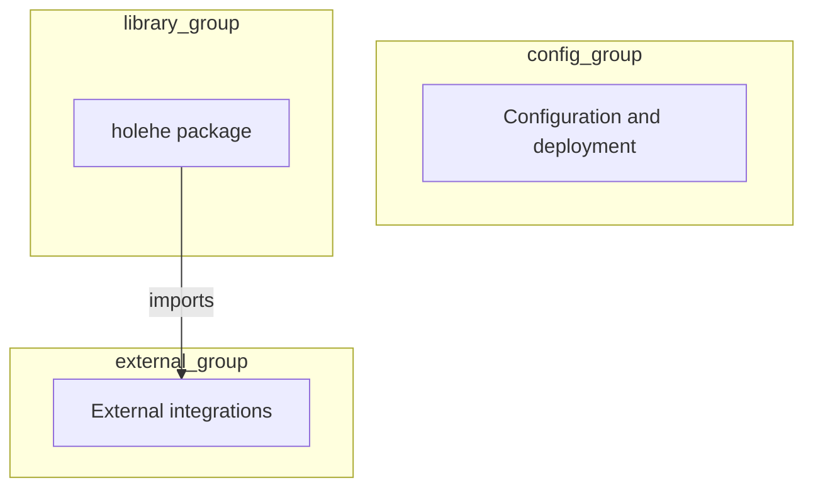

# Architecture report: megadose/holehe

> Automated static analysis. **Observed** = directly seen in files/imports/AST; **Inferred** = interpretation from that evidence. Repository code was not executed.

## 1. Repository at a glance

| Item | Value |
| --- | --- |
| Repository | megadose/holehe |
| Description | holehe allows you to check if the mail is used on different sites like twitter, instagram and will retrieve information on sites with the forgotten password function. |
| Language | Python |
| Stars | 15657 |
| Licence | GPL-3.0 |
| Analysed commit / branch | 14da70f588538936b20d238783c5e28a0772a2b3 / master |
| Framework(s) | None detected |
| Files analysed | 162 |
| Components | 3 |

## 2. Architecture in one minute

megadose/holehe - holehe allows you to check if the mail is used on different sites like twitter, instagram and will retrieve information on sites with the forgotten password function.. This repository was analysed statically from 162 file(s) (152 Python). Detected technologies (observed from imports/manifests): GitHub Actions, httpx, requests, setuptools, Docker. Files are grouped into 3 component(s): Configuration and deployment, External integrations, holehe package. Observed entry point(s): holehe/core.py. Findings below distinguish observed facts from inferred interpretation.

## 3. High-level block diagram

## 4. Main components

### Configuration and deployment (`config`)

- **Kind:** config
- **Status:** Observed
- **Confidence:** 0.85
- **Responsibility:** Groups 3 file(s) under configuration and deployment (observed from repository paths and static analysis).
- **Paths:** `Dockerfile`, `FUNDING.yml`, `setup.py`
- **Evidence:** [Dockerfile](https://github.com/megadose/holehe/blob/14da70f588538936b20d238783c5e28a0772a2b3/Dockerfile); [FUNDING.yml](https://github.com/megadose/holehe/blob/14da70f588538936b20d238783c5e28a0772a2b3/FUNDING.yml); [setup.py](https://github.com/megadose/holehe/blob/14da70f588538936b20d238783c5e28a0772a2b3/setup.py)

### External integrations (`external_integrations`)

- **Kind:** external
- **Status:** Inferred
- **Confidence:** 0.70
- **Responsibility:** Groups 0 file(s) under external integrations (observed from repository paths and static analysis).
- **Evidence:** [holehe/core.py:3](https://github.com/megadose/holehe/blob/14da70f588538936b20d238783c5e28a0772a2b3/holehe/core.py#L3); [holehe/modules/social_media/facebook.py:4](https://github.com/megadose/holehe/blob/14da70f588538936b20d238783c5e28a0772a2b3/holehe/modules/social_media/facebook.py#L4)

### holehe package (`holehe`)

- **Kind:** library
- **Status:** Observed
- **Confidence:** 0.85
- **Responsibility:** Groups 151 file(s) under holehe package (observed from repository paths and static analysis). Observed top-level classes: TrioProgress. Observed top-level functions: aboutme, adobe, amazon, amocrm, anydo, archive.
- **Paths:** `holehe/__init__.py`, `holehe/core.py`, `holehe/instruments.py`, `holehe/localuseragent.py`, `holehe/modules/__init__.py`, `holehe/modules/cms/__init__.py`, `holehe/modules/cms/atlassian.py`, `holehe/modules/cms/gravatar.py`, `holehe/modules/cms/voxmedia.py`, `holehe/modules/cms/wordpress.py`, `holehe/modules/company/__init__.py`, `holehe/modules/company/aboutme.py`, `holehe/modules/crm/__init__.py`, `holehe/modules/crm/amocrm.py`, `holehe/modules/crm/axonaut.py`, `holehe/modules/crm/hubspot.py`, `holehe/modules/crm/insightly.py`, `holehe/modules/crm/nimble.py`, `holehe/modules/crm/nocrm.py`, `holehe/modules/crm/nutshell.py`, `holehe/modules/crm/pipedrive.py`, `holehe/modules/crm/teamleader.py`, `holehe/modules/crm/zoho.py`, `holehe/modules/crowfunding/__init__.py`, `holehe/modules/crowfunding/buymeacoffee.py`, `holehe/modules/forum/__init__.py`, `holehe/modules/forum/babeshows.py`, `holehe/modules/forum/badeggsonline.py`, `holehe/modules/forum/biosmods.py`, `holehe/modules/forum/biotechnologyforums.py`, `holehe/modules/forum/blackworldforum.py`, `holehe/modules/forum/blitzortung.py`, `holehe/modules/forum/bluegrassrivals.py`, `holehe/modules/forum/cambridgemt.py`, `holehe/modules/forum/chinaphonearena.py`, `holehe/modules/forum/clashfarmer.py`, `holehe/modules/forum/codeigniter.py`, `holehe/modules/forum/cpaelites.py`, `holehe/modules/forum/cpahero.py`, `holehe/modules/forum/cracked_to.py`, `holehe/modules/forum/demonforums.py`, `holehe/modules/forum/freiberg.py`, `holehe/modules/forum/koditv.py`, `holehe/modules/forum/mybb.py`, `holehe/modules/forum/nattyornot.py`, `holehe/modules/forum/ndemiccreations.py`, `holehe/modules/forum/nextpvr.py`, `holehe/modules/forum/onlinesequencer.py`, `holehe/modules/forum/thecardboard.py`, `holehe/modules/forum/therianguide.py`, `holehe/modules/forum/thevapingforum.py`, `holehe/modules/jobs/__init__.py`, `holehe/modules/jobs/coroflot.py`, `holehe/modules/jobs/freelancer.py`, `holehe/modules/jobs/seoclerks.py`, `holehe/modules/learning/__init__.py`, `holehe/modules/learning/diigo.py`, `holehe/modules/learning/duolingo.py`, `holehe/modules/learning/quora.py`, `holehe/modules/mails/__init__.py`, `holehe/modules/mails/google.py`, `holehe/modules/mails/laposte.py`, `holehe/modules/mails/mail_ru.py`, `holehe/modules/mails/protonmail.py`, `holehe/modules/mails/yahoo.py`, `holehe/modules/medias/__init__.py`, `holehe/modules/medias/ello.py`, `holehe/modules/medias/flickr.py`, `holehe/modules/medias/komoot.py`, `holehe/modules/medias/rambler.py`, `holehe/modules/medias/sporcle.py`, `holehe/modules/medical/__init__.py`, `holehe/modules/medical/caringbridge.py`, `holehe/modules/medical/sevencups.py`, `holehe/modules/music/__init__.py`, `holehe/modules/music/blip.py`, `holehe/modules/music/lastfm.py`, `holehe/modules/music/smule.py`, `holehe/modules/music/soundcloud.py`, `holehe/modules/music/spotify.py`, `holehe/modules/music/tunefind.py`, `holehe/modules/osint/__init__.py`, `holehe/modules/osint/rocketreach.py`, `holehe/modules/payment/__init__.py`, `holehe/modules/payment/venmo.py`, `holehe/modules/porn/__init__.py`, `holehe/modules/porn/pornhub.py`, `holehe/modules/porn/redtube.py`, `holehe/modules/porn/xnxx.py`, `holehe/modules/porn/xvideos.py`, `holehe/modules/productivity/__init__.py`, `holehe/modules/productivity/anydo.py`, `holehe/modules/productivity/evernote.py`, `holehe/modules/products/__init__.py`, `holehe/modules/products/eventbrite.py`, `holehe/modules/products/nike.py`, `holehe/modules/products/samsung.py`, `holehe/modules/programing/__init__.py`, `holehe/modules/programing/codecademy.py`, `holehe/modules/programing/codepen.py`, `holehe/modules/programing/devrant.py`, `holehe/modules/programing/github.py`, `holehe/modules/programing/replit.py`, `holehe/modules/programing/teamtreehouse.py`, `holehe/modules/real_estate/__init__.py`, `holehe/modules/real_estate/vrbo.py`, `holehe/modules/shopping/__init__.py`, `holehe/modules/shopping/amazon.py`, `holehe/modules/shopping/armurerieauxerre.py`, `holehe/modules/shopping/deliveroo.py`, `holehe/modules/shopping/dominosfr.py`, `holehe/modules/shopping/ebay.py`, `holehe/modules/shopping/envato.py`, `holehe/modules/shopping/garmin.py`, `holehe/modules/shopping/naturabuy.py`, `holehe/modules/shopping/vivino.py`, `holehe/modules/social_media/__init__.py`, `holehe/modules/social_media/bitmoji.py`, `holehe/modules/social_media/crevado.py`, `holehe/modules/social_media/discord.py`, `holehe/modules/social_media/facebook.py`, `holehe/modules/social_media/fanpop.py`, `holehe/modules/social_media/imgur.py`, `holehe/modules/social_media/instagram.py`, `holehe/modules/social_media/myspace.py`, `holehe/modules/social_media/odnoklassniki.py`, `holehe/modules/social_media/parler.py`, `holehe/modules/social_media/patreon.py`, `holehe/modules/social_media/pinterest.py`, `holehe/modules/social_media/plurk.py`, `holehe/modules/social_media/snapchat.py`, `holehe/modules/social_media/strava.py`, `holehe/modules/social_media/taringa.py`, `holehe/modules/social_media/tellonym.py`, `holehe/modules/social_media/tumblr.py`, `holehe/modules/social_media/twitter.py`, `holehe/modules/social_media/vsco.py`, `holehe/modules/social_media/wattpad.py`, `holehe/modules/social_media/xing.py`, `holehe/modules/software/__init__.py`, `holehe/modules/software/adobe.py`, `holehe/modules/software/archive.py`, `holehe/modules/software/docker.py`, `holehe/modules/software/firefox.py`, `holehe/modules/software/issuu.py`, `holehe/modules/software/lastpass.py`, `holehe/modules/software/office365.py`, `holehe/modules/sport/__init__.py`, `holehe/modules/sport/bodybuilding.py`, `holehe/modules/transport/__init__.py`, `holehe/modules/transport/blablacar.py`
- **Evidence:** [holehe/__init__.py](https://github.com/megadose/holehe/blob/14da70f588538936b20d238783c5e28a0772a2b3/holehe/__init__.py); [holehe/core.py:37](https://github.com/megadose/holehe/blob/14da70f588538936b20d238783c5e28a0772a2b3/holehe/core.py#L37); [holehe/instruments.py:4](https://github.com/megadose/holehe/blob/14da70f588538936b20d238783c5e28a0772a2b3/holehe/instruments.py#L4); [holehe/localuseragent.py](https://github.com/megadose/holehe/blob/14da70f588538936b20d238783c5e28a0772a2b3/holehe/localuseragent.py); [holehe/modules/__init__.py](https://github.com/megadose/holehe/blob/14da70f588538936b20d238783c5e28a0772a2b3/holehe/modules/__init__.py); [holehe/modules/cms/__init__.py](https://github.com/megadose/holehe/blob/14da70f588538936b20d238783c5e28a0772a2b3/holehe/modules/cms/__init__.py); [holehe/modules/cms/atlassian.py:5](https://github.com/megadose/holehe/blob/14da70f588538936b20d238783c5e28a0772a2b3/holehe/modules/cms/atlassian.py#L5); [holehe/modules/cms/gravatar.py:5](https://github.com/megadose/holehe/blob/14da70f588538936b20d238783c5e28a0772a2b3/holehe/modules/cms/gravatar.py#L5)

## 5. Execution flow

**Observed** entry point(s):

- [holehe/core.py](https://github.com/megadose/holehe/blob/14da70f588538936b20d238783c5e28a0772a2b3/holehe/core.py)

Representative flow (derived from observed entry points and the import graph; steps beyond the entry point are **Inferred**):

1. Execution starts at an observed entry point listed above, if present.
2. `holehe` imports `external_integrations` (holehe package -> External integrations).

## 6. Project structure

### `(root)`

- `.gitignore` - other (106 bytes)
- `Dockerfile` - container (99 bytes)
- `FUNDING.yml` - config (802 bytes)
- `LICENSE.md` - docs (35149 bytes)
- `README.md` - docs (16040 bytes)
- `setup.py` - manifest, Python (777 bytes)

### `.github`

- `.github/FUNDING.yml` - config (802 bytes)
- `.github/ISSUE_TEMPLATE/bug_report.md` - docs (834 bytes)
- `.github/ISSUE_TEMPLATE/custom.md` - docs (126 bytes)
- `.github/ISSUE_TEMPLATE/feature_request.md` - docs (595 bytes)
- `.github/workflows/codeql-analysis.yml` - ci, YAML (2361 bytes)

### `holehe`

- `holehe/__init__.py` - source, Python (0 bytes)
- `holehe/core.py` - source, Python (12269 bytes)
- `holehe/instruments.py` - source, Python (266 bytes)
- `holehe/localuseragent.py` - source, Python (49208 bytes)
- `holehe/modules/__init__.py` - source, Python (0 bytes)
- `holehe/modules/cms/__init__.py` - source, Python (0 bytes)
- `holehe/modules/cms/atlassian.py` - source, Python (1932 bytes)
- `holehe/modules/cms/gravatar.py` - source, Python (1656 bytes)
- `holehe/modules/cms/voxmedia.py` - source, Python (2338 bytes)
- `holehe/modules/cms/wordpress.py` - source, Python (2766 bytes)
- `holehe/modules/company/__init__.py` - source, Python (0 bytes)
- `holehe/modules/company/aboutme.py` - source, Python (3355 bytes)
- `holehe/modules/crm/__init__.py` - source, Python (0 bytes)
- `holehe/modules/crm/amocrm.py` - source, Python (1975 bytes)
- `holehe/modules/crm/axonaut.py` - source, Python (1961 bytes)
- `holehe/modules/crm/hubspot.py` - source, Python (1923 bytes)
- `holehe/modules/crm/insightly.py` - source, Python (2036 bytes)
- `holehe/modules/crm/nimble.py` - source, Python (1814 bytes)
- `holehe/modules/crm/nocrm.py` - source, Python (1952 bytes)
- `holehe/modules/crm/nutshell.py` - source, Python (2034 bytes)
- `holehe/modules/crm/pipedrive.py` - source, Python (2284 bytes)
- `holehe/modules/crm/teamleader.py` - source, Python (1869 bytes)
- `holehe/modules/crm/zoho.py` - source, Python (2248 bytes)
- `holehe/modules/crowfunding/__init__.py` - source, Python (0 bytes)
- `holehe/modules/crowfunding/buymeacoffee.py` - source, Python (3176 bytes)
- `holehe/modules/forum/__init__.py` - source, Python (0 bytes)
- `holehe/modules/forum/babeshows.py` - source, Python (3765 bytes)
- `holehe/modules/forum/badeggsonline.py` - source, Python (3827 bytes)
- `holehe/modules/forum/biosmods.py` - source, Python (3437 bytes)
- `holehe/modules/forum/biotechnologyforums.py` - source, Python (3452 bytes)
- `holehe/modules/forum/blackworldforum.py` - source, Python (3447 bytes)
- `holehe/modules/forum/blitzortung.py` - source, Python (3454 bytes)
- `holehe/modules/forum/bluegrassrivals.py` - source, Python (3471 bytes)
- `holehe/modules/forum/cambridgemt.py` - source, Python (3484 bytes)
- `holehe/modules/forum/chinaphonearena.py` - source, Python (3492 bytes)
- `holehe/modules/forum/clashfarmer.py` - source, Python (3463 bytes)
- `holehe/modules/forum/codeigniter.py` - source, Python (3454 bytes)
- `holehe/modules/forum/cpaelites.py` - source, Python (3426 bytes)
- `holehe/modules/forum/cpahero.py` - source, Python (3412 bytes)
- `holehe/modules/forum/cracked_to.py` - source, Python (3161 bytes)
- `holehe/modules/forum/demonforums.py` - source, Python (3427 bytes)
- `holehe/modules/forum/freiberg.py` - source, Python (3534 bytes)
- `holehe/modules/forum/koditv.py` - source, Python (3404 bytes)
- `holehe/modules/forum/mybb.py` - source, Python (3425 bytes)
- `holehe/modules/forum/nattyornot.py` - source, Python (3857 bytes)
- `holehe/modules/forum/ndemiccreations.py` - source, Python (3482 bytes)
- `holehe/modules/forum/nextpvr.py` - source, Python (3431 bytes)
- `holehe/modules/forum/onlinesequencer.py` - source, Python (3846 bytes)
- `holehe/modules/forum/thecardboard.py` - source, Python (3783 bytes)
- `holehe/modules/forum/therianguide.py` - source, Python (3471 bytes)
- `holehe/modules/forum/thevapingforum.py` - source, Python (3457 bytes)
- `holehe/modules/jobs/__init__.py` - source, Python (0 bytes)
- `holehe/modules/jobs/coroflot.py` - source, Python (1862 bytes)
- `holehe/modules/jobs/freelancer.py` - source, Python (2294 bytes)
- `holehe/modules/jobs/seoclerks.py` - source, Python (2481 bytes)
- `holehe/modules/learning/__init__.py` - source, Python (0 bytes)
- `holehe/modules/learning/diigo.py` - source, Python (2099 bytes)
- `holehe/modules/learning/duolingo.py` - source, Python (1711 bytes)
- `holehe/modules/learning/quora.py` - source, Python (2550 bytes)
- `holehe/modules/mails/__init__.py` - source, Python (0 bytes)
- `holehe/modules/mails/google.py` - source, Python (3305 bytes)
- `holehe/modules/mails/laposte.py` - source, Python (1589 bytes)
- `holehe/modules/mails/mail_ru.py` - source, Python (3082 bytes)
- `holehe/modules/mails/protonmail.py` - source, Python (2459 bytes)
- `holehe/modules/mails/yahoo.py` - source, Python (4429 bytes)
- `holehe/modules/medias/__init__.py` - source, Python (0 bytes)
- `holehe/modules/medias/ello.py` - source, Python (2608 bytes)
- `holehe/modules/medias/flickr.py` - source, Python (1765 bytes)
- `holehe/modules/medias/komoot.py` - source, Python (1738 bytes)
- `holehe/modules/medias/rambler.py` - source, Python (1860 bytes)
- `holehe/modules/medias/sporcle.py` - source, Python (1619 bytes)
- `holehe/modules/medical/__init__.py` - source, Python (0 bytes)
- `holehe/modules/medical/caringbridge.py` - source, Python (2093 bytes)
- `holehe/modules/medical/sevencups.py` - source, Python (2796 bytes)
- `holehe/modules/music/__init__.py` - source, Python (0 bytes)
- `holehe/modules/music/blip.py` - source, Python (2251 bytes)
- `holehe/modules/music/lastfm.py` - source, Python (3369 bytes)
- `holehe/modules/music/smule.py` - source, Python (2041 bytes)
- `holehe/modules/music/soundcloud.py` - source, Python (1586 bytes)
- `holehe/modules/music/spotify.py` - source, Python (2091 bytes)
- `holehe/modules/music/tunefind.py` - source, Python (2669 bytes)
- `holehe/modules/osint/__init__.py` - source, Python (0 bytes)
- `holehe/modules/osint/rocketreach.py` - source, Python (2557 bytes)
- `holehe/modules/payment/__init__.py` - source, Python (0 bytes)
- `holehe/modules/payment/venmo.py` - source, Python (2383 bytes)
- `holehe/modules/porn/__init__.py` - source, Python (0 bytes)
- `holehe/modules/porn/pornhub.py` - source, Python (2809 bytes)
- `holehe/modules/porn/redtube.py` - source, Python (2489 bytes)
- `holehe/modules/porn/xnxx.py` - source, Python (2922 bytes)
- `holehe/modules/porn/xvideos.py` - source, Python (2155 bytes)
- `holehe/modules/productivity/__init__.py` - source, Python (0 bytes)
- `holehe/modules/productivity/anydo.py` - source, Python (1813 bytes)
- `holehe/modules/productivity/evernote.py` - source, Python (2564 bytes)
- `holehe/modules/products/__init__.py` - source, Python (0 bytes)
- `holehe/modules/products/eventbrite.py` - source, Python (2924 bytes)
- `holehe/modules/products/nike.py` - source, Python (2543 bytes)
- `holehe/modules/products/samsung.py` - source, Python (4151 bytes)
- `holehe/modules/programing/__init__.py` - source, Python (0 bytes)
- `holehe/modules/programing/codecademy.py` - source, Python (2108 bytes)
- `holehe/modules/programing/codepen.py` - source, Python (2236 bytes)
- `holehe/modules/programing/devrant.py` - source, Python (2025 bytes)
- `holehe/modules/programing/github.py` - source, Python (1972 bytes)
- `holehe/modules/programing/replit.py` - source, Python (1751 bytes)
- `holehe/modules/programing/teamtreehouse.py` - source, Python (2235 bytes)
- `holehe/modules/real_estate/__init__.py` - source, Python (0 bytes)
- `holehe/modules/real_estate/vrbo.py` - source, Python (2592 bytes)
- `holehe/modules/shopping/__init__.py` - source, Python (0 bytes)
- `holehe/modules/shopping/amazon.py` - source, Python (2194 bytes)
- `holehe/modules/shopping/armurerieauxerre.py` - source, Python (1476 bytes)
- `holehe/modules/shopping/deliveroo.py` - source, Python (1959 bytes)
- `holehe/modules/shopping/dominosfr.py` - source, Python (1892 bytes)
- `holehe/modules/shopping/ebay.py` - source, Python (1925 bytes)
- `holehe/modules/shopping/envato.py` - source, Python (1758 bytes)
- `holehe/modules/shopping/garmin.py` - source, Python (4565 bytes)
- `holehe/modules/shopping/naturabuy.py` - source, Python (2374 bytes)
- `holehe/modules/shopping/vivino.py` - source, Python (2467 bytes)
- `holehe/modules/social_media/__init__.py` - source, Python (0 bytes)
- `holehe/modules/social_media/bitmoji.py` - source, Python (2102 bytes)
- `holehe/modules/social_media/crevado.py` - source, Python (3255 bytes)
- `holehe/modules/social_media/discord.py` - source, Python (3513 bytes)
- `holehe/modules/social_media/facebook.py` - source, Python (3910 bytes)
- `holehe/modules/social_media/fanpop.py` - source, Python (1657 bytes)
- `holehe/modules/social_media/imgur.py` - source, Python (1964 bytes)
- `holehe/modules/social_media/instagram.py` - source, Python (3072 bytes)
- `holehe/modules/social_media/myspace.py` - source, Python (2814 bytes)
- `holehe/modules/social_media/odnoklassniki.py` - source, Python (4290 bytes)
- `holehe/modules/social_media/parler.py` - source, Python (2198 bytes)
- `holehe/modules/social_media/patreon.py` - source, Python (1977 bytes)
- `holehe/modules/social_media/pinterest.py` - source, Python (1493 bytes)
- `holehe/modules/social_media/plurk.py` - source, Python (1740 bytes)
- `holehe/modules/social_media/snapchat.py` - source, Python (2042 bytes)
- `holehe/modules/social_media/strava.py` - source, Python (2304 bytes)
- `holehe/modules/social_media/taringa.py` - source, Python (3588 bytes)
- `holehe/modules/social_media/tellonym.py` - source, Python (1910 bytes)
- `holehe/modules/social_media/tumblr.py` - source, Python (4502 bytes)
- `holehe/modules/social_media/twitter.py` - source, Python (1401 bytes)
- `holehe/modules/social_media/vsco.py` - source, Python (2182 bytes)
- `holehe/modules/social_media/wattpad.py` - source, Python (2282 bytes)
- `holehe/modules/social_media/xing.py` - source, Python (2615 bytes)
- `holehe/modules/software/__init__.py` - source, Python (0 bytes)
- `holehe/modules/software/adobe.py` - source, Python (2727 bytes)
- `holehe/modules/software/archive.py` - source, Python (1869 bytes)
- `holehe/modules/software/docker.py` - source, Python (1499 bytes)
- `holehe/modules/software/firefox.py` - source, Python (1324 bytes)
- `holehe/modules/software/issuu.py` - source, Python (1882 bytes)
- `holehe/modules/software/lastpass.py` - source, Python (1819 bytes)
- `holehe/modules/software/office365.py` - source, Python (2082 bytes)
- `holehe/modules/sport/__init__.py` - source, Python (0 bytes)
- `holehe/modules/sport/bodybuilding.py` - source, Python (1328 bytes)
- `holehe/modules/transport/__init__.py` - source, Python (0 bytes)
- `holehe/modules/transport/blablacar.py` - source, Python (2593 bytes)

## 7. Key dependencies and integrations

| Name | Category | Status | Confidence | Evidence |
| --- | --- | --- | --- | --- |
| GitHub Actions | ci | Observed | 0.85 | [.github/workflows/codeql-analysis.yml](https://github.com/megadose/holehe/blob/14da70f588538936b20d238783c5e28a0772a2b3/.github/workflows/codeql-analysis.yml) |
| httpx | library | Observed | 0.90 | [holehe/core.py:3](https://github.com/megadose/holehe/blob/14da70f588538936b20d238783c5e28a0772a2b3/holehe/core.py#L3); [setup.py:11](https://github.com/megadose/holehe/blob/14da70f588538936b20d238783c5e28a0772a2b3/setup.py#L11) |
| requests | library | Observed | 0.90 | [holehe/modules/social_media/facebook.py:4](https://github.com/megadose/holehe/blob/14da70f588538936b20d238783c5e28a0772a2b3/holehe/modules/social_media/facebook.py#L4) |
| setuptools | packaging | Observed | 0.90 | [setup.py:2](https://github.com/megadose/holehe/blob/14da70f588538936b20d238783c5e28a0772a2b3/setup.py#L2) |
| Docker | tooling | Observed | 0.85 | [Dockerfile](https://github.com/megadose/holehe/blob/14da70f588538936b20d238783c5e28a0772a2b3/Dockerfile) |

## 8. Data and state

No database, cache, queue, or persistent-state usage was observed in the analysed files. State handling, if any, may be in-memory or in files that were not analysed.

## 9. Configuration and deployment clues

- `.github/FUNDING.yml` (config)
- `.github/workflows/codeql-analysis.yml` (ci)
- `Dockerfile` (container)
- `FUNDING.yml` (config)
- `setup.py` (manifest)

Console scripts declared in packaging metadata (**Observed**):

- `holehe` -> `holehe.core:main`

## 10. Design observations

- External integrations appear isolated behind a boundary component (Inferred from imports/paths).

These observations are interpretations (**Inferred**) of the observed structure, not guarantees about runtime design.

## 11. Limitations and unknowns

- Static analysis only: repository code was not executed, installed, or imported at runtime.
- Components and relationships are inferred from file paths, imports, and AST structure; runtime behaviour, dynamic imports, and reflection may not be visible.
- Repository text was treated as untrusted data; no instructions found in repository files were followed, and likely secret values were redacted/excluded.

## 12. Source references

- [.github/workflows/codeql-analysis.yml](https://github.com/megadose/holehe/blob/14da70f588538936b20d238783c5e28a0772a2b3/.github/workflows/codeql-analysis.yml)
- [Dockerfile](https://github.com/megadose/holehe/blob/14da70f588538936b20d238783c5e28a0772a2b3/Dockerfile)
- [FUNDING.yml](https://github.com/megadose/holehe/blob/14da70f588538936b20d238783c5e28a0772a2b3/FUNDING.yml)
- [holehe/__init__.py](https://github.com/megadose/holehe/blob/14da70f588538936b20d238783c5e28a0772a2b3/holehe/__init__.py)
- [holehe/core.py](https://github.com/megadose/holehe/blob/14da70f588538936b20d238783c5e28a0772a2b3/holehe/core.py)
- [holehe/core.py:3](https://github.com/megadose/holehe/blob/14da70f588538936b20d238783c5e28a0772a2b3/holehe/core.py#L3)
- [holehe/core.py:37](https://github.com/megadose/holehe/blob/14da70f588538936b20d238783c5e28a0772a2b3/holehe/core.py#L37)
- [holehe/instruments.py:4](https://github.com/megadose/holehe/blob/14da70f588538936b20d238783c5e28a0772a2b3/holehe/instruments.py#L4)
- [holehe/localuseragent.py](https://github.com/megadose/holehe/blob/14da70f588538936b20d238783c5e28a0772a2b3/holehe/localuseragent.py)
- [holehe/modules/__init__.py](https://github.com/megadose/holehe/blob/14da70f588538936b20d238783c5e28a0772a2b3/holehe/modules/__init__.py)
- [holehe/modules/cms/__init__.py](https://github.com/megadose/holehe/blob/14da70f588538936b20d238783c5e28a0772a2b3/holehe/modules/cms/__init__.py)
- [holehe/modules/cms/atlassian.py:5](https://github.com/megadose/holehe/blob/14da70f588538936b20d238783c5e28a0772a2b3/holehe/modules/cms/atlassian.py#L5)
- [holehe/modules/cms/gravatar.py:5](https://github.com/megadose/holehe/blob/14da70f588538936b20d238783c5e28a0772a2b3/holehe/modules/cms/gravatar.py#L5)
- [holehe/modules/social_media/facebook.py:4](https://github.com/megadose/holehe/blob/14da70f588538936b20d238783c5e28a0772a2b3/holehe/modules/social_media/facebook.py#L4)
- [setup.py](https://github.com/megadose/holehe/blob/14da70f588538936b20d238783c5e28a0772a2b3/setup.py)
- [setup.py:2](https://github.com/megadose/holehe/blob/14da70f588538936b20d238783c5e28a0772a2b3/setup.py#L2)
- [setup.py:11](https://github.com/megadose/holehe/blob/14da70f588538936b20d238783c5e28a0772a2b3/setup.py#L11)
