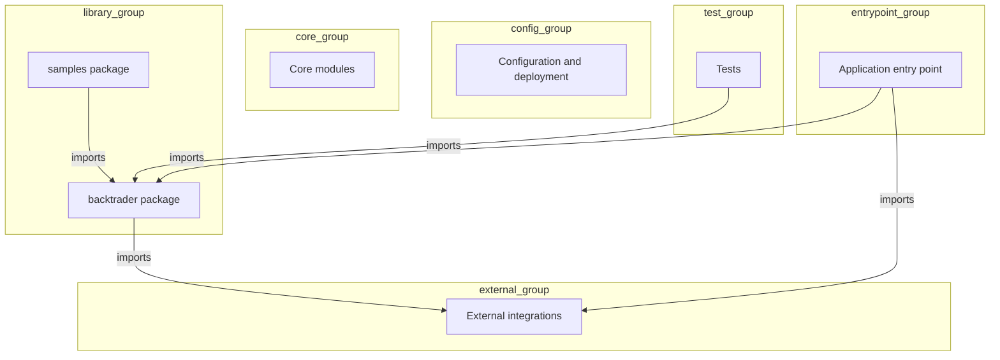

# Architecture report: mementum/backtrader

> Automated static analysis. **Observed** = directly seen in files/imports/AST; **Inferred** = interpretation from that evidence. Repository code was not executed.

## 1. Repository at a glance

| Item | Value |
| --- | --- |
| Repository | mementum/backtrader |
| Description | Python Backtesting library for trading strategies |
| Language | Python |
| Stars | 23740 |
| Licence | GPL-3.0 |
| Analysed commit / branch | b853d7c90b6721476eb5a5ea3135224e33db1f14 / master |
| Framework(s) | None detected |
| Files analysed | 372 |
| Components | 7 |

## 2. Architecture in one minute

mementum/backtrader - Python Backtesting library for trading strategies. This repository was analysed statically from 372 file(s) (345 Python). Detected technologies (observed from imports/manifests): NumPy, pandas, requests, setuptools. Files are grouped into 7 component(s): backtrader package, Configuration and deployment, Core modules, Application entry point, External integrations, samples package, Tests. Observed entry point(s): backtrader/btrun/__init__.py, backtrader/btrun/btrun.py, contrib/samples/pair-trading/pair-trading.py. Findings below distinguish observed facts from inferred interpretation.

## 3. High-level block diagram

## 4. Main components

### backtrader package (`backtrader`)

- **Kind:** library
- **Status:** Observed
- **Confidence:** 0.85
- **Responsibility:** Groups 170 file(s) under backtrader package (observed from repository paths and static analysis). Observed top-level classes: API, AbstractDataBase, AccelerationDecelerationOscillator, Accum, AdaptiveMovingAverage, All. Observed top-level functions: LineDelay, LineNum, LineSeriesMaker, LinesCoupler, Localizer, PumpEvents.
- **Paths:** `backtrader/__init__.py`, `backtrader/analyzer.py`, `backtrader/analyzers/__init__.py`, `backtrader/analyzers/annualreturn.py`, `backtrader/analyzers/calmar.py`, `backtrader/analyzers/drawdown.py`, `backtrader/analyzers/leverage.py`, `backtrader/analyzers/logreturnsrolling.py`, `backtrader/analyzers/periodstats.py`, `backtrader/analyzers/positions.py`, `backtrader/analyzers/pyfolio.py`, `backtrader/analyzers/returns.py`, `backtrader/analyzers/sharpe.py`, `backtrader/analyzers/sqn.py`, `backtrader/analyzers/timereturn.py`, `backtrader/analyzers/tradeanalyzer.py`, `backtrader/analyzers/transactions.py`, `backtrader/analyzers/vwr.py`, `backtrader/broker.py`, `backtrader/brokers/__init__.py`, `backtrader/brokers/bbroker.py`, `backtrader/brokers/ibbroker.py`, `backtrader/brokers/oandabroker.py`, `backtrader/brokers/vcbroker.py`, `backtrader/btrun/__init__.py`, `backtrader/cerebro.py`, `backtrader/comminfo.py`, `backtrader/commissions/__init__.py`, `backtrader/dataseries.py`, `backtrader/errors.py`, `backtrader/feed.py`, `backtrader/feeds/__init__.py`, `backtrader/feeds/blaze.py`, `backtrader/feeds/btcsv.py`, `backtrader/feeds/chainer.py`, `backtrader/feeds/csvgeneric.py`, `backtrader/feeds/ibdata.py`, `backtrader/feeds/influxfeed.py`, `backtrader/feeds/mt4csv.py`, `backtrader/feeds/oanda.py`, `backtrader/feeds/pandafeed.py`, `backtrader/feeds/quandl.py`, `backtrader/feeds/rollover.py`, `backtrader/feeds/sierrachart.py`, `backtrader/feeds/vcdata.py`, `backtrader/feeds/vchart.py`, `backtrader/feeds/vchartcsv.py`, `backtrader/feeds/vchartfile.py`, `backtrader/feeds/yahoo.py`, `backtrader/fillers.py`, `backtrader/filters/__init__.py`, `backtrader/filters/bsplitter.py`, `backtrader/filters/calendardays.py`, `backtrader/filters/datafiller.py`, `backtrader/filters/datafilter.py`, `backtrader/filters/daysteps.py`, `backtrader/filters/heikinashi.py`, `backtrader/filters/renko.py`, `backtrader/filters/session.py`, `backtrader/flt.py`, `backtrader/functions.py`, `backtrader/indicator.py`, `backtrader/indicators/__init__.py`, `backtrader/indicators/accdecoscillator.py`, `backtrader/indicators/aroon.py`, `backtrader/indicators/atr.py`, `backtrader/indicators/awesomeoscillator.py`, `backtrader/indicators/basicops.py`, `backtrader/indicators/bollinger.py`, `backtrader/indicators/cci.py`, `backtrader/indicators/contrib/__init__.py`, `backtrader/indicators/contrib/vortex.py`, `backtrader/indicators/crossover.py`, `backtrader/indicators/dema.py`, `backtrader/indicators/deviation.py`, `backtrader/indicators/directionalmove.py`, `backtrader/indicators/dma.py`, `backtrader/indicators/dpo.py`, `backtrader/indicators/dv2.py`, `backtrader/indicators/ema.py`, `backtrader/indicators/envelope.py`, `backtrader/indicators/hadelta.py`, `backtrader/indicators/heikinashi.py`, `backtrader/indicators/hma.py`, `backtrader/indicators/hurst.py`, `backtrader/indicators/ichimoku.py`, `backtrader/indicators/kama.py`, `backtrader/indicators/kst.py`, `backtrader/indicators/lrsi.py`, `backtrader/indicators/mabase.py`, `backtrader/indicators/macd.py`, `backtrader/indicators/momentum.py`, `backtrader/indicators/ols.py`, `backtrader/indicators/oscillator.py`, `backtrader/indicators/percentchange.py`, `backtrader/indicators/percentrank.py`, `backtrader/indicators/pivotpoint.py`, `backtrader/indicators/prettygoodoscillator.py`, `backtrader/indicators/priceoscillator.py`, `backtrader/indicators/psar.py`, `backtrader/indicators/rmi.py`, `backtrader/indicators/rsi.py`, `backtrader/indicators/sma.py`, `backtrader/indicators/smma.py`, `backtrader/indicators/stochastic.py`, `backtrader/indicators/trix.py`, `backtrader/indicators/tsi.py`, `backtrader/indicators/ultimateoscillator.py`, `backtrader/indicators/vortex.py`, `backtrader/indicators/williams.py`, `backtrader/indicators/wma.py`, `backtrader/indicators/zlema.py`, `backtrader/indicators/zlind.py`, `backtrader/linebuffer.py`, `backtrader/lineiterator.py`, `backtrader/lineroot.py`, `backtrader/lineseries.py`, `backtrader/mathsupport.py`, `backtrader/metabase.py`, `backtrader/observer.py`, `backtrader/observers/__init__.py`, `backtrader/observers/benchmark.py`, `backtrader/observers/broker.py`, `backtrader/observers/buysell.py`, `backtrader/observers/drawdown.py`, `backtrader/observers/logreturns.py`, `backtrader/observers/timereturn.py`, `backtrader/observers/trades.py`, `backtrader/order.py`, `backtrader/plot/__init__.py`, `backtrader/plot/finance.py`, `backtrader/plot/formatters.py`, `backtrader/plot/locator.py`, `backtrader/plot/multicursor.py`, `backtrader/plot/plot.py`, `backtrader/plot/scheme.py`, `backtrader/plot/utils.py`, `backtrader/position.py`, `backtrader/resamplerfilter.py`, `backtrader/signal.py`, `backtrader/signals/__init__.py`, `backtrader/sizer.py`, `backtrader/sizers/__init__.py`, `backtrader/sizers/fixedsize.py`, `backtrader/sizers/percents_sizer.py`, `backtrader/store.py`, `backtrader/stores/__init__.py`, `backtrader/stores/ibstore.py`, `backtrader/stores/oandastore.py`, `backtrader/stores/vchartfile.py`, `backtrader/stores/vcstore.py`, `backtrader/strategies/__init__.py`, `backtrader/strategies/sma_crossover.py`, `backtrader/strategy.py`, `backtrader/studies/__init__.py`, `backtrader/studies/contrib/__init__.py`, `backtrader/studies/contrib/fractal.py`, `backtrader/talib.py`, `backtrader/timer.py`, `backtrader/trade.py`, `backtrader/tradingcal.py`, `backtrader/utils/__init__.py`, `backtrader/utils/autodict.py`, `backtrader/utils/date.py`, `backtrader/utils/dateintern.py`, `backtrader/utils/flushfile.py`, `backtrader/utils/ordereddefaultdict.py`, `backtrader/utils/py3.py`, `backtrader/version.py`, `backtrader/writer.py`
- **Evidence:** [backtrader/__init__.py](https://github.com/mementum/backtrader/blob/b853d7c90b6721476eb5a5ea3135224e33db1f14/backtrader/__init__.py); [backtrader/analyzer.py:34](https://github.com/mementum/backtrader/blob/b853d7c90b6721476eb5a5ea3135224e33db1f14/backtrader/analyzer.py#L34); [backtrader/analyzers/__init__.py](https://github.com/mementum/backtrader/blob/b853d7c90b6721476eb5a5ea3135224e33db1f14/backtrader/analyzers/__init__.py); [backtrader/analyzers/annualreturn.py:30](https://github.com/mementum/backtrader/blob/b853d7c90b6721476eb5a5ea3135224e33db1f14/backtrader/analyzers/annualreturn.py#L30); [backtrader/analyzers/calmar.py:31](https://github.com/mementum/backtrader/blob/b853d7c90b6721476eb5a5ea3135224e33db1f14/backtrader/analyzers/calmar.py#L31); [backtrader/analyzers/drawdown.py:31](https://github.com/mementum/backtrader/blob/b853d7c90b6721476eb5a5ea3135224e33db1f14/backtrader/analyzers/drawdown.py#L31); [backtrader/analyzers/leverage.py:27](https://github.com/mementum/backtrader/blob/b853d7c90b6721476eb5a5ea3135224e33db1f14/backtrader/analyzers/leverage.py#L27); [backtrader/analyzers/logreturnsrolling.py:33](https://github.com/mementum/backtrader/blob/b853d7c90b6721476eb5a5ea3135224e33db1f14/backtrader/analyzers/logreturnsrolling.py#L33)

### Configuration and deployment (`config`)

- **Kind:** config
- **Status:** Observed
- **Confidence:** 0.85
- **Responsibility:** Groups 1 file(s) under configuration and deployment (observed from repository paths and static analysis).
- **Paths:** `setup.py`
- **Evidence:** [setup.py](https://github.com/mementum/backtrader/blob/b853d7c90b6721476eb5a5ea3135224e33db1f14/setup.py)

### Core modules (`core`)

- **Kind:** core
- **Status:** Observed
- **Confidence:** 0.85
- **Responsibility:** Groups 1 file(s) under core modules (observed from repository paths and static analysis).
- **Paths:** `pypi.sh`
- **Evidence:** [pypi.sh](https://github.com/mementum/backtrader/blob/b853d7c90b6721476eb5a5ea3135224e33db1f14/pypi.sh)

### Application entry point (`entrypoint`)

- **Kind:** entrypoint
- **Status:** Observed
- **Confidence:** 0.85
- **Responsibility:** Groups 84 file(s) under application entry point (observed from repository paths and static analysis). Observed top-level classes: AutoStopOrStopTrail, BaseStrategy, BidAskCSV, BuySellArrows, CloseSMA, DayStepsCloseFilter. Observed top-level functions: average, btrun, checkdate, checkvolume, close_changer, getdata.
- **Paths:** `backtrader/btrun/btrun.py`, `contrib/samples/pair-trading/pair-trading.py`, `contrib/utils/influxdb-import.py`, `contrib/utils/iqfeed-to-influxdb.py`, `samples/analyzer-annualreturn/analyzer-annualreturn.py`, `samples/bidask-to-ohlc/bidask-to-ohlc.py`, `samples/bracket/bracket.py`, `samples/btfd/btfd.py`, `samples/calendar-days/calendar-days.py`, `samples/calmar/calmar-test.py`, `samples/cheat-on-open/cheat-on-open.py`, `samples/commission-schemes/commission-schemes.py`, `samples/credit-interest/credit-interest.py`, `samples/data-bid-ask/bidask.py`, `samples/data-filler/data-filler.py`, `samples/data-multitimeframe/data-multitimeframe.py`, `samples/data-pandas/data-pandas-optix.py`, `samples/data-pandas/data-pandas.py`, `samples/data-replay/data-replay.py`, `samples/data-resample/data-resample.py`, `samples/daysteps/daysteps.py`, `samples/future-spot/future-spot.py`, `samples/gold-vs-sp500/gold-vs-sp500.py`, `samples/ib-cash-bid-ask/ib-cash-bid-ask.py`, `samples/ibtest/ibtest.py`, `samples/kselrsi/ksignal.py`, `samples/lineplotter/lineplotter.py`, `samples/lrsi/lrsi-test.py`, `samples/macd-settings/macd-settings.py`, `samples/memory-savings/memory-savings.py`, `samples/mixing-timeframes/mixing-timeframes.py`, `samples/multi-copy/multi-copy.py`, `samples/multi-example/mult-values.py`, `samples/multidata-strategy/multidata-strategy-unaligned.py`, `samples/multidata-strategy/multidata-strategy.py`, `samples/multitrades/multitrades.py`, `samples/oandatest/oandatest.py`, `samples/observer-benchmark/observer-benchmark.py`, `samples/observers/observers-default-drawdown.py`, `samples/observers/observers-default.py`, `samples/observers/observers-orderobserver.py`, `samples/oco/oco.py`, `samples/optimization/optimization.py`, `samples/order-close/close-daily.py`, `samples/order-close/close-minute.py`, `samples/order-execution/order-execution.py`, `samples/order-history/order-history.py`, `samples/order_target/order_target.py`, `samples/partial-plot/partial-plot.py`, `samples/pinkfish-challenge/pinkfish-challenge.py`, `samples/pivot-point/ppsample.py`, `samples/plot-same-axis/plot-same-axis.py`, `samples/psar/psar-intraday.py`, `samples/psar/psar.py`, `samples/pyfolio2/pyfoliotest.py`, `samples/pyfoliotest/pyfoliotest.py`, `samples/relative-volume/relative-volume.py`, `samples/renko/renko.py`, `samples/resample-tickdata/resample-tickdata.py`, `samples/rollover/rollover.py`, `samples/sharpe-timereturn/sharpe-timereturn.py`, `samples/signals-strategy/signals-strategy.py`, `samples/sigsmacross/sigsmacross.py`, `samples/sizertest/sizertest.py`, `samples/slippage/slippage.py`, `samples/sratio/sratio.py`, `samples/stop-trading/stop-loss-approaches.py`, `samples/stoptrail/trail.py`, `samples/strategy-selection/strategy-selection.py`, `samples/talib/tablibsartest.py`, `samples/talib/talibtest.py`, `samples/timers/scheduled-min.py`, `samples/timers/scheduled.py`, `samples/tradingcalendar/tcal-intra.py`, `samples/tradingcalendar/tcal.py`, `samples/vctest/vctest.py`, `samples/volumefilling/volumefilling.py`, `samples/vwr/vwr.py`, `samples/weekdays-filler/weekdaysaligner.py`, `samples/writer-test/writer-test.py`, `samples/yahoo-test/yahoo-test.py`, `tools/bt-run.py`, `tools/rewrite-data.py`, `tools/yahoodownload.py`
- **Evidence:** [backtrader/btrun/btrun.py:73](https://github.com/mementum/backtrader/blob/b853d7c90b6721476eb5a5ea3135224e33db1f14/backtrader/btrun/btrun.py#L73); [contrib/samples/pair-trading/pair-trading.py:20](https://github.com/mementum/backtrader/blob/b853d7c90b6721476eb5a5ea3135224e33db1f14/contrib/samples/pair-trading/pair-trading.py#L20); [contrib/utils/influxdb-import.py:15](https://github.com/mementum/backtrader/blob/b853d7c90b6721476eb5a5ea3135224e33db1f14/contrib/utils/influxdb-import.py#L15); [contrib/utils/iqfeed-to-influxdb.py:17](https://github.com/mementum/backtrader/blob/b853d7c90b6721476eb5a5ea3135224e33db1f14/contrib/utils/iqfeed-to-influxdb.py#L17); [samples/analyzer-annualreturn/analyzer-annualreturn.py:35](https://github.com/mementum/backtrader/blob/b853d7c90b6721476eb5a5ea3135224e33db1f14/samples/analyzer-annualreturn/analyzer-annualreturn.py#L35); [samples/bidask-to-ohlc/bidask-to-ohlc.py:31](https://github.com/mementum/backtrader/blob/b853d7c90b6721476eb5a5ea3135224e33db1f14/samples/bidask-to-ohlc/bidask-to-ohlc.py#L31); [samples/bracket/bracket.py:31](https://github.com/mementum/backtrader/blob/b853d7c90b6721476eb5a5ea3135224e33db1f14/samples/bracket/bracket.py#L31); [samples/btfd/btfd.py:34](https://github.com/mementum/backtrader/blob/b853d7c90b6721476eb5a5ea3135224e33db1f14/samples/btfd/btfd.py#L34)

### External integrations (`external_integrations`)

- **Kind:** external
- **Status:** Inferred
- **Confidence:** 0.70
- **Responsibility:** Groups 0 file(s) under external integrations (observed from repository paths and static analysis).
- **Evidence:** [backtrader/feeds/yahoo.py:255](https://github.com/mementum/backtrader/blob/b853d7c90b6721476eb5a5ea3135224e33db1f14/backtrader/feeds/yahoo.py#L255); [backtrader/stores/oandastore.py:31](https://github.com/mementum/backtrader/blob/b853d7c90b6721476eb5a5ea3135224e33db1f14/backtrader/stores/oandastore.py#L31); [contrib/utils/iqfeed-to-influxdb.py:7](https://github.com/mementum/backtrader/blob/b853d7c90b6721476eb5a5ea3135224e33db1f14/contrib/utils/iqfeed-to-influxdb.py#L7); [tools/yahoodownload.py:54](https://github.com/mementum/backtrader/blob/b853d7c90b6721476eb5a5ea3135224e33db1f14/tools/yahoodownload.py#L54)

### samples package (`samples`)

- **Kind:** library
- **Status:** Observed
- **Confidence:** 0.85
- **Responsibility:** Groups 7 file(s) under samples package (observed from repository paths and static analysis). Observed top-level classes: MTradeObserver, OrderObserver, PivotPoint, PivotPoint1, RelativeVolume, RelativeVolumeByBar.
- **Paths:** `samples/data-filler/relativevolume.py`, `samples/multitrades/mtradeobserver.py`, `samples/observers/orderobserver.py`, `samples/pivot-point/pivotpoint.py`, `samples/relative-volume/relvolbybar.py`, `samples/sigsmacross/sigsmacross2.py`, `samples/weekdays-filler/weekdaysfiller.py`
- **Evidence:** [samples/data-filler/relativevolume.py:29](https://github.com/mementum/backtrader/blob/b853d7c90b6721476eb5a5ea3135224e33db1f14/samples/data-filler/relativevolume.py#L29); [samples/multitrades/mtradeobserver.py:29](https://github.com/mementum/backtrader/blob/b853d7c90b6721476eb5a5ea3135224e33db1f14/samples/multitrades/mtradeobserver.py#L29); [samples/observers/orderobserver.py:29](https://github.com/mementum/backtrader/blob/b853d7c90b6721476eb5a5ea3135224e33db1f14/samples/observers/orderobserver.py#L29); [samples/pivot-point/pivotpoint.py:27](https://github.com/mementum/backtrader/blob/b853d7c90b6721476eb5a5ea3135224e33db1f14/samples/pivot-point/pivotpoint.py#L27); [samples/relative-volume/relvolbybar.py:32](https://github.com/mementum/backtrader/blob/b853d7c90b6721476eb5a5ea3135224e33db1f14/samples/relative-volume/relvolbybar.py#L32); [samples/sigsmacross/sigsmacross2.py:25](https://github.com/mementum/backtrader/blob/b853d7c90b6721476eb5a5ea3135224e33db1f14/samples/sigsmacross/sigsmacross2.py#L25); [samples/weekdays-filler/weekdaysfiller.py:27](https://github.com/mementum/backtrader/blob/b853d7c90b6721476eb5a5ea3135224e33db1f14/samples/weekdays-filler/weekdaysfiller.py#L27)

### Tests (`tests`)

- **Kind:** test
- **Status:** Observed
- **Confidence:** 0.85
- **Responsibility:** Groups 83 file(s) under tests (observed from repository paths and static analysis). Observed top-level classes: FakeCommInfo, FakeData, SampleParamsHolder, TS2, TestFrompackages, TestStrategy. Observed top-level functions: _execute, check_futures, check_stocks, getdata, runtest, test_run.
- **Paths:** `tests/test_analyzer-sqn.py`, `tests/test_analyzer-timereturn.py`, `tests/test_comminfo.py`, `tests/test_data_multiframe.py`, `tests/test_data_replay.py`, `tests/test_data_resample.py`, `tests/test_ind_accdecosc.py`, `tests/test_ind_aroonoscillator.py`, `tests/test_ind_aroonupdown.py`, `tests/test_ind_atr.py`, `tests/test_ind_awesomeoscillator.py`, `tests/test_ind_bbands.py`, `tests/test_ind_cci.py`, `tests/test_ind_dema.py`, `tests/test_ind_demaenvelope.py`, `tests/test_ind_demaosc.py`, `tests/test_ind_dm.py`, `tests/test_ind_dma.py`, `tests/test_ind_downmove.py`, `tests/test_ind_dpo.py`, `tests/test_ind_dv2.py`, `tests/test_ind_ema.py`, `tests/test_ind_emaenvelope.py`, `tests/test_ind_emaosc.py`, `tests/test_ind_envelope.py`, `tests/test_ind_heikinashi.py`, `tests/test_ind_highest.py`, `tests/test_ind_hma.py`, `tests/test_ind_ichimoku.py`, `tests/test_ind_kama.py`, `tests/test_ind_kamaenvelope.py`, `tests/test_ind_kamaosc.py`, `tests/test_ind_kst.py`, `tests/test_ind_lowest.py`, `tests/test_ind_lrsi.py`, `tests/test_ind_macdhisto.py`, `tests/test_ind_minperiod.py`, `tests/test_ind_momentum.py`, `tests/test_ind_momentumoscillator.py`, `tests/test_ind_oscillator.py`, `tests/test_ind_pctchange.py`, `tests/test_ind_pctrank.py`, `tests/test_ind_pgo.py`, `tests/test_ind_ppo.py`, `tests/test_ind_pposhort.py`, `tests/test_ind_priceosc.py`, `tests/test_ind_rmi.py`, `tests/test_ind_roc.py`, `tests/test_ind_rsi.py`, `tests/test_ind_rsi_safe.py`, `tests/test_ind_sma.py`, `tests/test_ind_smaenvelope.py`, `tests/test_ind_smaosc.py`, `tests/test_ind_smma.py`, `tests/test_ind_smmaenvelope.py`, `tests/test_ind_smmaosc.py`, `tests/test_ind_stochastic.py`, `tests/test_ind_stochasticfull.py`, `tests/test_ind_sumn.py`, `tests/test_ind_tema.py`, `tests/test_ind_temaenvelope.py`, `tests/test_ind_temaosc.py`, `tests/test_ind_trix.py`, `tests/test_ind_tsi.py`, `tests/test_ind_ultosc.py`, `tests/test_ind_upmove.py`, `tests/test_ind_vortex.py`, `tests/test_ind_williamsad.py`, `tests/test_ind_williamsr.py`, `tests/test_ind_wma.py`, `tests/test_ind_wmaenvelope.py`, `tests/test_ind_wmaosc.py`, `tests/test_ind_zlema.py`, `tests/test_ind_zlind.py`, `tests/test_metaclass.py`, `tests/test_order.py`, `tests/test_position.py`, `tests/test_strategy_optimized.py`, `tests/test_strategy_unoptimized.py`, `tests/test_study_fractal.py`, `tests/test_trade.py`, `tests/test_writer.py`, `tests/testcommon.py`
- **Evidence:** [tests/test_analyzer-sqn.py:37](https://github.com/mementum/backtrader/blob/b853d7c90b6721476eb5a5ea3135224e33db1f14/tests/test_analyzer-sqn.py#L37); [tests/test_analyzer-timereturn.py:37](https://github.com/mementum/backtrader/blob/b853d7c90b6721476eb5a5ea3135224e33db1f14/tests/test_analyzer-timereturn.py#L37); [tests/test_comminfo.py:30](https://github.com/mementum/backtrader/blob/b853d7c90b6721476eb5a5ea3135224e33db1f14/tests/test_comminfo.py#L30); [tests/test_data_multiframe.py:37](https://github.com/mementum/backtrader/blob/b853d7c90b6721476eb5a5ea3135224e33db1f14/tests/test_data_multiframe.py#L37); [tests/test_data_replay.py:40](https://github.com/mementum/backtrader/blob/b853d7c90b6721476eb5a5ea3135224e33db1f14/tests/test_data_replay.py#L40); [tests/test_data_resample.py:39](https://github.com/mementum/backtrader/blob/b853d7c90b6721476eb5a5ea3135224e33db1f14/tests/test_data_resample.py#L39); [tests/test_ind_accdecosc.py:37](https://github.com/mementum/backtrader/blob/b853d7c90b6721476eb5a5ea3135224e33db1f14/tests/test_ind_accdecosc.py#L37); [tests/test_ind_aroonoscillator.py:38](https://github.com/mementum/backtrader/blob/b853d7c90b6721476eb5a5ea3135224e33db1f14/tests/test_ind_aroonoscillator.py#L38)

## 5. Execution flow

**Observed** entry point(s):

- [backtrader/btrun/__init__.py](https://github.com/mementum/backtrader/blob/b853d7c90b6721476eb5a5ea3135224e33db1f14/backtrader/btrun/__init__.py)
- [backtrader/btrun/btrun.py:742](https://github.com/mementum/backtrader/blob/b853d7c90b6721476eb5a5ea3135224e33db1f14/backtrader/btrun/btrun.py#L742)
- [contrib/samples/pair-trading/pair-trading.py:261](https://github.com/mementum/backtrader/blob/b853d7c90b6721476eb5a5ea3135224e33db1f14/contrib/samples/pair-trading/pair-trading.py#L261)
- [contrib/utils/influxdb-import.py:63](https://github.com/mementum/backtrader/blob/b853d7c90b6721476eb5a5ea3135224e33db1f14/contrib/utils/influxdb-import.py#L63)
- [contrib/utils/iqfeed-to-influxdb.py:156](https://github.com/mementum/backtrader/blob/b853d7c90b6721476eb5a5ea3135224e33db1f14/contrib/utils/iqfeed-to-influxdb.py#L156)
- [samples/analyzer-annualreturn/analyzer-annualreturn.py:240](https://github.com/mementum/backtrader/blob/b853d7c90b6721476eb5a5ea3135224e33db1f14/samples/analyzer-annualreturn/analyzer-annualreturn.py#L240)
- [samples/bidask-to-ohlc/bidask-to-ohlc.py:88](https://github.com/mementum/backtrader/blob/b853d7c90b6721476eb5a5ea3135224e33db1f14/samples/bidask-to-ohlc/bidask-to-ohlc.py#L88)
- [samples/bracket/bracket.py:198](https://github.com/mementum/backtrader/blob/b853d7c90b6721476eb5a5ea3135224e33db1f14/samples/bracket/bracket.py#L198)
- [samples/btfd/btfd.py:232](https://github.com/mementum/backtrader/blob/b853d7c90b6721476eb5a5ea3135224e33db1f14/samples/btfd/btfd.py#L232)
- [samples/calendar-days/calendar-days.py:129](https://github.com/mementum/backtrader/blob/b853d7c90b6721476eb5a5ea3135224e33db1f14/samples/calendar-days/calendar-days.py#L129)
- [samples/calmar/calmar-test.py:120](https://github.com/mementum/backtrader/blob/b853d7c90b6721476eb5a5ea3135224e33db1f14/samples/calmar/calmar-test.py#L120)
- [samples/cheat-on-open/cheat-on-open.py:153](https://github.com/mementum/backtrader/blob/b853d7c90b6721476eb5a5ea3135224e33db1f14/samples/cheat-on-open/cheat-on-open.py#L153)

Representative flow (derived from observed entry points and the import graph; steps beyond the entry point are **Inferred**):

1. Execution starts at an observed entry point listed above, if present.
2. `backtrader` imports `external_integrations` (backtrader package -> External integrations).
3. `entrypoint` imports `backtrader` (Application entry point -> backtrader package).
4. `entrypoint` imports `external_integrations` (Application entry point -> External integrations).
5. `samples` imports `backtrader` (samples package -> backtrader package).
6. `tests` imports `backtrader` (Tests -> backtrader package).

## 6. Project structure

### `(root)`

- `.gitignore` - other (796 bytes)
- `.travis.yml` - ci, YAML (368 bytes)
- `LICENSE` - docs (35121 bytes)
- `README.rst` - docs (5409 bytes)
- `changelog.txt` - docs (58797 bytes)
- `pypi.sh` - source, Shell (136 bytes)
- `setup.py` - manifest, Python (5322 bytes)

### `.github`

- `.github/FUNDING.yml` - config (720 bytes)

### `backtrader`

- `backtrader/__init__.py` - source, Python (2578 bytes)
- `backtrader/analyzer.py` - source, Python (14440 bytes)
- `backtrader/analyzers/__init__.py` - source, Python (1527 bytes)
- `backtrader/analyzers/annualreturn.py` - source, Python (2818 bytes)
- `backtrader/analyzers/calmar.py` - source, Python (3821 bytes)
- `backtrader/analyzers/drawdown.py` - source, Python (6513 bytes)
- `backtrader/analyzers/leverage.py` - source, Python (2397 bytes)
- `backtrader/analyzers/logreturnsrolling.py` - source, Python (5020 bytes)
- `backtrader/analyzers/periodstats.py` - source, Python (3555 bytes)
- `backtrader/analyzers/positions.py` - source, Python (2790 bytes)
- `backtrader/analyzers/pyfolio.py` - source, Python (5933 bytes)
- `backtrader/analyzers/returns.py` - source, Python (4698 bytes)
- `backtrader/analyzers/sharpe.py` - source, Python (7383 bytes)
- `backtrader/analyzers/sqn.py` - source, Python (2623 bytes)
- `backtrader/analyzers/timereturn.py` - source, Python (5210 bytes)
- `backtrader/analyzers/tradeanalyzer.py` - source, Python (7116 bytes)
- `backtrader/analyzers/transactions.py` - source, Python (3562 bytes)
- `backtrader/analyzers/vwr.py` - source, Python (5460 bytes)
- `backtrader/broker.py` - source, Python (5504 bytes)
- `backtrader/brokers/__init__.py` - source, Python (1548 bytes)
- `backtrader/brokers/bbroker.py` - source, Python (46016 bytes)
- `backtrader/brokers/ibbroker.py` - source, Python (21489 bytes)
- `backtrader/brokers/oandabroker.py` - source, Python (12811 bytes)
- `backtrader/brokers/vcbroker.py` - source, Python (15907 bytes)
- `backtrader/btrun/__init__.py` - source, Python (1044 bytes)
- `backtrader/btrun/btrun.py` - source, Python (25093 bytes)
- `backtrader/cerebro.py` - source, Python (63600 bytes)
- `backtrader/comminfo.py` - source, Python (11691 bytes)
- `backtrader/commissions/__init__.py` - source, Python (1796 bytes)
- `backtrader/dataseries.py` - source, Python (6498 bytes)
- `backtrader/errors.py` - source, Python (1890 bytes)
- `backtrader/feed.py` - source, Python (26027 bytes)
- `backtrader/feeds/__init__.py` - source, Python (1674 bytes)
- `backtrader/feeds/blaze.py` - source, Python (2877 bytes)
- `backtrader/feeds/btcsv.py` - source, Python (2266 bytes)
- `backtrader/feeds/chainer.py` - source, Python (3489 bytes)
- `backtrader/feeds/csvgeneric.py` - source, Python (5624 bytes)
- `backtrader/feeds/ibdata.py` - source, Python (27438 bytes)
- `backtrader/feeds/influxfeed.py` - source, Python (4060 bytes)
- `backtrader/feeds/mt4csv.py` - source, Python (1704 bytes)
- `backtrader/feeds/oanda.py` - source, Python (16545 bytes)
- `backtrader/feeds/pandafeed.py` - source, Python (8735 bytes)
- `backtrader/feeds/quandl.py` - source, Python (6851 bytes)
- `backtrader/feeds/rollover.py` - source, Python (6892 bytes)
- `backtrader/feeds/sierrachart.py` - source, Python (1420 bytes)
- `backtrader/feeds/vcdata.py` - source, Python (22443 bytes)
- `backtrader/feeds/vchart.py` - source, Python (4598 bytes)
- `backtrader/feeds/vchartcsv.py` - source, Python (2777 bytes)
- `backtrader/feeds/vchartfile.py` - source, Python (4662 bytes)
- `backtrader/feeds/yahoo.py` - source, Python (10867 bytes)
- `backtrader/fillers.py` - source, Python (3754 bytes)
- `backtrader/filters/__init__.py` - source, Python (1242 bytes)
- `backtrader/filters/bsplitter.py` - source, Python (3932 bytes)
- `backtrader/filters/calendardays.py` - source, Python (3933 bytes)
- `backtrader/filters/datafiller.py` - source, Python (6343 bytes)
- `backtrader/filters/datafilter.py` - source, Python (2743 bytes)
- `backtrader/filters/daysteps.py` - source, Python (3135 bytes)
- `backtrader/filters/heikinashi.py` - source, Python (1944 bytes)
- `backtrader/filters/renko.py` - source, Python (4627 bytes)
- `backtrader/filters/session.py` - source, Python (8533 bytes)
- `backtrader/flt.py` - source, Python (1512 bytes)
- `backtrader/functions.py` - source, Python (7219 bytes)
- `backtrader/indicator.py` - source, Python (5584 bytes)
- `backtrader/indicators/__init__.py` - source, Python (2548 bytes)
- `backtrader/indicators/accdecoscillator.py` - source, Python (2166 bytes)
- `backtrader/indicators/aroon.py` - source, Python (6378 bytes)
- `backtrader/indicators/atr.py` - source, Python (3661 bytes)
- `backtrader/indicators/awesomeoscillator.py` - source, Python (2175 bytes)
- `backtrader/indicators/basicops.py` - source, Python (13527 bytes)
- `backtrader/indicators/bollinger.py` - source, Python (2713 bytes)
- `backtrader/indicators/cci.py` - source, Python (2416 bytes)
- `backtrader/indicators/contrib/__init__.py` - source, Python (1158 bytes)
- `backtrader/indicators/contrib/vortex.py` - source, Python (1953 bytes)
- `backtrader/indicators/crossover.py` - source, Python (4245 bytes)
- `backtrader/indicators/dema.py` - source, Python (2843 bytes)
- `backtrader/indicators/deviation.py` - source, Python (3596 bytes)
- `backtrader/indicators/directionalmove.py` - source, Python (13343 bytes)
- `backtrader/indicators/dma.py` - source, Python (2873 bytes)
- `backtrader/indicators/dpo.py` - source, Python (2401 bytes)
- `backtrader/indicators/dv2.py` - source, Python (1781 bytes)
- `backtrader/indicators/ema.py` - source, Python (2025 bytes)
- `backtrader/indicators/envelope.py` - source, Python (3996 bytes)
- `backtrader/indicators/hadelta.py` - source, Python (2282 bytes)
- `backtrader/indicators/heikinashi.py` - source, Python (2419 bytes)
- `backtrader/indicators/hma.py` - source, Python (2579 bytes)
- `backtrader/indicators/hurst.py` - source, Python (3307 bytes)
- `backtrader/indicators/ichimoku.py` - source, Python (3138 bytes)
- `backtrader/indicators/kama.py` - source, Python (3378 bytes)
- `backtrader/indicators/kst.py` - source, Python (3008 bytes)
- `backtrader/indicators/lrsi.py` - source, Python (3556 bytes)
- `backtrader/indicators/mabase.py` - source, Python (2719 bytes)
- `backtrader/indicators/macd.py` - source, Python (2837 bytes)
- `backtrader/indicators/momentum.py` - source, Python (3525 bytes)
- `backtrader/indicators/ols.py` - source, Python (3987 bytes)
- `backtrader/indicators/oscillator.py` - source, Python (4050 bytes)
- `backtrader/indicators/percentchange.py` - source, Python (1605 bytes)
- `backtrader/indicators/percentrank.py` - source, Python (1410 bytes)
- `backtrader/indicators/pivotpoint.py` - source, Python (9353 bytes)
- `backtrader/indicators/prettygoodoscillator.py` - source, Python (2262 bytes)
- `backtrader/indicators/priceoscillator.py` - source, Python (3801 bytes)
- `backtrader/indicators/psar.py` - source, Python (5931 bytes)
- `backtrader/indicators/rmi.py` - source, Python (2474 bytes)
- `backtrader/indicators/rsi.py` - source, Python (6813 bytes)
- `backtrader/indicators/sma.py` - source, Python (1665 bytes)
- `backtrader/indicators/smma.py` - source, Python (2190 bytes)
- `backtrader/indicators/stochastic.py` - source, Python (4869 bytes)
- `backtrader/indicators/trix.py` - source, Python (2947 bytes)
- `backtrader/indicators/tsi.py` - source, Python (2660 bytes)
- `backtrader/indicators/ultimateoscillator.py` - source, Python (2913 bytes)
- `backtrader/indicators/vortex.py` - source, Python (1888 bytes)
- `backtrader/indicators/williams.py` - source, Python (3038 bytes)
- `backtrader/indicators/wma.py` - source, Python (2088 bytes)
- `backtrader/indicators/zlema.py` - source, Python (1880 bytes)
- `backtrader/indicators/zlind.py` - source, Python (3192 bytes)
- `backtrader/linebuffer.py` - source, Python (26583 bytes)
- `backtrader/lineiterator.py` - source, Python (15838 bytes)
- `backtrader/lineroot.py` - source, Python (10689 bytes)
- `backtrader/lineseries.py` - source, Python (22007 bytes)
- `backtrader/mathsupport.py` - source, Python (1923 bytes)
- `backtrader/metabase.py` - source, Python (11160 bytes)
- `backtrader/observer.py` - source, Python (2274 bytes)
- `backtrader/observers/__init__.py` - source, Python (1325 bytes)
- `backtrader/observers/benchmark.py` - source, Python (4314 bytes)
- `backtrader/observers/broker.py` - source, Python (3868 bytes)
- `backtrader/observers/buysell.py` - source, Python (3882 bytes)
- `backtrader/observers/drawdown.py` - source, Python (3643 bytes)
- `backtrader/observers/logreturns.py` - source, Python (3234 bytes)
- `backtrader/observers/timereturn.py` - source, Python (3088 bytes)
- `backtrader/observers/trades.py` - source, Python (4983 bytes)
- `backtrader/order.py` - source, Python (21937 bytes)
- `backtrader/plot/__init__.py` - source, Python (1494 bytes)
- `backtrader/plot/finance.py` - source, Python (19346 bytes)
- `backtrader/plot/formatters.py` - source, Python (4042 bytes)
- `backtrader/plot/locator.py` - source, Python (9435 bytes)
- `backtrader/plot/multicursor.py` - source, Python (12231 bytes)
- `backtrader/plot/plot.py` - source, Python (33959 bytes)
- `backtrader/plot/scheme.py` - source, Python (6433 bytes)
- `backtrader/plot/utils.py` - source, Python (2920 bytes)
- `backtrader/position.py` - source, Python (7445 bytes)
- `backtrader/resamplerfilter.py` - source, Python (26141 bytes)
- `backtrader/signal.py` - source, Python (1894 bytes)
- `backtrader/signals/__init__.py` - source, Python (1019 bytes)
- `backtrader/sizer.py` - source, Python (2977 bytes)
- `backtrader/sizers/__init__.py` - source, Python (1208 bytes)
- `backtrader/sizers/fixedsize.py` - source, Python (3486 bytes)
- `backtrader/sizers/percents_sizer.py` - source, Python (2482 bytes)
- `backtrader/store.py` - source, Python (3135 bytes)
- `backtrader/stores/__init__.py` - source, Python (1527 bytes)
- `backtrader/stores/ibstore.py` - source, Python (54280 bytes)
- `backtrader/stores/oandastore.py` - source, Python (22120 bytes)
- `backtrader/stores/vchartfile.py` - source, Python (2700 bytes)
- `backtrader/stores/vcstore.py` - source, Python (19039 bytes)
- `backtrader/strategies/__init__.py` - source, Python (1048 bytes)
- `backtrader/strategies/sma_crossover.py` - source, Python (2197 bytes)
- `backtrader/strategy.py` - source, Python (61718 bytes)
- `backtrader/studies/__init__.py` - source, Python (1053 bytes)
- `backtrader/studies/contrib/__init__.py` - source, Python (1159 bytes)
- `backtrader/studies/contrib/fractal.py` - source, Python (2608 bytes)
- `backtrader/talib.py` - source, Python (8950 bytes)
- `backtrader/timer.py` - source, Python (7585 bytes)
- `backtrader/trade.py` - source, Python (11662 bytes)
- `backtrader/tradingcal.py` - source, Python (9893 bytes)
- `backtrader/utils/__init__.py` - source, Python (1145 bytes)
- `backtrader/utils/autodict.py` - source, Python (3787 bytes)
- `backtrader/utils/date.py` - source, Python (1319 bytes)
- `backtrader/utils/dateintern.py` - source, Python (6972 bytes)
- `backtrader/utils/flushfile.py` - source, Python (1588 bytes)
- `backtrader/utils/ordereddefaultdict.py` - source, Python (2091 bytes)
- `backtrader/utils/py3.py` - source, Python (3409 bytes)
- `backtrader/version.py` - source, Python (1110 bytes)
- `backtrader/writer.py` - source, Python (7741 bytes)

### `contrib`

- `contrib/datas/daily-KO.csv` - data (20045 bytes)
- `contrib/datas/daily-PEP.csv` - data (19914 bytes)
- `contrib/samples/pair-trading/pair-trading.py` - source, Python (9958 bytes)
- `contrib/utils/influxdb-import.py` - source, Python (4932 bytes)
- `contrib/utils/iqfeed-to-influxdb.py` - source, Python (8744 bytes)

### `datas`

- `datas/2005-2006-day-001.txt` - docs (24109 bytes)
- `datas/2006-day-001-optix.txt` - docs (15123 bytes)
- `datas/2006-day-001.txt` - docs (12030 bytes)
- `datas/2006-day-002.txt` - docs (6108 bytes)
- `datas/2006-min-005.txt` - docs (120002 bytes)
- `datas/2006-month-001.txt` - docs (609 bytes)
- `datas/2006-volume-day-001.txt` - docs (15130 bytes)
- `datas/2006-week-001.txt` - docs (2489 bytes)
- `datas/2006-week-002.txt` - docs (1267 bytes)
- `datas/bidask.csv` - data (358 bytes)
- `datas/bidask2.csv` - data (543 bytes)
- `datas/nvda-2014.txt` - docs (17462 bytes)
- `datas/orcl-2003-2005.txt` - docs (52877 bytes)
- `datas/orcl-2014.txt` - docs (17638 bytes)
- `datas/ticksample.csv` - data (8207 bytes)
- `datas/yhoo-2003-2005.txt` - docs (52718 bytes)
- `datas/yhoo-2014.txt` - docs (17666 bytes)

### `samples`

- `samples/analyzer-annualreturn/analyzer-annualreturn.py` - source, Python (8161 bytes)
- `samples/bidask-to-ohlc/bidask-to-ohlc.py` - source, Python (2770 bytes)
- `samples/bracket/bracket.py` - source, Python (6700 bytes)
- `samples/btfd/btfd.py` - source, Python (8479 bytes)
- `samples/calendar-days/calendar-days.py` - source, Python (4333 bytes)
- `samples/calmar/calmar-test.py` - source, Python (3943 bytes)
- `samples/cheat-on-open/cheat-on-open.py` - source, Python (4916 bytes)
- `samples/commission-schemes/commission-schemes.py` - source, Python (6840 bytes)
- `samples/credit-interest/credit-interest.py` - source, Python (7135 bytes)
- `samples/data-bid-ask/bidask.py` - source, Python (3278 bytes)
- `samples/data-filler/data-filler.py` - source, Python (5355 bytes)
- `samples/data-filler/relativevolume.py` - source, Python (1809 bytes)
- `samples/data-multitimeframe/data-multitimeframe.py` - source, Python (8037 bytes)
- `samples/data-pandas/data-pandas-optix.py` - source, Python (3426 bytes)
- `samples/data-pandas/data-pandas.py` - source, Python (2725 bytes)
- `samples/data-replay/data-replay.py` - source, Python (3578 bytes)
- `samples/data-resample/data-resample.py` - source, Python (2957 bytes)
- `samples/daysteps/daysteps.py` - source, Python (3622 bytes)
- `samples/future-spot/future-spot.py` - source, Python (3222 bytes)
- `samples/gold-vs-sp500/gold-vs-sp500.py` - source, Python (5241 bytes)
- `samples/ib-cash-bid-ask/ib-cash-bid-ask.py` - source, Python (4167 bytes)
- `samples/ibtest/ibtest.py` - source, Python (21635 bytes)
- `samples/kselrsi/ksignal.py` - source, Python (4814 bytes)
- `samples/lineplotter/lineplotter.py` - source, Python (3622 bytes)
- `samples/lrsi/lrsi-test.py` - source, Python (3770 bytes)
- `samples/macd-settings/macd-settings.py` - source, Python (10577 bytes)
- `samples/memory-savings/memory-savings.py` - source, Python (5040 bytes)
- `samples/mixing-timeframes/mixing-timeframes.py` - source, Python (2972 bytes)
- `samples/multi-copy/multi-copy.py` - source, Python (8221 bytes)
- `samples/multi-example/mult-values.py` - source, Python (8129 bytes)
- `samples/multidata-strategy/multidata-strategy-unaligned.py` - source, Python (7405 bytes)
- `samples/multidata-strategy/multidata-strategy.py` - source, Python (7528 bytes)
- `samples/multitrades/mtradeobserver.py` - source, Python (1729 bytes)
- `samples/multitrades/multitrades.py` - source, Python (7450 bytes)
- `samples/oandatest/oandatest.py` - source, Python (18846 bytes)
- `samples/observer-benchmark/observer-benchmark.py` - source, Python (7280 bytes)
- `samples/observers/observers-default-drawdown.py` - source, Python (2810 bytes)
- `samples/observers/observers-default.py` - source, Python (1327 bytes)
- `samples/observers/observers-orderobserver.py` - source, Python (3892 bytes)
- `samples/observers/orderobserver.py` - source, Python (2008 bytes)
- `samples/oco/oco.py` - source, Python (6526 bytes)
- `samples/optimization/optimization.py` - source, Python (6071 bytes)
- `samples/order-close/close-daily.py` - source, Python (5993 bytes)
- `samples/order-close/close-minute.py` - source, Python (4837 bytes)
- `samples/order-execution/order-execution.py` - source, Python (9484 bytes)
- `samples/order-history/order-history.py` - source, Python (6279 bytes)
- `samples/order_target/order_target.py` - source, Python (6711 bytes)
- `samples/partial-plot/partial-plot.py` - source, Python (4082 bytes)
- `samples/pinkfish-challenge/pinkfish-challenge.py` - source, Python (12617 bytes)
- `samples/pivot-point/pivotpoint.py` - source, Python (2144 bytes)
- `samples/pivot-point/ppsample.py` - source, Python (2802 bytes)
- `samples/plot-same-axis/plot-same-axis.py` - source, Python (4996 bytes)
- `samples/psar/psar-intraday.py` - source, Python (4502 bytes)
- `samples/psar/psar.py` - source, Python (3837 bytes)
- `samples/pyfolio2/backtrader-pyfolio.ipynb` - other (22844 bytes)
- `samples/pyfolio2/pyfoliotest.py` - source, Python (8471 bytes)
- `samples/pyfoliotest/pyfoliotest.py` - source, Python (6600 bytes)
- `samples/relative-volume/relative-volume.py` - source, Python (3992 bytes)
- `samples/relative-volume/relvolbybar.py` - source, Python (3680 bytes)
- `samples/renko/renko.py` - source, Python (4393 bytes)
- `samples/resample-tickdata/resample-tickdata.py` - source, Python (3758 bytes)
- `samples/rollover/rollover.py` - source, Python (5500 bytes)
- `samples/sharpe-timereturn/sharpe-timereturn.py` - source, Python (5691 bytes)
- `samples/signals-strategy/signals-strategy.py` - source, Python (5158 bytes)
- `samples/sigsmacross/sigsmacross.py` - source, Python (3835 bytes)
- `samples/sigsmacross/sigsmacross2.py` - source, Python (1489 bytes)
- `samples/sizertest/sizertest.py` - source, Python (4899 bytes)
- `samples/slippage/slippage.py` - source, Python (6278 bytes)
- `samples/sratio/sratio.py` - source, Python (2124 bytes)
- `samples/stop-trading/stop-loss-approaches.py` - source, Python (8127 bytes)
- `samples/stoptrail/trail.py` - source, Python (5435 bytes)
- `samples/strategy-selection/strategy-selection.py` - source, Python (3044 bytes)
- `samples/talib/tablibsartest.py` - source, Python (3497 bytes)
- `samples/talib/talibtest.py` - source, Python (7426 bytes)
- `samples/timers/scheduled-min.py` - source, Python (5800 bytes)
- `samples/timers/scheduled.py` - source, Python (5315 bytes)
- `samples/tradingcalendar/tcal-intra.py` - source, Python (5833 bytes)
- `samples/tradingcalendar/tcal.py` - source, Python (5818 bytes)
- `samples/vctest/vctest.py` - source, Python (15011 bytes)
- `samples/volumefilling/volumefilling.py` - source, Python (5839 bytes)
- `samples/vwr/vwr.py` - source, Python (5716 bytes)
- `samples/weekdays-filler/weekdaysaligner.py` - source, Python (4370 bytes)
- `samples/weekdays-filler/weekdaysfiller.py` - source, Python (2606 bytes)
- `samples/writer-test/writer-test.py` - source, Python (7177 bytes)
- `samples/yahoo-test/yahoo-test.py` - source, Python (3422 bytes)

### `tests`

- `tests/test_analyzer-sqn.py` - test, Python (6423 bytes)
- `tests/test_analyzer-timereturn.py` - test, Python (6065 bytes)
- `tests/test_comminfo.py` - test, Python (2624 bytes)
- `tests/test_data_multiframe.py` - test, Python (1653 bytes)
- `tests/test_data_replay.py` - test, Python (1982 bytes)
- `tests/test_data_resample.py` - test, Python (1877 bytes)
- `tests/test_ind_accdecosc.py` - test, Python (1602 bytes)
- `tests/test_ind_aroonoscillator.py` - test, Python (1621 bytes)
- `tests/test_ind_aroonupdown.py` - test, Python (1660 bytes)
- `tests/test_ind_atr.py` - test, Python (1609 bytes)
- `tests/test_ind_awesomeoscillator.py` - test, Python (1570 bytes)
- `tests/test_ind_bbands.py` - test, Python (1720 bytes)
- `tests/test_ind_cci.py` - test, Python (1609 bytes)
- `tests/test_ind_dema.py` - test, Python (1615 bytes)
- `tests/test_ind_demaenvelope.py` - test, Python (1725 bytes)
- `tests/test_ind_demaosc.py` - test, Python (1609 bytes)
- `tests/test_ind_dm.py` - test, Python (1743 bytes)
- `tests/test_ind_dma.py` - test, Python (1615 bytes)
- `tests/test_ind_downmove.py` - test, Python (1615 bytes)
- `tests/test_ind_dpo.py` - test, Python (1609 bytes)
- `tests/test_ind_dv2.py` - test, Python (1610 bytes)
- `tests/test_ind_ema.py` - test, Python (1615 bytes)
- `tests/test_ind_emaenvelope.py` - test, Python (1725 bytes)
- `tests/test_ind_emaosc.py` - test, Python (1612 bytes)
- `tests/test_ind_envelope.py` - test, Python (1871 bytes)
- `tests/test_ind_heikinashi.py` - test, Python (1782 bytes)
- `tests/test_ind_highest.py` - test, Python (1685 bytes)
- `tests/test_ind_hma.py` - test, Python (1616 bytes)
- `tests/test_ind_ichimoku.py` - test, Python (1833 bytes)
- `tests/test_ind_kama.py` - test, Python (1616 bytes)
- `tests/test_ind_kamaenvelope.py` - test, Python (1725 bytes)
- `tests/test_ind_kamaosc.py` - test, Python (1612 bytes)
- `tests/test_ind_kst.py` - test, Python (1654 bytes)
- `tests/test_ind_lowest.py` - test, Python (1684 bytes)
- `tests/test_ind_lrsi.py` - test, Python (1606 bytes)
- `tests/test_ind_macdhisto.py` - test, Python (1701 bytes)
- `tests/test_ind_minperiod.py` - test, Python (1680 bytes)
- `tests/test_ind_momentum.py` - test, Python (1615 bytes)
- `tests/test_ind_momentumoscillator.py` - test, Python (1626 bytes)
- `tests/test_ind_oscillator.py` - test, Python (1764 bytes)
- `tests/test_ind_pctchange.py` - test, Python (1611 bytes)
- `tests/test_ind_pctrank.py` - test, Python (1614 bytes)
- `tests/test_ind_pgo.py` - test, Python (1606 bytes)
- `tests/test_ind_ppo.py` - test, Python (1690 bytes)
- `tests/test_ind_pposhort.py` - test, Python (1695 bytes)
- `tests/test_ind_priceosc.py` - test, Python (1613 bytes)
- `tests/test_ind_rmi.py` - test, Python (1571 bytes)
- `tests/test_ind_roc.py` - test, Python (1607 bytes)
- `tests/test_ind_rsi.py` - test, Python (1609 bytes)
- `tests/test_ind_rsi_safe.py` - test, Python (1614 bytes)
- `tests/test_ind_sma.py` - test, Python (1615 bytes)
- `tests/test_ind_smaenvelope.py` - test, Python (1725 bytes)
- `tests/test_ind_smaosc.py` - test, Python (1610 bytes)
- `tests/test_ind_smma.py` - test, Python (1616 bytes)
- `tests/test_ind_smmaenvelope.py` - test, Python (1726 bytes)
- `tests/test_ind_smmaosc.py` - test, Python (1613 bytes)
- `tests/test_ind_stochastic.py` - test, Python (1661 bytes)
- `tests/test_ind_stochasticfull.py` - test, Python (1710 bytes)
- `tests/test_ind_sumn.py` - test, Python (1685 bytes)
- `tests/test_ind_tema.py` - test, Python (1615 bytes)
- `tests/test_ind_temaenvelope.py` - test, Python (1725 bytes)
- `tests/test_ind_temaosc.py` - test, Python (1612 bytes)
- `tests/test_ind_trix.py` - test, Python (1606 bytes)
- `tests/test_ind_tsi.py` - test, Python (1608 bytes)
- `tests/test_ind_ultosc.py` - test, Python (1654 bytes)
- `tests/test_ind_upmove.py` - test, Python (1612 bytes)
- `tests/test_ind_vortex.py` - test, Python (1650 bytes)
- `tests/test_ind_williamsad.py` - test, Python (1616 bytes)
- `tests/test_ind_williamsr.py` - test, Python (1618 bytes)
- `tests/test_ind_wma.py` - test, Python (1615 bytes)
- `tests/test_ind_wmaenvelope.py` - test, Python (1725 bytes)
- `tests/test_ind_wmaosc.py` - test, Python (1612 bytes)
- `tests/test_ind_zlema.py` - test, Python (1616 bytes)
- `tests/test_ind_zlind.py` - test, Python (1627 bytes)
- `tests/test_metaclass.py` - test, Python (1618 bytes)
- `tests/test_order.py` - test, Python (3961 bytes)
- `tests/test_position.py` - test, Python (2813 bytes)
- `tests/test_strategy_optimized.py` - test, Python (5477 bytes)
- `tests/test_strategy_unoptimized.py` - test, Python (6659 bytes)
- `tests/test_study_fractal.py` - test, Python (1596 bytes)
- `tests/test_trade.py` - test, Python (3852 bytes)
- `tests/test_writer.py` - test, Python (2196 bytes)
- `tests/testcommon.py` - test, Python (7322 bytes)

### `tools`

- `tools/bt-run.py` - source, Python (1099 bytes)
- `tools/rewrite-data.py` - source, Python (5732 bytes)
- `tools/yahoodownload.py` - source, Python (7414 bytes)

## 7. Key dependencies and integrations

| Name | Category | Status | Confidence | Evidence |
| --- | --- | --- | --- | --- |
| NumPy | library | Observed | 0.95 | [backtrader/plot/locator.py:43](https://github.com/mementum/backtrader/blob/b853d7c90b6721476eb5a5ea3135224e33db1f14/backtrader/plot/locator.py#L43); [backtrader/plot/plot.py:33](https://github.com/mementum/backtrader/blob/b853d7c90b6721476eb5a5ea3135224e33db1f14/backtrader/plot/plot.py#L33); [backtrader/talib.py:38](https://github.com/mementum/backtrader/blob/b853d7c90b6721476eb5a5ea3135224e33db1f14/backtrader/talib.py#L38); [contrib/utils/iqfeed-to-influxdb.py:9](https://github.com/mementum/backtrader/blob/b853d7c90b6721476eb5a5ea3135224e33db1f14/contrib/utils/iqfeed-to-influxdb.py#L9) |
| pandas | library | Observed | 0.95 | [backtrader/analyzers/pyfolio.py:116](https://github.com/mementum/backtrader/blob/b853d7c90b6721476eb5a5ea3135224e33db1f14/backtrader/analyzers/pyfolio.py#L116); [backtrader/analyzers/pyfolio.py:117](https://github.com/mementum/backtrader/blob/b853d7c90b6721476eb5a5ea3135224e33db1f14/backtrader/analyzers/pyfolio.py#L117); [backtrader/tradingcal.py:236](https://github.com/mementum/backtrader/blob/b853d7c90b6721476eb5a5ea3135224e33db1f14/backtrader/tradingcal.py#L236); [contrib/utils/influxdb-import.py:9](https://github.com/mementum/backtrader/blob/b853d7c90b6721476eb5a5ea3135224e33db1f14/contrib/utils/influxdb-import.py#L9) |
| requests | library | Observed | 0.95 | [backtrader/feeds/yahoo.py:255](https://github.com/mementum/backtrader/blob/b853d7c90b6721476eb5a5ea3135224e33db1f14/backtrader/feeds/yahoo.py#L255); [backtrader/stores/oandastore.py:31](https://github.com/mementum/backtrader/blob/b853d7c90b6721476eb5a5ea3135224e33db1f14/backtrader/stores/oandastore.py#L31); [tools/yahoodownload.py:54](https://github.com/mementum/backtrader/blob/b853d7c90b6721476eb5a5ea3135224e33db1f14/tools/yahoodownload.py#L54) |
| setuptools | packaging | Observed | 0.90 | [setup.py:23](https://github.com/mementum/backtrader/blob/b853d7c90b6721476eb5a5ea3135224e33db1f14/setup.py#L23) |

## 8. Data and state

No database, cache, queue, or persistent-state usage was observed in the analysed files. State handling, if any, may be in-memory or in files that were not analysed.

## 9. Configuration and deployment clues

- `.github/FUNDING.yml` (config)
- `.travis.yml` (ci)
- `setup.py` (manifest)

Console scripts declared in packaging metadata (**Observed**):

- `btrun` -> `backtrader.btrun:btrun`
- `sample` -> `sample:main`

## 10. Design observations

- An entry/API layer is separated from other code (Inferred from paths and decorators).
- Tests are present alongside source code (Observed from test file paths).
- External integrations appear isolated behind a boundary component (Inferred from imports/paths).

These observations are interpretations (**Inferred**) of the observed structure, not guarantees about runtime design.

## 11. Limitations and unknowns

- Static analysis only: repository code was not executed, installed, or imported at runtime.
- Components and relationships are inferred from file paths, imports, and AST structure; runtime behaviour, dynamic imports, and reflection may not be visible.
- Repository text was treated as untrusted data; no instructions found in repository files were followed, and likely secret values were redacted/excluded.

## 12. Source references

- [backtrader/__init__.py](https://github.com/mementum/backtrader/blob/b853d7c90b6721476eb5a5ea3135224e33db1f14/backtrader/__init__.py)
- [backtrader/analyzer.py:34](https://github.com/mementum/backtrader/blob/b853d7c90b6721476eb5a5ea3135224e33db1f14/backtrader/analyzer.py#L34)
- [backtrader/analyzers/__init__.py](https://github.com/mementum/backtrader/blob/b853d7c90b6721476eb5a5ea3135224e33db1f14/backtrader/analyzers/__init__.py)
- [backtrader/analyzers/annualreturn.py:30](https://github.com/mementum/backtrader/blob/b853d7c90b6721476eb5a5ea3135224e33db1f14/backtrader/analyzers/annualreturn.py#L30)
- [backtrader/analyzers/calmar.py:31](https://github.com/mementum/backtrader/blob/b853d7c90b6721476eb5a5ea3135224e33db1f14/backtrader/analyzers/calmar.py#L31)
- [backtrader/analyzers/drawdown.py:31](https://github.com/mementum/backtrader/blob/b853d7c90b6721476eb5a5ea3135224e33db1f14/backtrader/analyzers/drawdown.py#L31)
- [backtrader/analyzers/leverage.py:27](https://github.com/mementum/backtrader/blob/b853d7c90b6721476eb5a5ea3135224e33db1f14/backtrader/analyzers/leverage.py#L27)
- [backtrader/analyzers/logreturnsrolling.py:33](https://github.com/mementum/backtrader/blob/b853d7c90b6721476eb5a5ea3135224e33db1f14/backtrader/analyzers/logreturnsrolling.py#L33)
- [backtrader/analyzers/pyfolio.py:116](https://github.com/mementum/backtrader/blob/b853d7c90b6721476eb5a5ea3135224e33db1f14/backtrader/analyzers/pyfolio.py#L116)
- [backtrader/analyzers/pyfolio.py:117](https://github.com/mementum/backtrader/blob/b853d7c90b6721476eb5a5ea3135224e33db1f14/backtrader/analyzers/pyfolio.py#L117)
- [backtrader/btrun/__init__.py](https://github.com/mementum/backtrader/blob/b853d7c90b6721476eb5a5ea3135224e33db1f14/backtrader/btrun/__init__.py)
- [backtrader/btrun/btrun.py:73](https://github.com/mementum/backtrader/blob/b853d7c90b6721476eb5a5ea3135224e33db1f14/backtrader/btrun/btrun.py#L73)
- [backtrader/btrun/btrun.py:742](https://github.com/mementum/backtrader/blob/b853d7c90b6721476eb5a5ea3135224e33db1f14/backtrader/btrun/btrun.py#L742)
- [backtrader/feeds/yahoo.py:255](https://github.com/mementum/backtrader/blob/b853d7c90b6721476eb5a5ea3135224e33db1f14/backtrader/feeds/yahoo.py#L255)
- [backtrader/plot/locator.py:43](https://github.com/mementum/backtrader/blob/b853d7c90b6721476eb5a5ea3135224e33db1f14/backtrader/plot/locator.py#L43)
- [backtrader/plot/plot.py:33](https://github.com/mementum/backtrader/blob/b853d7c90b6721476eb5a5ea3135224e33db1f14/backtrader/plot/plot.py#L33)
- [backtrader/stores/oandastore.py:31](https://github.com/mementum/backtrader/blob/b853d7c90b6721476eb5a5ea3135224e33db1f14/backtrader/stores/oandastore.py#L31)
- [backtrader/talib.py:38](https://github.com/mementum/backtrader/blob/b853d7c90b6721476eb5a5ea3135224e33db1f14/backtrader/talib.py#L38)
- [backtrader/tradingcal.py:236](https://github.com/mementum/backtrader/blob/b853d7c90b6721476eb5a5ea3135224e33db1f14/backtrader/tradingcal.py#L236)
- [contrib/samples/pair-trading/pair-trading.py:20](https://github.com/mementum/backtrader/blob/b853d7c90b6721476eb5a5ea3135224e33db1f14/contrib/samples/pair-trading/pair-trading.py#L20)
- [contrib/samples/pair-trading/pair-trading.py:261](https://github.com/mementum/backtrader/blob/b853d7c90b6721476eb5a5ea3135224e33db1f14/contrib/samples/pair-trading/pair-trading.py#L261)
- [contrib/utils/influxdb-import.py:9](https://github.com/mementum/backtrader/blob/b853d7c90b6721476eb5a5ea3135224e33db1f14/contrib/utils/influxdb-import.py#L9)
- [contrib/utils/influxdb-import.py:15](https://github.com/mementum/backtrader/blob/b853d7c90b6721476eb5a5ea3135224e33db1f14/contrib/utils/influxdb-import.py#L15)
- [contrib/utils/influxdb-import.py:63](https://github.com/mementum/backtrader/blob/b853d7c90b6721476eb5a5ea3135224e33db1f14/contrib/utils/influxdb-import.py#L63)
- [contrib/utils/iqfeed-to-influxdb.py:7](https://github.com/mementum/backtrader/blob/b853d7c90b6721476eb5a5ea3135224e33db1f14/contrib/utils/iqfeed-to-influxdb.py#L7)
- [contrib/utils/iqfeed-to-influxdb.py:9](https://github.com/mementum/backtrader/blob/b853d7c90b6721476eb5a5ea3135224e33db1f14/contrib/utils/iqfeed-to-influxdb.py#L9)
- [contrib/utils/iqfeed-to-influxdb.py:10](https://github.com/mementum/backtrader/blob/b853d7c90b6721476eb5a5ea3135224e33db1f14/contrib/utils/iqfeed-to-influxdb.py#L10)
- [contrib/utils/iqfeed-to-influxdb.py:17](https://github.com/mementum/backtrader/blob/b853d7c90b6721476eb5a5ea3135224e33db1f14/contrib/utils/iqfeed-to-influxdb.py#L17)
- [contrib/utils/iqfeed-to-influxdb.py:156](https://github.com/mementum/backtrader/blob/b853d7c90b6721476eb5a5ea3135224e33db1f14/contrib/utils/iqfeed-to-influxdb.py#L156)
- [pypi.sh](https://github.com/mementum/backtrader/blob/b853d7c90b6721476eb5a5ea3135224e33db1f14/pypi.sh)
- [samples/analyzer-annualreturn/analyzer-annualreturn.py:35](https://github.com/mementum/backtrader/blob/b853d7c90b6721476eb5a5ea3135224e33db1f14/samples/analyzer-annualreturn/analyzer-annualreturn.py#L35)
- [samples/analyzer-annualreturn/analyzer-annualreturn.py:240](https://github.com/mementum/backtrader/blob/b853d7c90b6721476eb5a5ea3135224e33db1f14/samples/analyzer-annualreturn/analyzer-annualreturn.py#L240)
- [samples/bidask-to-ohlc/bidask-to-ohlc.py:31](https://github.com/mementum/backtrader/blob/b853d7c90b6721476eb5a5ea3135224e33db1f14/samples/bidask-to-ohlc/bidask-to-ohlc.py#L31)
- [samples/bidask-to-ohlc/bidask-to-ohlc.py:88](https://github.com/mementum/backtrader/blob/b853d7c90b6721476eb5a5ea3135224e33db1f14/samples/bidask-to-ohlc/bidask-to-ohlc.py#L88)
- [samples/bracket/bracket.py:31](https://github.com/mementum/backtrader/blob/b853d7c90b6721476eb5a5ea3135224e33db1f14/samples/bracket/bracket.py#L31)
- [samples/bracket/bracket.py:198](https://github.com/mementum/backtrader/blob/b853d7c90b6721476eb5a5ea3135224e33db1f14/samples/bracket/bracket.py#L198)
- [samples/btfd/btfd.py:34](https://github.com/mementum/backtrader/blob/b853d7c90b6721476eb5a5ea3135224e33db1f14/samples/btfd/btfd.py#L34)
- [samples/btfd/btfd.py:232](https://github.com/mementum/backtrader/blob/b853d7c90b6721476eb5a5ea3135224e33db1f14/samples/btfd/btfd.py#L232)
- [samples/calendar-days/calendar-days.py:129](https://github.com/mementum/backtrader/blob/b853d7c90b6721476eb5a5ea3135224e33db1f14/samples/calendar-days/calendar-days.py#L129)
- [samples/calmar/calmar-test.py:120](https://github.com/mementum/backtrader/blob/b853d7c90b6721476eb5a5ea3135224e33db1f14/samples/calmar/calmar-test.py#L120)
- [samples/cheat-on-open/cheat-on-open.py:153](https://github.com/mementum/backtrader/blob/b853d7c90b6721476eb5a5ea3135224e33db1f14/samples/cheat-on-open/cheat-on-open.py#L153)
- [samples/data-filler/relativevolume.py:29](https://github.com/mementum/backtrader/blob/b853d7c90b6721476eb5a5ea3135224e33db1f14/samples/data-filler/relativevolume.py#L29)
- [samples/data-pandas/data-pandas-optix.py:29](https://github.com/mementum/backtrader/blob/b853d7c90b6721476eb5a5ea3135224e33db1f14/samples/data-pandas/data-pandas-optix.py#L29)
- [samples/data-pandas/data-pandas.py:29](https://github.com/mementum/backtrader/blob/b853d7c90b6721476eb5a5ea3135224e33db1f14/samples/data-pandas/data-pandas.py#L29)
- [samples/multitrades/mtradeobserver.py:29](https://github.com/mementum/backtrader/blob/b853d7c90b6721476eb5a5ea3135224e33db1f14/samples/multitrades/mtradeobserver.py#L29)
- [samples/observers/orderobserver.py:29](https://github.com/mementum/backtrader/blob/b853d7c90b6721476eb5a5ea3135224e33db1f14/samples/observers/orderobserver.py#L29)
- [samples/pivot-point/pivotpoint.py:27](https://github.com/mementum/backtrader/blob/b853d7c90b6721476eb5a5ea3135224e33db1f14/samples/pivot-point/pivotpoint.py#L27)
- [samples/relative-volume/relvolbybar.py:32](https://github.com/mementum/backtrader/blob/b853d7c90b6721476eb5a5ea3135224e33db1f14/samples/relative-volume/relvolbybar.py#L32)
- [samples/sigsmacross/sigsmacross2.py:25](https://github.com/mementum/backtrader/blob/b853d7c90b6721476eb5a5ea3135224e33db1f14/samples/sigsmacross/sigsmacross2.py#L25)
- [samples/weekdays-filler/weekdaysfiller.py:27](https://github.com/mementum/backtrader/blob/b853d7c90b6721476eb5a5ea3135224e33db1f14/samples/weekdays-filler/weekdaysfiller.py#L27)
- [setup.py](https://github.com/mementum/backtrader/blob/b853d7c90b6721476eb5a5ea3135224e33db1f14/setup.py)
- [setup.py:23](https://github.com/mementum/backtrader/blob/b853d7c90b6721476eb5a5ea3135224e33db1f14/setup.py#L23)
- [tests/test_analyzer-sqn.py:37](https://github.com/mementum/backtrader/blob/b853d7c90b6721476eb5a5ea3135224e33db1f14/tests/test_analyzer-sqn.py#L37)
- [tests/test_analyzer-timereturn.py:37](https://github.com/mementum/backtrader/blob/b853d7c90b6721476eb5a5ea3135224e33db1f14/tests/test_analyzer-timereturn.py#L37)
- [tests/test_comminfo.py:30](https://github.com/mementum/backtrader/blob/b853d7c90b6721476eb5a5ea3135224e33db1f14/tests/test_comminfo.py#L30)
- [tests/test_data_multiframe.py:37](https://github.com/mementum/backtrader/blob/b853d7c90b6721476eb5a5ea3135224e33db1f14/tests/test_data_multiframe.py#L37)
- [tests/test_data_replay.py:40](https://github.com/mementum/backtrader/blob/b853d7c90b6721476eb5a5ea3135224e33db1f14/tests/test_data_replay.py#L40)
- [tests/test_data_resample.py:39](https://github.com/mementum/backtrader/blob/b853d7c90b6721476eb5a5ea3135224e33db1f14/tests/test_data_resample.py#L39)
- [tests/test_ind_accdecosc.py:37](https://github.com/mementum/backtrader/blob/b853d7c90b6721476eb5a5ea3135224e33db1f14/tests/test_ind_accdecosc.py#L37)
- [tests/test_ind_aroonoscillator.py:38](https://github.com/mementum/backtrader/blob/b853d7c90b6721476eb5a5ea3135224e33db1f14/tests/test_ind_aroonoscillator.py#L38)
- [tools/yahoodownload.py:54](https://github.com/mementum/backtrader/blob/b853d7c90b6721476eb5a5ea3135224e33db1f14/tools/yahoodownload.py#L54)
