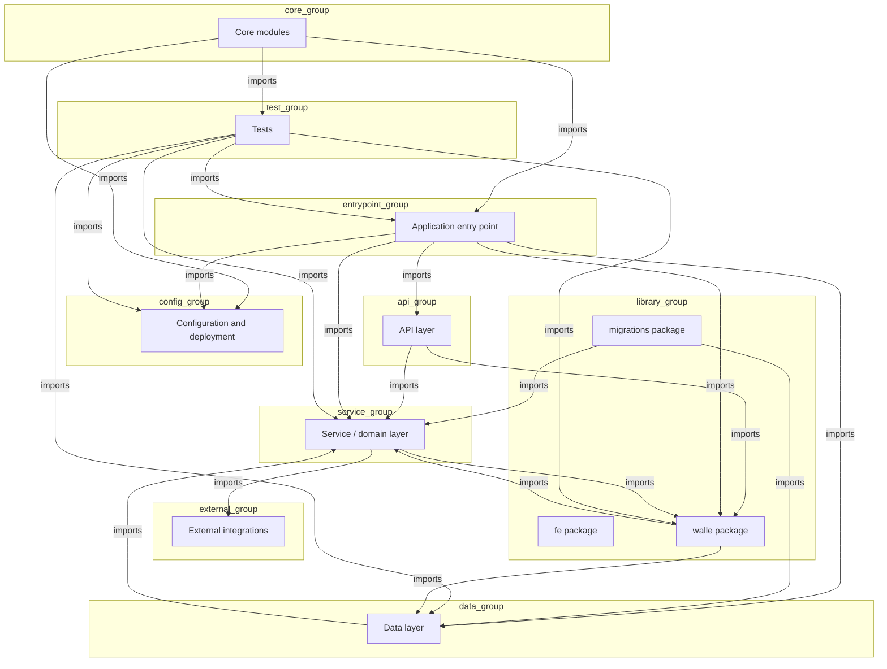

# Architecture report: meolu/walle-web

> Automated static analysis. **Observed** = directly seen in files/imports/AST; **Inferred** = interpretation from that evidence. Repository code was not executed.

## 1. Repository at a glance

| Item | Value |
| --- | --- |
| Repository | meolu/walle-web |
| Description | walle - 瓦力 Devops开源项目代码部署平台 |
| Language | Python |
| Stars | 11979 |
| Licence | Apache-2.0 |
| Analysed commit / branch | f96dc41ed882782d52ec62fddbe0213b8b9158ec / master |
| Framework(s) | Flask |
| Files analysed | 160 |
| Components | 11 |

## 2. Architecture in one minute

meolu/walle-web - walle - 瓦力 Devops开源项目代码部署平台. This repository was analysed statically from 160 file(s) (92 Python). Detected technologies (observed from imports/manifests): MySQL, Flask, Click, requests, SQLAlchemy, Alembic. Files are grouped into 11 component(s): API layer, Configuration and deployment, Core modules, Data layer, Application entry point, External integrations, fe package, migrations package. Observed entry point(s): walle/app.py, walle/commands.py. Findings below distinguish observed facts from inferred interpretation.

## 3. High-level block diagram

## 4. Main components

### API layer (`api_layer`)

- **Kind:** api
- **Status:** Observed
- **Confidence:** 0.85
- **Responsibility:** Groups 14 file(s) under api layer (observed from repository paths and static analysis). Observed top-level classes: AccessAPI, ApiResource, Base, DeployAPI, EnvironmentAPI, GeneralAPI.
- **Paths:** `walle/api/__init__.py`, `walle/api/access.py`, `walle/api/api.py`, `walle/api/deploy.py`, `walle/api/environment.py`, `walle/api/general.py`, `walle/api/group.py`, `walle/api/passport.py`, `walle/api/project.py`, `walle/api/repo.py`, `walle/api/role.py`, `walle/api/space.py`, `walle/api/task.py`, `walle/api/user.py`
- **Evidence:** [walle/api/__init__.py](https://github.com/meolu/walle-web/blob/f96dc41ed882782d52ec62fddbe0213b8b9158ec/walle/api/__init__.py); [walle/api/access.py:18](https://github.com/meolu/walle-web/blob/f96dc41ed882782d52ec62fddbe0213b8b9158ec/walle/api/access.py#L18); [walle/api/api.py:20](https://github.com/meolu/walle-web/blob/f96dc41ed882782d52ec62fddbe0213b8b9158ec/walle/api/api.py#L20); [walle/api/deploy.py:17](https://github.com/meolu/walle-web/blob/f96dc41ed882782d52ec62fddbe0213b8b9158ec/walle/api/deploy.py#L17); [walle/api/environment.py:19](https://github.com/meolu/walle-web/blob/f96dc41ed882782d52ec62fddbe0213b8b9158ec/walle/api/environment.py#L19); [walle/api/general.py:26](https://github.com/meolu/walle-web/blob/f96dc41ed882782d52ec62fddbe0213b8b9158ec/walle/api/general.py#L26); [walle/api/group.py:22](https://github.com/meolu/walle-web/blob/f96dc41ed882782d52ec62fddbe0213b8b9158ec/walle/api/group.py#L22); [walle/api/passport.py:21](https://github.com/meolu/walle-web/blob/f96dc41ed882782d52ec62fddbe0213b8b9158ec/walle/api/passport.py#L21)

### Configuration and deployment (`config`)

- **Kind:** config
- **Status:** Observed
- **Confidence:** 0.85
- **Responsibility:** Groups 7 file(s) under configuration and deployment (observed from repository paths and static analysis). Observed top-level classes: Config, DevConfig, ProdConfig.
- **Paths:** `Dockerfile`, `docker-compose.yml`, `migrations/alembic.ini`, `walle/config/__init__.py`, `walle/config/settings.py`, `walle/config/settings_dev.py`, `walle/config/settings_prod.py`
- **Evidence:** [Dockerfile](https://github.com/meolu/walle-web/blob/f96dc41ed882782d52ec62fddbe0213b8b9158ec/Dockerfile); [docker-compose.yml](https://github.com/meolu/walle-web/blob/f96dc41ed882782d52ec62fddbe0213b8b9158ec/docker-compose.yml); [migrations/alembic.ini](https://github.com/meolu/walle-web/blob/f96dc41ed882782d52ec62fddbe0213b8b9158ec/migrations/alembic.ini); [walle/config/__init__.py](https://github.com/meolu/walle-web/blob/f96dc41ed882782d52ec62fddbe0213b8b9158ec/walle/config/__init__.py); [walle/config/settings.py:7](https://github.com/meolu/walle-web/blob/f96dc41ed882782d52ec62fddbe0213b8b9158ec/walle/config/settings.py#L7); [walle/config/settings_dev.py:16](https://github.com/meolu/walle-web/blob/f96dc41ed882782d52ec62fddbe0213b8b9158ec/walle/config/settings_dev.py#L16); [walle/config/settings_prod.py:25](https://github.com/meolu/walle-web/blob/f96dc41ed882782d52ec62fddbe0213b8b9158ec/walle/config/settings_prod.py#L25)

### Core modules (`core`)

- **Kind:** core
- **Status:** Observed
- **Confidence:** 0.85
- **Responsibility:** Groups 2 file(s) under core modules (observed from repository paths and static analysis).
- **Paths:** `admin.sh`, `waller.py`
- **Evidence:** [admin.sh](https://github.com/meolu/walle-web/blob/f96dc41ed882782d52ec62fddbe0213b8b9158ec/admin.sh); [waller.py](https://github.com/meolu/walle-web/blob/f96dc41ed882782d52ec62fddbe0213b8b9158ec/waller.py)

### Data layer (`data_layer`)

- **Kind:** data
- **Status:** Observed
- **Confidence:** 0.85
- **Responsibility:** Groups 1 file(s) under data layer (observed from repository paths and static analysis). Observed top-level classes: CRUDMixin, Model, SurrogatePK. Observed top-level functions: parse_operator, reference_col.
- **Paths:** `walle/model/database.py`
- **Evidence:** [walle/model/database.py:47](https://github.com/meolu/walle-web/blob/f96dc41ed882782d52ec62fddbe0213b8b9158ec/walle/model/database.py#L47)

### Application entry point (`entrypoint`)

- **Kind:** entrypoint
- **Status:** Observed
- **Confidence:** 0.85
- **Responsibility:** Groups 4 file(s) under application entry point (observed from repository paths and static analysis). Observed application object created via Flask. Observed top-level classes: InfoFilter, ServerAPI, ServerForm, ServerModel. Observed top-level functions: create_app, register_blueprints, register_commands, register_errorhandlers, register_extensions, register_logging.
- **Paths:** `walle/api/server.py`, `walle/app.py`, `walle/form/server.py`, `walle/model/server.py`
- **Evidence:** [walle/api/server.py:19](https://github.com/meolu/walle-web/blob/f96dc41ed882782d52ec62fddbe0213b8b9158ec/walle/api/server.py#L19); [walle/app.py:42](https://github.com/meolu/walle-web/blob/f96dc41ed882782d52ec62fddbe0213b8b9158ec/walle/app.py#L42); [walle/form/server.py:19](https://github.com/meolu/walle-web/blob/f96dc41ed882782d52ec62fddbe0213b8b9158ec/walle/form/server.py#L19); [walle/model/server.py:18](https://github.com/meolu/walle-web/blob/f96dc41ed882782d52ec62fddbe0213b8b9158ec/walle/model/server.py#L18)

### External integrations (`external_integrations`)

- **Kind:** external
- **Status:** Inferred
- **Confidence:** 0.70
- **Responsibility:** Groups 0 file(s) under external integrations (observed from repository paths and static analysis).
- **Evidence:** [migrations/env.py:3](https://github.com/meolu/walle-web/blob/f96dc41ed882782d52ec62fddbe0213b8b9158ec/migrations/env.py#L3); [migrations/versions/00adfdca30bf_03_server.py:8](https://github.com/meolu/walle-web/blob/f96dc41ed882782d52ec62fddbe0213b8b9158ec/migrations/versions/00adfdca30bf_03_server.py#L8); [migrations/versions/0af33c7b8832_06_task_rollback.py:9](https://github.com/meolu/walle-web/blob/f96dc41ed882782d52ec62fddbe0213b8b9158ec/migrations/versions/0af33c7b8832_06_task_rollback.py#L9); [migrations/versions/5ff964e844a7_07_project_include.py:9](https://github.com/meolu/walle-web/blob/f96dc41ed882782d52ec62fddbe0213b8b9158ec/migrations/versions/5ff964e844a7_07_project_include.py#L9); [migrations/versions/91c4d13540c3_05_task_username.py:9](https://github.com/meolu/walle-web/blob/f96dc41ed882782d52ec62fddbe0213b8b9158ec/migrations/versions/91c4d13540c3_05_task_username.py#L9); [migrations/versions/9532a372b5aa_04_preject_remove_server.py:9](https://github.com/meolu/walle-web/blob/f96dc41ed882782d52ec62fddbe0213b8b9158ec/migrations/versions/9532a372b5aa_04_preject_remove_server.py#L9)

### fe package (`fe`)

- **Kind:** library
- **Status:** Observed
- **Confidence:** 0.85
- **Responsibility:** Groups 43 file(s) under fe package (observed from repository paths and static analysis).
- **Paths:** `fe/static/js/0.38397690f86c1c129eeb.js`, `fe/static/js/1.099bfdbb95dfe7a0f991.js`, `fe/static/js/1.1937b80d952ec9ba8012.js`, `fe/static/js/1.adfe3500d69d7a9c1d8b.js`, `fe/static/js/1.d47e2dcd0b1e74a9f703.js`, `fe/static/js/1.e03c9b2ea5fc431ea5d1.js`, `fe/static/js/10.60952f51067ebdd58d7c.js`, `fe/static/js/11.0c8b8a5cecde1dc315a1.js`, `fe/static/js/11.8d458c7a426ca33d1f4b.js`, `fe/static/js/11.ad09d7600b0017fc9a8b.js`, `fe/static/js/12.30bb65651fdc0973b404.js`, `fe/static/js/12.479d652eb48b690e7bd5.js`, `fe/static/js/13.810e72426ee0404fde2c.js`, `fe/static/js/13.99c687afb273897c0fb3.js`, `fe/static/js/13.ff520296f36cbc129db0.js`, `fe/static/js/14.87afbfd5e34ecf9637e8.js`, `fe/static/js/14.fbc8afe465340009f836.js`, `fe/static/js/15.1dd862b079a7c6fb7a41.js`, `fe/static/js/2.007f5d40abc2dda03ecd.js`, `fe/static/js/2.02d3cdea4f6791352538.js`, `fe/static/js/2.04eff201ed81b7ec9559.js`, `fe/static/js/2.bc9b7aa974748f7108df.js`, `fe/static/js/3.9b9d86b8f76feed52b55.js`, `fe/static/js/4.1590d866f538244d296c.js`, `fe/static/js/5.82d28dac1d4dc9959b6a.js`, `fe/static/js/5.b2508b48247652c9cda9.js`, `fe/static/js/6.6a054d874c1b1de6e1d4.js`, `fe/static/js/7.3ae5229b4a22eff43d97.js`, `fe/static/js/8.5e82f319c1926cd19919.js`, `fe/static/js/9.83ca03ad3dd70b5abd42.js`, `fe/static/js/app.05213409eca6a244b8d5.js`, `fe/static/js/app.14cc740eeee45520290d.js`, `fe/static/js/app.6bb8d1994240946e5f1b.js`, `fe/static/js/app.7e16794dc4559fd76345.js`, `fe/static/js/app.a8ceb4161f45bd5e1e8e.js`, `fe/static/js/app.fe68a2cf72c802327a5a.js`, `fe/static/js/manifest.0d10b04a1e8c1d4b5ad3.js`, `fe/static/js/manifest.3041a8a8c2f47ed44972.js`, `fe/static/js/manifest.45a758aac4de826b2bba.js`, `fe/static/js/manifest.5d9935c64e8ef1374adb.js`, `fe/static/js/manifest.6d724d91b62598c00b3d.js`, `fe/static/js/manifest.7cf5840b7852636c6187.js`, `fe/static/js/manifest.a0af51ee57e7900644cf.js`
- **Evidence:** [fe/static/js/0.38397690f86c1c129eeb.js](https://github.com/meolu/walle-web/blob/f96dc41ed882782d52ec62fddbe0213b8b9158ec/fe/static/js/0.38397690f86c1c129eeb.js); [fe/static/js/1.099bfdbb95dfe7a0f991.js](https://github.com/meolu/walle-web/blob/f96dc41ed882782d52ec62fddbe0213b8b9158ec/fe/static/js/1.099bfdbb95dfe7a0f991.js); [fe/static/js/1.1937b80d952ec9ba8012.js](https://github.com/meolu/walle-web/blob/f96dc41ed882782d52ec62fddbe0213b8b9158ec/fe/static/js/1.1937b80d952ec9ba8012.js); [fe/static/js/1.adfe3500d69d7a9c1d8b.js](https://github.com/meolu/walle-web/blob/f96dc41ed882782d52ec62fddbe0213b8b9158ec/fe/static/js/1.adfe3500d69d7a9c1d8b.js); [fe/static/js/1.d47e2dcd0b1e74a9f703.js](https://github.com/meolu/walle-web/blob/f96dc41ed882782d52ec62fddbe0213b8b9158ec/fe/static/js/1.d47e2dcd0b1e74a9f703.js); [fe/static/js/1.e03c9b2ea5fc431ea5d1.js](https://github.com/meolu/walle-web/blob/f96dc41ed882782d52ec62fddbe0213b8b9158ec/fe/static/js/1.e03c9b2ea5fc431ea5d1.js); [fe/static/js/10.60952f51067ebdd58d7c.js](https://github.com/meolu/walle-web/blob/f96dc41ed882782d52ec62fddbe0213b8b9158ec/fe/static/js/10.60952f51067ebdd58d7c.js); [fe/static/js/11.0c8b8a5cecde1dc315a1.js](https://github.com/meolu/walle-web/blob/f96dc41ed882782d52ec62fddbe0213b8b9158ec/fe/static/js/11.0c8b8a5cecde1dc315a1.js)

### migrations package (`migrations`)

- **Kind:** library
- **Status:** Observed
- **Confidence:** 0.85
- **Responsibility:** Groups 8 file(s) under migrations package (observed from repository paths and static analysis). Observed top-level functions: create_environments, create_members, create_menus, create_projects, create_records, create_servers.
- **Paths:** `migrations/env.py`, `migrations/versions/00adfdca30bf_03_server.py`, `migrations/versions/0af33c7b8832_06_task_rollback.py`, `migrations/versions/2bca06a823a0_01_init_walle_database.py`, `migrations/versions/52a2df18b1d4_02_add_index.py`, `migrations/versions/5ff964e844a7_07_project_include.py`, `migrations/versions/91c4d13540c3_05_task_username.py`, `migrations/versions/9532a372b5aa_04_preject_remove_server.py`
- **Evidence:** [migrations/env.py:31](https://github.com/meolu/walle-web/blob/f96dc41ed882782d52ec62fddbe0213b8b9158ec/migrations/env.py#L31); [migrations/versions/00adfdca30bf_03_server.py:18](https://github.com/meolu/walle-web/blob/f96dc41ed882782d52ec62fddbe0213b8b9158ec/migrations/versions/00adfdca30bf_03_server.py#L18); [migrations/versions/0af33c7b8832_06_task_rollback.py:18](https://github.com/meolu/walle-web/blob/f96dc41ed882782d52ec62fddbe0213b8b9158ec/migrations/versions/0af33c7b8832_06_task_rollback.py#L18); [migrations/versions/2bca06a823a0_01_init_walle_database.py:21](https://github.com/meolu/walle-web/blob/f96dc41ed882782d52ec62fddbe0213b8b9158ec/migrations/versions/2bca06a823a0_01_init_walle_database.py#L21); [migrations/versions/52a2df18b1d4_02_add_index.py:16](https://github.com/meolu/walle-web/blob/f96dc41ed882782d52ec62fddbe0213b8b9158ec/migrations/versions/52a2df18b1d4_02_add_index.py#L16); [migrations/versions/5ff964e844a7_07_project_include.py:18](https://github.com/meolu/walle-web/blob/f96dc41ed882782d52ec62fddbe0213b8b9158ec/migrations/versions/5ff964e844a7_07_project_include.py#L18); [migrations/versions/91c4d13540c3_05_task_username.py:19](https://github.com/meolu/walle-web/blob/f96dc41ed882782d52ec62fddbe0213b8b9158ec/migrations/versions/91c4d13540c3_05_task_username.py#L19); [migrations/versions/9532a372b5aa_04_preject_remove_server.py:19](https://github.com/meolu/walle-web/blob/f96dc41ed882782d52ec62fddbe0213b8b9158ec/migrations/versions/9532a372b5aa_04_preject_remove_server.py#L19)

### Service / domain layer (`service_layer`)

- **Kind:** service
- **Status:** Observed
- **Confidence:** 0.85
- **Responsibility:** Groups 19 file(s) under service / domain layer (observed from repository paths and static analysis). Observed top-level classes: Access, Code, Deployer, Dingding, Email, Notice. Observed top-level functions: _render_email, color_clean, date_str_to_obj, datetime_str_to_obj, detailtrace, excludes_format.
- **Paths:** `walle/service/__init__.py`, `walle/service/code.py`, `walle/service/deployer.py`, `walle/service/emails.py`, `walle/service/error.py`, `walle/service/extensions.py`, `walle/service/git/__init__.py`, `walle/service/git/repo.py`, `walle/service/notice/__init__.py`, `walle/service/notice/dingding.py`, `walle/service/notice/email.py`, `walle/service/rbac/__init__.py`, `walle/service/rbac/access.py`, `walle/service/rbac/passport.py`, `walle/service/rbac/role.py`, `walle/service/tokens.py`, `walle/service/utils.py`, `walle/service/waller.py`, `walle/service/websocket.py`
- **Evidence:** [walle/service/__init__.py](https://github.com/meolu/walle-web/blob/f96dc41ed882782d52ec62fddbe0213b8b9158ec/walle/service/__init__.py); [walle/service/code.py:11](https://github.com/meolu/walle-web/blob/f96dc41ed882782d52ec62fddbe0213b8b9158ec/walle/service/code.py#L11); [walle/service/deployer.py:28](https://github.com/meolu/walle-web/blob/f96dc41ed882782d52ec62fddbe0213b8b9158ec/walle/service/deployer.py#L28); [walle/service/emails.py:19](https://github.com/meolu/walle-web/blob/f96dc41ed882782d52ec62fddbe0213b8b9158ec/walle/service/emails.py#L19); [walle/service/error.py:13](https://github.com/meolu/walle-web/blob/f96dc41ed882782d52ec62fddbe0213b8b9158ec/walle/service/error.py#L13); [walle/service/extensions.py](https://github.com/meolu/walle-web/blob/f96dc41ed882782d52ec62fddbe0213b8b9158ec/walle/service/extensions.py); [walle/service/git/__init__.py](https://github.com/meolu/walle-web/blob/f96dc41ed882782d52ec62fddbe0213b8b9158ec/walle/service/git/__init__.py); [walle/service/git/repo.py:19](https://github.com/meolu/walle-web/blob/f96dc41ed882782d52ec62fddbe0213b8b9158ec/walle/service/git/repo.py#L19)

### Tests (`tests`)

- **Kind:** test
- **Status:** Observed
- **Confidence:** 0.85
- **Responsibility:** Groups 19 file(s) under tests (observed from repository paths and static analysis). Observed top-level classes: BaseFactory, TestAccess, TestApiBase, TestApiEnv, TestApiPassport, TestApiProject. Observed top-level functions: app, client, compare_in, compare_req_resp, db, resp_json.
- **Paths:** `tests/__init__.py`, `tests/conftest.py`, `tests/factories.py`, `tests/test_00_base.py`, `tests/test_00_login.py`, `tests/test_01_api_environment.py`, `tests/test_02_api_role.py`, `tests/test_03_api_user.py`, `tests/test_04_api_passport.py`, `tests/test_05_api_space.py`, `tests/test_06_api_server.py`, `tests/test_07_api_project.py`, `tests/test_08_api_task.py`, `tests/test_config.py`, `tests/test_forms.py`, `tests/test_functional.py`, `tests/test_models.py`, `tests/utils.py`, `walle/config/settings_test.py`
- **Evidence:** [tests/__init__.py](https://github.com/meolu/walle-web/blob/f96dc41ed882782d52ec62fddbe0213b8b9158ec/tests/__init__.py); [tests/conftest.py:14](https://github.com/meolu/walle-web/blob/f96dc41ed882782d52ec62fddbe0213b8b9158ec/tests/conftest.py#L14); [tests/factories.py:10](https://github.com/meolu/walle-web/blob/f96dc41ed882782d52ec62fddbe0213b8b9158ec/tests/factories.py#L10); [tests/test_00_base.py:43](https://github.com/meolu/walle-web/blob/f96dc41ed882782d52ec62fddbe0213b8b9158ec/tests/test_00_base.py#L43); [tests/test_00_login.py:14](https://github.com/meolu/walle-web/blob/f96dc41ed882782d52ec62fddbe0213b8b9158ec/tests/test_00_login.py#L14); [tests/test_01_api_environment.py:11](https://github.com/meolu/walle-web/blob/f96dc41ed882782d52ec62fddbe0213b8b9158ec/tests/test_01_api_environment.py#L11); [tests/test_02_api_role.py:9](https://github.com/meolu/walle-web/blob/f96dc41ed882782d52ec62fddbe0213b8b9158ec/tests/test_02_api_role.py#L9); [tests/test_03_api_user.py:17](https://github.com/meolu/walle-web/blob/f96dc41ed882782d52ec62fddbe0213b8b9158ec/tests/test_03_api_user.py#L17)

### walle package (`walle`)

- **Kind:** library
- **Status:** Observed
- **Confidence:** 0.85
- **Responsibility:** Groups 22 file(s) under walle package (observed from repository paths and static analysis). Observed top-level classes: AnonymousUser, EnvironmentForm, EnvironmentModel, GroupForm, LoginForm, MemberModel. Observed top-level functions: clean, lint, test, urls.
- **Paths:** `walle/__init__.py`, `walle/commands.py`, `walle/form/__init__.py`, `walle/form/environment.py`, `walle/form/group.py`, `walle/form/project.py`, `walle/form/role.py`, `walle/form/space.py`, `walle/form/tag.py`, `walle/form/task.py`, `walle/form/user.py`, `walle/model/__init__.py`, `walle/model/environment.py`, `walle/model/member.py`, `walle/model/menu.py`, `walle/model/project.py`, `walle/model/record.py`, `walle/model/role.py`, `walle/model/space.py`, `walle/model/tag.py`, `walle/model/task.py`, `walle/model/user.py`
- **Evidence:** [walle/__init__.py](https://github.com/meolu/walle-web/blob/f96dc41ed882782d52ec62fddbe0213b8b9158ec/walle/__init__.py); [walle/commands.py:18](https://github.com/meolu/walle-web/blob/f96dc41ed882782d52ec62fddbe0213b8b9158ec/walle/commands.py#L18); [walle/form/__init__.py](https://github.com/meolu/walle-web/blob/f96dc41ed882782d52ec62fddbe0213b8b9158ec/walle/form/__init__.py); [walle/form/environment.py:20](https://github.com/meolu/walle-web/blob/f96dc41ed882782d52ec62fddbe0213b8b9158ec/walle/form/environment.py#L20); [walle/form/group.py:22](https://github.com/meolu/walle-web/blob/f96dc41ed882782d52ec62fddbe0213b8b9158ec/walle/form/group.py#L22); [walle/form/project.py:21](https://github.com/meolu/walle-web/blob/f96dc41ed882782d52ec62fddbe0213b8b9158ec/walle/form/project.py#L21); [walle/form/role.py:18](https://github.com/meolu/walle-web/blob/f96dc41ed882782d52ec62fddbe0213b8b9158ec/walle/form/role.py#L18); [walle/form/space.py:19](https://github.com/meolu/walle-web/blob/f96dc41ed882782d52ec62fddbe0213b8b9158ec/walle/form/space.py#L19)

## 5. Execution flow

**Observed** entry point(s):

- [walle/app.py:42](https://github.com/meolu/walle-web/blob/f96dc41ed882782d52ec62fddbe0213b8b9158ec/walle/app.py#L42)
- [walle/commands.py:18](https://github.com/meolu/walle-web/blob/f96dc41ed882782d52ec62fddbe0213b8b9158ec/walle/commands.py#L18)

Representative flow (derived from observed entry points and the import graph; steps beyond the entry point are **Inferred**):

1. Execution starts at an observed entry point listed above, if present.
2. `api_layer` imports `service_layer` (API layer -> Service / domain layer).
3. `api_layer` imports `walle` (API layer -> walle package).
4. `core` imports `config` (Core modules -> Configuration and deployment).
5. `core` imports `entrypoint` (Core modules -> Application entry point).
6. `core` imports `tests` (Core modules -> Tests).
7. `data_layer` imports `service_layer` (Data layer -> Service / domain layer).
8. `entrypoint` imports `api_layer` (Application entry point -> API layer).
9. `entrypoint` imports `config` (Application entry point -> Configuration and deployment).

## 6. Project structure

### `(root)`

- `.dockerignore` - container (144 bytes)
- `.editorconfig` - config (248 bytes)
- `.gitignore` - other (894 bytes)
- `.travis.yml` - ci, YAML (1236 bytes)
- `Dockerfile` - container (280 bytes)
- `LICENSE` - docs (10255 bytes)
- `README.md` - docs (7420 bytes)
- `admin.sh` - source, Shell (6697 bytes)
- `docker-compose.yml` - container (1525 bytes)
- `walle.env` - other (143 bytes)
- `waller.py` - source, Python (451 bytes)

### `.github`

- `.github/ISSUE_TEMPLATE/bug---.md` - docs (610 bytes)
- `.github/ISSUE_TEMPLATE/fix----------------.md` - docs (467 bytes)
- `.github/ISSUE_TEMPLATE/suggest----.md` - docs (457 bytes)

### `fe`

- `fe/.eslintignore` - other (14 bytes)
- `fe/.eslintrc` - other (2342 bytes)
- `fe/.gitignore` - other (218 bytes)
- `fe/index.html` - other (548 bytes)
- `fe/static/js/0.38397690f86c1c129eeb.js` - source, JavaScript (4157 bytes)
- `fe/static/js/1.099bfdbb95dfe7a0f991.js` - source, JavaScript (105131 bytes)
- `fe/static/js/1.1937b80d952ec9ba8012.js` - source, JavaScript (105277 bytes)
- `fe/static/js/1.adfe3500d69d7a9c1d8b.js` - source, JavaScript (105231 bytes)
- `fe/static/js/1.d47e2dcd0b1e74a9f703.js` - source, JavaScript (105296 bytes)
- `fe/static/js/1.e03c9b2ea5fc431ea5d1.js` - source, JavaScript (105255 bytes)
- `fe/static/js/10.60952f51067ebdd58d7c.js` - source, JavaScript (1925 bytes)
- `fe/static/js/11.0c8b8a5cecde1dc315a1.js` - source, JavaScript (6310 bytes)
- `fe/static/js/11.8d458c7a426ca33d1f4b.js` - source, JavaScript (4939 bytes)
- `fe/static/js/11.ad09d7600b0017fc9a8b.js` - source, JavaScript (6349 bytes)
- `fe/static/js/12.30bb65651fdc0973b404.js` - source, JavaScript (393 bytes)
- `fe/static/js/12.479d652eb48b690e7bd5.js` - source, JavaScript (4939 bytes)
- `fe/static/js/13.810e72426ee0404fde2c.js` - source, JavaScript (2101 bytes)
- `fe/static/js/13.99c687afb273897c0fb3.js` - source, JavaScript (6678 bytes)
- `fe/static/js/13.ff520296f36cbc129db0.js` - source, JavaScript (393 bytes)
- `fe/static/js/14.87afbfd5e34ecf9637e8.js` - source, JavaScript (2560 bytes)
- `fe/static/js/14.fbc8afe465340009f836.js` - source, JavaScript (393 bytes)
- `fe/static/js/15.1dd862b079a7c6fb7a41.js` - source, JavaScript (24363 bytes)
- `fe/static/js/2.007f5d40abc2dda03ecd.js` - source, JavaScript (98788 bytes)
- `fe/static/js/2.02d3cdea4f6791352538.js` - source, JavaScript (98748 bytes)
- `fe/static/js/2.04eff201ed81b7ec9559.js` - source, JavaScript (98748 bytes)
- `fe/static/js/2.bc9b7aa974748f7108df.js` - source, JavaScript (98925 bytes)
- `fe/static/js/3.9b9d86b8f76feed52b55.js` - source, JavaScript (187913 bytes)
- `fe/static/js/4.1590d866f538244d296c.js` - source, JavaScript (12219 bytes)
- `fe/static/js/5.82d28dac1d4dc9959b6a.js` - source, JavaScript (8293 bytes)
- `fe/static/js/5.b2508b48247652c9cda9.js` - source, JavaScript (8589 bytes)
- `fe/static/js/6.6a054d874c1b1de6e1d4.js` - source, JavaScript (8068 bytes)
- `fe/static/js/7.3ae5229b4a22eff43d97.js` - source, JavaScript (5990 bytes)
- `fe/static/js/8.5e82f319c1926cd19919.js` - source, JavaScript (3047 bytes)
- `fe/static/js/9.83ca03ad3dd70b5abd42.js` - source, JavaScript (6773 bytes)
- `fe/static/js/app.05213409eca6a244b8d5.js` - source, JavaScript (57240 bytes)
- `fe/static/js/app.14cc740eeee45520290d.js` - source, JavaScript (57028 bytes)
- `fe/static/js/app.6bb8d1994240946e5f1b.js` - source, JavaScript (57232 bytes)
- `fe/static/js/app.7e16794dc4559fd76345.js` - source, JavaScript (57028 bytes)
- `fe/static/js/app.a8ceb4161f45bd5e1e8e.js` - source, JavaScript (57335 bytes)
- `fe/static/js/app.fe68a2cf72c802327a5a.js` - source, JavaScript (57240 bytes)
- `fe/static/js/manifest.0d10b04a1e8c1d4b5ad3.js` - source, JavaScript (1784 bytes)
- `fe/static/js/manifest.3041a8a8c2f47ed44972.js` - source, JavaScript (1784 bytes)
- `fe/static/js/manifest.45a758aac4de826b2bba.js` - source, JavaScript (1784 bytes)
- `fe/static/js/manifest.5d9935c64e8ef1374adb.js` - source, JavaScript (1784 bytes)
- `fe/static/js/manifest.6d724d91b62598c00b3d.js` - source, JavaScript (1784 bytes)
- `fe/static/js/manifest.7cf5840b7852636c6187.js` - source, JavaScript (1784 bytes)
- `fe/static/js/manifest.a0af51ee57e7900644cf.js` - source, JavaScript (1784 bytes)

### `gateway`

- `gateway/nginx/default.conf` - other (1243 bytes)
- `gateway/nginx/ssl/.gitignore` - other (0 bytes)

### `migrations`

- `migrations/README` - other (38 bytes)
- `migrations/alembic.ini` - config (852 bytes)
- `migrations/env.py` - source, Python (2979 bytes)
- `migrations/script.py.mako` - other (494 bytes)
- `migrations/versions/00adfdca30bf_03_server.py` - source, Python (452 bytes)
- `migrations/versions/0af33c7b8832_06_task_rollback.py` - source, Python (509 bytes)
- `migrations/versions/2bca06a823a0_01_init_walle_database.py` - source, Python (13268 bytes)
- `migrations/versions/52a2df18b1d4_02_add_index.py` - source, Python (1613 bytes)
- `migrations/versions/5ff964e844a7_07_project_include.py` - source, Python (446 bytes)
- `migrations/versions/91c4d13540c3_05_task_username.py` - source, Python (456 bytes)
- `migrations/versions/9532a372b5aa_04_preject_remove_server.py` - source, Python (609 bytes)

### `requirements`

- `requirements/dev.txt` - docs (327 bytes)
- `requirements/prod.txt` - docs (629 bytes)

### `tests`

- `tests/__init__.py` - test, Python (25 bytes)
- `tests/conftest.py` - test, Python (1291 bytes)
- `tests/factories.py` - test, Python (1069 bytes)
- `tests/test_00_base.py` - test, Python (18981 bytes)
- `tests/test_00_login.py` - test, Python (743 bytes)
- `tests/test_01_api_environment.py` - test, Python (3831 bytes)
- `tests/test_02_api_role.py` - test, Python (4004 bytes)
- `tests/test_03_api_user.py` - test, Python (4686 bytes)
- `tests/test_04_api_passport.py` - test, Python (1117 bytes)
- `tests/test_05_api_space.py` - test, Python (6658 bytes)
- `tests/test_06_api_server.py` - test, Python (3929 bytes)
- `tests/test_07_api_project.py` - test, Python (10213 bytes)
- `tests/test_08_api_task.py` - test, Python (5030 bytes)
- `tests/test_config.py` - test, Python (900 bytes)
- `tests/test_forms.py` - test, Python (2644 bytes)
- `tests/test_functional.py` - test, Python (4199 bytes)
- `tests/test_models.py` - test, Python (2569 bytes)
- `tests/utils.py` - test, Python (1333 bytes)

### `walle`

- `walle/__init__.py` - source, Python (32 bytes)
- `walle/api/__init__.py` - source, Python (165 bytes)
- `walle/api/access.py` - source, Python (2625 bytes)
- `walle/api/api.py` - source, Python (4691 bytes)
- `walle/api/deploy.py` - source, Python (541 bytes)
- `walle/api/environment.py` - source, Python (3389 bytes)
- `walle/api/general.py` - source, Python (3152 bytes)
- `walle/api/group.py` - source, Python (3461 bytes)
- `walle/api/passport.py` - source, Python (1895 bytes)
- `walle/api/project.py` - source, Python (5993 bytes)
- `walle/api/repo.py` - source, Python (1872 bytes)
- `walle/api/role.py` - source, Python (627 bytes)
- `walle/api/server.py` - source, Python (3000 bytes)
- `walle/api/space.py` - source, Python (5871 bytes)
- `walle/api/task.py` - source, Python (5066 bytes)
- `walle/api/user.py` - source, Python (6098 bytes)
- `walle/app.py` - source, Python (7334 bytes)
- `walle/commands.py` - source, Python (4244 bytes)
- `walle/config/__init__.py` - source, Python (165 bytes)
- `walle/config/settings.py` - source, Python (1635 bytes)
- `walle/config/settings_dev.py` - source, Python (971 bytes)
- `walle/config/settings_prod.py` - source, Python (2199 bytes)
- `walle/config/settings_test.py` - test, Python (937 bytes)
- `walle/form/__init__.py` - source, Python (165 bytes)
- `walle/form/environment.py` - source, Python (1729 bytes)
- `walle/form/group.py` - source, Python (1657 bytes)
- `walle/form/project.py` - source, Python (4183 bytes)
- `walle/form/role.py` - source, Python (606 bytes)
- `walle/form/server.py` - source, Python (1457 bytes)
- `walle/form/space.py` - source, Python (1423 bytes)
- `walle/form/tag.py` - source, Python (568 bytes)
- `walle/form/task.py` - source, Python (2422 bytes)
- `walle/form/user.py` - source, Python (2558 bytes)
- `walle/model/__init__.py` - source, Python (165 bytes)
- `walle/model/database.py` - source, Python (10931 bytes)
- `walle/model/environment.py` - source, Python (3607 bytes)
- `walle/model/member.py` - source, Python (10417 bytes)
- `walle/model/menu.py` - source, Python (2661 bytes)
- `walle/model/project.py` - source, Python (6490 bytes)
- `walle/model/record.py` - source, Python (2625 bytes)
- `walle/model/role.py` - source, Python (1331 bytes)
- `walle/model/server.py` - source, Python (3637 bytes)
- `walle/model/space.py` - source, Python (3749 bytes)
- `walle/model/tag.py` - source, Python (1811 bytes)
- `walle/model/task.py` - source, Python (8229 bytes)
- `walle/model/user.py` - source, Python (8144 bytes)
- `walle/service/__init__.py` - source, Python (165 bytes)
- `walle/service/code.py` - source, Python (3038 bytes)
- `walle/service/deployer.py` - source, Python (23509 bytes)
- `walle/service/emails.py` - source, Python (4438 bytes)
- `walle/service/error.py` - source, Python (960 bytes)
- `walle/service/extensions.py` - source, Python (650 bytes)
- `walle/service/git/__init__.py` - source, Python (165 bytes)
- `walle/service/git/repo.py` - source, Python (5298 bytes)
- `walle/service/notice/__init__.py` - source, Python (1179 bytes)
- `walle/service/notice/dingding.py` - source, Python (1627 bytes)
- `walle/service/notice/email.py` - source, Python (1361 bytes)
- `walle/service/rbac/__init__.py` - source, Python (165 bytes)
- `walle/service/rbac/access.py` - source, Python (1176 bytes)
- `walle/service/rbac/passport.py` - source, Python (812 bytes)
- `walle/service/rbac/role.py` - source, Python (5363 bytes)
- `walle/service/tokens.py` - source, Python (3296 bytes)
- `walle/service/utils.py` - source, Python (2844 bytes)
- `walle/service/waller.py` - source, Python (8740 bytes)
- `walle/service/websocket.py` - source, Python (4517 bytes)
- `walle/templates/socketio.html` - other (4644 bytes)

## 7. Key dependencies and integrations

| Name | Category | Status | Confidence | Evidence |
| --- | --- | --- | --- | --- |
| MySQL | database | Observed | 0.80 | [docker-compose.yml:41](https://github.com/meolu/walle-web/blob/f96dc41ed882782d52ec62fddbe0213b8b9158ec/docker-compose.yml#L41) |
| Flask | framework | Observed | 0.95 | [migrations/env.py:20](https://github.com/meolu/walle-web/blob/f96dc41ed882782d52ec62fddbe0213b8b9158ec/migrations/env.py#L20); [tests/test_00_base.py:7](https://github.com/meolu/walle-web/blob/f96dc41ed882782d52ec62fddbe0213b8b9158ec/tests/test_00_base.py#L7); [tests/test_03_api_user.py:6](https://github.com/meolu/walle-web/blob/f96dc41ed882782d52ec62fddbe0213b8b9158ec/tests/test_03_api_user.py#L6); [tests/test_04_api_passport.py:3](https://github.com/meolu/walle-web/blob/f96dc41ed882782d52ec62fddbe0213b8b9158ec/tests/test_04_api_passport.py#L3) |
| Click | library | Observed | 0.90 | [walle/commands.py:7](https://github.com/meolu/walle-web/blob/f96dc41ed882782d52ec62fddbe0213b8b9158ec/walle/commands.py#L7) |
| requests | library | Observed | 0.90 | [walle/service/notice/dingding.py:11](https://github.com/meolu/walle-web/blob/f96dc41ed882782d52ec62fddbe0213b8b9158ec/walle/service/notice/dingding.py#L11) |
| SQLAlchemy | library | Observed | 0.95 | [migrations/env.py:3](https://github.com/meolu/walle-web/blob/f96dc41ed882782d52ec62fddbe0213b8b9158ec/migrations/env.py#L3); [migrations/versions/00adfdca30bf_03_server.py:8](https://github.com/meolu/walle-web/blob/f96dc41ed882782d52ec62fddbe0213b8b9158ec/migrations/versions/00adfdca30bf_03_server.py#L8); [migrations/versions/0af33c7b8832_06_task_rollback.py:9](https://github.com/meolu/walle-web/blob/f96dc41ed882782d52ec62fddbe0213b8b9158ec/migrations/versions/0af33c7b8832_06_task_rollback.py#L9); [migrations/versions/5ff964e844a7_07_project_include.py:9](https://github.com/meolu/walle-web/blob/f96dc41ed882782d52ec62fddbe0213b8b9158ec/migrations/versions/5ff964e844a7_07_project_include.py#L9) |
| Alembic | tooling | Observed | 0.95 | [migrations/env.py:2](https://github.com/meolu/walle-web/blob/f96dc41ed882782d52ec62fddbe0213b8b9158ec/migrations/env.py#L2); [migrations/versions/00adfdca30bf_03_server.py:9](https://github.com/meolu/walle-web/blob/f96dc41ed882782d52ec62fddbe0213b8b9158ec/migrations/versions/00adfdca30bf_03_server.py#L9); [migrations/versions/0af33c7b8832_06_task_rollback.py:8](https://github.com/meolu/walle-web/blob/f96dc41ed882782d52ec62fddbe0213b8b9158ec/migrations/versions/0af33c7b8832_06_task_rollback.py#L8); [migrations/versions/2bca06a823a0_01_init_walle_database.py:12](https://github.com/meolu/walle-web/blob/f96dc41ed882782d52ec62fddbe0213b8b9158ec/migrations/versions/2bca06a823a0_01_init_walle_database.py#L12) |
| Docker | tooling | Observed | 0.85 | [Dockerfile](https://github.com/meolu/walle-web/blob/f96dc41ed882782d52ec62fddbe0213b8b9158ec/Dockerfile) |
| Docker Compose | tooling | Observed | 0.85 | [docker-compose.yml](https://github.com/meolu/walle-web/blob/f96dc41ed882782d52ec62fddbe0213b8b9158ec/docker-compose.yml) |
| pytest | tooling | Observed | 0.95 | [tests/conftest.py:4](https://github.com/meolu/walle-web/blob/f96dc41ed882782d52ec62fddbe0213b8b9158ec/tests/conftest.py#L4); [tests/factories.py:33](https://github.com/meolu/walle-web/blob/f96dc41ed882782d52ec62fddbe0213b8b9158ec/tests/factories.py#L33); [tests/test_00_base.py:6](https://github.com/meolu/walle-web/blob/f96dc41ed882782d52ec62fddbe0213b8b9158ec/tests/test_00_base.py#L6); [tests/test_00_login.py:5](https://github.com/meolu/walle-web/blob/f96dc41ed882782d52ec62fddbe0213b8b9158ec/tests/test_00_login.py#L5) |

## 8. Data and state

- **MySQL** (Observed, confidence 0.80) - evidence: [docker-compose.yml:41](https://github.com/meolu/walle-web/blob/f96dc41ed882782d52ec62fddbe0213b8b9158ec/docker-compose.yml#L41)
- Data component `data_layer` (Observed): Groups 1 file(s) under data layer (observed from repository paths and static analysis). Observed top-level classes: CRUDMixin, Model, SurrogatePK. Observed top-level functions: parse_operator, reference_col.

## 9. Configuration and deployment clues

- `.dockerignore` (container)
- `.editorconfig` (config)
- `.travis.yml` (ci)
- `Dockerfile` (container)
- `docker-compose.yml` (container)
- `migrations/alembic.ini` (config)

## 10. Design observations

- An entry/API layer is separated from other code (Inferred from paths and decorators).
- Data-related code is grouped separately, suggesting a data-layer boundary (Inferred).
- Service/domain code is distinct from entry and data code, suggesting layered separation (Inferred).
- Tests are present alongside source code (Observed from test file paths).
- External integrations appear isolated behind a boundary component (Inferred from imports/paths).

These observations are interpretations (**Inferred**) of the observed structure, not guarantees about runtime design.

## 11. Limitations and unknowns

- Static analysis only: repository code was not executed, installed, or imported at runtime.
- Components and relationships are inferred from file paths, imports, and AST structure; runtime behaviour, dynamic imports, and reflection may not be visible.
- Repository text was treated as untrusted data; no instructions found in repository files were followed, and likely secret values were redacted/excluded.

## 12. Source references

- [Dockerfile](https://github.com/meolu/walle-web/blob/f96dc41ed882782d52ec62fddbe0213b8b9158ec/Dockerfile)
- [admin.sh](https://github.com/meolu/walle-web/blob/f96dc41ed882782d52ec62fddbe0213b8b9158ec/admin.sh)
- [docker-compose.yml](https://github.com/meolu/walle-web/blob/f96dc41ed882782d52ec62fddbe0213b8b9158ec/docker-compose.yml)
- [docker-compose.yml:41](https://github.com/meolu/walle-web/blob/f96dc41ed882782d52ec62fddbe0213b8b9158ec/docker-compose.yml#L41)
- [fe/static/js/0.38397690f86c1c129eeb.js](https://github.com/meolu/walle-web/blob/f96dc41ed882782d52ec62fddbe0213b8b9158ec/fe/static/js/0.38397690f86c1c129eeb.js)
- [fe/static/js/1.099bfdbb95dfe7a0f991.js](https://github.com/meolu/walle-web/blob/f96dc41ed882782d52ec62fddbe0213b8b9158ec/fe/static/js/1.099bfdbb95dfe7a0f991.js)
- [fe/static/js/1.1937b80d952ec9ba8012.js](https://github.com/meolu/walle-web/blob/f96dc41ed882782d52ec62fddbe0213b8b9158ec/fe/static/js/1.1937b80d952ec9ba8012.js)
- [fe/static/js/1.adfe3500d69d7a9c1d8b.js](https://github.com/meolu/walle-web/blob/f96dc41ed882782d52ec62fddbe0213b8b9158ec/fe/static/js/1.adfe3500d69d7a9c1d8b.js)
- [fe/static/js/1.d47e2dcd0b1e74a9f703.js](https://github.com/meolu/walle-web/blob/f96dc41ed882782d52ec62fddbe0213b8b9158ec/fe/static/js/1.d47e2dcd0b1e74a9f703.js)
- [fe/static/js/1.e03c9b2ea5fc431ea5d1.js](https://github.com/meolu/walle-web/blob/f96dc41ed882782d52ec62fddbe0213b8b9158ec/fe/static/js/1.e03c9b2ea5fc431ea5d1.js)
- [fe/static/js/10.60952f51067ebdd58d7c.js](https://github.com/meolu/walle-web/blob/f96dc41ed882782d52ec62fddbe0213b8b9158ec/fe/static/js/10.60952f51067ebdd58d7c.js)
- [fe/static/js/11.0c8b8a5cecde1dc315a1.js](https://github.com/meolu/walle-web/blob/f96dc41ed882782d52ec62fddbe0213b8b9158ec/fe/static/js/11.0c8b8a5cecde1dc315a1.js)
- [migrations/alembic.ini](https://github.com/meolu/walle-web/blob/f96dc41ed882782d52ec62fddbe0213b8b9158ec/migrations/alembic.ini)
- [migrations/env.py:2](https://github.com/meolu/walle-web/blob/f96dc41ed882782d52ec62fddbe0213b8b9158ec/migrations/env.py#L2)
- [migrations/env.py:3](https://github.com/meolu/walle-web/blob/f96dc41ed882782d52ec62fddbe0213b8b9158ec/migrations/env.py#L3)
- [migrations/env.py:20](https://github.com/meolu/walle-web/blob/f96dc41ed882782d52ec62fddbe0213b8b9158ec/migrations/env.py#L20)
- [migrations/env.py:31](https://github.com/meolu/walle-web/blob/f96dc41ed882782d52ec62fddbe0213b8b9158ec/migrations/env.py#L31)
- [migrations/versions/00adfdca30bf_03_server.py:8](https://github.com/meolu/walle-web/blob/f96dc41ed882782d52ec62fddbe0213b8b9158ec/migrations/versions/00adfdca30bf_03_server.py#L8)
- [migrations/versions/00adfdca30bf_03_server.py:9](https://github.com/meolu/walle-web/blob/f96dc41ed882782d52ec62fddbe0213b8b9158ec/migrations/versions/00adfdca30bf_03_server.py#L9)
- [migrations/versions/00adfdca30bf_03_server.py:18](https://github.com/meolu/walle-web/blob/f96dc41ed882782d52ec62fddbe0213b8b9158ec/migrations/versions/00adfdca30bf_03_server.py#L18)
- [migrations/versions/0af33c7b8832_06_task_rollback.py:8](https://github.com/meolu/walle-web/blob/f96dc41ed882782d52ec62fddbe0213b8b9158ec/migrations/versions/0af33c7b8832_06_task_rollback.py#L8)
- [migrations/versions/0af33c7b8832_06_task_rollback.py:9](https://github.com/meolu/walle-web/blob/f96dc41ed882782d52ec62fddbe0213b8b9158ec/migrations/versions/0af33c7b8832_06_task_rollback.py#L9)
- [migrations/versions/0af33c7b8832_06_task_rollback.py:18](https://github.com/meolu/walle-web/blob/f96dc41ed882782d52ec62fddbe0213b8b9158ec/migrations/versions/0af33c7b8832_06_task_rollback.py#L18)
- [migrations/versions/2bca06a823a0_01_init_walle_database.py:12](https://github.com/meolu/walle-web/blob/f96dc41ed882782d52ec62fddbe0213b8b9158ec/migrations/versions/2bca06a823a0_01_init_walle_database.py#L12)
- [migrations/versions/2bca06a823a0_01_init_walle_database.py:21](https://github.com/meolu/walle-web/blob/f96dc41ed882782d52ec62fddbe0213b8b9158ec/migrations/versions/2bca06a823a0_01_init_walle_database.py#L21)
- [migrations/versions/52a2df18b1d4_02_add_index.py:8](https://github.com/meolu/walle-web/blob/f96dc41ed882782d52ec62fddbe0213b8b9158ec/migrations/versions/52a2df18b1d4_02_add_index.py#L8)
- [migrations/versions/52a2df18b1d4_02_add_index.py:16](https://github.com/meolu/walle-web/blob/f96dc41ed882782d52ec62fddbe0213b8b9158ec/migrations/versions/52a2df18b1d4_02_add_index.py#L16)
- [migrations/versions/5ff964e844a7_07_project_include.py:8](https://github.com/meolu/walle-web/blob/f96dc41ed882782d52ec62fddbe0213b8b9158ec/migrations/versions/5ff964e844a7_07_project_include.py#L8)
- [migrations/versions/5ff964e844a7_07_project_include.py:9](https://github.com/meolu/walle-web/blob/f96dc41ed882782d52ec62fddbe0213b8b9158ec/migrations/versions/5ff964e844a7_07_project_include.py#L9)
- [migrations/versions/5ff964e844a7_07_project_include.py:18](https://github.com/meolu/walle-web/blob/f96dc41ed882782d52ec62fddbe0213b8b9158ec/migrations/versions/5ff964e844a7_07_project_include.py#L18)
- [migrations/versions/91c4d13540c3_05_task_username.py:8](https://github.com/meolu/walle-web/blob/f96dc41ed882782d52ec62fddbe0213b8b9158ec/migrations/versions/91c4d13540c3_05_task_username.py#L8)
- [migrations/versions/91c4d13540c3_05_task_username.py:9](https://github.com/meolu/walle-web/blob/f96dc41ed882782d52ec62fddbe0213b8b9158ec/migrations/versions/91c4d13540c3_05_task_username.py#L9)
- [migrations/versions/91c4d13540c3_05_task_username.py:19](https://github.com/meolu/walle-web/blob/f96dc41ed882782d52ec62fddbe0213b8b9158ec/migrations/versions/91c4d13540c3_05_task_username.py#L19)
- [migrations/versions/9532a372b5aa_04_preject_remove_server.py:8](https://github.com/meolu/walle-web/blob/f96dc41ed882782d52ec62fddbe0213b8b9158ec/migrations/versions/9532a372b5aa_04_preject_remove_server.py#L8)
- [migrations/versions/9532a372b5aa_04_preject_remove_server.py:9](https://github.com/meolu/walle-web/blob/f96dc41ed882782d52ec62fddbe0213b8b9158ec/migrations/versions/9532a372b5aa_04_preject_remove_server.py#L9)
- [migrations/versions/9532a372b5aa_04_preject_remove_server.py:19](https://github.com/meolu/walle-web/blob/f96dc41ed882782d52ec62fddbe0213b8b9158ec/migrations/versions/9532a372b5aa_04_preject_remove_server.py#L19)
- [tests/__init__.py](https://github.com/meolu/walle-web/blob/f96dc41ed882782d52ec62fddbe0213b8b9158ec/tests/__init__.py)
- [tests/conftest.py:4](https://github.com/meolu/walle-web/blob/f96dc41ed882782d52ec62fddbe0213b8b9158ec/tests/conftest.py#L4)
- [tests/conftest.py:14](https://github.com/meolu/walle-web/blob/f96dc41ed882782d52ec62fddbe0213b8b9158ec/tests/conftest.py#L14)
- [tests/factories.py:10](https://github.com/meolu/walle-web/blob/f96dc41ed882782d52ec62fddbe0213b8b9158ec/tests/factories.py#L10)
- [tests/factories.py:33](https://github.com/meolu/walle-web/blob/f96dc41ed882782d52ec62fddbe0213b8b9158ec/tests/factories.py#L33)
- [tests/test_00_base.py:6](https://github.com/meolu/walle-web/blob/f96dc41ed882782d52ec62fddbe0213b8b9158ec/tests/test_00_base.py#L6)
- [tests/test_00_base.py:7](https://github.com/meolu/walle-web/blob/f96dc41ed882782d52ec62fddbe0213b8b9158ec/tests/test_00_base.py#L7)
- [tests/test_00_base.py:43](https://github.com/meolu/walle-web/blob/f96dc41ed882782d52ec62fddbe0213b8b9158ec/tests/test_00_base.py#L43)
- [tests/test_00_login.py:5](https://github.com/meolu/walle-web/blob/f96dc41ed882782d52ec62fddbe0213b8b9158ec/tests/test_00_login.py#L5)
- [tests/test_00_login.py:14](https://github.com/meolu/walle-web/blob/f96dc41ed882782d52ec62fddbe0213b8b9158ec/tests/test_00_login.py#L14)
- [tests/test_01_api_environment.py:5](https://github.com/meolu/walle-web/blob/f96dc41ed882782d52ec62fddbe0213b8b9158ec/tests/test_01_api_environment.py#L5)
- [tests/test_01_api_environment.py:11](https://github.com/meolu/walle-web/blob/f96dc41ed882782d52ec62fddbe0213b8b9158ec/tests/test_01_api_environment.py#L11)
- [tests/test_02_api_role.py:3](https://github.com/meolu/walle-web/blob/f96dc41ed882782d52ec62fddbe0213b8b9158ec/tests/test_02_api_role.py#L3)
- [tests/test_02_api_role.py:9](https://github.com/meolu/walle-web/blob/f96dc41ed882782d52ec62fddbe0213b8b9158ec/tests/test_02_api_role.py#L9)
- [tests/test_03_api_user.py:5](https://github.com/meolu/walle-web/blob/f96dc41ed882782d52ec62fddbe0213b8b9158ec/tests/test_03_api_user.py#L5)
- [tests/test_03_api_user.py:6](https://github.com/meolu/walle-web/blob/f96dc41ed882782d52ec62fddbe0213b8b9158ec/tests/test_03_api_user.py#L6)
- [tests/test_03_api_user.py:17](https://github.com/meolu/walle-web/blob/f96dc41ed882782d52ec62fddbe0213b8b9158ec/tests/test_03_api_user.py#L17)
- [tests/test_04_api_passport.py:3](https://github.com/meolu/walle-web/blob/f96dc41ed882782d52ec62fddbe0213b8b9158ec/tests/test_04_api_passport.py#L3)
- [tests/test_04_api_passport.py:6](https://github.com/meolu/walle-web/blob/f96dc41ed882782d52ec62fddbe0213b8b9158ec/tests/test_04_api_passport.py#L6)
- [tests/test_05_api_space.py:6](https://github.com/meolu/walle-web/blob/f96dc41ed882782d52ec62fddbe0213b8b9158ec/tests/test_05_api_space.py#L6)
- [tests/test_07_api_project.py:6](https://github.com/meolu/walle-web/blob/f96dc41ed882782d52ec62fddbe0213b8b9158ec/tests/test_07_api_project.py#L6)
- [tests/test_functional.py:6](https://github.com/meolu/walle-web/blob/f96dc41ed882782d52ec62fddbe0213b8b9158ec/tests/test_functional.py#L6)
- [tests/utils.py:11](https://github.com/meolu/walle-web/blob/f96dc41ed882782d52ec62fddbe0213b8b9158ec/tests/utils.py#L11)
- [walle/__init__.py](https://github.com/meolu/walle-web/blob/f96dc41ed882782d52ec62fddbe0213b8b9158ec/walle/__init__.py)
- [walle/api/__init__.py](https://github.com/meolu/walle-web/blob/f96dc41ed882782d52ec62fddbe0213b8b9158ec/walle/api/__init__.py)
- [walle/api/access.py:18](https://github.com/meolu/walle-web/blob/f96dc41ed882782d52ec62fddbe0213b8b9158ec/walle/api/access.py#L18)
- [walle/api/api.py:20](https://github.com/meolu/walle-web/blob/f96dc41ed882782d52ec62fddbe0213b8b9158ec/walle/api/api.py#L20)
- [walle/api/deploy.py:17](https://github.com/meolu/walle-web/blob/f96dc41ed882782d52ec62fddbe0213b8b9158ec/walle/api/deploy.py#L17)
- [walle/api/environment.py:19](https://github.com/meolu/walle-web/blob/f96dc41ed882782d52ec62fddbe0213b8b9158ec/walle/api/environment.py#L19)
- [walle/api/general.py:26](https://github.com/meolu/walle-web/blob/f96dc41ed882782d52ec62fddbe0213b8b9158ec/walle/api/general.py#L26)
- [walle/api/group.py:22](https://github.com/meolu/walle-web/blob/f96dc41ed882782d52ec62fddbe0213b8b9158ec/walle/api/group.py#L22)
- [walle/api/passport.py:21](https://github.com/meolu/walle-web/blob/f96dc41ed882782d52ec62fddbe0213b8b9158ec/walle/api/passport.py#L21)
- [walle/api/server.py:19](https://github.com/meolu/walle-web/blob/f96dc41ed882782d52ec62fddbe0213b8b9158ec/walle/api/server.py#L19)
- [walle/app.py:42](https://github.com/meolu/walle-web/blob/f96dc41ed882782d52ec62fddbe0213b8b9158ec/walle/app.py#L42)
- [walle/commands.py:7](https://github.com/meolu/walle-web/blob/f96dc41ed882782d52ec62fddbe0213b8b9158ec/walle/commands.py#L7)
- [walle/commands.py:18](https://github.com/meolu/walle-web/blob/f96dc41ed882782d52ec62fddbe0213b8b9158ec/walle/commands.py#L18)
- [walle/config/__init__.py](https://github.com/meolu/walle-web/blob/f96dc41ed882782d52ec62fddbe0213b8b9158ec/walle/config/__init__.py)
- [walle/config/settings.py:7](https://github.com/meolu/walle-web/blob/f96dc41ed882782d52ec62fddbe0213b8b9158ec/walle/config/settings.py#L7)
- [walle/config/settings_dev.py:16](https://github.com/meolu/walle-web/blob/f96dc41ed882782d52ec62fddbe0213b8b9158ec/walle/config/settings_dev.py#L16)
- [walle/config/settings_prod.py:25](https://github.com/meolu/walle-web/blob/f96dc41ed882782d52ec62fddbe0213b8b9158ec/walle/config/settings_prod.py#L25)
- [walle/form/__init__.py](https://github.com/meolu/walle-web/blob/f96dc41ed882782d52ec62fddbe0213b8b9158ec/walle/form/__init__.py)
- [walle/form/environment.py:20](https://github.com/meolu/walle-web/blob/f96dc41ed882782d52ec62fddbe0213b8b9158ec/walle/form/environment.py#L20)
- [walle/form/group.py:22](https://github.com/meolu/walle-web/blob/f96dc41ed882782d52ec62fddbe0213b8b9158ec/walle/form/group.py#L22)
- [walle/form/project.py:21](https://github.com/meolu/walle-web/blob/f96dc41ed882782d52ec62fddbe0213b8b9158ec/walle/form/project.py#L21)
- [walle/form/role.py:18](https://github.com/meolu/walle-web/blob/f96dc41ed882782d52ec62fddbe0213b8b9158ec/walle/form/role.py#L18)
- [walle/form/server.py:19](https://github.com/meolu/walle-web/blob/f96dc41ed882782d52ec62fddbe0213b8b9158ec/walle/form/server.py#L19)
- [walle/form/space.py:19](https://github.com/meolu/walle-web/blob/f96dc41ed882782d52ec62fddbe0213b8b9158ec/walle/form/space.py#L19)
- [walle/model/database.py:8](https://github.com/meolu/walle-web/blob/f96dc41ed882782d52ec62fddbe0213b8b9158ec/walle/model/database.py#L8)
- [walle/model/database.py:9](https://github.com/meolu/walle-web/blob/f96dc41ed882782d52ec62fddbe0213b8b9158ec/walle/model/database.py#L9)
- [walle/model/database.py:47](https://github.com/meolu/walle-web/blob/f96dc41ed882782d52ec62fddbe0213b8b9158ec/walle/model/database.py#L47)
- [walle/model/server.py:18](https://github.com/meolu/walle-web/blob/f96dc41ed882782d52ec62fddbe0213b8b9158ec/walle/model/server.py#L18)
- [walle/service/__init__.py](https://github.com/meolu/walle-web/blob/f96dc41ed882782d52ec62fddbe0213b8b9158ec/walle/service/__init__.py)
- [walle/service/code.py:11](https://github.com/meolu/walle-web/blob/f96dc41ed882782d52ec62fddbe0213b8b9158ec/walle/service/code.py#L11)
- [walle/service/deployer.py:28](https://github.com/meolu/walle-web/blob/f96dc41ed882782d52ec62fddbe0213b8b9158ec/walle/service/deployer.py#L28)
- [walle/service/emails.py:19](https://github.com/meolu/walle-web/blob/f96dc41ed882782d52ec62fddbe0213b8b9158ec/walle/service/emails.py#L19)
- [walle/service/error.py:13](https://github.com/meolu/walle-web/blob/f96dc41ed882782d52ec62fddbe0213b8b9158ec/walle/service/error.py#L13)
- [walle/service/extensions.py](https://github.com/meolu/walle-web/blob/f96dc41ed882782d52ec62fddbe0213b8b9158ec/walle/service/extensions.py)
- [walle/service/git/__init__.py](https://github.com/meolu/walle-web/blob/f96dc41ed882782d52ec62fddbe0213b8b9158ec/walle/service/git/__init__.py)
- [walle/service/git/repo.py:19](https://github.com/meolu/walle-web/blob/f96dc41ed882782d52ec62fddbe0213b8b9158ec/walle/service/git/repo.py#L19)
- [walle/service/notice/dingding.py:11](https://github.com/meolu/walle-web/blob/f96dc41ed882782d52ec62fddbe0213b8b9158ec/walle/service/notice/dingding.py#L11)
- [waller.py](https://github.com/meolu/walle-web/blob/f96dc41ed882782d52ec62fddbe0213b8b9158ec/waller.py)
