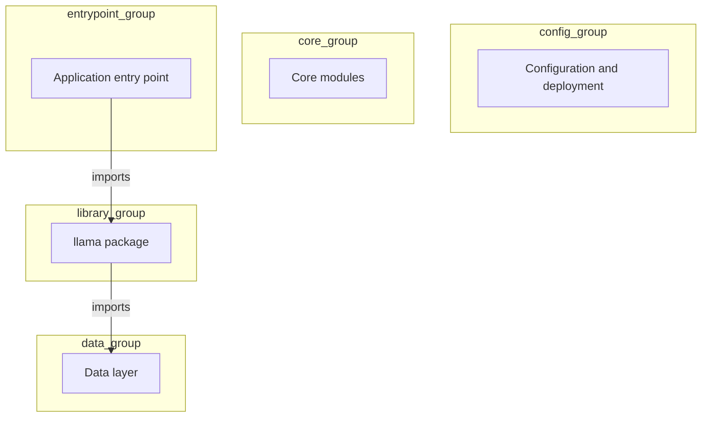

# Architecture report: meta-llama/codellama

> Automated static analysis. **Observed** = directly seen in files/imports/AST; **Inferred** = interpretation from that evidence. Repository code was not executed.

## 1. Repository at a glance

| Item | Value |
| --- | --- |
| Repository | meta-llama/codellama |
| Description | Inference code for CodeLlama models |
| Language | Python |
| Stars | 16204 |
| Licence | Other |
| Analysed commit / branch | e81b597e44dbecc2a0dedb9949fdf84adfc22395 / main |
| Framework(s) | None detected |
| Files analysed | 19 |
| Components | 5 |

## 2. Architecture in one minute

meta-llama/codellama - Inference code for CodeLlama models. This repository was analysed statically from 19 file(s) (8 Python). Detected technologies (observed from imports/manifests): setuptools. Files are grouped into 5 component(s): Configuration and deployment, Core modules, Data layer, Application entry point, llama package. Observed entry point(s): example_completion.py, example_infilling.py, example_instructions.py. Findings below distinguish observed facts from inferred interpretation.

## 3. High-level block diagram

## 4. Main components

### Configuration and deployment (`config`)

- **Kind:** config
- **Status:** Observed
- **Confidence:** 0.85
- **Responsibility:** Groups 2 file(s) under configuration and deployment (observed from repository paths and static analysis). Observed top-level functions: get_requirements.
- **Paths:** `requirements.txt`, `setup.py`
- **Evidence:** [requirements.txt](https://github.com/meta-llama/codellama/blob/e81b597e44dbecc2a0dedb9949fdf84adfc22395/requirements.txt); [setup.py:7](https://github.com/meta-llama/codellama/blob/e81b597e44dbecc2a0dedb9949fdf84adfc22395/setup.py#L7)

### Core modules (`core`)

- **Kind:** core
- **Status:** Observed
- **Confidence:** 0.85
- **Responsibility:** Groups 1 file(s) under core modules (observed from repository paths and static analysis).
- **Paths:** `download.sh`
- **Evidence:** [download.sh](https://github.com/meta-llama/codellama/blob/e81b597e44dbecc2a0dedb9949fdf84adfc22395/download.sh)

### Data layer (`data_layer`)

- **Kind:** data
- **Status:** Observed
- **Confidence:** 0.85
- **Responsibility:** Groups 1 file(s) under data layer (observed from repository paths and static analysis). Observed top-level classes: Attention, FeedForward, ModelArgs, RMSNorm, Transformer, TransformerBlock. Observed top-level functions: apply_rotary_emb, precompute_freqs_cis, repeat_kv, reshape_for_broadcast.
- **Paths:** `llama/model.py`
- **Evidence:** [llama/model.py:26](https://github.com/meta-llama/codellama/blob/e81b597e44dbecc2a0dedb9949fdf84adfc22395/llama/model.py#L26)

### Application entry point (`entrypoint`)

- **Kind:** entrypoint
- **Status:** Observed
- **Confidence:** 0.85
- **Responsibility:** Groups 3 file(s) under application entry point (observed from repository paths and static analysis). Observed top-level functions: main.
- **Paths:** `example_completion.py`, `example_infilling.py`, `example_instructions.py`
- **Evidence:** [example_completion.py:11](https://github.com/meta-llama/codellama/blob/e81b597e44dbecc2a0dedb9949fdf84adfc22395/example_completion.py#L11); [example_infilling.py:9](https://github.com/meta-llama/codellama/blob/e81b597e44dbecc2a0dedb9949fdf84adfc22395/example_infilling.py#L9); [example_instructions.py:11](https://github.com/meta-llama/codellama/blob/e81b597e44dbecc2a0dedb9949fdf84adfc22395/example_instructions.py#L11)

### llama package (`llama`)

- **Kind:** library
- **Status:** Observed
- **Confidence:** 0.85
- **Responsibility:** Groups 3 file(s) under llama package (observed from repository paths and static analysis). Observed top-level classes: ChatPrediction, CompletionPrediction, InfillingPrediction, Llama, Message, Tokenizer. Observed top-level functions: dialog_prompt_tokens, infilling_prompt_tokens, sample_top_p.
- **Paths:** `llama/__init__.py`, `llama/generation.py`, `llama/tokenizer.py`
- **Evidence:** [llama/__init__.py](https://github.com/meta-llama/codellama/blob/e81b597e44dbecc2a0dedb9949fdf84adfc22395/llama/__init__.py); [llama/generation.py:32](https://github.com/meta-llama/codellama/blob/e81b597e44dbecc2a0dedb9949fdf84adfc22395/llama/generation.py#L32); [llama/tokenizer.py:14](https://github.com/meta-llama/codellama/blob/e81b597e44dbecc2a0dedb9949fdf84adfc22395/llama/tokenizer.py#L14)

## 5. Execution flow

**Observed** entry point(s):

- [example_completion.py:52](https://github.com/meta-llama/codellama/blob/e81b597e44dbecc2a0dedb9949fdf84adfc22395/example_completion.py#L52)
- [example_infilling.py:78](https://github.com/meta-llama/codellama/blob/e81b597e44dbecc2a0dedb9949fdf84adfc22395/example_infilling.py#L78)
- [example_instructions.py:67](https://github.com/meta-llama/codellama/blob/e81b597e44dbecc2a0dedb9949fdf84adfc22395/example_instructions.py#L67)

Representative flow (derived from observed entry points and the import graph; steps beyond the entry point are **Inferred**):

1. Execution starts at an observed entry point listed above, if present.
2. `entrypoint` imports `llama` (Application entry point -> llama package).
3. `llama` imports `data_layer` (llama package -> Data layer).

## 6. Project structure

### `(root)`

- `.gitignore` - other (3077 bytes)
- `CODE_OF_CONDUCT.md` - docs (3536 bytes)
- `CONTRIBUTING.md` - docs (1354 bytes)
- `LICENSE` - docs (85 bytes)
- `MODEL_CARD.md` - docs (4323 bytes)
- `README.md` - docs (8837 bytes)
- `USE_POLICY.md` - docs (105 bytes)
- `dev-requirements.txt` - docs (51 bytes)
- `download.sh` - source, Shell (2160 bytes)
- `example_completion.py` - source, Python (1263 bytes)
- `example_infilling.py` - source, Python (2102 bytes)
- `example_instructions.py` - source, Python (1971 bytes)
- `requirements.txt` - manifest (35 bytes)
- `setup.py` - manifest, Python (430 bytes)

### `.circleci`

- `.circleci/config.yaml` - ci, YAML (1226 bytes)

### `llama`

- `llama/__init__.py` - source, Python (270 bytes)
- `llama/generation.py` - source, Python (19728 bytes)
- `llama/model.py` - source, Python (10246 bytes)
- `llama/tokenizer.py` - source, Python (2512 bytes)

## 7. Key dependencies and integrations

| Name | Category | Status | Confidence | Evidence |
| --- | --- | --- | --- | --- |
| setuptools | packaging | Observed | 0.90 | [setup.py:4](https://github.com/meta-llama/codellama/blob/e81b597e44dbecc2a0dedb9949fdf84adfc22395/setup.py#L4) |

## 8. Data and state

- Data component `data_layer` (Observed): Groups 1 file(s) under data layer (observed from repository paths and static analysis). Observed top-level classes: Attention, FeedForward, ModelArgs, RMSNorm, Transformer, TransformerBlock. Observed top-level functions: apply_rotary_emb, precompute_freqs_cis, repeat_kv, reshape_for_broadcast.

## 9. Configuration and deployment clues

- `.circleci/config.yaml` (ci)
- `requirements.txt` (manifest)
- `setup.py` (manifest)

## 10. Design observations

- An entry/API layer is separated from other code (Inferred from paths and decorators).
- Data-related code is grouped separately, suggesting a data-layer boundary (Inferred).

These observations are interpretations (**Inferred**) of the observed structure, not guarantees about runtime design.

## 11. Limitations and unknowns

- Static analysis only: repository code was not executed, installed, or imported at runtime.
- Components and relationships are inferred from file paths, imports, and AST structure; runtime behaviour, dynamic imports, and reflection may not be visible.
- Repository text was treated as untrusted data; no instructions found in repository files were followed, and likely secret values were redacted/excluded.
- The GitHub repository was marked archived at selection time.

## 12. Source references

- [download.sh](https://github.com/meta-llama/codellama/blob/e81b597e44dbecc2a0dedb9949fdf84adfc22395/download.sh)
- [example_completion.py:11](https://github.com/meta-llama/codellama/blob/e81b597e44dbecc2a0dedb9949fdf84adfc22395/example_completion.py#L11)
- [example_completion.py:52](https://github.com/meta-llama/codellama/blob/e81b597e44dbecc2a0dedb9949fdf84adfc22395/example_completion.py#L52)
- [example_infilling.py:9](https://github.com/meta-llama/codellama/blob/e81b597e44dbecc2a0dedb9949fdf84adfc22395/example_infilling.py#L9)
- [example_infilling.py:78](https://github.com/meta-llama/codellama/blob/e81b597e44dbecc2a0dedb9949fdf84adfc22395/example_infilling.py#L78)
- [example_instructions.py:11](https://github.com/meta-llama/codellama/blob/e81b597e44dbecc2a0dedb9949fdf84adfc22395/example_instructions.py#L11)
- [example_instructions.py:67](https://github.com/meta-llama/codellama/blob/e81b597e44dbecc2a0dedb9949fdf84adfc22395/example_instructions.py#L67)
- [llama/__init__.py](https://github.com/meta-llama/codellama/blob/e81b597e44dbecc2a0dedb9949fdf84adfc22395/llama/__init__.py)
- [llama/generation.py:32](https://github.com/meta-llama/codellama/blob/e81b597e44dbecc2a0dedb9949fdf84adfc22395/llama/generation.py#L32)
- [llama/model.py:26](https://github.com/meta-llama/codellama/blob/e81b597e44dbecc2a0dedb9949fdf84adfc22395/llama/model.py#L26)
- [llama/tokenizer.py:14](https://github.com/meta-llama/codellama/blob/e81b597e44dbecc2a0dedb9949fdf84adfc22395/llama/tokenizer.py#L14)
- [requirements.txt](https://github.com/meta-llama/codellama/blob/e81b597e44dbecc2a0dedb9949fdf84adfc22395/requirements.txt)
- [setup.py:4](https://github.com/meta-llama/codellama/blob/e81b597e44dbecc2a0dedb9949fdf84adfc22395/setup.py#L4)
- [setup.py:7](https://github.com/meta-llama/codellama/blob/e81b597e44dbecc2a0dedb9949fdf84adfc22395/setup.py#L7)
