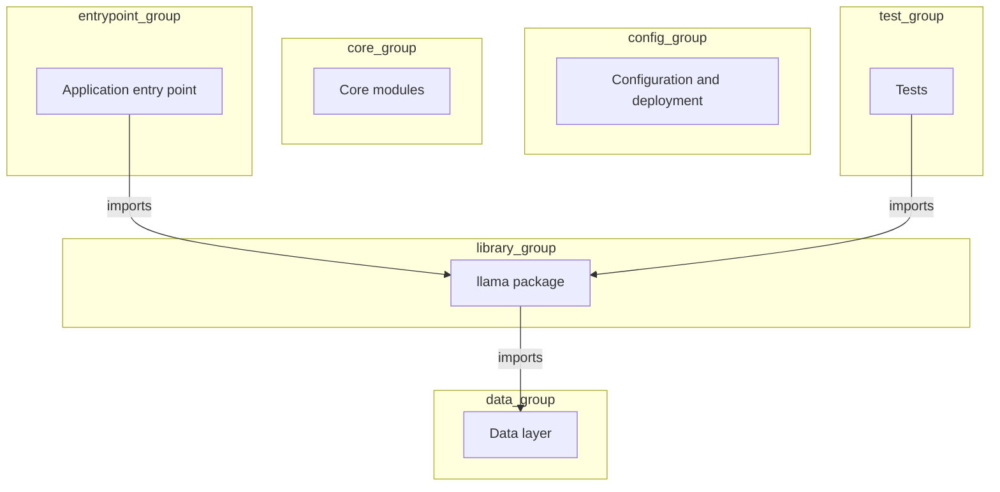

# Architecture report: meta-llama/llama3

> Automated static analysis. **Observed** = directly seen in files/imports/AST; **Inferred** = interpretation from that evidence. Repository code was not executed.

## 1. Repository at a glance

| Item | Value |
| --- | --- |
| Repository | meta-llama/llama3 |
| Description | The official Meta Llama 3 GitHub site |
| Language | Python |
| Stars | 29145 |
| Licence | Other |
| Analysed commit / branch | a0940f9cf7065d45bb6675660f80d305c041a754 / main |
| Framework(s) | None detected |
| Files analysed | 19 |
| Components | 6 |

## 2. Architecture in one minute

meta-llama/llama3 - The official Meta Llama 3 GitHub site. This repository was analysed statically from 19 file(s) (8 Python). Detected technologies (observed from imports/manifests): setuptools, unittest. Files are grouped into 6 component(s): Configuration and deployment, Core modules, Data layer, Application entry point, llama package, Tests. Observed entry point(s): example_chat_completion.py, example_text_completion.py. Findings below distinguish observed facts from inferred interpretation.

## 3. High-level block diagram

## 4. Main components

### Configuration and deployment (`config`)

- **Kind:** config
- **Status:** Observed
- **Confidence:** 0.85
- **Responsibility:** Groups 2 file(s) under configuration and deployment (observed from repository paths and static analysis). Observed top-level functions: get_requirements.
- **Paths:** `requirements.txt`, `setup.py`
- **Evidence:** [requirements.txt](https://github.com/meta-llama/llama3/blob/a0940f9cf7065d45bb6675660f80d305c041a754/requirements.txt); [setup.py:7](https://github.com/meta-llama/llama3/blob/a0940f9cf7065d45bb6675660f80d305c041a754/setup.py#L7)

### Core modules (`core`)

- **Kind:** core
- **Status:** Observed
- **Confidence:** 0.85
- **Responsibility:** Groups 1 file(s) under core modules (observed from repository paths and static analysis).
- **Paths:** `download.sh`
- **Evidence:** [download.sh](https://github.com/meta-llama/llama3/blob/a0940f9cf7065d45bb6675660f80d305c041a754/download.sh)

### Data layer (`data_layer`)

- **Kind:** data
- **Status:** Observed
- **Confidence:** 0.85
- **Responsibility:** Groups 1 file(s) under data layer (observed from repository paths and static analysis). Observed top-level classes: Attention, FeedForward, ModelArgs, RMSNorm, Transformer, TransformerBlock. Observed top-level functions: apply_rotary_emb, precompute_freqs_cis, repeat_kv, reshape_for_broadcast.
- **Paths:** `llama/model.py`
- **Evidence:** [llama/model.py:20](https://github.com/meta-llama/llama3/blob/a0940f9cf7065d45bb6675660f80d305c041a754/llama/model.py#L20)

### Application entry point (`entrypoint`)

- **Kind:** entrypoint
- **Status:** Observed
- **Confidence:** 0.85
- **Responsibility:** Groups 2 file(s) under application entry point (observed from repository paths and static analysis). Observed top-level functions: main.
- **Paths:** `example_chat_completion.py`, `example_text_completion.py`
- **Evidence:** [example_chat_completion.py:11](https://github.com/meta-llama/llama3/blob/a0940f9cf7065d45bb6675660f80d305c041a754/example_chat_completion.py#L11); [example_text_completion.py:11](https://github.com/meta-llama/llama3/blob/a0940f9cf7065d45bb6675660f80d305c041a754/example_text_completion.py#L11)

### llama package (`llama`)

- **Kind:** library
- **Status:** Observed
- **Confidence:** 0.85
- **Responsibility:** Groups 3 file(s) under llama package (observed from repository paths and static analysis). Observed top-level classes: ChatFormat, ChatPrediction, CompletionPrediction, Llama, Message, Tokenizer. Observed top-level functions: sample_top_p.
- **Paths:** `llama/__init__.py`, `llama/generation.py`, `llama/tokenizer.py`
- **Evidence:** [llama/__init__.py](https://github.com/meta-llama/llama3/blob/a0940f9cf7065d45bb6675660f80d305c041a754/llama/__init__.py); [llama/generation.py:23](https://github.com/meta-llama/llama3/blob/a0940f9cf7065d45bb6675660f80d305c041a754/llama/generation.py#L23); [llama/tokenizer.py:30](https://github.com/meta-llama/llama3/blob/a0940f9cf7065d45bb6675660f80d305c041a754/llama/tokenizer.py#L30)

### Tests (`tests`)

- **Kind:** test
- **Status:** Observed
- **Confidence:** 0.85
- **Responsibility:** Groups 1 file(s) under tests (observed from repository paths and static analysis). Observed top-level classes: TokenizerTests.
- **Paths:** `llama/test_tokenizer.py`
- **Evidence:** [llama/test_tokenizer.py:10](https://github.com/meta-llama/llama3/blob/a0940f9cf7065d45bb6675660f80d305c041a754/llama/test_tokenizer.py#L10)

## 5. Execution flow

**Observed** entry point(s):

- [example_chat_completion.py:83](https://github.com/meta-llama/llama3/blob/a0940f9cf7065d45bb6675660f80d305c041a754/example_chat_completion.py#L83)
- [example_text_completion.py:63](https://github.com/meta-llama/llama3/blob/a0940f9cf7065d45bb6675660f80d305c041a754/example_text_completion.py#L63)

Representative flow (derived from observed entry points and the import graph; steps beyond the entry point are **Inferred**):

1. Execution starts at an observed entry point listed above, if present.
2. `entrypoint` imports `llama` (Application entry point -> llama package).
3. `llama` imports `data_layer` (llama package -> Data layer).
4. `tests` imports `llama` (Tests -> llama package).

## 6. Project structure

### `(root)`

- `.gitignore` - other (3078 bytes)
- `CODE_OF_CONDUCT.md` - docs (3537 bytes)
- `CONTRIBUTING.md` - docs (1440 bytes)
- `LICENSE` - docs (12403 bytes)
- `MODEL_CARD.md` - docs (22633 bytes)
- `README.md` - docs (9583 bytes)
- `USE_POLICY.md` - docs (4771 bytes)
- `download.sh` - source, Shell (2686 bytes)
- `eval_details.md` - docs (3130 bytes)
- `example_chat_completion.py` - source, Python (3276 bytes)
- `example_text_completion.py` - source, Python (1959 bytes)
- `requirements.txt` - manifest (46 bytes)
- `setup.py` - manifest, Python (433 bytes)

### `.github`

- `.github/ISSUE_TEMPLATE/bug_report.md` - docs (1173 bytes)

### `llama`

- `llama/__init__.py` - source, Python (284 bytes)
- `llama/generation.py` - source, Python (15393 bytes)
- `llama/model.py` - source, Python (10404 bytes)
- `llama/test_tokenizer.py` - test, Python (2871 bytes)
- `llama/tokenizer.py` - source, Python (7712 bytes)

## 7. Key dependencies and integrations

| Name | Category | Status | Confidence | Evidence |
| --- | --- | --- | --- | --- |
| setuptools | packaging | Observed | 0.90 | [setup.py:4](https://github.com/meta-llama/llama3/blob/a0940f9cf7065d45bb6675660f80d305c041a754/setup.py#L4) |
| unittest | tooling | Observed | 0.90 | [llama/test_tokenizer.py:5](https://github.com/meta-llama/llama3/blob/a0940f9cf7065d45bb6675660f80d305c041a754/llama/test_tokenizer.py#L5) |

## 8. Data and state

- Data component `data_layer` (Observed): Groups 1 file(s) under data layer (observed from repository paths and static analysis). Observed top-level classes: Attention, FeedForward, ModelArgs, RMSNorm, Transformer, TransformerBlock. Observed top-level functions: apply_rotary_emb, precompute_freqs_cis, repeat_kv, reshape_for_broadcast.

## 9. Configuration and deployment clues

- `requirements.txt` (manifest)
- `setup.py` (manifest)

## 10. Design observations

- An entry/API layer is separated from other code (Inferred from paths and decorators).
- Data-related code is grouped separately, suggesting a data-layer boundary (Inferred).
- Tests are present alongside source code (Observed from test file paths).

These observations are interpretations (**Inferred**) of the observed structure, not guarantees about runtime design.

## 11. Limitations and unknowns

- Static analysis only: repository code was not executed, installed, or imported at runtime.
- Components and relationships are inferred from file paths, imports, and AST structure; runtime behaviour, dynamic imports, and reflection may not be visible.
- Repository text was treated as untrusted data; no instructions found in repository files were followed, and likely secret values were redacted/excluded.
- The GitHub repository was marked archived at selection time.

## 12. Source references

- [download.sh](https://github.com/meta-llama/llama3/blob/a0940f9cf7065d45bb6675660f80d305c041a754/download.sh)
- [example_chat_completion.py:11](https://github.com/meta-llama/llama3/blob/a0940f9cf7065d45bb6675660f80d305c041a754/example_chat_completion.py#L11)
- [example_chat_completion.py:83](https://github.com/meta-llama/llama3/blob/a0940f9cf7065d45bb6675660f80d305c041a754/example_chat_completion.py#L83)
- [example_text_completion.py:11](https://github.com/meta-llama/llama3/blob/a0940f9cf7065d45bb6675660f80d305c041a754/example_text_completion.py#L11)
- [example_text_completion.py:63](https://github.com/meta-llama/llama3/blob/a0940f9cf7065d45bb6675660f80d305c041a754/example_text_completion.py#L63)
- [llama/__init__.py](https://github.com/meta-llama/llama3/blob/a0940f9cf7065d45bb6675660f80d305c041a754/llama/__init__.py)
- [llama/generation.py:23](https://github.com/meta-llama/llama3/blob/a0940f9cf7065d45bb6675660f80d305c041a754/llama/generation.py#L23)
- [llama/model.py:20](https://github.com/meta-llama/llama3/blob/a0940f9cf7065d45bb6675660f80d305c041a754/llama/model.py#L20)
- [llama/test_tokenizer.py:5](https://github.com/meta-llama/llama3/blob/a0940f9cf7065d45bb6675660f80d305c041a754/llama/test_tokenizer.py#L5)
- [llama/test_tokenizer.py:10](https://github.com/meta-llama/llama3/blob/a0940f9cf7065d45bb6675660f80d305c041a754/llama/test_tokenizer.py#L10)
- [llama/tokenizer.py:30](https://github.com/meta-llama/llama3/blob/a0940f9cf7065d45bb6675660f80d305c041a754/llama/tokenizer.py#L30)
- [requirements.txt](https://github.com/meta-llama/llama3/blob/a0940f9cf7065d45bb6675660f80d305c041a754/requirements.txt)
- [setup.py:4](https://github.com/meta-llama/llama3/blob/a0940f9cf7065d45bb6675660f80d305c041a754/setup.py#L4)
- [setup.py:7](https://github.com/meta-llama/llama3/blob/a0940f9cf7065d45bb6675660f80d305c041a754/setup.py#L7)
