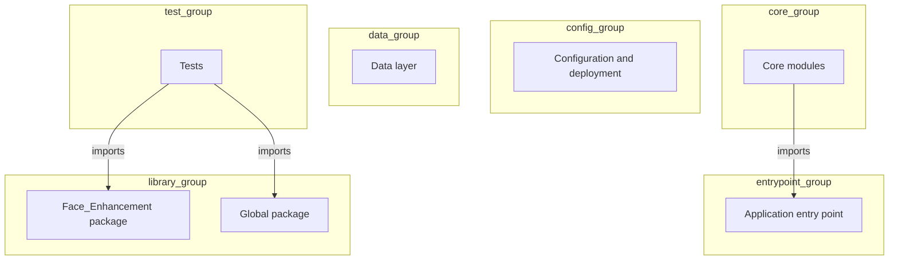

# Architecture report: microsoft/Bringing-Old-Photos-Back-to-Life

> Automated static analysis. **Observed** = directly seen in files/imports/AST; **Inferred** = interpretation from that evidence. Repository code was not executed.

## 1. Repository at a glance

| Item | Value |
| --- | --- |
| Repository | microsoft/Bringing-Old-Photos-Back-to-Life |
| Description | Bringing Old Photo Back to Life (CVPR 2020 oral) |
| Language | Python |
| Stars | 15691 |
| Licence | MIT |
| Analysed commit / branch | 33875eccf4ebcd3665cf38cc56f3a0ce563d3a9c / master |
| Framework(s) | None detected |
| Files analysed | 75 |
| Components | 7 |

## 2. Architecture in one minute

microsoft/Bringing-Old-Photos-Back-to-Life - Bringing Old Photo Back to Life (CVPR 2020 oral). This repository was analysed statically from 75 file(s) (63 Python). Detected technologies (observed from imports/manifests): NumPy, Docker. Files are grouped into 7 component(s): Configuration and deployment, Core modules, Data layer, Application entry point, Face_Enhancement package, Global package, Tests. Observed entry point(s): Face_Detection/align_warp_back_multiple_dlib.py, Face_Detection/align_warp_back_multiple_dlib_HR.py, Face_Detection/detect_all_dlib.py. Findings below distinguish observed facts from inferred interpretation.

## 3. High-level block diagram

## 4. Main components

### Configuration and deployment (`config`)

- **Kind:** config
- **Status:** Observed
- **Confidence:** 0.85
- **Responsibility:** Groups 6 file(s) under configuration and deployment (observed from repository paths and static analysis).
- **Paths:** `Dockerfile`, `Face_Enhancement/requirements.txt`, `ansible.yaml`, `cog.yaml`, `kubernetes-pod.yml`, `requirements.txt`
- **Evidence:** [Dockerfile](https://github.com/microsoft/Bringing-Old-Photos-Back-to-Life/blob/33875eccf4ebcd3665cf38cc56f3a0ce563d3a9c/Dockerfile); [Face_Enhancement/requirements.txt](https://github.com/microsoft/Bringing-Old-Photos-Back-to-Life/blob/33875eccf4ebcd3665cf38cc56f3a0ce563d3a9c/Face_Enhancement/requirements.txt); [ansible.yaml](https://github.com/microsoft/Bringing-Old-Photos-Back-to-Life/blob/33875eccf4ebcd3665cf38cc56f3a0ce563d3a9c/ansible.yaml); [cog.yaml](https://github.com/microsoft/Bringing-Old-Photos-Back-to-Life/blob/33875eccf4ebcd3665cf38cc56f3a0ce563d3a9c/cog.yaml); [kubernetes-pod.yml](https://github.com/microsoft/Bringing-Old-Photos-Back-to-Life/blob/33875eccf4ebcd3665cf38cc56f3a0ce563d3a9c/kubernetes-pod.yml); [requirements.txt](https://github.com/microsoft/Bringing-Old-Photos-Back-to-Life/blob/33875eccf4ebcd3665cf38cc56f3a0ce563d3a9c/requirements.txt)

### Core modules (`core`)

- **Kind:** core
- **Status:** Observed
- **Confidence:** 0.85
- **Responsibility:** Groups 2 file(s) under core modules (observed from repository paths and static analysis). Observed top-level classes: Predictor. Observed top-level functions: clean_folder, modify.
- **Paths:** `GUI.py`, `predict.py`
- **Evidence:** [GUI.py:11](https://github.com/microsoft/Bringing-Old-Photos-Back-to-Life/blob/33875eccf4ebcd3665cf38cc56f3a0ce563d3a9c/GUI.py#L11); [predict.py:12](https://github.com/microsoft/Bringing-Old-Photos-Back-to-Life/blob/33875eccf4ebcd3665cf38cc56f3a0ce563d3a9c/predict.py#L12)

### Data layer (`data_layer`)

- **Kind:** data
- **Status:** Observed
- **Confidence:** 0.85
- **Responsibility:** Groups 31 file(s) under data layer (observed from repository paths and static analysis). Observed top-level classes: BaseDataLoader, BaseDataset, BaseModel, BaseNetwork, BigFileMemoryLoader, ConvEncoder. Observed top-level functions: CreateDataLoader, CreateDataset, SN, __crop, __flip, __make_power_2.
- **Paths:** `Face_Enhancement/data/__init__.py`, `Face_Enhancement/data/base_dataset.py`, `Face_Enhancement/data/custom_dataset.py`, `Face_Enhancement/data/face_dataset.py`, `Face_Enhancement/data/image_folder.py`, `Face_Enhancement/data/pix2pix_dataset.py`, `Face_Enhancement/models/__init__.py`, `Face_Enhancement/models/networks/__init__.py`, `Face_Enhancement/models/networks/architecture.py`, `Face_Enhancement/models/networks/base_network.py`, `Face_Enhancement/models/networks/encoder.py`, `Face_Enhancement/models/networks/generator.py`, `Face_Enhancement/models/networks/normalization.py`, `Face_Enhancement/models/pix2pix_model.py`, `Global/data/Create_Bigfile.py`, `Global/data/Load_Bigfile.py`, `Global/data/__init__.py`, `Global/data/base_data_loader.py`, `Global/data/base_dataset.py`, `Global/data/custom_dataset_data_loader.py`, `Global/data/data_loader.py`, `Global/data/image_folder.py`, `Global/data/online_dataset_for_old_photos.py`, `Global/models/NonLocal_feature_mapping_model.py`, `Global/models/__init__.py`, `Global/models/base_model.py`, `Global/models/mapping_model.py`, `Global/models/models.py`, `Global/models/networks.py`, `Global/models/pix2pixHD_model.py`, `Global/models/pix2pixHD_model_DA.py`
- **Evidence:** [Face_Enhancement/data/__init__.py:10](https://github.com/microsoft/Bringing-Old-Photos-Back-to-Life/blob/33875eccf4ebcd3665cf38cc56f3a0ce563d3a9c/Face_Enhancement/data/__init__.py#L10); [Face_Enhancement/data/base_dataset.py:11](https://github.com/microsoft/Bringing-Old-Photos-Back-to-Life/blob/33875eccf4ebcd3665cf38cc56f3a0ce563d3a9c/Face_Enhancement/data/base_dataset.py#L11); [Face_Enhancement/data/custom_dataset.py:8](https://github.com/microsoft/Bringing-Old-Photos-Back-to-Life/blob/33875eccf4ebcd3665cf38cc56f3a0ce563d3a9c/Face_Enhancement/data/custom_dataset.py#L8); [Face_Enhancement/data/face_dataset.py:11](https://github.com/microsoft/Bringing-Old-Photos-Back-to-Life/blob/33875eccf4ebcd3665cf38cc56f3a0ce563d3a9c/Face_Enhancement/data/face_dataset.py#L11); [Face_Enhancement/data/image_folder.py:24](https://github.com/microsoft/Bringing-Old-Photos-Back-to-Life/blob/33875eccf4ebcd3665cf38cc56f3a0ce563d3a9c/Face_Enhancement/data/image_folder.py#L24); [Face_Enhancement/data/pix2pix_dataset.py:10](https://github.com/microsoft/Bringing-Old-Photos-Back-to-Life/blob/33875eccf4ebcd3665cf38cc56f3a0ce563d3a9c/Face_Enhancement/data/pix2pix_dataset.py#L10); [Face_Enhancement/models/__init__.py:8](https://github.com/microsoft/Bringing-Old-Photos-Back-to-Life/blob/33875eccf4ebcd3665cf38cc56f3a0ce563d3a9c/Face_Enhancement/models/__init__.py#L8); [Face_Enhancement/models/networks/__init__.py:11](https://github.com/microsoft/Bringing-Old-Photos-Back-to-Life/blob/33875eccf4ebcd3665cf38cc56f3a0ce563d3a9c/Face_Enhancement/models/networks/__init__.py#L11)

### Application entry point (`entrypoint`)

- **Kind:** entrypoint
- **Status:** Observed
- **Confidence:** 0.85
- **Responsibility:** Groups 8 file(s) under application entry point (observed from repository paths and static analysis). Observed top-level classes: UNet, UNetConvBlock, UNetUpBlock, UnetGenerator, UnetSkipConnectionBlock. Observed top-level functions: Poisson_B, Poisson_blending, _origin_face_pts, _standard_face_pts, affine2theta, blend_mask.
- **Paths:** `Face_Detection/align_warp_back_multiple_dlib.py`, `Face_Detection/align_warp_back_multiple_dlib_HR.py`, `Face_Detection/detect_all_dlib.py`, `Face_Detection/detect_all_dlib_HR.py`, `Global/detection.py`, `Global/detection_models/networks.py`, `Global/test.py`, `run.py`
- **Evidence:** [Face_Detection/align_warp_back_multiple_dlib.py:26](https://github.com/microsoft/Bringing-Old-Photos-Back-to-Life/blob/33875eccf4ebcd3665cf38cc56f3a0ce563d3a9c/Face_Detection/align_warp_back_multiple_dlib.py#L26); [Face_Detection/align_warp_back_multiple_dlib_HR.py:26](https://github.com/microsoft/Bringing-Old-Photos-Back-to-Life/blob/33875eccf4ebcd3665cf38cc56f3a0ce563d3a9c/Face_Detection/align_warp_back_multiple_dlib_HR.py#L26); [Face_Detection/detect_all_dlib.py:27](https://github.com/microsoft/Bringing-Old-Photos-Back-to-Life/blob/33875eccf4ebcd3665cf38cc56f3a0ce563d3a9c/Face_Detection/detect_all_dlib.py#L27); [Face_Detection/detect_all_dlib_HR.py:27](https://github.com/microsoft/Bringing-Old-Photos-Back-to-Life/blob/33875eccf4ebcd3665cf38cc56f3a0ce563d3a9c/Face_Detection/detect_all_dlib_HR.py#L27); [Global/detection.py:25](https://github.com/microsoft/Bringing-Old-Photos-Back-to-Life/blob/33875eccf4ebcd3665cf38cc56f3a0ce563d3a9c/Global/detection.py#L25); [Global/detection_models/networks.py:11](https://github.com/microsoft/Bringing-Old-Photos-Back-to-Life/blob/33875eccf4ebcd3665cf38cc56f3a0ce563d3a9c/Global/detection_models/networks.py#L11); [Global/test.py:18](https://github.com/microsoft/Bringing-Old-Photos-Back-to-Life/blob/33875eccf4ebcd3665cf38cc56f3a0ce563d3a9c/Global/test.py#L18); [run.py:10](https://github.com/microsoft/Bringing-Old-Photos-Back-to-Life/blob/33875eccf4ebcd3665cf38cc56f3a0ce563d3a9c/run.py#L10)

### Face_Enhancement package (`face_enhancement`)

- **Kind:** library
- **Status:** Observed
- **Confidence:** 0.85
- **Responsibility:** Groups 6 file(s) under face_enhancement package (observed from repository paths and static analysis). Observed top-level classes: BaseOptions, Colorize, IterationCounter, Visualizer. Observed top-level functions: atoi, copyconf, find_class_in_module, load_network, load_obj, mkdir.
- **Paths:** `Face_Enhancement/options/__init__.py`, `Face_Enhancement/options/base_options.py`, `Face_Enhancement/util/__init__.py`, `Face_Enhancement/util/iter_counter.py`, `Face_Enhancement/util/util.py`, `Face_Enhancement/util/visualizer.py`
- **Evidence:** [Face_Enhancement/options/__init__.py](https://github.com/microsoft/Bringing-Old-Photos-Back-to-Life/blob/33875eccf4ebcd3665cf38cc56f3a0ce563d3a9c/Face_Enhancement/options/__init__.py); [Face_Enhancement/options/base_options.py:14](https://github.com/microsoft/Bringing-Old-Photos-Back-to-Life/blob/33875eccf4ebcd3665cf38cc56f3a0ce563d3a9c/Face_Enhancement/options/base_options.py#L14); [Face_Enhancement/util/__init__.py](https://github.com/microsoft/Bringing-Old-Photos-Back-to-Life/blob/33875eccf4ebcd3665cf38cc56f3a0ce563d3a9c/Face_Enhancement/util/__init__.py); [Face_Enhancement/util/iter_counter.py:10](https://github.com/microsoft/Bringing-Old-Photos-Back-to-Life/blob/33875eccf4ebcd3665cf38cc56f3a0ce563d3a9c/Face_Enhancement/util/iter_counter.py#L10); [Face_Enhancement/util/util.py:15](https://github.com/microsoft/Bringing-Old-Photos-Back-to-Life/blob/33875eccf4ebcd3665cf38cc56f3a0ce563d3a9c/Face_Enhancement/util/util.py#L15); [Face_Enhancement/util/visualizer.py:20](https://github.com/microsoft/Bringing-Old-Photos-Back-to-Life/blob/33875eccf4ebcd3665cf38cc56f3a0ce563d3a9c/Face_Enhancement/util/visualizer.py#L20)

### Global package (`global`)

- **Kind:** library
- **Status:** Observed
- **Confidence:** 0.85
- **Responsibility:** Groups 13 file(s) under global package (observed from repository paths and static analysis). Observed top-level classes: BaseOptions, Downsample, ImagePool, Timer, TrainOptions, Visualizer. Observed top-level functions: clean_tensorboard, config_parse, get_dir_size, get_pad_layer, get_size, imshow.
- **Paths:** `Global/detection_models/__init__.py`, `Global/detection_models/antialiasing.py`, `Global/detection_util/util.py`, `Global/options/__init__.py`, `Global/options/base_options.py`, `Global/options/train_options.py`, `Global/train_domain_A.py`, `Global/train_domain_B.py`, `Global/train_mapping.py`, `Global/util/__init__.py`, `Global/util/image_pool.py`, `Global/util/util.py`, `Global/util/visualizer.py`
- **Evidence:** [Global/detection_models/__init__.py](https://github.com/microsoft/Bringing-Old-Photos-Back-to-Life/blob/33875eccf4ebcd3665cf38cc56f3a0ce563d3a9c/Global/detection_models/__init__.py); [Global/detection_models/antialiasing.py:11](https://github.com/microsoft/Bringing-Old-Photos-Back-to-Life/blob/33875eccf4ebcd3665cf38cc56f3a0ce563d3a9c/Global/detection_models/antialiasing.py#L11); [Global/detection_util/util.py:25](https://github.com/microsoft/Bringing-Old-Photos-Back-to-Life/blob/33875eccf4ebcd3665cf38cc56f3a0ce563d3a9c/Global/detection_util/util.py#L25); [Global/options/__init__.py](https://github.com/microsoft/Bringing-Old-Photos-Back-to-Life/blob/33875eccf4ebcd3665cf38cc56f3a0ce563d3a9c/Global/options/__init__.py); [Global/options/base_options.py:10](https://github.com/microsoft/Bringing-Old-Photos-Back-to-Life/blob/33875eccf4ebcd3665cf38cc56f3a0ce563d3a9c/Global/options/base_options.py#L10); [Global/options/train_options.py:6](https://github.com/microsoft/Bringing-Old-Photos-Back-to-Life/blob/33875eccf4ebcd3665cf38cc56f3a0ce563d3a9c/Global/options/train_options.py#L6); [Global/train_domain_A.py](https://github.com/microsoft/Bringing-Old-Photos-Back-to-Life/blob/33875eccf4ebcd3665cf38cc56f3a0ce563d3a9c/Global/train_domain_A.py); [Global/train_domain_B.py](https://github.com/microsoft/Bringing-Old-Photos-Back-to-Life/blob/33875eccf4ebcd3665cf38cc56f3a0ce563d3a9c/Global/train_domain_B.py)

### Tests (`tests`)

- **Kind:** test
- **Status:** Observed
- **Confidence:** 0.85
- **Responsibility:** Groups 3 file(s) under tests (observed from repository paths and static analysis). Observed top-level classes: TestOptions.
- **Paths:** `Face_Enhancement/options/test_options.py`, `Face_Enhancement/test_face.py`, `Global/options/test_options.py`
- **Evidence:** [Face_Enhancement/options/test_options.py:7](https://github.com/microsoft/Bringing-Old-Photos-Back-to-Life/blob/33875eccf4ebcd3665cf38cc56f3a0ce563d3a9c/Face_Enhancement/options/test_options.py#L7); [Face_Enhancement/test_face.py](https://github.com/microsoft/Bringing-Old-Photos-Back-to-Life/blob/33875eccf4ebcd3665cf38cc56f3a0ce563d3a9c/Face_Enhancement/test_face.py); [Global/options/test_options.py:7](https://github.com/microsoft/Bringing-Old-Photos-Back-to-Life/blob/33875eccf4ebcd3665cf38cc56f3a0ce563d3a9c/Global/options/test_options.py#L7)

## 5. Execution flow

**Observed** entry point(s):

- [Face_Detection/align_warp_back_multiple_dlib.py:347](https://github.com/microsoft/Bringing-Old-Photos-Back-to-Life/blob/33875eccf4ebcd3665cf38cc56f3a0ce563d3a9c/Face_Detection/align_warp_back_multiple_dlib.py#L347)
- [Face_Detection/align_warp_back_multiple_dlib_HR.py:347](https://github.com/microsoft/Bringing-Old-Photos-Back-to-Life/blob/33875eccf4ebcd3665cf38cc56f3a0ce563d3a9c/Face_Detection/align_warp_back_multiple_dlib_HR.py#L347)
- [Face_Detection/detect_all_dlib.py:130](https://github.com/microsoft/Bringing-Old-Photos-Back-to-Life/blob/33875eccf4ebcd3665cf38cc56f3a0ce563d3a9c/Face_Detection/detect_all_dlib.py#L130)
- [Face_Detection/detect_all_dlib_HR.py:130](https://github.com/microsoft/Bringing-Old-Photos-Back-to-Life/blob/33875eccf4ebcd3665cf38cc56f3a0ce563d3a9c/Face_Detection/detect_all_dlib_HR.py#L130)
- [Global/detection.py:168](https://github.com/microsoft/Bringing-Old-Photos-Back-to-Life/blob/33875eccf4ebcd3665cf38cc56f3a0ce563d3a9c/Global/detection.py#L168)
- [Global/detection_models/networks.py:301](https://github.com/microsoft/Bringing-Old-Photos-Back-to-Life/blob/33875eccf4ebcd3665cf38cc56f3a0ce563d3a9c/Global/detection_models/networks.py#L301)
- [Global/test.py:95](https://github.com/microsoft/Bringing-Old-Photos-Back-to-Life/blob/33875eccf4ebcd3665cf38cc56f3a0ce563d3a9c/Global/test.py#L95)
- [run.py:17](https://github.com/microsoft/Bringing-Old-Photos-Back-to-Life/blob/33875eccf4ebcd3665cf38cc56f3a0ce563d3a9c/run.py#L17)

Representative flow (derived from observed entry points and the import graph; steps beyond the entry point are **Inferred**):

1. Execution starts at an observed entry point listed above, if present.
2. `core` imports `entrypoint` (Core modules -> Application entry point).
3. `tests` imports `face_enhancement` (Tests -> Face_Enhancement package).
4. `tests` imports `global` (Tests -> Global package).

## 6. Project structure

### `(root)`

- `.gitignore` - other (23 bytes)
- `CODE_OF_CONDUCT.md` - docs (444 bytes)
- `Dockerfile` - container (1358 bytes)
- `GUI.py` - source, Python (7241 bytes)
- `LICENSE` - docs (1141 bytes)
- `README.md` - docs (12303 bytes)
- `SECURITY.md` - docs (2780 bytes)
- `ansible.yaml` - config (3506 bytes)
- `cog.yaml` - config (551 bytes)
- `download-weights` - other (847 bytes)
- `kubernetes-pod.yml` - config (727 bytes)
- `predict.py` - source, Python (8086 bytes)
- `requirements.txt` - manifest (136 bytes)
- `run.py` - source, Python (6775 bytes)

### `Face_Detection`

- `Face_Detection/align_warp_back_multiple_dlib.py` - source, Python (13487 bytes)
- `Face_Detection/align_warp_back_multiple_dlib_HR.py` - source, Python (13487 bytes)
- `Face_Detection/detect_all_dlib.py` - source, Python (5291 bytes)
- `Face_Detection/detect_all_dlib_HR.py` - source, Python (5291 bytes)

### `Face_Enhancement`

- `Face_Enhancement/data/__init__.py` - source, Python (624 bytes)
- `Face_Enhancement/data/base_dataset.py` - source, Python (3892 bytes)
- `Face_Enhancement/data/custom_dataset.py` - source, Python (2149 bytes)
- `Face_Enhancement/data/face_dataset.py` - source, Python (3029 bytes)
- `Face_Enhancement/data/image_folder.py` - source, Python (2717 bytes)
- `Face_Enhancement/data/pix2pix_dataset.py` - source, Python (3911 bytes)
- `Face_Enhancement/models/__init__.py` - source, Python (1336 bytes)
- `Face_Enhancement/models/networks/__init__.py` - source, Python (1773 bytes)
- `Face_Enhancement/models/networks/architecture.py` - source, Python (6291 bytes)
- `Face_Enhancement/models/networks/base_network.py` - source, Python (2370 bytes)
- `Face_Enhancement/models/networks/encoder.py` - source, Python (1873 bytes)
- `Face_Enhancement/models/networks/generator.py` - source, Python (8343 bytes)
- `Face_Enhancement/models/networks/normalization.py` - source, Python (3848 bytes)
- `Face_Enhancement/models/pix2pix_model.py` - source, Python (9786 bytes)
- `Face_Enhancement/options/__init__.py` - source, Python (73 bytes)
- `Face_Enhancement/options/base_options.py` - source, Python (10935 bytes)
- `Face_Enhancement/options/test_options.py` - test, Python (968 bytes)
- `Face_Enhancement/requirements.txt` - manifest (97 bytes)
- `Face_Enhancement/test_face.py` - test, Python (1077 bytes)
- `Face_Enhancement/util/__init__.py` - source, Python (73 bytes)
- `Face_Enhancement/util/iter_counter.py` - source, Python (3009 bytes)
- `Face_Enhancement/util/util.py` - source, Python (6590 bytes)
- `Face_Enhancement/util/visualizer.py` - source, Python (4786 bytes)

### `Global`

- `Global/data/Create_Bigfile.py` - source, Python (1952 bytes)
- `Global/data/Load_Bigfile.py` - source, Python (1590 bytes)
- `Global/data/__init__.py` - source, Python (0 bytes)
- `Global/data/base_data_loader.py` - source, Python (268 bytes)
- `Global/data/base_dataset.py` - source, Python (3596 bytes)
- `Global/data/custom_dataset_data_loader.py` - source, Python (1316 bytes)
- `Global/data/data_loader.py` - source, Python (302 bytes)
- `Global/data/image_folder.py` - source, Python (1643 bytes)
- `Global/data/online_dataset_for_old_photos.py` - source, Python (15313 bytes)
- `Global/detection.py` - source, Python (5032 bytes)
- `Global/detection_models/__init__.py` - source, Python (0 bytes)
- `Global/detection_models/antialiasing.py` - source, Python (2451 bytes)
- `Global/detection_models/networks.py` - source, Python (11753 bytes)
- `Global/detection_util/util.py` - source, Python (7981 bytes)
- `Global/models/NonLocal_feature_mapping_model.py` - source, Python (6414 bytes)
- `Global/models/__init__.py` - source, Python (0 bytes)
- `Global/models/base_model.py` - source, Python (4281 bytes)
- `Global/models/mapping_model.py` - source, Python (13758 bytes)
- `Global/models/models.py` - source, Python (1212 bytes)
- `Global/models/networks.py` - source, Python (30705 bytes)
- `Global/models/pix2pixHD_model.py` - source, Python (15127 bytes)
- `Global/models/pix2pixHD_model_DA.py` - source, Python (16499 bytes)
- `Global/options/__init__.py` - source, Python (0 bytes)
- `Global/options/base_options.py` - source, Python (16231 bytes)
- `Global/options/test_options.py` - test, Python (4605 bytes)
- `Global/options/train_options.py` - source, Python (5199 bytes)
- `Global/test.py` - source, Python (6028 bytes)
- `Global/train_domain_A.py` - source, Python (5403 bytes)
- `Global/train_domain_B.py` - source, Python (5193 bytes)
- `Global/train_mapping.py` - source, Python (5954 bytes)
- `Global/util/__init__.py` - source, Python (0 bytes)
- `Global/util/image_pool.py` - source, Python (1166 bytes)
- `Global/util/util.py` - source, Python (1845 bytes)
- `Global/util/visualizer.py` - source, Python (5790 bytes)

## 7. Key dependencies and integrations

| Name | Category | Status | Confidence | Evidence |
| --- | --- | --- | --- | --- |
| NumPy | library | Observed | 0.95 | [Face_Detection/align_warp_back_multiple_dlib.py:5](https://github.com/microsoft/Bringing-Old-Photos-Back-to-Life/blob/33875eccf4ebcd3665cf38cc56f3a0ce563d3a9c/Face_Detection/align_warp_back_multiple_dlib.py#L5); [Face_Detection/align_warp_back_multiple_dlib_HR.py:5](https://github.com/microsoft/Bringing-Old-Photos-Back-to-Life/blob/33875eccf4ebcd3665cf38cc56f3a0ce563d3a9c/Face_Detection/align_warp_back_multiple_dlib_HR.py#L5); [Face_Detection/detect_all_dlib.py:5](https://github.com/microsoft/Bringing-Old-Photos-Back-to-Life/blob/33875eccf4ebcd3665cf38cc56f3a0ce563d3a9c/Face_Detection/detect_all_dlib.py#L5); [Face_Detection/detect_all_dlib_HR.py:5](https://github.com/microsoft/Bringing-Old-Photos-Back-to-Life/blob/33875eccf4ebcd3665cf38cc56f3a0ce563d3a9c/Face_Detection/detect_all_dlib_HR.py#L5) |
| Docker | tooling | Observed | 0.85 | [Dockerfile](https://github.com/microsoft/Bringing-Old-Photos-Back-to-Life/blob/33875eccf4ebcd3665cf38cc56f3a0ce563d3a9c/Dockerfile) |

## 8. Data and state

- Data component `data_layer` (Observed): Groups 31 file(s) under data layer (observed from repository paths and static analysis). Observed top-level classes: BaseDataLoader, BaseDataset, BaseModel, BaseNetwork, BigFileMemoryLoader, ConvEncoder. Observed top-level functions: CreateDataLoader, CreateDataset, SN, __crop, __flip, __make_power…

## 9. Configuration and deployment clues

- `Dockerfile` (container)
- `Face_Enhancement/requirements.txt` (manifest)
- `ansible.yaml` (config)
- `cog.yaml` (config)
- `kubernetes-pod.yml` (config)
- `requirements.txt` (manifest)

## 10. Design observations

- An entry/API layer is separated from other code (Inferred from paths and decorators).
- Data-related code is grouped separately, suggesting a data-layer boundary (Inferred).
- Tests are present alongside source code (Observed from test file paths).

These observations are interpretations (**Inferred**) of the observed structure, not guarantees about runtime design.

## 11. Limitations and unknowns

- Static analysis only: repository code was not executed, installed, or imported at runtime.
- Components and relationships are inferred from file paths, imports, and AST structure; runtime behaviour, dynamic imports, and reflection may not be visible.
- Repository text was treated as untrusted data; no instructions found in repository files were followed, and likely secret values were redacted/excluded.
- The GitHub repository was marked archived at selection time.

## 12. Source references

- [Dockerfile](https://github.com/microsoft/Bringing-Old-Photos-Back-to-Life/blob/33875eccf4ebcd3665cf38cc56f3a0ce563d3a9c/Dockerfile)
- [Face_Detection/align_warp_back_multiple_dlib.py:5](https://github.com/microsoft/Bringing-Old-Photos-Back-to-Life/blob/33875eccf4ebcd3665cf38cc56f3a0ce563d3a9c/Face_Detection/align_warp_back_multiple_dlib.py#L5)
- [Face_Detection/align_warp_back_multiple_dlib.py:26](https://github.com/microsoft/Bringing-Old-Photos-Back-to-Life/blob/33875eccf4ebcd3665cf38cc56f3a0ce563d3a9c/Face_Detection/align_warp_back_multiple_dlib.py#L26)
- [Face_Detection/align_warp_back_multiple_dlib.py:347](https://github.com/microsoft/Bringing-Old-Photos-Back-to-Life/blob/33875eccf4ebcd3665cf38cc56f3a0ce563d3a9c/Face_Detection/align_warp_back_multiple_dlib.py#L347)
- [Face_Detection/align_warp_back_multiple_dlib_HR.py:5](https://github.com/microsoft/Bringing-Old-Photos-Back-to-Life/blob/33875eccf4ebcd3665cf38cc56f3a0ce563d3a9c/Face_Detection/align_warp_back_multiple_dlib_HR.py#L5)
- [Face_Detection/align_warp_back_multiple_dlib_HR.py:26](https://github.com/microsoft/Bringing-Old-Photos-Back-to-Life/blob/33875eccf4ebcd3665cf38cc56f3a0ce563d3a9c/Face_Detection/align_warp_back_multiple_dlib_HR.py#L26)
- [Face_Detection/align_warp_back_multiple_dlib_HR.py:347](https://github.com/microsoft/Bringing-Old-Photos-Back-to-Life/blob/33875eccf4ebcd3665cf38cc56f3a0ce563d3a9c/Face_Detection/align_warp_back_multiple_dlib_HR.py#L347)
- [Face_Detection/detect_all_dlib.py:5](https://github.com/microsoft/Bringing-Old-Photos-Back-to-Life/blob/33875eccf4ebcd3665cf38cc56f3a0ce563d3a9c/Face_Detection/detect_all_dlib.py#L5)
- [Face_Detection/detect_all_dlib.py:27](https://github.com/microsoft/Bringing-Old-Photos-Back-to-Life/blob/33875eccf4ebcd3665cf38cc56f3a0ce563d3a9c/Face_Detection/detect_all_dlib.py#L27)
- [Face_Detection/detect_all_dlib.py:130](https://github.com/microsoft/Bringing-Old-Photos-Back-to-Life/blob/33875eccf4ebcd3665cf38cc56f3a0ce563d3a9c/Face_Detection/detect_all_dlib.py#L130)
- [Face_Detection/detect_all_dlib_HR.py:5](https://github.com/microsoft/Bringing-Old-Photos-Back-to-Life/blob/33875eccf4ebcd3665cf38cc56f3a0ce563d3a9c/Face_Detection/detect_all_dlib_HR.py#L5)
- [Face_Detection/detect_all_dlib_HR.py:27](https://github.com/microsoft/Bringing-Old-Photos-Back-to-Life/blob/33875eccf4ebcd3665cf38cc56f3a0ce563d3a9c/Face_Detection/detect_all_dlib_HR.py#L27)
- [Face_Detection/detect_all_dlib_HR.py:130](https://github.com/microsoft/Bringing-Old-Photos-Back-to-Life/blob/33875eccf4ebcd3665cf38cc56f3a0ce563d3a9c/Face_Detection/detect_all_dlib_HR.py#L130)
- [Face_Enhancement/data/__init__.py:10](https://github.com/microsoft/Bringing-Old-Photos-Back-to-Life/blob/33875eccf4ebcd3665cf38cc56f3a0ce563d3a9c/Face_Enhancement/data/__init__.py#L10)
- [Face_Enhancement/data/base_dataset.py:7](https://github.com/microsoft/Bringing-Old-Photos-Back-to-Life/blob/33875eccf4ebcd3665cf38cc56f3a0ce563d3a9c/Face_Enhancement/data/base_dataset.py#L7)
- [Face_Enhancement/data/base_dataset.py:11](https://github.com/microsoft/Bringing-Old-Photos-Back-to-Life/blob/33875eccf4ebcd3665cf38cc56f3a0ce563d3a9c/Face_Enhancement/data/base_dataset.py#L11)
- [Face_Enhancement/data/custom_dataset.py:8](https://github.com/microsoft/Bringing-Old-Photos-Back-to-Life/blob/33875eccf4ebcd3665cf38cc56f3a0ce563d3a9c/Face_Enhancement/data/custom_dataset.py#L8)
- [Face_Enhancement/data/face_dataset.py:11](https://github.com/microsoft/Bringing-Old-Photos-Back-to-Life/blob/33875eccf4ebcd3665cf38cc56f3a0ce563d3a9c/Face_Enhancement/data/face_dataset.py#L11)
- [Face_Enhancement/data/image_folder.py:24](https://github.com/microsoft/Bringing-Old-Photos-Back-to-Life/blob/33875eccf4ebcd3665cf38cc56f3a0ce563d3a9c/Face_Enhancement/data/image_folder.py#L24)
- [Face_Enhancement/data/pix2pix_dataset.py:10](https://github.com/microsoft/Bringing-Old-Photos-Back-to-Life/blob/33875eccf4ebcd3665cf38cc56f3a0ce563d3a9c/Face_Enhancement/data/pix2pix_dataset.py#L10)
- [Face_Enhancement/models/__init__.py:8](https://github.com/microsoft/Bringing-Old-Photos-Back-to-Life/blob/33875eccf4ebcd3665cf38cc56f3a0ce563d3a9c/Face_Enhancement/models/__init__.py#L8)
- [Face_Enhancement/models/networks/__init__.py:11](https://github.com/microsoft/Bringing-Old-Photos-Back-to-Life/blob/33875eccf4ebcd3665cf38cc56f3a0ce563d3a9c/Face_Enhancement/models/networks/__init__.py#L11)
- [Face_Enhancement/models/networks/encoder.py:5](https://github.com/microsoft/Bringing-Old-Photos-Back-to-Life/blob/33875eccf4ebcd3665cf38cc56f3a0ce563d3a9c/Face_Enhancement/models/networks/encoder.py#L5)
- [Face_Enhancement/options/__init__.py](https://github.com/microsoft/Bringing-Old-Photos-Back-to-Life/blob/33875eccf4ebcd3665cf38cc56f3a0ce563d3a9c/Face_Enhancement/options/__init__.py)
- [Face_Enhancement/options/base_options.py:14](https://github.com/microsoft/Bringing-Old-Photos-Back-to-Life/blob/33875eccf4ebcd3665cf38cc56f3a0ce563d3a9c/Face_Enhancement/options/base_options.py#L14)
- [Face_Enhancement/options/test_options.py:7](https://github.com/microsoft/Bringing-Old-Photos-Back-to-Life/blob/33875eccf4ebcd3665cf38cc56f3a0ce563d3a9c/Face_Enhancement/options/test_options.py#L7)
- [Face_Enhancement/requirements.txt](https://github.com/microsoft/Bringing-Old-Photos-Back-to-Life/blob/33875eccf4ebcd3665cf38cc56f3a0ce563d3a9c/Face_Enhancement/requirements.txt)
- [Face_Enhancement/test_face.py](https://github.com/microsoft/Bringing-Old-Photos-Back-to-Life/blob/33875eccf4ebcd3665cf38cc56f3a0ce563d3a9c/Face_Enhancement/test_face.py)
- [Face_Enhancement/util/__init__.py](https://github.com/microsoft/Bringing-Old-Photos-Back-to-Life/blob/33875eccf4ebcd3665cf38cc56f3a0ce563d3a9c/Face_Enhancement/util/__init__.py)
- [Face_Enhancement/util/iter_counter.py:6](https://github.com/microsoft/Bringing-Old-Photos-Back-to-Life/blob/33875eccf4ebcd3665cf38cc56f3a0ce563d3a9c/Face_Enhancement/util/iter_counter.py#L6)
- [Face_Enhancement/util/iter_counter.py:10](https://github.com/microsoft/Bringing-Old-Photos-Back-to-Life/blob/33875eccf4ebcd3665cf38cc56f3a0ce563d3a9c/Face_Enhancement/util/iter_counter.py#L10)
- [Face_Enhancement/util/util.py:8](https://github.com/microsoft/Bringing-Old-Photos-Back-to-Life/blob/33875eccf4ebcd3665cf38cc56f3a0ce563d3a9c/Face_Enhancement/util/util.py#L8)
- [Face_Enhancement/util/util.py:15](https://github.com/microsoft/Bringing-Old-Photos-Back-to-Life/blob/33875eccf4ebcd3665cf38cc56f3a0ce563d3a9c/Face_Enhancement/util/util.py#L15)
- [Face_Enhancement/util/visualizer.py:20](https://github.com/microsoft/Bringing-Old-Photos-Back-to-Life/blob/33875eccf4ebcd3665cf38cc56f3a0ce563d3a9c/Face_Enhancement/util/visualizer.py#L20)
- [GUI.py:11](https://github.com/microsoft/Bringing-Old-Photos-Back-to-Life/blob/33875eccf4ebcd3665cf38cc56f3a0ce563d3a9c/GUI.py#L11)
- [Global/detection.py:25](https://github.com/microsoft/Bringing-Old-Photos-Back-to-Life/blob/33875eccf4ebcd3665cf38cc56f3a0ce563d3a9c/Global/detection.py#L25)
- [Global/detection.py:168](https://github.com/microsoft/Bringing-Old-Photos-Back-to-Life/blob/33875eccf4ebcd3665cf38cc56f3a0ce563d3a9c/Global/detection.py#L168)
- [Global/detection_models/__init__.py](https://github.com/microsoft/Bringing-Old-Photos-Back-to-Life/blob/33875eccf4ebcd3665cf38cc56f3a0ce563d3a9c/Global/detection_models/__init__.py)
- [Global/detection_models/antialiasing.py:11](https://github.com/microsoft/Bringing-Old-Photos-Back-to-Life/blob/33875eccf4ebcd3665cf38cc56f3a0ce563d3a9c/Global/detection_models/antialiasing.py#L11)
- [Global/detection_models/networks.py:11](https://github.com/microsoft/Bringing-Old-Photos-Back-to-Life/blob/33875eccf4ebcd3665cf38cc56f3a0ce563d3a9c/Global/detection_models/networks.py#L11)
- [Global/detection_models/networks.py:301](https://github.com/microsoft/Bringing-Old-Photos-Back-to-Life/blob/33875eccf4ebcd3665cf38cc56f3a0ce563d3a9c/Global/detection_models/networks.py#L301)
- [Global/detection_util/util.py:25](https://github.com/microsoft/Bringing-Old-Photos-Back-to-Life/blob/33875eccf4ebcd3665cf38cc56f3a0ce563d3a9c/Global/detection_util/util.py#L25)
- [Global/options/__init__.py](https://github.com/microsoft/Bringing-Old-Photos-Back-to-Life/blob/33875eccf4ebcd3665cf38cc56f3a0ce563d3a9c/Global/options/__init__.py)
- [Global/options/base_options.py:10](https://github.com/microsoft/Bringing-Old-Photos-Back-to-Life/blob/33875eccf4ebcd3665cf38cc56f3a0ce563d3a9c/Global/options/base_options.py#L10)
- [Global/options/test_options.py:7](https://github.com/microsoft/Bringing-Old-Photos-Back-to-Life/blob/33875eccf4ebcd3665cf38cc56f3a0ce563d3a9c/Global/options/test_options.py#L7)
- [Global/options/train_options.py:6](https://github.com/microsoft/Bringing-Old-Photos-Back-to-Life/blob/33875eccf4ebcd3665cf38cc56f3a0ce563d3a9c/Global/options/train_options.py#L6)
- [Global/test.py:18](https://github.com/microsoft/Bringing-Old-Photos-Back-to-Life/blob/33875eccf4ebcd3665cf38cc56f3a0ce563d3a9c/Global/test.py#L18)
- [Global/test.py:95](https://github.com/microsoft/Bringing-Old-Photos-Back-to-Life/blob/33875eccf4ebcd3665cf38cc56f3a0ce563d3a9c/Global/test.py#L95)
- [Global/train_domain_A.py](https://github.com/microsoft/Bringing-Old-Photos-Back-to-Life/blob/33875eccf4ebcd3665cf38cc56f3a0ce563d3a9c/Global/train_domain_A.py)
- [Global/train_domain_B.py](https://github.com/microsoft/Bringing-Old-Photos-Back-to-Life/blob/33875eccf4ebcd3665cf38cc56f3a0ce563d3a9c/Global/train_domain_B.py)
- [ansible.yaml](https://github.com/microsoft/Bringing-Old-Photos-Back-to-Life/blob/33875eccf4ebcd3665cf38cc56f3a0ce563d3a9c/ansible.yaml)
- [cog.yaml](https://github.com/microsoft/Bringing-Old-Photos-Back-to-Life/blob/33875eccf4ebcd3665cf38cc56f3a0ce563d3a9c/cog.yaml)
- [kubernetes-pod.yml](https://github.com/microsoft/Bringing-Old-Photos-Back-to-Life/blob/33875eccf4ebcd3665cf38cc56f3a0ce563d3a9c/kubernetes-pod.yml)
- [predict.py:12](https://github.com/microsoft/Bringing-Old-Photos-Back-to-Life/blob/33875eccf4ebcd3665cf38cc56f3a0ce563d3a9c/predict.py#L12)
- [requirements.txt](https://github.com/microsoft/Bringing-Old-Photos-Back-to-Life/blob/33875eccf4ebcd3665cf38cc56f3a0ce563d3a9c/requirements.txt)
- [run.py:10](https://github.com/microsoft/Bringing-Old-Photos-Back-to-Life/blob/33875eccf4ebcd3665cf38cc56f3a0ce563d3a9c/run.py#L10)
- [run.py:17](https://github.com/microsoft/Bringing-Old-Photos-Back-to-Life/blob/33875eccf4ebcd3665cf38cc56f3a0ce563d3a9c/run.py#L17)
