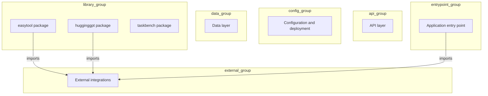

# Architecture report: microsoft/JARVIS

> Automated static analysis. **Observed** = directly seen in files/imports/AST; **Inferred** = interpretation from that evidence. Repository code was not executed.

## 1. Repository at a glance

| Item | Value |
| --- | --- |
| Repository | microsoft/JARVIS |
| Description | JARVIS, a system to connect LLMs with ML community. Paper: https://arxiv.org/pdf/2303.17580.pdf |
| Language | Python |
| Stars | 25654 |
| Licence | MIT |
| Analysed commit / branch | 7624cf388b47334ff8a0868e7d862dde18cfda86 / main |
| Framework(s) | Electron, Flask, Vue |
| Files analysed | 87 |
| Components | 8 |

## 2. Architecture in one minute

microsoft/JARVIS - JARVIS, a system to connect LLMs with ML community. Paper: https://arxiv.org/pdf/2303.17580.pdf. This repository was analysed statically from 87 file(s) (20 Python). Detected technologies (observed from imports/manifests): Electron, Flask, Vue, aiohttp, axios, Click. Files are grouped into 8 component(s): API layer, Configuration and deployment, Data layer, easytool package, Application entry point, External integrations, hugginggpt package, taskbench package. Observed entry point(s): easytool/data_process.py, easytool/easytool/util.py, easytool/main.py. Findings below distinguish observed facts from inferred interpretation.

## 3. High-level block diagram

## 4. Main components

### API layer (`api_layer`)

- **Kind:** api
- **Status:** Observed
- **Confidence:** 0.85
- **Responsibility:** Groups 3 file(s) under api layer (observed from repository paths and static analysis).
- **Paths:** `hugginggpt/web/src/api/chatgpt.ts`, `hugginggpt/web/src/api/hugginggpt.ts`, `hugginggpt/web/src/views/home.vue`
- **Evidence:** [hugginggpt/web/src/api/chatgpt.ts](https://github.com/microsoft/JARVIS/blob/7624cf388b47334ff8a0868e7d862dde18cfda86/hugginggpt/web/src/api/chatgpt.ts); [hugginggpt/web/src/api/hugginggpt.ts](https://github.com/microsoft/JARVIS/blob/7624cf388b47334ff8a0868e7d862dde18cfda86/hugginggpt/web/src/api/hugginggpt.ts); [hugginggpt/web/src/views/home.vue](https://github.com/microsoft/JARVIS/blob/7624cf388b47334ff8a0868e7d862dde18cfda86/hugginggpt/web/src/views/home.vue)

### Configuration and deployment (`config`)

- **Kind:** config
- **Status:** Observed
- **Confidence:** 0.85
- **Responsibility:** Groups 26 file(s) under configuration and deployment (observed from repository paths and static analysis).
- **Paths:** `easytool/data_funcqa/tool_instruction/functions_data.json`, `easytool/data_restbench/tool_instruction/tmdb_tool.json`, `easytool/requirements.txt`, `hugginggpt/.dockerignore`, `hugginggpt/Dockerfile.jetson`, `hugginggpt/server/configs/config.azure.yaml`, `hugginggpt/server/configs/config.default.yaml`, `hugginggpt/server/configs/config.gradio.yaml`, `hugginggpt/server/configs/config.lite.yaml`, `hugginggpt/server/demos/demo_choose_model.json`, `hugginggpt/server/demos/demo_parse_task.json`, `hugginggpt/server/demos/demo_response_results.json`, `hugginggpt/server/requirements.txt`, `hugginggpt/web/electron/electron-builder.yml`, `hugginggpt/web/electron/package.json`, `hugginggpt/web/package.json`, `hugginggpt/web/src/config/index.ts`, `hugginggpt/web/tsconfig.config.json`, `hugginggpt/web/tsconfig.json`, `taskbench/data_dailylifeapis/graph_desc.json`, `taskbench/data_dailylifeapis/tool_desc.json`, `taskbench/data_huggingface/graph_desc.json`, `taskbench/data_huggingface/tool_desc.json`, `taskbench/data_multimedia/graph_desc.json`, `taskbench/data_multimedia/tool_desc.json`, `taskbench/requirements.txt`
- **Evidence:** [easytool/data_funcqa/tool_instruction/functions_data.json](https://github.com/microsoft/JARVIS/blob/7624cf388b47334ff8a0868e7d862dde18cfda86/easytool/data_funcqa/tool_instruction/functions_data.json); [easytool/data_restbench/tool_instruction/tmdb_tool.json](https://github.com/microsoft/JARVIS/blob/7624cf388b47334ff8a0868e7d862dde18cfda86/easytool/data_restbench/tool_instruction/tmdb_tool.json); [easytool/requirements.txt](https://github.com/microsoft/JARVIS/blob/7624cf388b47334ff8a0868e7d862dde18cfda86/easytool/requirements.txt); [hugginggpt/.dockerignore](https://github.com/microsoft/JARVIS/blob/7624cf388b47334ff8a0868e7d862dde18cfda86/hugginggpt/.dockerignore); [hugginggpt/Dockerfile.jetson](https://github.com/microsoft/JARVIS/blob/7624cf388b47334ff8a0868e7d862dde18cfda86/hugginggpt/Dockerfile.jetson); [hugginggpt/server/configs/config.azure.yaml](https://github.com/microsoft/JARVIS/blob/7624cf388b47334ff8a0868e7d862dde18cfda86/hugginggpt/server/configs/config.azure.yaml); [hugginggpt/server/configs/config.default.yaml](https://github.com/microsoft/JARVIS/blob/7624cf388b47334ff8a0868e7d862dde18cfda86/hugginggpt/server/configs/config.default.yaml); [hugginggpt/server/configs/config.gradio.yaml](https://github.com/microsoft/JARVIS/blob/7624cf388b47334ff8a0868e7d862dde18cfda86/hugginggpt/server/configs/config.gradio.yaml)

### Data layer (`data_layer`)

- **Kind:** data
- **Status:** Observed
- **Confidence:** 0.85
- **Responsibility:** Groups 1 file(s) under data layer (observed from repository paths and static analysis).
- **Paths:** `hugginggpt/server/models/download.sh`
- **Evidence:** [hugginggpt/server/models/download.sh](https://github.com/microsoft/JARVIS/blob/7624cf388b47334ff8a0868e7d862dde18cfda86/hugginggpt/server/models/download.sh)

### easytool package (`easytool`)

- **Kind:** library
- **Status:** Observed
- **Confidence:** 0.85
- **Responsibility:** Groups 6 file(s) under easytool package (observed from repository paths and static analysis). Observed top-level functions: Call_function, add_, answer_check, answer_generation, answer_generation_depend, answer_generation_direct.
- **Paths:** `easytool/data_funcqa/funchub/math.py`, `easytool/easytool/__init__.py`, `easytool/easytool/funcQA.py`, `easytool/easytool/restbench.py`, `easytool/easytool/toolbench.py`, `easytool/easytool/toolbench_retrieve.py`
- **Evidence:** [easytool/data_funcqa/funchub/math.py:5](https://github.com/microsoft/JARVIS/blob/7624cf388b47334ff8a0868e7d862dde18cfda86/easytool/data_funcqa/funchub/math.py#L5); [easytool/easytool/__init__.py](https://github.com/microsoft/JARVIS/blob/7624cf388b47334ff8a0868e7d862dde18cfda86/easytool/easytool/__init__.py); [easytool/easytool/funcQA.py:29](https://github.com/microsoft/JARVIS/blob/7624cf388b47334ff8a0868e7d862dde18cfda86/easytool/easytool/funcQA.py#L29); [easytool/easytool/restbench.py:31](https://github.com/microsoft/JARVIS/blob/7624cf388b47334ff8a0868e7d862dde18cfda86/easytool/easytool/restbench.py#L31); [easytool/easytool/toolbench.py:29](https://github.com/microsoft/JARVIS/blob/7624cf388b47334ff8a0868e7d862dde18cfda86/easytool/easytool/toolbench.py#L29); [easytool/easytool/toolbench_retrieve.py:29](https://github.com/microsoft/JARVIS/blob/7624cf388b47334ff8a0868e7d862dde18cfda86/easytool/easytool/toolbench_retrieve.py#L29)

### Application entry point (`entrypoint`)

- **Kind:** entrypoint
- **Status:** Observed
- **Confidence:** 0.85
- **Responsibility:** Groups 12 file(s) under application entry point (observed from repository paths and static analysis). Observed application object created via Flask. Observed routes: ROUTE /running, ROUTE /status/<path:model_id>, ROUTE /models/<path:model_id>. Observed top-level classes: ContentFormatError, GraphSampler, RateLimitError. Observed top-level functions: build_index, change_name, chat_huggingface, chitchat, choose_model, cli.
- **Paths:** `easytool/data_process.py`, `easytool/easytool/util.py`, `easytool/main.py`, `hugginggpt/server/awesome_chat.py`, `hugginggpt/server/models_server.py`, `taskbench/data_engine.py`, `taskbench/evaluate.py`, `taskbench/format_data.py`, `taskbench/generate_graph.py`, `taskbench/graph_sampler.py`, `taskbench/inference.py`, `taskbench/visualize_graph.py`
- **Evidence:** [easytool/data_process.py:14](https://github.com/microsoft/JARVIS/blob/7624cf388b47334ff8a0868e7d862dde18cfda86/easytool/data_process.py#L14); [easytool/easytool/util.py:7](https://github.com/microsoft/JARVIS/blob/7624cf388b47334ff8a0868e7d862dde18cfda86/easytool/easytool/util.py#L7); [easytool/main.py](https://github.com/microsoft/JARVIS/blob/7624cf388b47334ff8a0868e7d862dde18cfda86/easytool/main.py); [hugginggpt/server/awesome_chat.py:1019](https://github.com/microsoft/JARVIS/blob/7624cf388b47334ff8a0868e7d862dde18cfda86/hugginggpt/server/awesome_chat.py#L1019); [hugginggpt/server/models_server.py:71](https://github.com/microsoft/JARVIS/blob/7624cf388b47334ff8a0868e7d862dde18cfda86/hugginggpt/server/models_server.py#L71); [taskbench/data_engine.py:48](https://github.com/microsoft/JARVIS/blob/7624cf388b47334ff8a0868e7d862dde18cfda86/taskbench/data_engine.py#L48); [taskbench/evaluate.py:20](https://github.com/microsoft/JARVIS/blob/7624cf388b47334ff8a0868e7d862dde18cfda86/taskbench/evaluate.py#L20); [taskbench/format_data.py:5](https://github.com/microsoft/JARVIS/blob/7624cf388b47334ff8a0868e7d862dde18cfda86/taskbench/format_data.py#L5)

### External integrations (`external_integrations`)

- **Kind:** external
- **Status:** Inferred
- **Confidence:** 0.70
- **Responsibility:** Groups 0 file(s) under external integrations (observed from repository paths and static analysis).
- **Evidence:** [easytool/easytool/funcQA.py:16](https://github.com/microsoft/JARVIS/blob/7624cf388b47334ff8a0868e7d862dde18cfda86/easytool/easytool/funcQA.py#L16); [easytool/easytool/restbench.py:17](https://github.com/microsoft/JARVIS/blob/7624cf388b47334ff8a0868e7d862dde18cfda86/easytool/easytool/restbench.py#L17); [easytool/easytool/toolbench.py:16](https://github.com/microsoft/JARVIS/blob/7624cf388b47334ff8a0868e7d862dde18cfda86/easytool/easytool/toolbench.py#L16); [easytool/easytool/toolbench_retrieve.py:16](https://github.com/microsoft/JARVIS/blob/7624cf388b47334ff8a0868e7d862dde18cfda86/easytool/easytool/toolbench_retrieve.py#L16); [hugginggpt/server/awesome_chat.py:10](https://github.com/microsoft/JARVIS/blob/7624cf388b47334ff8a0868e7d862dde18cfda86/hugginggpt/server/awesome_chat.py#L10); [hugginggpt/server/run_gradio_demo.py:5](https://github.com/microsoft/JARVIS/blob/7624cf388b47334ff8a0868e7d862dde18cfda86/hugginggpt/server/run_gradio_demo.py#L5)

### hugginggpt package (`hugginggpt`)

- **Kind:** library
- **Status:** Observed
- **Confidence:** 0.85
- **Responsibility:** Groups 14 file(s) under hugginggpt package (observed from repository paths and static analysis). Observed top-level functions: add_message, add_text, bot, count_tokens, extract_medias, get_max_context_length.
- **Paths:** `hugginggpt/server/get_token_ids.py`, `hugginggpt/server/run_gradio_demo.py`, `hugginggpt/web/electron/main.js`, `hugginggpt/web/electron/preload.js`, `hugginggpt/web/env.d.ts`, `hugginggpt/web/postcss.config.js`, `hugginggpt/web/src/App.vue`, `hugginggpt/web/src/components/Loading.vue`, `hugginggpt/web/src/main.ts`, `hugginggpt/web/src/prompt/index.ts`, `hugginggpt/web/src/router/index.ts`, `hugginggpt/web/src/types/index.ts`, `hugginggpt/web/tailwind.config.js`, `hugginggpt/web/vite.config.ts`
- **Evidence:** [hugginggpt/server/get_token_ids.py:37](https://github.com/microsoft/JARVIS/blob/7624cf388b47334ff8a0868e7d862dde18cfda86/hugginggpt/server/get_token_ids.py#L37); [hugginggpt/server/run_gradio_demo.py:11](https://github.com/microsoft/JARVIS/blob/7624cf388b47334ff8a0868e7d862dde18cfda86/hugginggpt/server/run_gradio_demo.py#L11); [hugginggpt/web/electron/main.js](https://github.com/microsoft/JARVIS/blob/7624cf388b47334ff8a0868e7d862dde18cfda86/hugginggpt/web/electron/main.js); [hugginggpt/web/electron/preload.js](https://github.com/microsoft/JARVIS/blob/7624cf388b47334ff8a0868e7d862dde18cfda86/hugginggpt/web/electron/preload.js); [hugginggpt/web/env.d.ts](https://github.com/microsoft/JARVIS/blob/7624cf388b47334ff8a0868e7d862dde18cfda86/hugginggpt/web/env.d.ts); [hugginggpt/web/postcss.config.js](https://github.com/microsoft/JARVIS/blob/7624cf388b47334ff8a0868e7d862dde18cfda86/hugginggpt/web/postcss.config.js); [hugginggpt/web/src/App.vue](https://github.com/microsoft/JARVIS/blob/7624cf388b47334ff8a0868e7d862dde18cfda86/hugginggpt/web/src/App.vue); [hugginggpt/web/src/components/Loading.vue](https://github.com/microsoft/JARVIS/blob/7624cf388b47334ff8a0868e7d862dde18cfda86/hugginggpt/web/src/components/Loading.vue)

### taskbench package (`taskbench`)

- **Kind:** library
- **Status:** Observed
- **Confidence:** 0.85
- **Responsibility:** Groups 1 file(s) under taskbench package (observed from repository paths and static analysis).
- **Paths:** `taskbench/batch_evaluate.sh`
- **Evidence:** [taskbench/batch_evaluate.sh](https://github.com/microsoft/JARVIS/blob/7624cf388b47334ff8a0868e7d862dde18cfda86/taskbench/batch_evaluate.sh)

## 5. Execution flow

**Observed** entry point(s):

- [easytool/data_process.py:108](https://github.com/microsoft/JARVIS/blob/7624cf388b47334ff8a0868e7d862dde18cfda86/easytool/data_process.py#L108)
- [easytool/easytool/util.py:108](https://github.com/microsoft/JARVIS/blob/7624cf388b47334ff8a0868e7d862dde18cfda86/easytool/easytool/util.py#L108)
- [easytool/main.py:11](https://github.com/microsoft/JARVIS/blob/7624cf388b47334ff8a0868e7d862dde18cfda86/easytool/main.py#L11)
- [hugginggpt/server/awesome_chat.py:1019](https://github.com/microsoft/JARVIS/blob/7624cf388b47334ff8a0868e7d862dde18cfda86/hugginggpt/server/awesome_chat.py#L1019)
- [hugginggpt/server/models_server.py:71](https://github.com/microsoft/JARVIS/blob/7624cf388b47334ff8a0868e7d862dde18cfda86/hugginggpt/server/models_server.py#L71)
- [taskbench/data_engine.py:48](https://github.com/microsoft/JARVIS/blob/7624cf388b47334ff8a0868e7d862dde18cfda86/taskbench/data_engine.py#L48)
- [taskbench/evaluate.py:178](https://github.com/microsoft/JARVIS/blob/7624cf388b47334ff8a0868e7d862dde18cfda86/taskbench/evaluate.py#L178)
- [taskbench/format_data.py:60](https://github.com/microsoft/JARVIS/blob/7624cf388b47334ff8a0868e7d862dde18cfda86/taskbench/format_data.py#L60)
- [taskbench/generate_graph.py:49](https://github.com/microsoft/JARVIS/blob/7624cf388b47334ff8a0868e7d862dde18cfda86/taskbench/generate_graph.py#L49)
- [taskbench/graph_sampler.py:210](https://github.com/microsoft/JARVIS/blob/7624cf388b47334ff8a0868e7d862dde18cfda86/taskbench/graph_sampler.py#L210)
- [taskbench/inference.py:37](https://github.com/microsoft/JARVIS/blob/7624cf388b47334ff8a0868e7d862dde18cfda86/taskbench/inference.py#L37)
- [taskbench/visualize_graph.py:8](https://github.com/microsoft/JARVIS/blob/7624cf388b47334ff8a0868e7d862dde18cfda86/taskbench/visualize_graph.py#L8)

**Observed** routes (from decorators):

- `ROUTE /running` -> `running` in `hugginggpt/server/models_server.py:351`
- `ROUTE /status/<path:model_id>` -> `status` in `hugginggpt/server/models_server.py:355`
- `ROUTE /models/<path:model_id>` -> `models` in `hugginggpt/server/models_server.py:365`

Representative flow (derived from observed entry points and the import graph; steps beyond the entry point are **Inferred**):

1. Execution starts at an observed entry point listed above, if present.
2. `easytool` imports `external_integrations` (easytool package -> External integrations).
3. `entrypoint` imports `external_integrations` (Application entry point -> External integrations).
4. `hugginggpt` imports `external_integrations` (hugginggpt package -> External integrations).

## 6. Project structure

### `(root)`

- `.gitignore` - other (2387 bytes)
- `CITATION.cff` - other (1129 bytes)
- `CODE_OF_CONDUCT.md` - docs (444 bytes)
- `CONTRIBUTING.md` - docs (1700 bytes)
- `LICENSE` - docs (1141 bytes)
- `README.md` - docs (14987 bytes)
- `SECURITY.md` - docs (2757 bytes)
- `SUPPORT.md` - docs (1244 bytes)

### `easytool`

- `easytool/README.md` - docs (3701 bytes)
- `easytool/data_funcqa/funchub/math.py` - source, Python (4203 bytes)
- `easytool/data_funcqa/tool_instruction/functions_data.json` - config (7924 bytes)
- `easytool/data_funcqa/tool_instruction/tool_dic.jsonl` - data (1974 bytes)
- `easytool/data_process.py` - source, Python (4162 bytes)
- `easytool/data_restbench/tool_instruction/tmdb_tool.json` - config (26392 bytes)
- `easytool/easytool/__init__.py` - source, Python (13 bytes)
- `easytool/easytool/funcQA.py` - source, Python (32887 bytes)
- `easytool/easytool/restbench.py` - source, Python (4538 bytes)
- `easytool/easytool/toolbench.py` - source, Python (36352 bytes)
- `easytool/easytool/toolbench_retrieve.py` - source, Python (37197 bytes)
- `easytool/easytool/util.py` - source, Python (3214 bytes)
- `easytool/main.py` - source, Python (3790 bytes)
- `easytool/requirements.txt` - manifest (102 bytes)

### `hugginggpt`

- `hugginggpt/.dockerignore` - container (75 bytes)
- `hugginggpt/Dockerfile.jetson` - container (3704 bytes)
- `hugginggpt/README.md` - docs (14471 bytes)
- `hugginggpt/server/awesome_chat.py` - source, Python (45647 bytes)
- `hugginggpt/server/configs/config.azure.yaml` - config (4635 bytes)
- `hugginggpt/server/configs/config.default.yaml` - config (4698 bytes)
- `hugginggpt/server/configs/config.gradio.yaml` - config (4273 bytes)
- `hugginggpt/server/configs/config.lite.yaml` - config (4423 bytes)
- `hugginggpt/server/demos/demo_choose_model.json` - config (142 bytes)
- `hugginggpt/server/demos/demo_parse_task.json` - config (4269 bytes)
- `hugginggpt/server/demos/demo_response_results.json` - config (316 bytes)
- `hugginggpt/server/get_token_ids.py` - source, Python (2474 bytes)
- `hugginggpt/server/models/download.ps1` - other (1824 bytes)
- `hugginggpt/server/models/download.sh` - source, Shell (1743 bytes)
- `hugginggpt/server/models_server.py` - source, Python (31358 bytes)
- `hugginggpt/server/requirements.txt` - manifest (579 bytes)
- `hugginggpt/server/run_gradio_demo.py` - source, Python (5117 bytes)
- `hugginggpt/web/electron/electron-builder.yml` - config (281 bytes)
- `hugginggpt/web/electron/main.js` - source, JavaScript (1398 bytes)
- `hugginggpt/web/electron/package.json` - manifest (232 bytes)
- `hugginggpt/web/electron/preload.js` - source, JavaScript (542 bytes)
- `hugginggpt/web/env.d.ts` - source, TypeScript (38 bytes)
- `hugginggpt/web/index.html` - other (342 bytes)
- `hugginggpt/web/package.json` - manifest (874 bytes)
- `hugginggpt/web/postcss.config.js` - source, JavaScript (82 bytes)
- `hugginggpt/web/public/audio.svg` - other (658 bytes)
- `hugginggpt/web/public/video.svg` - other (2157 bytes)
- `hugginggpt/web/src/App.vue` - source, Vue (122 bytes)
- `hugginggpt/web/src/api/chatgpt.ts` - source, TypeScript (840 bytes)
- `hugginggpt/web/src/api/hugginggpt.ts` - source, TypeScript (753 bytes)
- `hugginggpt/web/src/assets/audio.svg` - other (1014 bytes)
- `hugginggpt/web/src/assets/chatgpt.svg` - other (6089 bytes)
- `hugginggpt/web/src/assets/clip.svg` - other (358 bytes)
- `hugginggpt/web/src/assets/huggingface.svg` - other (8927 bytes)
- `hugginggpt/web/src/assets/logo.svg` - other (10789 bytes)
- `hugginggpt/web/src/assets/setting.svg` - other (1358 bytes)
- `hugginggpt/web/src/assets/switch.svg` - other (396 bytes)
- `hugginggpt/web/src/assets/tailwind.css` - other (526 bytes)
- `hugginggpt/web/src/components/Loading.vue` - source, Vue (1704 bytes)
- `hugginggpt/web/src/config/index.ts` - source, TypeScript (338 bytes)
- `hugginggpt/web/src/main.ts` - source, TypeScript (186 bytes)
- `hugginggpt/web/src/prompt/index.ts` - source, TypeScript (3516 bytes)
- `hugginggpt/web/src/router/index.ts` - source, TypeScript (301 bytes)
- `hugginggpt/web/src/types/index.ts` - source, TypeScript (415 bytes)
- `hugginggpt/web/src/views/home.vue` - source, Vue (15074 bytes)
- `hugginggpt/web/tailwind.config.js` - source, JavaScript (175 bytes)
- `hugginggpt/web/tsconfig.config.json` - config (196 bytes)
- `hugginggpt/web/tsconfig.json` - config (306 bytes)
- `hugginggpt/web/vite.config.ts` - source, TypeScript (421 bytes)

### `taskbench`

- `taskbench/README.md` - docs (19343 bytes)
- `taskbench/batch_evaluate.sh` - source, Shell (786 bytes)
- `taskbench/data_dailylifeapis/graph_desc.json` - config (184749 bytes)
- `taskbench/data_dailylifeapis/tool_desc.json` - config (14069 bytes)
- `taskbench/data_engine.py` - source, Python (18683 bytes)
- `taskbench/data_huggingface/graph_desc.json` - config (32444 bytes)
- `taskbench/data_huggingface/tool_desc.json` - config (7878 bytes)
- `taskbench/data_multimedia/graph_desc.json` - config (56093 bytes)
- `taskbench/data_multimedia/tool_desc.json` - config (9043 bytes)
- `taskbench/evaluate.py` - source, Python (23540 bytes)
- `taskbench/format_data.py` - source, Python (4725 bytes)
- `taskbench/generate_graph.py` - source, Python (2702 bytes)
- `taskbench/graph_sampler.py` - source, Python (9484 bytes)
- `taskbench/inference.py` - source, Python (15189 bytes)
- `taskbench/requirements.txt` - manifest (190 bytes)
- `taskbench/visualize_graph.py` - source, Python (998 bytes)

## 7. Key dependencies and integrations

| Name | Category | Status | Confidence | Evidence |
| --- | --- | --- | --- | --- |
| Electron | framework | Observed | 0.85 | [hugginggpt/web/electron/package.json:6](https://github.com/microsoft/JARVIS/blob/7624cf388b47334ff8a0868e7d862dde18cfda86/hugginggpt/web/electron/package.json#L6) |
| Flask | framework | Observed | 0.95 | [hugginggpt/server/awesome_chat.py:21](https://github.com/microsoft/JARVIS/blob/7624cf388b47334ff8a0868e7d862dde18cfda86/hugginggpt/server/awesome_chat.py#L21); [hugginggpt/server/awesome_chat.py:22](https://github.com/microsoft/JARVIS/blob/7624cf388b47334ff8a0868e7d862dde18cfda86/hugginggpt/server/awesome_chat.py#L22); [hugginggpt/server/models_server.py:16](https://github.com/microsoft/JARVIS/blob/7624cf388b47334ff8a0868e7d862dde18cfda86/hugginggpt/server/models_server.py#L16); [hugginggpt/server/models_server.py:17](https://github.com/microsoft/JARVIS/blob/7624cf388b47334ff8a0868e7d862dde18cfda86/hugginggpt/server/models_server.py#L17) |
| Vue | framework | Observed | 0.85 | [hugginggpt/web/package.json:2](https://github.com/microsoft/JARVIS/blob/7624cf388b47334ff8a0868e7d862dde18cfda86/hugginggpt/web/package.json#L2) |
| aiohttp | library | Observed | 0.95 | [taskbench/data_engine.py:16](https://github.com/microsoft/JARVIS/blob/7624cf388b47334ff8a0868e7d862dde18cfda86/taskbench/data_engine.py#L16); [taskbench/inference.py:6](https://github.com/microsoft/JARVIS/blob/7624cf388b47334ff8a0868e7d862dde18cfda86/taskbench/inference.py#L6); [taskbench/requirements.txt:5](https://github.com/microsoft/JARVIS/blob/7624cf388b47334ff8a0868e7d862dde18cfda86/taskbench/requirements.txt#L5) |
| axios | library | Observed | 0.85 | [hugginggpt/web/package.json:15](https://github.com/microsoft/JARVIS/blob/7624cf388b47334ff8a0868e7d862dde18cfda86/hugginggpt/web/package.json#L15) |
| Click | library | Observed | 0.95 | [taskbench/data_engine.py:13](https://github.com/microsoft/JARVIS/blob/7624cf388b47334ff8a0868e7d862dde18cfda86/taskbench/data_engine.py#L13); [taskbench/evaluate.py:5](https://github.com/microsoft/JARVIS/blob/7624cf388b47334ff8a0868e7d862dde18cfda86/taskbench/evaluate.py#L5); [taskbench/format_data.py:2](https://github.com/microsoft/JARVIS/blob/7624cf388b47334ff8a0868e7d862dde18cfda86/taskbench/format_data.py#L2); [taskbench/generate_graph.py:2](https://github.com/microsoft/JARVIS/blob/7624cf388b47334ff8a0868e7d862dde18cfda86/taskbench/generate_graph.py#L2) |
| NumPy | library | Observed | 0.95 | [easytool/easytool/funcQA.py:15](https://github.com/microsoft/JARVIS/blob/7624cf388b47334ff8a0868e7d862dde18cfda86/easytool/easytool/funcQA.py#L15); [easytool/easytool/restbench.py:16](https://github.com/microsoft/JARVIS/blob/7624cf388b47334ff8a0868e7d862dde18cfda86/easytool/easytool/restbench.py#L16); [easytool/easytool/toolbench.py:15](https://github.com/microsoft/JARVIS/blob/7624cf388b47334ff8a0868e7d862dde18cfda86/easytool/easytool/toolbench.py#L15); [easytool/easytool/toolbench_retrieve.py:15](https://github.com/microsoft/JARVIS/blob/7624cf388b47334ff8a0868e7d862dde18cfda86/easytool/easytool/toolbench_retrieve.py#L15) |
| pandas | library | Observed | 0.85 | [taskbench/requirements.txt:7](https://github.com/microsoft/JARVIS/blob/7624cf388b47334ff8a0868e7d862dde18cfda86/taskbench/requirements.txt#L7) |
| requests | library | Observed | 0.95 | [easytool/easytool/funcQA.py:16](https://github.com/microsoft/JARVIS/blob/7624cf388b47334ff8a0868e7d862dde18cfda86/easytool/easytool/funcQA.py#L16); [easytool/easytool/restbench.py:17](https://github.com/microsoft/JARVIS/blob/7624cf388b47334ff8a0868e7d862dde18cfda86/easytool/easytool/restbench.py#L17); [easytool/easytool/toolbench.py:16](https://github.com/microsoft/JARVIS/blob/7624cf388b47334ff8a0868e7d862dde18cfda86/easytool/easytool/toolbench.py#L16); [easytool/easytool/toolbench_retrieve.py:16](https://github.com/microsoft/JARVIS/blob/7624cf388b47334ff8a0868e7d862dde18cfda86/easytool/easytool/toolbench_retrieve.py#L16) |
| Tailwind CSS | library | Observed | 0.85 | [hugginggpt/web/package.json:2](https://github.com/microsoft/JARVIS/blob/7624cf388b47334ff8a0868e7d862dde18cfda86/hugginggpt/web/package.json#L2) |
| Docker | tooling | Observed | 0.85 | [hugginggpt/Dockerfile.jetson](https://github.com/microsoft/JARVIS/blob/7624cf388b47334ff8a0868e7d862dde18cfda86/hugginggpt/Dockerfile.jetson) |
| TypeScript | tooling | Observed | 0.85 | [hugginggpt/web/package.json:27](https://github.com/microsoft/JARVIS/blob/7624cf388b47334ff8a0868e7d862dde18cfda86/hugginggpt/web/package.json#L27) |
| Vite | tooling | Observed | 0.85 | [hugginggpt/web/package.json:2](https://github.com/microsoft/JARVIS/blob/7624cf388b47334ff8a0868e7d862dde18cfda86/hugginggpt/web/package.json#L2) |

## 8. Data and state

- Data component `data_layer` (Observed): Groups 1 file(s) under data layer (observed from repository paths and static analysis).

## 9. Configuration and deployment clues

- `easytool/data_funcqa/tool_instruction/functions_data.json` (config)
- `easytool/data_restbench/tool_instruction/tmdb_tool.json` (config)
- `easytool/requirements.txt` (manifest)
- `hugginggpt/.dockerignore` (container)
- `hugginggpt/Dockerfile.jetson` (container)
- `hugginggpt/server/configs/config.azure.yaml` (config)
- `hugginggpt/server/configs/config.default.yaml` (config)
- `hugginggpt/server/configs/config.gradio.yaml` (config)
- `hugginggpt/server/configs/config.lite.yaml` (config)
- `hugginggpt/server/demos/demo_choose_model.json` (config)
- `hugginggpt/server/demos/demo_parse_task.json` (config)
- `hugginggpt/server/demos/demo_response_results.json` (config)
- `hugginggpt/server/requirements.txt` (manifest)
- `hugginggpt/web/electron/electron-builder.yml` (config)
- `hugginggpt/web/electron/package.json` (manifest)
- `hugginggpt/web/package.json` (manifest)
- `hugginggpt/web/tsconfig.config.json` (config)
- `hugginggpt/web/tsconfig.json` (config)
- `taskbench/data_dailylifeapis/graph_desc.json` (config)
- `taskbench/data_dailylifeapis/tool_desc.json` (config)
- `taskbench/data_huggingface/graph_desc.json` (config)
- `taskbench/data_huggingface/tool_desc.json` (config)
- `taskbench/data_multimedia/graph_desc.json` (config)
- `taskbench/data_multimedia/tool_desc.json` (config)
- `taskbench/requirements.txt` (manifest)

## 10. Design observations

- An entry/API layer is separated from other code (Inferred from paths and decorators).
- Data-related code is grouped separately, suggesting a data-layer boundary (Inferred).
- External integrations appear isolated behind a boundary component (Inferred from imports/paths).

These observations are interpretations (**Inferred**) of the observed structure, not guarantees about runtime design.

## 11. Limitations and unknowns

- Static analysis only: repository code was not executed, installed, or imported at runtime.
- Components and relationships are inferred from file paths, imports, and AST structure; runtime behaviour, dynamic imports, and reflection may not be visible.
- 1 file(s) were skipped during inventory (1 x likely secret file excluded).
- Repository text was treated as untrusted data; no instructions found in repository files were followed, and likely secret values were redacted/excluded.

## 12. Source references

- [easytool/data_funcqa/funchub/math.py:5](https://github.com/microsoft/JARVIS/blob/7624cf388b47334ff8a0868e7d862dde18cfda86/easytool/data_funcqa/funchub/math.py#L5)
- [easytool/data_funcqa/tool_instruction/functions_data.json](https://github.com/microsoft/JARVIS/blob/7624cf388b47334ff8a0868e7d862dde18cfda86/easytool/data_funcqa/tool_instruction/functions_data.json)
- [easytool/data_process.py:14](https://github.com/microsoft/JARVIS/blob/7624cf388b47334ff8a0868e7d862dde18cfda86/easytool/data_process.py#L14)
- [easytool/data_process.py:108](https://github.com/microsoft/JARVIS/blob/7624cf388b47334ff8a0868e7d862dde18cfda86/easytool/data_process.py#L108)
- [easytool/data_restbench/tool_instruction/tmdb_tool.json](https://github.com/microsoft/JARVIS/blob/7624cf388b47334ff8a0868e7d862dde18cfda86/easytool/data_restbench/tool_instruction/tmdb_tool.json)
- [easytool/easytool/__init__.py](https://github.com/microsoft/JARVIS/blob/7624cf388b47334ff8a0868e7d862dde18cfda86/easytool/easytool/__init__.py)
- [easytool/easytool/funcQA.py:15](https://github.com/microsoft/JARVIS/blob/7624cf388b47334ff8a0868e7d862dde18cfda86/easytool/easytool/funcQA.py#L15)
- [easytool/easytool/funcQA.py:16](https://github.com/microsoft/JARVIS/blob/7624cf388b47334ff8a0868e7d862dde18cfda86/easytool/easytool/funcQA.py#L16)
- [easytool/easytool/funcQA.py:29](https://github.com/microsoft/JARVIS/blob/7624cf388b47334ff8a0868e7d862dde18cfda86/easytool/easytool/funcQA.py#L29)
- [easytool/easytool/restbench.py:16](https://github.com/microsoft/JARVIS/blob/7624cf388b47334ff8a0868e7d862dde18cfda86/easytool/easytool/restbench.py#L16)
- [easytool/easytool/restbench.py:17](https://github.com/microsoft/JARVIS/blob/7624cf388b47334ff8a0868e7d862dde18cfda86/easytool/easytool/restbench.py#L17)
- [easytool/easytool/restbench.py:31](https://github.com/microsoft/JARVIS/blob/7624cf388b47334ff8a0868e7d862dde18cfda86/easytool/easytool/restbench.py#L31)
- [easytool/easytool/toolbench.py:15](https://github.com/microsoft/JARVIS/blob/7624cf388b47334ff8a0868e7d862dde18cfda86/easytool/easytool/toolbench.py#L15)
- [easytool/easytool/toolbench.py:16](https://github.com/microsoft/JARVIS/blob/7624cf388b47334ff8a0868e7d862dde18cfda86/easytool/easytool/toolbench.py#L16)
- [easytool/easytool/toolbench.py:29](https://github.com/microsoft/JARVIS/blob/7624cf388b47334ff8a0868e7d862dde18cfda86/easytool/easytool/toolbench.py#L29)
- [easytool/easytool/toolbench_retrieve.py:15](https://github.com/microsoft/JARVIS/blob/7624cf388b47334ff8a0868e7d862dde18cfda86/easytool/easytool/toolbench_retrieve.py#L15)
- [easytool/easytool/toolbench_retrieve.py:16](https://github.com/microsoft/JARVIS/blob/7624cf388b47334ff8a0868e7d862dde18cfda86/easytool/easytool/toolbench_retrieve.py#L16)
- [easytool/easytool/toolbench_retrieve.py:29](https://github.com/microsoft/JARVIS/blob/7624cf388b47334ff8a0868e7d862dde18cfda86/easytool/easytool/toolbench_retrieve.py#L29)
- [easytool/easytool/util.py:7](https://github.com/microsoft/JARVIS/blob/7624cf388b47334ff8a0868e7d862dde18cfda86/easytool/easytool/util.py#L7)
- [easytool/easytool/util.py:108](https://github.com/microsoft/JARVIS/blob/7624cf388b47334ff8a0868e7d862dde18cfda86/easytool/easytool/util.py#L108)
- [easytool/main.py](https://github.com/microsoft/JARVIS/blob/7624cf388b47334ff8a0868e7d862dde18cfda86/easytool/main.py)
- [easytool/main.py:11](https://github.com/microsoft/JARVIS/blob/7624cf388b47334ff8a0868e7d862dde18cfda86/easytool/main.py#L11)
- [easytool/requirements.txt](https://github.com/microsoft/JARVIS/blob/7624cf388b47334ff8a0868e7d862dde18cfda86/easytool/requirements.txt)
- [easytool/requirements.txt:6](https://github.com/microsoft/JARVIS/blob/7624cf388b47334ff8a0868e7d862dde18cfda86/easytool/requirements.txt#L6)
- [easytool/requirements.txt:7](https://github.com/microsoft/JARVIS/blob/7624cf388b47334ff8a0868e7d862dde18cfda86/easytool/requirements.txt#L7)
- [hugginggpt/.dockerignore](https://github.com/microsoft/JARVIS/blob/7624cf388b47334ff8a0868e7d862dde18cfda86/hugginggpt/.dockerignore)
- [hugginggpt/Dockerfile.jetson](https://github.com/microsoft/JARVIS/blob/7624cf388b47334ff8a0868e7d862dde18cfda86/hugginggpt/Dockerfile.jetson)
- [hugginggpt/server/awesome_chat.py:10](https://github.com/microsoft/JARVIS/blob/7624cf388b47334ff8a0868e7d862dde18cfda86/hugginggpt/server/awesome_chat.py#L10)
- [hugginggpt/server/awesome_chat.py:21](https://github.com/microsoft/JARVIS/blob/7624cf388b47334ff8a0868e7d862dde18cfda86/hugginggpt/server/awesome_chat.py#L21)
- [hugginggpt/server/awesome_chat.py:22](https://github.com/microsoft/JARVIS/blob/7624cf388b47334ff8a0868e7d862dde18cfda86/hugginggpt/server/awesome_chat.py#L22)
- [hugginggpt/server/awesome_chat.py:1019](https://github.com/microsoft/JARVIS/blob/7624cf388b47334ff8a0868e7d862dde18cfda86/hugginggpt/server/awesome_chat.py#L1019)
- [hugginggpt/server/configs/config.azure.yaml](https://github.com/microsoft/JARVIS/blob/7624cf388b47334ff8a0868e7d862dde18cfda86/hugginggpt/server/configs/config.azure.yaml)
- [hugginggpt/server/configs/config.default.yaml](https://github.com/microsoft/JARVIS/blob/7624cf388b47334ff8a0868e7d862dde18cfda86/hugginggpt/server/configs/config.default.yaml)
- [hugginggpt/server/configs/config.gradio.yaml](https://github.com/microsoft/JARVIS/blob/7624cf388b47334ff8a0868e7d862dde18cfda86/hugginggpt/server/configs/config.gradio.yaml)
- [hugginggpt/server/get_token_ids.py:37](https://github.com/microsoft/JARVIS/blob/7624cf388b47334ff8a0868e7d862dde18cfda86/hugginggpt/server/get_token_ids.py#L37)
- [hugginggpt/server/models/download.sh](https://github.com/microsoft/JARVIS/blob/7624cf388b47334ff8a0868e7d862dde18cfda86/hugginggpt/server/models/download.sh)
- [hugginggpt/server/models_server.py:5](https://github.com/microsoft/JARVIS/blob/7624cf388b47334ff8a0868e7d862dde18cfda86/hugginggpt/server/models_server.py#L5)
- [hugginggpt/server/models_server.py:16](https://github.com/microsoft/JARVIS/blob/7624cf388b47334ff8a0868e7d862dde18cfda86/hugginggpt/server/models_server.py#L16)
- [hugginggpt/server/models_server.py:17](https://github.com/microsoft/JARVIS/blob/7624cf388b47334ff8a0868e7d862dde18cfda86/hugginggpt/server/models_server.py#L17)
- [hugginggpt/server/models_server.py:71](https://github.com/microsoft/JARVIS/blob/7624cf388b47334ff8a0868e7d862dde18cfda86/hugginggpt/server/models_server.py#L71)
- [hugginggpt/server/requirements.txt:8](https://github.com/microsoft/JARVIS/blob/7624cf388b47334ff8a0868e7d862dde18cfda86/hugginggpt/server/requirements.txt#L8)
- [hugginggpt/server/run_gradio_demo.py:5](https://github.com/microsoft/JARVIS/blob/7624cf388b47334ff8a0868e7d862dde18cfda86/hugginggpt/server/run_gradio_demo.py#L5)
- [hugginggpt/server/run_gradio_demo.py:11](https://github.com/microsoft/JARVIS/blob/7624cf388b47334ff8a0868e7d862dde18cfda86/hugginggpt/server/run_gradio_demo.py#L11)
- [hugginggpt/web/electron/main.js](https://github.com/microsoft/JARVIS/blob/7624cf388b47334ff8a0868e7d862dde18cfda86/hugginggpt/web/electron/main.js)
- [hugginggpt/web/electron/package.json:6](https://github.com/microsoft/JARVIS/blob/7624cf388b47334ff8a0868e7d862dde18cfda86/hugginggpt/web/electron/package.json#L6)
- [hugginggpt/web/electron/preload.js](https://github.com/microsoft/JARVIS/blob/7624cf388b47334ff8a0868e7d862dde18cfda86/hugginggpt/web/electron/preload.js)
- [hugginggpt/web/env.d.ts](https://github.com/microsoft/JARVIS/blob/7624cf388b47334ff8a0868e7d862dde18cfda86/hugginggpt/web/env.d.ts)
- [hugginggpt/web/package.json:2](https://github.com/microsoft/JARVIS/blob/7624cf388b47334ff8a0868e7d862dde18cfda86/hugginggpt/web/package.json#L2)
- [hugginggpt/web/package.json:15](https://github.com/microsoft/JARVIS/blob/7624cf388b47334ff8a0868e7d862dde18cfda86/hugginggpt/web/package.json#L15)
- [hugginggpt/web/package.json:27](https://github.com/microsoft/JARVIS/blob/7624cf388b47334ff8a0868e7d862dde18cfda86/hugginggpt/web/package.json#L27)
- [hugginggpt/web/postcss.config.js](https://github.com/microsoft/JARVIS/blob/7624cf388b47334ff8a0868e7d862dde18cfda86/hugginggpt/web/postcss.config.js)
- [hugginggpt/web/src/App.vue](https://github.com/microsoft/JARVIS/blob/7624cf388b47334ff8a0868e7d862dde18cfda86/hugginggpt/web/src/App.vue)
- [hugginggpt/web/src/api/chatgpt.ts](https://github.com/microsoft/JARVIS/blob/7624cf388b47334ff8a0868e7d862dde18cfda86/hugginggpt/web/src/api/chatgpt.ts)
- [hugginggpt/web/src/api/hugginggpt.ts](https://github.com/microsoft/JARVIS/blob/7624cf388b47334ff8a0868e7d862dde18cfda86/hugginggpt/web/src/api/hugginggpt.ts)
- [hugginggpt/web/src/components/Loading.vue](https://github.com/microsoft/JARVIS/blob/7624cf388b47334ff8a0868e7d862dde18cfda86/hugginggpt/web/src/components/Loading.vue)
- [hugginggpt/web/src/views/home.vue](https://github.com/microsoft/JARVIS/blob/7624cf388b47334ff8a0868e7d862dde18cfda86/hugginggpt/web/src/views/home.vue)
- [taskbench/batch_evaluate.sh](https://github.com/microsoft/JARVIS/blob/7624cf388b47334ff8a0868e7d862dde18cfda86/taskbench/batch_evaluate.sh)
- [taskbench/data_engine.py:13](https://github.com/microsoft/JARVIS/blob/7624cf388b47334ff8a0868e7d862dde18cfda86/taskbench/data_engine.py#L13)
- [taskbench/data_engine.py:16](https://github.com/microsoft/JARVIS/blob/7624cf388b47334ff8a0868e7d862dde18cfda86/taskbench/data_engine.py#L16)
- [taskbench/data_engine.py:48](https://github.com/microsoft/JARVIS/blob/7624cf388b47334ff8a0868e7d862dde18cfda86/taskbench/data_engine.py#L48)
- [taskbench/evaluate.py:2](https://github.com/microsoft/JARVIS/blob/7624cf388b47334ff8a0868e7d862dde18cfda86/taskbench/evaluate.py#L2)
- [taskbench/evaluate.py:5](https://github.com/microsoft/JARVIS/blob/7624cf388b47334ff8a0868e7d862dde18cfda86/taskbench/evaluate.py#L5)
- [taskbench/evaluate.py:20](https://github.com/microsoft/JARVIS/blob/7624cf388b47334ff8a0868e7d862dde18cfda86/taskbench/evaluate.py#L20)
- [taskbench/evaluate.py:178](https://github.com/microsoft/JARVIS/blob/7624cf388b47334ff8a0868e7d862dde18cfda86/taskbench/evaluate.py#L178)
- [taskbench/format_data.py:2](https://github.com/microsoft/JARVIS/blob/7624cf388b47334ff8a0868e7d862dde18cfda86/taskbench/format_data.py#L2)
- [taskbench/format_data.py:5](https://github.com/microsoft/JARVIS/blob/7624cf388b47334ff8a0868e7d862dde18cfda86/taskbench/format_data.py#L5)
- [taskbench/format_data.py:60](https://github.com/microsoft/JARVIS/blob/7624cf388b47334ff8a0868e7d862dde18cfda86/taskbench/format_data.py#L60)
- [taskbench/generate_graph.py:2](https://github.com/microsoft/JARVIS/blob/7624cf388b47334ff8a0868e7d862dde18cfda86/taskbench/generate_graph.py#L2)
- [taskbench/generate_graph.py:49](https://github.com/microsoft/JARVIS/blob/7624cf388b47334ff8a0868e7d862dde18cfda86/taskbench/generate_graph.py#L49)
- [taskbench/graph_sampler.py:5](https://github.com/microsoft/JARVIS/blob/7624cf388b47334ff8a0868e7d862dde18cfda86/taskbench/graph_sampler.py#L5)
- [taskbench/graph_sampler.py:210](https://github.com/microsoft/JARVIS/blob/7624cf388b47334ff8a0868e7d862dde18cfda86/taskbench/graph_sampler.py#L210)
- [taskbench/inference.py:4](https://github.com/microsoft/JARVIS/blob/7624cf388b47334ff8a0868e7d862dde18cfda86/taskbench/inference.py#L4)
- [taskbench/inference.py:6](https://github.com/microsoft/JARVIS/blob/7624cf388b47334ff8a0868e7d862dde18cfda86/taskbench/inference.py#L6)
- [taskbench/inference.py:37](https://github.com/microsoft/JARVIS/blob/7624cf388b47334ff8a0868e7d862dde18cfda86/taskbench/inference.py#L37)
- [taskbench/requirements.txt:1](https://github.com/microsoft/JARVIS/blob/7624cf388b47334ff8a0868e7d862dde18cfda86/taskbench/requirements.txt#L1)
- [taskbench/requirements.txt:2](https://github.com/microsoft/JARVIS/blob/7624cf388b47334ff8a0868e7d862dde18cfda86/taskbench/requirements.txt#L2)
- [taskbench/requirements.txt:5](https://github.com/microsoft/JARVIS/blob/7624cf388b47334ff8a0868e7d862dde18cfda86/taskbench/requirements.txt#L5)
- [taskbench/requirements.txt:7](https://github.com/microsoft/JARVIS/blob/7624cf388b47334ff8a0868e7d862dde18cfda86/taskbench/requirements.txt#L7)
- [taskbench/requirements.txt:8](https://github.com/microsoft/JARVIS/blob/7624cf388b47334ff8a0868e7d862dde18cfda86/taskbench/requirements.txt#L8)
- [taskbench/visualize_graph.py:4](https://github.com/microsoft/JARVIS/blob/7624cf388b47334ff8a0868e7d862dde18cfda86/taskbench/visualize_graph.py#L4)
- [taskbench/visualize_graph.py:8](https://github.com/microsoft/JARVIS/blob/7624cf388b47334ff8a0868e7d862dde18cfda86/taskbench/visualize_graph.py#L8)
