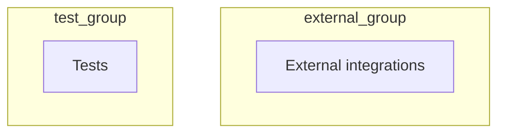

# Architecture report: microsoft/LoRA

> Automated static analysis. **Observed** = directly seen in files/imports/AST; **Inferred** = interpretation from that evidence. Repository code was not executed.

## 1. Repository at a glance

| Item | Value |
| --- | --- |
| Repository | microsoft/LoRA |
| Description | Code for loralib, an implementation of "LoRA: Low-Rank Adaptation of Large Language Models" |
| Language | Python |
| Stars | 13923 |
| Licence | MIT |
| Analysed commit / branch | c4593f060e6a368d7bb5af5273b8e42810cdef90 / main |
| Framework(s) | FastAPI, Starlette |
| Files analysed | 680 |
| Components | 2 |

## 2. Architecture in one minute

microsoft/LoRA - Code for loralib, an implementation of "LoRA: Low-Rank Adaptation of Large Language Models". This repository was analysed statically from 680 file(s) (388 Python). Detected technologies (observed from imports/manifests): FastAPI, Starlette, Click, NumPy, pandas, Pydantic. Files are grouped into 2 component(s): External integrations, Tests. Findings below distinguish observed facts from inferred interpretation.

## 3. High-level block diagram

## 4. Main components

### External integrations (`external_integrations`)

- **Kind:** external
- **Status:** Inferred
- **Confidence:** 0.70
- **Responsibility:** Groups 0 file(s) under external integrations (observed from repository paths and static analysis).
- **Evidence:** [examples/NLU/examples/legacy/seq2seq/utils.py:21](https://github.com/microsoft/LoRA/blob/c4593f060e6a368d7bb5af5273b8e42810cdef90/examples/NLU/examples/legacy/seq2seq/utils.py#L21); [examples/NLU/examples/research_projects/distillation/utils.py:21](https://github.com/microsoft/LoRA/blob/c4593f060e6a368d7bb5af5273b8e42810cdef90/examples/NLU/examples/research_projects/distillation/utils.py#L21); [examples/NLU/examples/research_projects/lxmert/utils.py:42](https://github.com/microsoft/LoRA/blob/c4593f060e6a368d7bb5af5273b8e42810cdef90/examples/NLU/examples/research_projects/lxmert/utils.py#L42); [examples/NLU/examples/research_projects/rag/utils_rag.py:7](https://github.com/microsoft/LoRA/blob/c4593f060e6a368d7bb5af5273b8e42810cdef90/examples/NLU/examples/research_projects/rag/utils_rag.py#L7); [examples/NLU/examples/research_projects/seq2seq-distillation/utils.py:7](https://github.com/microsoft/LoRA/blob/c4593f060e6a368d7bb5af5273b8e42810cdef90/examples/NLU/examples/research_projects/seq2seq-distillation/utils.py#L7); [examples/NLU/src/transformers/commands/lfs.py:27](https://github.com/microsoft/LoRA/blob/c4593f060e6a368d7bb5af5273b8e42810cdef90/examples/NLU/src/transformers/commands/lfs.py#L27)

### Tests (`tests`)

- **Kind:** test
- **Status:** Observed
- **Confidence:** 0.85
- **Responsibility:** Groups 15 file(s) under tests (observed from repository paths and static analysis). Observed top-level classes: DeeBertTests, ExamplesTests, GenerationUtilsTest, PabeeTests, RagRetrieverTest, SummarizationDataProcessingTest. Observed top-level functions: get_results, get_setup_file, is_cuda_and_apex_available, load_json, pytest_addoption, pytest_terminal_summary.
- **Paths:** `examples/NLU/examples/conftest.py`, `examples/NLU/examples/research_projects/bert-loses-patience/test_run_glue_with_pabee.py`, `examples/NLU/examples/research_projects/bertabs/test_utils_summarization.py`, `examples/NLU/examples/research_projects/deebert/test_glue_deebert.py`, `examples/NLU/examples/research_projects/rag/test_distributed_retriever.py`, `examples/NLU/examples/test_examples.py`, `examples/NLU/examples/test_xla_examples.py`, `examples/NLU/examples/tests/deepspeed/ds_config.json`, `examples/NLU/examples/tests/deepspeed/test_deepspeed.py`, `examples/NLU/examples/tests/trainer/test_trainer_ext.py`, `examples/NLU/src/transformers/data/test_generation_utils.py`, `examples/NLU/tests/__init__.py`, `examples/NLU/tests/fixtures/dummy-config.json`, `examples/NLU/tests/fixtures/empty.txt`, `examples/NLU/tests/fixtures/input.txt`
- **Evidence:** [examples/NLU/examples/conftest.py:33](https://github.com/microsoft/LoRA/blob/c4593f060e6a368d7bb5af5273b8e42810cdef90/examples/NLU/examples/conftest.py#L33); [examples/NLU/examples/research_projects/bert-loses-patience/test_run_glue_with_pabee.py:15](https://github.com/microsoft/LoRA/blob/c4593f060e6a368d7bb5af5273b8e42810cdef90/examples/NLU/examples/research_projects/bert-loses-patience/test_run_glue_with_pabee.py#L15); [examples/NLU/examples/research_projects/bertabs/test_utils_summarization.py:23](https://github.com/microsoft/LoRA/blob/c4593f060e6a368d7bb5af5273b8e42810cdef90/examples/NLU/examples/research_projects/bertabs/test_utils_summarization.py#L23); [examples/NLU/examples/research_projects/deebert/test_glue_deebert.py:15](https://github.com/microsoft/LoRA/blob/c4593f060e6a368d7bb5af5273b8e42810cdef90/examples/NLU/examples/research_projects/deebert/test_glue_deebert.py#L15); [examples/NLU/examples/research_projects/rag/test_distributed_retriever.py:39](https://github.com/microsoft/LoRA/blob/c4593f060e6a368d7bb5af5273b8e42810cdef90/examples/NLU/examples/research_projects/rag/test_distributed_retriever.py#L39); [examples/NLU/examples/test_examples.py:62](https://github.com/microsoft/LoRA/blob/c4593f060e6a368d7bb5af5273b8e42810cdef90/examples/NLU/examples/test_examples.py#L62); [examples/NLU/examples/test_xla_examples.py:32](https://github.com/microsoft/LoRA/blob/c4593f060e6a368d7bb5af5273b8e42810cdef90/examples/NLU/examples/test_xla_examples.py#L32); [examples/NLU/examples/tests/deepspeed/ds_config.json](https://github.com/microsoft/LoRA/blob/c4593f060e6a368d7bb5af5273b8e42810cdef90/examples/NLU/examples/tests/deepspeed/ds_config.json)

## 5. Execution flow

No entry point was observed; the startup flow below is therefore limited.

Representative flow (derived from observed entry points and the import graph; steps beyond the entry point are **Inferred**):

1. Execution starts at an observed entry point listed above, if present.
2. No internal import relationships between components were observed.

## 6. Project structure

### `(root)`

- `.gitignore` - other (1568 bytes)
- `LICENSE.md` - docs (1141 bytes)
- `README.md` - docs (14379 bytes)
- `SECURITY.md` - docs (2757 bytes)

### `examples`

- `examples/NLG/CODE_OF_CONDUCT.md` - docs (444 bytes)
- `examples/NLG/LICENSE` - docs (1141 bytes)
- `examples/NLG/README.md` - docs (5560 bytes)
- `examples/NLG/SECURITY.md` - docs (2780 bytes)
- `examples/NLG/create_datasets.sh` - source, Shell (2251 bytes)
- `examples/NLG/download_pretrained_checkpoints.sh` - source, Shell (403 bytes)
- `examples/NLG/eval/README.md` - docs (285 bytes)
- `examples/NLG/eval/download_evalscript.sh` - source, Shell (431 bytes)
- `examples/NLG/eval/eval.py` - source, Python (13598 bytes)
- `examples/NLG/requirement.txt` - docs (135 bytes)
- `examples/NLG/src/data_utils.py` - source, Python (9588 bytes)
- `examples/NLG/src/encoder.py` - source, Python (4797 bytes)
- `examples/NLG/src/exp_utils.py` - source, Python (1642 bytes)
- `examples/NLG/src/format_converting_dart.py` - source, Python (1435 bytes)
- `examples/NLG/src/format_converting_e2e.py` - source, Python (713 bytes)
- `examples/NLG/src/format_converting_webnlg.py` - source, Python (2146 bytes)
- `examples/NLG/src/gpt2_beam.py` - source, Python (15162 bytes)
- `examples/NLG/src/gpt2_decode.py` - source, Python (5853 bytes)
- `examples/NLG/src/gpt2_encode.py` - source, Python (2053 bytes)
- `examples/NLG/src/gpt2_ft.py` - source, Python (12549 bytes)
- `examples/NLG/src/gpu.py` - source, Python (4697 bytes)
- `examples/NLG/src/model.py` - source, Python (16345 bytes)
- `examples/NLG/src/optimizer.py` - source, Python (14444 bytes)
- `examples/NLG/vocab/config.json` - config (718 bytes)
- `examples/NLU/CODE_OF_CONDUCT.md` - docs (5226 bytes)
- `examples/NLU/CONTRIBUTING.md` - docs (13956 bytes)
- `examples/NLU/ISSUES.md` - docs (18848 bytes)
- `examples/NLU/LICENSE` - docs (11418 bytes)
- `examples/NLU/MANIFEST.in` - manifest (16 bytes)
- `examples/NLU/Makefile` - other (2312 bytes)
- `examples/NLU/README.md` - docs (5750 bytes)
- `examples/NLU/adapter_houlsby_roberta_large_mnli.sh` - source, Shell (793 bytes)
- `examples/NLU/adapter_pfeiffer_roberta_large_mnli.sh` - source, Shell (795 bytes)
- `examples/NLU/deberta_v2_xxlarge_cola.sh` - source, Shell (850 bytes)
- `examples/NLU/deberta_v2_xxlarge_mnli.sh` - source, Shell (852 bytes)
- `examples/NLU/deberta_v2_xxlarge_mrpc.sh` - source, Shell (893 bytes)
- `examples/NLU/deberta_v2_xxlarge_qnli.sh` - source, Shell (853 bytes)
- `examples/NLU/deberta_v2_xxlarge_qqp.sh` - source, Shell (854 bytes)
- `examples/NLU/deberta_v2_xxlarge_rte.sh` - source, Shell (893 bytes)
- `examples/NLU/deberta_v2_xxlarge_sst2.sh` - source, Shell (853 bytes)
- `examples/NLU/deberta_v2_xxlarge_stsb.sh` - source, Shell (893 bytes)
- `examples/NLU/docker/transformers-cpu/Dockerfile` - container (629 bytes)
- `examples/NLU/docker/transformers-gpu/Dockerfile` - container (846 bytes)
- `examples/NLU/docker/transformers-pytorch-cpu/Dockerfile` - container (608 bytes)
- `examples/NLU/docker/transformers-pytorch-gpu/Dockerfile` - container (825 bytes)
- `examples/NLU/docker/transformers-pytorch-tpu/Dockerfile` - container (2865 bytes)
- `examples/NLU/docker/transformers-pytorch-tpu/bert-base-cased.jsonnet` - other (929 bytes)
- `examples/NLU/docker/transformers-pytorch-tpu/dataset.yaml` - config (797 bytes)
- `examples/NLU/docker/transformers-pytorch-tpu/docker-entrypoint.sh` - source, Shell (247 bytes)
- `examples/NLU/docker/transformers-tensorflow-cpu/Dockerfile` - container (613 bytes)
- `examples/NLU/docker/transformers-tensorflow-gpu/Dockerfile` - container (640 bytes)
- `examples/NLU/docs/Makefile` - docs (585 bytes)
- `examples/NLU/docs/README.md` - docs (11749 bytes)
- `examples/NLU/docs/source/_static/css/code-snippets.css` - docs (297 bytes)
- `examples/NLU/docs/source/_static/css/huggingface.css` - docs (7257 bytes)
- `examples/NLU/docs/source/_static/js/custom.js` - docs (23065 bytes)
- `examples/NLU/docs/source/_static/js/huggingface_logo.svg` - docs (7783 bytes)
- `examples/NLU/docs/source/add_new_model.rst` - docs (50595 bytes)
- `examples/NLU/docs/source/benchmarks.rst` - docs (18733 bytes)
- `examples/NLU/docs/source/bertology.rst` - docs (2115 bytes)
- `examples/NLU/docs/source/community.md` - docs (18588 bytes)
- `examples/NLU/docs/source/conf.py` - docs (6540 bytes)
- `examples/NLU/docs/source/converting_tensorflow_models.rst` - docs (8037 bytes)
- `examples/NLU/docs/source/custom_datasets.rst` - docs (32516 bytes)
- `examples/NLU/docs/source/glossary.rst` - docs (15280 bytes)
- `examples/NLU/docs/source/index.rst` - docs (33058 bytes)
- `examples/NLU/docs/source/installation.md` - docs (8510 bytes)
- `examples/NLU/docs/source/internal/file_utils.rst` - docs (2129 bytes)
- `examples/NLU/docs/source/internal/generation_utils.rst` - docs (7175 bytes)
- `examples/NLU/docs/source/internal/modeling_utils.rst` - docs (3502 bytes)
- `examples/NLU/docs/source/internal/pipelines_utils.rst` - docs (1952 bytes)
- `examples/NLU/docs/source/internal/tokenization_utils.rst` - docs (2063 bytes)
- `examples/NLU/docs/source/internal/trainer_utils.rst` - docs (1881 bytes)
- `examples/NLU/docs/source/main_classes/callback.rst` - docs (4189 bytes)
- `examples/NLU/docs/source/main_classes/configuration.rst` - docs (1225 bytes)
- `examples/NLU/docs/source/main_classes/feature_extractor.rst` - docs (1795 bytes)
- `examples/NLU/docs/source/main_classes/logging.rst` - docs (3308 bytes)
- `examples/NLU/docs/source/main_classes/model.rst` - docs (3140 bytes)
- `examples/NLU/docs/source/main_classes/optimizer_schedules.rst` - docs (3407 bytes)
- `examples/NLU/docs/source/main_classes/output.rst` - docs (11053 bytes)
- `examples/NLU/docs/source/main_classes/pipelines.rst` - docs (5948 bytes)
- `examples/NLU/docs/source/main_classes/processors.rst` - docs (7685 bytes)
- `examples/NLU/docs/source/main_classes/tokenizer.rst` - docs (4755 bytes)
- `examples/NLU/docs/source/main_classes/trainer.rst` - docs (39293 bytes)
- `examples/NLU/docs/source/migration.md` - docs (14942 bytes)
- `examples/NLU/docs/source/model_doc/albert.rst` - docs (6896 bytes)
- `examples/NLU/docs/source/model_doc/auto.rst` - docs (6487 bytes)
- `examples/NLU/docs/source/model_doc/bart.rst` - docs (6977 bytes)
- `examples/NLU/docs/source/model_doc/barthez.rst` - docs (3174 bytes)
- `examples/NLU/docs/source/model_doc/bert.rst` - docs (8171 bytes)
- `examples/NLU/docs/source/model_doc/bertgeneration.rst` - docs (5194 bytes)
- `examples/NLU/docs/source/model_doc/bertweet.rst` - docs (2757 bytes)
- `examples/NLU/docs/source/model_doc/blenderbot.rst` - docs (5788 bytes)
- `examples/NLU/docs/source/model_doc/blenderbot_small.rst` - docs (4514 bytes)
- `examples/NLU/docs/source/model_doc/bort.rst` - docs (2977 bytes)
- `examples/NLU/docs/source/model_doc/camembert.rst` - docs (6001 bytes)
- `examples/NLU/docs/source/model_doc/convbert.rst` - docs (6074 bytes)
- `examples/NLU/docs/source/model_doc/ctrl.rst` - docs (4881 bytes)
- `examples/NLU/docs/source/model_doc/deberta.rst` - docs (4502 bytes)
- `examples/NLU/docs/source/model_doc/deberta_v2.rst` - docs (5969 bytes)
- `examples/NLU/docs/source/model_doc/dialogpt.rst` - docs (3222 bytes)
- `examples/NLU/docs/source/model_doc/distilbert.rst` - docs (6585 bytes)
- `examples/NLU/docs/source/model_doc/dpr.rst` - docs (5178 bytes)
- `examples/NLU/docs/source/model_doc/electra.rst` - docs (8344 bytes)
- `examples/NLU/docs/source/model_doc/encoderdecoder.rst` - docs (2183 bytes)
- `examples/NLU/docs/source/model_doc/flaubert.rst` - docs (5942 bytes)
- `examples/NLU/docs/source/model_doc/fsmt.rst` - docs (3670 bytes)
- `examples/NLU/docs/source/model_doc/funnel.rst` - docs (8196 bytes)
- `examples/NLU/docs/source/model_doc/gpt.rst` - docs (6418 bytes)
- `examples/NLU/docs/source/model_doc/gpt2.rst` - docs (5995 bytes)
- `examples/NLU/docs/source/model_doc/herbert.rst` - docs (3730 bytes)
- `examples/NLU/docs/source/model_doc/ibert.rst` - docs (4169 bytes)
- `examples/NLU/docs/source/model_doc/layoutlm.rst` - docs (6372 bytes)
- `examples/NLU/docs/source/model_doc/led.rst` - docs (6720 bytes)
- `examples/NLU/docs/source/model_doc/longformer.rst` - docs (10388 bytes)
- `examples/NLU/docs/source/model_doc/lxmert.rst` - docs (6370 bytes)
- `examples/NLU/docs/source/model_doc/m2m_100.rst` - docs (6474 bytes)
- `examples/NLU/docs/source/model_doc/marian.rst` - docs (9995 bytes)
- `examples/NLU/docs/source/model_doc/mbart.rst` - docs (11253 bytes)
- `examples/NLU/docs/source/model_doc/mobilebert.rst` - docs (7836 bytes)
- `examples/NLU/docs/source/model_doc/mpnet.rst` - docs (6160 bytes)
- `examples/NLU/docs/source/model_doc/mt5.rst` - docs (3647 bytes)
- `examples/NLU/docs/source/model_doc/pegasus.rst` - docs (7035 bytes)
- `examples/NLU/docs/source/model_doc/phobert.rst` - docs (2508 bytes)
- `examples/NLU/docs/source/model_doc/prophetnet.rst` - docs (4726 bytes)
- `examples/NLU/docs/source/model_doc/rag.rst` - docs (5467 bytes)
- `examples/NLU/docs/source/model_doc/reformer.rst` - docs (10954 bytes)
- `examples/NLU/docs/source/model_doc/retribert.rst` - docs (2153 bytes)
- `examples/NLU/docs/source/model_doc/roberta.rst` - docs (6833 bytes)
- `examples/NLU/docs/source/model_doc/speech_to_text.rst` - docs (7468 bytes)
- `examples/NLU/docs/source/model_doc/squeezebert.rst` - docs (5476 bytes)
- `examples/NLU/docs/source/model_doc/t5.rst` - docs (7935 bytes)
- `examples/NLU/docs/source/model_doc/tapas.rst` - docs (27672 bytes)
- `examples/NLU/docs/source/model_doc/transformerxl.rst` - docs (5478 bytes)
- `examples/NLU/docs/source/model_doc/wav2vec2.rst` - docs (3653 bytes)
- `examples/NLU/docs/source/model_doc/xlm.rst` - docs (6464 bytes)
- `examples/NLU/docs/source/model_doc/xlmprophetnet.rst` - docs (4205 bytes)
- `examples/NLU/docs/source/model_doc/xlmroberta.rst` - docs (6864 bytes)
- `examples/NLU/docs/source/model_doc/xlnet.rst` - docs (8214 bytes)
- `examples/NLU/docs/source/model_doc/xlsr_wav2vec2.rst` - docs (2822 bytes)
- `examples/NLU/docs/source/model_sharing.rst` - docs (12639 bytes)
- `examples/NLU/docs/source/model_summary.rst` - docs (45539 bytes)
- `examples/NLU/docs/source/multilingual.rst` - docs (5797 bytes)
- `examples/NLU/docs/source/perplexity.rst` - docs (7940 bytes)
- `examples/NLU/docs/source/philosophy.rst` - docs (5403 bytes)
- `examples/NLU/docs/source/preprocessing.rst` - docs (23516 bytes)
- `examples/NLU/docs/source/pretrained_models.rst` - docs (103708 bytes)
- `examples/NLU/docs/source/quicktour.rst` - docs (22019 bytes)
- `examples/NLU/docs/source/serialization.rst` - docs (13653 bytes)
- `examples/NLU/docs/source/task_summary.rst` - docs (47728 bytes)
- `examples/NLU/docs/source/testing.rst` - docs (44489 bytes)
- `examples/NLU/docs/source/tokenizer_summary.rst` - docs (18803 bytes)
- `examples/NLU/docs/source/training.rst` - docs (14452 bytes)
- `examples/NLU/ds_config.json` - config (298 bytes)
- `examples/NLU/environment.yml` - manifest (2815 bytes)
- `examples/NLU/examples/README.md` - docs (12357 bytes)
- `examples/NLU/examples/_tests_requirements.txt` - docs (237 bytes)
- `examples/NLU/examples/benchmarking/README.md` - docs (1654 bytes)
- `examples/NLU/examples/benchmarking/plot_csv_file.py` - source, Python (6407 bytes)
- `examples/NLU/examples/benchmarking/requirements.txt` - manifest (0 bytes)
- `examples/NLU/examples/benchmarking/run_benchmark.py` - source, Python (1836 bytes)
- `examples/NLU/examples/benchmarking/run_benchmark_tf.py` - source, Python (1915 bytes)
- `examples/NLU/examples/conftest.py` - test, Python (1704 bytes)
- `examples/NLU/examples/language-modeling/README.md` - docs (5580 bytes)
- `examples/NLU/examples/language-modeling/requirements.txt` - manifest (51 bytes)
- `examples/NLU/examples/language-modeling/run_clm.py` - source, Python (18700 bytes)
- `examples/NLU/examples/language-modeling/run_mlm.py` - source, Python (20669 bytes)
- `examples/NLU/examples/language-modeling/run_mlm_flax.py` - source, Python (27904 bytes)
- `examples/NLU/examples/language-modeling/run_plm.py` - source, Python (19450 bytes)
- `examples/NLU/examples/legacy/README.md` - docs (871 bytes)
- `examples/NLU/examples/legacy/multiple_choice/run_multiple_choice.py` - source, Python (8248 bytes)
- `examples/NLU/examples/legacy/multiple_choice/utils_multiple_choice.py` - source, Python (20898 bytes)
- `examples/NLU/examples/legacy/pytorch-lightning/lightning_base.py` - source, Python (15040 bytes)
- `examples/NLU/examples/legacy/pytorch-lightning/requirements.txt` - manifest (256 bytes)
- `examples/NLU/examples/legacy/pytorch-lightning/run_glue.py` - source, Python (8014 bytes)
- `examples/NLU/examples/legacy/pytorch-lightning/run_glue.sh` - source, Shell (907 bytes)
- `examples/NLU/examples/legacy/pytorch-lightning/run_ner.py` - source, Python (9690 bytes)
- `examples/NLU/examples/legacy/pytorch-lightning/run_ner.sh` - source, Shell (1703 bytes)
- `examples/NLU/examples/legacy/pytorch-lightning/run_pos.sh` - source, Shell (1112 bytes)
- `examples/NLU/examples/legacy/question-answering/run_squad.py` - source, Python (34740 bytes)
- `examples/NLU/examples/legacy/question-answering/run_squad_trainer.py` - source, Python (6791 bytes)
- `examples/NLU/examples/legacy/run_camembert.py` - source, Python (1935 bytes)
- `examples/NLU/examples/legacy/run_chinese_ref.py` - source, Python (5274 bytes)
- `examples/NLU/examples/legacy/run_language_modeling.py` - source, Python (13706 bytes)
- `examples/NLU/examples/legacy/run_openai_gpt.py` - source, Python (14275 bytes)
- `examples/NLU/examples/legacy/run_swag.py` - source, Python (30167 bytes)
- `examples/NLU/examples/legacy/run_transfo_xl.py` - source, Python (6207 bytes)
- `examples/NLU/examples/legacy/seq2seq/README.md` - docs (15105 bytes)
- `examples/NLU/examples/legacy/seq2seq/__init__.py` - source, Python (87 bytes)
- `examples/NLU/examples/legacy/seq2seq/convert_model_to_fp16.py` - source, Python (1383 bytes)
- `examples/NLU/examples/legacy/seq2seq/download_wmt.py` - source, Python (2634 bytes)
- `examples/NLU/examples/legacy/seq2seq/finetune.sh` - source, Shell (979 bytes)
- `examples/NLU/examples/legacy/seq2seq/finetune_tpu.sh` - source, Shell (1026 bytes)
- `examples/NLU/examples/legacy/seq2seq/finetune_trainer.py` - source, Python (13811 bytes)
- `examples/NLU/examples/legacy/seq2seq/minify_dataset.py` - source, Python (1161 bytes)
- `examples/NLU/examples/legacy/seq2seq/old_test_calculate_rouge.py` - source, Python (5646 bytes)
- `examples/NLU/examples/legacy/seq2seq/old_test_datasets.py` - source, Python (11060 bytes)
- `examples/NLU/examples/legacy/seq2seq/old_test_fsmt_bleu_score.py` - source, Python (2504 bytes)
- `examples/NLU/examples/legacy/seq2seq/old_test_seq2seq_examples.py` - source, Python (4987 bytes)
- `examples/NLU/examples/legacy/seq2seq/old_test_seq2seq_examples_multi_gpu.py` - source, Python (2032 bytes)
- `examples/NLU/examples/legacy/seq2seq/old_test_tatoeba_conversion.py` - source, Python (1388 bytes)
- `examples/NLU/examples/legacy/seq2seq/pack_dataset.py` - source, Python (3385 bytes)
- `examples/NLU/examples/legacy/seq2seq/requirements.txt` - manifest (227 bytes)
- `examples/NLU/examples/legacy/seq2seq/romanian_postprocessing.md` - docs (1871 bytes)
- `examples/NLU/examples/legacy/seq2seq/rouge_cli.py` - source, Python (1180 bytes)
- `examples/NLU/examples/legacy/seq2seq/run_distributed_eval.py` - source, Python (10191 bytes)
- `examples/NLU/examples/legacy/seq2seq/run_eval.py` - source, Python (7285 bytes)
- `examples/NLU/examples/legacy/seq2seq/run_eval_search.py` - source, Python (5935 bytes)
- `examples/NLU/examples/legacy/seq2seq/save_len_file.py` - source, Python (2111 bytes)
- `examples/NLU/examples/legacy/seq2seq/save_randomly_initialized_model.py` - source, Python (1539 bytes)
- `examples/NLU/examples/legacy/seq2seq/sentence_splitter.py` - source, Python (1239 bytes)
- `examples/NLU/examples/legacy/seq2seq/seq2seq_trainer.py` - source, Python (11143 bytes)
- `examples/NLU/examples/legacy/seq2seq/seq2seq_training_args.py` - source, Python (2678 bytes)
- `examples/NLU/examples/legacy/seq2seq/test_data/fsmt/build-eval-data.py` - source, Python (877 bytes)
- `examples/NLU/examples/legacy/seq2seq/test_data/fsmt/fsmt_val_data.json` - config (9073 bytes)
- `examples/NLU/examples/legacy/seq2seq/test_data/wmt_en_ro/test.source` - other (12053 bytes)
- `examples/NLU/examples/legacy/seq2seq/test_data/wmt_en_ro/test.target` - other (14518 bytes)
- `examples/NLU/examples/legacy/seq2seq/test_data/wmt_en_ro/train.source` - other (4678 bytes)
- `examples/NLU/examples/legacy/seq2seq/test_data/wmt_en_ro/train.target` - other (6111 bytes)
- `examples/NLU/examples/legacy/seq2seq/test_data/wmt_en_ro/val.source` - other (9589 bytes)
- `examples/NLU/examples/legacy/seq2seq/test_data/wmt_en_ro/val.target` - other (11443 bytes)
- `examples/NLU/examples/legacy/seq2seq/train_distil_marian_enro.sh` - source, Shell (1534 bytes)
- `examples/NLU/examples/legacy/seq2seq/train_distil_marian_enro_tpu.sh` - source, Shell (1529 bytes)
- `examples/NLU/examples/legacy/seq2seq/train_distilbart_cnn.sh` - source, Shell (1500 bytes)
- `examples/NLU/examples/legacy/seq2seq/train_mbart_cc25_enro.sh` - source, Shell (1407 bytes)
- `examples/NLU/examples/legacy/seq2seq/utils.py` - source, Python (25293 bytes)
- `examples/NLU/examples/legacy/seq2seq/xla_spawn.py` - source, Python (2519 bytes)
- `examples/NLU/examples/legacy/token-classification/README.md` - docs (11291 bytes)
- `examples/NLU/examples/legacy/token-classification/run.sh` - source, Shell (1482 bytes)
- `examples/NLU/examples/legacy/token-classification/run_chunk.sh` - source, Shell (1024 bytes)
- `examples/NLU/examples/legacy/token-classification/run_ner.py` - source, Python (12221 bytes)
- `examples/NLU/examples/legacy/token-classification/run_pos.sh` - source, Shell (1022 bytes)
- `examples/NLU/examples/legacy/token-classification/run_tf_ner.py` - source, Python (11189 bytes)
- `examples/NLU/examples/legacy/token-classification/scripts/preprocess.py` - source, Python (993 bytes)
- `examples/NLU/examples/legacy/token-classification/tasks.py` - source, Python (5509 bytes)
- `examples/NLU/examples/legacy/token-classification/utils_ner.py` - source, Python (15657 bytes)
- `examples/NLU/examples/multiple-choice/README.md` - docs (1812 bytes)
- `examples/NLU/examples/multiple-choice/requirements.txt` - manifest (33 bytes)
- `examples/NLU/examples/multiple-choice/run_swag.py` - source, Python (18322 bytes)
- `examples/NLU/examples/multiple-choice/run_tf_multiple_choice.py` - source, Python (7397 bytes)
- `examples/NLU/examples/multiple-choice/utils_multiple_choice.py` - source, Python (20898 bytes)
- `examples/NLU/examples/question-answering/README.md` - docs (8153 bytes)
- `examples/NLU/examples/question-answering/requirements.txt` - manifest (18 bytes)
- `examples/NLU/examples/question-answering/run_qa.py` - source, Python (25734 bytes)
- `examples/NLU/examples/question-answering/run_qa_beam_search.py` - source, Python (27585 bytes)
- `examples/NLU/examples/question-answering/run_tf_squad.py` - source, Python (9369 bytes)
- `examples/NLU/examples/question-answering/trainer_qa.py` - source, Python (4539 bytes)
- `examples/NLU/examples/question-answering/utils_qa.py` - source, Python (22266 bytes)
- `examples/NLU/examples/research_projects/README.md` - docs (1131 bytes)
- `examples/NLU/examples/research_projects/adversarial/README.md` - docs (1425 bytes)
- `examples/NLU/examples/research_projects/adversarial/requirements.txt` - manifest (22 bytes)
- `examples/NLU/examples/research_projects/adversarial/run_hans.py` - source, Python (8215 bytes)
- `examples/NLU/examples/research_projects/adversarial/utils_hans.py` - source, Python (11775 bytes)
- `examples/NLU/examples/research_projects/bert-loses-patience/README.md` - docs (3354 bytes)
- `examples/NLU/examples/research_projects/bert-loses-patience/pabee/__init__.py` - source, Python (0 bytes)
- `examples/NLU/examples/research_projects/bert-loses-patience/pabee/modeling_pabee_albert.py` - source, Python (14058 bytes)
- `examples/NLU/examples/research_projects/bert-loses-patience/pabee/modeling_pabee_bert.py` - source, Python (15472 bytes)
- `examples/NLU/examples/research_projects/bert-loses-patience/requirements.txt` - manifest (21 bytes)
- `examples/NLU/examples/research_projects/bert-loses-patience/run_glue_with_pabee.py` - source, Python (30526 bytes)
- `examples/NLU/examples/research_projects/bert-loses-patience/test_run_glue_with_pabee.py` - test, Python (1369 bytes)
- `examples/NLU/examples/research_projects/bertabs/README.md` - docs (2896 bytes)
- `examples/NLU/examples/research_projects/bertabs/__init__.py` - source, Python (0 bytes)
- `examples/NLU/examples/research_projects/bertabs/configuration_bertabs.py` - source, Python (3261 bytes)
- `examples/NLU/examples/research_projects/bertabs/convert_bertabs_original_pytorch_checkpoint.py` - source, Python (6529 bytes)
- `examples/NLU/examples/research_projects/bertabs/modeling_bertabs.py` - source, Python (38279 bytes)
- `examples/NLU/examples/research_projects/bertabs/requirements.txt` - manifest (49 bytes)
- `examples/NLU/examples/research_projects/bertabs/run_summarization.py` - source, Python (10188 bytes)
- `examples/NLU/examples/research_projects/bertabs/test_utils_summarization.py` - test, Python (4424 bytes)
- `examples/NLU/examples/research_projects/bertabs/utils_summarization.py` - source, Python (5755 bytes)
- `examples/NLU/examples/research_projects/bertology/requirements.txt` - manifest (22 bytes)
- `examples/NLU/examples/research_projects/bertology/run_bertology.py` - source, Python (18567 bytes)
- `examples/NLU/examples/research_projects/bertology/run_prune_gpt.py` - source, Python (15464 bytes)
- `examples/NLU/examples/research_projects/deebert/README.md` - docs (1897 bytes)
- `examples/NLU/examples/research_projects/deebert/entropy_eval.sh` - source, Shell (904 bytes)
- `examples/NLU/examples/research_projects/deebert/eval_deebert.sh` - source, Shell (790 bytes)
- `examples/NLU/examples/research_projects/deebert/requirements.txt` - manifest (22 bytes)
- `examples/NLU/examples/research_projects/deebert/run_glue_deebert.py` - source, Python (31706 bytes)
- `examples/NLU/examples/research_projects/deebert/src/__init__.py` - source, Python (0 bytes)
- `examples/NLU/examples/research_projects/deebert/src/modeling_highway_bert.py` - source, Python (17668 bytes)
- `examples/NLU/examples/research_projects/deebert/src/modeling_highway_roberta.py` - source, Python (6792 bytes)
- `examples/NLU/examples/research_projects/deebert/test_glue_deebert.py` - test, Python (3690 bytes)
- `examples/NLU/examples/research_projects/deebert/train_deebert.sh` - source, Shell (910 bytes)
- `examples/NLU/examples/research_projects/distillation/README.md` - docs (14936 bytes)
- `examples/NLU/examples/research_projects/distillation/distiller.py` - source, Python (26139 bytes)
- `examples/NLU/examples/research_projects/distillation/grouped_batch_sampler.py` - source, Python (4360 bytes)
- `examples/NLU/examples/research_projects/distillation/lm_seqs_dataset.py` - source, Python (6132 bytes)
- `examples/NLU/examples/research_projects/distillation/requirements.txt` - manifest (96 bytes)
- `examples/NLU/examples/research_projects/distillation/run_squad_w_distillation.py` - source, Python (36214 bytes)
- `examples/NLU/examples/research_projects/distillation/scripts/binarized_data.py` - source, Python (3662 bytes)
- `examples/NLU/examples/research_projects/distillation/scripts/extract.py` - source, Python (4450 bytes)
- `examples/NLU/examples/research_projects/distillation/scripts/extract_distilbert.py` - source, Python (4316 bytes)
- `examples/NLU/examples/research_projects/distillation/scripts/token_counts.py` - source, Python (2019 bytes)
- `examples/NLU/examples/research_projects/distillation/train.py` - source, Python (12974 bytes)
- `examples/NLU/examples/research_projects/distillation/training_configs/distilbert-base-cased.json` - config (277 bytes)
- `examples/NLU/examples/research_projects/distillation/training_configs/distilbert-base-multilingual-cased.json` - config (278 bytes)
- `examples/NLU/examples/research_projects/distillation/training_configs/distilbert-base-uncased.json` - config (277 bytes)
- `examples/NLU/examples/research_projects/distillation/training_configs/distilgpt2.json` - config (168 bytes)
- `examples/NLU/examples/research_projects/distillation/training_configs/distilroberta-base.json` - config (364 bytes)
- `examples/NLU/examples/research_projects/distillation/utils.py` - source, Python (4280 bytes)
- `examples/NLU/examples/research_projects/longform-qa/README.md` - docs (664 bytes)
- `examples/NLU/examples/research_projects/longform-qa/eli5_app.py` - source, Python (13474 bytes)
- `examples/NLU/examples/research_projects/longform-qa/eli5_utils.py` - source, Python (28302 bytes)
- `examples/NLU/examples/research_projects/longform-qa/requirements.txt` - manifest (52 bytes)
- `examples/NLU/examples/research_projects/lxmert/README.md` - docs (189 bytes)
- `examples/NLU/examples/research_projects/lxmert/demo.ipynb` - other (88935 bytes)
- `examples/NLU/examples/research_projects/lxmert/extracting_data.py` - source, Python (5254 bytes)
- `examples/NLU/examples/research_projects/lxmert/modeling_frcnn.py` - source, Python (73641 bytes)
- `examples/NLU/examples/research_projects/lxmert/processing_image.py` - source, Python (5627 bytes)
- `examples/NLU/examples/research_projects/lxmert/requirements.txt` - manifest (1666 bytes)
- `examples/NLU/examples/research_projects/lxmert/utils.py` - source, Python (18199 bytes)
- `examples/NLU/examples/research_projects/lxmert/visualizing_image.py` - source, Python (13420 bytes)
- `examples/NLU/examples/research_projects/mlm_wwm/README.md` - docs (3469 bytes)
- `examples/NLU/examples/research_projects/mlm_wwm/requirements.txt` - manifest (55 bytes)
- `examples/NLU/examples/research_projects/mlm_wwm/run_chinese_ref.py` - source, Python (5282 bytes)
- `examples/NLU/examples/research_projects/mlm_wwm/run_mlm_wwm.py` - source, Python (17237 bytes)
- `examples/NLU/examples/research_projects/mm-imdb/README.md` - docs (662 bytes)
- `examples/NLU/examples/research_projects/mm-imdb/run_mmimdb.py` - source, Python (23937 bytes)
- `examples/NLU/examples/research_projects/mm-imdb/utils_mmimdb.py` - source, Python (4587 bytes)
- `examples/NLU/examples/research_projects/movement-pruning/README.md` - docs (11312 bytes)
- `examples/NLU/examples/research_projects/movement-pruning/Saving_PruneBERT.ipynb` - other (28300 bytes)
- `examples/NLU/examples/research_projects/movement-pruning/bertarize.py` - source, Python (5086 bytes)
- `examples/NLU/examples/research_projects/movement-pruning/counts_parameters.py` - source, Python (3395 bytes)
- `examples/NLU/examples/research_projects/movement-pruning/emmental/__init__.py` - source, Python (301 bytes)
- `examples/NLU/examples/research_projects/movement-pruning/emmental/configuration_bert_masked.py` - source, Python (2549 bytes)
- `examples/NLU/examples/research_projects/movement-pruning/emmental/modeling_bert_masked.py` - source, Python (47094 bytes)
- `examples/NLU/examples/research_projects/movement-pruning/emmental/modules/__init__.py` - source, Python (128 bytes)
- `examples/NLU/examples/research_projects/movement-pruning/emmental/modules/binarizer.py` - source, Python (5822 bytes)
- `examples/NLU/examples/research_projects/movement-pruning/emmental/modules/masked_nn.py` - source, Python (4532 bytes)
- `examples/NLU/examples/research_projects/movement-pruning/masked_run_glue.py` - source, Python (40645 bytes)
- `examples/NLU/examples/research_projects/movement-pruning/masked_run_squad.py` - source, Python (47731 bytes)
- `examples/NLU/examples/research_projects/movement-pruning/requirements.txt` - manifest (186 bytes)
- `examples/NLU/examples/research_projects/performer/README.md` - docs (1348 bytes)
- `examples/NLU/examples/research_projects/performer/full_script.sh` - source, Shell (351 bytes)
- `examples/NLU/examples/research_projects/performer/modeling_flax_performer.py` - source, Python (21123 bytes)
- `examples/NLU/examples/research_projects/performer/modeling_flax_performer_utils.py` - source, Python (25683 bytes)
- `examples/NLU/examples/research_projects/performer/run_mlm_performer.py` - source, Python (28529 bytes)
- `examples/NLU/examples/research_projects/performer/sanity_script.sh` - source, Shell (353 bytes)
- `examples/NLU/examples/research_projects/pplm/README.md` - docs (2281 bytes)
- `examples/NLU/examples/research_projects/pplm/pplm_classification_head.py` - source, Python (655 bytes)
- `examples/NLU/examples/research_projects/pplm/requirements.txt` - manifest (272 bytes)
- `examples/NLU/examples/research_projects/pplm/run_pplm.py` - source, Python (28698 bytes)
- `examples/NLU/examples/research_projects/pplm/run_pplm_discrim_train.py` - source, Python (18769 bytes)
- `examples/NLU/examples/research_projects/rag/README.md` - docs (10332 bytes)
- `examples/NLU/examples/research_projects/rag/__init__.py` - source, Python (87 bytes)
- `examples/NLU/examples/research_projects/rag/_test_finetune_rag.py` - source, Python (3969 bytes)
- `examples/NLU/examples/research_projects/rag/callbacks_rag.py` - source, Python (4428 bytes)
- `examples/NLU/examples/research_projects/rag/consolidate_rag_checkpoint.py` - source, Python (3640 bytes)
- `examples/NLU/examples/research_projects/rag/distributed_pytorch_retriever.py` - source, Python (6539 bytes)
- `examples/NLU/examples/research_projects/rag/distributed_ray_retriever.py` - source, Python (7314 bytes)
- `examples/NLU/examples/research_projects/rag/eval_rag.py` - source, Python (11101 bytes)
- `examples/NLU/examples/research_projects/rag/finetune_rag.py` - source, Python (25793 bytes)
- `examples/NLU/examples/research_projects/rag/finetune_rag.sh` - source, Shell (1036 bytes)
- `examples/NLU/examples/research_projects/rag/finetune_rag_ray.sh` - source, Shell (1261 bytes)
- `examples/NLU/examples/research_projects/rag/lightning_base.py` - source, Python (15040 bytes)
- `examples/NLU/examples/research_projects/rag/parse_dpr_relevance_data.py` - source, Python (1353 bytes)
- `examples/NLU/examples/research_projects/rag/requirements.txt` - manifest (106 bytes)
- `examples/NLU/examples/research_projects/rag/test_data/my_knowledge_dataset.csv` - data (3592 bytes)
- `examples/NLU/examples/research_projects/rag/test_distributed_retriever.py` - test, Python (13794 bytes)
- `examples/NLU/examples/research_projects/rag/use_own_knowledge_dataset.py` - source, Python (8174 bytes)
- `examples/NLU/examples/research_projects/rag/utils_rag.py` - source, Python (8114 bytes)
- `examples/NLU/examples/research_projects/seq2seq-distillation/README.md` - docs (19657 bytes)
- `examples/NLU/examples/research_projects/seq2seq-distillation/_test_bash_script.py` - source, Python (8363 bytes)
- `examples/NLU/examples/research_projects/seq2seq-distillation/_test_make_student.py` - source, Python (1602 bytes)
- `examples/NLU/examples/research_projects/seq2seq-distillation/_test_seq2seq_examples.py` - source, Python (16551 bytes)
- `examples/NLU/examples/research_projects/seq2seq-distillation/_test_seq2seq_examples_multi_gpu.py` - source, Python (5672 bytes)
- `examples/NLU/examples/research_projects/seq2seq-distillation/callbacks.py` - source, Python (4416 bytes)
- `examples/NLU/examples/research_projects/seq2seq-distillation/convert_pl_checkpoint_to_hf.py` - source, Python (2478 bytes)
- `examples/NLU/examples/research_projects/seq2seq-distillation/distil_marian_enro_teacher.sh` - source, Shell (764 bytes)
- `examples/NLU/examples/research_projects/seq2seq-distillation/distil_marian_no_teacher.sh` - source, Shell (657 bytes)
- `examples/NLU/examples/research_projects/seq2seq-distillation/distillation.py` - source, Python (14562 bytes)
- `examples/NLU/examples/research_projects/seq2seq-distillation/dynamic_bs_example.sh` - source, Shell (630 bytes)
- `examples/NLU/examples/research_projects/seq2seq-distillation/finetune.py` - source, Python (18851 bytes)
- `examples/NLU/examples/research_projects/seq2seq-distillation/finetune.sh` - source, Shell (342 bytes)
- `examples/NLU/examples/research_projects/seq2seq-distillation/finetune_bart_tiny.sh` - source, Shell (848 bytes)
- `examples/NLU/examples/research_projects/seq2seq-distillation/finetune_pegasus_xsum.sh` - source, Shell (500 bytes)
- `examples/NLU/examples/research_projects/seq2seq-distillation/finetune_t5.sh` - source, Shell (371 bytes)
- `examples/NLU/examples/research_projects/seq2seq-distillation/lightning_base.py` - source, Python (15040 bytes)
- `examples/NLU/examples/research_projects/seq2seq-distillation/make_student.py` - source, Python (7430 bytes)
- `examples/NLU/examples/research_projects/seq2seq-distillation/precomputed_pseudo_labels.md` - docs (3791 bytes)
- `examples/NLU/examples/research_projects/seq2seq-distillation/requirements.txt` - manifest (244 bytes)
- `examples/NLU/examples/research_projects/seq2seq-distillation/run_eval.py` - source, Python (6486 bytes)
- `examples/NLU/examples/research_projects/seq2seq-distillation/sentence_splitter.py` - source, Python (633 bytes)
- `examples/NLU/examples/research_projects/seq2seq-distillation/train_distilbart_cnn.sh` - source, Shell (649 bytes)
- `examples/NLU/examples/research_projects/seq2seq-distillation/train_distilbart_xsum.sh` - source, Shell (777 bytes)
- `examples/NLU/examples/research_projects/seq2seq-distillation/train_mbart_cc25_enro.sh` - source, Shell (598 bytes)
- `examples/NLU/examples/research_projects/seq2seq-distillation/utils.py` - source, Python (24333 bytes)
- `examples/NLU/examples/research_projects/wav2vec2/README.md` - docs (568 bytes)
- `examples/NLU/examples/research_projects/wav2vec2/finetune_base_100.sh` - source, Shell (587 bytes)
- `examples/NLU/examples/research_projects/wav2vec2/finetune_large_lv60_100.sh` - source, Shell (599 bytes)
- `examples/NLU/examples/research_projects/wav2vec2/requirements.txt` - manifest (43 bytes)
- `examples/NLU/examples/research_projects/wav2vec2/run_asr.py` - source, Python (10547 bytes)
- `examples/NLU/examples/research_projects/zero-shot-distillation/README.md` - docs (8699 bytes)
- `examples/NLU/examples/research_projects/zero-shot-distillation/distill_classifier.py` - source, Python (12208 bytes)
- `examples/NLU/examples/seq2seq/README.md` - docs (9917 bytes)
- `examples/NLU/examples/seq2seq/requirements.txt` - manifest (87 bytes)
- `examples/NLU/examples/seq2seq/run_summarization.py` - source, Python (24923 bytes)
- `examples/NLU/examples/seq2seq/run_translation.py` - source, Python (23832 bytes)
- `examples/NLU/examples/test_data/wmt_en_ro/test.json` - config (27417 bytes)
- `examples/NLU/examples/test_data/wmt_en_ro/train.json` - config (11234 bytes)
- `examples/NLU/examples/test_data/wmt_en_ro/val.json` - config (21699 bytes)
- `examples/NLU/examples/test_examples.py` - test, Python (11269 bytes)
- `examples/NLU/examples/test_xla_examples.py` - test, Python (2952 bytes)
- `examples/NLU/examples/tests/deepspeed/ds_config.json` - test (943 bytes)
- `examples/NLU/examples/tests/deepspeed/test_deepspeed.py` - test, Python (9774 bytes)
- `examples/NLU/examples/tests/trainer/test_trainer_ext.py` - test, Python (8556 bytes)
- `examples/NLU/examples/text-classification/README.md` - docs (10713 bytes)
- `examples/NLU/examples/text-classification/requirements.txt` - manifest (62 bytes)
- `examples/NLU/examples/text-classification/run_glue.py` - source, Python (27637 bytes)
- `examples/NLU/examples/text-classification/run_glue_no_trainer.py` - source, Python (18597 bytes)
- `examples/NLU/examples/text-classification/run_tf_glue.py` - source, Python (8782 bytes)
- `examples/NLU/examples/text-classification/run_tf_text_classification.py` - source, Python (10714 bytes)
- `examples/NLU/examples/text-classification/run_xnli.py` - source, Python (13855 bytes)
- `examples/NLU/examples/text-generation/README.md` - docs (1167 bytes)
- `examples/NLU/examples/text-generation/requirements.txt` - manifest (41 bytes)
- `examples/NLU/examples/text-generation/run_generation.py` - source, Python (11045 bytes)
- `examples/NLU/examples/token-classification/README.md` - docs (4701 bytes)
- `examples/NLU/examples/token-classification/requirements.txt` - manifest (26 bytes)
- `examples/NLU/examples/token-classification/run.sh` - source, Shell (758 bytes)
- `examples/NLU/examples/token-classification/run_ner.py` - source, Python (20777 bytes)
- `examples/NLU/examples/xla_spawn.py` - source, Python (2519 bytes)
- `examples/NLU/hubconf.py` - source, Python (7325 bytes)
- `examples/NLU/mnli.cutoff.sh` - source, Shell (895 bytes)
- `examples/NLU/mnli.rdrop.sh` - source, Shell (874 bytes)
- `examples/NLU/model_cards/README.md` - docs (1241 bytes)
- `examples/NLU/model_cards/google/tapas-base/README.md` - docs (6425 bytes)
- `examples/NLU/notebooks/01-training-tokenizers.ipynb` - other (14394 bytes)
- `examples/NLU/notebooks/02-transformers.ipynb` - other (39876 bytes)
- `examples/NLU/notebooks/03-pipelines.ipynb` - other (120565 bytes)
- `examples/NLU/notebooks/04-onnx-export.ipynb` - other (113065 bytes)
- `examples/NLU/notebooks/README.md` - docs (5695 bytes)
- `examples/NLU/pyproject.toml` - manifest (57 bytes)
- `examples/NLU/roberta_base_cola.sh` - source, Shell (738 bytes)
- `examples/NLU/roberta_base_mnli.sh` - source, Shell (738 bytes)
- `examples/NLU/roberta_base_mrpc.sh` - source, Shell (781 bytes)
- `examples/NLU/roberta_base_qnli.sh` - source, Shell (738 bytes)
- `examples/NLU/roberta_base_qqp.sh` - source, Shell (736 bytes)
- `examples/NLU/roberta_base_rte.sh` - source, Shell (779 bytes)
- `examples/NLU/roberta_base_sst2.sh` - source, Shell (738 bytes)
- `examples/NLU/roberta_base_stsb.sh` - source, Shell (781 bytes)
- `examples/NLU/roberta_large_cola.sh` - source, Shell (713 bytes)
- `examples/NLU/roberta_large_mnli.sh` - source, Shell (713 bytes)
- `examples/NLU/roberta_large_mrpc.sh` - source, Shell (757 bytes)
- `examples/NLU/roberta_large_qnli.sh` - source, Shell (713 bytes)
- `examples/NLU/roberta_large_qqp.sh` - source, Shell (711 bytes)
- `examples/NLU/roberta_large_rte.sh` - source, Shell (755 bytes)
- `examples/NLU/roberta_large_sst2.sh` - source, Shell (713 bytes)
- `examples/NLU/roberta_large_stsb.sh` - source, Shell (757 bytes)
- `examples/NLU/scripts/check_tokenizers.py` - source, Python (5547 bytes)
- `examples/NLU/scripts/fsmt/convert-allenai-wmt16.sh` - source, Shell (3282 bytes)
- `examples/NLU/scripts/fsmt/convert-allenai-wmt19.sh` - source, Shell (2411 bytes)
- `examples/NLU/scripts/fsmt/convert-facebook-wmt19.sh` - source, Shell (3030 bytes)
- `examples/NLU/scripts/fsmt/eval-allenai-wmt16.sh` - source, Shell (3758 bytes)
- `examples/NLU/scripts/fsmt/eval-allenai-wmt19.sh` - source, Shell (3024 bytes)
- `examples/NLU/scripts/fsmt/eval-facebook-wmt19.sh` - source, Shell (6673 bytes)
- `examples/NLU/scripts/fsmt/fsmt-make-super-tiny-model.py` - source, Python (3263 bytes)
- `examples/NLU/scripts/fsmt/fsmt-make-tiny-model.py` - source, Python (2179 bytes)
- `examples/NLU/scripts/fsmt/gen-card-allenai-wmt16.py` - source, Python (4908 bytes)
- `examples/NLU/scripts/fsmt/gen-card-allenai-wmt19.py` - source, Python (4490 bytes)
- `examples/NLU/scripts/fsmt/gen-card-facebook-wmt19.py` - source, Python (5510 bytes)
- `examples/NLU/scripts/fsmt/s3-move.sh` - source, Shell (4974 bytes)
- `examples/NLU/scripts/fsmt/tests-to-run.sh` - source, Shell (1093 bytes)
- `examples/NLU/scripts/pegasus/build_test_sample_spm_no_bos.py` - source, Python (1252 bytes)
- `examples/NLU/scripts/stale.py` - source, Python (2451 bytes)
- `examples/NLU/scripts/tatoeba/README.md` - docs (2386 bytes)
- `examples/NLU/scripts/tatoeba/upload_models.sh` - source, Shell (292 bytes)
- `examples/NLU/setup.cfg` - manifest (803 bytes)
- `examples/NLU/setup.py` - manifest, Python (11169 bytes)
- `examples/NLU/src/transformers/__init__.py` - source, Python (89586 bytes)
- `examples/NLU/src/transformers/activations.py` - source, Python (3093 bytes)
- `examples/NLU/src/transformers/activations_tf.py` - source, Python (2776 bytes)
- `examples/NLU/src/transformers/benchmark/__init__.py` - source, Python (0 bytes)
- `examples/NLU/src/transformers/benchmark/benchmark.py` - source, Python (10629 bytes)
- `examples/NLU/src/transformers/benchmark/benchmark_args.py` - source, Python (3777 bytes)
- `examples/NLU/src/transformers/benchmark/benchmark_args_tf.py` - source, Python (4573 bytes)
- `examples/NLU/src/transformers/benchmark/benchmark_args_utils.py` - source, Python (5895 bytes)
- `examples/NLU/src/transformers/benchmark/benchmark_tf.py` - source, Python (12940 bytes)
- `examples/NLU/src/transformers/benchmark/benchmark_utils.py` - source, Python (37343 bytes)
- `examples/NLU/src/transformers/commands/__init__.py` - source, Python (923 bytes)
- `examples/NLU/src/transformers/commands/add_new_model.py` - source, Python (9392 bytes)
- `examples/NLU/src/transformers/commands/convert.py` - source, Python (7563 bytes)
- `examples/NLU/src/transformers/commands/download.py` - source, Python (1860 bytes)
- `examples/NLU/src/transformers/commands/env.py` - source, Python (2604 bytes)
- `examples/NLU/src/transformers/commands/lfs.py` - source, Python (7647 bytes)
- `examples/NLU/src/transformers/commands/run.py` - source, Python (4263 bytes)
- `examples/NLU/src/transformers/commands/serving.py` - source, Python (8013 bytes)
- `examples/NLU/src/transformers/commands/train.py` - source, Python (6397 bytes)
- `examples/NLU/src/transformers/commands/transformers_cli.py` - source, Python (1837 bytes)
- `examples/NLU/src/transformers/commands/user.py` - source, Python (14565 bytes)
- `examples/NLU/src/transformers/configuration_utils.py` - source, Python (33594 bytes)
- `examples/NLU/src/transformers/convert_graph_to_onnx.py` - source, Python (18612 bytes)
- `examples/NLU/src/transformers/convert_pytorch_checkpoint_to_tf2.py` - source, Python (16259 bytes)
- `examples/NLU/src/transformers/convert_slow_tokenizer.py` - source, Python (25621 bytes)
- `examples/NLU/src/transformers/convert_slow_tokenizers_checkpoints_to_fast.py` - source, Python (5132 bytes)
- `examples/NLU/src/transformers/convert_tf_hub_seq_to_seq_bert_to_pytorch.py` - source, Python (2920 bytes)
- `examples/NLU/src/transformers/data/__init__.py` - source, Python (1271 bytes)
- `examples/NLU/src/transformers/data/data_collator.py` - source, Python (35044 bytes)
- `examples/NLU/src/transformers/data/datasets/__init__.py` - source, Python (1080 bytes)
- `examples/NLU/src/transformers/data/datasets/glue.py` - source, Python (6230 bytes)
- `examples/NLU/src/transformers/data/datasets/language_modeling.py` - source, Python (22824 bytes)
- `examples/NLU/src/transformers/data/datasets/squad.py` - source, Python (9138 bytes)
- `examples/NLU/src/transformers/data/metrics/__init__.py` - source, Python (3714 bytes)
- `examples/NLU/src/transformers/data/metrics/squad_metrics.py` - source, Python (29699 bytes)
- `examples/NLU/src/transformers/data/processors/__init__.py` - source, Python (1185 bytes)
- `examples/NLU/src/transformers/data/processors/glue.py` - source, Python (23361 bytes)
- `examples/NLU/src/transformers/data/processors/squad.py` - source, Python (33278 bytes)
- `examples/NLU/src/transformers/data/processors/utils.py` - source, Python (13911 bytes)
- `examples/NLU/src/transformers/data/processors/xnli.py` - source, Python (3318 bytes)
- `examples/NLU/src/transformers/data/test_generation_utils.py` - test, Python (3438 bytes)
- `examples/NLU/src/transformers/dependency_versions_check.py` - source, Python (1677 bytes)
- `examples/NLU/src/transformers/dependency_versions_table.py` - source, Python (1906 bytes)
- `examples/NLU/src/transformers/feature_extraction_sequence_utils.py` - source, Python (16003 bytes)
- `examples/NLU/src/transformers/feature_extraction_utils.py` - source, Python (21175 bytes)
- `examples/NLU/src/transformers/file_utils.py` - source, Python (61771 bytes)
- `examples/NLU/src/transformers/generation_beam_search.py` - source, Python (17340 bytes)
- `examples/NLU/src/transformers/generation_logits_process.py` - source, Python (25573 bytes)
- `examples/NLU/src/transformers/generation_stopping_criteria.py` - source, Python (3993 bytes)
- `examples/NLU/src/transformers/generation_tf_utils.py` - source, Python (56952 bytes)
- `examples/NLU/src/transformers/generation_utils.py` - source, Python (133979 bytes)
- `examples/NLU/src/transformers/hf_api.py` - source, Python (7421 bytes)
- `examples/NLU/src/transformers/hf_argparser.py` - source, Python (10450 bytes)
- `examples/NLU/src/transformers/integrations.py` - source, Python (32586 bytes)
- `examples/NLU/src/transformers/modelcard.py` - source, Python (10029 bytes)
- `examples/NLU/src/transformers/modeling_flax_utils.py` - source, Python (19460 bytes)
- `examples/NLU/src/transformers/modeling_outputs.py` - source, Python (52392 bytes)
- `examples/NLU/src/transformers/modeling_tf_outputs.py` - source, Python (36294 bytes)
- `examples/NLU/src/transformers/modeling_tf_pytorch_utils.py` - source, Python (17522 bytes)
- `examples/NLU/src/transformers/modeling_tf_utils.py` - source, Python (73531 bytes)
- `examples/NLU/src/transformers/modeling_utils.py` - source, Python (88195 bytes)
- `examples/NLU/src/transformers/models/__init__.py` - source, Python (1488 bytes)
- `examples/NLU/src/transformers/models/adapter.py` - source, Python (469 bytes)
- `examples/NLU/src/transformers/models/albert/__init__.py` - source, Python (3924 bytes)
- `examples/NLU/src/transformers/models/albert/configuration_albert.py` - source, Python (8244 bytes)
- `examples/NLU/src/transformers/models/albert/convert_albert_original_tf_checkpoint_to_pytorch.py` - source, Python (2176 bytes)
- `examples/NLU/src/transformers/models/albert/modeling_albert.py` - source, Python (54555 bytes)
- `examples/NLU/src/transformers/models/albert/modeling_tf_albert.py` - source, Python (70305 bytes)
- `examples/NLU/src/transformers/models/albert/tokenization_albert.py` - source, Python (13600 bytes)
- `examples/NLU/src/transformers/models/albert/tokenization_albert_fast.py` - source, Python (12146 bytes)
- `examples/NLU/src/transformers/models/auto/__init__.py` - source, Python (6194 bytes)
- `examples/NLU/src/transformers/models/auto/configuration_auto.py` - source, Python (19754 bytes)
- `examples/NLU/src/transformers/models/auto/modeling_auto.py` - source, Python (84109 bytes)
- `examples/NLU/src/transformers/models/auto/modeling_flax_auto.py` - source, Python (8260 bytes)
- `examples/NLU/src/transformers/models/auto/modeling_tf_auto.py` - source, Python (72900 bytes)
- `examples/NLU/src/transformers/models/auto/tokenization_auto.py` - source, Python (20482 bytes)
- `examples/NLU/src/transformers/models/bart/__init__.py` - source, Python (2929 bytes)
- `examples/NLU/src/transformers/models/bart/configuration_bart.py` - source, Python (9052 bytes)
- `examples/NLU/src/transformers/models/bart/convert_bart_original_pytorch_checkpoint_to_pytorch.py` - source, Python (5647 bytes)
- `examples/NLU/src/transformers/models/bart/modeling_bart.py` - source, Python (80539 bytes)
- `examples/NLU/src/transformers/models/bart/modeling_tf_bart.py` - source, Python (68450 bytes)
- `examples/NLU/src/transformers/models/bart/tokenization_bart.py` - source, Python (3052 bytes)
- `examples/NLU/src/transformers/models/bart/tokenization_bart_fast.py` - source, Python (3942 bytes)
- `examples/NLU/src/transformers/models/barthez/__init__.py` - source, Python (1888 bytes)
- `examples/NLU/src/transformers/models/barthez/tokenization_barthez.py` - source, Python (11454 bytes)
- `examples/NLU/src/transformers/models/barthez/tokenization_barthez_fast.py` - source, Python (10264 bytes)
- `examples/NLU/src/transformers/models/bert/__init__.py` - source, Python (4386 bytes)
- `examples/NLU/src/transformers/models/bert/configuration_bert.py` - source, Python (10488 bytes)
- `examples/NLU/src/transformers/models/bert/convert_bert_original_tf2_checkpoint_to_pytorch.py` - source, Python (10271 bytes)
- `examples/NLU/src/transformers/models/bert/convert_bert_original_tf_checkpoint_to_pytorch.py` - source, Python (2152 bytes)
- `examples/NLU/src/transformers/models/bert/convert_bert_pytorch_checkpoint_to_original_tf.py` - source, Python (4119 bytes)
- `examples/NLU/src/transformers/models/bert/modeling_bert.py` - source, Python (76726 bytes)
- `examples/NLU/src/transformers/models/bert/modeling_flax_bert.py` - source, Python (27657 bytes)
- `examples/NLU/src/transformers/models/bert/modeling_tf_bert.py` - source, Python (82417 bytes)
- `examples/NLU/src/transformers/models/bert/tokenization_bert.py` - source, Python (24782 bytes)
- `examples/NLU/src/transformers/models/bert/tokenization_bert_fast.py` - source, Python (14326 bytes)
- `examples/NLU/src/transformers/models/bert_generation/__init__.py` - source, Python (2237 bytes)
- `examples/NLU/src/transformers/models/bert_generation/configuration_bert_generation.py` - source, Python (6324 bytes)
- `examples/NLU/src/transformers/models/bert_generation/modeling_bert_generation.py` - source, Python (27589 bytes)
- `examples/NLU/src/transformers/models/bert_generation/tokenization_bert_generation.py` - source, Python (5355 bytes)
- `examples/NLU/src/transformers/models/bert_japanese/__init__.py` - source, Python (1627 bytes)
- `examples/NLU/src/transformers/models/bert_japanese/tokenization_bert_japanese.py` - source, Python (13229 bytes)
- `examples/NLU/src/transformers/models/bertweet/__init__.py` - source, Python (1533 bytes)
- `examples/NLU/src/transformers/models/bertweet/tokenization_bertweet.py` - source, Python (27626 bytes)
- `examples/NLU/src/transformers/models/blenderbot/__init__.py` - source, Python (2604 bytes)
- `examples/NLU/src/transformers/models/blenderbot/configuration_blenderbot.py` - source, Python (8591 bytes)
- `examples/NLU/src/transformers/models/blenderbot/convert_blenderbot_original_pytorch_checkpoint_to_pytorch.py` - source, Python (3678 bytes)
- `examples/NLU/src/transformers/models/blenderbot/modeling_blenderbot.py` - source, Python (72499 bytes)
- `examples/NLU/src/transformers/models/blenderbot/modeling_tf_blenderbot.py` - source, Python (71194 bytes)
- `examples/NLU/src/transformers/models/blenderbot/tokenization_blenderbot.py` - source, Python (4134 bytes)
- `examples/NLU/src/transformers/models/blenderbot_small/__init__.py` - source, Python (2776 bytes)
- `examples/NLU/src/transformers/models/blenderbot_small/configuration_blenderbot_small.py` - source, Python (8603 bytes)
- `examples/NLU/src/transformers/models/blenderbot_small/modeling_blenderbot_small.py` - source, Python (71484 bytes)
- `examples/NLU/src/transformers/models/blenderbot_small/modeling_tf_blenderbot_small.py` - source, Python (70107 bytes)
- `examples/NLU/src/transformers/models/blenderbot_small/tokenization_blenderbot_small.py` - source, Python (8700 bytes)
- `examples/NLU/src/transformers/models/blenderbot_small/tokenization_blenderbot_small_fast.py` - source, Python (4053 bytes)
- `examples/NLU/src/transformers/models/bort/convert_bort_original_gluonnlp_checkpoint_to_pytorch.py` - source, Python (14048 bytes)
- `examples/NLU/src/transformers/models/camembert/__init__.py` - source, Python (3716 bytes)
- `examples/NLU/src/transformers/models/camembert/configuration_camembert.py` - source, Python (1499 bytes)
- `examples/NLU/src/transformers/models/camembert/modeling_camembert.py` - source, Python (5734 bytes)
- `examples/NLU/src/transformers/models/camembert/modeling_tf_camembert.py` - source, Python (6327 bytes)
- `examples/NLU/src/transformers/models/camembert/tokenization_camembert.py` - source, Python (11867 bytes)
- `examples/NLU/src/transformers/models/camembert/tokenization_camembert_fast.py` - source, Python (10071 bytes)
- `examples/NLU/src/transformers/models/convbert/__init__.py` - source, Python (3793 bytes)
- `examples/NLU/src/transformers/models/convbert/configuration_convbert.py` - source, Python (6767 bytes)
- `examples/NLU/src/transformers/models/convbert/convert_convbert_original_tf1_checkpoint_to_pytorch_and_tf2.py` - source, Python (2080 bytes)
- `examples/NLU/src/transformers/models/convbert/modeling_convbert.py` - source, Python (53868 bytes)
- `examples/NLU/src/transformers/models/convbert/modeling_tf_convbert.py` - source, Python (58779 bytes)
- `examples/NLU/src/transformers/models/convbert/tokenization_convbert.py` - source, Python (2216 bytes)
- `examples/NLU/src/transformers/models/convbert/tokenization_convbert_fast.py` - source, Python (2422 bytes)
- `examples/NLU/src/transformers/models/ctrl/__init__.py` - source, Python (2727 bytes)
- `examples/NLU/src/transformers/models/ctrl/configuration_ctrl.py` - source, Python (5824 bytes)
- `examples/NLU/src/transformers/models/ctrl/modeling_ctrl.py` - source, Python (29130 bytes)
- `examples/NLU/src/transformers/models/ctrl/modeling_tf_ctrl.py` - source, Python (38201 bytes)
- `examples/NLU/src/transformers/models/ctrl/tokenization_ctrl.py` - source, Python (8524 bytes)
- `examples/NLU/src/transformers/models/deberta/__init__.py` - source, Python (2424 bytes)
- `examples/NLU/src/transformers/models/deberta/configuration_deberta.py` - source, Python (7628 bytes)
- `examples/NLU/src/transformers/models/deberta/modeling_deberta.py` - source, Python (55255 bytes)
- `examples/NLU/src/transformers/models/deberta/tokenization_deberta.py` - source, Python (24986 bytes)
- `examples/NLU/src/transformers/models/deberta_v2/__init__.py` - source, Python (2486 bytes)
- `examples/NLU/src/transformers/models/deberta_v2/configuration_deberta_v2.py` - source, Python (8311 bytes)
- `examples/NLU/src/transformers/models/deberta_v2/modeling_deberta_v2.py` - source, Python (77660 bytes)
- `examples/NLU/src/transformers/models/deberta_v2/tokenization_deberta_v2.py` - source, Python (18296 bytes)
- `examples/NLU/src/transformers/models/dialogpt/__init__.py` - source, Python (0 bytes)
- `examples/NLU/src/transformers/models/dialogpt/convert_dialogpt_original_pytorch_checkpoint_to_pytorch.py` - source, Python (1542 bytes)
- `examples/NLU/src/transformers/models/distilbert/__init__.py` - source, Python (3772 bytes)
- `examples/NLU/src/transformers/models/distilbert/configuration_distilbert.py` - source, Python (6724 bytes)
- `examples/NLU/src/transformers/models/distilbert/modeling_distilbert.py` - source, Python (38537 bytes)
- `examples/NLU/src/transformers/models/distilbert/modeling_tf_distilbert.py` - source, Python (49838 bytes)
- `examples/NLU/src/transformers/models/distilbert/tokenization_distilbert.py` - source, Python (3035 bytes)
- `examples/NLU/src/transformers/models/distilbert/tokenization_distilbert_fast.py` - source, Python (4056 bytes)
- `examples/NLU/src/transformers/models/dpr/__init__.py` - source, Python (4239 bytes)
- `examples/NLU/src/transformers/models/dpr/configuration_dpr.py` - source, Python (6939 bytes)
- `examples/NLU/src/transformers/models/dpr/convert_dpr_original_checkpoint_to_pytorch.py` - source, Python (6068 bytes)
- `examples/NLU/src/transformers/models/dpr/modeling_dpr.py` - source, Python (28623 bytes)
- `examples/NLU/src/transformers/models/dpr/modeling_tf_dpr.py` - source, Python (37860 bytes)
- `examples/NLU/src/transformers/models/dpr/tokenization_dpr.py` - source, Python (20067 bytes)
- `examples/NLU/src/transformers/models/dpr/tokenization_dpr_fast.py` - source, Python (20549 bytes)
- `examples/NLU/src/transformers/models/electra/__init__.py` - source, Python (3772 bytes)
- `examples/NLU/src/transformers/models/electra/configuration_electra.py` - source, Python (9202 bytes)
- `examples/NLU/src/transformers/models/electra/convert_electra_original_tf_checkpoint_to_pytorch.py` - source, Python (2866 bytes)
- `examples/NLU/src/transformers/models/electra/modeling_electra.py` - source, Python (59853 bytes)
- `examples/NLU/src/transformers/models/electra/modeling_tf_electra.py` - source, Python (63342 bytes)
- `examples/NLU/src/transformers/models/electra/tokenization_electra.py` - source, Python (2932 bytes)
- `examples/NLU/src/transformers/models/electra/tokenization_electra_fast.py` - source, Python (3958 bytes)
- `examples/NLU/src/transformers/models/encoder_decoder/__init__.py` - source, Python (1773 bytes)
- `examples/NLU/src/transformers/models/encoder_decoder/configuration_encoder_decoder.py` - source, Python (5040 bytes)
- `examples/NLU/src/transformers/models/encoder_decoder/modeling_encoder_decoder.py` - source, Python (24838 bytes)
- `examples/NLU/src/transformers/models/flaubert/__init__.py` - source, Python (3337 bytes)
- `examples/NLU/src/transformers/models/flaubert/configuration_flaubert.py` - source, Python (8932 bytes)
- `examples/NLU/src/transformers/models/flaubert/modeling_flaubert.py` - source, Python (17558 bytes)
- `examples/NLU/src/transformers/models/flaubert/modeling_tf_flaubert.py` - source, Python (40272 bytes)
- `examples/NLU/src/transformers/models/flaubert/tokenization_flaubert.py` - source, Python (5636 bytes)
- `examples/NLU/src/transformers/models/fsmt/__init__.py` - source, Python (1962 bytes)
- `examples/NLU/src/transformers/models/fsmt/configuration_fsmt.py` - source, Python (10332 bytes)
- `examples/NLU/src/transformers/models/fsmt/convert_fsmt_original_pytorch_checkpoint_to_pytorch.py` - source, Python (11258 bytes)
- `examples/NLU/src/transformers/models/fsmt/modeling_fsmt.py` - source, Python (52909 bytes)
- `examples/NLU/src/transformers/models/fsmt/tokenization_fsmt.py` - source, Python (19847 bytes)
- `examples/NLU/src/transformers/models/funnel/__init__.py` - source, Python (3752 bytes)
- `examples/NLU/src/transformers/models/funnel/configuration_funnel.py` - source, Python (9492 bytes)
- `examples/NLU/src/transformers/models/funnel/convert_funnel_original_tf_checkpoint_to_pytorch.py` - source, Python (2367 bytes)
- `examples/NLU/src/transformers/models/funnel/modeling_funnel.py` - source, Python (66008 bytes)
- `examples/NLU/src/transformers/models/funnel/modeling_tf_funnel.py` - source, Python (78492 bytes)
- `examples/NLU/src/transformers/models/funnel/tokenization_funnel.py` - source, Python (5374 bytes)
- `examples/NLU/src/transformers/models/funnel/tokenization_funnel_fast.py` - source, Python (6922 bytes)
- `examples/NLU/src/transformers/models/gpt2/__init__.py` - source, Python (3216 bytes)
- `examples/NLU/src/transformers/models/gpt2/configuration_gpt2.py` - source, Python (9073 bytes)
- `examples/NLU/src/transformers/models/gpt2/convert_gpt2_original_tf_checkpoint_to_pytorch.py` - source, Python (2555 bytes)
- `examples/NLU/src/transformers/models/gpt2/modeling_gpt2.py` - source, Python (55669 bytes)
- `examples/NLU/src/transformers/models/gpt2/modeling_tf_gpt2.py` - source, Python (45855 bytes)
- `examples/NLU/src/transformers/models/gpt2/tokenization_gpt2.py` - source, Python (12387 bytes)
- `examples/NLU/src/transformers/models/gpt2/tokenization_gpt2_fast.py` - source, Python (8121 bytes)
- `examples/NLU/src/transformers/models/herbert/__init__.py` - source, Python (1766 bytes)
- `examples/NLU/src/transformers/models/herbert/tokenization_herbert.py` - source, Python (2958 bytes)
- `examples/NLU/src/transformers/models/herbert/tokenization_herbert_fast.py` - source, Python (6680 bytes)
- `examples/NLU/src/transformers/models/ibert/__init__.py` - source, Python (2344 bytes)
- `examples/NLU/src/transformers/models/ibert/configuration_ibert.py` - source, Python (6985 bytes)
- `examples/NLU/src/transformers/models/ibert/modeling_ibert.py` - source, Python (55363 bytes)
- `examples/NLU/src/transformers/models/ibert/quant_modules.py` - source, Python (30646 bytes)
- `examples/NLU/src/transformers/models/layoutlm/__init__.py` - source, Python (2537 bytes)
- `examples/NLU/src/transformers/models/layoutlm/configuration_layoutlm.py` - source, Python (6160 bytes)
- `examples/NLU/src/transformers/models/layoutlm/modeling_layoutlm.py` - source, Python (50828 bytes)
- `examples/NLU/src/transformers/models/layoutlm/tokenization_layoutlm.py` - source, Python (2088 bytes)
- `examples/NLU/src/transformers/models/led/tokenization_led.py` - source, Python (1864 bytes)
- `examples/NLU/templates/adding_a_new_model/open_model_proposals/README.md` - docs (103 bytes)
- `examples/NLU/tests/__init__.py` - test, Python (0 bytes)
- `examples/NLU/tests/fixtures/dummy-config.json` - test (29 bytes)
- `examples/NLU/tests/fixtures/empty.txt` - test (0 bytes)
- `examples/NLU/tests/fixtures/input.txt` - test (52 bytes)

## 7. Key dependencies and integrations

| Name | Category | Status | Confidence | Evidence |
| --- | --- | --- | --- | --- |
| FastAPI | framework | Observed | 0.95 | [examples/NLU/setup.py:91](https://github.com/microsoft/LoRA/blob/c4593f060e6a368d7bb5af5273b8e42810cdef90/examples/NLU/setup.py#L91); [examples/NLU/src/transformers/commands/serving.py:24](https://github.com/microsoft/LoRA/blob/c4593f060e6a368d7bb5af5273b8e42810cdef90/examples/NLU/src/transformers/commands/serving.py#L24); [examples/NLU/src/transformers/commands/serving.py:25](https://github.com/microsoft/LoRA/blob/c4593f060e6a368d7bb5af5273b8e42810cdef90/examples/NLU/src/transformers/commands/serving.py#L25) |
| Starlette | framework | Observed | 0.90 | [examples/NLU/setup.py:126](https://github.com/microsoft/LoRA/blob/c4593f060e6a368d7bb5af5273b8e42810cdef90/examples/NLU/setup.py#L126); [examples/NLU/src/transformers/commands/serving.py:27](https://github.com/microsoft/LoRA/blob/c4593f060e6a368d7bb5af5273b8e42810cdef90/examples/NLU/src/transformers/commands/serving.py#L27) |
| Click | library | Observed | 0.85 | [examples/NLU/examples/research_projects/lxmert/requirements.txt:10](https://github.com/microsoft/LoRA/blob/c4593f060e6a368d7bb5af5273b8e42810cdef90/examples/NLU/examples/research_projects/lxmert/requirements.txt#L10) |
| NumPy | library | Observed | 0.95 | [examples/NLG/src/data_utils.py:9](https://github.com/microsoft/LoRA/blob/c4593f060e6a368d7bb5af5273b8e42810cdef90/examples/NLG/src/data_utils.py#L9); [examples/NLG/src/exp_utils.py:7](https://github.com/microsoft/LoRA/blob/c4593f060e6a368d7bb5af5273b8e42810cdef90/examples/NLG/src/exp_utils.py#L7); [examples/NLG/src/gpt2_beam.py:21](https://github.com/microsoft/LoRA/blob/c4593f060e6a368d7bb5af5273b8e42810cdef90/examples/NLG/src/gpt2_beam.py#L21); [examples/NLG/src/gpt2_decode.py:6](https://github.com/microsoft/LoRA/blob/c4593f060e6a368d7bb5af5273b8e42810cdef90/examples/NLG/src/gpt2_decode.py#L6) |
| pandas | library | Observed | 0.95 | [examples/NLU/examples/legacy/pytorch-lightning/requirements.txt:15](https://github.com/microsoft/LoRA/blob/c4593f060e6a368d7bb5af5273b8e42810cdef90/examples/NLU/examples/legacy/pytorch-lightning/requirements.txt#L15); [examples/NLU/examples/legacy/seq2seq/old_test_calculate_rouge.py:18](https://github.com/microsoft/LoRA/blob/c4593f060e6a368d7bb5af5273b8e42810cdef90/examples/NLU/examples/legacy/seq2seq/old_test_calculate_rouge.py#L18); [examples/NLU/examples/legacy/seq2seq/requirements.txt:14](https://github.com/microsoft/LoRA/blob/c4593f060e6a368d7bb5af5273b8e42810cdef90/examples/NLU/examples/legacy/seq2seq/requirements.txt#L14); [examples/NLU/examples/research_projects/longform-qa/eli5_utils.py:9](https://github.com/microsoft/LoRA/blob/c4593f060e6a368d7bb5af5273b8e42810cdef90/examples/NLU/examples/research_projects/longform-qa/eli5_utils.py#L9) |
| Pydantic | library | Observed | 0.90 | [examples/NLU/setup.py:110](https://github.com/microsoft/LoRA/blob/c4593f060e6a368d7bb5af5273b8e42810cdef90/examples/NLU/setup.py#L110); [examples/NLU/src/transformers/commands/serving.py:26](https://github.com/microsoft/LoRA/blob/c4593f060e6a368d7bb5af5273b8e42810cdef90/examples/NLU/src/transformers/commands/serving.py#L26) |
| requests | library | Observed | 0.95 | [examples/NLU/examples/research_projects/lxmert/requirements.txt:78](https://github.com/microsoft/LoRA/blob/c4593f060e6a368d7bb5af5273b8e42810cdef90/examples/NLU/examples/research_projects/lxmert/requirements.txt#L78); [examples/NLU/examples/research_projects/lxmert/utils.py:42](https://github.com/microsoft/LoRA/blob/c4593f060e6a368d7bb5af5273b8e42810cdef90/examples/NLU/examples/research_projects/lxmert/utils.py#L42); [examples/NLU/setup.py:117](https://github.com/microsoft/LoRA/blob/c4593f060e6a368d7bb5af5273b8e42810cdef90/examples/NLU/setup.py#L117); [examples/NLU/src/transformers/commands/lfs.py:27](https://github.com/microsoft/LoRA/blob/c4593f060e6a368d7bb5af5273b8e42810cdef90/examples/NLU/src/transformers/commands/lfs.py#L27) |
| Uvicorn | library | Observed | 0.90 | [examples/NLU/setup.py:136](https://github.com/microsoft/LoRA/blob/c4593f060e6a368d7bb5af5273b8e42810cdef90/examples/NLU/setup.py#L136); [examples/NLU/src/transformers/commands/serving.py:28](https://github.com/microsoft/LoRA/blob/c4593f060e6a368d7bb5af5273b8e42810cdef90/examples/NLU/src/transformers/commands/serving.py#L28) |
| Poetry | packaging | Observed | 0.85 | [examples/NLU/pyproject.toml](https://github.com/microsoft/LoRA/blob/c4593f060e6a368d7bb5af5273b8e42810cdef90/examples/NLU/pyproject.toml) |
| setuptools | packaging | Observed | 0.90 | [examples/NLU/setup.py:63](https://github.com/microsoft/LoRA/blob/c4593f060e6a368d7bb5af5273b8e42810cdef90/examples/NLU/setup.py#L63) |
| Docker | tooling | Observed | 0.90 | [examples/NLU/docker/transformers-cpu/Dockerfile](https://github.com/microsoft/LoRA/blob/c4593f060e6a368d7bb5af5273b8e42810cdef90/examples/NLU/docker/transformers-cpu/Dockerfile); [examples/NLU/docker/transformers-gpu/Dockerfile](https://github.com/microsoft/LoRA/blob/c4593f060e6a368d7bb5af5273b8e42810cdef90/examples/NLU/docker/transformers-gpu/Dockerfile); [examples/NLU/docker/transformers-pytorch-cpu/Dockerfile](https://github.com/microsoft/LoRA/blob/c4593f060e6a368d7bb5af5273b8e42810cdef90/examples/NLU/docker/transformers-pytorch-cpu/Dockerfile); [examples/NLU/docker/transformers-pytorch-gpu/Dockerfile](https://github.com/microsoft/LoRA/blob/c4593f060e6a368d7bb5af5273b8e42810cdef90/examples/NLU/docker/transformers-pytorch-gpu/Dockerfile) |
| pytest | tooling | Observed | 0.95 | [examples/NLU/examples/legacy/pytorch-lightning/requirements.txt:18](https://github.com/microsoft/LoRA/blob/c4593f060e6a368d7bb5af5273b8e42810cdef90/examples/NLU/examples/legacy/pytorch-lightning/requirements.txt#L18); [examples/NLU/examples/legacy/seq2seq/old_test_datasets.py:19](https://github.com/microsoft/LoRA/blob/c4593f060e6a368d7bb5af5273b8e42810cdef90/examples/NLU/examples/legacy/seq2seq/old_test_datasets.py#L19); [examples/NLU/examples/legacy/seq2seq/requirements.txt:17](https://github.com/microsoft/LoRA/blob/c4593f060e6a368d7bb5af5273b8e42810cdef90/examples/NLU/examples/legacy/seq2seq/requirements.txt#L17); [examples/NLU/examples/research_projects/pplm/requirements.txt:18](https://github.com/microsoft/LoRA/blob/c4593f060e6a368d7bb5af5273b8e42810cdef90/examples/NLU/examples/research_projects/pplm/requirements.txt#L18) |
| unittest | tooling | Observed | 0.95 | [examples/NLU/examples/legacy/seq2seq/old_test_fsmt_bleu_score.py:18](https://github.com/microsoft/LoRA/blob/c4593f060e6a368d7bb5af5273b8e42810cdef90/examples/NLU/examples/legacy/seq2seq/old_test_fsmt_bleu_score.py#L18); [examples/NLU/examples/legacy/seq2seq/old_test_seq2seq_examples.py:19](https://github.com/microsoft/LoRA/blob/c4593f060e6a368d7bb5af5273b8e42810cdef90/examples/NLU/examples/legacy/seq2seq/old_test_seq2seq_examples.py#L19); [examples/NLU/examples/legacy/seq2seq/old_test_tatoeba_conversion.py:17](https://github.com/microsoft/LoRA/blob/c4593f060e6a368d7bb5af5273b8e42810cdef90/examples/NLU/examples/legacy/seq2seq/old_test_tatoeba_conversion.py#L17); [examples/NLU/examples/research_projects/bert-loses-patience/test_run_glue_with_pabee.py:4](https://github.com/microsoft/LoRA/blob/c4593f060e6a368d7bb5af5273b8e42810cdef90/examples/NLU/examples/research_projects/bert-loses-patience/test_run_glue_with_pabee.py#L4) |

## 8. Data and state

No database, cache, queue, or persistent-state usage was observed in the analysed files. State handling, if any, may be in-memory or in files that were not analysed.

## 9. Configuration and deployment clues

- `examples/NLG/vocab/config.json` (config)
- `examples/NLU/MANIFEST.in` (manifest)
- `examples/NLU/docker/transformers-cpu/Dockerfile` (container)
- `examples/NLU/docker/transformers-gpu/Dockerfile` (container)
- `examples/NLU/docker/transformers-pytorch-cpu/Dockerfile` (container)
- `examples/NLU/docker/transformers-pytorch-gpu/Dockerfile` (container)
- `examples/NLU/docker/transformers-pytorch-tpu/Dockerfile` (container)
- `examples/NLU/docker/transformers-pytorch-tpu/dataset.yaml` (config)
- `examples/NLU/docker/transformers-tensorflow-cpu/Dockerfile` (container)
- `examples/NLU/docker/transformers-tensorflow-gpu/Dockerfile` (container)
- `examples/NLU/ds_config.json` (config)
- `examples/NLU/environment.yml` (manifest)
- `examples/NLU/examples/benchmarking/requirements.txt` (manifest)
- `examples/NLU/examples/language-modeling/requirements.txt` (manifest)
- `examples/NLU/examples/legacy/pytorch-lightning/requirements.txt` (manifest)
- `examples/NLU/examples/legacy/seq2seq/requirements.txt` (manifest)
- `examples/NLU/examples/legacy/seq2seq/test_data/fsmt/fsmt_val_data.json` (config)
- `examples/NLU/examples/multiple-choice/requirements.txt` (manifest)
- `examples/NLU/examples/question-answering/requirements.txt` (manifest)
- `examples/NLU/examples/research_projects/adversarial/requirements.txt` (manifest)
- `examples/NLU/examples/research_projects/bert-loses-patience/requirements.txt` (manifest)
- `examples/NLU/examples/research_projects/bertabs/requirements.txt` (manifest)
- `examples/NLU/examples/research_projects/bertology/requirements.txt` (manifest)
- `examples/NLU/examples/research_projects/deebert/requirements.txt` (manifest)
- `examples/NLU/examples/research_projects/distillation/requirements.txt` (manifest)
- `examples/NLU/examples/research_projects/distillation/training_configs/distilbert-base-cased.json` (config)
- `examples/NLU/examples/research_projects/distillation/training_configs/distilbert-base-multilingual-cased.json` (config)
- `examples/NLU/examples/research_projects/distillation/training_configs/distilbert-base-uncased.json` (config)
- `examples/NLU/examples/research_projects/distillation/training_configs/distilgpt2.json` (config)
- `examples/NLU/examples/research_projects/distillation/training_configs/distilroberta-base.json` (config)
- `examples/NLU/examples/research_projects/longform-qa/requirements.txt` (manifest)
- `examples/NLU/examples/research_projects/lxmert/requirements.txt` (manifest)
- `examples/NLU/examples/research_projects/mlm_wwm/requirements.txt` (manifest)
- `examples/NLU/examples/research_projects/movement-pruning/requirements.txt` (manifest)
- `examples/NLU/examples/research_projects/pplm/requirements.txt` (manifest)
- `examples/NLU/examples/research_projects/rag/requirements.txt` (manifest)
- `examples/NLU/examples/research_projects/seq2seq-distillation/requirements.txt` (manifest)
- `examples/NLU/examples/research_projects/wav2vec2/requirements.txt` (manifest)
- `examples/NLU/examples/seq2seq/requirements.txt` (manifest)
- `examples/NLU/examples/test_data/wmt_en_ro/test.json` (config)
- `examples/NLU/examples/test_data/wmt_en_ro/train.json` (config)
- `examples/NLU/examples/test_data/wmt_en_ro/val.json` (config)
- `examples/NLU/examples/text-classification/requirements.txt` (manifest)
- `examples/NLU/examples/text-generation/requirements.txt` (manifest)
- `examples/NLU/examples/token-classification/requirements.txt` (manifest)
- `examples/NLU/pyproject.toml` (manifest)
- `examples/NLU/setup.cfg` (manifest)
- `examples/NLU/setup.py` (manifest)

Console scripts declared in packaging metadata (**Observed**):

- `transformers-cli` -> `transformers.commands.transformers_cli:main`

## 10. Design observations

- Tests are present alongside source code (Observed from test file paths).
- External integrations appear isolated behind a boundary component (Inferred from imports/paths).

These observations are interpretations (**Inferred**) of the observed structure, not guarantees about runtime design.

## 11. Limitations and unknowns

- Static analysis only: repository code was not executed, installed, or imported at runtime.
- Components and relationships are inferred from file paths, imports, and AST structure; runtime behaviour, dynamic imports, and reflection may not be visible.
- No clear application entry point was observed in the analysed files.
- Repository text was treated as untrusted data; no instructions found in repository files were followed, and likely secret values were redacted/excluded.

## 12. Source references

- [examples/NLG/src/data_utils.py:9](https://github.com/microsoft/LoRA/blob/c4593f060e6a368d7bb5af5273b8e42810cdef90/examples/NLG/src/data_utils.py#L9)
- [examples/NLG/src/exp_utils.py:7](https://github.com/microsoft/LoRA/blob/c4593f060e6a368d7bb5af5273b8e42810cdef90/examples/NLG/src/exp_utils.py#L7)
- [examples/NLG/src/gpt2_beam.py:21](https://github.com/microsoft/LoRA/blob/c4593f060e6a368d7bb5af5273b8e42810cdef90/examples/NLG/src/gpt2_beam.py#L21)
- [examples/NLG/src/gpt2_decode.py:6](https://github.com/microsoft/LoRA/blob/c4593f060e6a368d7bb5af5273b8e42810cdef90/examples/NLG/src/gpt2_decode.py#L6)
- [examples/NLG/src/gpt2_encode.py:6](https://github.com/microsoft/LoRA/blob/c4593f060e6a368d7bb5af5273b8e42810cdef90/examples/NLG/src/gpt2_encode.py#L6)
- [examples/NLG/src/gpt2_encode.py:20](https://github.com/microsoft/LoRA/blob/c4593f060e6a368d7bb5af5273b8e42810cdef90/examples/NLG/src/gpt2_encode.py#L20)
- [examples/NLG/src/gpt2_ft.py:9](https://github.com/microsoft/LoRA/blob/c4593f060e6a368d7bb5af5273b8e42810cdef90/examples/NLG/src/gpt2_ft.py#L9)
- [examples/NLG/src/gpu.py:11](https://github.com/microsoft/LoRA/blob/c4593f060e6a368d7bb5af5273b8e42810cdef90/examples/NLG/src/gpu.py#L11)
- [examples/NLU/docker/transformers-cpu/Dockerfile](https://github.com/microsoft/LoRA/blob/c4593f060e6a368d7bb5af5273b8e42810cdef90/examples/NLU/docker/transformers-cpu/Dockerfile)
- [examples/NLU/docker/transformers-gpu/Dockerfile](https://github.com/microsoft/LoRA/blob/c4593f060e6a368d7bb5af5273b8e42810cdef90/examples/NLU/docker/transformers-gpu/Dockerfile)
- [examples/NLU/docker/transformers-pytorch-cpu/Dockerfile](https://github.com/microsoft/LoRA/blob/c4593f060e6a368d7bb5af5273b8e42810cdef90/examples/NLU/docker/transformers-pytorch-cpu/Dockerfile)
- [examples/NLU/docker/transformers-pytorch-gpu/Dockerfile](https://github.com/microsoft/LoRA/blob/c4593f060e6a368d7bb5af5273b8e42810cdef90/examples/NLU/docker/transformers-pytorch-gpu/Dockerfile)
- [examples/NLU/docker/transformers-pytorch-tpu/Dockerfile](https://github.com/microsoft/LoRA/blob/c4593f060e6a368d7bb5af5273b8e42810cdef90/examples/NLU/docker/transformers-pytorch-tpu/Dockerfile)
- [examples/NLU/docker/transformers-tensorflow-cpu/Dockerfile](https://github.com/microsoft/LoRA/blob/c4593f060e6a368d7bb5af5273b8e42810cdef90/examples/NLU/docker/transformers-tensorflow-cpu/Dockerfile)
- [examples/NLU/docker/transformers-tensorflow-gpu/Dockerfile](https://github.com/microsoft/LoRA/blob/c4593f060e6a368d7bb5af5273b8e42810cdef90/examples/NLU/docker/transformers-tensorflow-gpu/Dockerfile)
- [examples/NLU/examples/conftest.py:33](https://github.com/microsoft/LoRA/blob/c4593f060e6a368d7bb5af5273b8e42810cdef90/examples/NLU/examples/conftest.py#L33)
- [examples/NLU/examples/legacy/pytorch-lightning/requirements.txt:15](https://github.com/microsoft/LoRA/blob/c4593f060e6a368d7bb5af5273b8e42810cdef90/examples/NLU/examples/legacy/pytorch-lightning/requirements.txt#L15)
- [examples/NLU/examples/legacy/pytorch-lightning/requirements.txt:18](https://github.com/microsoft/LoRA/blob/c4593f060e6a368d7bb5af5273b8e42810cdef90/examples/NLU/examples/legacy/pytorch-lightning/requirements.txt#L18)
- [examples/NLU/examples/legacy/seq2seq/old_test_calculate_rouge.py:18](https://github.com/microsoft/LoRA/blob/c4593f060e6a368d7bb5af5273b8e42810cdef90/examples/NLU/examples/legacy/seq2seq/old_test_calculate_rouge.py#L18)
- [examples/NLU/examples/legacy/seq2seq/old_test_datasets.py:19](https://github.com/microsoft/LoRA/blob/c4593f060e6a368d7bb5af5273b8e42810cdef90/examples/NLU/examples/legacy/seq2seq/old_test_datasets.py#L19)
- [examples/NLU/examples/legacy/seq2seq/old_test_fsmt_bleu_score.py:18](https://github.com/microsoft/LoRA/blob/c4593f060e6a368d7bb5af5273b8e42810cdef90/examples/NLU/examples/legacy/seq2seq/old_test_fsmt_bleu_score.py#L18)
- [examples/NLU/examples/legacy/seq2seq/old_test_seq2seq_examples.py:19](https://github.com/microsoft/LoRA/blob/c4593f060e6a368d7bb5af5273b8e42810cdef90/examples/NLU/examples/legacy/seq2seq/old_test_seq2seq_examples.py#L19)
- [examples/NLU/examples/legacy/seq2seq/old_test_tatoeba_conversion.py:17](https://github.com/microsoft/LoRA/blob/c4593f060e6a368d7bb5af5273b8e42810cdef90/examples/NLU/examples/legacy/seq2seq/old_test_tatoeba_conversion.py#L17)
- [examples/NLU/examples/legacy/seq2seq/requirements.txt:14](https://github.com/microsoft/LoRA/blob/c4593f060e6a368d7bb5af5273b8e42810cdef90/examples/NLU/examples/legacy/seq2seq/requirements.txt#L14)
- [examples/NLU/examples/legacy/seq2seq/requirements.txt:17](https://github.com/microsoft/LoRA/blob/c4593f060e6a368d7bb5af5273b8e42810cdef90/examples/NLU/examples/legacy/seq2seq/requirements.txt#L17)
- [examples/NLU/examples/legacy/seq2seq/utils.py:21](https://github.com/microsoft/LoRA/blob/c4593f060e6a368d7bb5af5273b8e42810cdef90/examples/NLU/examples/legacy/seq2seq/utils.py#L21)
- [examples/NLU/examples/research_projects/bert-loses-patience/test_run_glue_with_pabee.py:4](https://github.com/microsoft/LoRA/blob/c4593f060e6a368d7bb5af5273b8e42810cdef90/examples/NLU/examples/research_projects/bert-loses-patience/test_run_glue_with_pabee.py#L4)
- [examples/NLU/examples/research_projects/bert-loses-patience/test_run_glue_with_pabee.py:15](https://github.com/microsoft/LoRA/blob/c4593f060e6a368d7bb5af5273b8e42810cdef90/examples/NLU/examples/research_projects/bert-loses-patience/test_run_glue_with_pabee.py#L15)
- [examples/NLU/examples/research_projects/bertabs/test_utils_summarization.py:15](https://github.com/microsoft/LoRA/blob/c4593f060e6a368d7bb5af5273b8e42810cdef90/examples/NLU/examples/research_projects/bertabs/test_utils_summarization.py#L15)
- [examples/NLU/examples/research_projects/bertabs/test_utils_summarization.py:23](https://github.com/microsoft/LoRA/blob/c4593f060e6a368d7bb5af5273b8e42810cdef90/examples/NLU/examples/research_projects/bertabs/test_utils_summarization.py#L23)
- [examples/NLU/examples/research_projects/deebert/test_glue_deebert.py:4](https://github.com/microsoft/LoRA/blob/c4593f060e6a368d7bb5af5273b8e42810cdef90/examples/NLU/examples/research_projects/deebert/test_glue_deebert.py#L4)
- [examples/NLU/examples/research_projects/deebert/test_glue_deebert.py:15](https://github.com/microsoft/LoRA/blob/c4593f060e6a368d7bb5af5273b8e42810cdef90/examples/NLU/examples/research_projects/deebert/test_glue_deebert.py#L15)
- [examples/NLU/examples/research_projects/distillation/utils.py:21](https://github.com/microsoft/LoRA/blob/c4593f060e6a368d7bb5af5273b8e42810cdef90/examples/NLU/examples/research_projects/distillation/utils.py#L21)
- [examples/NLU/examples/research_projects/longform-qa/eli5_utils.py:9](https://github.com/microsoft/LoRA/blob/c4593f060e6a368d7bb5af5273b8e42810cdef90/examples/NLU/examples/research_projects/longform-qa/eli5_utils.py#L9)
- [examples/NLU/examples/research_projects/lxmert/requirements.txt:10](https://github.com/microsoft/LoRA/blob/c4593f060e6a368d7bb5af5273b8e42810cdef90/examples/NLU/examples/research_projects/lxmert/requirements.txt#L10)
- [examples/NLU/examples/research_projects/lxmert/requirements.txt:53](https://github.com/microsoft/LoRA/blob/c4593f060e6a368d7bb5af5273b8e42810cdef90/examples/NLU/examples/research_projects/lxmert/requirements.txt#L53)
- [examples/NLU/examples/research_projects/lxmert/requirements.txt:78](https://github.com/microsoft/LoRA/blob/c4593f060e6a368d7bb5af5273b8e42810cdef90/examples/NLU/examples/research_projects/lxmert/requirements.txt#L78)
- [examples/NLU/examples/research_projects/lxmert/utils.py:42](https://github.com/microsoft/LoRA/blob/c4593f060e6a368d7bb5af5273b8e42810cdef90/examples/NLU/examples/research_projects/lxmert/utils.py#L42)
- [examples/NLU/examples/research_projects/pplm/requirements.txt:15](https://github.com/microsoft/LoRA/blob/c4593f060e6a368d7bb5af5273b8e42810cdef90/examples/NLU/examples/research_projects/pplm/requirements.txt#L15)
- [examples/NLU/examples/research_projects/pplm/requirements.txt:18](https://github.com/microsoft/LoRA/blob/c4593f060e6a368d7bb5af5273b8e42810cdef90/examples/NLU/examples/research_projects/pplm/requirements.txt#L18)
- [examples/NLU/examples/research_projects/rag/eval_rag.py:9](https://github.com/microsoft/LoRA/blob/c4593f060e6a368d7bb5af5273b8e42810cdef90/examples/NLU/examples/research_projects/rag/eval_rag.py#L9)
- [examples/NLU/examples/research_projects/rag/test_distributed_retriever.py:6](https://github.com/microsoft/LoRA/blob/c4593f060e6a368d7bb5af5273b8e42810cdef90/examples/NLU/examples/research_projects/rag/test_distributed_retriever.py#L6)
- [examples/NLU/examples/research_projects/rag/test_distributed_retriever.py:7](https://github.com/microsoft/LoRA/blob/c4593f060e6a368d7bb5af5273b8e42810cdef90/examples/NLU/examples/research_projects/rag/test_distributed_retriever.py#L7)
- [examples/NLU/examples/research_projects/rag/test_distributed_retriever.py:39](https://github.com/microsoft/LoRA/blob/c4593f060e6a368d7bb5af5273b8e42810cdef90/examples/NLU/examples/research_projects/rag/test_distributed_retriever.py#L39)
- [examples/NLU/examples/research_projects/rag/utils_rag.py:7](https://github.com/microsoft/LoRA/blob/c4593f060e6a368d7bb5af5273b8e42810cdef90/examples/NLU/examples/research_projects/rag/utils_rag.py#L7)
- [examples/NLU/examples/research_projects/seq2seq-distillation/_test_seq2seq_examples.py:8](https://github.com/microsoft/LoRA/blob/c4593f060e6a368d7bb5af5273b8e42810cdef90/examples/NLU/examples/research_projects/seq2seq-distillation/_test_seq2seq_examples.py#L8)
- [examples/NLU/examples/research_projects/seq2seq-distillation/requirements.txt:14](https://github.com/microsoft/LoRA/blob/c4593f060e6a368d7bb5af5273b8e42810cdef90/examples/NLU/examples/research_projects/seq2seq-distillation/requirements.txt#L14)
- [examples/NLU/examples/research_projects/seq2seq-distillation/requirements.txt:17](https://github.com/microsoft/LoRA/blob/c4593f060e6a368d7bb5af5273b8e42810cdef90/examples/NLU/examples/research_projects/seq2seq-distillation/requirements.txt#L17)
- [examples/NLU/examples/research_projects/seq2seq-distillation/utils.py:7](https://github.com/microsoft/LoRA/blob/c4593f060e6a368d7bb5af5273b8e42810cdef90/examples/NLU/examples/research_projects/seq2seq-distillation/utils.py#L7)
- [examples/NLU/examples/test_examples.py:62](https://github.com/microsoft/LoRA/blob/c4593f060e6a368d7bb5af5273b8e42810cdef90/examples/NLU/examples/test_examples.py#L62)
- [examples/NLU/examples/test_xla_examples.py:32](https://github.com/microsoft/LoRA/blob/c4593f060e6a368d7bb5af5273b8e42810cdef90/examples/NLU/examples/test_xla_examples.py#L32)
- [examples/NLU/examples/tests/deepspeed/ds_config.json](https://github.com/microsoft/LoRA/blob/c4593f060e6a368d7bb5af5273b8e42810cdef90/examples/NLU/examples/tests/deepspeed/ds_config.json)
- [examples/NLU/pyproject.toml](https://github.com/microsoft/LoRA/blob/c4593f060e6a368d7bb5af5273b8e42810cdef90/examples/NLU/pyproject.toml)
- [examples/NLU/setup.cfg:26](https://github.com/microsoft/LoRA/blob/c4593f060e6a368d7bb5af5273b8e42810cdef90/examples/NLU/setup.cfg#L26)
- [examples/NLU/setup.py:63](https://github.com/microsoft/LoRA/blob/c4593f060e6a368d7bb5af5273b8e42810cdef90/examples/NLU/setup.py#L63)
- [examples/NLU/setup.py:91](https://github.com/microsoft/LoRA/blob/c4593f060e6a368d7bb5af5273b8e42810cdef90/examples/NLU/setup.py#L91)
- [examples/NLU/setup.py:110](https://github.com/microsoft/LoRA/blob/c4593f060e6a368d7bb5af5273b8e42810cdef90/examples/NLU/setup.py#L110)
- [examples/NLU/setup.py:111](https://github.com/microsoft/LoRA/blob/c4593f060e6a368d7bb5af5273b8e42810cdef90/examples/NLU/setup.py#L111)
- [examples/NLU/setup.py:117](https://github.com/microsoft/LoRA/blob/c4593f060e6a368d7bb5af5273b8e42810cdef90/examples/NLU/setup.py#L117)
- [examples/NLU/setup.py:126](https://github.com/microsoft/LoRA/blob/c4593f060e6a368d7bb5af5273b8e42810cdef90/examples/NLU/setup.py#L126)
- [examples/NLU/setup.py:136](https://github.com/microsoft/LoRA/blob/c4593f060e6a368d7bb5af5273b8e42810cdef90/examples/NLU/setup.py#L136)
- [examples/NLU/src/transformers/commands/lfs.py:27](https://github.com/microsoft/LoRA/blob/c4593f060e6a368d7bb5af5273b8e42810cdef90/examples/NLU/src/transformers/commands/lfs.py#L27)
- [examples/NLU/src/transformers/commands/serving.py:24](https://github.com/microsoft/LoRA/blob/c4593f060e6a368d7bb5af5273b8e42810cdef90/examples/NLU/src/transformers/commands/serving.py#L24)
- [examples/NLU/src/transformers/commands/serving.py:25](https://github.com/microsoft/LoRA/blob/c4593f060e6a368d7bb5af5273b8e42810cdef90/examples/NLU/src/transformers/commands/serving.py#L25)
- [examples/NLU/src/transformers/commands/serving.py:26](https://github.com/microsoft/LoRA/blob/c4593f060e6a368d7bb5af5273b8e42810cdef90/examples/NLU/src/transformers/commands/serving.py#L26)
- [examples/NLU/src/transformers/commands/serving.py:27](https://github.com/microsoft/LoRA/blob/c4593f060e6a368d7bb5af5273b8e42810cdef90/examples/NLU/src/transformers/commands/serving.py#L27)
- [examples/NLU/src/transformers/commands/serving.py:28](https://github.com/microsoft/LoRA/blob/c4593f060e6a368d7bb5af5273b8e42810cdef90/examples/NLU/src/transformers/commands/serving.py#L28)
- [examples/NLU/src/transformers/commands/user.py:22](https://github.com/microsoft/LoRA/blob/c4593f060e6a368d7bb5af5273b8e42810cdef90/examples/NLU/src/transformers/commands/user.py#L22)
- [examples/NLU/src/transformers/file_utils.py:46](https://github.com/microsoft/LoRA/blob/c4593f060e6a368d7bb5af5273b8e42810cdef90/examples/NLU/src/transformers/file_utils.py#L46)
- [examples/NLU/src/transformers/hf_api.py:24](https://github.com/microsoft/LoRA/blob/c4593f060e6a368d7bb5af5273b8e42810cdef90/examples/NLU/src/transformers/hf_api.py#L24)
- [examples/NLU/src/transformers/models/deberta/tokenization_deberta.py:27](https://github.com/microsoft/LoRA/blob/c4593f060e6a368d7bb5af5273b8e42810cdef90/examples/NLU/src/transformers/models/deberta/tokenization_deberta.py#L27)
