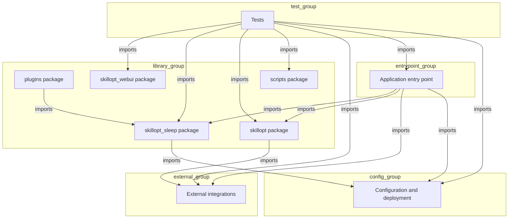

# Architecture report: microsoft/SkillOpt

> Automated static analysis. **Observed** = directly seen in files/imports/AST; **Inferred** = interpretation from that evidence. Repository code was not executed.

## 1. Repository at a glance

| Item | Value |
| --- | --- |
| Repository | microsoft/SkillOpt |
| Description | SkillOpt is a text-space optimizer that trains reusable natural-language skills for frozen LLM agents through trajectory-driven edits, validation-gated updates, and deployable best_skill.md artifacts. |
| Language | Python |
| Stars | 19078 |
| Licence | MIT |
| Analysed commit / branch | 45f65ca04f5f6713bca7b9797b495696ba812751 / main |
| Framework(s) | None detected |
| Files analysed | 482 |
| Components | 9 |

## 2. Architecture in one minute

microsoft/SkillOpt - SkillOpt is a text-space optimizer that trains reusable natural-language skills for frozen LLM agents through trajectory-driven edits, validation-gated updates, and deployable best_skill.md artifacts.. This repository was analysed statically from 482 file(s) (271 Python). Detected technologies (observed from imports/manifests): GitHub Actions, SQLite, httpx, NumPy, Poetry, setuptools. Files are grouped into 9 component(s): Configuration and deployment, Application entry point, External integrations, plugins package, scripts package, skillopt package, skillopt_sleep package, skillopt_webui package. Observed entry point(s): plugins/copilot/mcp_server.py, plugins/copilot/skillopt/mcp_server.py, plugins/devin/harvest_devin.py. Findings below distinguish observed facts from inferred interpretation.

## 3. High-level block diagram

## 4. Main components

### Configuration and deployment (`config`)

- **Kind:** config
- **Status:** Observed
- **Confidence:** 0.85
- **Responsibility:** Groups 44 file(s) under configuration and deployment (observed from repository paths and static analysis). Observed top-level classes: ConfigError, SleepConfig. Observed top-level functions: _cast_value, _deep_merge, _drop_base_keys_overridden_by_layer, _load_file, _load_yaml, _nested_key_present.
- **Paths:** `configs/_base_/default.yaml`, `configs/alfworld/default.yaml`, `configs/docvqa/default.yaml`, `configs/features/soft_gate.yaml`, `configs/livemathematicianbench/default.yaml`, `configs/officeqa/default.yaml`, `configs/searchqa/default.yaml`, `configs/spreadsheetbench/default.yaml`, `data/alfworld_path_split/split_manifest.json`, `data/alfworld_path_split/train/items.json`, `data/alfworld_path_split/val/items.json`, `data/docvqa_id_split/split_manifest.json`, `data/docvqa_id_split/train/items.json`, `data/docvqa_id_split/val/items.json`, `data/livemathematicianbench_id_split/split_manifest.json`, `data/livemathematicianbench_id_split/train/items.json`, `data/livemathematicianbench_id_split/val/items.json`, `data/officeqa_id_split/split_manifest.json`, `data/officeqa_id_split/train/items.json`, `data/officeqa_id_split/val/items.json`, `data/searchqa_id_split/split_manifest.json`, `data/searchqa_id_split/train/items.json`, `data/searchqa_id_split/val/items.json`, `data/spreadsheetbench_id_split/split_manifest.json`, `data/spreadsheetbench_id_split/train/items.json`, `data/spreadsheetbench_id_split/val/items.json`, `mkdocs.yml`, `plugins/claude-code/.claude-plugin/marketplace.json`, `plugins/claude-code/.claude-plugin/plugin.json`, `plugins/claude-code/hooks/hooks.json`, `plugins/copilot/mcp-config.example.json`, `plugins/copilot/skillopt/mcp-config.example.json`, `plugins/cursor/.cursor-plugin/plugin.json`, `plugins/devin/fixtures/devin_sample.json`, `plugins/devin/hooks/hooks.v1.json`, `plugins/devin/mcp-config.example.json`, `plugins/dsh/cordis.patch.yml`, `plugins/dsh/package.json`, `plugins/openclaw/config.json`, `pyproject.toml`, `requirements.txt`, `skillopt/config.py`, `skillopt/envs/_template/config_template.yaml`, `skillopt_sleep/config.py`
- **Evidence:** [configs/_base_/default.yaml](https://github.com/microsoft/SkillOpt/blob/45f65ca04f5f6713bca7b9797b495696ba812751/configs/_base_/default.yaml); [configs/alfworld/default.yaml](https://github.com/microsoft/SkillOpt/blob/45f65ca04f5f6713bca7b9797b495696ba812751/configs/alfworld/default.yaml); [configs/docvqa/default.yaml](https://github.com/microsoft/SkillOpt/blob/45f65ca04f5f6713bca7b9797b495696ba812751/configs/docvqa/default.yaml); [configs/features/soft_gate.yaml](https://github.com/microsoft/SkillOpt/blob/45f65ca04f5f6713bca7b9797b495696ba812751/configs/features/soft_gate.yaml); [configs/livemathematicianbench/default.yaml](https://github.com/microsoft/SkillOpt/blob/45f65ca04f5f6713bca7b9797b495696ba812751/configs/livemathematicianbench/default.yaml); [configs/officeqa/default.yaml](https://github.com/microsoft/SkillOpt/blob/45f65ca04f5f6713bca7b9797b495696ba812751/configs/officeqa/default.yaml); [configs/searchqa/default.yaml](https://github.com/microsoft/SkillOpt/blob/45f65ca04f5f6713bca7b9797b495696ba812751/configs/searchqa/default.yaml); [configs/spreadsheetbench/default.yaml](https://github.com/microsoft/SkillOpt/blob/45f65ca04f5f6713bca7b9797b495696ba812751/configs/spreadsheetbench/default.yaml)

### Application entry point (`entrypoint`)

- **Kind:** entrypoint
- **Status:** Observed
- **Confidence:** 0.85
- **Responsibility:** Groups 22 file(s) under application entry point (observed from repository paths and static analysis). Observed top-level classes: BootstrapCI, EngineResult, EvalReport, EvalResults, EvalkitError, McNemarResult. Observed top-level functions: _add_common, _app_data_roots, _append, _append_adopt_args, _append_history, _as_binary.
- **Paths:** `plugins/copilot/mcp_server.py`, `plugins/copilot/skillopt/mcp_server.py`, `plugins/devin/harvest_devin.py`, `plugins/devin/judge.py`, `plugins/devin/mcp_server.py`, `plugins/dsh/scripts/sleep.py`, `plugins/openclaw/run_sleep.py`, `plugins/openclaw/slash_sleep.py`, `scripts/check_reproducibility.py`, `scripts/eval_only.py`, `scripts/materialize_searchqa.py`, `scripts/train.py`, `skillopt_sleep/__main__.py`, `skillopt_sleep/adapters/superpowers.py`, `skillopt_sleep/evalkit.py`, `skillopt_sleep/experiments/report.py`, `skillopt_sleep/experiments/run_experiment.py`, `skillopt_sleep/experiments/run_gbrain.py`, `skillopt_sleep/experiments/run_transfer.py`, `skillopt_sleep/experiments/sweep.py`, `skillopt_webui/__main__.py`, `skillopt_webui/app.py`
- **Evidence:** [plugins/copilot/mcp_server.py:126](https://github.com/microsoft/SkillOpt/blob/45f65ca04f5f6713bca7b9797b495696ba812751/plugins/copilot/mcp_server.py#L126); [plugins/copilot/skillopt/mcp_server.py:41](https://github.com/microsoft/SkillOpt/blob/45f65ca04f5f6713bca7b9797b495696ba812751/plugins/copilot/skillopt/mcp_server.py#L41); [plugins/devin/harvest_devin.py:51](https://github.com/microsoft/SkillOpt/blob/45f65ca04f5f6713bca7b9797b495696ba812751/plugins/devin/harvest_devin.py#L51); [plugins/devin/judge.py:41](https://github.com/microsoft/SkillOpt/blob/45f65ca04f5f6713bca7b9797b495696ba812751/plugins/devin/judge.py#L41); [plugins/devin/mcp_server.py:136](https://github.com/microsoft/SkillOpt/blob/45f65ca04f5f6713bca7b9797b495696ba812751/plugins/devin/mcp_server.py#L136); [plugins/dsh/scripts/sleep.py:35](https://github.com/microsoft/SkillOpt/blob/45f65ca04f5f6713bca7b9797b495696ba812751/plugins/dsh/scripts/sleep.py#L35); [plugins/openclaw/run_sleep.py:38](https://github.com/microsoft/SkillOpt/blob/45f65ca04f5f6713bca7b9797b495696ba812751/plugins/openclaw/run_sleep.py#L38); [plugins/openclaw/slash_sleep.py:31](https://github.com/microsoft/SkillOpt/blob/45f65ca04f5f6713bca7b9797b495696ba812751/plugins/openclaw/slash_sleep.py#L31)

### External integrations (`external_integrations`)

- **Kind:** external
- **Status:** Observed
- **Confidence:** 0.85
- **Responsibility:** Groups 1 file(s) under external integrations (observed from repository paths and static analysis).
- **Paths:** `skillopt_sleep/adapters/__init__.py`
- **Evidence:** [skillopt_sleep/adapters/__init__.py](https://github.com/microsoft/SkillOpt/blob/45f65ca04f5f6713bca7b9797b495696ba812751/skillopt_sleep/adapters/__init__.py)

### plugins package (`plugins`)

- **Kind:** library
- **Status:** Observed
- **Confidence:** 0.85
- **Responsibility:** Groups 17 file(s) under plugins package (observed from repository paths and static analysis). Observed top-level classes: OpenClawDeepSeekBackend. Observed top-level functions: _chat, _embed.
- **Paths:** `plugins/claude-code/hooks/on-session-end.sh`, `plugins/claude-code/scripts/install-cron.sh`, `plugins/claude-code/scripts/run-sleep.sh`, `plugins/claude-code/scripts/sleep.sh`, `plugins/codex/install.sh`, `plugins/cursor/install.sh`, `plugins/devin/hooks/on-session-end.sh`, `plugins/devin/install.sh`, `plugins/dsh/scripts/audit-control-chars.mjs`, `plugins/dsh/scripts/audit-injection.mjs`, `plugins/dsh/scripts/canary.mjs`, `plugins/dsh/scripts/test-quoting-bash.mjs`, `plugins/dsh/scripts/test-shell-seam.mjs`, `plugins/dsh/src/index.js`, `plugins/openclaw/run_sleep_cron.sh`, `plugins/openclaw/skillopt_sleep_openclaw.py`, `plugins/run-sleep.sh`
- **Evidence:** [plugins/claude-code/hooks/on-session-end.sh](https://github.com/microsoft/SkillOpt/blob/45f65ca04f5f6713bca7b9797b495696ba812751/plugins/claude-code/hooks/on-session-end.sh); [plugins/claude-code/scripts/install-cron.sh](https://github.com/microsoft/SkillOpt/blob/45f65ca04f5f6713bca7b9797b495696ba812751/plugins/claude-code/scripts/install-cron.sh); [plugins/claude-code/scripts/run-sleep.sh](https://github.com/microsoft/SkillOpt/blob/45f65ca04f5f6713bca7b9797b495696ba812751/plugins/claude-code/scripts/run-sleep.sh); [plugins/claude-code/scripts/sleep.sh](https://github.com/microsoft/SkillOpt/blob/45f65ca04f5f6713bca7b9797b495696ba812751/plugins/claude-code/scripts/sleep.sh); [plugins/codex/install.sh](https://github.com/microsoft/SkillOpt/blob/45f65ca04f5f6713bca7b9797b495696ba812751/plugins/codex/install.sh); [plugins/cursor/install.sh](https://github.com/microsoft/SkillOpt/blob/45f65ca04f5f6713bca7b9797b495696ba812751/plugins/cursor/install.sh); [plugins/devin/hooks/on-session-end.sh](https://github.com/microsoft/SkillOpt/blob/45f65ca04f5f6713bca7b9797b495696ba812751/plugins/devin/hooks/on-session-end.sh); [plugins/devin/install.sh](https://github.com/microsoft/SkillOpt/blob/45f65ca04f5f6713bca7b9797b495696ba812751/plugins/devin/install.sh)

### scripts package (`scripts`)

- **Kind:** library
- **Status:** Observed
- **Confidence:** 0.85
- **Responsibility:** Groups 5 file(s) under scripts package (observed from repository paths and static analysis).
- **Paths:** `scripts/__init__.py`, `scripts/run_alfworld.sh`, `scripts/run_searchqa.sh`, `scripts/run_spreadsheetbench.sh`, `scripts/smoke_superpowers.sh`
- **Evidence:** [scripts/__init__.py](https://github.com/microsoft/SkillOpt/blob/45f65ca04f5f6713bca7b9797b495696ba812751/scripts/__init__.py); [scripts/run_alfworld.sh](https://github.com/microsoft/SkillOpt/blob/45f65ca04f5f6713bca7b9797b495696ba812751/scripts/run_alfworld.sh); [scripts/run_searchqa.sh](https://github.com/microsoft/SkillOpt/blob/45f65ca04f5f6713bca7b9797b495696ba812751/scripts/run_searchqa.sh); [scripts/run_spreadsheetbench.sh](https://github.com/microsoft/SkillOpt/blob/45f65ca04f5f6713bca7b9797b495696ba812751/scripts/run_spreadsheetbench.sh); [scripts/smoke_superpowers.sh](https://github.com/microsoft/SkillOpt/blob/45f65ca04f5f6713bca7b9797b495696ba812751/scripts/smoke_superpowers.sh)

### skillopt package (`skillopt`)

- **Kind:** library
- **Status:** Observed
- **Confidence:** 0.85
- **Responsibility:** Groups 87 file(s) under skillopt package (observed from repository paths and static analysis). Observed top-level classes: ALFWorldAdapter, ALFWorldBatchRun, ALFWorldDataLoader, AutonomousScheduler, BaseDataLoader, BatchSpec. Observed top-level functions: _all_backend_modules, _append_attachment_instructions, _append_diagnostic_instruction, _apply_edit_with_report, _as_list, _assistant_message_schema.
- **Paths:** `skillopt/__init__.py`, `skillopt/datasets/__init__.py`, `skillopt/datasets/base.py`, `skillopt/engine/__init__.py`, `skillopt/engine/trainer.py`, `skillopt/envs/__init__.py`, `skillopt/envs/_template/env_template.py`, `skillopt/envs/_template/loader_template.py`, `skillopt/envs/alfworld/__init__.py`, `skillopt/envs/alfworld/adapter.py`, `skillopt/envs/alfworld/dataloader.py`, `skillopt/envs/alfworld/reflect.py`, `skillopt/envs/alfworld/rollout.py`, `skillopt/envs/base.py`, `skillopt/envs/docvqa/__init__.py`, `skillopt/envs/docvqa/adapter.py`, `skillopt/envs/docvqa/dataloader.py`, `skillopt/envs/docvqa/evaluator.py`, `skillopt/envs/docvqa/rollout.py`, `skillopt/envs/livemathematicianbench/__init__.py`, `skillopt/envs/livemathematicianbench/adapter.py`, `skillopt/envs/livemathematicianbench/dataloader.py`, `skillopt/envs/livemathematicianbench/evaluator.py`, `skillopt/envs/livemathematicianbench/reflect.py`, `skillopt/envs/livemathematicianbench/rollout.py`, `skillopt/envs/officeqa/__init__.py`, `skillopt/envs/officeqa/adapter.py`, `skillopt/envs/officeqa/dataloader.py`, `skillopt/envs/officeqa/evaluator.py`, `skillopt/envs/officeqa/keenable_search.py`, `skillopt/envs/officeqa/parallel_search.py`, `skillopt/envs/officeqa/rollout.py`, `skillopt/envs/officeqa/tool_runtime.py`, `skillopt/envs/searchqa/__init__.py`, `skillopt/envs/searchqa/adapter.py`, `skillopt/envs/searchqa/dataloader.py`, `skillopt/envs/searchqa/evaluator.py`, `skillopt/envs/searchqa/reflect.py`, `skillopt/envs/searchqa/rollout.py`, `skillopt/envs/spreadsheetbench/__init__.py`, `skillopt/envs/spreadsheetbench/adapter.py`, `skillopt/envs/spreadsheetbench/codegen_agent.py`, `skillopt/envs/spreadsheetbench/dataloader.py`, `skillopt/envs/spreadsheetbench/evaluator.py`, `skillopt/envs/spreadsheetbench/executor.py`, `skillopt/envs/spreadsheetbench/react_agent.py`, `skillopt/envs/spreadsheetbench/reflect.py`, `skillopt/envs/spreadsheetbench/rollout.py`, `skillopt/envs/task_output.py`, `skillopt/evaluation/__init__.py`, `skillopt/evaluation/gate.py`, `skillopt/gradient/__init__.py`, `skillopt/gradient/aggregate.py`, `skillopt/gradient/reflect.py`, `skillopt/model/__init__.py`, `skillopt/model/azure_openai.py`, `skillopt/model/backend_config.py`, `skillopt/model/claude_backend.py`, `skillopt/model/claude_code_backend.py`, `skillopt/model/codex_backend.py`, `skillopt/model/codex_harness.py`, `skillopt/model/common.py`, `skillopt/model/copilot_backend.py`, `skillopt/model/minimax_backend.py`, `skillopt/model/openai_compatible_backend.py`, `skillopt/model/qwen_backend.py`, `skillopt/model/router.py`, `skillopt/optimizer/__init__.py`, `skillopt/optimizer/appendix.py`, `skillopt/optimizer/clip.py`, `skillopt/optimizer/lr_autonomous.py`, `skillopt/optimizer/meta_skill.py`, `skillopt/optimizer/rewrite.py`, `skillopt/optimizer/scheduler.py`, `skillopt/optimizer/select.py`, `skillopt/optimizer/skill.py`, `skillopt/optimizer/skill_aware.py`, `skillopt/optimizer/slow_update.py`, `skillopt/optimizer/update_modes.py`, `skillopt/prompts/__init__.py`, `skillopt/scheduler/__init__.py`, `skillopt/types.py`, `skillopt/utils/__init__.py`, `skillopt/utils/console.py`, `skillopt/utils/json_utils.py`, `skillopt/utils/reproducibility.py`, `skillopt/utils/scoring.py`
- **Evidence:** [skillopt/__init__.py](https://github.com/microsoft/SkillOpt/blob/45f65ca04f5f6713bca7b9797b495696ba812751/skillopt/__init__.py); [skillopt/datasets/__init__.py](https://github.com/microsoft/SkillOpt/blob/45f65ca04f5f6713bca7b9797b495696ba812751/skillopt/datasets/__init__.py); [skillopt/datasets/base.py:42](https://github.com/microsoft/SkillOpt/blob/45f65ca04f5f6713bca7b9797b495696ba812751/skillopt/datasets/base.py#L42); [skillopt/engine/__init__.py](https://github.com/microsoft/SkillOpt/blob/45f65ca04f5f6713bca7b9797b495696ba812751/skillopt/engine/__init__.py); [skillopt/engine/trainer.py:89](https://github.com/microsoft/SkillOpt/blob/45f65ca04f5f6713bca7b9797b495696ba812751/skillopt/engine/trainer.py#L89); [skillopt/envs/__init__.py](https://github.com/microsoft/SkillOpt/blob/45f65ca04f5f6713bca7b9797b495696ba812751/skillopt/envs/__init__.py); [skillopt/envs/_template/env_template.py:22](https://github.com/microsoft/SkillOpt/blob/45f65ca04f5f6713bca7b9797b495696ba812751/skillopt/envs/_template/env_template.py#L22); [skillopt/envs/_template/loader_template.py:21](https://github.com/microsoft/SkillOpt/blob/45f65ca04f5f6713bca7b9797b495696ba812751/skillopt/envs/_template/loader_template.py#L21)

### skillopt_sleep package (`skillopt_sleep`)

- **Kind:** library
- **Status:** Observed
- **Confidence:** 0.85
- **Responsibility:** Groups 35 file(s) under skillopt_sleep package (observed from repository paths and static analysis). Observed top-level classes: AdoptedSkill, AzureOpenAIBackend, AzureResponsesBackend, Backend, Budget, ClaudeCliBackend. Observed top-level functions: _active_branch_entries, _adopt_live_target_ok, _adopt_target_ok, _adoption_locks, _ancestor_in_scope, _artifact_snapshot.
- **Paths:** `skillopt_sleep/__init__.py`, `skillopt_sleep/backend.py`, `skillopt_sleep/budget.py`, `skillopt_sleep/consolidate.py`, `skillopt_sleep/cycle.py`, `skillopt_sleep/dream.py`, `skillopt_sleep/evidence.py`, `skillopt_sleep/experiments/__init__.py`, `skillopt_sleep/experiments/gbrain_bench.py`, `skillopt_sleep/experiments/personas.py`, `skillopt_sleep/gate.py`, `skillopt_sleep/handoff_backend.py`, `skillopt_sleep/harvest.py`, `skillopt_sleep/harvest_codex.py`, `skillopt_sleep/harvest_copilot.py`, `skillopt_sleep/harvest_copilot_cli.py`, `skillopt_sleep/harvest_cursor.py`, `skillopt_sleep/harvest_opencode.py`, `skillopt_sleep/harvest_pi.py`, `skillopt_sleep/harvest_sources.py`, `skillopt_sleep/judges.py`, `skillopt_sleep/llm_miner.py`, `skillopt_sleep/memory.py`, `skillopt_sleep/mine.py`, `skillopt_sleep/multi_skill.py`, `skillopt_sleep/prompts.py`, `skillopt_sleep/replay.py`, `skillopt_sleep/rollout.py`, `skillopt_sleep/scheduler.py`, `skillopt_sleep/skill_resolver.py`, `skillopt_sleep/slow_update.py`, `skillopt_sleep/staging.py`, `skillopt_sleep/state.py`, `skillopt_sleep/tasks_file.py`, `skillopt_sleep/types.py`
- **Evidence:** [skillopt_sleep/__init__.py](https://github.com/microsoft/SkillOpt/blob/45f65ca04f5f6713bca7b9797b495696ba812751/skillopt_sleep/__init__.py); [skillopt_sleep/backend.py:44](https://github.com/microsoft/SkillOpt/blob/45f65ca04f5f6713bca7b9797b495696ba812751/skillopt_sleep/backend.py#L44); [skillopt_sleep/budget.py:15](https://github.com/microsoft/SkillOpt/blob/45f65ca04f5f6713bca7b9797b495696ba812751/skillopt_sleep/budget.py#L15); [skillopt_sleep/consolidate.py:36](https://github.com/microsoft/SkillOpt/blob/45f65ca04f5f6713bca7b9797b495696ba812751/skillopt_sleep/consolidate.py#L36); [skillopt_sleep/cycle.py:63](https://github.com/microsoft/SkillOpt/blob/45f65ca04f5f6713bca7b9797b495696ba812751/skillopt_sleep/cycle.py#L63); [skillopt_sleep/dream.py:38](https://github.com/microsoft/SkillOpt/blob/45f65ca04f5f6713bca7b9797b495696ba812751/skillopt_sleep/dream.py#L38); [skillopt_sleep/evidence.py:39](https://github.com/microsoft/SkillOpt/blob/45f65ca04f5f6713bca7b9797b495696ba812751/skillopt_sleep/evidence.py#L39); [skillopt_sleep/experiments/__init__.py](https://github.com/microsoft/SkillOpt/blob/45f65ca04f5f6713bca7b9797b495696ba812751/skillopt_sleep/experiments/__init__.py)

### skillopt_webui package (`skillopt_webui`)

- **Kind:** library
- **Status:** Observed
- **Confidence:** 0.85
- **Responsibility:** Groups 1 file(s) under skillopt_webui package (observed from repository paths and static analysis).
- **Paths:** `skillopt_webui/__init__.py`
- **Evidence:** [skillopt_webui/__init__.py](https://github.com/microsoft/SkillOpt/blob/45f65ca04f5f6713bca7b9797b495696ba812751/skillopt_webui/__init__.py)

### Tests (`tests`)

- **Kind:** test
- **Status:** Observed
- **Confidence:** 0.85
- **Responsibility:** Groups 144 file(s) under tests (observed from repository paths and static analysis). Observed routes: PATCH skillopt.model.codex_harness.subprocess.run, PATCH skillopt.model.codex_harness.subprocess.run, PATCH sys.platform, PATCH shutil.which, PATCH sys.platform. Observed top-level classes: CountedBeforeConsolidationBackend, EditingBackend, FeedbackFlowBackend, MeteredBackend, MockBeneficialBackend, MockFractionalDegradationBackend. Observed top-level functions: _accepted_group, _add, _add_ancestor_tool_canary, _add_basic_transcript, _add_mcp_canary, _add_message.
- **Paths:** `data/alfworld_path_split/test/items.json`, `data/docvqa_id_split/test/items.json`, `data/livemathematicianbench_id_split/test/items.json`, `data/officeqa_id_split/test/items.json`, `data/searchqa_id_split/test/items.json`, `data/spreadsheetbench_id_split/test/items.json`, `plugins/openclaw/tests/devops-tasks.json`, `plugins/openclaw/tests/research-cron-tasks.json`, `plugins/openclaw/tests/wiki-tasks.json`, `tests/PREFERENCE_SCOPE_MATRIX_154.md`, `tests/__init__.py`, `tests/fixtures/copilot/session-v3.jsonl`, `tests/fixtures/copilot/workspace.json`, `tests/fixtures/evalkit/aa_manifest.json`, `tests/fixtures/evalkit/aa_outcomes.json`, `tests/fixtures/evalkit/mcnemar_textbook.json`, `tests/fixtures/evalkit/results_searchqa_nano_gated.json`, `tests/fixtures/reproducibility/.gitattributes`, `tests/fixtures/reproducibility/eval_summary.json`, `tests/fixtures/reproducibility/evidence.json`, `tests/fixtures/reproducibility/results.jsonl`, `tests/fixtures/reproducibility/split_manifest.json`, `tests/fixtures/reproducibility/test/items.json`, `tests/fixtures/reproducibility/train/items.json`, `tests/fixtures/reproducibility/val/items.json`, `tests/test_aggregate_fallback.py`, `tests/test_alfworld_paths.py`, `tests/test_alfworld_task_output_confinement.py`, `tests/test_azure_openai_compat.py`, `tests/test_azure_usage_accounting.py`, `tests/test_backend_opencode.py`, `tests/test_backend_opencode_live.py`, `tests/test_backend_pi.py`, `tests/test_benchmark_task_output_paths.py`, `tests/test_claude_backend_tempdir.py`, `tests/test_claude_code_backend.py`, `tests/test_claude_code_exec_resolution.py`, `tests/test_claude_replay_isolation.py`, `tests/test_cli_backend_cache.py`, `tests/test_cli_path_resolution.py`, `tests/test_codex_cli_prompt_stdin.py`, `tests/test_codex_config_aliases.py`, `tests/test_codex_optimizer_backend.py`, `tests/test_console_encoding.py`, `tests/test_consolidate_split.py`, `tests/test_consolidation_edit_bookkeeping.py`, `tests/test_copilot_exec_backend.py`, `tests/test_copilot_harvest.py`, `tests/test_copilot_tool_scope.py`, `tests/test_cursor_exec_backend.py`, `tests/test_data_manifests.py`, `tests/test_devin_plugin.py`, `tests/test_docvqa_evaluator.py`, `tests/test_env_section_survives_dedup.py`, `tests/test_evalkit.py`, `tests/test_executor_env_isolation.py`, `tests/test_export_redaction.py`, `tests/test_gate.py`, `tests/test_gate_no_regression.py`, `tests/test_handoff_backend.py`, `tests/test_harvest_checkpoint_source.py`, `tests/test_harvest_codex_replay.py`, `tests/test_harvest_copilot_cli.py`, `tests/test_harvest_cutoff_timezone.py`, `tests/test_harvest_machine_repeats.py`, `tests/test_harvest_malformed_lines.py`, `tests/test_harvest_opencode.py`, `tests/test_harvest_opencode_live.py`, `tests/test_harvest_pi.py`, `tests/test_harvest_project_scope.py`, `tests/test_harvest_race.py`, `tests/test_hierarchical_merge.py`, `tests/test_holdout_integrity.py`, `tests/test_json_utils.py`, `tests/test_judge_score_contract.py`, `tests/test_judges.py`, `tests/test_latest_pointer_race.py`, `tests/test_learned_block_roundtrip.py`, `tests/test_livemath_evaluator.py`, `tests/test_materialize_searchqa.py`, `tests/test_mcp_schema.py`, `tests/test_minimax_backend.py`, `tests/test_minimax_region.py`, `tests/test_model_change_warning.py`, `tests/test_officeqa_answer_extraction.py`, `tests/test_officeqa_evaluator.py`, `tests/test_officeqa_keenable_search.py`, `tests/test_officeqa_parallel_search.py`, `tests/test_openai_compatible_backend.py`, `tests/test_openai_compatible_config.py`, `tests/test_optimizer_feedback_flow.py`, `tests/test_outcome_judges.py`, `tests/test_pi_integration.py`, `tests/test_plugin_sync.py`, `tests/test_preference_scope_contracts.py`, `tests/test_qwen_backend.py`, `tests/test_react_agent_no_shell.py`, `tests/test_recall_holdout_twins.py`, `tests/test_reproducibility.py`, `tests/test_retired_cli_options.py`, `tests/test_role_backend_resolution.py`, `tests/test_run_sleep_fallback.py`, `tests/test_runners.Tests.ps1`, `tests/test_scheduler.py`, `tests/test_scheduler_windows.py`, `tests/test_scoring.py`, `tests/test_searchqa_evaluator.py`, `tests/test_searchqa_rollout_failfast.py`, `tests/test_semantic_density.py`, `tests/test_skill_aware_reflection.py`, `tests/test_sleep_adopt_skill_subset.py`, `tests/test_sleep_config_encoding.py`, `tests/test_sleep_dream_metric.py`, `tests/test_sleep_engine.py`, `tests/test_sleep_evidence.py`, `tests/test_sleep_harvest_non_user_records.py`, `tests/test_sleep_multi_skill.py`, `tests/test_sleep_scheduler_safety.py`, `tests/test_sleep_skill_group_report.py`, `tests/test_sleep_skill_harvest.py`, `tests/test_sleep_skill_hint.py`, `tests/test_sleep_skill_resolver.py`, `tests/test_sleep_staging_fanout.py`, `tests/test_sleep_state.py`, `tests/test_sleep_token_budget.py`, `tests/test_slow_update_robustness.py`, `tests/test_split_exposure.py`, `tests/test_split_hardening_2x3.py`, `tests/test_split_wiring.py`, `tests/test_spreadsheetbench_task_id_confinement.py`, `tests/test_staging_redaction_azure.py`, `tests/test_superpowers_scenarios.py`, `tests/test_systematic_debugging_scenarios.py`, `tests/test_systematic_debugging_shim_harness.py`, `tests/test_tool_evidence_judging.py`, `tests/test_trainer_failure_patterns.py`, `tests/test_trainer_resume.py`, `tests/test_types.py`, `tests/test_unmatched_edits.py`, `tests/test_unmatched_edits_reporting.py`, `tests/test_webui_build_gradio.py`, `tests/test_webui_env_preflight.py`, `tests/test_webui_security.py`, `tests/test_workspace_symlink.py`
- **Evidence:** [data/alfworld_path_split/test/items.json](https://github.com/microsoft/SkillOpt/blob/45f65ca04f5f6713bca7b9797b495696ba812751/data/alfworld_path_split/test/items.json); [data/docvqa_id_split/test/items.json](https://github.com/microsoft/SkillOpt/blob/45f65ca04f5f6713bca7b9797b495696ba812751/data/docvqa_id_split/test/items.json); [data/livemathematicianbench_id_split/test/items.json](https://github.com/microsoft/SkillOpt/blob/45f65ca04f5f6713bca7b9797b495696ba812751/data/livemathematicianbench_id_split/test/items.json); [data/officeqa_id_split/test/items.json](https://github.com/microsoft/SkillOpt/blob/45f65ca04f5f6713bca7b9797b495696ba812751/data/officeqa_id_split/test/items.json); [data/searchqa_id_split/test/items.json](https://github.com/microsoft/SkillOpt/blob/45f65ca04f5f6713bca7b9797b495696ba812751/data/searchqa_id_split/test/items.json); [data/spreadsheetbench_id_split/test/items.json](https://github.com/microsoft/SkillOpt/blob/45f65ca04f5f6713bca7b9797b495696ba812751/data/spreadsheetbench_id_split/test/items.json); [plugins/openclaw/tests/devops-tasks.json](https://github.com/microsoft/SkillOpt/blob/45f65ca04f5f6713bca7b9797b495696ba812751/plugins/openclaw/tests/devops-tasks.json); [plugins/openclaw/tests/research-cron-tasks.json](https://github.com/microsoft/SkillOpt/blob/45f65ca04f5f6713bca7b9797b495696ba812751/plugins/openclaw/tests/research-cron-tasks.json)

## 5. Execution flow

**Observed** entry point(s):

- [plugins/copilot/mcp_server.py:387](https://github.com/microsoft/SkillOpt/blob/45f65ca04f5f6713bca7b9797b495696ba812751/plugins/copilot/mcp_server.py#L387)
- [plugins/copilot/skillopt/mcp_server.py:228](https://github.com/microsoft/SkillOpt/blob/45f65ca04f5f6713bca7b9797b495696ba812751/plugins/copilot/skillopt/mcp_server.py#L228)
- [plugins/devin/harvest_devin.py:532](https://github.com/microsoft/SkillOpt/blob/45f65ca04f5f6713bca7b9797b495696ba812751/plugins/devin/harvest_devin.py#L532)
- [plugins/devin/judge.py:128](https://github.com/microsoft/SkillOpt/blob/45f65ca04f5f6713bca7b9797b495696ba812751/plugins/devin/judge.py#L128)
- [plugins/devin/mcp_server.py:429](https://github.com/microsoft/SkillOpt/blob/45f65ca04f5f6713bca7b9797b495696ba812751/plugins/devin/mcp_server.py#L429)
- [plugins/dsh/scripts/sleep.py:118](https://github.com/microsoft/SkillOpt/blob/45f65ca04f5f6713bca7b9797b495696ba812751/plugins/dsh/scripts/sleep.py#L118)
- [plugins/openclaw/run_sleep.py:144](https://github.com/microsoft/SkillOpt/blob/45f65ca04f5f6713bca7b9797b495696ba812751/plugins/openclaw/run_sleep.py#L144)
- [plugins/openclaw/slash_sleep.py:330](https://github.com/microsoft/SkillOpt/blob/45f65ca04f5f6713bca7b9797b495696ba812751/plugins/openclaw/slash_sleep.py#L330)
- [scripts/check_reproducibility.py:32](https://github.com/microsoft/SkillOpt/blob/45f65ca04f5f6713bca7b9797b495696ba812751/scripts/check_reproducibility.py#L32)
- [scripts/eval_only.py](https://github.com/microsoft/SkillOpt/blob/45f65ca04f5f6713bca7b9797b495696ba812751/scripts/eval_only.py)
- [scripts/materialize_searchqa.py:169](https://github.com/microsoft/SkillOpt/blob/45f65ca04f5f6713bca7b9797b495696ba812751/scripts/materialize_searchqa.py#L169)
- [scripts/train.py](https://github.com/microsoft/SkillOpt/blob/45f65ca04f5f6713bca7b9797b495696ba812751/scripts/train.py)

**Observed** routes (from decorators):

- `PATCH skillopt.model.codex_harness.subprocess.run` -> `test_codex_harness_full_auto_is_ignored` in `tests/test_codex_config_aliases.py:675`
- `PATCH skillopt.model.codex_harness.subprocess.run` -> `test_codex_harness_cli_forwards_network_and_web_search` in `tests/test_codex_config_aliases.py:726`
- `PATCH sys.platform` -> `test_schedule_windows` in `tests/test_scheduler_windows.py:8`
- `PATCH shutil.which` -> `test_schedule_windows` in `tests/test_scheduler_windows.py:8`
- `PATCH sys.platform` -> `test_unschedule_windows` in `tests/test_scheduler_windows.py:52`
- `PATCH shutil.which` -> `test_unschedule_windows` in `tests/test_scheduler_windows.py:52`

Representative flow (derived from observed entry points and the import graph; steps beyond the entry point are **Inferred**):

1. Execution starts at an observed entry point listed above, if present.
2. `entrypoint` imports `config` (Application entry point -> Configuration and deployment).
3. `entrypoint` imports `external_integrations` (Application entry point -> External integrations).
4. `entrypoint` imports `skillopt` (Application entry point -> skillopt package).
5. `entrypoint` imports `skillopt_sleep` (Application entry point -> skillopt_sleep package).
6. `plugins` imports `skillopt_sleep` (plugins package -> skillopt_sleep package).
7. `skillopt` imports `external_integrations` (skillopt package -> External integrations).
8. `skillopt_sleep` imports `config` (skillopt_sleep package -> Configuration and deployment).
9. `tests` imports `config` (Tests -> Configuration and deployment).

## 6. Project structure

### `(root)`

- `.env.example` - config (4030 bytes)
- `.gitignore` - other (1657 bytes)
- `CHANGELOG.md` - docs (17634 bytes)
- `CONTRIBUTING.md` - docs (1527 bytes)
- `LICENSE` - docs (1078 bytes)
- `README.md` - docs (9394 bytes)
- `SECURITY.md` - docs (542 bytes)
- `index.html` - other (86715 bytes)
- `mkdocs.yml` - config (2499 bytes)
- `pyproject.toml` - manifest (3259 bytes)
- `requirements.txt` - manifest (1164 bytes)
- `skillopt.html` - other (84298 bytes)

### `.cursor-plugin`

- `.cursor-plugin/marketplace.json` - config (486 bytes)

### `.github`

- `.github/dependabot.yml` - config (662 bytes)
- `.github/workflows/ci.yml` - ci, YAML (2460 bytes)

### `blog`

- `blog/gating-reflection-safe-updates/index.html` - other (74197 bytes)
- `blog/index.html` - other (6293 bytes)

### `ckpt`

- `ckpt/README.md` - docs (4105 bytes)
- `ckpt/alfworld/gpt5.5_skill.md` - docs (13179 bytes)
- `ckpt/docvqa/gpt5.5_skill.md` - docs (1963 bytes)
- `ckpt/livemath/gpt5.5_skill.md` - docs (3343 bytes)
- `ckpt/officeqa/gpt5.5_skill.md` - docs (6456 bytes)
- `ckpt/searchqa/gpt5.5_skill.md` - docs (9941 bytes)
- `ckpt/spreadsheetbench/gpt5.5_skill.md` - docs (13335 bytes)

### `configs`

- `configs/_base_/default.yaml` - config (5681 bytes)
- `configs/alfworld/default.yaml` - config (476 bytes)
- `configs/docvqa/default.yaml` - config (454 bytes)
- `configs/features/soft_gate.yaml` - config (2702 bytes)
- `configs/livemathematicianbench/default.yaml` - config (462 bytes)
- `configs/officeqa/default.yaml` - config (712 bytes)
- `configs/searchqa/default.yaml` - config (504 bytes)
- `configs/spreadsheetbench/default.yaml` - config (599 bytes)

### `data`

- `data/README.md` - docs (7082 bytes)
- `data/alfworld_path_split/split_manifest.json` - config (735 bytes)
- `data/alfworld_path_split/test/items.json` - test (28714 bytes)
- `data/alfworld_path_split/train/items.json` - config (8171 bytes)
- `data/alfworld_path_split/val/items.json` - config (3806 bytes)
- `data/docvqa_id_split/split_manifest.json` - config (1060 bytes)
- `data/docvqa_id_split/test/items.json` - test (141340 bytes)
- `data/docvqa_id_split/train/items.json` - config (40385 bytes)
- `data/docvqa_id_split/val/items.json` - config (19998 bytes)
- `data/livemathematicianbench_id_split/split_manifest.json` - config (1003 bytes)
- `data/livemathematicianbench_id_split/test/items.json` - test (22196 bytes)
- `data/livemathematicianbench_id_split/train/items.json` - config (6223 bytes)
- `data/livemathematicianbench_id_split/val/items.json` - config (3022 bytes)
- `data/officeqa_id_split/split_manifest.json` - config (719 bytes)
- `data/officeqa_id_split/test/items.json` - test (65730 bytes)
- `data/officeqa_id_split/train/items.json` - config (18261 bytes)
- `data/officeqa_id_split/val/items.json` - config (9020 bytes)
- `data/searchqa_id_split/split_manifest.json` - config (586 bytes)
- `data/searchqa_id_split/test/items.json` - test (75603 bytes)
- `data/searchqa_id_split/train/items.json` - config (21603 bytes)
- `data/searchqa_id_split/val/items.json` - config (10803 bytes)
- `data/spreadsheetbench_id_split/split_manifest.json` - config (745 bytes)
- `data/spreadsheetbench_id_split/test/items.json` - test (34618 bytes)
- `data/spreadsheetbench_id_split/train/items.json` - config (9910 bytes)
- `data/spreadsheetbench_id_split/val/items.json` - config (4940 bytes)

### `docs`

- `docs/contributing.md` - docs (2579 bytes)
- `docs/guide/configuration.md` - docs (12291 bytes)
- `docs/guide/dl-analogy.md` - docs (3229 bytes)
- `docs/guide/first-experiment.md` - docs (3762 bytes)
- `docs/guide/installation.md` - docs (5540 bytes)
- `docs/guide/local-env-smoke.md` - docs (4517 bytes)
- `docs/guide/new-backend.md` - docs (9505 bytes)
- `docs/guide/new-benchmark.md` - docs (15242 bytes)
- `docs/guide/offline-reproducibility.md` - docs (8922 bytes)
- `docs/guide/skill-document.md` - docs (3424 bytes)
- `docs/guide/training-loop.md` - docs (5099 bytes)
- `docs/guideline.html` - docs (27548 bytes)
- `docs/index.md` - docs (6566 bytes)
- `docs/reference/api.md` - docs (7734 bytes)
- `docs/reference/cli.md` - docs (21674 bytes)
- `docs/reference/config.md` - docs (19403 bytes)
- `docs/review_guidelines.md` - docs (4417 bytes)
- `docs/sleep/README.md` - docs (34321 bytes)
- `docs/sleep/RESULTS.md` - docs (8787 bytes)
- `docs/sleep/evalkit.md` - docs (3905 bytes)
- `docs/sleep/examples/runner.py` - docs (4436 bytes)
- `docs/sleep/examples/watchdog.py` - docs (1846 bytes)
- `docs/sleep/multi-skill-staging.md` - docs (11746 bytes)
- `docs/sleep/openai-compatible-endpoints.md` - docs (9669 bytes)
- `docs/superpowers/SECURITY.md` - docs (4059 bytes)
- `docs/superpowers/specs/2026-06-07-skillopt-sleep-claude-code-plugin-design.md` - docs (17897 bytes)

### `plugins`

- `plugins/README.md` - docs (17122 bytes)
- `plugins/claude-code/.claude-plugin/marketplace.json` - config (1157 bytes)
- `plugins/claude-code/.claude-plugin/plugin.json` - config (877 bytes)
- `plugins/claude-code/README.md` - docs (10882 bytes)
- `plugins/claude-code/commands/skillopt-sleep-handoff.md` - docs (3628 bytes)
- `plugins/claude-code/commands/skillopt-sleep.md` - docs (4665 bytes)
- `plugins/claude-code/hooks/hooks.json` - config (273 bytes)
- `plugins/claude-code/hooks/on-session-end.sh` - source, Shell (737 bytes)
- `plugins/claude-code/scripts/install-cron.sh` - source, Shell (1546 bytes)
- `plugins/claude-code/scripts/run-sleep.sh` - source, Shell (3602 bytes)
- `plugins/claude-code/scripts/sleep.sh` - source, Shell (1369 bytes)
- `plugins/claude-code/skills/skillopt-sleep/SKILL.md` - docs (9054 bytes)
- `plugins/codex/README.md` - docs (5262 bytes)
- `plugins/codex/install.ps1` - other (2159 bytes)
- `plugins/codex/install.sh` - source, Shell (1578 bytes)
- `plugins/codex/skills/skillopt-sleep/SKILL.md` - docs (9402 bytes)
- `plugins/copilot/README.md` - docs (4617 bytes)
- `plugins/copilot/copilot-instructions.snippet.md` - docs (3820 bytes)
- `plugins/copilot/mcp-config.example.json` - config (208 bytes)
- `plugins/copilot/mcp_server.py` - source, Python (16067 bytes)
- `plugins/copilot/skillopt/README.md` - docs (4726 bytes)
- `plugins/copilot/skillopt/copilot-instructions.snippet.md` - docs (1758 bytes)
- `plugins/copilot/skillopt/mcp-config.example.json` - config (216 bytes)
- `plugins/copilot/skillopt/mcp_server.py` - source, Python (9107 bytes)
- `plugins/cursor/.cursor-plugin/plugin.json` - config (770 bytes)
- `plugins/cursor/LICENSE` - docs (1078 bytes)
- `plugins/cursor/README.md` - docs (10756 bytes)
- `plugins/cursor/commands/skillopt-sleep.md` - docs (796 bytes)
- `plugins/cursor/install.ps1` - other (2177 bytes)
- `plugins/cursor/install.sh` - source, Shell (1456 bytes)
- `plugins/cursor/skills/skillopt-sleep/SKILL.md` - docs (9709 bytes)
- `plugins/devin/README.md` - docs (5777 bytes)
- `plugins/devin/devin-rules.snippet.md` - docs (3023 bytes)
- `plugins/devin/fixtures/devin_sample.json` - config (744 bytes)
- `plugins/devin/harvest_devin.py` - source, Python (22817 bytes)
- `plugins/devin/hooks/hooks.v1.json` - config (251 bytes)
- `plugins/devin/hooks/on-session-end.sh` - source, Shell (834 bytes)
- `plugins/devin/install.sh` - source, Shell (3300 bytes)
- `plugins/devin/judge.py` - source, Python (5374 bytes)
- `plugins/devin/mcp-config.example.json` - config (240 bytes)
- `plugins/devin/mcp_server.py` - source, Python (18145 bytes)
- `plugins/dsh/LICENSE` - docs (1078 bytes)
- `plugins/dsh/README.md` - docs (5652 bytes)
- `plugins/dsh/README.zh.md` - docs (1219 bytes)
- `plugins/dsh/cordis.patch.yml` - config (563 bytes)
- `plugins/dsh/package.json` - manifest (1029 bytes)
- `plugins/dsh/scripts/audit-control-chars.mjs` - source, JavaScript (2864 bytes)
- `plugins/dsh/scripts/audit-injection.mjs` - source, JavaScript (2996 bytes)
- `plugins/dsh/scripts/canary.mjs` - source, JavaScript (17296 bytes)
- `plugins/dsh/scripts/sleep.py` - source, Python (4145 bytes)
- `plugins/dsh/scripts/test-quoting-bash.mjs` - source, JavaScript (4029 bytes)
- `plugins/dsh/scripts/test-shell-seam.mjs` - source, JavaScript (2645 bytes)
- `plugins/dsh/skills/skillopt-sleep/SKILL.md` - docs (5775 bytes)
- `plugins/dsh/src/index.js` - source, JavaScript (19642 bytes)
- `plugins/openclaw/README.md` - docs (5109 bytes)
- `plugins/openclaw/SKILL.md` - docs (5133 bytes)
- `plugins/openclaw/config.json` - config (763 bytes)
- `plugins/openclaw/run_sleep.py` - source, Python (5178 bytes)
- `plugins/openclaw/run_sleep_cron.sh` - source, Shell (2205 bytes)
- `plugins/openclaw/skillopt_sleep_openclaw.py` - source, Python (10208 bytes)
- `plugins/openclaw/slash_sleep.py` - source, Python (12006 bytes)
- `plugins/openclaw/tests/devops-tasks.json` - test (5248 bytes)
- `plugins/openclaw/tests/research-cron-tasks.json` - test (7014 bytes)
- `plugins/openclaw/tests/wiki-tasks.json` - test (5155 bytes)
- `plugins/run-sleep.cmd` - other (3508 bytes)
- `plugins/run-sleep.ps1` - other (3420 bytes)
- `plugins/run-sleep.sh` - source, Shell (3602 bytes)

### `scripts`

- `scripts/__init__.py` - source, Python (0 bytes)
- `scripts/check_reproducibility.py` - source, Python (1443 bytes)
- `scripts/eval_only.py` - source, Python (38539 bytes)
- `scripts/materialize_searchqa.py` - source, Python (5479 bytes)
- `scripts/run_alfworld.sh` - source, Shell (2357 bytes)
- `scripts/run_searchqa.sh` - source, Shell (1692 bytes)
- `scripts/run_spreadsheetbench.sh` - source, Shell (1724 bytes)
- `scripts/smoke_superpowers.sh` - source, Shell (3035 bytes)
- `scripts/train.py` - source, Python (42341 bytes)

### `skillopt`

- `skillopt/__init__.py` - source, Python (728 bytes)
- `skillopt/config.py` - source, Python (19802 bytes)
- `skillopt/datasets/__init__.py` - source, Python (324 bytes)
- `skillopt/datasets/base.py` - source, Python (18879 bytes)
- `skillopt/engine/__init__.py` - source, Python (303 bytes)
- `skillopt/engine/trainer.py` - source, Python (120739 bytes)
- `skillopt/envs/__init__.py` - source, Python (36 bytes)
- `skillopt/envs/_template/README.md` - docs (2208 bytes)
- `skillopt/envs/_template/config_template.yaml` - config (2997 bytes)
- `skillopt/envs/_template/env_template.py` - source, Python (5844 bytes)
- `skillopt/envs/_template/loader_template.py` - source, Python (3180 bytes)
- `skillopt/envs/alfworld/__init__.py` - source, Python (139 bytes)
- `skillopt/envs/alfworld/adapter.py` - source, Python (15073 bytes)
- `skillopt/envs/alfworld/dataloader.py` - source, Python (3879 bytes)
- `skillopt/envs/alfworld/prompts/analyst_error.md` - docs (2932 bytes)
- `skillopt/envs/alfworld/prompts/analyst_success.md` - docs (1554 bytes)
- `skillopt/envs/alfworld/prompts/rollout_no_history.md` - docs (515 bytes)
- `skillopt/envs/alfworld/prompts/rollout_with_history.md` - docs (768 bytes)
- `skillopt/envs/alfworld/prompts/rollout_with_memory.md` - docs (846 bytes)
- `skillopt/envs/alfworld/reflect.py` - source, Python (91 bytes)
- `skillopt/envs/alfworld/rollout.py` - source, Python (12992 bytes)
- `skillopt/envs/alfworld/skills/initial.md` - docs (2966 bytes)
- `skillopt/envs/base.py` - source, Python (12297 bytes)
- `skillopt/envs/docvqa/__init__.py` - source, Python (46 bytes)
- `skillopt/envs/docvqa/adapter.py` - source, Python (3330 bytes)
- `skillopt/envs/docvqa/dataloader.py` - source, Python (2273 bytes)
- `skillopt/envs/docvqa/evaluator.py` - source, Python (3602 bytes)
- `skillopt/envs/docvqa/prompts/analyst_error.md` - docs (1808 bytes)
- `skillopt/envs/docvqa/prompts/analyst_success.md` - docs (1220 bytes)
- `skillopt/envs/docvqa/prompts/rollout_system.md` - docs (510 bytes)
- `skillopt/envs/docvqa/rollout.py` - source, Python (14614 bytes)
- `skillopt/envs/docvqa/skills/initial.md` - docs (536 bytes)
- `skillopt/envs/livemathematicianbench/__init__.py` - source, Python (62 bytes)
- `skillopt/envs/livemathematicianbench/adapter.py` - source, Python (4597 bytes)
- `skillopt/envs/livemathematicianbench/dataloader.py` - source, Python (10776 bytes)
- `skillopt/envs/livemathematicianbench/evaluator.py` - source, Python (2257 bytes)
- `skillopt/envs/livemathematicianbench/prompts/analyst_error.md` - docs (1700 bytes)
- `skillopt/envs/livemathematicianbench/prompts/analyst_success.md` - docs (1070 bytes)
- `skillopt/envs/livemathematicianbench/prompts/rollout_system.md` - docs (494 bytes)
- `skillopt/envs/livemathematicianbench/reflect.py` - source, Python (105 bytes)
- `skillopt/envs/livemathematicianbench/rollout.py` - source, Python (16879 bytes)
- `skillopt/envs/livemathematicianbench/skills/initial.md` - docs (1018 bytes)
- `skillopt/envs/officeqa/__init__.py` - source, Python (48 bytes)
- `skillopt/envs/officeqa/adapter.py` - source, Python (4695 bytes)
- `skillopt/envs/officeqa/dataloader.py` - source, Python (2572 bytes)
- `skillopt/envs/officeqa/evaluator.py` - source, Python (1553 bytes)
- `skillopt/envs/officeqa/keenable_search.py` - source, Python (4682 bytes)
- `skillopt/envs/officeqa/parallel_search.py` - source, Python (5193 bytes)
- `skillopt/envs/officeqa/prompts/analyst_error.md` - docs (2033 bytes)
- `skillopt/envs/officeqa/prompts/analyst_success.md` - docs (1375 bytes)
- `skillopt/envs/officeqa/prompts/rollout_system.md` - docs (903 bytes)
- `skillopt/envs/officeqa/rollout.py` - source, Python (36851 bytes)
- `skillopt/envs/officeqa/skills/initial.md` - docs (887 bytes)
- `skillopt/envs/officeqa/tool_runtime.py` - source, Python (19887 bytes)
- `skillopt/envs/searchqa/__init__.py` - source, Python (48 bytes)
- `skillopt/envs/searchqa/adapter.py` - source, Python (3325 bytes)
- `skillopt/envs/searchqa/dataloader.py` - source, Python (1265 bytes)
- `skillopt/envs/searchqa/evaluator.py` - source, Python (3388 bytes)
- `skillopt/envs/searchqa/prompts/analyst_error.md` - docs (2312 bytes)
- `skillopt/envs/searchqa/prompts/analyst_success.md` - docs (1515 bytes)
- `skillopt/envs/searchqa/prompts/rollout_system.md` - docs (536 bytes)
- `skillopt/envs/searchqa/reflect.py` - source, Python (91 bytes)
- `skillopt/envs/searchqa/rollout.py` - source, Python (18074 bytes)
- `skillopt/envs/searchqa/skills/initial.md` - docs (104 bytes)
- `skillopt/envs/spreadsheetbench/__init__.py` - source, Python (171 bytes)
- `skillopt/envs/spreadsheetbench/adapter.py` - source, Python (5831 bytes)
- `skillopt/envs/spreadsheetbench/codegen_agent.py` - source, Python (30053 bytes)
- `skillopt/envs/spreadsheetbench/dataloader.py` - source, Python (1056 bytes)
- `skillopt/envs/spreadsheetbench/evaluator.py` - source, Python (5509 bytes)
- `skillopt/envs/spreadsheetbench/executor.py` - source, Python (4131 bytes)
- `skillopt/envs/spreadsheetbench/prompts/analyst_error.md` - docs (2335 bytes)
- `skillopt/envs/spreadsheetbench/prompts/analyst_success.md` - docs (1515 bytes)
- `skillopt/envs/spreadsheetbench/prompts/codegen_system.md` - docs (568 bytes)
- `skillopt/envs/spreadsheetbench/prompts/critical_rules.md` - docs (575 bytes)
- `skillopt/envs/spreadsheetbench/prompts/react_system.md` - docs (1112 bytes)
- `skillopt/envs/spreadsheetbench/react_agent.py` - source, Python (14854 bytes)
- `skillopt/envs/spreadsheetbench/reflect.py` - source, Python (99 bytes)
- `skillopt/envs/spreadsheetbench/rollout.py` - source, Python (41101 bytes)
- `skillopt/envs/spreadsheetbench/skills/initial.md` - docs (1598 bytes)
- `skillopt/envs/task_output.py` - source, Python (1890 bytes)
- `skillopt/evaluation/__init__.py` - source, Python (428 bytes)
- `skillopt/evaluation/gate.py` - source, Python (7267 bytes)
- `skillopt/gradient/__init__.py` - source, Python (542 bytes)
- `skillopt/gradient/aggregate.py` - source, Python (10487 bytes)
- `skillopt/gradient/reflect.py` - source, Python (27728 bytes)
- `skillopt/model/__init__.py` - source, Python (29932 bytes)
- `skillopt/model/azure_openai.py` - source, Python (34070 bytes)
- `skillopt/model/backend_config.py` - source, Python (21020 bytes)
- `skillopt/model/claude_backend.py` - source, Python (19250 bytes)
- `skillopt/model/claude_code_backend.py` - source, Python (9070 bytes)
- `skillopt/model/codex_backend.py` - source, Python (21301 bytes)
- `skillopt/model/codex_harness.py` - source, Python (75205 bytes)
- `skillopt/model/common.py` - source, Python (8360 bytes)
- `skillopt/model/copilot_backend.py` - source, Python (9153 bytes)
- `skillopt/model/minimax_backend.py` - source, Python (14961 bytes)
- `skillopt/model/openai_compatible_backend.py` - source, Python (16117 bytes)
- `skillopt/model/qwen_backend.py` - source, Python (23576 bytes)
- `skillopt/model/router.py` - source, Python (7059 bytes)
- `skillopt/optimizer/__init__.py` - source, Python (628 bytes)
- `skillopt/optimizer/appendix.py` - source, Python (6269 bytes)
- `skillopt/optimizer/clip.py` - source, Python (3980 bytes)
- `skillopt/optimizer/lr_autonomous.py` - source, Python (3543 bytes)
- `skillopt/optimizer/meta_skill.py` - source, Python (2959 bytes)
- `skillopt/optimizer/rewrite.py` - source, Python (2015 bytes)
- `skillopt/optimizer/scheduler.py` - source, Python (4454 bytes)
- `skillopt/optimizer/select.py` - source, Python (162 bytes)
- `skillopt/optimizer/skill.py` - source, Python (7609 bytes)
- `skillopt/optimizer/skill_aware.py` - source, Python (8897 bytes)
- `skillopt/optimizer/slow_update.py` - source, Python (16890 bytes)
- `skillopt/optimizer/update_modes.py` - source, Python (4914 bytes)
- `skillopt/prompts/__init__.py` - source, Python (1893 bytes)
- `skillopt/prompts/analyst_error.md` - docs (1951 bytes)
- `skillopt/prompts/analyst_error_full_rewrite.md` - docs (1258 bytes)
- `skillopt/prompts/analyst_error_rewrite.md` - docs (1934 bytes)
- `skillopt/prompts/analyst_success.md` - docs (1646 bytes)
- `skillopt/prompts/analyst_success_full_rewrite.md` - docs (1219 bytes)
- `skillopt/prompts/analyst_success_rewrite.md` - docs (1408 bytes)
- `skillopt/prompts/lr_autonomous.md` - docs (745 bytes)
- `skillopt/prompts/merge_failure.md` - docs (1422 bytes)
- `skillopt/prompts/merge_failure_full_rewrite.md` - docs (1099 bytes)
- `skillopt/prompts/merge_failure_rewrite.md` - docs (1059 bytes)
- `skillopt/prompts/merge_final.md` - docs (1398 bytes)
- `skillopt/prompts/merge_final_full_rewrite.md` - docs (1053 bytes)
- `skillopt/prompts/merge_final_rewrite.md` - docs (926 bytes)
- `skillopt/prompts/merge_success.md` - docs (1121 bytes)
- `skillopt/prompts/merge_success_full_rewrite.md` - docs (1103 bytes)
- `skillopt/prompts/merge_success_rewrite.md` - docs (1006 bytes)
- `skillopt/prompts/meta_skill.md` - docs (1755 bytes)
- `skillopt/prompts/ranking.md` - docs (999 bytes)
- `skillopt/prompts/ranking_rewrite.md` - docs (647 bytes)
- `skillopt/prompts/rewrite_skill.md` - docs (1234 bytes)
- `skillopt/prompts/slow_update.md` - docs (2998 bytes)
- `skillopt/scheduler/__init__.py` - source, Python (283 bytes)
- `skillopt/types.py` - source, Python (10383 bytes)
- `skillopt/utils/__init__.py` - source, Python (224 bytes)
- `skillopt/utils/console.py` - source, Python (1098 bytes)
- `skillopt/utils/json_utils.py` - source, Python (9485 bytes)
- `skillopt/utils/reproducibility.py` - source, Python (17919 bytes)
- `skillopt/utils/scoring.py` - source, Python (920 bytes)

### `skillopt-assets`

- `skillopt-assets/arxiv-logomark-small.svg` - other (1687 bytes)

### `skillopt_sleep`

- `skillopt_sleep/__init__.py` - source, Python (826 bytes)
- `skillopt_sleep/__main__.py` - source, Python (39382 bytes)
- `skillopt_sleep/adapters/__init__.py` - source, Python (55 bytes)
- `skillopt_sleep/adapters/superpowers.py` - source, Python (57867 bytes)
- `skillopt_sleep/backend.py` - source, Python (130920 bytes)
- `skillopt_sleep/budget.py` - source, Python (3117 bytes)
- `skillopt_sleep/config.py` - source, Python (11713 bytes)
- `skillopt_sleep/consolidate.py` - source, Python (26363 bytes)
- `skillopt_sleep/cycle.py` - source, Python (55081 bytes)
- `skillopt_sleep/dream.py` - source, Python (7543 bytes)
- `skillopt_sleep/evalkit.py` - source, Python (26590 bytes)
- `skillopt_sleep/evidence.py` - source, Python (5608 bytes)
- `skillopt_sleep/experiments/__init__.py` - source, Python (34 bytes)
- `skillopt_sleep/experiments/gbrain_bench.py` - source, Python (4247 bytes)
- `skillopt_sleep/experiments/personas.py` - source, Python (3529 bytes)
- `skillopt_sleep/experiments/report.py` - source, Python (5662 bytes)
- `skillopt_sleep/experiments/run_experiment.py` - source, Python (7788 bytes)
- `skillopt_sleep/experiments/run_gbrain.py` - source, Python (9578 bytes)
- `skillopt_sleep/experiments/run_transfer.py` - source, Python (6487 bytes)
- `skillopt_sleep/experiments/sweep.py` - source, Python (7305 bytes)
- `skillopt_sleep/gate.py` - source, Python (2143 bytes)
- `skillopt_sleep/handoff_backend.py` - source, Python (7714 bytes)
- `skillopt_sleep/harvest.py` - source, Python (29862 bytes)
- `skillopt_sleep/harvest_codex.py` - source, Python (8238 bytes)
- `skillopt_sleep/harvest_copilot.py` - source, Python (16028 bytes)
- `skillopt_sleep/harvest_copilot_cli.py` - source, Python (9400 bytes)
- `skillopt_sleep/harvest_cursor.py` - source, Python (10623 bytes)
- `skillopt_sleep/harvest_opencode.py` - source, Python (12103 bytes)
- `skillopt_sleep/harvest_pi.py` - source, Python (11500 bytes)
- `skillopt_sleep/harvest_sources.py` - source, Python (4171 bytes)
- `skillopt_sleep/judges.py` - source, Python (15198 bytes)
- `skillopt_sleep/llm_miner.py` - source, Python (8472 bytes)
- `skillopt_sleep/memory.py` - source, Python (6657 bytes)
- `skillopt_sleep/mine.py` - source, Python (16402 bytes)
- `skillopt_sleep/multi_skill.py` - source, Python (8029 bytes)
- `skillopt_sleep/prompts.py` - source, Python (10552 bytes)
- `skillopt_sleep/replay.py` - source, Python (9722 bytes)
- `skillopt_sleep/rollout.py` - source, Python (7472 bytes)
- `skillopt_sleep/scheduler.py` - source, Python (10864 bytes)
- `skillopt_sleep/skill_resolver.py` - source, Python (8960 bytes)
- `skillopt_sleep/slow_update.py` - source, Python (5725 bytes)
- `skillopt_sleep/staging.py` - source, Python (129954 bytes)
- `skillopt_sleep/state.py` - source, Python (12451 bytes)
- `skillopt_sleep/tasks_file.py` - source, Python (3452 bytes)
- `skillopt_sleep/types.py` - source, Python (9803 bytes)

### `skillopt_webui`

- `skillopt_webui/__init__.py` - source, Python (0 bytes)
- `skillopt_webui/__main__.py` - source, Python (87 bytes)
- `skillopt_webui/app.py` - source, Python (34322 bytes)

### `tests`

- `tests/PREFERENCE_SCOPE_MATRIX_154.md` - test (1365 bytes)
- `tests/__init__.py` - test, Python (0 bytes)
- `tests/fixtures/copilot/session-v3.jsonl` - test (1860 bytes)
- `tests/fixtures/copilot/workspace.json` - test (41 bytes)
- `tests/fixtures/evalkit/aa_manifest.json` - test (314 bytes)
- `tests/fixtures/evalkit/aa_outcomes.json` - test (443 bytes)
- `tests/fixtures/evalkit/mcnemar_textbook.json` - test (193 bytes)
- `tests/fixtures/evalkit/results_searchqa_nano_gated.json` - test (369 bytes)
- `tests/fixtures/reproducibility/.gitattributes` - test (103 bytes)
- `tests/fixtures/reproducibility/eval_summary.json` - test (68 bytes)
- `tests/fixtures/reproducibility/evidence.json` - test (741 bytes)
- `tests/fixtures/reproducibility/results.jsonl` - test (68 bytes)
- `tests/fixtures/reproducibility/split_manifest.json` - test (153 bytes)
- `tests/fixtures/reproducibility/test/items.json` - test (27 bytes)
- `tests/fixtures/reproducibility/train/items.json` - test (20 bytes)
- `tests/fixtures/reproducibility/val/items.json` - test (18 bytes)
- `tests/test_aggregate_fallback.py` - test, Python (6282 bytes)
- `tests/test_alfworld_paths.py` - test, Python (1251 bytes)
- `tests/test_alfworld_task_output_confinement.py` - test, Python (6239 bytes)
- `tests/test_azure_openai_compat.py` - test, Python (11134 bytes)
- `tests/test_azure_usage_accounting.py` - test, Python (11719 bytes)
- `tests/test_backend_opencode.py` - test, Python (45274 bytes)
- `tests/test_backend_opencode_live.py` - test, Python (13260 bytes)
- `tests/test_backend_pi.py` - test, Python (11427 bytes)
- `tests/test_benchmark_task_output_paths.py` - test, Python (8923 bytes)
- `tests/test_claude_backend_tempdir.py` - test, Python (1714 bytes)
- `tests/test_claude_code_backend.py` - test, Python (14901 bytes)
- `tests/test_claude_code_exec_resolution.py` - test, Python (4359 bytes)
- `tests/test_claude_replay_isolation.py` - test, Python (6114 bytes)
- `tests/test_cli_backend_cache.py` - test, Python (14828 bytes)
- `tests/test_cli_path_resolution.py` - test, Python (1181 bytes)
- `tests/test_codex_cli_prompt_stdin.py` - test, Python (4101 bytes)
- `tests/test_codex_config_aliases.py` - test, Python (24523 bytes)
- `tests/test_codex_optimizer_backend.py` - test, Python (13963 bytes)
- `tests/test_console_encoding.py` - test, Python (2244 bytes)
- `tests/test_consolidate_split.py` - test, Python (3508 bytes)
- `tests/test_consolidation_edit_bookkeeping.py` - test, Python (3571 bytes)
- `tests/test_copilot_exec_backend.py` - test, Python (33403 bytes)
- `tests/test_copilot_harvest.py` - test, Python (15548 bytes)
- `tests/test_copilot_tool_scope.py` - test, Python (2922 bytes)
- `tests/test_cursor_exec_backend.py` - test, Python (14773 bytes)
- `tests/test_data_manifests.py` - test, Python (901 bytes)
- `tests/test_devin_plugin.py` - test, Python (24588 bytes)
- `tests/test_docvqa_evaluator.py` - test, Python (3373 bytes)
- `tests/test_env_section_survives_dedup.py` - test, Python (2770 bytes)
- `tests/test_evalkit.py` - test, Python (28902 bytes)
- `tests/test_executor_env_isolation.py` - test, Python (6856 bytes)
- `tests/test_export_redaction.py` - test, Python (2001 bytes)
- `tests/test_gate.py` - test, Python (10205 bytes)
- `tests/test_gate_no_regression.py` - test, Python (18568 bytes)
- `tests/test_handoff_backend.py` - test, Python (13123 bytes)
- `tests/test_harvest_checkpoint_source.py` - test, Python (12499 bytes)
- `tests/test_harvest_codex_replay.py` - test, Python (4617 bytes)
- `tests/test_harvest_copilot_cli.py` - test, Python (11209 bytes)
- `tests/test_harvest_cutoff_timezone.py` - test, Python (3216 bytes)
- `tests/test_harvest_machine_repeats.py` - test, Python (17260 bytes)
- `tests/test_harvest_malformed_lines.py` - test, Python (2757 bytes)
- `tests/test_harvest_opencode.py` - test, Python (35927 bytes)
- `tests/test_harvest_opencode_live.py` - test, Python (2982 bytes)
- `tests/test_harvest_pi.py` - test, Python (18337 bytes)
- `tests/test_harvest_project_scope.py` - test, Python (4252 bytes)
- `tests/test_harvest_race.py` - test, Python (2912 bytes)
- `tests/test_hierarchical_merge.py` - test, Python (3362 bytes)
- `tests/test_holdout_integrity.py` - test, Python (6234 bytes)
- `tests/test_json_utils.py` - test, Python (10257 bytes)
- `tests/test_judge_score_contract.py` - test, Python (3763 bytes)
- `tests/test_judges.py` - test, Python (13697 bytes)
- `tests/test_latest_pointer_race.py` - test, Python (5855 bytes)
- `tests/test_learned_block_roundtrip.py` - test, Python (4481 bytes)
- `tests/test_livemath_evaluator.py` - test, Python (916 bytes)
- `tests/test_materialize_searchqa.py` - test, Python (2593 bytes)
- `tests/test_mcp_schema.py` - test, Python (13399 bytes)
- `tests/test_minimax_backend.py` - test, Python (11169 bytes)
- `tests/test_minimax_region.py` - test, Python (5772 bytes)
- `tests/test_model_change_warning.py` - test, Python (8505 bytes)
- `tests/test_officeqa_answer_extraction.py` - test, Python (1905 bytes)
- `tests/test_officeqa_evaluator.py` - test, Python (884 bytes)
- `tests/test_officeqa_keenable_search.py` - test, Python (13022 bytes)
- `tests/test_officeqa_parallel_search.py` - test, Python (13681 bytes)
- `tests/test_openai_compatible_backend.py` - test, Python (5922 bytes)
- `tests/test_openai_compatible_config.py` - test, Python (25914 bytes)
- `tests/test_optimizer_feedback_flow.py` - test, Python (6360 bytes)
- `tests/test_outcome_judges.py` - test, Python (14636 bytes)
- `tests/test_pi_integration.py` - test, Python (2789 bytes)
- `tests/test_plugin_sync.py` - test, Python (10321 bytes)
- `tests/test_preference_scope_contracts.py` - test, Python (2678 bytes)
- `tests/test_qwen_backend.py` - test, Python (17007 bytes)
- `tests/test_react_agent_no_shell.py` - test, Python (1910 bytes)
- `tests/test_recall_holdout_twins.py` - test, Python (5145 bytes)
- `tests/test_reproducibility.py` - test, Python (23369 bytes)
- `tests/test_retired_cli_options.py` - test, Python (7271 bytes)
- `tests/test_role_backend_resolution.py` - test, Python (6304 bytes)
- `tests/test_run_sleep_fallback.py` - test, Python (9082 bytes)
- `tests/test_runners.Tests.ps1` - test (10918 bytes)
- `tests/test_scheduler.py` - test, Python (13308 bytes)
- `tests/test_scheduler_windows.py` - test, Python (3195 bytes)
- `tests/test_scoring.py` - test, Python (3138 bytes)
- `tests/test_searchqa_evaluator.py` - test, Python (1085 bytes)
- `tests/test_searchqa_rollout_failfast.py` - test, Python (875 bytes)
- `tests/test_semantic_density.py` - test, Python (5256 bytes)
- `tests/test_skill_aware_reflection.py` - test, Python (13824 bytes)
- `tests/test_sleep_adopt_skill_subset.py` - test, Python (120960 bytes)
- `tests/test_sleep_config_encoding.py` - test, Python (8294 bytes)
- `tests/test_sleep_dream_metric.py` - test, Python (5190 bytes)
- `tests/test_sleep_engine.py` - test, Python (175045 bytes)
- `tests/test_sleep_evidence.py` - test, Python (8976 bytes)
- `tests/test_sleep_harvest_non_user_records.py` - test, Python (2717 bytes)
- `tests/test_sleep_multi_skill.py` - test, Python (14562 bytes)
- `tests/test_sleep_scheduler_safety.py` - test, Python (3462 bytes)
- `tests/test_sleep_skill_group_report.py` - test, Python (8788 bytes)
- `tests/test_sleep_skill_harvest.py` - test, Python (6201 bytes)
- `tests/test_sleep_skill_hint.py` - test, Python (8660 bytes)
- `tests/test_sleep_skill_resolver.py` - test, Python (18309 bytes)
- `tests/test_sleep_staging_fanout.py` - test, Python (34625 bytes)
- `tests/test_sleep_state.py` - test, Python (8515 bytes)
- `tests/test_sleep_token_budget.py` - test, Python (27372 bytes)
- `tests/test_slow_update_robustness.py` - test, Python (5006 bytes)
- `tests/test_split_exposure.py` - test, Python (5609 bytes)
- `tests/test_split_hardening_2x3.py` - test, Python (10941 bytes)
- `tests/test_split_wiring.py` - test, Python (8263 bytes)
- `tests/test_spreadsheetbench_task_id_confinement.py` - test, Python (6840 bytes)
- `tests/test_staging_redaction_azure.py` - test, Python (8152 bytes)
- `tests/test_superpowers_scenarios.py` - test, Python (56483 bytes)
- `tests/test_systematic_debugging_scenarios.py` - test, Python (10115 bytes)
- `tests/test_systematic_debugging_shim_harness.py` - test, Python (4750 bytes)
- `tests/test_tool_evidence_judging.py` - test, Python (4179 bytes)
- `tests/test_trainer_failure_patterns.py` - test, Python (1343 bytes)
- `tests/test_trainer_resume.py` - test, Python (5336 bytes)
- `tests/test_types.py` - test, Python (9157 bytes)
- `tests/test_unmatched_edits.py` - test, Python (4280 bytes)
- `tests/test_unmatched_edits_reporting.py` - test, Python (3063 bytes)
- `tests/test_webui_build_gradio.py` - test, Python (2867 bytes)
- `tests/test_webui_env_preflight.py` - test, Python (3070 bytes)
- `tests/test_webui_security.py` - test, Python (15955 bytes)
- `tests/test_workspace_symlink.py` - test, Python (4317 bytes)

## 7. Key dependencies and integrations

| Name | Category | Status | Confidence | Evidence |
| --- | --- | --- | --- | --- |
| GitHub Actions | ci | Observed | 0.85 | [.github/workflows/ci.yml](https://github.com/microsoft/SkillOpt/blob/45f65ca04f5f6713bca7b9797b495696ba812751/.github/workflows/ci.yml) |
| SQLite | database | Observed | 0.95 | [skillopt_sleep/harvest_copilot_cli.py:18](https://github.com/microsoft/SkillOpt/blob/45f65ca04f5f6713bca7b9797b495696ba812751/skillopt_sleep/harvest_copilot_cli.py#L18); [skillopt_sleep/harvest_opencode.py:15](https://github.com/microsoft/SkillOpt/blob/45f65ca04f5f6713bca7b9797b495696ba812751/skillopt_sleep/harvest_opencode.py#L15); [tests/test_harvest_copilot_cli.py:4](https://github.com/microsoft/SkillOpt/blob/45f65ca04f5f6713bca7b9797b495696ba812751/tests/test_harvest_copilot_cli.py#L4); [tests/test_harvest_opencode.py:8](https://github.com/microsoft/SkillOpt/blob/45f65ca04f5f6713bca7b9797b495696ba812751/tests/test_harvest_opencode.py#L8) |
| httpx | library | Observed | 0.95 | [pyproject.toml:33](https://github.com/microsoft/SkillOpt/blob/45f65ca04f5f6713bca7b9797b495696ba812751/pyproject.toml#L33); [requirements.txt:8](https://github.com/microsoft/SkillOpt/blob/45f65ca04f5f6713bca7b9797b495696ba812751/requirements.txt#L8); [skillopt/envs/officeqa/keenable_search.py:14](https://github.com/microsoft/SkillOpt/blob/45f65ca04f5f6713bca7b9797b495696ba812751/skillopt/envs/officeqa/keenable_search.py#L14); [skillopt/envs/officeqa/parallel_search.py:15](https://github.com/microsoft/SkillOpt/blob/45f65ca04f5f6713bca7b9797b495696ba812751/skillopt/envs/officeqa/parallel_search.py#L15) |
| NumPy | library | Observed | 0.90 | [pyproject.toml:29](https://github.com/microsoft/SkillOpt/blob/45f65ca04f5f6713bca7b9797b495696ba812751/pyproject.toml#L29); [requirements.txt:4](https://github.com/microsoft/SkillOpt/blob/45f65ca04f5f6713bca7b9797b495696ba812751/requirements.txt#L4) |
| Poetry | packaging | Observed | 0.85 | [pyproject.toml](https://github.com/microsoft/SkillOpt/blob/45f65ca04f5f6713bca7b9797b495696ba812751/pyproject.toml) |
| setuptools | packaging | Observed | 0.85 | [pyproject.toml:2](https://github.com/microsoft/SkillOpt/blob/45f65ca04f5f6713bca7b9797b495696ba812751/pyproject.toml#L2) |
| pytest | tooling | Observed | 0.95 | [.github/workflows/ci.yml:25](https://github.com/microsoft/SkillOpt/blob/45f65ca04f5f6713bca7b9797b495696ba812751/.github/workflows/ci.yml#L25); [pyproject.toml:59](https://github.com/microsoft/SkillOpt/blob/45f65ca04f5f6713bca7b9797b495696ba812751/pyproject.toml#L59); [tests/test_aggregate_fallback.py:3](https://github.com/microsoft/SkillOpt/blob/45f65ca04f5f6713bca7b9797b495696ba812751/tests/test_aggregate_fallback.py#L3); [tests/test_alfworld_task_output_confinement.py:7](https://github.com/microsoft/SkillOpt/blob/45f65ca04f5f6713bca7b9797b495696ba812751/tests/test_alfworld_task_output_confinement.py#L7) |
| unittest | tooling | Observed | 0.95 | [tests/test_aggregate_fallback.py:1](https://github.com/microsoft/SkillOpt/blob/45f65ca04f5f6713bca7b9797b495696ba812751/tests/test_aggregate_fallback.py#L1); [tests/test_azure_openai_compat.py:23](https://github.com/microsoft/SkillOpt/blob/45f65ca04f5f6713bca7b9797b495696ba812751/tests/test_azure_openai_compat.py#L23); [tests/test_azure_openai_compat.py:26](https://github.com/microsoft/SkillOpt/blob/45f65ca04f5f6713bca7b9797b495696ba812751/tests/test_azure_openai_compat.py#L26); [tests/test_azure_usage_accounting.py:15](https://github.com/microsoft/SkillOpt/blob/45f65ca04f5f6713bca7b9797b495696ba812751/tests/test_azure_usage_accounting.py#L15) |

## 8. Data and state

- **SQLite** (Observed, confidence 0.95) - evidence: [skillopt_sleep/harvest_copilot_cli.py:18](https://github.com/microsoft/SkillOpt/blob/45f65ca04f5f6713bca7b9797b495696ba812751/skillopt_sleep/harvest_copilot_cli.py#L18); [skillopt_sleep/harvest_opencode.py:15](https://github.com/microsoft/SkillOpt/blob/45f65ca04f5f6713bca7b9797b495696ba812751/skillopt_sleep/harvest_opencode.py#L15); [tests/test_harvest_copilot_cli.py:4](https://github.com/microsoft/SkillOpt/blob/45f65ca04f5f6713bca7b9797b495696ba812751/tests/test_harvest_copilot_cli.py#L4); [tests/test_harvest_opencode.py:8](https://github.com/microsoft/SkillOpt/blob/45f65ca04f5f6713bca7b9797b495696ba812751/tests/test_harvest_opencode.py#L8)

## 9. Configuration and deployment clues

- `.cursor-plugin/marketplace.json` (config)
- `.env.example` (config)
- `.github/dependabot.yml` (config)
- `.github/workflows/ci.yml` (ci)
- `configs/_base_/default.yaml` (config)
- `configs/alfworld/default.yaml` (config)
- `configs/docvqa/default.yaml` (config)
- `configs/features/soft_gate.yaml` (config)
- `configs/livemathematicianbench/default.yaml` (config)
- `configs/officeqa/default.yaml` (config)
- `configs/searchqa/default.yaml` (config)
- `configs/spreadsheetbench/default.yaml` (config)
- `data/alfworld_path_split/split_manifest.json` (config)
- `data/alfworld_path_split/train/items.json` (config)
- `data/alfworld_path_split/val/items.json` (config)
- `data/docvqa_id_split/split_manifest.json` (config)
- `data/docvqa_id_split/train/items.json` (config)
- `data/docvqa_id_split/val/items.json` (config)
- `data/livemathematicianbench_id_split/split_manifest.json` (config)
- `data/livemathematicianbench_id_split/train/items.json` (config)
- `data/livemathematicianbench_id_split/val/items.json` (config)
- `data/officeqa_id_split/split_manifest.json` (config)
- `data/officeqa_id_split/train/items.json` (config)
- `data/officeqa_id_split/val/items.json` (config)
- `data/searchqa_id_split/split_manifest.json` (config)
- `data/searchqa_id_split/train/items.json` (config)
- `data/searchqa_id_split/val/items.json` (config)
- `data/spreadsheetbench_id_split/split_manifest.json` (config)
- `data/spreadsheetbench_id_split/train/items.json` (config)
- `data/spreadsheetbench_id_split/val/items.json` (config)
- `mkdocs.yml` (config)
- `plugins/claude-code/.claude-plugin/marketplace.json` (config)
- `plugins/claude-code/.claude-plugin/plugin.json` (config)
- `plugins/claude-code/hooks/hooks.json` (config)
- `plugins/copilot/mcp-config.example.json` (config)
- `plugins/copilot/skillopt/mcp-config.example.json` (config)
- `plugins/cursor/.cursor-plugin/plugin.json` (config)
- `plugins/devin/fixtures/devin_sample.json` (config)
- `plugins/devin/hooks/hooks.v1.json` (config)
- `plugins/devin/mcp-config.example.json` (config)
- `plugins/dsh/cordis.patch.yml` (config)
- `plugins/dsh/package.json` (manifest)
- `plugins/openclaw/config.json` (config)
- `pyproject.toml` (manifest)
- `requirements.txt` (manifest)
- `skillopt/envs/_template/config_template.yaml` (config)

Environment variable *names* seen in example env files (values never recorded):

- `.env.example`: `AZURE_OPENAI_API_KEY`, `AZURE_OPENAI_API_VERSION`, `AZURE_OPENAI_AUTH_MODE`, `AZURE_OPENAI_ENDPOINT`

Console scripts declared in packaging metadata (**Observed**):

- `skillopt-eval` -> `scripts.eval_only:main`
- `skillopt-sleep` -> `skillopt_sleep.__main__:main`
- `skillopt-train` -> `scripts.train:main`

## 10. Design observations

- An entry/API layer is separated from other code (Inferred from paths and decorators).
- Tests are present alongside source code (Observed from test file paths).
- External integrations appear isolated behind a boundary component (Inferred from imports/paths).

These observations are interpretations (**Inferred**) of the observed structure, not guarantees about runtime design.

## 11. Limitations and unknowns

- Static analysis only: repository code was not executed, installed, or imported at runtime.
- Components and relationships are inferred from file paths, imports, and AST structure; runtime behaviour, dynamic imports, and reflection may not be visible.
- 8 file(s) were skipped during inventory (8 x vendored/generated directory excluded).
- Repository text was treated as untrusted data; no instructions found in repository files were followed, and likely secret values were redacted/excluded.

## 12. Source references

- [.github/workflows/ci.yml](https://github.com/microsoft/SkillOpt/blob/45f65ca04f5f6713bca7b9797b495696ba812751/.github/workflows/ci.yml)
- [.github/workflows/ci.yml:25](https://github.com/microsoft/SkillOpt/blob/45f65ca04f5f6713bca7b9797b495696ba812751/.github/workflows/ci.yml#L25)
- [configs/_base_/default.yaml](https://github.com/microsoft/SkillOpt/blob/45f65ca04f5f6713bca7b9797b495696ba812751/configs/_base_/default.yaml)
- [configs/alfworld/default.yaml](https://github.com/microsoft/SkillOpt/blob/45f65ca04f5f6713bca7b9797b495696ba812751/configs/alfworld/default.yaml)
- [configs/docvqa/default.yaml](https://github.com/microsoft/SkillOpt/blob/45f65ca04f5f6713bca7b9797b495696ba812751/configs/docvqa/default.yaml)
- [configs/features/soft_gate.yaml](https://github.com/microsoft/SkillOpt/blob/45f65ca04f5f6713bca7b9797b495696ba812751/configs/features/soft_gate.yaml)
- [configs/livemathematicianbench/default.yaml](https://github.com/microsoft/SkillOpt/blob/45f65ca04f5f6713bca7b9797b495696ba812751/configs/livemathematicianbench/default.yaml)
- [configs/officeqa/default.yaml](https://github.com/microsoft/SkillOpt/blob/45f65ca04f5f6713bca7b9797b495696ba812751/configs/officeqa/default.yaml)
- [configs/searchqa/default.yaml](https://github.com/microsoft/SkillOpt/blob/45f65ca04f5f6713bca7b9797b495696ba812751/configs/searchqa/default.yaml)
- [configs/spreadsheetbench/default.yaml](https://github.com/microsoft/SkillOpt/blob/45f65ca04f5f6713bca7b9797b495696ba812751/configs/spreadsheetbench/default.yaml)
- [data/alfworld_path_split/test/items.json](https://github.com/microsoft/SkillOpt/blob/45f65ca04f5f6713bca7b9797b495696ba812751/data/alfworld_path_split/test/items.json)
- [data/docvqa_id_split/test/items.json](https://github.com/microsoft/SkillOpt/blob/45f65ca04f5f6713bca7b9797b495696ba812751/data/docvqa_id_split/test/items.json)
- [data/livemathematicianbench_id_split/test/items.json](https://github.com/microsoft/SkillOpt/blob/45f65ca04f5f6713bca7b9797b495696ba812751/data/livemathematicianbench_id_split/test/items.json)
- [data/officeqa_id_split/test/items.json](https://github.com/microsoft/SkillOpt/blob/45f65ca04f5f6713bca7b9797b495696ba812751/data/officeqa_id_split/test/items.json)
- [data/searchqa_id_split/test/items.json](https://github.com/microsoft/SkillOpt/blob/45f65ca04f5f6713bca7b9797b495696ba812751/data/searchqa_id_split/test/items.json)
- [data/spreadsheetbench_id_split/test/items.json](https://github.com/microsoft/SkillOpt/blob/45f65ca04f5f6713bca7b9797b495696ba812751/data/spreadsheetbench_id_split/test/items.json)
- [plugins/claude-code/hooks/on-session-end.sh](https://github.com/microsoft/SkillOpt/blob/45f65ca04f5f6713bca7b9797b495696ba812751/plugins/claude-code/hooks/on-session-end.sh)
- [plugins/claude-code/scripts/install-cron.sh](https://github.com/microsoft/SkillOpt/blob/45f65ca04f5f6713bca7b9797b495696ba812751/plugins/claude-code/scripts/install-cron.sh)
- [plugins/claude-code/scripts/run-sleep.sh](https://github.com/microsoft/SkillOpt/blob/45f65ca04f5f6713bca7b9797b495696ba812751/plugins/claude-code/scripts/run-sleep.sh)
- [plugins/claude-code/scripts/sleep.sh](https://github.com/microsoft/SkillOpt/blob/45f65ca04f5f6713bca7b9797b495696ba812751/plugins/claude-code/scripts/sleep.sh)
- [plugins/codex/install.sh](https://github.com/microsoft/SkillOpt/blob/45f65ca04f5f6713bca7b9797b495696ba812751/plugins/codex/install.sh)
- [plugins/copilot/mcp_server.py:126](https://github.com/microsoft/SkillOpt/blob/45f65ca04f5f6713bca7b9797b495696ba812751/plugins/copilot/mcp_server.py#L126)
- [plugins/copilot/mcp_server.py:387](https://github.com/microsoft/SkillOpt/blob/45f65ca04f5f6713bca7b9797b495696ba812751/plugins/copilot/mcp_server.py#L387)
- [plugins/copilot/skillopt/mcp_server.py:41](https://github.com/microsoft/SkillOpt/blob/45f65ca04f5f6713bca7b9797b495696ba812751/plugins/copilot/skillopt/mcp_server.py#L41)
- [plugins/copilot/skillopt/mcp_server.py:228](https://github.com/microsoft/SkillOpt/blob/45f65ca04f5f6713bca7b9797b495696ba812751/plugins/copilot/skillopt/mcp_server.py#L228)
- [plugins/cursor/install.sh](https://github.com/microsoft/SkillOpt/blob/45f65ca04f5f6713bca7b9797b495696ba812751/plugins/cursor/install.sh)
- [plugins/devin/harvest_devin.py:51](https://github.com/microsoft/SkillOpt/blob/45f65ca04f5f6713bca7b9797b495696ba812751/plugins/devin/harvest_devin.py#L51)
- [plugins/devin/harvest_devin.py:532](https://github.com/microsoft/SkillOpt/blob/45f65ca04f5f6713bca7b9797b495696ba812751/plugins/devin/harvest_devin.py#L532)
- [plugins/devin/hooks/on-session-end.sh](https://github.com/microsoft/SkillOpt/blob/45f65ca04f5f6713bca7b9797b495696ba812751/plugins/devin/hooks/on-session-end.sh)
- [plugins/devin/install.sh](https://github.com/microsoft/SkillOpt/blob/45f65ca04f5f6713bca7b9797b495696ba812751/plugins/devin/install.sh)
- [plugins/devin/judge.py:41](https://github.com/microsoft/SkillOpt/blob/45f65ca04f5f6713bca7b9797b495696ba812751/plugins/devin/judge.py#L41)
- [plugins/devin/judge.py:128](https://github.com/microsoft/SkillOpt/blob/45f65ca04f5f6713bca7b9797b495696ba812751/plugins/devin/judge.py#L128)
- [plugins/devin/mcp_server.py:136](https://github.com/microsoft/SkillOpt/blob/45f65ca04f5f6713bca7b9797b495696ba812751/plugins/devin/mcp_server.py#L136)
- [plugins/devin/mcp_server.py:429](https://github.com/microsoft/SkillOpt/blob/45f65ca04f5f6713bca7b9797b495696ba812751/plugins/devin/mcp_server.py#L429)
- [plugins/dsh/scripts/sleep.py:35](https://github.com/microsoft/SkillOpt/blob/45f65ca04f5f6713bca7b9797b495696ba812751/plugins/dsh/scripts/sleep.py#L35)
- [plugins/dsh/scripts/sleep.py:118](https://github.com/microsoft/SkillOpt/blob/45f65ca04f5f6713bca7b9797b495696ba812751/plugins/dsh/scripts/sleep.py#L118)
- [plugins/openclaw/run_sleep.py:38](https://github.com/microsoft/SkillOpt/blob/45f65ca04f5f6713bca7b9797b495696ba812751/plugins/openclaw/run_sleep.py#L38)
- [plugins/openclaw/run_sleep.py:144](https://github.com/microsoft/SkillOpt/blob/45f65ca04f5f6713bca7b9797b495696ba812751/plugins/openclaw/run_sleep.py#L144)
- [plugins/openclaw/slash_sleep.py:31](https://github.com/microsoft/SkillOpt/blob/45f65ca04f5f6713bca7b9797b495696ba812751/plugins/openclaw/slash_sleep.py#L31)
- [plugins/openclaw/slash_sleep.py:330](https://github.com/microsoft/SkillOpt/blob/45f65ca04f5f6713bca7b9797b495696ba812751/plugins/openclaw/slash_sleep.py#L330)
- [plugins/openclaw/tests/devops-tasks.json](https://github.com/microsoft/SkillOpt/blob/45f65ca04f5f6713bca7b9797b495696ba812751/plugins/openclaw/tests/devops-tasks.json)
- [plugins/openclaw/tests/research-cron-tasks.json](https://github.com/microsoft/SkillOpt/blob/45f65ca04f5f6713bca7b9797b495696ba812751/plugins/openclaw/tests/research-cron-tasks.json)
- [pyproject.toml](https://github.com/microsoft/SkillOpt/blob/45f65ca04f5f6713bca7b9797b495696ba812751/pyproject.toml)
- [pyproject.toml:2](https://github.com/microsoft/SkillOpt/blob/45f65ca04f5f6713bca7b9797b495696ba812751/pyproject.toml#L2)
- [pyproject.toml:29](https://github.com/microsoft/SkillOpt/blob/45f65ca04f5f6713bca7b9797b495696ba812751/pyproject.toml#L29)
- [pyproject.toml:33](https://github.com/microsoft/SkillOpt/blob/45f65ca04f5f6713bca7b9797b495696ba812751/pyproject.toml#L33)
- [pyproject.toml:59](https://github.com/microsoft/SkillOpt/blob/45f65ca04f5f6713bca7b9797b495696ba812751/pyproject.toml#L59)
- [requirements.txt:4](https://github.com/microsoft/SkillOpt/blob/45f65ca04f5f6713bca7b9797b495696ba812751/requirements.txt#L4)
- [requirements.txt:8](https://github.com/microsoft/SkillOpt/blob/45f65ca04f5f6713bca7b9797b495696ba812751/requirements.txt#L8)
- [scripts/__init__.py](https://github.com/microsoft/SkillOpt/blob/45f65ca04f5f6713bca7b9797b495696ba812751/scripts/__init__.py)
- [scripts/check_reproducibility.py:32](https://github.com/microsoft/SkillOpt/blob/45f65ca04f5f6713bca7b9797b495696ba812751/scripts/check_reproducibility.py#L32)
- [scripts/eval_only.py](https://github.com/microsoft/SkillOpt/blob/45f65ca04f5f6713bca7b9797b495696ba812751/scripts/eval_only.py)
- [scripts/materialize_searchqa.py:169](https://github.com/microsoft/SkillOpt/blob/45f65ca04f5f6713bca7b9797b495696ba812751/scripts/materialize_searchqa.py#L169)
- [scripts/run_alfworld.sh](https://github.com/microsoft/SkillOpt/blob/45f65ca04f5f6713bca7b9797b495696ba812751/scripts/run_alfworld.sh)
- [scripts/run_searchqa.sh](https://github.com/microsoft/SkillOpt/blob/45f65ca04f5f6713bca7b9797b495696ba812751/scripts/run_searchqa.sh)
- [scripts/run_spreadsheetbench.sh](https://github.com/microsoft/SkillOpt/blob/45f65ca04f5f6713bca7b9797b495696ba812751/scripts/run_spreadsheetbench.sh)
- [scripts/smoke_superpowers.sh](https://github.com/microsoft/SkillOpt/blob/45f65ca04f5f6713bca7b9797b495696ba812751/scripts/smoke_superpowers.sh)
- [scripts/train.py](https://github.com/microsoft/SkillOpt/blob/45f65ca04f5f6713bca7b9797b495696ba812751/scripts/train.py)
- [skillopt/__init__.py](https://github.com/microsoft/SkillOpt/blob/45f65ca04f5f6713bca7b9797b495696ba812751/skillopt/__init__.py)
- [skillopt/datasets/__init__.py](https://github.com/microsoft/SkillOpt/blob/45f65ca04f5f6713bca7b9797b495696ba812751/skillopt/datasets/__init__.py)
- [skillopt/datasets/base.py:42](https://github.com/microsoft/SkillOpt/blob/45f65ca04f5f6713bca7b9797b495696ba812751/skillopt/datasets/base.py#L42)
- [skillopt/engine/__init__.py](https://github.com/microsoft/SkillOpt/blob/45f65ca04f5f6713bca7b9797b495696ba812751/skillopt/engine/__init__.py)
- [skillopt/engine/trainer.py:89](https://github.com/microsoft/SkillOpt/blob/45f65ca04f5f6713bca7b9797b495696ba812751/skillopt/engine/trainer.py#L89)
- [skillopt/envs/__init__.py](https://github.com/microsoft/SkillOpt/blob/45f65ca04f5f6713bca7b9797b495696ba812751/skillopt/envs/__init__.py)
- [skillopt/envs/_template/env_template.py:22](https://github.com/microsoft/SkillOpt/blob/45f65ca04f5f6713bca7b9797b495696ba812751/skillopt/envs/_template/env_template.py#L22)
- [skillopt/envs/_template/loader_template.py:21](https://github.com/microsoft/SkillOpt/blob/45f65ca04f5f6713bca7b9797b495696ba812751/skillopt/envs/_template/loader_template.py#L21)
- [skillopt/envs/officeqa/keenable_search.py:14](https://github.com/microsoft/SkillOpt/blob/45f65ca04f5f6713bca7b9797b495696ba812751/skillopt/envs/officeqa/keenable_search.py#L14)
- [skillopt/envs/officeqa/parallel_search.py:15](https://github.com/microsoft/SkillOpt/blob/45f65ca04f5f6713bca7b9797b495696ba812751/skillopt/envs/officeqa/parallel_search.py#L15)
- [skillopt_sleep/__init__.py](https://github.com/microsoft/SkillOpt/blob/45f65ca04f5f6713bca7b9797b495696ba812751/skillopt_sleep/__init__.py)
- [skillopt_sleep/adapters/__init__.py](https://github.com/microsoft/SkillOpt/blob/45f65ca04f5f6713bca7b9797b495696ba812751/skillopt_sleep/adapters/__init__.py)
- [skillopt_sleep/backend.py:44](https://github.com/microsoft/SkillOpt/blob/45f65ca04f5f6713bca7b9797b495696ba812751/skillopt_sleep/backend.py#L44)
- [skillopt_sleep/budget.py:15](https://github.com/microsoft/SkillOpt/blob/45f65ca04f5f6713bca7b9797b495696ba812751/skillopt_sleep/budget.py#L15)
- [skillopt_sleep/consolidate.py:36](https://github.com/microsoft/SkillOpt/blob/45f65ca04f5f6713bca7b9797b495696ba812751/skillopt_sleep/consolidate.py#L36)
- [skillopt_sleep/cycle.py:63](https://github.com/microsoft/SkillOpt/blob/45f65ca04f5f6713bca7b9797b495696ba812751/skillopt_sleep/cycle.py#L63)
- [skillopt_sleep/dream.py:38](https://github.com/microsoft/SkillOpt/blob/45f65ca04f5f6713bca7b9797b495696ba812751/skillopt_sleep/dream.py#L38)
- [skillopt_sleep/evidence.py:39](https://github.com/microsoft/SkillOpt/blob/45f65ca04f5f6713bca7b9797b495696ba812751/skillopt_sleep/evidence.py#L39)
- [skillopt_sleep/experiments/__init__.py](https://github.com/microsoft/SkillOpt/blob/45f65ca04f5f6713bca7b9797b495696ba812751/skillopt_sleep/experiments/__init__.py)
- [skillopt_sleep/harvest_copilot_cli.py:18](https://github.com/microsoft/SkillOpt/blob/45f65ca04f5f6713bca7b9797b495696ba812751/skillopt_sleep/harvest_copilot_cli.py#L18)
- [skillopt_sleep/harvest_opencode.py:15](https://github.com/microsoft/SkillOpt/blob/45f65ca04f5f6713bca7b9797b495696ba812751/skillopt_sleep/harvest_opencode.py#L15)
- [skillopt_webui/__init__.py](https://github.com/microsoft/SkillOpt/blob/45f65ca04f5f6713bca7b9797b495696ba812751/skillopt_webui/__init__.py)
- [tests/test_aggregate_fallback.py:1](https://github.com/microsoft/SkillOpt/blob/45f65ca04f5f6713bca7b9797b495696ba812751/tests/test_aggregate_fallback.py#L1)
- [tests/test_aggregate_fallback.py:3](https://github.com/microsoft/SkillOpt/blob/45f65ca04f5f6713bca7b9797b495696ba812751/tests/test_aggregate_fallback.py#L3)
- [tests/test_alfworld_task_output_confinement.py:7](https://github.com/microsoft/SkillOpt/blob/45f65ca04f5f6713bca7b9797b495696ba812751/tests/test_alfworld_task_output_confinement.py#L7)
- [tests/test_azure_openai_compat.py:23](https://github.com/microsoft/SkillOpt/blob/45f65ca04f5f6713bca7b9797b495696ba812751/tests/test_azure_openai_compat.py#L23)
- [tests/test_azure_openai_compat.py:26](https://github.com/microsoft/SkillOpt/blob/45f65ca04f5f6713bca7b9797b495696ba812751/tests/test_azure_openai_compat.py#L26)
- [tests/test_azure_usage_accounting.py:15](https://github.com/microsoft/SkillOpt/blob/45f65ca04f5f6713bca7b9797b495696ba812751/tests/test_azure_usage_accounting.py#L15)
- [tests/test_backend_opencode.py:10](https://github.com/microsoft/SkillOpt/blob/45f65ca04f5f6713bca7b9797b495696ba812751/tests/test_backend_opencode.py#L10)
- [tests/test_backend_opencode.py:12](https://github.com/microsoft/SkillOpt/blob/45f65ca04f5f6713bca7b9797b495696ba812751/tests/test_backend_opencode.py#L12)
- [tests/test_backend_opencode_live.py:24](https://github.com/microsoft/SkillOpt/blob/45f65ca04f5f6713bca7b9797b495696ba812751/tests/test_backend_opencode_live.py#L24)
- [tests/test_backend_pi.py:6](https://github.com/microsoft/SkillOpt/blob/45f65ca04f5f6713bca7b9797b495696ba812751/tests/test_backend_pi.py#L6)
- [tests/test_benchmark_task_output_paths.py:6](https://github.com/microsoft/SkillOpt/blob/45f65ca04f5f6713bca7b9797b495696ba812751/tests/test_benchmark_task_output_paths.py#L6)
- [tests/test_claude_code_backend.py:26](https://github.com/microsoft/SkillOpt/blob/45f65ca04f5f6713bca7b9797b495696ba812751/tests/test_claude_code_backend.py#L26)
- [tests/test_claude_replay_isolation.py:6](https://github.com/microsoft/SkillOpt/blob/45f65ca04f5f6713bca7b9797b495696ba812751/tests/test_claude_replay_isolation.py#L6)
- [tests/test_codex_cli_prompt_stdin.py:11](https://github.com/microsoft/SkillOpt/blob/45f65ca04f5f6713bca7b9797b495696ba812751/tests/test_codex_cli_prompt_stdin.py#L11)
- [tests/test_harvest_copilot_cli.py:4](https://github.com/microsoft/SkillOpt/blob/45f65ca04f5f6713bca7b9797b495696ba812751/tests/test_harvest_copilot_cli.py#L4)
- [tests/test_harvest_opencode.py:8](https://github.com/microsoft/SkillOpt/blob/45f65ca04f5f6713bca7b9797b495696ba812751/tests/test_harvest_opencode.py#L8)
- [tests/test_officeqa_keenable_search.py:8](https://github.com/microsoft/SkillOpt/blob/45f65ca04f5f6713bca7b9797b495696ba812751/tests/test_officeqa_keenable_search.py#L8)
- [tests/test_officeqa_parallel_search.py:36](https://github.com/microsoft/SkillOpt/blob/45f65ca04f5f6713bca7b9797b495696ba812751/tests/test_officeqa_parallel_search.py#L36)
