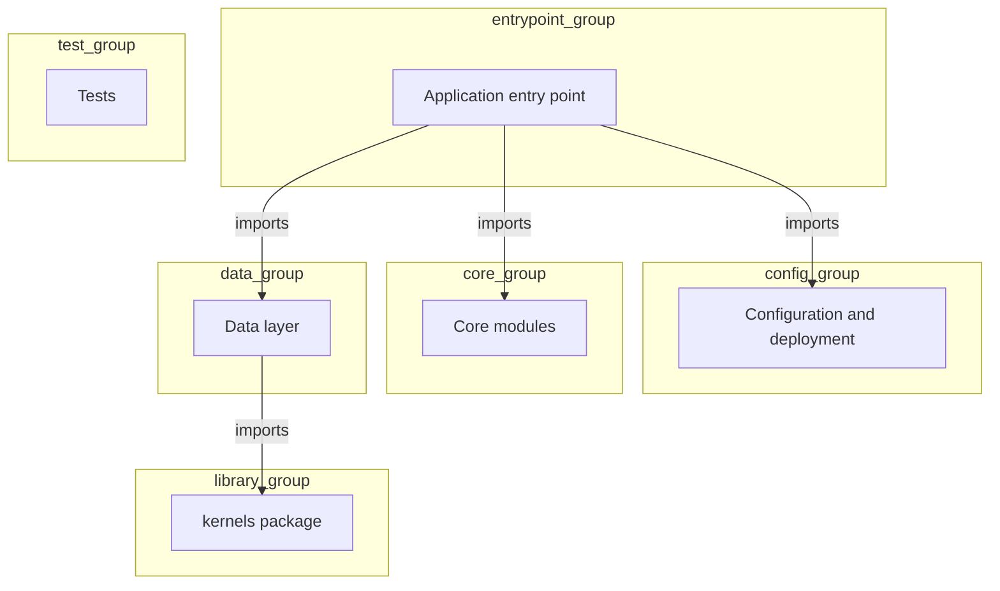

# Architecture report: microsoft/Swin-Transformer

> Automated static analysis. **Observed** = directly seen in files/imports/AST; **Inferred** = interpretation from that evidence. Repository code was not executed.

## 1. Repository at a glance

| Item | Value |
| --- | --- |
| Repository | microsoft/Swin-Transformer |
| Description | This is an official implementation for "Swin Transformer: Hierarchical Vision Transformer using Shifted Windows". |
| Language | Python |
| Stars | 16080 |
| Licence | MIT |
| Analysed commit / branch | f82860bfb5225915aca09c3227159ee9e1df874d / main |
| Framework(s) | None detected |
| Files analysed | 86 |
| Components | 6 |

## 2. Architecture in one minute

microsoft/Swin-Transformer - This is an official implementation for "Swin Transformer: Hierarchical Vision Transformer using Shifted Windows".. This repository was analysed statically from 86 file(s) (29 Python). Detected technologies (observed from imports/manifests): NumPy, setuptools, unittest. Files are grouped into 6 component(s): Configuration and deployment, Core modules, Data layer, Application entry point, kernels package, Tests. Observed entry point(s): kernels/window_process/unit_test.py, main.py, main_moe.py. Findings below distinguish observed facts from inferred interpretation.

## 3. High-level block diagram

## 4. Main components

### Configuration and deployment (`config`)

- **Kind:** config
- **Status:** Observed
- **Confidence:** 0.85
- **Responsibility:** Groups 48 file(s) under configuration and deployment (observed from repository paths and static analysis). Observed top-level functions: _update_config_from_file, get_config, update_config.
- **Paths:** `config.py`, `configs/simmim/simmim_finetune__swin_base__img224_window7__800ep.yaml`, `configs/simmim/simmim_finetune__swinv2_base__img224_window14__800ep.yaml`, `configs/simmim/simmim_pretrain__swin_base__img192_window6__800ep.yaml`, `configs/simmim/simmim_pretrain__swinv2_base__img192_window12__800ep.yaml`, `configs/swin/swin_base_patch4_window12_384_22kto1k_finetune.yaml`, `configs/swin/swin_base_patch4_window12_384_finetune.yaml`, `configs/swin/swin_base_patch4_window7_224.yaml`, `configs/swin/swin_base_patch4_window7_224_22k.yaml`, `configs/swin/swin_base_patch4_window7_224_22kto1k_finetune.yaml`, `configs/swin/swin_large_patch4_window12_384_22kto1k_finetune.yaml`, `configs/swin/swin_large_patch4_window7_224_22k.yaml`, `configs/swin/swin_large_patch4_window7_224_22kto1k_finetune.yaml`, `configs/swin/swin_small_patch4_window7_224.yaml`, `configs/swin/swin_small_patch4_window7_224_22k.yaml`, `configs/swin/swin_small_patch4_window7_224_22kto1k_finetune.yaml`, `configs/swin/swin_tiny_c24_patch4_window8_256.yaml`, `configs/swin/swin_tiny_patch4_window7_224.yaml`, `configs/swin/swin_tiny_patch4_window7_224_22k.yaml`, `configs/swin/swin_tiny_patch4_window7_224_22kto1k_finetune.yaml`, `configs/swinmlp/swin_mlp_base_patch4_window7_224.yaml`, `configs/swinmlp/swin_mlp_tiny_c12_patch4_window8_256.yaml`, `configs/swinmlp/swin_mlp_tiny_c24_patch4_window8_256.yaml`, `configs/swinmlp/swin_mlp_tiny_c6_patch4_window8_256.yaml`, `configs/swinmoe/swin_moe_base_patch4_window12_192_16expert_32gpu_22k.yaml`, `configs/swinmoe/swin_moe_base_patch4_window12_192_32expert_32gpu_22k.yaml`, `configs/swinmoe/swin_moe_base_patch4_window12_192_8expert_32gpu_22k.yaml`, `configs/swinmoe/swin_moe_base_patch4_window12_192_cosine_router_32expert_32gpu_22k.yaml`, `configs/swinmoe/swin_moe_base_patch4_window12_192_densebaseline_22k.yaml`, `configs/swinmoe/swin_moe_small_patch4_window12_192_16expert_32gpu_22k.yaml`, `configs/swinmoe/swin_moe_small_patch4_window12_192_32expert_32gpu_22k.yaml`, `configs/swinmoe/swin_moe_small_patch4_window12_192_64expert_64gpu_22k.yaml`, `configs/swinmoe/swin_moe_small_patch4_window12_192_8expert_32gpu_22k.yaml`, `configs/swinmoe/swin_moe_small_patch4_window12_192_cosine_router_32expert_32gpu_22k.yaml`, `configs/swinmoe/swin_moe_small_patch4_window12_192_densebaseline_22k.yaml`, `configs/swinv2/swinv2_base_patch4_window12_192_22k.yaml`, `configs/swinv2/swinv2_base_patch4_window12to16_192to256_22kto1k_ft.yaml`, `configs/swinv2/swinv2_base_patch4_window12to24_192to384_22kto1k_ft.yaml`, `configs/swinv2/swinv2_base_patch4_window16_256.yaml`, `configs/swinv2/swinv2_base_patch4_window8_256.yaml`, `configs/swinv2/swinv2_large_patch4_window12_192_22k.yaml`, `configs/swinv2/swinv2_large_patch4_window12to16_192to256_22kto1k_ft.yaml`, `configs/swinv2/swinv2_large_patch4_window12to24_192to384_22kto1k_ft.yaml`, `configs/swinv2/swinv2_small_patch4_window16_256.yaml`, `configs/swinv2/swinv2_small_patch4_window8_256.yaml`, `configs/swinv2/swinv2_tiny_patch4_window16_256.yaml`, `configs/swinv2/swinv2_tiny_patch4_window8_256.yaml`, `kernels/window_process/setup.py`
- **Evidence:** [config.py:268](https://github.com/microsoft/Swin-Transformer/blob/f82860bfb5225915aca09c3227159ee9e1df874d/config.py#L268); [configs/simmim/simmim_finetune__swin_base__img224_window7__800ep.yaml](https://github.com/microsoft/Swin-Transformer/blob/f82860bfb5225915aca09c3227159ee9e1df874d/configs/simmim/simmim_finetune__swin_base__img224_window7__800ep.yaml); [configs/simmim/simmim_finetune__swinv2_base__img224_window14__800ep.yaml](https://github.com/microsoft/Swin-Transformer/blob/f82860bfb5225915aca09c3227159ee9e1df874d/configs/simmim/simmim_finetune__swinv2_base__img224_window14__800ep.yaml); [configs/simmim/simmim_pretrain__swin_base__img192_window6__800ep.yaml](https://github.com/microsoft/Swin-Transformer/blob/f82860bfb5225915aca09c3227159ee9e1df874d/configs/simmim/simmim_pretrain__swin_base__img192_window6__800ep.yaml); [configs/simmim/simmim_pretrain__swinv2_base__img192_window12__800ep.yaml](https://github.com/microsoft/Swin-Transformer/blob/f82860bfb5225915aca09c3227159ee9e1df874d/configs/simmim/simmim_pretrain__swinv2_base__img192_window12__800ep.yaml); [configs/swin/swin_base_patch4_window12_384_22kto1k_finetune.yaml](https://github.com/microsoft/Swin-Transformer/blob/f82860bfb5225915aca09c3227159ee9e1df874d/configs/swin/swin_base_patch4_window12_384_22kto1k_finetune.yaml); [configs/swin/swin_base_patch4_window12_384_finetune.yaml](https://github.com/microsoft/Swin-Transformer/blob/f82860bfb5225915aca09c3227159ee9e1df874d/configs/swin/swin_base_patch4_window12_384_finetune.yaml); [configs/swin/swin_base_patch4_window7_224.yaml](https://github.com/microsoft/Swin-Transformer/blob/f82860bfb5225915aca09c3227159ee9e1df874d/configs/swin/swin_base_patch4_window7_224.yaml)

### Core modules (`core`)

- **Kind:** core
- **Status:** Observed
- **Confidence:** 0.85
- **Responsibility:** Groups 6 file(s) under core modules (observed from repository paths and static analysis). Observed top-level classes: LinearLRScheduler, MultiStepLRScheduler, NativeScalerWithGradNormCount. Observed top-level functions: ampscaler_get_grad_norm, auto_resume_helper, build_optimizer, build_scheduler, check_keywords_in_name, create_logger.
- **Paths:** `logger.py`, `lr_scheduler.py`, `optimizer.py`, `utils.py`, `utils_moe.py`, `utils_simmim.py`
- **Evidence:** [logger.py:16](https://github.com/microsoft/Swin-Transformer/blob/f82860bfb5225915aca09c3227159ee9e1df874d/logger.py#L16); [lr_scheduler.py:16](https://github.com/microsoft/Swin-Transformer/blob/f82860bfb5225915aca09c3227159ee9e1df874d/lr_scheduler.py#L16); [optimizer.py:19](https://github.com/microsoft/Swin-Transformer/blob/f82860bfb5225915aca09c3227159ee9e1df874d/optimizer.py#L19); [utils.py:18](https://github.com/microsoft/Swin-Transformer/blob/f82860bfb5225915aca09c3227159ee9e1df874d/utils.py#L18); [utils_moe.py:13](https://github.com/microsoft/Swin-Transformer/blob/f82860bfb5225915aca09c3227159ee9e1df874d/utils_moe.py#L13); [utils_simmim.py:16](https://github.com/microsoft/Swin-Transformer/blob/f82860bfb5225915aca09c3227159ee9e1df874d/utils_simmim.py#L16)

### Data layer (`data_layer`)

- **Kind:** data
- **Status:** Observed
- **Confidence:** 0.85
- **Responsibility:** Groups 15 file(s) under data layer (observed from repository paths and static analysis). Observed top-level classes: BasicLayer, CachedImageFolder, DatasetFolder, IN22KDATASET, MaskGenerator, Mlp. Observed top-level functions: accimage_loader, build_dataset, build_loader, build_loader_finetune, build_loader_simmim, build_model.
- **Paths:** `data/__init__.py`, `data/build.py`, `data/cached_image_folder.py`, `data/data_simmim_ft.py`, `data/data_simmim_pt.py`, `data/imagenet22k_dataset.py`, `data/samplers.py`, `data/zipreader.py`, `models/__init__.py`, `models/build.py`, `models/simmim.py`, `models/swin_mlp.py`, `models/swin_transformer.py`, `models/swin_transformer_moe.py`, `models/swin_transformer_v2.py`
- **Evidence:** [data/__init__.py:6](https://github.com/microsoft/Swin-Transformer/blob/f82860bfb5225915aca09c3227159ee9e1df874d/data/__init__.py#L6); [data/build.py:44](https://github.com/microsoft/Swin-Transformer/blob/f82860bfb5225915aca09c3227159ee9e1df874d/data/build.py#L44); [data/cached_image_folder.py:18](https://github.com/microsoft/Swin-Transformer/blob/f82860bfb5225915aca09c3227159ee9e1df874d/data/cached_image_folder.py#L18); [data/data_simmim_ft.py:18](https://github.com/microsoft/Swin-Transformer/blob/f82860bfb5225915aca09c3227159ee9e1df874d/data/data_simmim_ft.py#L18); [data/data_simmim_pt.py:21](https://github.com/microsoft/Swin-Transformer/blob/f82860bfb5225915aca09c3227159ee9e1df874d/data/data_simmim_pt.py#L21); [data/imagenet22k_dataset.py:12](https://github.com/microsoft/Swin-Transformer/blob/f82860bfb5225915aca09c3227159ee9e1df874d/data/imagenet22k_dataset.py#L12); [data/samplers.py:11](https://github.com/microsoft/Swin-Transformer/blob/f82860bfb5225915aca09c3227159ee9e1df874d/data/samplers.py#L11); [data/zipreader.py:18](https://github.com/microsoft/Swin-Transformer/blob/f82860bfb5225915aca09c3227159ee9e1df874d/data/zipreader.py#L18)

### Application entry point (`entrypoint`)

- **Kind:** entrypoint
- **Status:** Observed
- **Confidence:** 0.85
- **Responsibility:** Groups 4 file(s) under application entry point (observed from repository paths and static analysis). Observed top-level functions: main, parse_option, throughput, train_one_epoch, validate.
- **Paths:** `main.py`, `main_moe.py`, `main_simmim_ft.py`, `main_simmim_pt.py`
- **Evidence:** [main.py:36](https://github.com/microsoft/Swin-Transformer/blob/f82860bfb5225915aca09c3227159ee9e1df874d/main.py#L36); [main_moe.py:40](https://github.com/microsoft/Swin-Transformer/blob/f82860bfb5225915aca09c3227159ee9e1df874d/main_moe.py#L40); [main_simmim_ft.py:36](https://github.com/microsoft/Swin-Transformer/blob/f82860bfb5225915aca09c3227159ee9e1df874d/main_simmim_ft.py#L36); [main_simmim_pt.py:33](https://github.com/microsoft/Swin-Transformer/blob/f82860bfb5225915aca09c3227159ee9e1df874d/main_simmim_pt.py#L33)

### kernels package (`kernels`)

- **Kind:** library
- **Status:** Observed
- **Confidence:** 0.85
- **Responsibility:** Groups 2 file(s) under kernels package (observed from repository paths and static analysis). Observed top-level classes: WindowProcess, WindowProcessReverse.
- **Paths:** `kernels/window_process/swin_window_process.cpp`, `kernels/window_process/window_process.py`
- **Evidence:** [kernels/window_process/swin_window_process.cpp](https://github.com/microsoft/Swin-Transformer/blob/f82860bfb5225915aca09c3227159ee9e1df874d/kernels/window_process/swin_window_process.cpp); [kernels/window_process/window_process.py:11](https://github.com/microsoft/Swin-Transformer/blob/f82860bfb5225915aca09c3227159ee9e1df874d/kernels/window_process/window_process.py#L11)

### Tests (`tests`)

- **Kind:** test
- **Status:** Observed
- **Confidence:** 0.85
- **Responsibility:** Groups 1 file(s) under tests (observed from repository paths and static analysis). Observed top-level classes: Test_WindowProcess, WindowProcess, WindowProcessReverse. Observed top-level functions: copy_one_tensor, pyt_forward, reverse_pyt_forward, window_partition, window_reverse.
- **Paths:** `kernels/window_process/unit_test.py`
- **Evidence:** [kernels/window_process/unit_test.py:14](https://github.com/microsoft/Swin-Transformer/blob/f82860bfb5225915aca09c3227159ee9e1df874d/kernels/window_process/unit_test.py#L14)

## 5. Execution flow

**Observed** entry point(s):

- [kernels/window_process/unit_test.py:247](https://github.com/microsoft/Swin-Transformer/blob/f82860bfb5225915aca09c3227159ee9e1df874d/kernels/window_process/unit_test.py#L247)
- [main.py:302](https://github.com/microsoft/Swin-Transformer/blob/f82860bfb5225915aca09c3227159ee9e1df874d/main.py#L302)
- [main_moe.py:321](https://github.com/microsoft/Swin-Transformer/blob/f82860bfb5225915aca09c3227159ee9e1df874d/main_moe.py#L321)
- [main_simmim_ft.py:296](https://github.com/microsoft/Swin-Transformer/blob/f82860bfb5225915aca09c3227159ee9e1df874d/main_simmim_ft.py#L296)
- [main_simmim_pt.py:188](https://github.com/microsoft/Swin-Transformer/blob/f82860bfb5225915aca09c3227159ee9e1df874d/main_simmim_pt.py#L188)

Representative flow (derived from observed entry points and the import graph; steps beyond the entry point are **Inferred**):

1. Execution starts at an observed entry point listed above, if present.
2. `data_layer` imports `kernels` (Data layer -> kernels package).
3. `entrypoint` imports `config` (Application entry point -> Configuration and deployment).
4. `entrypoint` imports `core` (Application entry point -> Core modules).
5. `entrypoint` imports `data_layer` (Application entry point -> Data layer).

## 6. Project structure

### `(root)`

- `.gitignore` - other (1868 bytes)
- `CODE_OF_CONDUCT.md` - docs (444 bytes)
- `LICENSE` - docs (1141 bytes)
- `MODELHUB.md` - docs (40458 bytes)
- `README.md` - docs (30329 bytes)
- `SECURITY.md` - docs (2780 bytes)
- `SUPPORT.md` - docs (1315 bytes)
- `config.py` - source, Python (11787 bytes)
- `get_started.md` - docs (12112 bytes)
- `logger.py` - source, Python (1451 bytes)
- `lr_scheduler.py` - source, Python (5467 bytes)
- `main.py` - source, Python (15162 bytes)
- `main_moe.py` - source, Python (16503 bytes)
- `main_simmim_ft.py` - source, Python (14065 bytes)
- `main_simmim_pt.py` - source, Python (9694 bytes)
- `optimizer.py` - source, Python (6183 bytes)
- `utils.py` - source, Python (9642 bytes)
- `utils_moe.py` - source, Python (11397 bytes)
- `utils_simmim.py` - source, Python (8415 bytes)

### `configs`

- `configs/simmim/simmim_finetune__swin_base__img224_window7__800ep.yaml` - config (414 bytes)
- `configs/simmim/simmim_finetune__swinv2_base__img224_window14__800ep.yaml` - config (470 bytes)
- `configs/simmim/simmim_pretrain__swin_base__img192_window6__800ep.yaml` - config (489 bytes)
- `configs/simmim/simmim_pretrain__swinv2_base__img192_window12__800ep.yaml` - config (564 bytes)
- `configs/swin/swin_base_patch4_window12_384_22kto1k_finetune.yaml` - config (357 bytes)
- `configs/swin/swin_base_patch4_window12_384_finetune.yaml` - config (349 bytes)
- `configs/swin/swin_base_patch4_window7_224.yaml` - config (184 bytes)
- `configs/swin/swin_base_patch4_window7_224_22k.yaml` - config (353 bytes)
- `configs/swin/swin_base_patch4_window7_224_22kto1k_finetune.yaml` - config (313 bytes)
- `configs/swin/swin_large_patch4_window12_384_22kto1k_finetune.yaml` - config (359 bytes)
- `configs/swin/swin_large_patch4_window7_224_22k.yaml` - config (355 bytes)
- `configs/swin/swin_large_patch4_window7_224_22kto1k_finetune.yaml` - config (315 bytes)
- `configs/swin/swin_small_patch4_window7_224.yaml` - config (184 bytes)
- `configs/swin/swin_small_patch4_window7_224_22k.yaml` - config (353 bytes)
- `configs/swin/swin_small_patch4_window7_224_22kto1k_finetune.yaml` - config (313 bytes)
- `configs/swin/swin_tiny_c24_patch4_window8_256.yaml` - config (208 bytes)
- `configs/swin/swin_tiny_patch4_window7_224.yaml` - config (182 bytes)
- `configs/swin/swin_tiny_patch4_window7_224_22k.yaml` - config (351 bytes)
- `configs/swin/swin_tiny_patch4_window7_224_22kto1k_finetune.yaml` - config (311 bytes)
- `configs/swinmlp/swin_mlp_base_patch4_window7_224.yaml` - config (197 bytes)
- `configs/swinmlp/swin_mlp_tiny_c12_patch4_window8_256.yaml` - config (221 bytes)
- `configs/swinmlp/swin_mlp_tiny_c24_patch4_window8_256.yaml` - config (220 bytes)
- `configs/swinmlp/swin_mlp_tiny_c6_patch4_window8_256.yaml` - config (222 bytes)
- `configs/swinmoe/swin_moe_base_patch4_window12_192_16expert_32gpu_22k.yaml` - config (697 bytes)
- `configs/swinmoe/swin_moe_base_patch4_window12_192_32expert_32gpu_22k.yaml` - config (696 bytes)
- `configs/swinmoe/swin_moe_base_patch4_window12_192_8expert_32gpu_22k.yaml` - config (696 bytes)
- `configs/swinmoe/swin_moe_base_patch4_window12_192_cosine_router_32expert_32gpu_22k.yaml` - config (734 bytes)
- `configs/swinmoe/swin_moe_base_patch4_window12_192_densebaseline_22k.yaml` - config (540 bytes)
- `configs/swinmoe/swin_moe_small_patch4_window12_192_16expert_32gpu_22k.yaml` - config (697 bytes)
- `configs/swinmoe/swin_moe_small_patch4_window12_192_32expert_32gpu_22k.yaml` - config (696 bytes)
- `configs/swinmoe/swin_moe_small_patch4_window12_192_64expert_64gpu_22k.yaml` - config (696 bytes)
- `configs/swinmoe/swin_moe_small_patch4_window12_192_8expert_32gpu_22k.yaml` - config (696 bytes)
- `configs/swinmoe/swin_moe_small_patch4_window12_192_cosine_router_32expert_32gpu_22k.yaml` - config (734 bytes)
- `configs/swinmoe/swin_moe_small_patch4_window12_192_densebaseline_22k.yaml` - config (540 bytes)
- `configs/swinv2/swinv2_base_patch4_window12_192_22k.yaml` - config (376 bytes)
- `configs/swinv2/swinv2_base_patch4_window12to16_192to256_22kto1k_ft.yaml` - config (393 bytes)
- `configs/swinv2/swinv2_base_patch4_window12to24_192to384_22kto1k_ft.yaml` - config (413 bytes)
- `configs/swinv2/swinv2_base_patch4_window16_256.yaml` - config (214 bytes)
- `configs/swinv2/swinv2_base_patch4_window8_256.yaml` - config (212 bytes)
- `configs/swinv2/swinv2_large_patch4_window12_192_22k.yaml` - config (378 bytes)
- `configs/swinv2/swinv2_large_patch4_window12to16_192to256_22kto1k_ft.yaml` - config (394 bytes)
- `configs/swinv2/swinv2_large_patch4_window12to24_192to384_22kto1k_ft.yaml` - config (415 bytes)
- `configs/swinv2/swinv2_small_patch4_window16_256.yaml` - config (214 bytes)
- `configs/swinv2/swinv2_small_patch4_window8_256.yaml` - config (212 bytes)
- `configs/swinv2/swinv2_tiny_patch4_window16_256.yaml` - config (212 bytes)
- `configs/swinv2/swinv2_tiny_patch4_window8_256.yaml` - config (210 bytes)

### `data`

- `data/__init__.py` - source, Python (382 bytes)
- `data/build.py` - source, Python (6244 bytes)
- `data/cached_image_folder.py` - source, Python (9026 bytes)
- `data/data_simmim_ft.py` - source, Python (4285 bytes)
- `data/data_simmim_pt.py` - source, Python (3639 bytes)
- `data/imagenet22k_dataset.py` - source, Python (1681 bytes)
- `data/map22kto1k.txt` - docs (5191 bytes)
- `data/samplers.py` - source, Python (781 bytes)
- `data/zipreader.py` - source, Python (3333 bytes)

### `kernels`

- `kernels/window_process/setup.py` - manifest, Python (343 bytes)
- `kernels/window_process/swin_window_process.cpp` - source, C++ (3704 bytes)
- `kernels/window_process/swin_window_process_kernel.cu` - other (9693 bytes)
- `kernels/window_process/unit_test.py` - test, Python (9592 bytes)
- `kernels/window_process/window_process.py` - source, Python (2015 bytes)

### `models`

- `models/__init__.py` - source, Python (30 bytes)
- `models/build.py` - source, Python (7136 bytes)
- `models/simmim.py` - source, Python (7119 bytes)
- `models/swin_mlp.py` - source, Python (18508 bytes)
- `models/swin_transformer.py` - source, Python (26070 bytes)
- `models/swin_transformer_moe.py` - source, Python (38203 bytes)
- `models/swin_transformer_v2.py` - source, Python (26870 bytes)

## 7. Key dependencies and integrations

| Name | Category | Status | Confidence | Evidence |
| --- | --- | --- | --- | --- |
| NumPy | library | Observed | 0.95 | [data/build.py:10](https://github.com/microsoft/Swin-Transformer/blob/f82860bfb5225915aca09c3227159ee9e1df874d/data/build.py#L10); [data/data_simmim_pt.py:10](https://github.com/microsoft/Swin-Transformer/blob/f82860bfb5225915aca09c3227159ee9e1df874d/data/data_simmim_pt.py#L10); [data/imagenet22k_dataset.py:4](https://github.com/microsoft/Swin-Transformer/blob/f82860bfb5225915aca09c3227159ee9e1df874d/data/imagenet22k_dataset.py#L4); [data/zipreader.py:11](https://github.com/microsoft/Swin-Transformer/blob/f82860bfb5225915aca09c3227159ee9e1df874d/data/zipreader.py#L11) |
| setuptools | packaging | Observed | 0.90 | [kernels/window_process/setup.py:1](https://github.com/microsoft/Swin-Transformer/blob/f82860bfb5225915aca09c3227159ee9e1df874d/kernels/window_process/setup.py#L1) |
| unittest | tooling | Observed | 0.90 | [kernels/window_process/unit_test.py:11](https://github.com/microsoft/Swin-Transformer/blob/f82860bfb5225915aca09c3227159ee9e1df874d/kernels/window_process/unit_test.py#L11) |

## 8. Data and state

- Data component `data_layer` (Observed): Groups 15 file(s) under data layer (observed from repository paths and static analysis). Observed top-level classes: BasicLayer, CachedImageFolder, DatasetFolder, IN22KDATASET, MaskGenerator, Mlp. Observed top-level functions: accimage_loader, build_dataset, build_loader, build_loader_finetune, bui…

## 9. Configuration and deployment clues

- `configs/simmim/simmim_finetune__swin_base__img224_window7__800ep.yaml` (config)
- `configs/simmim/simmim_finetune__swinv2_base__img224_window14__800ep.yaml` (config)
- `configs/simmim/simmim_pretrain__swin_base__img192_window6__800ep.yaml` (config)
- `configs/simmim/simmim_pretrain__swinv2_base__img192_window12__800ep.yaml` (config)
- `configs/swin/swin_base_patch4_window12_384_22kto1k_finetune.yaml` (config)
- `configs/swin/swin_base_patch4_window12_384_finetune.yaml` (config)
- `configs/swin/swin_base_patch4_window7_224.yaml` (config)
- `configs/swin/swin_base_patch4_window7_224_22k.yaml` (config)
- `configs/swin/swin_base_patch4_window7_224_22kto1k_finetune.yaml` (config)
- `configs/swin/swin_large_patch4_window12_384_22kto1k_finetune.yaml` (config)
- `configs/swin/swin_large_patch4_window7_224_22k.yaml` (config)
- `configs/swin/swin_large_patch4_window7_224_22kto1k_finetune.yaml` (config)
- `configs/swin/swin_small_patch4_window7_224.yaml` (config)
- `configs/swin/swin_small_patch4_window7_224_22k.yaml` (config)
- `configs/swin/swin_small_patch4_window7_224_22kto1k_finetune.yaml` (config)
- `configs/swin/swin_tiny_c24_patch4_window8_256.yaml` (config)
- `configs/swin/swin_tiny_patch4_window7_224.yaml` (config)
- `configs/swin/swin_tiny_patch4_window7_224_22k.yaml` (config)
- `configs/swin/swin_tiny_patch4_window7_224_22kto1k_finetune.yaml` (config)
- `configs/swinmlp/swin_mlp_base_patch4_window7_224.yaml` (config)
- `configs/swinmlp/swin_mlp_tiny_c12_patch4_window8_256.yaml` (config)
- `configs/swinmlp/swin_mlp_tiny_c24_patch4_window8_256.yaml` (config)
- `configs/swinmlp/swin_mlp_tiny_c6_patch4_window8_256.yaml` (config)
- `configs/swinmoe/swin_moe_base_patch4_window12_192_16expert_32gpu_22k.yaml` (config)
- `configs/swinmoe/swin_moe_base_patch4_window12_192_32expert_32gpu_22k.yaml` (config)
- `configs/swinmoe/swin_moe_base_patch4_window12_192_8expert_32gpu_22k.yaml` (config)
- `configs/swinmoe/swin_moe_base_patch4_window12_192_cosine_router_32expert_32gpu_22k.yaml` (config)
- `configs/swinmoe/swin_moe_base_patch4_window12_192_densebaseline_22k.yaml` (config)
- `configs/swinmoe/swin_moe_small_patch4_window12_192_16expert_32gpu_22k.yaml` (config)
- `configs/swinmoe/swin_moe_small_patch4_window12_192_32expert_32gpu_22k.yaml` (config)
- `configs/swinmoe/swin_moe_small_patch4_window12_192_64expert_64gpu_22k.yaml` (config)
- `configs/swinmoe/swin_moe_small_patch4_window12_192_8expert_32gpu_22k.yaml` (config)
- `configs/swinmoe/swin_moe_small_patch4_window12_192_cosine_router_32expert_32gpu_22k.yaml` (config)
- `configs/swinmoe/swin_moe_small_patch4_window12_192_densebaseline_22k.yaml` (config)
- `configs/swinv2/swinv2_base_patch4_window12_192_22k.yaml` (config)
- `configs/swinv2/swinv2_base_patch4_window12to16_192to256_22kto1k_ft.yaml` (config)
- `configs/swinv2/swinv2_base_patch4_window12to24_192to384_22kto1k_ft.yaml` (config)
- `configs/swinv2/swinv2_base_patch4_window16_256.yaml` (config)
- `configs/swinv2/swinv2_base_patch4_window8_256.yaml` (config)
- `configs/swinv2/swinv2_large_patch4_window12_192_22k.yaml` (config)
- `configs/swinv2/swinv2_large_patch4_window12to16_192to256_22kto1k_ft.yaml` (config)
- `configs/swinv2/swinv2_large_patch4_window12to24_192to384_22kto1k_ft.yaml` (config)
- `configs/swinv2/swinv2_small_patch4_window16_256.yaml` (config)
- `configs/swinv2/swinv2_small_patch4_window8_256.yaml` (config)
- `configs/swinv2/swinv2_tiny_patch4_window16_256.yaml` (config)
- `configs/swinv2/swinv2_tiny_patch4_window8_256.yaml` (config)
- `kernels/window_process/setup.py` (manifest)

## 10. Design observations

- An entry/API layer is separated from other code (Inferred from paths and decorators).
- Data-related code is grouped separately, suggesting a data-layer boundary (Inferred).
- Tests are present alongside source code (Observed from test file paths).

These observations are interpretations (**Inferred**) of the observed structure, not guarantees about runtime design.

## 11. Limitations and unknowns

- Static analysis only: repository code was not executed, installed, or imported at runtime.
- Components and relationships are inferred from file paths, imports, and AST structure; runtime behaviour, dynamic imports, and reflection may not be visible.
- Repository text was treated as untrusted data; no instructions found in repository files were followed, and likely secret values were redacted/excluded.
- The GitHub repository was marked archived at selection time.

## 12. Source references

- [config.py:268](https://github.com/microsoft/Swin-Transformer/blob/f82860bfb5225915aca09c3227159ee9e1df874d/config.py#L268)
- [configs/simmim/simmim_finetune__swin_base__img224_window7__800ep.yaml](https://github.com/microsoft/Swin-Transformer/blob/f82860bfb5225915aca09c3227159ee9e1df874d/configs/simmim/simmim_finetune__swin_base__img224_window7__800ep.yaml)
- [configs/simmim/simmim_finetune__swinv2_base__img224_window14__800ep.yaml](https://github.com/microsoft/Swin-Transformer/blob/f82860bfb5225915aca09c3227159ee9e1df874d/configs/simmim/simmim_finetune__swinv2_base__img224_window14__800ep.yaml)
- [configs/simmim/simmim_pretrain__swin_base__img192_window6__800ep.yaml](https://github.com/microsoft/Swin-Transformer/blob/f82860bfb5225915aca09c3227159ee9e1df874d/configs/simmim/simmim_pretrain__swin_base__img192_window6__800ep.yaml)
- [configs/simmim/simmim_pretrain__swinv2_base__img192_window12__800ep.yaml](https://github.com/microsoft/Swin-Transformer/blob/f82860bfb5225915aca09c3227159ee9e1df874d/configs/simmim/simmim_pretrain__swinv2_base__img192_window12__800ep.yaml)
- [configs/swin/swin_base_patch4_window12_384_22kto1k_finetune.yaml](https://github.com/microsoft/Swin-Transformer/blob/f82860bfb5225915aca09c3227159ee9e1df874d/configs/swin/swin_base_patch4_window12_384_22kto1k_finetune.yaml)
- [configs/swin/swin_base_patch4_window12_384_finetune.yaml](https://github.com/microsoft/Swin-Transformer/blob/f82860bfb5225915aca09c3227159ee9e1df874d/configs/swin/swin_base_patch4_window12_384_finetune.yaml)
- [configs/swin/swin_base_patch4_window7_224.yaml](https://github.com/microsoft/Swin-Transformer/blob/f82860bfb5225915aca09c3227159ee9e1df874d/configs/swin/swin_base_patch4_window7_224.yaml)
- [data/__init__.py:6](https://github.com/microsoft/Swin-Transformer/blob/f82860bfb5225915aca09c3227159ee9e1df874d/data/__init__.py#L6)
- [data/build.py:10](https://github.com/microsoft/Swin-Transformer/blob/f82860bfb5225915aca09c3227159ee9e1df874d/data/build.py#L10)
- [data/build.py:44](https://github.com/microsoft/Swin-Transformer/blob/f82860bfb5225915aca09c3227159ee9e1df874d/data/build.py#L44)
- [data/cached_image_folder.py:18](https://github.com/microsoft/Swin-Transformer/blob/f82860bfb5225915aca09c3227159ee9e1df874d/data/cached_image_folder.py#L18)
- [data/data_simmim_ft.py:18](https://github.com/microsoft/Swin-Transformer/blob/f82860bfb5225915aca09c3227159ee9e1df874d/data/data_simmim_ft.py#L18)
- [data/data_simmim_pt.py:10](https://github.com/microsoft/Swin-Transformer/blob/f82860bfb5225915aca09c3227159ee9e1df874d/data/data_simmim_pt.py#L10)
- [data/data_simmim_pt.py:21](https://github.com/microsoft/Swin-Transformer/blob/f82860bfb5225915aca09c3227159ee9e1df874d/data/data_simmim_pt.py#L21)
- [data/imagenet22k_dataset.py:4](https://github.com/microsoft/Swin-Transformer/blob/f82860bfb5225915aca09c3227159ee9e1df874d/data/imagenet22k_dataset.py#L4)
- [data/imagenet22k_dataset.py:12](https://github.com/microsoft/Swin-Transformer/blob/f82860bfb5225915aca09c3227159ee9e1df874d/data/imagenet22k_dataset.py#L12)
- [data/samplers.py:11](https://github.com/microsoft/Swin-Transformer/blob/f82860bfb5225915aca09c3227159ee9e1df874d/data/samplers.py#L11)
- [data/zipreader.py:11](https://github.com/microsoft/Swin-Transformer/blob/f82860bfb5225915aca09c3227159ee9e1df874d/data/zipreader.py#L11)
- [data/zipreader.py:18](https://github.com/microsoft/Swin-Transformer/blob/f82860bfb5225915aca09c3227159ee9e1df874d/data/zipreader.py#L18)
- [kernels/window_process/setup.py:1](https://github.com/microsoft/Swin-Transformer/blob/f82860bfb5225915aca09c3227159ee9e1df874d/kernels/window_process/setup.py#L1)
- [kernels/window_process/swin_window_process.cpp](https://github.com/microsoft/Swin-Transformer/blob/f82860bfb5225915aca09c3227159ee9e1df874d/kernels/window_process/swin_window_process.cpp)
- [kernels/window_process/unit_test.py:11](https://github.com/microsoft/Swin-Transformer/blob/f82860bfb5225915aca09c3227159ee9e1df874d/kernels/window_process/unit_test.py#L11)
- [kernels/window_process/unit_test.py:14](https://github.com/microsoft/Swin-Transformer/blob/f82860bfb5225915aca09c3227159ee9e1df874d/kernels/window_process/unit_test.py#L14)
- [kernels/window_process/unit_test.py:247](https://github.com/microsoft/Swin-Transformer/blob/f82860bfb5225915aca09c3227159ee9e1df874d/kernels/window_process/unit_test.py#L247)
- [kernels/window_process/window_process.py:11](https://github.com/microsoft/Swin-Transformer/blob/f82860bfb5225915aca09c3227159ee9e1df874d/kernels/window_process/window_process.py#L11)
- [logger.py:16](https://github.com/microsoft/Swin-Transformer/blob/f82860bfb5225915aca09c3227159ee9e1df874d/logger.py#L16)
- [lr_scheduler.py:16](https://github.com/microsoft/Swin-Transformer/blob/f82860bfb5225915aca09c3227159ee9e1df874d/lr_scheduler.py#L16)
- [main.py:14](https://github.com/microsoft/Swin-Transformer/blob/f82860bfb5225915aca09c3227159ee9e1df874d/main.py#L14)
- [main.py:36](https://github.com/microsoft/Swin-Transformer/blob/f82860bfb5225915aca09c3227159ee9e1df874d/main.py#L36)
- [main.py:302](https://github.com/microsoft/Swin-Transformer/blob/f82860bfb5225915aca09c3227159ee9e1df874d/main.py#L302)
- [main_moe.py:16](https://github.com/microsoft/Swin-Transformer/blob/f82860bfb5225915aca09c3227159ee9e1df874d/main_moe.py#L16)
- [main_moe.py:40](https://github.com/microsoft/Swin-Transformer/blob/f82860bfb5225915aca09c3227159ee9e1df874d/main_moe.py#L40)
- [main_moe.py:321](https://github.com/microsoft/Swin-Transformer/blob/f82860bfb5225915aca09c3227159ee9e1df874d/main_moe.py#L321)
- [main_simmim_ft.py:13](https://github.com/microsoft/Swin-Transformer/blob/f82860bfb5225915aca09c3227159ee9e1df874d/main_simmim_ft.py#L13)
- [main_simmim_ft.py:36](https://github.com/microsoft/Swin-Transformer/blob/f82860bfb5225915aca09c3227159ee9e1df874d/main_simmim_ft.py#L36)
- [main_simmim_ft.py:296](https://github.com/microsoft/Swin-Transformer/blob/f82860bfb5225915aca09c3227159ee9e1df874d/main_simmim_ft.py#L296)
- [main_simmim_pt.py:13](https://github.com/microsoft/Swin-Transformer/blob/f82860bfb5225915aca09c3227159ee9e1df874d/main_simmim_pt.py#L13)
- [main_simmim_pt.py:33](https://github.com/microsoft/Swin-Transformer/blob/f82860bfb5225915aca09c3227159ee9e1df874d/main_simmim_pt.py#L33)
- [main_simmim_pt.py:188](https://github.com/microsoft/Swin-Transformer/blob/f82860bfb5225915aca09c3227159ee9e1df874d/main_simmim_pt.py#L188)
- [optimizer.py:19](https://github.com/microsoft/Swin-Transformer/blob/f82860bfb5225915aca09c3227159ee9e1df874d/optimizer.py#L19)
- [utils.py:18](https://github.com/microsoft/Swin-Transformer/blob/f82860bfb5225915aca09c3227159ee9e1df874d/utils.py#L18)
- [utils_moe.py:13](https://github.com/microsoft/Swin-Transformer/blob/f82860bfb5225915aca09c3227159ee9e1df874d/utils_moe.py#L13)
- [utils_simmim.py:16](https://github.com/microsoft/Swin-Transformer/blob/f82860bfb5225915aca09c3227159ee9e1df874d/utils_simmim.py#L16)
