# Architecture report: microsoft/data-formulator

> Automated static analysis. **Observed** = directly seen in files/imports/AST; **Inferred** = interpretation from that evidence. Repository code was not executed.

## 1. Repository at a glance

| Item | Value |
| --- | --- |
| Repository | microsoft/data-formulator |
| Description | 🪄 Data Formulator is an interactive AI-powered data analysis system makes it easy to connect, explore and visualize data. |
| Language | Python |
| Stars | 17682 |
| Licence | MIT |
| Analysed commit / branch | 5477f0e236426dc8f74a498ec400414fba7fbc0f / main |
| Framework(s) | Flask, React |
| Files analysed | 642 |
| Components | 18 |

## 2. Architecture in one minute

microsoft/data-formulator - 🪄 Data Formulator is an interactive AI-powered data analysis system makes it easy to connect, explore and visualize data.. This repository was analysed statically from 642 file(s) (270 Python). Detected technologies (observed from imports/manifests): GitHub Actions, MongoDB, MySQL, PostgreSQL, SQLite, Flask. Files are grouped into 18 component(s): API layer, app package, components package, Configuration and deployment, Core modules, Data layer, dataOperations package, Application entry point. Observed entry point(s): py-src/data_formulator/__main__.py, py-src/data_formulator/app.py, py-src/data_formulator/desktop.py. Findings below distinguish observed facts from inferred interpretation.

## 3. High-level block diagram

```mermaid
flowchart TD
    subgraph api_group
        api_layer["API layer"]
    end
    subgraph config_group
        config["Configuration and deployment"]
    end
    subgraph core_group
        core["Core modules"]
    end
    subgraph data_group
        data_layer["Data layer"]
    end
    subgraph entrypoint_group
        entrypoint["Application entry point"]
    end
    subgraph external_group
        external_integrations["External integrations"]
    end
    subgraph library_group
        app["app package"]
        components["components package"]
        dataoperations["dataOperations package"]
        i18n["i18n package"]
        icons_tsx["icons.tsx package"]
        index_tsx["index.tsx package"]
        mui_d_ts["mui.d.ts package"]
        packaging["packaging package"]
        py_src["py-src package"]
        types_d_ts["types.d.ts package"]
    end
    subgraph service_group
        service_layer["Service / domain layer"]
    end
    subgraph test_group
        tests["Tests"]
    end
    api_layer -->|imports| external_integrations
    entrypoint -->|imports| external_integrations
    py_src -->|imports| data_layer
    py_src -->|imports| external_integrations
    tests -->|imports| data_layer
    tests -->|imports| external_integrations
```

## 4. Main components

### API layer (`api_layer`)

- **Kind:** api
- **Status:** Observed
- **Confidence:** 0.85
- **Responsibility:** Groups 62 file(s) under api layer (observed from repository paths and static analysis). Observed routes: ROUTE /login, ROUTE /callback, ROUTE /logout, ROUTE /login, ROUTE /callback. Observed top-level classes: DataConnector, SourceSpec. Observed top-level functions: _apply_aggregation_and_sample, _apply_filters_pandas, _apply_session_front_matter, _az_account_summary, _build_filter_where_duckdb, _build_parquet_sample_sql.
- **Paths:** `py-src/data_formulator/auth/gateways/github_gateway.py`, `py-src/data_formulator/auth/gateways/kusto_oauth_gateway.py`, `py-src/data_formulator/auth/gateways/oidc_gateway.py`, `py-src/data_formulator/data_connector.py`, `py-src/data_formulator/routes/__init__.py`, `py-src/data_formulator/routes/agents.py`, `py-src/data_formulator/routes/credentials.py`, `py-src/data_formulator/routes/demo_stream.py`, `py-src/data_formulator/routes/knowledge.py`, `py-src/data_formulator/routes/logs.py`, `py-src/data_formulator/routes/model_endpoints.py`, `py-src/data_formulator/routes/sessions.py`, `py-src/data_formulator/routes/tables.py`, `src/api/knowledgeApi.ts`, `src/views/About.tsx`, `src/views/AgentChatInput.tsx`, `src/views/AgentPausePanel.tsx`, `src/views/AgentRulesDialog.tsx`, `src/views/AgentToyIcon.tsx`, `src/views/ChartQuickConfig.tsx`, `src/views/ChartRenderService.tsx`, `src/views/ChartUtils.tsx`, `src/views/ChartVariantStrip.tsx`, `src/views/ChartifactDialog.tsx`, `src/views/ChatDialog.tsx`, `src/views/ColumnFilterPopover.tsx`, `src/views/DBTableManager.tsx`, `src/views/DataFormulator.tsx`, `src/views/DataFrameTable.tsx`, `src/views/DataLoadingChat.tsx`, `src/views/DataSourceSidebar.tsx`, `src/views/DataThread.tsx`, `src/views/DataThreadCards.tsx`, `src/views/DataView.tsx`, `src/views/EncodingBox.tsx`, `src/views/EncodingShelfCard.tsx`, `src/views/EncodingShelfThread.tsx`, `src/views/ExampleSessions.tsx`, `src/views/ExplComponents.tsx`, `src/views/InteractionEntryCard.tsx`, `src/views/KnowledgePanel.tsx`, `src/views/LocalInstallUpgradePanel.tsx`, `src/views/LogViewerDialog.tsx`, `src/views/MessageSnackbar.tsx`, `src/views/ModelSelectionDialog.tsx`, `src/views/MultiTablePreview.tsx`, `src/views/OperatorCard.tsx`, `src/views/ReactTable.tsx`, `src/views/RefreshDataDialog.tsx`, `src/views/ReportView.tsx`, `src/views/SelectableDataGrid.tsx`, `src/views/SessionDistill.tsx`, `src/views/SimpleChartRecBox.tsx`, `src/views/SourceTableShelf.tsx`, `src/views/TestPanel.tsx`, `src/views/TiptapReportEditor.tsx`, `src/views/UnifiedDataUploadDialog.tsx`, `src/views/ViewUtils.tsx`, `src/views/VisualizationView.tsx`, `src/views/dataLoadingSuggestions.ts`, `src/views/threadLayout.ts`, `src/views/workflowContext.ts`
- **Evidence:** [py-src/data_formulator/auth/gateways/github_gateway.py:29](https://github.com/microsoft/data-formulator/blob/5477f0e236426dc8f74a498ec400414fba7fbc0f/py-src/data_formulator/auth/gateways/github_gateway.py#L29); [py-src/data_formulator/auth/gateways/kusto_oauth_gateway.py:43](https://github.com/microsoft/data-formulator/blob/5477f0e236426dc8f74a498ec400414fba7fbc0f/py-src/data_formulator/auth/gateways/kusto_oauth_gateway.py#L43); [py-src/data_formulator/auth/gateways/oidc_gateway.py:44](https://github.com/microsoft/data-formulator/blob/5477f0e236426dc8f74a498ec400414fba7fbc0f/py-src/data_formulator/auth/gateways/oidc_gateway.py#L44); [py-src/data_formulator/data_connector.py:72](https://github.com/microsoft/data-formulator/blob/5477f0e236426dc8f74a498ec400414fba7fbc0f/py-src/data_formulator/data_connector.py#L72); [py-src/data_formulator/routes/__init__.py](https://github.com/microsoft/data-formulator/blob/5477f0e236426dc8f74a498ec400414fba7fbc0f/py-src/data_formulator/routes/__init__.py); [py-src/data_formulator/routes/agents.py:47](https://github.com/microsoft/data-formulator/blob/5477f0e236426dc8f74a498ec400414fba7fbc0f/py-src/data_formulator/routes/agents.py#L47); [py-src/data_formulator/routes/credentials.py:28](https://github.com/microsoft/data-formulator/blob/5477f0e236426dc8f74a498ec400414fba7fbc0f/py-src/data_formulator/routes/credentials.py#L28); [py-src/data_formulator/routes/demo_stream.py:43](https://github.com/microsoft/data-formulator/blob/5477f0e236426dc8f74a498ec400414fba7fbc0f/py-src/data_formulator/routes/demo_stream.py#L43)

### app package (`app`)

- **Kind:** library
- **Status:** Observed
- **Confidence:** 0.85
- **Responsibility:** Groups 35 file(s) under app package (observed from repository paths and static analysis).
- **Paths:** `src/app/App.tsx`, `src/app/AuthButton.tsx`, `src/app/IdentityMigrationDialog.tsx`, `src/app/LayoutProvider.tsx`, `src/app/OidcCallback.tsx`, `src/app/agentInteractionPolicy.ts`, `src/app/apiClient.ts`, `src/app/chartCache.ts`, `src/app/chartRecommendation.ts`, `src/app/clarification.ts`, `src/app/connectorFormPersistence.ts`, `src/app/connectorNames.ts`, `src/app/dfSlice.tsx`, `src/app/displayRowsCache.ts`, `src/app/errorCodes.ts`, `src/app/errorHandler.ts`, `src/app/identity.ts`, `src/app/inputTablePreviewCache.ts`, `src/app/intentClassifier.ts`, `src/app/layout.ts`, `src/app/loadableState.ts`, `src/app/oidcConfig.ts`, `src/app/restyle.ts`, `src/app/stateMigrations.ts`, `src/app/store.ts`, `src/app/tableResolution.ts`, `src/app/tableThunks.ts`, `src/app/tokens.ts`, `src/app/useAutoSave.tsx`, `src/app/useDataRefresh.tsx`, `src/app/useKnowledgeStore.ts`, `src/app/useWorkspaceAutoName.tsx`, `src/app/utils.tsx`, `src/app/workspaceDB.ts`, `src/app/workspaceService.ts`
- **Evidence:** [src/app/App.tsx](https://github.com/microsoft/data-formulator/blob/5477f0e236426dc8f74a498ec400414fba7fbc0f/src/app/App.tsx); [src/app/AuthButton.tsx](https://github.com/microsoft/data-formulator/blob/5477f0e236426dc8f74a498ec400414fba7fbc0f/src/app/AuthButton.tsx); [src/app/IdentityMigrationDialog.tsx](https://github.com/microsoft/data-formulator/blob/5477f0e236426dc8f74a498ec400414fba7fbc0f/src/app/IdentityMigrationDialog.tsx); [src/app/LayoutProvider.tsx](https://github.com/microsoft/data-formulator/blob/5477f0e236426dc8f74a498ec400414fba7fbc0f/src/app/LayoutProvider.tsx); [src/app/OidcCallback.tsx](https://github.com/microsoft/data-formulator/blob/5477f0e236426dc8f74a498ec400414fba7fbc0f/src/app/OidcCallback.tsx); [src/app/agentInteractionPolicy.ts](https://github.com/microsoft/data-formulator/blob/5477f0e236426dc8f74a498ec400414fba7fbc0f/src/app/agentInteractionPolicy.ts); [src/app/apiClient.ts](https://github.com/microsoft/data-formulator/blob/5477f0e236426dc8f74a498ec400414fba7fbc0f/src/app/apiClient.ts); [src/app/chartCache.ts](https://github.com/microsoft/data-formulator/blob/5477f0e236426dc8f74a498ec400414fba7fbc0f/src/app/chartCache.ts)

### components package (`components`)

- **Kind:** library
- **Status:** Observed
- **Confidence:** 0.85
- **Responsibility:** Groups 17 file(s) under components package (observed from repository paths and static analysis).
- **Paths:** `src/components/AnvilLoader.tsx`, `src/components/CatalogTree.tsx`, `src/components/ChartTemplates.tsx`, `src/components/ComponentType.tsx`, `src/components/ConnectorFormCard.tsx`, `src/components/ConnectorTablePreview.tsx`, `src/components/DataOperationCard.tsx`, `src/components/DndTypes.ts`, `src/components/FunComponents.tsx`, `src/components/LoadPlanCard.tsx`, `src/components/MarkdownEditor.tsx`, `src/components/ResizeHandle.tsx`, `src/components/RotatingTextBlock.tsx`, `src/components/ScrollFade.tsx`, `src/components/TablePreviewRow.tsx`, `src/components/VirtualizedCatalogTree.tsx`, `src/components/filterFormat.ts`
- **Evidence:** [src/components/AnvilLoader.tsx](https://github.com/microsoft/data-formulator/blob/5477f0e236426dc8f74a498ec400414fba7fbc0f/src/components/AnvilLoader.tsx); [src/components/CatalogTree.tsx](https://github.com/microsoft/data-formulator/blob/5477f0e236426dc8f74a498ec400414fba7fbc0f/src/components/CatalogTree.tsx); [src/components/ChartTemplates.tsx](https://github.com/microsoft/data-formulator/blob/5477f0e236426dc8f74a498ec400414fba7fbc0f/src/components/ChartTemplates.tsx); [src/components/ComponentType.tsx](https://github.com/microsoft/data-formulator/blob/5477f0e236426dc8f74a498ec400414fba7fbc0f/src/components/ComponentType.tsx); [src/components/ConnectorFormCard.tsx](https://github.com/microsoft/data-formulator/blob/5477f0e236426dc8f74a498ec400414fba7fbc0f/src/components/ConnectorFormCard.tsx); [src/components/ConnectorTablePreview.tsx](https://github.com/microsoft/data-formulator/blob/5477f0e236426dc8f74a498ec400414fba7fbc0f/src/components/ConnectorTablePreview.tsx); [src/components/DataOperationCard.tsx](https://github.com/microsoft/data-formulator/blob/5477f0e236426dc8f74a498ec400414fba7fbc0f/src/components/DataOperationCard.tsx); [src/components/DndTypes.ts](https://github.com/microsoft/data-formulator/blob/5477f0e236426dc8f74a498ec400414fba7fbc0f/src/components/DndTypes.ts)

### Configuration and deployment (`config`)

- **Kind:** config
- **Status:** Observed
- **Confidence:** 0.85
- **Responsibility:** Groups 46 file(s) under configuration and deployment (observed from repository paths and static analysis).
- **Paths:** `Dockerfile`, `MANIFEST.in`, `docker-compose.yml`, `package.json`, `public/demos/demos.yaml`, `public/manifest.json`, `py-src/data_formulator/analyst/skills/core/tools.json`, `py-src/data_formulator/analyst/skills/data-loading/tools.json`, `py-src/data_formulator/analyst/skills/data_loading/tools.json`, `py-src/data_formulator/analyst/skills/report/tools.json`, `py-src/data_formulator/sandbox/Dockerfile.sandbox`, `pyproject.toml`, `pytest.ini`, `requirements.txt`, `src/i18n/locales/en/chart.json`, `src/i18n/locales/en/common.json`, `src/i18n/locales/en/dataLoading.json`, `src/i18n/locales/en/encoding.json`, `src/i18n/locales/en/errors.json`, `src/i18n/locales/en/loader.json`, `src/i18n/locales/en/messages.json`, `src/i18n/locales/en/model.json`, `src/i18n/locales/en/navigation.json`, `src/i18n/locales/en/upload.json`, `src/i18n/locales/zh/chart.json`, `src/i18n/locales/zh/common.json`, `src/i18n/locales/zh/dataLoading.json`, `src/i18n/locales/zh/encoding.json`, `src/i18n/locales/zh/errors.json`, `src/i18n/locales/zh/loader.json`, `src/i18n/locales/zh/messages.json`, `src/i18n/locales/zh/model.json`, `src/i18n/locales/zh/navigation.json`, `src/i18n/locales/zh/upload.json`, `tests/database-dockers/bigquery/Dockerfile`, `tests/database-dockers/bigquery/docker-compose.yml`, `tests/database-dockers/cosmosdb/Dockerfile`, `tests/database-dockers/cosmosdb/docker-compose.yml`, `tests/database-dockers/mongodb/Dockerfile`, `tests/database-dockers/mongodb/docker-compose.yml`, `tests/database-dockers/mysql/Dockerfile`, `tests/database-dockers/mysql/docker-compose.yml`, `tests/database-dockers/postgres/Dockerfile`, `tests/database-dockers/postgres/docker-compose.yml`, `tests/database-dockers/superset/docker-compose.yml`, `tsconfig.json`
- **Evidence:** [Dockerfile](https://github.com/microsoft/data-formulator/blob/5477f0e236426dc8f74a498ec400414fba7fbc0f/Dockerfile); [MANIFEST.in](https://github.com/microsoft/data-formulator/blob/5477f0e236426dc8f74a498ec400414fba7fbc0f/MANIFEST.in); [docker-compose.yml](https://github.com/microsoft/data-formulator/blob/5477f0e236426dc8f74a498ec400414fba7fbc0f/docker-compose.yml); [package.json](https://github.com/microsoft/data-formulator/blob/5477f0e236426dc8f74a498ec400414fba7fbc0f/package.json); [public/demos/demos.yaml](https://github.com/microsoft/data-formulator/blob/5477f0e236426dc8f74a498ec400414fba7fbc0f/public/demos/demos.yaml); [public/manifest.json](https://github.com/microsoft/data-formulator/blob/5477f0e236426dc8f74a498ec400414fba7fbc0f/public/manifest.json); [py-src/data_formulator/analyst/skills/core/tools.json](https://github.com/microsoft/data-formulator/blob/5477f0e236426dc8f74a498ec400414fba7fbc0f/py-src/data_formulator/analyst/skills/core/tools.json); [py-src/data_formulator/analyst/skills/data-loading/tools.json](https://github.com/microsoft/data-formulator/blob/5477f0e236426dc8f74a498ec400414fba7fbc0f/py-src/data_formulator/analyst/skills/data-loading/tools.json)

### Core modules (`core`)

- **Kind:** core
- **Status:** Observed
- **Confidence:** 0.85
- **Responsibility:** Groups 4 file(s) under core modules (observed from repository paths and static analysis).
- **Paths:** `eslint.config.js`, `local_server.sh`, `vite.config.ts`, `vitest.config.ts`
- **Evidence:** [eslint.config.js](https://github.com/microsoft/data-formulator/blob/5477f0e236426dc8f74a498ec400414fba7fbc0f/eslint.config.js); [local_server.sh](https://github.com/microsoft/data-formulator/blob/5477f0e236426dc8f74a498ec400414fba7fbc0f/local_server.sh); [vite.config.ts](https://github.com/microsoft/data-formulator/blob/5477f0e236426dc8f74a498ec400414fba7fbc0f/vite.config.ts); [vitest.config.ts](https://github.com/microsoft/data-formulator/blob/5477f0e236426dc8f74a498ec400414fba7fbc0f/vitest.config.ts)

### Data layer (`data_layer`)

- **Kind:** data
- **Status:** Observed
- **Confidence:** 0.85
- **Responsibility:** Groups 5 file(s) under data layer (observed from repository paths and static analysis). Observed top-level classes: ConnectorQueryStep, DataOperation, DataOperationPlan, DataOperationStatus, FailedOperationStep, LoadQuery. Observed top-level functions: _canonical_hash, _freeze_json, _new_id, _step_from_dict, _thaw_json.
- **Paths:** `py-src/data_formulator/data_operations/models.py`, `src/data/column.ts`, `src/data/table.ts`, `src/data/types.ts`, `src/data/utils.ts`
- **Evidence:** [py-src/data_formulator/data_operations/models.py:18](https://github.com/microsoft/data-formulator/blob/5477f0e236426dc8f74a498ec400414fba7fbc0f/py-src/data_formulator/data_operations/models.py#L18); [src/data/column.ts](https://github.com/microsoft/data-formulator/blob/5477f0e236426dc8f74a498ec400414fba7fbc0f/src/data/column.ts); [src/data/table.ts](https://github.com/microsoft/data-formulator/blob/5477f0e236426dc8f74a498ec400414fba7fbc0f/src/data/table.ts); [src/data/types.ts](https://github.com/microsoft/data-formulator/blob/5477f0e236426dc8f74a498ec400414fba7fbc0f/src/data/types.ts); [src/data/utils.ts](https://github.com/microsoft/data-formulator/blob/5477f0e236426dc8f74a498ec400414fba7fbc0f/src/data/utils.ts)

### dataOperations package (`dataoperations`)

- **Kind:** library
- **Status:** Observed
- **Confidence:** 0.85
- **Responsibility:** Groups 1 file(s) under dataoperations package (observed from repository paths and static analysis).
- **Paths:** `src/dataOperations/models.ts`
- **Evidence:** [src/dataOperations/models.ts](https://github.com/microsoft/data-formulator/blob/5477f0e236426dc8f74a498ec400414fba7fbc0f/src/dataOperations/models.ts)

### Application entry point (`entrypoint`)

- **Kind:** entrypoint
- **Status:** Observed
- **Confidence:** 0.85
- **Responsibility:** Groups 3 file(s) under application entry point (observed from repository paths and static analysis). Observed application object created via Flask. Observed routes: ROUTE /, ROUTE /api/auth/info, ROUTE /api/app-config. Observed top-level classes: CustomJSONEncoder. Observed top-level functions: _activate_window, _available_port, _claim_single_instance, _configure_standard_streams, _enable_per_monitor_dpi, _listen_for_activation.
- **Paths:** `py-src/data_formulator/__main__.py`, `py-src/data_formulator/app.py`, `py-src/data_formulator/desktop.py`
- **Evidence:** [py-src/data_formulator/__main__.py](https://github.com/microsoft/data-formulator/blob/5477f0e236426dc8f74a498ec400414fba7fbc0f/py-src/data_formulator/__main__.py); [py-src/data_formulator/app.py:49](https://github.com/microsoft/data-formulator/blob/5477f0e236426dc8f74a498ec400414fba7fbc0f/py-src/data_formulator/app.py#L49); [py-src/data_formulator/desktop.py:18](https://github.com/microsoft/data-formulator/blob/5477f0e236426dc8f74a498ec400414fba7fbc0f/py-src/data_formulator/desktop.py#L18)

### External integrations (`external_integrations`)

- **Kind:** external
- **Status:** Observed
- **Confidence:** 0.85
- **Responsibility:** Groups 2 file(s) under external integrations (observed from repository paths and static analysis). Observed top-level classes: SupersetClient.
- **Paths:** `py-src/data_formulator/auth/gateways/__init__.py`, `py-src/data_formulator/data_loader/superset_client.py`
- **Evidence:** [py-src/data_formulator/auth/gateways/__init__.py](https://github.com/microsoft/data-formulator/blob/5477f0e236426dc8f74a498ec400414fba7fbc0f/py-src/data_formulator/auth/gateways/__init__.py); [py-src/data_formulator/data_loader/superset_client.py:17](https://github.com/microsoft/data-formulator/blob/5477f0e236426dc8f74a498ec400414fba7fbc0f/py-src/data_formulator/data_loader/superset_client.py#L17)

### i18n package (`i18n`)

- **Kind:** library
- **Status:** Observed
- **Confidence:** 0.85
- **Responsibility:** Groups 5 file(s) under i18n package (observed from repository paths and static analysis).
- **Paths:** `src/i18n/index.ts`, `src/i18n/locales/en/index.ts`, `src/i18n/locales/index.ts`, `src/i18n/locales/zh/index.ts`, `src/i18n/vega-locale.ts`
- **Evidence:** [src/i18n/index.ts](https://github.com/microsoft/data-formulator/blob/5477f0e236426dc8f74a498ec400414fba7fbc0f/src/i18n/index.ts); [src/i18n/locales/en/index.ts](https://github.com/microsoft/data-formulator/blob/5477f0e236426dc8f74a498ec400414fba7fbc0f/src/i18n/locales/en/index.ts); [src/i18n/locales/index.ts](https://github.com/microsoft/data-formulator/blob/5477f0e236426dc8f74a498ec400414fba7fbc0f/src/i18n/locales/index.ts); [src/i18n/locales/zh/index.ts](https://github.com/microsoft/data-formulator/blob/5477f0e236426dc8f74a498ec400414fba7fbc0f/src/i18n/locales/zh/index.ts); [src/i18n/vega-locale.ts](https://github.com/microsoft/data-formulator/blob/5477f0e236426dc8f74a498ec400414fba7fbc0f/src/i18n/vega-locale.ts)

### icons.tsx package (`icons_tsx`)

- **Kind:** library
- **Status:** Observed
- **Confidence:** 0.85
- **Responsibility:** Groups 1 file(s) under icons.tsx package (observed from repository paths and static analysis).
- **Paths:** `src/icons.tsx`
- **Evidence:** [src/icons.tsx](https://github.com/microsoft/data-formulator/blob/5477f0e236426dc8f74a498ec400414fba7fbc0f/src/icons.tsx)

### index.tsx package (`index_tsx`)

- **Kind:** library
- **Status:** Observed
- **Confidence:** 0.85
- **Responsibility:** Groups 1 file(s) under index.tsx package (observed from repository paths and static analysis).
- **Paths:** `src/index.tsx`
- **Evidence:** [src/index.tsx](https://github.com/microsoft/data-formulator/blob/5477f0e236426dc8f74a498ec400414fba7fbc0f/src/index.tsx)

### mui.d.ts package (`mui_d_ts`)

- **Kind:** library
- **Status:** Observed
- **Confidence:** 0.85
- **Responsibility:** Groups 1 file(s) under mui.d.ts package (observed from repository paths and static analysis).
- **Paths:** `src/mui.d.ts`
- **Evidence:** [src/mui.d.ts](https://github.com/microsoft/data-formulator/blob/5477f0e236426dc8f74a498ec400414fba7fbc0f/src/mui.d.ts)

### packaging package (`packaging`)

- **Kind:** library
- **Status:** Observed
- **Confidence:** 0.85
- **Responsibility:** Groups 1 file(s) under packaging package (observed from repository paths and static analysis).
- **Paths:** `packaging/data_formulator_desktop.py`
- **Evidence:** [packaging/data_formulator_desktop.py](https://github.com/microsoft/data-formulator/blob/5477f0e236426dc8f74a498ec400414fba7fbc0f/packaging/data_formulator_desktop.py)

### py-src package (`py_src`)

- **Kind:** library
- **Status:** Observed
- **Confidence:** 0.85
- **Responsibility:** Groups 104 file(s) under py-src package (observed from repository paths and static analysis). Observed top-level classes: AgentDiagnostics, AnalystAgent, AppError, AthenaDataLoader, AuthProvider, AuthResult. Observed top-level functions: _age_and_freshness, _apply_chart_config, _apply_patterns, _apply_semantic_encoding, _apply_spec_quality, _as_bool.
- **Paths:** `py-src/data_formulator/__init__.py`, `py-src/data_formulator/_startup_spinner.py`, `py-src/data_formulator/agent_config.py`, `py-src/data_formulator/agents/__init__.py`, `py-src/data_formulator/agents/agent_chart_restyle.py`, `py-src/data_formulator/agents/agent_code_explanation.py`, `py-src/data_formulator/agents/agent_data_load.py`, `py-src/data_formulator/agents/agent_data_loading_chat.py`, `py-src/data_formulator/agents/agent_diagnostics.py`, `py-src/data_formulator/agents/agent_language.py`, `py-src/data_formulator/agents/agent_simple.py`, `py-src/data_formulator/agents/agent_sort_data.py`, `py-src/data_formulator/agents/agent_starter_questions.py`, `py-src/data_formulator/agents/agent_utils.py`, `py-src/data_formulator/agents/agent_utils_sql.py`, `py-src/data_formulator/agents/agent_workflow_distill.py`, `py-src/data_formulator/agents/client_utils.py`, `py-src/data_formulator/agents/context.py`, `py-src/data_formulator/agents/reasoning_log.py`, `py-src/data_formulator/agents/semantic_types.py`, `py-src/data_formulator/agents/web_utils.py`, `py-src/data_formulator/analyst/__init__.py`, `py-src/data_formulator/analyst/agent.py`, `py-src/data_formulator/analyst/skills/__init__.py`, `py-src/data_formulator/analyst/skills/base.py`, `py-src/data_formulator/analyst/skills/data-loading/__init__.py`, `py-src/data_formulator/analyst/skills/data-loading/skill.py`, `py-src/data_formulator/analyst/skills/data_loading/skill.py`, `py-src/data_formulator/analyst/skills/report/__init__.py`, `py-src/data_formulator/analyst/skills/report/skill.py`, `py-src/data_formulator/analyst/tools.py`, `py-src/data_formulator/auth/__init__.py`, `py-src/data_formulator/auth/azure_cli.py`, `py-src/data_formulator/auth/identity.py`, `py-src/data_formulator/auth/providers/__init__.py`, `py-src/data_formulator/auth/providers/azure_easyauth.py`, `py-src/data_formulator/auth/providers/base.py`, `py-src/data_formulator/auth/providers/github_oauth.py`, `py-src/data_formulator/auth/providers/oidc.py`, `py-src/data_formulator/auth/token_store.py`, `py-src/data_formulator/auth/vault/__init__.py`, `py-src/data_formulator/auth/vault/base.py`, `py-src/data_formulator/auth/vault/local_vault.py`, `py-src/data_formulator/data_loader/__init__.py`, `py-src/data_formulator/data_loader/athena_data_loader.py`, `py-src/data_formulator/data_loader/azure_blob_data_loader.py`, `py-src/data_formulator/data_loader/bigquery_data_loader.py`, `py-src/data_formulator/data_loader/clickhouse_data_loader.py`, `py-src/data_formulator/data_loader/connector_errors.py`, `py-src/data_formulator/data_loader/cosmosdb_data_loader.py`, `py-src/data_formulator/data_loader/databricks_data_loader.py`, `py-src/data_formulator/data_loader/external_data_loader.py`, `py-src/data_formulator/data_loader/guides/__init__.py`, `py-src/data_formulator/data_loader/kusto_data_loader.py`, `py-src/data_formulator/data_loader/local_folder_data_loader.py`, `py-src/data_formulator/data_loader/mongodb_data_loader.py`, `py-src/data_formulator/data_loader/mssql_data_loader.py`, `py-src/data_formulator/data_loader/mysql_data_loader.py`, `py-src/data_formulator/data_loader/postgresql_data_loader.py`, `py-src/data_formulator/data_loader/probe_utils.py`, `py-src/data_formulator/data_loader/s3_data_loader.py`, `py-src/data_formulator/data_loader/sample_datasets_loader.py`, `py-src/data_formulator/data_loader/superset_auth_bridge.py`, `py-src/data_formulator/data_loader/superset_data_loader.py`, `py-src/data_formulator/data_operations/__init__.py`, `py-src/data_formulator/data_operations/actions.py`, `py-src/data_formulator/data_operations/discovery.py`, `py-src/data_formulator/data_operations/executor.py`, `py-src/data_formulator/data_operations/repository.py`, `py-src/data_formulator/datalake/__init__.py`, `py-src/data_formulator/datalake/azure_blob_workspace.py`, `py-src/data_formulator/datalake/azure_blob_workspace_manager.py`, `py-src/data_formulator/datalake/blob_disk_cache.py`, `py-src/data_formulator/datalake/catalog_cache.py`, `py-src/data_formulator/datalake/catalog_refresh.py`, `py-src/data_formulator/datalake/ephemeral_workspace.py`, `py-src/data_formulator/datalake/file_manager.py`, `py-src/data_formulator/datalake/naming.py`, `py-src/data_formulator/datalake/parquet_utils.py`, `py-src/data_formulator/datalake/table_names.py`, `py-src/data_formulator/datalake/workspace.py`, `py-src/data_formulator/datalake/workspace_manager.py`, `py-src/data_formulator/datalake/workspace_metadata.py`, `py-src/data_formulator/error_handler.py`, `py-src/data_formulator/errors.py`, `py-src/data_formulator/example_datasets_config.py`, `py-src/data_formulator/knowledge/__init__.py`, `py-src/data_formulator/knowledge/store.py`, `py-src/data_formulator/model_registry.py`, `py-src/data_formulator/sandbox/__init__.py`, `py-src/data_formulator/sandbox/base.py`, `py-src/data_formulator/sandbox/docker_sandbox.py`, `py-src/data_formulator/sandbox/local_sandbox.py`, `py-src/data_formulator/sandbox/not_a_sandbox.py`, `py-src/data_formulator/security/__init__.py`, `py-src/data_formulator/security/code_signing.py`, `py-src/data_formulator/security/log_sanitizer.py`, `py-src/data_formulator/security/path_safety.py`, `py-src/data_formulator/security/sanitize.py`, `py-src/data_formulator/security/url_allowlist.py`, `py-src/data_formulator/workflows/__init__.py`, `py-src/data_formulator/workflows/chart_semantics.py`, `py-src/data_formulator/workflows/create_vl_plots.py`, `py-src/data_formulator/workspace_factory.py`
- **Evidence:** [py-src/data_formulator/__init__.py:4](https://github.com/microsoft/data-formulator/blob/5477f0e236426dc8f74a498ec400414fba7fbc0f/py-src/data_formulator/__init__.py#L4); [py-src/data_formulator/_startup_spinner.py:27](https://github.com/microsoft/data-formulator/blob/5477f0e236426dc8f74a498ec400414fba7fbc0f/py-src/data_formulator/_startup_spinner.py#L27); [py-src/data_formulator/agent_config.py:71](https://github.com/microsoft/data-formulator/blob/5477f0e236426dc8f74a498ec400414fba7fbc0f/py-src/data_formulator/agent_config.py#L71); [py-src/data_formulator/agents/__init__.py](https://github.com/microsoft/data-formulator/blob/5477f0e236426dc8f74a498ec400414fba7fbc0f/py-src/data_formulator/agents/__init__.py); [py-src/data_formulator/agents/agent_chart_restyle.py:97](https://github.com/microsoft/data-formulator/blob/5477f0e236426dc8f74a498ec400414fba7fbc0f/py-src/data_formulator/agents/agent_chart_restyle.py#L97); [py-src/data_formulator/agents/agent_code_explanation.py:151](https://github.com/microsoft/data-formulator/blob/5477f0e236426dc8f74a498ec400414fba7fbc0f/py-src/data_formulator/agents/agent_code_explanation.py#L151); [py-src/data_formulator/agents/agent_data_load.py:166](https://github.com/microsoft/data-formulator/blob/5477f0e236426dc8f74a498ec400414fba7fbc0f/py-src/data_formulator/agents/agent_data_load.py#L166); [py-src/data_formulator/agents/agent_data_loading_chat.py:729](https://github.com/microsoft/data-formulator/blob/5477f0e236426dc8f74a498ec400414fba7fbc0f/py-src/data_formulator/agents/agent_data_loading_chat.py#L729)

### Service / domain layer (`service_layer`)

- **Kind:** service
- **Status:** Observed
- **Confidence:** 0.85
- **Responsibility:** Groups 2 file(s) under service / domain layer (observed from repository paths and static analysis). Observed top-level classes: CoreSkill. Observed top-level functions: get_skill.
- **Paths:** `py-src/data_formulator/analyst/skills/core/__init__.py`, `py-src/data_formulator/analyst/skills/core/skill.py`
- **Evidence:** [py-src/data_formulator/analyst/skills/core/__init__.py](https://github.com/microsoft/data-formulator/blob/5477f0e236426dc8f74a498ec400414fba7fbc0f/py-src/data_formulator/analyst/skills/core/__init__.py); [py-src/data_formulator/analyst/skills/core/skill.py:44](https://github.com/microsoft/data-formulator/blob/5477f0e236426dc8f74a498ec400414fba7fbc0f/py-src/data_formulator/analyst/skills/core/skill.py#L44)

### Tests (`tests`)

- **Kind:** test
- **Status:** Observed
- **Confidence:** 0.85
- **Responsibility:** Groups 214 file(s) under tests (observed from repository paths and static analysis). Observed application object created via Flask. Observed routes: PATCH data_formulator.agents.client_utils.litellm, PATCH data_formulator.agents.client_utils.litellm, PATCH data_formulator.agents.client_utils.litellm, PATCH data_formulator.agents.client_utils.litellm, PATCH data_formulator.agents.client_utils.litellm. Observed top-level classes: AuthTierLoader, CP1252TTY, FailingTestConnectionLoader, FakeClient, InMemoryVault, MockAuthBridge. Observed top-level functions: _agent, _agent_log_home, _allowed_df_o…
- **Paths:** `tests/README.md`, `tests/backend/README.md`, `tests/backend/agents/test_agent_diagnostics.py`, `tests/backend/agents/test_agent_language.py`, `tests/backend/agents/test_agent_utils_sql_table_names.py`, `tests/backend/agents/test_analyst_connector_skill.py`, `tests/backend/agents/test_analyst_scratch_files.py`, `tests/backend/agents/test_client_image_strip.py`, `tests/backend/agents/test_client_utils.py`, `tests/backend/agents/test_context.py`, `tests/backend/agents/test_core_chart_contract.py`, `tests/backend/agents/test_data_loading_chat_images.py`, `tests/backend/agents/test_data_loading_discovery_tools.py`, `tests/backend/agents/test_data_loading_skill.py`, `tests/backend/agents/test_duckdb_notes_prompt.py`, `tests/backend/agents/test_generate_data_summary.py`, `tests/backend/agents/test_model_registry.py`, `tests/backend/agents/test_provenance_models.py`, `tests/backend/agents/test_reasoning_content_helpers.py`, `tests/backend/agents/test_reasoning_logger.py`, `tests/backend/agents/test_semantic_types.py`, `tests/backend/agents/test_sort_data_agent.py`, `tests/backend/agents/test_tool_path_safety.py`, `tests/backend/agents/test_workflow_distill.py`, `tests/backend/auth/sso_provider_contracts/__init__.py`, `tests/backend/auth/sso_provider_contracts/provider_fixtures.py`, `tests/backend/auth/sso_provider_contracts/test_oauth_provider_contracts.py`, `tests/backend/auth/sso_provider_contracts/test_oidc_provider_contracts.py`, `tests/backend/auth/test_auth.py`, `tests/backend/auth/test_auth_info_endpoint.py`, `tests/backend/auth/test_auth_provider_chain.py`, `tests/backend/auth/test_azure_cli.py`, `tests/backend/auth/test_azure_easyauth_provider.py`, `tests/backend/auth/test_credential_vault.py`, `tests/backend/auth/test_credential_vault_factory.py`, `tests/backend/auth/test_flask_session_config.py`, `tests/backend/auth/test_github_oauth_provider.py`, `tests/backend/auth/test_kusto_oauth_gateway.py`, `tests/backend/auth/test_oidc_gateway.py`, `tests/backend/auth/test_oidc_provider.py`, `tests/backend/auth/test_token_store.py`, `tests/backend/benchmarks/benchmark_sandbox.py`, `tests/backend/benchmarks/benchmark_workspace.py`, `tests/backend/data/test_all_loader_verification.py`, `tests/backend/data/test_atomic_metadata_update.py`, `tests/backend/data/test_catalog_cache.py`, `tests/backend/data/test_catalog_refresh.py`, `tests/backend/data/test_catalog_search_loaders.py`, `tests/backend/data/test_catalog_sync_base.py`, `tests/backend/data/test_connector_directory_storage.py`, `tests/backend/data/test_connector_errors.py`, `tests/backend/data/test_data_connector_config.py`, `tests/backend/data/test_data_connector_framework.py`, `tests/backend/data/test_data_connector_vault.py`, `tests/backend/data/test_df_to_safe_records.py`, `tests/backend/data/test_ephemeral_workspace.py`, `tests/backend/data/test_excel_fixture_parsing.py`, `tests/backend/data/test_external_data_loader_table_names.py`, `tests/backend/data/test_file_manager_encoding.py`, `tests/backend/data/test_file_manager_table_names.py`, `tests/backend/data/test_json_chinese_serialization.py`, `tests/backend/data/test_loader_auth_paths.py`, `tests/backend/data/test_local_folder_loader.py`, `tests/backend/data/test_max_import_rows.py`, `tests/backend/data/test_normalize_dtype.py`, `tests/backend/data/test_parquet_utils_table_names.py`, `tests/backend/data/test_phase5_agent_metadata.py`, `tests/backend/data/test_plugin_scanner.py`, `tests/backend/data/test_safe_data_filename.py`, `tests/backend/data/test_source_metadata.py`, `tests/backend/data/test_superset_catalog_sync.py`, `tests/backend/data/test_superset_smart_filter.py`, `tests/backend/data/test_sync_catalog_api.py`, `tests/backend/data/test_sync_catalog_cross_db.py`, `tests/backend/data/test_table_name_contracts.py`, `tests/backend/data/test_unicode_table_name_sanitization.py`, `tests/backend/data/test_workspace_fresh_names.py`, `tests/backend/data/test_workspace_manager.py`, `tests/backend/data/test_workspace_path_safety.py`, `tests/backend/data/test_workspace_scratch.py`, `tests/backend/data/test_workspace_source_file_ops.py`, `tests/backend/data_loader/test_auth_paths.py`, `tests/backend/data_loader/test_clickhouse_loader.py`, `tests/backend/data_loader/test_databricks_connection.py`, `tests/backend/data_loader/test_kusto_connection.py`, `tests/backend/data_loader/test_probe.py`, `tests/backend/data_operations/test_executor.py`, `tests/backend/data_operations/test_models.py`, `tests/backend/data_operations/test_repository.py`, `tests/backend/errors/__init__.py`, `tests/backend/errors/test_api_error_protocol_contract.py`, `tests/backend/errors/test_error_handler.py`, `tests/backend/errors/test_errors.py`, `tests/backend/fixtures/README.md`, `tests/backend/fixtures/excel/员工花名册_gbk.csv`, `tests/backend/fixtures/excel/员工花名册_utf8.csv`, `tests/backend/knowledge/__init__.py`, `tests/backend/knowledge/test_knowledge_store.py`, `tests/backend/routes/__init__.py`, `tests/backend/routes/test_agent_diagnostics_wiring.py`, `tests/backend/routes/test_analyst_data_operation_flow.py`, `tests/backend/routes/test_create_table_replace_source.py`, `tests/backend/routes/test_create_table_xls_upload.py`, `tests/backend/routes/test_credential_routes.py`, `tests/backend/routes/test_credentials_contract.py`, `tests/backend/routes/test_csv_encoding_roundtrip.py`, `tests/backend/routes/test_data_loaders_discovery.py`, `tests/backend/routes/test_data_loading_chat_route.py`, `tests/backend/routes/test_knowledge_contract.py`, `tests/backend/routes/test_knowledge_routes.py`, `tests/backend/routes/test_list_global_models_api.py`, `tests/backend/routes/test_parse_file_endpoint.py`, `tests/backend/routes/test_same_basename_upload.py`, `tests/backend/routes/test_sample_table_pagination.py`, `tests/backend/routes/test_session_export_import.py`, `tests/backend/routes/test_session_routes_migration.py`, `tests/backend/routes/test_upload_parquet_conversion.py`, `tests/backend/routes/test_workspace_name_api.py`, `tests/backend/security/test_code_signing.py`, `tests/backend/security/test_confined_dir_extended.py`, `tests/backend/security/test_confined_dir_migration.py`, `tests/backend/security/test_docker_sandbox_path.py`, `tests/backend/security/test_global_model_security.py`, `tests/backend/security/test_local_folder_deployment.py`, `tests/backend/security/test_log_sanitizer.py`, `tests/backend/security/test_sandbox.py`, `tests/backend/security/test_sandbox_security.py`, `tests/backend/security/test_sanitize.py`, `tests/backend/security/test_scratch_serve.py`, `tests/backend/security/test_startup_safety.py`, `tests/backend/security/test_superset_bridge_security.py`, `tests/backend/security/test_url_allowlist.py`, `tests/backend/test_desktop_single_instance.py`, `tests/backend/test_model_endpoints.py`, `tests/backend/test_startup_spinner.py`, `tests/conftest.py`, `tests/database-dockers/README.md`, `tests/database-dockers/bigquery/README.md`, `tests/database-dockers/bigquery/init_data.yaml`, `tests/database-dockers/bigquery/start.sh`, `tests/database-dockers/bigquery/test_bigquery_loader.py`, `tests/database-dockers/cosmosdb/README.md`, `tests/database-dockers/cosmosdb/seed_data.py`, `tests/database-dockers/cosmosdb/start.sh`, `tests/database-dockers/cosmosdb/test_cosmosdb_loader.py`, `tests/database-dockers/docker-compose.test.yml`, `tests/database-dockers/mongodb/README.md`, `tests/database-dockers/mongodb/init_data.js`, `tests/database-dockers/mongodb/start.sh`, `tests/database-dockers/mongodb/test_mongodb_loader.py`, `tests/database-dockers/mysql/README.md`, `tests/database-dockers/mysql/init.sql`, `tests/database-dockers/mysql/start.sh`, `tests/database-dockers/mysql/test_mysql_datalake.py`, `tests/database-dockers/mysql/test_mysql_loader.py`, `tests/database-dockers/postgres/README.md`, `tests/database-dockers/postgres/init.sql`, `tests/database-dockers/postgres/start.sh`, `tests/database-dockers/postgres/test_postgresql_loader.py`, `tests/database-dockers/superset/README.md`, `tests/database-dockers/superset/init-superset.sh`, `tests/database-dockers/superset/sample_data.py`, `tests/database-dockers/superset/start.sh`, `tests/database-dockers/superset/superset_config.py`, `tests/database-dockers/superset/test_superset_data_connector.py`, `tests/database-dockers/test-dbs.ps1`, `tests/frontend/README.md`, `tests/frontend/setup.ts`, `tests/frontend/unit/app/AuthButton.test.tsx`, `tests/frontend/unit/app/IdentityMigrationDialog.test.tsx`, `tests/frontend/unit/app/LayoutProvider.test.tsx`, `tests/frontend/unit/app/OidcCallback.test.tsx`, `tests/frontend/unit/app/agentInteractionPolicy.test.ts`, `tests/frontend/unit/app/agentMetadataTimeout.test.ts`, `tests/frontend/unit/app/apiClient.test.ts`, `tests/frontend/unit/app/chartInsightContract.test.ts`, `tests/frontend/unit/app/clarification.test.ts`, `tests/frontend/unit/app/connectorFormPersistence.test.ts`, `tests/frontend/unit/app/dfSelectors.test.ts`, `tests/frontend/unit/app/dfSliceTableCollections.test.ts`, `tests/frontend/unit/app/errorCodes.test.ts`, `tests/frontend/unit/app/errorHandler.test.ts`, `tests/frontend/unit/app/fetchWithIdentity.test.ts`, `tests/frontend/unit/app/getAccessToken.test.ts`, `tests/frontend/unit/app/i18nLocales.test.ts`, `tests/frontend/unit/app/inputTablePreviewCache.test.ts`, `tests/frontend/unit/app/layout.test.ts`, `tests/frontend/unit/app/loadableState.test.ts`, `tests/frontend/unit/app/oidcConfig.test.ts`, `tests/frontend/unit/app/rehydrateBackfill.test.ts`, `tests/frontend/unit/app/stateMigrations.test.ts`, `tests/frontend/unit/app/tableLoadsInFlight.test.ts`, `tests/frontend/unit/app/tableResolution.test.ts`, `tests/frontend/unit/app/tableThunks.test.ts`, `tests/frontend/unit/app/useAutoSave.test.tsx`, `tests/frontend/unit/app/useWorkspaceAutoName.test.tsx`, `tests/frontend/unit/app/workspaceService.test.ts`, `tests/frontend/unit/components/ConnectorTablePreview.test.tsx`, `tests/frontend/unit/components/DataOperationCard.test.tsx`, `tests/frontend/unit/components/LoadPlanCard.test.tsx`, `tests/frontend/unit/components/filterFormat.test.ts`, `tests/frontend/unit/data/coerceDate.test.ts`, `tests/frontend/unit/data/resolveExcelCellValue.test.ts`, `tests/frontend/unit/data/typeInference.test.ts`, `tests/frontend/unit/dataOperations/models.test.ts`, `tests/frontend/unit/views/ClarificationPanel.test.tsx`, `tests/frontend/unit/views/DataFrameTable.test.tsx`, `tests/frontend/unit/views/DataLoadingChat.test.tsx`, `tests/frontend/unit/views/DataSourceSidebar.test.tsx`, `tests/frontend/unit/views/SessionDistill.test.tsx`, `tests/frontend/unit/views/experienceContext.test.ts`, `tests/frontend/unit/views/formatCellValue.test.ts`, `tests/frontend/unit/views/safeCellRender.test.tsx`, `tests/test_plan.md`
- **Evidence:** [tests/README.md](https://github.com/microsoft/data-formulator/blob/5477f0e236426dc8f74a498ec400414fba7fbc0f/tests/README.md); [tests/backend/README.md](https://github.com/microsoft/data-formulator/blob/5477f0e236426dc8f74a498ec400414fba7fbc0f/tests/backend/README.md); [tests/backend/agents/test_agent_diagnostics.py:33](https://github.com/microsoft/data-formulator/blob/5477f0e236426dc8f74a498ec400414fba7fbc0f/tests/backend/agents/test_agent_diagnostics.py#L33); [tests/backend/agents/test_agent_language.py:34](https://github.com/microsoft/data-formulator/blob/5477f0e236426dc8f74a498ec400414fba7fbc0f/tests/backend/agents/test_agent_language.py#L34); [tests/backend/agents/test_agent_utils_sql_table_names.py:15](https://github.com/microsoft/data-formulator/blob/5477f0e236426dc8f74a498ec400414fba7fbc0f/tests/backend/agents/test_agent_utils_sql_table_names.py#L15); [tests/backend/agents/test_analyst_connector_skill.py:15](https://github.com/microsoft/data-formulator/blob/5477f0e236426dc8f74a498ec400414fba7fbc0f/tests/backend/agents/test_analyst_connector_skill.py#L15); [tests/backend/agents/test_analyst_scratch_files.py:19](https://github.com/microsoft/data-formulator/blob/5477f0e236426dc8f74a498ec400414fba7fbc0f/tests/backend/agents/test_analyst_scratch_files.py#L19); [tests/backend/agents/test_client_image_strip.py:34](https://github.com/microsoft/data-formulator/blob/5477f0e236426dc8f74a498ec400414fba7fbc0f/tests/backend/agents/test_client_image_strip.py#L34)

### types.d.ts package (`types_d_ts`)

- **Kind:** library
- **Status:** Observed
- **Confidence:** 0.85
- **Responsibility:** Groups 1 file(s) under types.d.ts package (observed from repository paths and static analysis).
- **Paths:** `src/types.d.ts`
- **Evidence:** [src/types.d.ts](https://github.com/microsoft/data-formulator/blob/5477f0e236426dc8f74a498ec400414fba7fbc0f/src/types.d.ts)

## 5. Execution flow

**Observed** entry point(s):

- [py-src/data_formulator/__main__.py:3](https://github.com/microsoft/data-formulator/blob/5477f0e236426dc8f74a498ec400414fba7fbc0f/py-src/data_formulator/__main__.py#L3)
- [py-src/data_formulator/app.py:49](https://github.com/microsoft/data-formulator/blob/5477f0e236426dc8f74a498ec400414fba7fbc0f/py-src/data_formulator/app.py#L49)
- [py-src/data_formulator/desktop.py:296](https://github.com/microsoft/data-formulator/blob/5477f0e236426dc8f74a498ec400414fba7fbc0f/py-src/data_formulator/desktop.py#L296)
- [src/app/App.tsx](https://github.com/microsoft/data-formulator/blob/5477f0e236426dc8f74a498ec400414fba7fbc0f/src/app/App.tsx)
- [src/i18n/index.ts](https://github.com/microsoft/data-formulator/blob/5477f0e236426dc8f74a498ec400414fba7fbc0f/src/i18n/index.ts)
- [src/i18n/locales/index.ts](https://github.com/microsoft/data-formulator/blob/5477f0e236426dc8f74a498ec400414fba7fbc0f/src/i18n/locales/index.ts)
- [src/index.tsx](https://github.com/microsoft/data-formulator/blob/5477f0e236426dc8f74a498ec400414fba7fbc0f/src/index.tsx)

**Observed** routes (from decorators):

- `ROUTE /` -> `index_alt` in `py-src/data_formulator/app.py:352`
- `ROUTE /api/auth/info` -> `get_auth_info` in `py-src/data_formulator/app.py:357`
- `ROUTE /api/app-config` -> `get_app_config` in `py-src/data_formulator/app.py:372`
- `ROUTE /login` -> `github_login` in `py-src/data_formulator/auth/gateways/github_gateway.py:63`
- `ROUTE /callback` -> `github_callback` in `py-src/data_formulator/auth/gateways/github_gateway.py:80`
- `ROUTE /logout` -> `github_logout` in `py-src/data_formulator/auth/gateways/github_gateway.py:142`
- `ROUTE /login` -> `kusto_login` in `py-src/data_formulator/auth/gateways/kusto_oauth_gateway.py:160`
- `ROUTE /callback` -> `kusto_callback` in `py-src/data_formulator/auth/gateways/kusto_oauth_gateway.py:204`
- `ROUTE /login` -> `oidc_login` in `py-src/data_formulator/auth/gateways/oidc_gateway.py:74`
- `ROUTE /auth/callback` -> `oidc_callback` in `py-src/data_formulator/auth/gateways/oidc_gateway.py:113`
- `ROUTE /status` -> `oidc_status` in `py-src/data_formulator/auth/gateways/oidc_gateway.py:178`
- `ROUTE /logout` -> `oidc_logout` in `py-src/data_formulator/auth/gateways/oidc_gateway.py:195`
- `ROUTE /tokens/save` -> `save_delegated_token` in `py-src/data_formulator/auth/gateways/oidc_gateway.py:212`
- `ROUTE /tokens/<system_id>` -> `clear_service_token` in `py-src/data_formulator/auth/gateways/oidc_gateway.py:242`
- `ROUTE /service-status` -> `auth_service_status` in `py-src/data_formulator/auth/gateways/oidc_gateway.py:250`
- `ROUTE /api/data-loaders` -> `list_data_loaders` in `py-src/data_formulator/data_connector.py:935`
- `ROUTE /api/data-loaders/discover-options` -> `discover_data_loader_options` in `py-src/data_formulator/data_connector.py:1000`
- `ROUTE /api/local/pick-directory` -> `pick_local_directory` in `py-src/data_formulator/data_connector.py:1034`
- `ROUTE /api/local/azure-status` -> `azure_cli_status` in `py-src/data_formulator/data_connector.py:1177`
- `ROUTE /api/local/azure-login` -> `azure_cli_login` in `py-src/data_formulator/data_connector.py:1202`
- `ROUTE /api/connectors` -> `list_connectors` in `py-src/data_formulator/data_connector.py:1254`
- `ROUTE /api/connectors` -> `create_connector` in `py-src/data_formulator/data_connector.py:1328`
- `ROUTE /api/connectors/<path:connector_id>` -> `update_connector` in `py-src/data_formulator/data_connector.py:1543`
- `ROUTE /api/connectors/<path:connector_id>` -> `delete_connector` in `py-src/data_formulator/data_connector.py:1563`
- `ROUTE /api/connectors/connect` -> `connector_connect` in `py-src/data_formulator/data_connector.py:1612`
- `ROUTE /api/connectors/disconnect` -> `connector_disconnect` in `py-src/data_formulator/data_connector.py:1742`
- `ROUTE /api/connectors/get-status` -> `connector_get_status` in `py-src/data_formulator/data_connector.py:1781`
- `ROUTE /api/connectors/get-catalog` -> `connector_get_catalog` in `py-src/data_formulator/data_connector.py:1848`
- `ROUTE /api/connectors/get-catalog-tree` -> `connector_get_catalog_tree` in `py-src/data_formulator/data_connector.py:1924`
- `ROUTE /api/connectors/get-catalog-progress` -> `connector_get_catalog_progress` in `py-src/data_formulator/data_connector.py:1994`
- `ROUTE /api/connectors/get-cached-catalog-tree` -> `connector_get_cached_catalog_tree` in `py-src/data_formulator/data_connector.py:2009`
- `ROUTE /api/connectors/sync-catalog-metadata` -> `connector_sync_catalog_metadata` in `py-src/data_formulator/data_connector.py:2066`
- `ROUTE /api/connectors/search-catalog` -> `connector_search_catalog` in `py-src/data_formulator/data_connector.py:2156`
- `ROUTE /api/connectors/import-data` -> `connector_import_data` in `py-src/data_formulator/data_connector.py:2184`
- `ROUTE /api/connectors/refresh-data` -> `connector_refresh_data` in `py-src/data_formulator/data_connector.py:2226`
- `ROUTE /api/connectors/preview-data` -> `connector_preview_data` in `py-src/data_formulator/data_connector.py:2272`
- `ROUTE /api/connectors/column-values` -> `connector_column_values` in `py-src/data_formulator/data_connector.py:2325`
- `ROUTE /api/connectors/import-group` -> `connector_import_group` in `py-src/data_formulator/data_connector.py:2360`
- `ROUTE /data-operation-preview` -> `preview_data_operation` in `py-src/data_formulator/routes/agents.py:78`
- `ROUTE /list-global-models` -> `list_global_models` in `py-src/data_formulator/routes/agents.py:247`
- `ROUTE /check-available-models` -> `check_available_models` in `py-src/data_formulator/routes/agents.py:258`
- `ROUTE /test-model` -> `test_model` in `py-src/data_formulator/routes/agents.py:322`
- `ROUTE /process-data-on-load` -> `process_data_on_load_request` in `py-src/data_formulator/routes/agents.py:359`
- `ROUTE /sort-data` -> `sort_data_request` in `py-src/data_formulator/routes/agents.py:387`
- `ROUTE /derive-starter-questions` -> `derive_starter_questions_request` in `py-src/data_formulator/routes/agents.py:408`
- `ROUTE /analyst-streaming` -> `analyst_streaming` in `py-src/data_formulator/routes/agents.py:436`
- `ROUTE /code-expl` -> `request_code_expl` in `py-src/data_formulator/routes/agents.py:638`
- `ROUTE /refresh-derived-data` -> `refresh_derived_data` in `py-src/data_formulator/routes/agents.py:670`
- `ROUTE /workspace-name` -> `workspace_name` in `py-src/data_formulator/routes/agents.py:798`
- `ROUTE /nl-to-filter` -> `nl_to_filter` in `py-src/data_formulator/routes/agents.py:837`
- `ROUTE /classify-chart-intent` -> `classify_chart_intent` in `py-src/data_formulator/routes/agents.py:876`
- `ROUTE /chart-restyle` -> `chart_restyle` in `py-src/data_formulator/routes/agents.py:922`
- `ROUTE /workspace/scratch/upload` -> `scratch_upload` in `py-src/data_formulator/routes/agents.py:982`
- `ROUTE /workspace/scratch/<path:filename>` -> `scratch_serve` in `py-src/data_formulator/routes/agents.py:1021`
- `ROUTE /data-loading-chat` -> `data_loading_chat` in `py-src/data_formulator/routes/agents.py:1045`
- `ROUTE /list` -> `list_credentials` in `py-src/data_formulator/routes/credentials.py:28`
- `ROUTE /store` -> `store_credential` in `py-src/data_formulator/routes/credentials.py:40`
- `ROUTE /delete` -> `delete_credential` in `py-src/data_formulator/routes/credentials.py:59`
- `ROUTE /earthquakes` -> `get_earthquakes` in `py-src/data_formulator/routes/demo_stream.py:114`
- `ROUTE /weather` -> `get_weather` in `py-src/data_formulator/routes/demo_stream.py:275`
- `ROUTE /weather/history` -> `get_weather_history` in `py-src/data_formulator/routes/demo_stream.py:378`
- `ROUTE /weather/forecast` -> `get_weather_forecast` in `py-src/data_formulator/routes/demo_stream.py:516`
- `ROUTE /weather/today` -> `get_weather_today` in `py-src/data_formulator/routes/demo_stream.py:659`
- `ROUTE /yfinance/history` -> `get_yfinance_history` in `py-src/data_formulator/routes/demo_stream.py:815`
- `ROUTE /yfinance/recent` -> `get_yfinance_recent` in `py-src/data_formulator/routes/demo_stream.py:871`
- `ROUTE /yfinance/financials` -> `get_yfinance_financials` in `py-src/data_formulator/routes/demo_stream.py:927`
- `ROUTE /live-sales` -> `get_live_sales` in `py-src/data_formulator/routes/demo_stream.py:1049`
- `ROUTE /info` -> `get_info` in `py-src/data_formulator/routes/demo_stream.py:1105`
- `ROUTE /limits` -> `knowledge_limits` in `py-src/data_formulator/routes/knowledge.py:49`
- `ROUTE /memory/read` -> `data_memory_read` in `py-src/data_formulator/routes/knowledge.py:58`
- `ROUTE /memory/append` -> `data_memory_append` in `py-src/data_formulator/routes/knowledge.py:64`
- `ROUTE /memory/rewrite` -> `data_memory_rewrite` in `py-src/data_formulator/routes/knowledge.py:78`
- `ROUTE /list` -> `knowledge_list` in `py-src/data_formulator/routes/knowledge.py:95`
- `ROUTE /read` -> `knowledge_read` in `py-src/data_formulator/routes/knowledge.py:114`
- `ROUTE /write` -> `knowledge_write` in `py-src/data_formulator/routes/knowledge.py:134`
- `ROUTE /delete` -> `knowledge_delete` in `py-src/data_formulator/routes/knowledge.py:155`
- `ROUTE /search` -> `knowledge_search` in `py-src/data_formulator/routes/knowledge.py:175`
- `ROUTE /distill-workflow` -> `distill_workflow` in `py-src/data_formulator/routes/knowledge.py:199`
- `ROUTE /info` -> `logs_info` in `py-src/data_formulator/routes/logs.py:61`
- `ROUTE /tail` -> `logs_tail` in `py-src/data_formulator/routes/logs.py:75`
- `ROUTE /download` -> `logs_download` in `py-src/data_formulator/routes/logs.py:105`
- `ROUTE ` -> `list_model_endpoints` in `py-src/data_formulator/routes/model_endpoints.py:76`
- `ROUTE ` -> `remember_model_endpoint` in `py-src/data_formulator/routes/model_endpoints.py:83`
- `ROUTE /save` -> `save_session` in `py-src/data_formulator/routes/sessions.py:63`
- `ROUTE /list` -> `list_sessions` in `py-src/data_formulator/routes/sessions.py:97`
- `ROUTE /load` -> `load_session` in `py-src/data_formulator/routes/sessions.py:134`
- `ROUTE /delete` -> `delete_session` in `py-src/data_formulator/routes/sessions.py:161`
- `ROUTE /create` -> `create_workspace_route` in `py-src/data_formulator/routes/sessions.py:178`
- `ROUTE /rename` -> `rename_workspace_route` in `py-src/data_formulator/routes/sessions.py:197`
- `ROUTE /update-meta` -> `update_workspace_meta` in `py-src/data_formulator/routes/sessions.py:217`
- `ROUTE /export` -> `export_session` in `py-src/data_formulator/routes/sessions.py:238`
- `ROUTE /import` -> `import_session` in `py-src/data_formulator/routes/sessions.py:271`
- `ROUTE /migrate` -> `migrate_workspaces` in `py-src/data_formulator/routes/sessions.py:307`
- `ROUTE /cleanup-anonymous` -> `cleanup_anonymous` in `py-src/data_formulator/routes/sessions.py:347`
- `ROUTE /open-workspace` -> `open_workspace` in `py-src/data_formulator/routes/tables.py:397`
- `ROUTE /list-tables` -> `list_tables` in `py-src/data_formulator/routes/tables.py:424`
- `ROUTE /sample-table` -> `sample_table` in `py-src/data_formulator/routes/tables.py:606`
- `ROUTE /get-table` -> `get_table_data` in `py-src/data_formulator/routes/tables.py:662`
- `ROUTE /create-table` -> `create_table` in `py-src/data_formulator/routes/tables.py:783`
- `ROUTE /parse-file` -> `parse_file` in `py-src/data_formulator/routes/tables.py:868`
- `ROUTE /sync-table-data` -> `sync_table_data` in `py-src/data_formulator/routes/tables.py:924`
- `ROUTE /delete-table` -> `drop_table` in `py-src/data_formulator/routes/tables.py:964`
- `ROUTE /upload-db-file` -> `upload_db_file` in `py-src/data_formulator/routes/tables.py:983`
- `ROUTE /download-db-file` -> `download_db_file` in `py-src/data_formulator/routes/tables.py:989`
- `ROUTE /export-table-csv` -> `export_table_csv` in `py-src/data_formulator/routes/tables.py:1057`
- `ROUTE /reset-db-file` -> `reset_db_file` in `py-src/data_formulator/routes/tables.py:1103`
- `ROUTE /analyze` -> `analyze_table` in `py-src/data_formulator/routes/tables.py:1121`
- `PATCH data_formulator.agents.client_utils.litellm` -> `test_retries_on_image_error` in `tests/backend/agents/test_client_image_strip.py:164`
- `PATCH data_formulator.agents.client_utils.litellm` -> `test_raises_unrelated_error` in `tests/backend/agents/test_client_image_strip.py:187`
- `PATCH data_formulator.agents.client_utils.litellm` -> `test_no_retry_on_success` in `tests/backend/agents/test_client_image_strip.py:196`
- `PATCH data_formulator.agents.client_utils.litellm` -> `test_retries_on_image_error` in `tests/backend/agents/test_client_image_strip.py:213`
- `PATCH data_formulator.agents.client_utils.litellm` -> `test_raises_unrelated_error` in `tests/backend/agents/test_client_image_strip.py:231`
- `PATCH data_formulator.agents.agent_data_load.generate_data_summary` -> `test_run_attaches_diagnostics` in `tests/backend/routes/test_agent_diagnostics_wiring.py:48`
- `PATCH data_formulator.agents.agent_data_load.generate_data_summary` -> `test_run_parse_failure_still_has_diagnostics` in `tests/backend/routes/test_agent_diagnostics_wiring.py:62`
- `PATCH data_formulator.routes.credentials.get_credential_vault` -> `test_no_vault_returns_empty_sources` in `tests/backend/routes/test_credentials_contract.py:41`
- `PATCH data_formulator.routes.credentials.get_identity_id` -> `test_no_vault_returns_empty_sources` in `tests/backend/routes/test_credentials_contract.py:41`
- `PATCH data_formulator.routes.credentials.get_credential_vault` -> `test_vault_returns_sources` in `tests/backend/routes/test_credentials_contract.py:50`
- `PATCH data_formulator.routes.credentials.get_identity_id` -> `test_vault_returns_sources` in `tests/backend/routes/test_credentials_contract.py:50`
- `PATCH data_formulator.routes.credentials.get_credential_vault` -> `test_no_vault_returns_service_unavailable` in `tests/backend/routes/test_credentials_contract.py:65`
- `PATCH data_formulator.routes.credentials.get_credential_vault` -> `test_missing_fields_returns_invalid_request` in `tests/backend/routes/test_credentials_contract.py:72`
- `PATCH data_formulator.routes.credentials.get_credential_vault` -> `test_success_returns_source_key` in `tests/backend/routes/test_credentials_contract.py:81`
- `PATCH data_formulator.routes.credentials.get_identity_id` -> `test_success_returns_source_key` in `tests/backend/routes/test_credentials_contract.py:81`
- `PATCH data_formulator.routes.credentials.get_credential_vault` -> `test_no_vault_returns_service_unavailable` in `tests/backend/routes/test_credentials_contract.py:99`
- `PATCH data_formulator.routes.credentials.get_credential_vault` -> `test_missing_source_key_returns_invalid_request` in `tests/backend/routes/test_credentials_contract.py:106`
- `PATCH data_formulator.routes.credentials.get_credential_vault` -> `test_success_returns_source_key` in `tests/backend/routes/test_credentials_contract.py:115`
- `PATCH data_formulator.routes.credentials.get_identity_id` -> `test_success_returns_source_key` in `tests/backend/routes/test_credentials_contract.py:115`
- `PATCH data_formulator.routes.agents._get_knowledge_store` -> `test_messages_forwarded_to_agent` in `tests/backend/routes/test_data_loading_chat_route.py:79`
- `PATCH data_formulator.routes.agents.get_language_instruction` -> `test_messages_forwarded_to_agent` in `tests/backend/routes/test_data_loading_chat_route.py:79`
- `PATCH data_formulator.routes.agents.get_workspace` -> `test_messages_forwarded_to_agent` in `tests/backend/routes/test_data_loading_chat_route.py:79`
- `PATCH data_formulator.routes.agents.get_identity_id` -> `test_messages_forwarded_to_agent` in `tests/backend/routes/test_data_loading_chat_route.py:79`
- `PATCH data_formulator.routes.agents.get_client` -> `test_messages_forwarded_to_agent` in `tests/backend/routes/test_data_loading_chat_route.py:79`
- `PATCH data_formulator.routes.agents.DataLoadingAgent` -> `test_messages_forwarded_to_agent` in `tests/backend/routes/test_data_loading_chat_route.py:79`
- `PATCH data_formulator.routes.agents._get_knowledge_store` -> `test_image_messages_are_forwarded` in `tests/backend/routes/test_data_loading_chat_route.py:105`
- `PATCH data_formulator.routes.agents.get_language_instruction` -> `test_image_messages_are_forwarded` in `tests/backend/routes/test_data_loading_chat_route.py:105`
- `PATCH data_formulator.routes.agents.get_workspace` -> `test_image_messages_are_forwarded` in `tests/backend/routes/test_data_loading_chat_route.py:105`
- `PATCH data_formulator.routes.agents.get_identity_id` -> `test_image_messages_are_forwarded` in `tests/backend/routes/test_data_loading_chat_route.py:105`
- `PATCH data_formulator.routes.agents.get_client` -> `test_image_messages_are_forwarded` in `tests/backend/routes/test_data_loading_chat_route.py:105`
- `PATCH data_formulator.routes.agents.DataLoadingAgent` -> `test_image_messages_are_forwarded` in `tests/backend/routes/test_data_loading_chat_route.py:105`
- `PATCH data_formulator.routes.agents._get_knowledge_store` -> `test_agent_exception_streams_error_event` in `tests/backend/routes/test_data_loading_chat_route.py:143`
- `PATCH data_formulator.routes.agents.get_language_instruction` -> `test_agent_exception_streams_error_event` in `tests/backend/routes/test_data_loading_chat_route.py:143`
- `PATCH data_formulator.routes.agents.get_workspace` -> `test_agent_exception_streams_error_event` in `tests/backend/routes/test_data_loading_chat_route.py:143`
- `PATCH data_formulator.routes.agents.get_identity_id` -> `test_agent_exception_streams_error_event` in `tests/backend/routes/test_data_loading_chat_route.py:143`
- `PATCH data_formulator.routes.agents.get_client` -> `test_agent_exception_streams_error_event` in `tests/backend/routes/test_data_loading_chat_route.py:143`
- `PATCH data_formulator.routes.agents.DataLoadingAgent` -> `test_agent_exception_streams_error_event` in `tests/backend/routes/test_data_loading_chat_route.py:143`
- `PATCH data_formulator.routes.knowledge._get_store` -> `test_success_returns_items` in `tests/backend/routes/test_knowledge_contract.py:62`
- `PATCH data_formulator.routes.knowledge._get_store` -> `test_file_not_found_returns_error` in `tests/backend/routes/test_knowledge_contract.py:83`
- `PATCH data_formulator.routes.knowledge._get_store` -> `test_success_returns_content` in `tests/backend/routes/test_knowledge_contract.py:94`
- `PATCH data_formulator.routes.knowledge._get_store` -> `test_success_returns_results` in `tests/backend/routes/test_knowledge_contract.py:110`
- `ROUTE /df-sso-bridge/` -> `df_sso_bridge` in `tests/database-dockers/superset/superset_config.py:85`

Representative flow (derived from observed entry points and the import graph; steps beyond the entry point are **Inferred**):

1. Execution starts at an observed entry point listed above, if present.
2. `api_layer` imports `external_integrations` (API layer -> External integrations).
3. `entrypoint` imports `external_integrations` (Application entry point -> External integrations).
4. `py_src` imports `data_layer` (py-src package -> Data layer).
5. `py_src` imports `external_integrations` (py-src package -> External integrations).
6. `tests` imports `data_layer` (Tests -> Data layer).
7. `tests` imports `external_integrations` (Tests -> External integrations).

## 6. Project structure

### `(root)`

- `.dockerignore` - container (107 bytes)
- `.env.template` - config (12331 bytes)
- `.gitignore` - other (7156 bytes)
- `.python-version` - other (5 bytes)
- `CHANGELOG.md` - docs (2165 bytes)
- `CODESPACES.md` - docs (1016 bytes)
- `CODE_OF_CONDUCT.md` - docs (444 bytes)
- `CONTRIBUTING.md` - docs (920 bytes)
- `DEVELOPMENT.md` - docs (28009 bytes)
- `Dockerfile` - container (2317 bytes)
- `LICENSE` - docs (1141 bytes)
- `MANIFEST.in` - manifest (196 bytes)
- `README.md` - docs (11237 bytes)
- `SECURITY.md` - docs (2757 bytes)
- `SUPPORT.md` - docs (375 bytes)
- `docker-compose.yml` - container (693 bytes)
- `eslint.config.js` - source, JavaScript (2056 bytes)
- `index.html` - other (1652 bytes)
- `local_server.bat` - other (499 bytes)
- `local_server.sh` - source, Shell (482 bytes)
- `package.json` - manifest (4569 bytes)
- `pyproject.toml` - manifest (3705 bytes)
- `pytest.ini` - config (504 bytes)
- `requirements.txt` - manifest (760 bytes)
- `tsconfig.json` - config (545 bytes)
- `vite.config.ts` - source, TypeScript (2388 bytes)
- `vitest.config.ts` - source, TypeScript (829 bytes)

### `.claude`

- `.claude/settings.json` - config (71 bytes)

### `.cursor`

- `.cursor/rules/backend-test-conventions.mdc` - other (4654 bytes)
- `.cursor/rules/dataframe-serialization.mdc` - other (1530 bytes)
- `.cursor/rules/dev-guides-first.mdc` - other (4333 bytes)
- `.cursor/rules/error-response-safety.mdc` - other (6029 bytes)
- `.cursor/rules/frontend-test-conventions.mdc` - other (2283 bytes)
- `.cursor/rules/i18n-no-hardcoded-strings.mdc` - other (2927 bytes)
- `.cursor/rules/implementation-review-checklist.mdc` - other (1634 bytes)
- `.cursor/rules/incremental-development-cadence.mdc` - other (1083 bytes)
- `.cursor/rules/language-injection-conventions.mdc` - other (2321 bytes)
- `.cursor/rules/log-sanitization.mdc` - other (4324 bytes)
- `.cursor/rules/package-manager-conventions.mdc` - other (317 bytes)
- `.cursor/rules/path-safety.mdc` - other (2162 bytes)
- `.cursor/rules/test-driven-workflow.mdc` - other (1838 bytes)
- `.cursor/rules/unified-error-protocol.mdc` - other (7012 bytes)
- `.cursor/skills/error-handling/SKILL.md` - docs (15424 bytes)
- `.cursor/skills/language-injection/SKILL.md` - docs (5214 bytes)
- `.cursor/skills/path-safety/SKILL.md` - docs (6581 bytes)

### `.devcontainer`

- `.devcontainer/devcontainer.json` - config (1135 bytes)

### `.github`

- `.github/copilot-instructions.md` - docs (465 bytes)
- `.github/dependabot.yml` - config (1445 bytes)
- `.github/workflows/desktop-build.yml` - ci, YAML (3369 bytes)
- `.github/workflows/python-build.yml` - ci, YAML (1716 bytes)

### `.vscode`

- `.vscode/launch.json` - config (573 bytes)
- `.vscode/settings.json` - config (396 bytes)
- `.vscode/tasks.json` - config (479 bytes)

### `docs`

- `docs/desktop-portable.md` - docs (1460 bytes)
- `docs/dev-guides/1-streaming-protocol.md` - docs (11553 bytes)
- `docs/dev-guides/10-agent-knowledge-reasoning-log.md` - docs (14275 bytes)
- `docs/dev-guides/11-catalog-metadata-sync.md` - docs (28441 bytes)
- `docs/dev-guides/12-sandbox-session.md` - docs (9418 bytes)
- `docs/dev-guides/13-unified-row-limits.md` - docs (5663 bytes)
- `docs/dev-guides/14-model-capability-runtime-degradation.md` - docs (5879 bytes)
- `docs/dev-guides/15-dataframe-serialization.md` - docs (2057 bytes)
- `docs/dev-guides/2-log-sanitization.md` - docs (6860 bytes)
- `docs/dev-guides/3-data-loader-development.md` - docs (23787 bytes)
- `docs/dev-guides/4-authentication-oidc-tokenstore.md` - docs (10952 bytes)
- `docs/dev-guides/5-data-connector-api.md` - docs (14960 bytes)
- `docs/dev-guides/6-i18n-language-injection.md` - docs (15586 bytes)
- `docs/dev-guides/7-unified-error-handling.md` - docs (24571 bytes)
- `docs/dev-guides/8-path-safety.md` - docs (9909 bytes)
- `docs/dev-guides/9-workspace-storage-architecture.md` - docs (17090 bytes)
- `docs/docs-cn/1-data-source-connections.md` - docs (5695 bytes)
- `docs/docs-cn/5-datasource_plugin-development-guide.md` - docs (8785 bytes)
- `docs/docs-cn/5.1-superset-sso-oauth-config-guide.md` - docs (42890 bytes)
- `docs/docs-cn/6-credential-vault.md` - docs (5264 bytes)
- `docs/docs-cn/7-server-migration-guide.md` - docs (9358 bytes)
- `docs/docs-cn/config-examples/superset/oauth_config.py` - docs (17376 bytes)
- `docs/docs-cn/config-examples/superset/superset_config.py` - docs (8528 bytes)

### `examples`

- `examples/plugins/README.md` - docs (8496 bytes)
- `examples/plugins/sqlite_data_loader.py` - source, Python (7897 bytes)

### `loops`

- `loops/model-evaluation/plan.md` - docs (3531 bytes)

### `packaging`

- `packaging/data_formulator_desktop.py` - source, Python (63 bytes)
- `packaging/data_formulator_desktop.spec` - other (5015 bytes)

### `public`

- `public/demos/demos.yaml` - config (1032 bytes)
- `public/manifest.json` - config (302 bytes)
- `public/pip-logo.svg` - other (53015 bytes)
- `public/robots.txt` - docs (67 bytes)

### `py-src`

- `py-src/data_formulator/__init__.py` - source, Python (335 bytes)
- `py-src/data_formulator/__main__.py` - source, Python (66 bytes)
- `py-src/data_formulator/_startup_spinner.py` - source, Python (2048 bytes)
- `py-src/data_formulator/agent_config.py` - source, Python (6147 bytes)
- `py-src/data_formulator/agents/__init__.py` - source, Python (420 bytes)
- `py-src/data_formulator/agents/agent_chart_restyle.py` - source, Python (17457 bytes)
- `py-src/data_formulator/agents/agent_code_explanation.py` - source, Python (8942 bytes)
- `py-src/data_formulator/agents/agent_data_load.py` - source, Python (10285 bytes)
- `py-src/data_formulator/agents/agent_data_loading_chat.py` - source, Python (112658 bytes)
- `py-src/data_formulator/agents/agent_diagnostics.py` - source, Python (4956 bytes)
- `py-src/data_formulator/agents/agent_language.py` - source, Python (7065 bytes)
- `py-src/data_formulator/agents/agent_simple.py` - source, Python (9901 bytes)
- `py-src/data_formulator/agents/agent_sort_data.py` - source, Python (3970 bytes)
- `py-src/data_formulator/agents/agent_starter_questions.py` - source, Python (4439 bytes)
- `py-src/data_formulator/agents/agent_utils.py` - source, Python (29338 bytes)
- `py-src/data_formulator/agents/agent_utils_sql.py` - source, Python (1387 bytes)
- `py-src/data_formulator/agents/agent_workflow_distill.py` - source, Python (22597 bytes)
- `py-src/data_formulator/agents/client_utils.py` - source, Python (19077 bytes)
- `py-src/data_formulator/agents/context.py` - source, Python (18896 bytes)
- `py-src/data_formulator/agents/reasoning_log.py` - source, Python (8322 bytes)
- `py-src/data_formulator/agents/semantic_types.py` - source, Python (18100 bytes)
- `py-src/data_formulator/agents/web_utils.py` - source, Python (18400 bytes)
- `py-src/data_formulator/analyst/__init__.py` - source, Python (1914 bytes)
- `py-src/data_formulator/analyst/agent.py` - source, Python (100595 bytes)
- `py-src/data_formulator/analyst/skills/__init__.py` - source, Python (16905 bytes)
- `py-src/data_formulator/analyst/skills/base.py` - source, Python (8234 bytes)
- `py-src/data_formulator/analyst/skills/core/SKILL.md` - docs (21991 bytes)
- `py-src/data_formulator/analyst/skills/core/__init__.py` - source, Python (300 bytes)
- `py-src/data_formulator/analyst/skills/core/skill.py` - source, Python (14307 bytes)
- `py-src/data_formulator/analyst/skills/core/tools.json` - config (7170 bytes)
- `py-src/data_formulator/analyst/skills/data-loading/SKILL.md` - docs (5656 bytes)
- `py-src/data_formulator/analyst/skills/data-loading/__init__.py` - source, Python (41 bytes)
- `py-src/data_formulator/analyst/skills/data-loading/skill.py` - source, Python (14820 bytes)
- `py-src/data_formulator/analyst/skills/data-loading/tools.json` - config (9415 bytes)
- `py-src/data_formulator/analyst/skills/data_loading/SKILL.md` - docs (5656 bytes)
- `py-src/data_formulator/analyst/skills/data_loading/skill.py` - source, Python (14820 bytes)
- `py-src/data_formulator/analyst/skills/data_loading/tools.json` - config (9415 bytes)
- `py-src/data_formulator/analyst/skills/report/SKILL.md` - docs (5967 bytes)
- `py-src/data_formulator/analyst/skills/report/__init__.py` - source, Python (299 bytes)
- `py-src/data_formulator/analyst/skills/report/skill.py` - source, Python (8672 bytes)
- `py-src/data_formulator/analyst/skills/report/tools.json` - config (1287 bytes)
- `py-src/data_formulator/analyst/tools.py` - source, Python (5746 bytes)
- `py-src/data_formulator/app.py` - source, Python (24542 bytes)
- `py-src/data_formulator/auth/__init__.py` - source, Python (73 bytes)
- `py-src/data_formulator/auth/azure_cli.py` - source, Python (1148 bytes)
- `py-src/data_formulator/auth/gateways/__init__.py` - source, Python (75 bytes)
- `py-src/data_formulator/auth/gateways/github_gateway.py` - source, Python (4766 bytes)
- `py-src/data_formulator/auth/gateways/kusto_oauth_gateway.py` - source, Python (9095 bytes)
- `py-src/data_formulator/auth/gateways/oidc_gateway.py` - source, Python (8472 bytes)
- `py-src/data_formulator/auth/identity.py` - source, Python (8751 bytes)
- `py-src/data_formulator/auth/providers/__init__.py` - source, Python (2672 bytes)
- `py-src/data_formulator/auth/providers/azure_easyauth.py` - source, Python (1559 bytes)
- `py-src/data_formulator/auth/providers/base.py` - source, Python (2918 bytes)
- `py-src/data_formulator/auth/providers/github_oauth.py` - source, Python (2260 bytes)
- `py-src/data_formulator/auth/providers/oidc.py` - source, Python (15390 bytes)
- `py-src/data_formulator/auth/token_store.py` - source, Python (14663 bytes)
- `py-src/data_formulator/auth/vault/__init__.py` - source, Python (3705 bytes)
- `py-src/data_formulator/auth/vault/base.py` - source, Python (1308 bytes)
- `py-src/data_formulator/auth/vault/local_vault.py` - source, Python (3439 bytes)
- `py-src/data_formulator/data_connector.py` - source, Python (108632 bytes)
- `py-src/data_formulator/data_loader/__init__.py` - source, Python (15281 bytes)
- `py-src/data_formulator/data_loader/athena_data_loader.py` - source, Python (25971 bytes)
- `py-src/data_formulator/data_loader/azure_blob_data_loader.py` - source, Python (18054 bytes)
- `py-src/data_formulator/data_loader/bigquery_data_loader.py` - source, Python (14785 bytes)
- `py-src/data_formulator/data_loader/clickhouse_data_loader.py` - source, Python (27956 bytes)
- `py-src/data_formulator/data_loader/connector_errors.py` - source, Python (6438 bytes)
- `py-src/data_formulator/data_loader/cosmosdb_data_loader.py` - source, Python (13298 bytes)
- `py-src/data_formulator/data_loader/databricks_data_loader.py` - source, Python (14480 bytes)
- `py-src/data_formulator/data_loader/external_data_loader.py` - source, Python (47548 bytes)
- `py-src/data_formulator/data_loader/guides/__init__.py` - source, Python (68 bytes)
- `py-src/data_formulator/data_loader/guides/athena.md` - docs (692 bytes)
- `py-src/data_formulator/data_loader/guides/azure_blob.md` - docs (944 bytes)
- `py-src/data_formulator/data_loader/guides/bigquery.md` - docs (757 bytes)
- `py-src/data_formulator/data_loader/guides/clickhouse.md` - docs (481 bytes)
- `py-src/data_formulator/data_loader/guides/cosmosdb.md` - docs (490 bytes)
- `py-src/data_formulator/data_loader/guides/databricks.md` - docs (596 bytes)
- `py-src/data_formulator/data_loader/guides/kusto.md` - docs (942 bytes)
- `py-src/data_formulator/data_loader/guides/local_folder.md` - docs (407 bytes)
- `py-src/data_formulator/data_loader/guides/mongodb.md` - docs (545 bytes)
- `py-src/data_formulator/data_loader/guides/mssql.md` - docs (1033 bytes)
- `py-src/data_formulator/data_loader/guides/mysql.md` - docs (562 bytes)
- `py-src/data_formulator/data_loader/guides/postgresql.md` - docs (560 bytes)
- `py-src/data_formulator/data_loader/guides/s3.md` - docs (441 bytes)
- `py-src/data_formulator/data_loader/guides/sample_datasets.md` - docs (139 bytes)
- `py-src/data_formulator/data_loader/guides/superset.md` - docs (469 bytes)
- `py-src/data_formulator/data_loader/kusto_data_loader.py` - source, Python (38207 bytes)
- `py-src/data_formulator/data_loader/local_folder_data_loader.py` - source, Python (12131 bytes)
- `py-src/data_formulator/data_loader/mongodb_data_loader.py` - source, Python (20830 bytes)
- `py-src/data_formulator/data_loader/mssql_data_loader.py` - source, Python (32126 bytes)
- `py-src/data_formulator/data_loader/mysql_data_loader.py` - source, Python (21036 bytes)
- `py-src/data_formulator/data_loader/postgresql_data_loader.py` - source, Python (35990 bytes)
- `py-src/data_formulator/data_loader/probe_utils.py` - source, Python (15791 bytes)
- `py-src/data_formulator/data_loader/s3_data_loader.py` - source, Python (12967 bytes)
- `py-src/data_formulator/data_loader/sample_datasets_loader.py` - source, Python (12986 bytes)
- `py-src/data_formulator/data_loader/superset_auth_bridge.py` - source, Python (3107 bytes)
- `py-src/data_formulator/data_loader/superset_client.py` - source, Python (6201 bytes)
- `py-src/data_formulator/data_loader/superset_data_loader.py` - source, Python (42933 bytes)
- `py-src/data_formulator/data_operations/__init__.py` - source, Python (1120 bytes)
- `py-src/data_formulator/data_operations/actions.py` - source, Python (274 bytes)
- `py-src/data_formulator/data_operations/discovery.py` - source, Python (14117 bytes)
- `py-src/data_formulator/data_operations/executor.py` - source, Python (7097 bytes)
- `py-src/data_formulator/data_operations/models.py` - source, Python (14108 bytes)
- `py-src/data_formulator/data_operations/repository.py` - source, Python (10638 bytes)
- `py-src/data_formulator/datalake/__init__.py` - source, Python (3603 bytes)
- `py-src/data_formulator/datalake/azure_blob_workspace.py` - source, Python (32666 bytes)
- `py-src/data_formulator/datalake/azure_blob_workspace_manager.py` - source, Python (13777 bytes)
- `py-src/data_formulator/datalake/blob_disk_cache.py` - source, Python (8850 bytes)
- `py-src/data_formulator/datalake/catalog_cache.py` - source, Python (24968 bytes)
- `py-src/data_formulator/datalake/catalog_refresh.py` - source, Python (4709 bytes)
- `py-src/data_formulator/datalake/ephemeral_workspace.py` - source, Python (7048 bytes)
- `py-src/data_formulator/datalake/file_manager.py` - source, Python (11308 bytes)
- `py-src/data_formulator/datalake/naming.py` - source, Python (1808 bytes)
- `py-src/data_formulator/datalake/parquet_utils.py` - source, Python (8937 bytes)
- `py-src/data_formulator/datalake/table_names.py` - source, Python (5868 bytes)
- `py-src/data_formulator/datalake/workspace.py` - source, Python (39776 bytes)
- `py-src/data_formulator/datalake/workspace_manager.py` - source, Python (19616 bytes)
- `py-src/data_formulator/datalake/workspace_metadata.py` - source, Python (22422 bytes)
- `py-src/data_formulator/desktop.py` - source, Python (11535 bytes)
- `py-src/data_formulator/error_handler.py` - source, Python (12571 bytes)
- `py-src/data_formulator/errors.py` - source, Python (5430 bytes)
- `py-src/data_formulator/example_datasets_config.py` - source, Python (59083 bytes)
- `py-src/data_formulator/knowledge/__init__.py` - source, Python (73 bytes)
- `py-src/data_formulator/knowledge/store.py` - source, Python (27272 bytes)
- `py-src/data_formulator/model_registry.py` - source, Python (3875 bytes)
- `py-src/data_formulator/routes/__init__.py` - source, Python (73 bytes)
- `py-src/data_formulator/routes/agents.py` - source, Python (44824 bytes)
- `py-src/data_formulator/routes/credentials.py` - source, Python (2626 bytes)
- `py-src/data_formulator/routes/demo_stream.py` - source, Python (51750 bytes)
- `py-src/data_formulator/routes/knowledge.py` - source, Python (15373 bytes)
- `py-src/data_formulator/routes/logs.py` - source, Python (3703 bytes)
- `py-src/data_formulator/routes/model_endpoints.py` - source, Python (3167 bytes)
- `py-src/data_formulator/routes/sessions.py` - source, Python (14326 bytes)
- `py-src/data_formulator/routes/tables.py` - source, Python (51413 bytes)
- `py-src/data_formulator/sandbox/Dockerfile.sandbox` - container (717 bytes)
- `py-src/data_formulator/sandbox/__init__.py` - source, Python (592 bytes)
- `py-src/data_formulator/sandbox/base.py` - source, Python (1668 bytes)
- `py-src/data_formulator/sandbox/docker_sandbox.py` - source, Python (9962 bytes)
- `py-src/data_formulator/sandbox/local_sandbox.py` - source, Python (24869 bytes)
- `py-src/data_formulator/sandbox/not_a_sandbox.py` - source, Python (2907 bytes)
- `py-src/data_formulator/security/__init__.py` - source, Python (73 bytes)
- `py-src/data_formulator/security/code_signing.py` - source, Python (4743 bytes)
- `py-src/data_formulator/security/log_sanitizer.py` - source, Python (8021 bytes)
- `py-src/data_formulator/security/path_safety.py` - source, Python (4895 bytes)
- `py-src/data_formulator/security/sanitize.py` - source, Python (8372 bytes)
- `py-src/data_formulator/security/url_allowlist.py` - source, Python (3549 bytes)
- `py-src/data_formulator/workflows/__init__.py` - source, Python (0 bytes)
- `py-src/data_formulator/workflows/chart_semantics.py` - source, Python (25014 bytes)
- `py-src/data_formulator/workflows/create_vl_plots.py` - source, Python (79317 bytes)
- `py-src/data_formulator/workspace_factory.py` - source, Python (5356 bytes)

### `src`

- `src/api/knowledgeApi.ts` - source, TypeScript (5964 bytes)
- `src/app/App.tsx` - source, TypeScript (84658 bytes)
- `src/app/AuthButton.tsx` - source, TypeScript (6643 bytes)
- `src/app/IdentityMigrationDialog.tsx` - source, TypeScript (5750 bytes)
- `src/app/LayoutProvider.tsx` - source, TypeScript (9673 bytes)
- `src/app/OidcCallback.tsx` - source, TypeScript (4169 bytes)
- `src/app/agentInteractionPolicy.ts` - source, TypeScript (200 bytes)
- `src/app/apiClient.ts` - source, TypeScript (10387 bytes)
- `src/app/chartCache.ts` - source, TypeScript (4755 bytes)
- `src/app/chartRecommendation.ts` - source, TypeScript (4211 bytes)
- `src/app/clarification.ts` - source, TypeScript (4631 bytes)
- `src/app/connectorFormPersistence.ts` - source, TypeScript (762 bytes)
- `src/app/connectorNames.ts` - source, TypeScript (948 bytes)
- `src/app/dfSlice.tsx` - source, TypeScript (135191 bytes)
- `src/app/displayRowsCache.ts` - source, TypeScript (1521 bytes)
- `src/app/errorCodes.ts` - source, TypeScript (2399 bytes)
- `src/app/errorHandler.ts` - source, TypeScript (3976 bytes)
- `src/app/identity.ts` - source, TypeScript (3568 bytes)
- `src/app/inputTablePreviewCache.ts` - source, TypeScript (1670 bytes)
- `src/app/intentClassifier.ts` - source, TypeScript (2375 bytes)
- `src/app/layout.ts` - source, TypeScript (23453 bytes)
- `src/app/loadableState.ts` - source, TypeScript (1306 bytes)
- `src/app/oidcConfig.ts` - source, TypeScript (8147 bytes)
- `src/app/restyle.ts` - source, TypeScript (13249 bytes)
- `src/app/stateMigrations.ts` - source, TypeScript (16379 bytes)
- `src/app/store.ts` - source, TypeScript (2069 bytes)
- `src/app/tableResolution.ts` - source, TypeScript (1926 bytes)
- `src/app/tableThunks.ts` - source, TypeScript (16966 bytes)
- `src/app/tokens.ts` - source, TypeScript (12348 bytes)
- `src/app/useAutoSave.tsx` - source, TypeScript (4745 bytes)
- `src/app/useDataRefresh.tsx` - source, TypeScript (29147 bytes)
- `src/app/useKnowledgeStore.ts` - source, TypeScript (6323 bytes)
- `src/app/useWorkspaceAutoName.tsx` - source, TypeScript (4241 bytes)
- `src/app/utils.tsx` - source, TypeScript (24458 bytes)
- `src/app/workspaceDB.ts` - source, TypeScript (4134 bytes)
- `src/app/workspaceService.ts` - source, TypeScript (12124 bytes)
- `src/assets/chart-icon-area.svg` - other (810 bytes)
- `src/assets/chart-icon-bar-table.svg` - other (1995 bytes)
- `src/assets/chart-icon-box-plot.svg` - other (1333 bytes)
- `src/assets/chart-icon-bullet.svg` - other (1038 bytes)
- `src/assets/chart-icon-bump.svg` - other (2630 bytes)
- `src/assets/chart-icon-candlestick.svg` - other (1299 bytes)
- `src/assets/chart-icon-column-grouped.svg` - other (984 bytes)
- `src/assets/chart-icon-column-stacked.svg` - other (996 bytes)
- `src/assets/chart-icon-column.svg` - other (745 bytes)
- `src/assets/chart-icon-connected-scatter.svg` - other (1298 bytes)
- `src/assets/chart-icon-custom-area.svg` - other (504 bytes)
- `src/assets/chart-icon-custom-bar.svg` - other (455 bytes)
- `src/assets/chart-icon-custom-line.svg` - other (637 bytes)
- `src/assets/chart-icon-custom-point.svg` - other (671 bytes)
- `src/assets/chart-icon-custom-rect.svg` - other (501 bytes)
- `src/assets/chart-icon-density.svg` - other (792 bytes)
- `src/assets/chart-icon-dot-plot-horizontal.svg` - other (1197 bytes)
- `src/assets/chart-icon-dotted-line.svg` - other (1618 bytes)
- `src/assets/chart-icon-ecdf.svg` - other (642 bytes)
- `src/assets/chart-icon-gantt.svg` - other (991 bytes)
- `src/assets/chart-icon-heat-map.svg` - other (1232 bytes)
- `src/assets/chart-icon-histogram.svg` - other (1079 bytes)
- `src/assets/chart-icon-kpi-card.svg` - other (1420 bytes)
- `src/assets/chart-icon-line.svg` - other (706 bytes)
- `src/assets/chart-icon-linear-regression.svg` - other (997 bytes)
- `src/assets/chart-icon-lollipop.svg` - other (1194 bytes)
- `src/assets/chart-icon-pie.svg` - other (800 bytes)
- `src/assets/chart-icon-placeholder.svg` - other (1142 bytes)
- `src/assets/chart-icon-pyramid.svg` - other (1522 bytes)
- `src/assets/chart-icon-radar.svg` - other (1381 bytes)
- `src/assets/chart-icon-range-area.svg` - other (1037 bytes)
- `src/assets/chart-icon-rose.svg` - other (1791 bytes)
- `src/assets/chart-icon-scatter.svg` - other (875 bytes)
- `src/assets/chart-icon-slope.svg` - other (1753 bytes)
- `src/assets/chart-icon-sparkline.svg` - other (2262 bytes)
- `src/assets/chart-icon-streamgraph.svg` - other (837 bytes)
- `src/assets/chart-icon-strip-plot.svg` - other (2197 bytes)
- `src/assets/chart-icon-violin.svg` - other (1149 bytes)
- `src/assets/chart-icon-waterfall.svg` - other (1687 bytes)
- `src/assets/df-logo.svg` - other (866 bytes)
- `src/assets/icon-design.md` - docs (4305 bytes)
- `src/components/AnvilLoader.tsx` - source, TypeScript (4107 bytes)
- `src/components/CatalogTree.tsx` - source, TypeScript (9850 bytes)
- `src/components/ChartTemplates.tsx` - source, TypeScript (7955 bytes)
- `src/components/ComponentType.tsx` - source, TypeScript (25926 bytes)
- `src/components/ConnectorFormCard.tsx` - source, TypeScript (18853 bytes)
- `src/components/ConnectorTablePreview.tsx` - source, TypeScript (37277 bytes)
- `src/components/DataOperationCard.tsx` - source, TypeScript (4247 bytes)
- `src/components/DndTypes.ts` - source, TypeScript (471 bytes)
- `src/components/FunComponents.tsx` - source, TypeScript (3063 bytes)
- `src/components/LoadPlanCard.tsx` - source, TypeScript (23909 bytes)
- `src/components/MarkdownEditor.tsx` - source, TypeScript (3829 bytes)
- `src/components/ResizeHandle.tsx` - source, TypeScript (4123 bytes)
- `src/components/RotatingTextBlock.tsx` - source, TypeScript (1438 bytes)
- `src/components/ScrollFade.tsx` - source, TypeScript (4137 bytes)
- `src/components/TablePreviewRow.tsx` - source, TypeScript (7655 bytes)
- `src/components/VirtualizedCatalogTree.tsx` - source, TypeScript (24910 bytes)
- `src/components/filterFormat.ts` - source, TypeScript (2634 bytes)
- `src/data/column.ts` - source, TypeScript (755 bytes)
- `src/data/table.ts` - source, TypeScript (1862 bytes)
- `src/data/types.ts` - source, TypeScript (6005 bytes)
- `src/data/utils.ts` - source, TypeScript (10897 bytes)
- `src/dataOperations/models.ts` - source, TypeScript (8309 bytes)
- `src/i18n/TRANSLATION_GUIDE.md` - docs (22265 bytes)
- `src/i18n/index.ts` - source, TypeScript (849 bytes)
- `src/i18n/locales/en/chart.json` - config (9719 bytes)
- `src/i18n/locales/en/common.json` - config (48799 bytes)
- `src/i18n/locales/en/dataLoading.json` - config (6522 bytes)
- `src/i18n/locales/en/encoding.json` - config (3259 bytes)
- `src/i18n/locales/en/errors.json` - config (1753 bytes)
- `src/i18n/locales/en/index.ts` - source, TypeScript (620 bytes)
- `src/i18n/locales/en/loader.json` - config (13552 bytes)
- `src/i18n/locales/en/messages.json` - config (5126 bytes)
- `src/i18n/locales/en/model.json` - config (3266 bytes)
- `src/i18n/locales/en/navigation.json` - config (439 bytes)
- `src/i18n/locales/en/upload.json` - config (8581 bytes)
- `src/i18n/locales/index.ts` - source, TypeScript (142 bytes)
- `src/i18n/locales/zh/chart.json` - config (9843 bytes)
- `src/i18n/locales/zh/common.json` - config (47787 bytes)
- `src/i18n/locales/zh/dataLoading.json` - config (6510 bytes)
- `src/i18n/locales/zh/encoding.json` - config (3255 bytes)
- `src/i18n/locales/zh/errors.json` - config (1590 bytes)
- `src/i18n/locales/zh/index.ts` - source, TypeScript (620 bytes)
- `src/i18n/locales/zh/loader.json` - config (13217 bytes)
- `src/i18n/locales/zh/messages.json` - config (4848 bytes)
- `src/i18n/locales/zh/model.json` - config (3275 bytes)
- `src/i18n/locales/zh/navigation.json` - config (435 bytes)
- `src/i18n/locales/zh/upload.json` - config (8489 bytes)
- `src/i18n/vega-locale.ts` - source, TypeScript (1865 bytes)
- `src/icons.tsx` - source, TypeScript (16083 bytes)
- `src/index.css` - other (2006 bytes)
- `src/index.tsx` - source, TypeScript (700 bytes)
- `src/mui.d.ts` - source, TypeScript (166 bytes)
- `src/scss/App.scss` - other (3542 bytes)
- `src/scss/DataView.scss` - other (2441 bytes)
- `src/scss/DraggableCard.scss` - other (1849 bytes)
- `src/scss/EncodingShelf.scss` - other (4526 bytes)
- `src/scss/VisualizationView.scss` - other (5322 bytes)
- `src/types.d.ts` - source, TypeScript (565 bytes)
- `src/views/About.tsx` - source, TypeScript (11764 bytes)
- `src/views/AgentChatInput.tsx` - source, TypeScript (25874 bytes)
- `src/views/AgentPausePanel.tsx` - source, TypeScript (33762 bytes)
- `src/views/AgentRulesDialog.tsx` - source, TypeScript (16341 bytes)
- `src/views/AgentToyIcon.tsx` - source, TypeScript (5986 bytes)
- `src/views/ChartQuickConfig.tsx` - source, TypeScript (21104 bytes)
- `src/views/ChartRenderService.tsx` - source, TypeScript (15260 bytes)
- `src/views/ChartUtils.tsx` - source, TypeScript (3271 bytes)
- `src/views/ChartVariantStrip.tsx` - source, TypeScript (28828 bytes)
- `src/views/ChartifactDialog.tsx` - source, TypeScript (9782 bytes)
- `src/views/ChatDialog.tsx` - source, TypeScript (17694 bytes)
- `src/views/ColumnFilterPopover.tsx` - source, TypeScript (24359 bytes)
- `src/views/DBTableManager.tsx` - source, TypeScript (69513 bytes)
- `src/views/DataFormulator.tsx` - source, TypeScript (60233 bytes)
- `src/views/DataFrameTable.tsx` - source, TypeScript (12886 bytes)
- `src/views/DataLoadingChat.tsx` - source, TypeScript (103591 bytes)
- `src/views/DataSourceSidebar.tsx` - source, TypeScript (134422 bytes)
- `src/views/DataThread.tsx` - source, TypeScript (169184 bytes)
- `src/views/DataThreadCards.tsx` - source, TypeScript (16651 bytes)
- `src/views/DataView.tsx` - source, TypeScript (18344 bytes)
- `src/views/EncodingBox.tsx` - source, TypeScript (32002 bytes)
- `src/views/EncodingShelfCard.tsx` - source, TypeScript (54336 bytes)
- `src/views/EncodingShelfThread.tsx` - source, TypeScript (3247 bytes)
- `src/views/ExampleSessions.tsx` - source, TypeScript (6711 bytes)
- `src/views/ExplComponents.tsx` - source, TypeScript (13976 bytes)
- `src/views/InteractionEntryCard.tsx` - source, TypeScript (36920 bytes)
- `src/views/KnowledgePanel.tsx` - source, TypeScript (30015 bytes)
- `src/views/LocalInstallUpgradePanel.tsx` - source, TypeScript (11420 bytes)
- `src/views/LogViewerDialog.tsx` - source, TypeScript (13480 bytes)
- `src/views/MessageSnackbar.tsx` - source, TypeScript (17230 bytes)
- `src/views/ModelSelectionDialog.tsx` - source, TypeScript (36026 bytes)
- `src/views/MultiTablePreview.tsx` - source, TypeScript (9837 bytes)
- `src/views/OperatorCard.tsx` - source, TypeScript (1982 bytes)
- `src/views/ReactTable.tsx` - source, TypeScript (9301 bytes)
- `src/views/RefreshDataDialog.tsx` - source, TypeScript (22566 bytes)
- `src/views/ReportView.tsx` - source, TypeScript (33511 bytes)
- `src/views/SelectableDataGrid.tsx` - source, TypeScript (38577 bytes)
- `src/views/SessionDistill.tsx` - source, TypeScript (31216 bytes)
- `src/views/SimpleChartRecBox.tsx` - source, TypeScript (142105 bytes)
- `src/views/SourceTableShelf.tsx` - source, TypeScript (44715 bytes)
- `src/views/TestPanel.tsx` - source, TypeScript (2700 bytes)
- `src/views/TiptapReportEditor.tsx` - source, TypeScript (34038 bytes)
- `src/views/UnifiedDataUploadDialog.tsx` - source, TypeScript (128998 bytes)
- `src/views/ViewUtils.tsx` - source, TypeScript (6780 bytes)
- `src/views/VisualizationView.tsx` - source, TypeScript (103928 bytes)
- `src/views/dataLoadingSuggestions.ts` - source, TypeScript (8725 bytes)
- `src/views/threadLayout.ts` - source, TypeScript (2274 bytes)
- `src/views/workflowContext.ts` - source, TypeScript (12129 bytes)

### `tests`

- `tests/README.md` - test (723 bytes)
- `tests/backend/README.md` - test (1638 bytes)
- `tests/backend/agents/test_agent_diagnostics.py` - test, Python (12460 bytes)
- `tests/backend/agents/test_agent_language.py` - test, Python (9887 bytes)
- `tests/backend/agents/test_agent_utils_sql_table_names.py` - test, Python (1437 bytes)
- `tests/backend/agents/test_analyst_connector_skill.py` - test, Python (4209 bytes)
- `tests/backend/agents/test_analyst_scratch_files.py` - test, Python (2298 bytes)
- `tests/backend/agents/test_client_image_strip.py` - test, Python (9164 bytes)
- `tests/backend/agents/test_client_utils.py` - test, Python (20907 bytes)
- `tests/backend/agents/test_context.py` - test, Python (871 bytes)
- `tests/backend/agents/test_core_chart_contract.py` - test, Python (1761 bytes)
- `tests/backend/agents/test_data_loading_chat_images.py` - test, Python (1939 bytes)
- `tests/backend/agents/test_data_loading_discovery_tools.py` - test, Python (31794 bytes)
- `tests/backend/agents/test_data_loading_skill.py` - test, Python (13432 bytes)
- `tests/backend/agents/test_duckdb_notes_prompt.py` - test, Python (1080 bytes)
- `tests/backend/agents/test_generate_data_summary.py` - test, Python (3777 bytes)
- `tests/backend/agents/test_model_registry.py` - test, Python (5785 bytes)
- `tests/backend/agents/test_provenance_models.py` - test, Python (3793 bytes)
- `tests/backend/agents/test_reasoning_content_helpers.py` - test, Python (3836 bytes)
- `tests/backend/agents/test_reasoning_logger.py` - test, Python (16724 bytes)
- `tests/backend/agents/test_semantic_types.py` - test, Python (13078 bytes)
- `tests/backend/agents/test_sort_data_agent.py` - test, Python (8158 bytes)
- `tests/backend/agents/test_tool_path_safety.py` - test, Python (6010 bytes)
- `tests/backend/agents/test_workflow_distill.py` - test, Python (21353 bytes)
- `tests/backend/auth/sso_provider_contracts/__init__.py` - test, Python (63 bytes)
- `tests/backend/auth/sso_provider_contracts/provider_fixtures.py` - test, Python (9475 bytes)
- `tests/backend/auth/sso_provider_contracts/test_oauth_provider_contracts.py` - test, Python (6625 bytes)
- `tests/backend/auth/sso_provider_contracts/test_oidc_provider_contracts.py` - test, Python (11363 bytes)
- `tests/backend/auth/test_auth.py` - test, Python (5114 bytes)
- `tests/backend/auth/test_auth_info_endpoint.py` - test, Python (3167 bytes)
- `tests/backend/auth/test_auth_provider_chain.py` - test, Python (11325 bytes)
- `tests/backend/auth/test_azure_cli.py` - test, Python (494 bytes)
- `tests/backend/auth/test_azure_easyauth_provider.py` - test, Python (3028 bytes)
- `tests/backend/auth/test_credential_vault.py` - test, Python (6219 bytes)
- `tests/backend/auth/test_credential_vault_factory.py` - test, Python (6346 bytes)
- `tests/backend/auth/test_flask_session_config.py` - test, Python (1599 bytes)
- `tests/backend/auth/test_github_oauth_provider.py` - test, Python (4873 bytes)
- `tests/backend/auth/test_kusto_oauth_gateway.py` - test, Python (4616 bytes)
- `tests/backend/auth/test_oidc_gateway.py` - test, Python (17428 bytes)
- `tests/backend/auth/test_oidc_provider.py` - test, Python (10674 bytes)
- `tests/backend/auth/test_token_store.py` - test, Python (15807 bytes)
- `tests/backend/benchmarks/benchmark_sandbox.py` - test, Python (7946 bytes)
- `tests/backend/benchmarks/benchmark_workspace.py` - test, Python (19778 bytes)
- `tests/backend/data/test_all_loader_verification.py` - test, Python (9838 bytes)
- `tests/backend/data/test_atomic_metadata_update.py` - test, Python (1679 bytes)
- `tests/backend/data/test_catalog_cache.py` - test, Python (26410 bytes)
- `tests/backend/data/test_catalog_refresh.py` - test, Python (3638 bytes)
- `tests/backend/data/test_catalog_search_loaders.py` - test, Python (3334 bytes)
- `tests/backend/data/test_catalog_sync_base.py` - test, Python (4908 bytes)
- `tests/backend/data/test_connector_directory_storage.py` - test, Python (10151 bytes)
- `tests/backend/data/test_connector_errors.py` - test, Python (2717 bytes)
- `tests/backend/data/test_data_connector_config.py` - test, Python (23499 bytes)
- `tests/backend/data/test_data_connector_framework.py` - test, Python (37596 bytes)
- `tests/backend/data/test_data_connector_vault.py` - test, Python (19589 bytes)
- `tests/backend/data/test_df_to_safe_records.py` - test, Python (3139 bytes)
- `tests/backend/data/test_ephemeral_workspace.py` - test, Python (5674 bytes)
- `tests/backend/data/test_excel_fixture_parsing.py` - test, Python (441 bytes)
- `tests/backend/data/test_external_data_loader_table_names.py` - test, Python (1149 bytes)
- `tests/backend/data/test_file_manager_encoding.py` - test, Python (8265 bytes)
- `tests/backend/data/test_file_manager_table_names.py` - test, Python (2326 bytes)
- `tests/backend/data/test_json_chinese_serialization.py` - test, Python (8533 bytes)
- `tests/backend/data/test_loader_auth_paths.py` - test, Python (2826 bytes)
- `tests/backend/data/test_local_folder_loader.py` - test, Python (12099 bytes)
- `tests/backend/data/test_max_import_rows.py` - test, Python (2555 bytes)
- `tests/backend/data/test_normalize_dtype.py` - test, Python (3081 bytes)
- `tests/backend/data/test_parquet_utils_table_names.py` - test, Python (990 bytes)
- `tests/backend/data/test_phase5_agent_metadata.py` - test, Python (16376 bytes)
- `tests/backend/data/test_plugin_scanner.py` - test, Python (10194 bytes)
- `tests/backend/data/test_safe_data_filename.py` - test, Python (937 bytes)
- `tests/backend/data/test_source_metadata.py` - test, Python (20008 bytes)
- `tests/backend/data/test_superset_catalog_sync.py` - test, Python (14408 bytes)
- `tests/backend/data/test_superset_smart_filter.py` - test, Python (20370 bytes)
- `tests/backend/data/test_sync_catalog_api.py` - test, Python (12556 bytes)
- `tests/backend/data/test_sync_catalog_cross_db.py` - test, Python (16902 bytes)
- `tests/backend/data/test_table_name_contracts.py` - test, Python (867 bytes)
- `tests/backend/data/test_unicode_table_name_sanitization.py` - test, Python (1484 bytes)
- `tests/backend/data/test_workspace_fresh_names.py` - test, Python (1110 bytes)
- `tests/backend/data/test_workspace_manager.py` - test, Python (20819 bytes)
- `tests/backend/data/test_workspace_path_safety.py` - test, Python (1765 bytes)
- `tests/backend/data/test_workspace_scratch.py` - test, Python (1880 bytes)
- `tests/backend/data/test_workspace_source_file_ops.py` - test, Python (2186 bytes)
- `tests/backend/data_loader/test_auth_paths.py` - test, Python (1387 bytes)
- `tests/backend/data_loader/test_clickhouse_loader.py` - test, Python (15112 bytes)
- `tests/backend/data_loader/test_databricks_connection.py` - test, Python (5544 bytes)
- `tests/backend/data_loader/test_kusto_connection.py` - test, Python (5596 bytes)
- `tests/backend/data_loader/test_probe.py` - test, Python (15171 bytes)
- `tests/backend/data_operations/test_executor.py` - test, Python (5739 bytes)
- `tests/backend/data_operations/test_models.py` - test, Python (5720 bytes)
- `tests/backend/data_operations/test_repository.py` - test, Python (6950 bytes)
- `tests/backend/errors/__init__.py` - test, Python (0 bytes)
- `tests/backend/errors/test_api_error_protocol_contract.py` - test, Python (4770 bytes)
- `tests/backend/errors/test_error_handler.py` - test, Python (19841 bytes)
- `tests/backend/errors/test_errors.py` - test, Python (5890 bytes)
- `tests/backend/fixtures/README.md` - test (473 bytes)
- `tests/backend/fixtures/excel/员工花名册_gbk.csv` - test (392 bytes)
- `tests/backend/fixtures/excel/员工花名册_utf8.csv` - test (281 bytes)
- `tests/backend/knowledge/__init__.py` - test, Python (0 bytes)
- `tests/backend/knowledge/test_knowledge_store.py` - test, Python (22198 bytes)
- `tests/backend/routes/__init__.py` - test, Python (0 bytes)
- `tests/backend/routes/test_agent_diagnostics_wiring.py` - test, Python (3325 bytes)
- `tests/backend/routes/test_analyst_data_operation_flow.py` - test, Python (8155 bytes)
- `tests/backend/routes/test_create_table_replace_source.py` - test, Python (4318 bytes)
- `tests/backend/routes/test_create_table_xls_upload.py` - test, Python (6008 bytes)
- `tests/backend/routes/test_credential_routes.py` - test, Python (7410 bytes)
- `tests/backend/routes/test_credentials_contract.py` - test, Python (4842 bytes)
- `tests/backend/routes/test_csv_encoding_roundtrip.py` - test, Python (5912 bytes)
- `tests/backend/routes/test_data_loaders_discovery.py` - test, Python (7989 bytes)
- `tests/backend/routes/test_data_loading_chat_route.py` - test, Python (5996 bytes)
- `tests/backend/routes/test_knowledge_contract.py` - test, Python (4387 bytes)
- `tests/backend/routes/test_knowledge_routes.py` - test, Python (18312 bytes)
- `tests/backend/routes/test_list_global_models_api.py` - test, Python (3460 bytes)
- `tests/backend/routes/test_parse_file_endpoint.py` - test, Python (2599 bytes)
- `tests/backend/routes/test_same_basename_upload.py` - test, Python (12006 bytes)
- `tests/backend/routes/test_sample_table_pagination.py` - test, Python (4803 bytes)
- `tests/backend/routes/test_session_export_import.py` - test, Python (7278 bytes)
- `tests/backend/routes/test_session_routes_migration.py` - test, Python (4291 bytes)
- `tests/backend/routes/test_upload_parquet_conversion.py` - test, Python (16292 bytes)
- `tests/backend/routes/test_workspace_name_api.py` - test, Python (2831 bytes)
- `tests/backend/security/test_code_signing.py` - test, Python (3194 bytes)
- `tests/backend/security/test_confined_dir_extended.py` - test, Python (6501 bytes)
- `tests/backend/security/test_confined_dir_migration.py` - test, Python (9068 bytes)
- `tests/backend/security/test_docker_sandbox_path.py` - test, Python (5564 bytes)
- `tests/backend/security/test_global_model_security.py` - test, Python (10368 bytes)
- `tests/backend/security/test_local_folder_deployment.py` - test, Python (2823 bytes)
- `tests/backend/security/test_log_sanitizer.py` - test, Python (11974 bytes)
- `tests/backend/security/test_sandbox.py` - test, Python (18757 bytes)
- `tests/backend/security/test_sandbox_security.py` - test, Python (5483 bytes)
- `tests/backend/security/test_sanitize.py` - test, Python (4083 bytes)
- `tests/backend/security/test_scratch_serve.py` - test, Python (2860 bytes)
- `tests/backend/security/test_startup_safety.py` - test, Python (2421 bytes)
- `tests/backend/security/test_superset_bridge_security.py` - test, Python (3205 bytes)
- `tests/backend/security/test_url_allowlist.py` - test, Python (6963 bytes)
- `tests/backend/test_desktop_single_instance.py` - test, Python (1900 bytes)
- `tests/backend/test_model_endpoints.py` - test, Python (3267 bytes)
- `tests/backend/test_startup_spinner.py` - test, Python (1473 bytes)
- `tests/conftest.py` - test, Python (1228 bytes)
- `tests/database-dockers/README.md` - test (5245 bytes)
- `tests/database-dockers/bigquery/Dockerfile` - container (458 bytes)
- `tests/database-dockers/bigquery/README.md` - test (1749 bytes)
- `tests/database-dockers/bigquery/docker-compose.yml` - container (302 bytes)
- `tests/database-dockers/bigquery/init_data.yaml` - test (9031 bytes)
- `tests/database-dockers/bigquery/start.sh` - test, Shell (1480 bytes)
- `tests/database-dockers/bigquery/test_bigquery_loader.py` - test, Python (13595 bytes)
- `tests/database-dockers/cosmosdb/Dockerfile` - container (428 bytes)
- `tests/database-dockers/cosmosdb/README.md` - test (1652 bytes)
- `tests/database-dockers/cosmosdb/docker-compose.yml` - container (691 bytes)
- `tests/database-dockers/cosmosdb/seed_data.py` - test, Python (9725 bytes)
- `tests/database-dockers/cosmosdb/start.sh` - test, Shell (1828 bytes)
- `tests/database-dockers/cosmosdb/test_cosmosdb_loader.py` - test, Python (12842 bytes)
- `tests/database-dockers/docker-compose.test.yml` - test (4046 bytes)
- `tests/database-dockers/mongodb/Dockerfile` - container (232 bytes)
- `tests/database-dockers/mongodb/README.md` - test (1226 bytes)
- `tests/database-dockers/mongodb/docker-compose.yml` - container (402 bytes)
- `tests/database-dockers/mongodb/init_data.js` - test, JavaScript (6951 bytes)
- `tests/database-dockers/mongodb/start.sh` - test, Shell (1472 bytes)
- `tests/database-dockers/mongodb/test_mongodb_loader.py` - test, Python (10691 bytes)
- `tests/database-dockers/mysql/Dockerfile` - container (170 bytes)
- `tests/database-dockers/mysql/README.md` - test (1061 bytes)
- `tests/database-dockers/mysql/docker-compose.yml` - container (345 bytes)
- `tests/database-dockers/mysql/init.sql` - test, SQL (4451 bytes)
- `tests/database-dockers/mysql/start.sh` - test, Shell (1431 bytes)
- `tests/database-dockers/mysql/test_mysql_datalake.py` - test, Python (5449 bytes)
- `tests/database-dockers/mysql/test_mysql_loader.py` - test, Python (8438 bytes)
- `tests/database-dockers/postgres/Dockerfile` - container (209 bytes)
- `tests/database-dockers/postgres/README.md` - test (1044 bytes)
- `tests/database-dockers/postgres/docker-compose.yml` - container (346 bytes)
- `tests/database-dockers/postgres/init.sql` - test, SQL (5518 bytes)
- `tests/database-dockers/postgres/start.sh` - test, Shell (1470 bytes)
- `tests/database-dockers/postgres/test_postgresql_loader.py` - test, Python (15603 bytes)
- `tests/database-dockers/superset/README.md` - test (4739 bytes)
- `tests/database-dockers/superset/docker-compose.yml` - container (1992 bytes)
- `tests/database-dockers/superset/init-superset.sh` - test, Shell (455 bytes)
- `tests/database-dockers/superset/sample_data.py` - test, Python (7994 bytes)
- `tests/database-dockers/superset/start.sh` - test, Shell (1872 bytes)
- `tests/database-dockers/superset/superset_config.py` - test, Python (4597 bytes)
- `tests/database-dockers/superset/test_superset_data_connector.py` - test, Python (18234 bytes)
- `tests/database-dockers/test-dbs.ps1` - test (5512 bytes)
- `tests/frontend/README.md` - test (968 bytes)
- `tests/frontend/setup.ts` - test, TypeScript (44 bytes)
- `tests/frontend/unit/app/AuthButton.test.tsx` - test, TypeScript (3495 bytes)
- `tests/frontend/unit/app/IdentityMigrationDialog.test.tsx` - test, TypeScript (8215 bytes)
- `tests/frontend/unit/app/LayoutProvider.test.tsx` - test, TypeScript (3656 bytes)
- `tests/frontend/unit/app/OidcCallback.test.tsx` - test, TypeScript (2954 bytes)
- `tests/frontend/unit/app/agentInteractionPolicy.test.ts` - test, TypeScript (412 bytes)
- `tests/frontend/unit/app/agentMetadataTimeout.test.ts` - test, TypeScript (6792 bytes)
- `tests/frontend/unit/app/apiClient.test.ts` - test, TypeScript (18859 bytes)
- `tests/frontend/unit/app/chartInsightContract.test.ts` - test, TypeScript (4525 bytes)
- `tests/frontend/unit/app/clarification.test.ts` - test, TypeScript (4126 bytes)
- `tests/frontend/unit/app/connectorFormPersistence.test.ts` - test, TypeScript (1766 bytes)
- `tests/frontend/unit/app/dfSelectors.test.ts` - test, TypeScript (4091 bytes)
- `tests/frontend/unit/app/dfSliceTableCollections.test.ts` - test, TypeScript (13107 bytes)
- `tests/frontend/unit/app/errorCodes.test.ts` - test, TypeScript (4034 bytes)
- `tests/frontend/unit/app/errorHandler.test.ts` - test, TypeScript (8677 bytes)
- `tests/frontend/unit/app/fetchWithIdentity.test.ts` - test, TypeScript (6825 bytes)
- `tests/frontend/unit/app/getAccessToken.test.ts` - test, TypeScript (2324 bytes)
- `tests/frontend/unit/app/i18nLocales.test.ts` - test, TypeScript (881 bytes)
- `tests/frontend/unit/app/inputTablePreviewCache.test.ts` - test, TypeScript (1406 bytes)
- `tests/frontend/unit/app/layout.test.ts` - test, TypeScript (19488 bytes)
- `tests/frontend/unit/app/loadableState.test.ts` - test, TypeScript (1205 bytes)
- `tests/frontend/unit/app/oidcConfig.test.ts` - test, TypeScript (2085 bytes)
- `tests/frontend/unit/app/rehydrateBackfill.test.ts` - test, TypeScript (1738 bytes)
- `tests/frontend/unit/app/stateMigrations.test.ts` - test, TypeScript (5665 bytes)
- `tests/frontend/unit/app/tableLoadsInFlight.test.ts` - test, TypeScript (2382 bytes)
- `tests/frontend/unit/app/tableResolution.test.ts` - test, TypeScript (2474 bytes)
- `tests/frontend/unit/app/tableThunks.test.ts` - test, TypeScript (2606 bytes)
- `tests/frontend/unit/app/useAutoSave.test.tsx` - test, TypeScript (2705 bytes)
- `tests/frontend/unit/app/useWorkspaceAutoName.test.tsx` - test, TypeScript (4473 bytes)
- `tests/frontend/unit/app/workspaceService.test.ts` - test, TypeScript (7165 bytes)
- `tests/frontend/unit/components/ConnectorTablePreview.test.tsx` - test, TypeScript (3017 bytes)
- `tests/frontend/unit/components/DataOperationCard.test.tsx` - test, TypeScript (3790 bytes)
- `tests/frontend/unit/components/LoadPlanCard.test.tsx` - test, TypeScript (5409 bytes)
- `tests/frontend/unit/components/filterFormat.test.ts` - test, TypeScript (1180 bytes)
- `tests/frontend/unit/data/coerceDate.test.ts` - test, TypeScript (3454 bytes)
- `tests/frontend/unit/data/resolveExcelCellValue.test.ts` - test, TypeScript (3290 bytes)
- `tests/frontend/unit/data/typeInference.test.ts` - test, TypeScript (8185 bytes)
- `tests/frontend/unit/dataOperations/models.test.ts` - test, TypeScript (3309 bytes)
- `tests/frontend/unit/views/ClarificationPanel.test.tsx` - test, TypeScript (9816 bytes)
- `tests/frontend/unit/views/DataFrameTable.test.tsx` - test, TypeScript (1996 bytes)
- `tests/frontend/unit/views/DataLoadingChat.test.tsx` - test, TypeScript (4461 bytes)
- `tests/frontend/unit/views/DataSourceSidebar.test.tsx` - test, TypeScript (7271 bytes)
- `tests/frontend/unit/views/SessionDistill.test.tsx` - test, TypeScript (5948 bytes)
- `tests/frontend/unit/views/experienceContext.test.ts` - test, TypeScript (11594 bytes)
- `tests/frontend/unit/views/formatCellValue.test.ts` - test, TypeScript (3875 bytes)
- `tests/frontend/unit/views/safeCellRender.test.tsx` - test, TypeScript (3359 bytes)
- `tests/test_plan.md` - test (14529 bytes)

## 7. Key dependencies and integrations

| Name | Category | Status | Confidence | Evidence |
| --- | --- | --- | --- | --- |
| GitHub Actions | ci | Observed | 0.90 | [.github/workflows/desktop-build.yml](https://github.com/microsoft/data-formulator/blob/5477f0e236426dc8f74a498ec400414fba7fbc0f/.github/workflows/desktop-build.yml); [.github/workflows/python-build.yml](https://github.com/microsoft/data-formulator/blob/5477f0e236426dc8f74a498ec400414fba7fbc0f/.github/workflows/python-build.yml) |
| MongoDB | database | Observed | 0.95 | [py-src/data_formulator/data_loader/mongodb_data_loader.py:7](https://github.com/microsoft/data-formulator/blob/5477f0e236426dc8f74a498ec400414fba7fbc0f/py-src/data_formulator/data_loader/mongodb_data_loader.py#L7); [pyproject.toml:48](https://github.com/microsoft/data-formulator/blob/5477f0e236426dc8f74a498ec400414fba7fbc0f/pyproject.toml#L48); [requirements.txt:24](https://github.com/microsoft/data-formulator/blob/5477f0e236426dc8f74a498ec400414fba7fbc0f/requirements.txt#L24); [tests/database-dockers/mongodb/docker-compose.yml:2](https://github.com/microsoft/data-formulator/blob/5477f0e236426dc8f74a498ec400414fba7fbc0f/tests/database-dockers/mongodb/docker-compose.yml#L2) |
| MySQL | database | Observed | 0.90 | [py-src/data_formulator/data_loader/mysql_data_loader.py:7](https://github.com/microsoft/data-formulator/blob/5477f0e236426dc8f74a498ec400414fba7fbc0f/py-src/data_formulator/data_loader/mysql_data_loader.py#L7); [pyproject.toml:54](https://github.com/microsoft/data-formulator/blob/5477f0e236426dc8f74a498ec400414fba7fbc0f/pyproject.toml#L54); [requirements.txt:30](https://github.com/microsoft/data-formulator/blob/5477f0e236426dc8f74a498ec400414fba7fbc0f/requirements.txt#L30); [tests/database-dockers/mysql/docker-compose.yml:2](https://github.com/microsoft/data-formulator/blob/5477f0e236426dc8f74a498ec400414fba7fbc0f/tests/database-dockers/mysql/docker-compose.yml#L2) |
| PostgreSQL | database | Observed | 0.90 | [py-src/data_formulator/data_loader/postgresql_data_loader.py:11](https://github.com/microsoft/data-formulator/blob/5477f0e236426dc8f74a498ec400414fba7fbc0f/py-src/data_formulator/data_loader/postgresql_data_loader.py#L11); [tests/database-dockers/postgres/docker-compose.yml:2](https://github.com/microsoft/data-formulator/blob/5477f0e236426dc8f74a498ec400414fba7fbc0f/tests/database-dockers/postgres/docker-compose.yml#L2) |
| SQLite | database | Observed | 0.95 | [examples/plugins/sqlite_data_loader.py:42](https://github.com/microsoft/data-formulator/blob/5477f0e236426dc8f74a498ec400414fba7fbc0f/examples/plugins/sqlite_data_loader.py#L42); [py-src/data_formulator/auth/vault/local_vault.py:16](https://github.com/microsoft/data-formulator/blob/5477f0e236426dc8f74a498ec400414fba7fbc0f/py-src/data_formulator/auth/vault/local_vault.py#L16); [tests/database-dockers/superset/sample_data.py:15](https://github.com/microsoft/data-formulator/blob/5477f0e236426dc8f74a498ec400414fba7fbc0f/tests/database-dockers/superset/sample_data.py#L15) |
| Flask | framework | Observed | 0.95 | [docs/docs-cn/config-examples/superset/oauth_config.py:10](https://github.com/microsoft/data-formulator/blob/5477f0e236426dc8f74a498ec400414fba7fbc0f/docs/docs-cn/config-examples/superset/oauth_config.py#L10); [docs/docs-cn/config-examples/superset/oauth_config.py:128](https://github.com/microsoft/data-formulator/blob/5477f0e236426dc8f74a498ec400414fba7fbc0f/docs/docs-cn/config-examples/superset/oauth_config.py#L128); [docs/docs-cn/config-examples/superset/superset_config.py:8](https://github.com/microsoft/data-formulator/blob/5477f0e236426dc8f74a498ec400414fba7fbc0f/docs/docs-cn/config-examples/superset/superset_config.py#L8); [docs/docs-cn/config-examples/superset/superset_config.py:205](https://github.com/microsoft/data-formulator/blob/5477f0e236426dc8f74a498ec400414fba7fbc0f/docs/docs-cn/config-examples/superset/superset_config.py#L205) |
| React | framework | Observed | 0.90 | [package.json:21](https://github.com/microsoft/data-formulator/blob/5477f0e236426dc8f74a498ec400414fba7fbc0f/package.json#L21); [package.json:69](https://github.com/microsoft/data-formulator/blob/5477f0e236426dc8f74a498ec400414fba7fbc0f/package.json#L69) |
| aiohttp | library | Observed | 0.85 | [pyproject.toml:33](https://github.com/microsoft/data-formulator/blob/5477f0e236426dc8f74a498ec400414fba7fbc0f/pyproject.toml#L33) |
| AWS (boto3) | library | Observed | 0.95 | [py-src/data_formulator/data_loader/athena_data_loader.py:6](https://github.com/microsoft/data-formulator/blob/5477f0e236426dc8f74a498ec400414fba7fbc0f/py-src/data_formulator/data_loader/athena_data_loader.py#L6); [py-src/data_formulator/data_loader/s3_data_loader.py:5](https://github.com/microsoft/data-formulator/blob/5477f0e236426dc8f74a498ec400414fba7fbc0f/py-src/data_formulator/data_loader/s3_data_loader.py#L5); [pyproject.toml:58](https://github.com/microsoft/data-formulator/blob/5477f0e236426dc8f74a498ec400414fba7fbc0f/pyproject.toml#L58); [requirements.txt:34](https://github.com/microsoft/data-formulator/blob/5477f0e236426dc8f74a498ec400414fba7fbc0f/requirements.txt#L34) |
| NumPy | library | Observed | 0.95 | [py-src/data_formulator/agents/agent_utils.py:11](https://github.com/microsoft/data-formulator/blob/5477f0e236426dc8f74a498ec400414fba7fbc0f/py-src/data_formulator/agents/agent_utils.py#L11); [py-src/data_formulator/app.py:30](https://github.com/microsoft/data-formulator/blob/5477f0e236426dc8f74a498ec400414fba7fbc0f/py-src/data_formulator/app.py#L30); [py-src/data_formulator/sandbox/local_sandbox.py:83](https://github.com/microsoft/data-formulator/blob/5477f0e236426dc8f74a498ec400414fba7fbc0f/py-src/data_formulator/sandbox/local_sandbox.py#L83); [py-src/data_formulator/workflows/create_vl_plots.py:2](https://github.com/microsoft/data-formulator/blob/5477f0e236426dc8f74a498ec400414fba7fbc0f/py-src/data_formulator/workflows/create_vl_plots.py#L2) |
| pandas | library | Observed | 0.95 | [py-src/data_formulator/agents/agent_data_loading_chat.py:19](https://github.com/microsoft/data-formulator/blob/5477f0e236426dc8f74a498ec400414fba7fbc0f/py-src/data_formulator/agents/agent_data_loading_chat.py#L19); [py-src/data_formulator/agents/agent_utils.py:648](https://github.com/microsoft/data-formulator/blob/5477f0e236426dc8f74a498ec400414fba7fbc0f/py-src/data_formulator/agents/agent_utils.py#L648); [py-src/data_formulator/agents/web_utils.py:442](https://github.com/microsoft/data-formulator/blob/5477f0e236426dc8f74a498ec400414fba7fbc0f/py-src/data_formulator/agents/web_utils.py#L442); [py-src/data_formulator/analyst/skills/report/skill.py:37](https://github.com/microsoft/data-formulator/blob/5477f0e236426dc8f74a498ec400414fba7fbc0f/py-src/data_formulator/analyst/skills/report/skill.py#L37) |
| React Router | library | Observed | 0.85 | [package.json:74](https://github.com/microsoft/data-formulator/blob/5477f0e236426dc8f74a498ec400414fba7fbc0f/package.json#L74) |
| Redux | library | Observed | 0.85 | [package.json:29](https://github.com/microsoft/data-formulator/blob/5477f0e236426dc8f74a498ec400414fba7fbc0f/package.json#L29) |
| Redux Toolkit | library | Observed | 0.85 | [package.json:29](https://github.com/microsoft/data-formulator/blob/5477f0e236426dc8f74a498ec400414fba7fbc0f/package.json#L29) |
| requests | library | Observed | 0.95 | [docs/docs-cn/config-examples/superset/oauth_config.py:5](https://github.com/microsoft/data-formulator/blob/5477f0e236426dc8f74a498ec400414fba7fbc0f/docs/docs-cn/config-examples/superset/oauth_config.py#L5); [docs/docs-cn/config-examples/superset/superset_config.py:6](https://github.com/microsoft/data-formulator/blob/5477f0e236426dc8f74a498ec400414fba7fbc0f/docs/docs-cn/config-examples/superset/superset_config.py#L6); [py-src/data_formulator/agents/web_utils.py:4](https://github.com/microsoft/data-formulator/blob/5477f0e236426dc8f74a498ec400414fba7fbc0f/py-src/data_formulator/agents/web_utils.py#L4); [py-src/data_formulator/auth/gateways/github_gateway.py:19](https://github.com/microsoft/data-formulator/blob/5477f0e236426dc8f74a498ec400414fba7fbc0f/py-src/data_formulator/auth/gateways/github_gateway.py#L19) |
| SQLAlchemy | library | Observed | 0.95 | [docs/docs-cn/config-examples/superset/oauth_config.py:158](https://github.com/microsoft/data-formulator/blob/5477f0e236426dc8f74a498ec400414fba7fbc0f/docs/docs-cn/config-examples/superset/oauth_config.py#L158); [docs/docs-cn/config-examples/superset/oauth_config.py:180](https://github.com/microsoft/data-formulator/blob/5477f0e236426dc8f74a498ec400414fba7fbc0f/docs/docs-cn/config-examples/superset/oauth_config.py#L180) |
| Poetry | packaging | Observed | 0.85 | [pyproject.toml](https://github.com/microsoft/data-formulator/blob/5477f0e236426dc8f74a498ec400414fba7fbc0f/pyproject.toml) |
| setuptools | packaging | Observed | 0.85 | [pyproject.toml:2](https://github.com/microsoft/data-formulator/blob/5477f0e236426dc8f74a498ec400414fba7fbc0f/pyproject.toml#L2) |
| Docker | tooling | Observed | 0.90 | [Dockerfile](https://github.com/microsoft/data-formulator/blob/5477f0e236426dc8f74a498ec400414fba7fbc0f/Dockerfile); [py-src/data_formulator/sandbox/Dockerfile.sandbox](https://github.com/microsoft/data-formulator/blob/5477f0e236426dc8f74a498ec400414fba7fbc0f/py-src/data_formulator/sandbox/Dockerfile.sandbox); [tests/database-dockers/bigquery/Dockerfile](https://github.com/microsoft/data-formulator/blob/5477f0e236426dc8f74a498ec400414fba7fbc0f/tests/database-dockers/bigquery/Dockerfile); [tests/database-dockers/cosmosdb/Dockerfile](https://github.com/microsoft/data-formulator/blob/5477f0e236426dc8f74a498ec400414fba7fbc0f/tests/database-dockers/cosmosdb/Dockerfile) |
| Docker Compose | tooling | Observed | 0.90 | [docker-compose.yml](https://github.com/microsoft/data-formulator/blob/5477f0e236426dc8f74a498ec400414fba7fbc0f/docker-compose.yml); [tests/database-dockers/bigquery/docker-compose.yml](https://github.com/microsoft/data-formulator/blob/5477f0e236426dc8f74a498ec400414fba7fbc0f/tests/database-dockers/bigquery/docker-compose.yml); [tests/database-dockers/cosmosdb/docker-compose.yml](https://github.com/microsoft/data-formulator/blob/5477f0e236426dc8f74a498ec400414fba7fbc0f/tests/database-dockers/cosmosdb/docker-compose.yml); [tests/database-dockers/mongodb/docker-compose.yml](https://github.com/microsoft/data-formulator/blob/5477f0e236426dc8f74a498ec400414fba7fbc0f/tests/database-dockers/mongodb/docker-compose.yml) |
| pytest | tooling | Observed | 0.95 | [.github/workflows/desktop-build.yml:58](https://github.com/microsoft/data-formulator/blob/5477f0e236426dc8f74a498ec400414fba7fbc0f/.github/workflows/desktop-build.yml#L58); [tests/backend/agents/test_agent_diagnostics.py:18](https://github.com/microsoft/data-formulator/blob/5477f0e236426dc8f74a498ec400414fba7fbc0f/tests/backend/agents/test_agent_diagnostics.py#L18); [tests/backend/agents/test_agent_language.py:17](https://github.com/microsoft/data-formulator/blob/5477f0e236426dc8f74a498ec400414fba7fbc0f/tests/backend/agents/test_agent_language.py#L17); [tests/backend/agents/test_agent_utils_sql_table_names.py:4](https://github.com/microsoft/data-formulator/blob/5477f0e236426dc8f74a498ec400414fba7fbc0f/tests/backend/agents/test_agent_utils_sql_table_names.py#L4) |
| TypeScript | tooling | Observed | 0.85 | [package.json:82](https://github.com/microsoft/data-formulator/blob/5477f0e236426dc8f74a498ec400414fba7fbc0f/package.json#L82) |
| unittest | tooling | Observed | 0.95 | [tests/backend/agents/test_analyst_connector_skill.py:5](https://github.com/microsoft/data-formulator/blob/5477f0e236426dc8f74a498ec400414fba7fbc0f/tests/backend/agents/test_analyst_connector_skill.py#L5); [tests/backend/agents/test_analyst_scratch_files.py:12](https://github.com/microsoft/data-formulator/blob/5477f0e236426dc8f74a498ec400414fba7fbc0f/tests/backend/agents/test_analyst_scratch_files.py#L12); [tests/backend/agents/test_client_image_strip.py:19](https://github.com/microsoft/data-formulator/blob/5477f0e236426dc8f74a498ec400414fba7fbc0f/tests/backend/agents/test_client_image_strip.py#L19); [tests/backend/agents/test_core_chart_contract.py:3](https://github.com/microsoft/data-formulator/blob/5477f0e236426dc8f74a498ec400414fba7fbc0f/tests/backend/agents/test_core_chart_contract.py#L3) |
| Vite | tooling | Observed | 0.85 | [package.json:8](https://github.com/microsoft/data-formulator/blob/5477f0e236426dc8f74a498ec400414fba7fbc0f/package.json#L8) |
| Vitest | tooling | Observed | 0.85 | [package.json:93](https://github.com/microsoft/data-formulator/blob/5477f0e236426dc8f74a498ec400414fba7fbc0f/package.json#L93) |

## 8. Data and state

- **MongoDB** (Observed, confidence 0.95) - evidence: [py-src/data_formulator/data_loader/mongodb_data_loader.py:7](https://github.com/microsoft/data-formulator/blob/5477f0e236426dc8f74a498ec400414fba7fbc0f/py-src/data_formulator/data_loader/mongodb_data_loader.py#L7); [pyproject.toml:48](https://github.com/microsoft/data-formulator/blob/5477f0e236426dc8f74a498ec400414fba7fbc0f/pyproject.toml#L48); [requirements.txt:24](https://github.com/microsoft/data-formulator/blob/5477f0e236426dc8f74a498ec400414fba7fbc0f/requirements.txt#L24); [tests/database-dockers/mongodb/docker-compose.yml:2](https://github.com/microsoft/data-formulator/blob/5477f0e236426dc8f74a498ec400414fba7fbc0f/tests/database-dockers/mongodb/docker-compose.yml#L2)
- **MySQL** (Observed, confidence 0.90) - evidence: [py-src/data_formulator/data_loader/mysql_data_loader.py:7](https://github.com/microsoft/data-formulator/blob/5477f0e236426dc8f74a498ec400414fba7fbc0f/py-src/data_formulator/data_loader/mysql_data_loader.py#L7); [pyproject.toml:54](https://github.com/microsoft/data-formulator/blob/5477f0e236426dc8f74a498ec400414fba7fbc0f/pyproject.toml#L54); [requirements.txt:30](https://github.com/microsoft/data-formulator/blob/5477f0e236426dc8f74a498ec400414fba7fbc0f/requirements.txt#L30); [tests/database-dockers/mysql/docker-compose.yml:2](https://github.com/microsoft/data-formulator/blob/5477f0e236426dc8f74a498ec400414fba7fbc0f/tests/database-dockers/mysql/docker-compose.yml#L2)
- **PostgreSQL** (Observed, confidence 0.90) - evidence: [py-src/data_formulator/data_loader/postgresql_data_loader.py:11](https://github.com/microsoft/data-formulator/blob/5477f0e236426dc8f74a498ec400414fba7fbc0f/py-src/data_formulator/data_loader/postgresql_data_loader.py#L11); [tests/database-dockers/postgres/docker-compose.yml:2](https://github.com/microsoft/data-formulator/blob/5477f0e236426dc8f74a498ec400414fba7fbc0f/tests/database-dockers/postgres/docker-compose.yml#L2)
- **SQLite** (Observed, confidence 0.95) - evidence: [examples/plugins/sqlite_data_loader.py:42](https://github.com/microsoft/data-formulator/blob/5477f0e236426dc8f74a498ec400414fba7fbc0f/examples/plugins/sqlite_data_loader.py#L42); [py-src/data_formulator/auth/vault/local_vault.py:16](https://github.com/microsoft/data-formulator/blob/5477f0e236426dc8f74a498ec400414fba7fbc0f/py-src/data_formulator/auth/vault/local_vault.py#L16); [tests/database-dockers/superset/sample_data.py:15](https://github.com/microsoft/data-formulator/blob/5477f0e236426dc8f74a498ec400414fba7fbc0f/tests/database-dockers/superset/sample_data.py#L15)
- Data component `data_layer` (Observed): Groups 5 file(s) under data layer (observed from repository paths and static analysis). Observed top-level classes: ConnectorQueryStep, DataOperation, DataOperationPlan, DataOperationStatus, FailedOperationStep, LoadQuery. Observed top-level functions: _canonical_hash, _freeze_json, _new_id, _step_…

## 9. Configuration and deployment clues

- `.claude/settings.json` (config)
- `.devcontainer/devcontainer.json` (config)
- `.dockerignore` (container)
- `.env.template` (config)
- `.github/dependabot.yml` (config)
- `.github/workflows/desktop-build.yml` (ci)
- `.github/workflows/python-build.yml` (ci)
- `.vscode/launch.json` (config)
- `.vscode/settings.json` (config)
- `.vscode/tasks.json` (config)
- `Dockerfile` (container)
- `MANIFEST.in` (manifest)
- `docker-compose.yml` (container)
- `package.json` (manifest)
- `public/demos/demos.yaml` (config)
- `public/manifest.json` (config)
- `py-src/data_formulator/analyst/skills/core/tools.json` (config)
- `py-src/data_formulator/analyst/skills/data-loading/tools.json` (config)
- `py-src/data_formulator/analyst/skills/data_loading/tools.json` (config)
- `py-src/data_formulator/analyst/skills/report/tools.json` (config)
- `py-src/data_formulator/sandbox/Dockerfile.sandbox` (container)
- `pyproject.toml` (manifest)
- `pytest.ini` (config)
- `requirements.txt` (manifest)
- `src/i18n/locales/en/chart.json` (config)
- `src/i18n/locales/en/common.json` (config)
- `src/i18n/locales/en/dataLoading.json` (config)
- `src/i18n/locales/en/encoding.json` (config)
- `src/i18n/locales/en/errors.json` (config)
- `src/i18n/locales/en/loader.json` (config)
- `src/i18n/locales/en/messages.json` (config)
- `src/i18n/locales/en/model.json` (config)
- `src/i18n/locales/en/navigation.json` (config)
- `src/i18n/locales/en/upload.json` (config)
- `src/i18n/locales/zh/chart.json` (config)
- `src/i18n/locales/zh/common.json` (config)
- `src/i18n/locales/zh/dataLoading.json` (config)
- `src/i18n/locales/zh/encoding.json` (config)
- `src/i18n/locales/zh/errors.json` (config)
- `src/i18n/locales/zh/loader.json` (config)
- `src/i18n/locales/zh/messages.json` (config)
- `src/i18n/locales/zh/model.json` (config)
- `src/i18n/locales/zh/navigation.json` (config)
- `src/i18n/locales/zh/upload.json` (config)
- `tests/database-dockers/bigquery/Dockerfile` (container)
- `tests/database-dockers/bigquery/docker-compose.yml` (container)
- `tests/database-dockers/cosmosdb/Dockerfile` (container)
- `tests/database-dockers/cosmosdb/docker-compose.yml` (container)
- `tests/database-dockers/mongodb/Dockerfile` (container)
- `tests/database-dockers/mongodb/docker-compose.yml` (container)
- `tests/database-dockers/mysql/Dockerfile` (container)
- `tests/database-dockers/mysql/docker-compose.yml` (container)
- `tests/database-dockers/postgres/Dockerfile` (container)
- `tests/database-dockers/postgres/docker-compose.yml` (container)
- `tests/database-dockers/superset/docker-compose.yml` (container)
- `tsconfig.json` (config)

Environment variable *names* seen in example env files (values never recorded):

- `.env.template`: `ANTHROPIC_API_KEY`, `ANTHROPIC_ENABLED`, `ANTHROPIC_MODELS`, `AZURE_API_BASE`, `AZURE_API_KEY`, `AZURE_ENABLED`, `AZURE_MODELS`, `DISABLE_DISPLAY_KEYS`, `OLLAMA_API_BASE`, `OLLAMA_ENABLED`, `OLLAMA_MODELS`, `OPENAI_API_KEY`, `OPENAI_ENABLED`, `OPENAI_MODELS`, `SANDBOX`

Console scripts declared in packaging metadata (**Observed**):

- `data_formulator` -> `data_formulator:run_app`
- `data_formulator_desktop` -> `data_formulator.desktop:run_desktop`

## 10. Design observations

- An entry/API layer is separated from other code (Inferred from paths and decorators).
- Data-related code is grouped separately, suggesting a data-layer boundary (Inferred).
- Service/domain code is distinct from entry and data code, suggesting layered separation (Inferred).
- Tests are present alongside source code (Observed from test file paths).
- External integrations appear isolated behind a boundary component (Inferred from imports/paths).

These observations are interpretations (**Inferred**) of the observed structure, not guarantees about runtime design.

## 11. Limitations and unknowns

- Static analysis only: repository code was not executed, installed, or imported at runtime.
- Components and relationships are inferred from file paths, imports, and AST structure; runtime behaviour, dynamic imports, and reflection may not be visible.
- 1 file(s) were skipped during inventory (1 x likely secret file excluded).
- Repository text was treated as untrusted data; no instructions found in repository files were followed, and likely secret values were redacted/excluded.

## 12. Source references

- [.github/workflows/desktop-build.yml](https://github.com/microsoft/data-formulator/blob/5477f0e236426dc8f74a498ec400414fba7fbc0f/.github/workflows/desktop-build.yml)
- [.github/workflows/desktop-build.yml:58](https://github.com/microsoft/data-formulator/blob/5477f0e236426dc8f74a498ec400414fba7fbc0f/.github/workflows/desktop-build.yml#L58)
- [.github/workflows/python-build.yml](https://github.com/microsoft/data-formulator/blob/5477f0e236426dc8f74a498ec400414fba7fbc0f/.github/workflows/python-build.yml)
- [Dockerfile](https://github.com/microsoft/data-formulator/blob/5477f0e236426dc8f74a498ec400414fba7fbc0f/Dockerfile)
- [MANIFEST.in](https://github.com/microsoft/data-formulator/blob/5477f0e236426dc8f74a498ec400414fba7fbc0f/MANIFEST.in)
- [docker-compose.yml](https://github.com/microsoft/data-formulator/blob/5477f0e236426dc8f74a498ec400414fba7fbc0f/docker-compose.yml)
- [docs/docs-cn/config-examples/superset/oauth_config.py:5](https://github.com/microsoft/data-formulator/blob/5477f0e236426dc8f74a498ec400414fba7fbc0f/docs/docs-cn/config-examples/superset/oauth_config.py#L5)
- [docs/docs-cn/config-examples/superset/oauth_config.py:10](https://github.com/microsoft/data-formulator/blob/5477f0e236426dc8f74a498ec400414fba7fbc0f/docs/docs-cn/config-examples/superset/oauth_config.py#L10)
- [docs/docs-cn/config-examples/superset/oauth_config.py:128](https://github.com/microsoft/data-formulator/blob/5477f0e236426dc8f74a498ec400414fba7fbc0f/docs/docs-cn/config-examples/superset/oauth_config.py#L128)
- [docs/docs-cn/config-examples/superset/oauth_config.py:158](https://github.com/microsoft/data-formulator/blob/5477f0e236426dc8f74a498ec400414fba7fbc0f/docs/docs-cn/config-examples/superset/oauth_config.py#L158)
- [docs/docs-cn/config-examples/superset/oauth_config.py:180](https://github.com/microsoft/data-formulator/blob/5477f0e236426dc8f74a498ec400414fba7fbc0f/docs/docs-cn/config-examples/superset/oauth_config.py#L180)
- [docs/docs-cn/config-examples/superset/superset_config.py:6](https://github.com/microsoft/data-formulator/blob/5477f0e236426dc8f74a498ec400414fba7fbc0f/docs/docs-cn/config-examples/superset/superset_config.py#L6)
- [docs/docs-cn/config-examples/superset/superset_config.py:8](https://github.com/microsoft/data-formulator/blob/5477f0e236426dc8f74a498ec400414fba7fbc0f/docs/docs-cn/config-examples/superset/superset_config.py#L8)
- [docs/docs-cn/config-examples/superset/superset_config.py:205](https://github.com/microsoft/data-formulator/blob/5477f0e236426dc8f74a498ec400414fba7fbc0f/docs/docs-cn/config-examples/superset/superset_config.py#L205)
- [eslint.config.js](https://github.com/microsoft/data-formulator/blob/5477f0e236426dc8f74a498ec400414fba7fbc0f/eslint.config.js)
- [examples/plugins/sqlite_data_loader.py:42](https://github.com/microsoft/data-formulator/blob/5477f0e236426dc8f74a498ec400414fba7fbc0f/examples/plugins/sqlite_data_loader.py#L42)
- [local_server.sh](https://github.com/microsoft/data-formulator/blob/5477f0e236426dc8f74a498ec400414fba7fbc0f/local_server.sh)
- [package.json](https://github.com/microsoft/data-formulator/blob/5477f0e236426dc8f74a498ec400414fba7fbc0f/package.json)
- [package.json:8](https://github.com/microsoft/data-formulator/blob/5477f0e236426dc8f74a498ec400414fba7fbc0f/package.json#L8)
- [package.json:21](https://github.com/microsoft/data-formulator/blob/5477f0e236426dc8f74a498ec400414fba7fbc0f/package.json#L21)
- [package.json:29](https://github.com/microsoft/data-formulator/blob/5477f0e236426dc8f74a498ec400414fba7fbc0f/package.json#L29)
- [package.json:69](https://github.com/microsoft/data-formulator/blob/5477f0e236426dc8f74a498ec400414fba7fbc0f/package.json#L69)
- [package.json:74](https://github.com/microsoft/data-formulator/blob/5477f0e236426dc8f74a498ec400414fba7fbc0f/package.json#L74)
- [package.json:82](https://github.com/microsoft/data-formulator/blob/5477f0e236426dc8f74a498ec400414fba7fbc0f/package.json#L82)
- [package.json:93](https://github.com/microsoft/data-formulator/blob/5477f0e236426dc8f74a498ec400414fba7fbc0f/package.json#L93)
- [packaging/data_formulator_desktop.py](https://github.com/microsoft/data-formulator/blob/5477f0e236426dc8f74a498ec400414fba7fbc0f/packaging/data_formulator_desktop.py)
- [public/demos/demos.yaml](https://github.com/microsoft/data-formulator/blob/5477f0e236426dc8f74a498ec400414fba7fbc0f/public/demos/demos.yaml)
- [public/manifest.json](https://github.com/microsoft/data-formulator/blob/5477f0e236426dc8f74a498ec400414fba7fbc0f/public/manifest.json)
- [py-src/data_formulator/__init__.py:4](https://github.com/microsoft/data-formulator/blob/5477f0e236426dc8f74a498ec400414fba7fbc0f/py-src/data_formulator/__init__.py#L4)
- [py-src/data_formulator/__main__.py](https://github.com/microsoft/data-formulator/blob/5477f0e236426dc8f74a498ec400414fba7fbc0f/py-src/data_formulator/__main__.py)
- [py-src/data_formulator/__main__.py:3](https://github.com/microsoft/data-formulator/blob/5477f0e236426dc8f74a498ec400414fba7fbc0f/py-src/data_formulator/__main__.py#L3)
- [py-src/data_formulator/_startup_spinner.py:27](https://github.com/microsoft/data-formulator/blob/5477f0e236426dc8f74a498ec400414fba7fbc0f/py-src/data_formulator/_startup_spinner.py#L27)
- [py-src/data_formulator/agent_config.py:71](https://github.com/microsoft/data-formulator/blob/5477f0e236426dc8f74a498ec400414fba7fbc0f/py-src/data_formulator/agent_config.py#L71)
- [py-src/data_formulator/agents/__init__.py](https://github.com/microsoft/data-formulator/blob/5477f0e236426dc8f74a498ec400414fba7fbc0f/py-src/data_formulator/agents/__init__.py)
- [py-src/data_formulator/agents/agent_chart_restyle.py:97](https://github.com/microsoft/data-formulator/blob/5477f0e236426dc8f74a498ec400414fba7fbc0f/py-src/data_formulator/agents/agent_chart_restyle.py#L97)
- [py-src/data_formulator/agents/agent_code_explanation.py:151](https://github.com/microsoft/data-formulator/blob/5477f0e236426dc8f74a498ec400414fba7fbc0f/py-src/data_formulator/agents/agent_code_explanation.py#L151)
- [py-src/data_formulator/agents/agent_data_load.py:166](https://github.com/microsoft/data-formulator/blob/5477f0e236426dc8f74a498ec400414fba7fbc0f/py-src/data_formulator/agents/agent_data_load.py#L166)
- [py-src/data_formulator/agents/agent_data_loading_chat.py:19](https://github.com/microsoft/data-formulator/blob/5477f0e236426dc8f74a498ec400414fba7fbc0f/py-src/data_formulator/agents/agent_data_loading_chat.py#L19)
- [py-src/data_formulator/agents/agent_data_loading_chat.py:729](https://github.com/microsoft/data-formulator/blob/5477f0e236426dc8f74a498ec400414fba7fbc0f/py-src/data_formulator/agents/agent_data_loading_chat.py#L729)
- [py-src/data_formulator/agents/agent_data_loading_chat.py:1873](https://github.com/microsoft/data-formulator/blob/5477f0e236426dc8f74a498ec400414fba7fbc0f/py-src/data_formulator/agents/agent_data_loading_chat.py#L1873)
- [py-src/data_formulator/agents/agent_utils.py:11](https://github.com/microsoft/data-formulator/blob/5477f0e236426dc8f74a498ec400414fba7fbc0f/py-src/data_formulator/agents/agent_utils.py#L11)
- [py-src/data_formulator/agents/agent_utils.py:648](https://github.com/microsoft/data-formulator/blob/5477f0e236426dc8f74a498ec400414fba7fbc0f/py-src/data_formulator/agents/agent_utils.py#L648)
- [py-src/data_formulator/agents/web_utils.py:4](https://github.com/microsoft/data-formulator/blob/5477f0e236426dc8f74a498ec400414fba7fbc0f/py-src/data_formulator/agents/web_utils.py#L4)
- [py-src/data_formulator/agents/web_utils.py:315](https://github.com/microsoft/data-formulator/blob/5477f0e236426dc8f74a498ec400414fba7fbc0f/py-src/data_formulator/agents/web_utils.py#L315)
- [py-src/data_formulator/agents/web_utils.py:442](https://github.com/microsoft/data-formulator/blob/5477f0e236426dc8f74a498ec400414fba7fbc0f/py-src/data_formulator/agents/web_utils.py#L442)
- [py-src/data_formulator/analyst/agent.py:968](https://github.com/microsoft/data-formulator/blob/5477f0e236426dc8f74a498ec400414fba7fbc0f/py-src/data_formulator/analyst/agent.py#L968)
- [py-src/data_formulator/analyst/agent.py:1019](https://github.com/microsoft/data-formulator/blob/5477f0e236426dc8f74a498ec400414fba7fbc0f/py-src/data_formulator/analyst/agent.py#L1019)
- [py-src/data_formulator/analyst/skills/core/__init__.py](https://github.com/microsoft/data-formulator/blob/5477f0e236426dc8f74a498ec400414fba7fbc0f/py-src/data_formulator/analyst/skills/core/__init__.py)
- [py-src/data_formulator/analyst/skills/core/skill.py:44](https://github.com/microsoft/data-formulator/blob/5477f0e236426dc8f74a498ec400414fba7fbc0f/py-src/data_formulator/analyst/skills/core/skill.py#L44)
- [py-src/data_formulator/analyst/skills/core/tools.json](https://github.com/microsoft/data-formulator/blob/5477f0e236426dc8f74a498ec400414fba7fbc0f/py-src/data_formulator/analyst/skills/core/tools.json)
- [py-src/data_formulator/analyst/skills/data-loading/tools.json](https://github.com/microsoft/data-formulator/blob/5477f0e236426dc8f74a498ec400414fba7fbc0f/py-src/data_formulator/analyst/skills/data-loading/tools.json)
- [py-src/data_formulator/analyst/skills/report/skill.py:37](https://github.com/microsoft/data-formulator/blob/5477f0e236426dc8f74a498ec400414fba7fbc0f/py-src/data_formulator/analyst/skills/report/skill.py#L37)
- [py-src/data_formulator/app.py:30](https://github.com/microsoft/data-formulator/blob/5477f0e236426dc8f74a498ec400414fba7fbc0f/py-src/data_formulator/app.py#L30)
- [py-src/data_formulator/app.py:49](https://github.com/microsoft/data-formulator/blob/5477f0e236426dc8f74a498ec400414fba7fbc0f/py-src/data_formulator/app.py#L49)
- [py-src/data_formulator/auth/gateways/__init__.py](https://github.com/microsoft/data-formulator/blob/5477f0e236426dc8f74a498ec400414fba7fbc0f/py-src/data_formulator/auth/gateways/__init__.py)
- [py-src/data_formulator/auth/gateways/github_gateway.py:19](https://github.com/microsoft/data-formulator/blob/5477f0e236426dc8f74a498ec400414fba7fbc0f/py-src/data_formulator/auth/gateways/github_gateway.py#L19)
- [py-src/data_formulator/auth/gateways/github_gateway.py:29](https://github.com/microsoft/data-formulator/blob/5477f0e236426dc8f74a498ec400414fba7fbc0f/py-src/data_formulator/auth/gateways/github_gateway.py#L29)
- [py-src/data_formulator/auth/gateways/kusto_oauth_gateway.py:19](https://github.com/microsoft/data-formulator/blob/5477f0e236426dc8f74a498ec400414fba7fbc0f/py-src/data_formulator/auth/gateways/kusto_oauth_gateway.py#L19)
- [py-src/data_formulator/auth/gateways/kusto_oauth_gateway.py:43](https://github.com/microsoft/data-formulator/blob/5477f0e236426dc8f74a498ec400414fba7fbc0f/py-src/data_formulator/auth/gateways/kusto_oauth_gateway.py#L43)
- [py-src/data_formulator/auth/gateways/oidc_gateway.py:26](https://github.com/microsoft/data-formulator/blob/5477f0e236426dc8f74a498ec400414fba7fbc0f/py-src/data_formulator/auth/gateways/oidc_gateway.py#L26)
- [py-src/data_formulator/auth/gateways/oidc_gateway.py:44](https://github.com/microsoft/data-formulator/blob/5477f0e236426dc8f74a498ec400414fba7fbc0f/py-src/data_formulator/auth/gateways/oidc_gateway.py#L44)
- [py-src/data_formulator/auth/token_store.py:198](https://github.com/microsoft/data-formulator/blob/5477f0e236426dc8f74a498ec400414fba7fbc0f/py-src/data_formulator/auth/token_store.py#L198)
- [py-src/data_formulator/auth/token_store.py:233](https://github.com/microsoft/data-formulator/blob/5477f0e236426dc8f74a498ec400414fba7fbc0f/py-src/data_formulator/auth/token_store.py#L233)
- [py-src/data_formulator/auth/vault/local_vault.py:16](https://github.com/microsoft/data-formulator/blob/5477f0e236426dc8f74a498ec400414fba7fbc0f/py-src/data_formulator/auth/vault/local_vault.py#L16)
- [py-src/data_formulator/data_connector.py:72](https://github.com/microsoft/data-formulator/blob/5477f0e236426dc8f74a498ec400414fba7fbc0f/py-src/data_formulator/data_connector.py#L72)
- [py-src/data_formulator/data_loader/athena_data_loader.py:6](https://github.com/microsoft/data-formulator/blob/5477f0e236426dc8f74a498ec400414fba7fbc0f/py-src/data_formulator/data_loader/athena_data_loader.py#L6)
- [py-src/data_formulator/data_loader/azure_blob_data_loader.py:3](https://github.com/microsoft/data-formulator/blob/5477f0e236426dc8f74a498ec400414fba7fbc0f/py-src/data_formulator/data_loader/azure_blob_data_loader.py#L3)
- [py-src/data_formulator/data_loader/cosmosdb_data_loader.py:4](https://github.com/microsoft/data-formulator/blob/5477f0e236426dc8f74a498ec400414fba7fbc0f/py-src/data_formulator/data_loader/cosmosdb_data_loader.py#L4)
- [py-src/data_formulator/data_loader/external_data_loader.py:5](https://github.com/microsoft/data-formulator/blob/5477f0e236426dc8f74a498ec400414fba7fbc0f/py-src/data_formulator/data_loader/external_data_loader.py#L5)
- [py-src/data_formulator/data_loader/kusto_data_loader.py:7](https://github.com/microsoft/data-formulator/blob/5477f0e236426dc8f74a498ec400414fba7fbc0f/py-src/data_formulator/data_loader/kusto_data_loader.py#L7)
- [py-src/data_formulator/data_loader/mongodb_data_loader.py:7](https://github.com/microsoft/data-formulator/blob/5477f0e236426dc8f74a498ec400414fba7fbc0f/py-src/data_formulator/data_loader/mongodb_data_loader.py#L7)
- [py-src/data_formulator/data_loader/mysql_data_loader.py:7](https://github.com/microsoft/data-formulator/blob/5477f0e236426dc8f74a498ec400414fba7fbc0f/py-src/data_formulator/data_loader/mysql_data_loader.py#L7)
- [py-src/data_formulator/data_loader/postgresql_data_loader.py:11](https://github.com/microsoft/data-formulator/blob/5477f0e236426dc8f74a498ec400414fba7fbc0f/py-src/data_formulator/data_loader/postgresql_data_loader.py#L11)
- [py-src/data_formulator/data_loader/s3_data_loader.py:5](https://github.com/microsoft/data-formulator/blob/5477f0e236426dc8f74a498ec400414fba7fbc0f/py-src/data_formulator/data_loader/s3_data_loader.py#L5)
- [py-src/data_formulator/data_loader/superset_client.py:17](https://github.com/microsoft/data-formulator/blob/5477f0e236426dc8f74a498ec400414fba7fbc0f/py-src/data_formulator/data_loader/superset_client.py#L17)
- [py-src/data_formulator/data_operations/models.py:18](https://github.com/microsoft/data-formulator/blob/5477f0e236426dc8f74a498ec400414fba7fbc0f/py-src/data_formulator/data_operations/models.py#L18)
- [py-src/data_formulator/desktop.py:18](https://github.com/microsoft/data-formulator/blob/5477f0e236426dc8f74a498ec400414fba7fbc0f/py-src/data_formulator/desktop.py#L18)
- [py-src/data_formulator/desktop.py:296](https://github.com/microsoft/data-formulator/blob/5477f0e236426dc8f74a498ec400414fba7fbc0f/py-src/data_formulator/desktop.py#L296)
- [py-src/data_formulator/routes/__init__.py](https://github.com/microsoft/data-formulator/blob/5477f0e236426dc8f74a498ec400414fba7fbc0f/py-src/data_formulator/routes/__init__.py)
- [py-src/data_formulator/routes/agents.py:47](https://github.com/microsoft/data-formulator/blob/5477f0e236426dc8f74a498ec400414fba7fbc0f/py-src/data_formulator/routes/agents.py#L47)
- [py-src/data_formulator/routes/credentials.py:28](https://github.com/microsoft/data-formulator/blob/5477f0e236426dc8f74a498ec400414fba7fbc0f/py-src/data_formulator/routes/credentials.py#L28)
- [py-src/data_formulator/routes/demo_stream.py:43](https://github.com/microsoft/data-formulator/blob/5477f0e236426dc8f74a498ec400414fba7fbc0f/py-src/data_formulator/routes/demo_stream.py#L43)
- [py-src/data_formulator/sandbox/Dockerfile.sandbox](https://github.com/microsoft/data-formulator/blob/5477f0e236426dc8f74a498ec400414fba7fbc0f/py-src/data_formulator/sandbox/Dockerfile.sandbox)
- [py-src/data_formulator/sandbox/local_sandbox.py:83](https://github.com/microsoft/data-formulator/blob/5477f0e236426dc8f74a498ec400414fba7fbc0f/py-src/data_formulator/sandbox/local_sandbox.py#L83)
- [py-src/data_formulator/workflows/create_vl_plots.py:2](https://github.com/microsoft/data-formulator/blob/5477f0e236426dc8f74a498ec400414fba7fbc0f/py-src/data_formulator/workflows/create_vl_plots.py#L2)
- [pyproject.toml](https://github.com/microsoft/data-formulator/blob/5477f0e236426dc8f74a498ec400414fba7fbc0f/pyproject.toml)
- [pyproject.toml:2](https://github.com/microsoft/data-formulator/blob/5477f0e236426dc8f74a498ec400414fba7fbc0f/pyproject.toml#L2)
- [pyproject.toml:33](https://github.com/microsoft/data-formulator/blob/5477f0e236426dc8f74a498ec400414fba7fbc0f/pyproject.toml#L33)
- [pyproject.toml:37](https://github.com/microsoft/data-formulator/blob/5477f0e236426dc8f74a498ec400414fba7fbc0f/pyproject.toml#L37)
- [pyproject.toml:48](https://github.com/microsoft/data-formulator/blob/5477f0e236426dc8f74a498ec400414fba7fbc0f/pyproject.toml#L48)
- [pyproject.toml:54](https://github.com/microsoft/data-formulator/blob/5477f0e236426dc8f74a498ec400414fba7fbc0f/pyproject.toml#L54)
- [pyproject.toml:58](https://github.com/microsoft/data-formulator/blob/5477f0e236426dc8f74a498ec400414fba7fbc0f/pyproject.toml#L58)
- [requirements.txt:12](https://github.com/microsoft/data-formulator/blob/5477f0e236426dc8f74a498ec400414fba7fbc0f/requirements.txt#L12)
- [requirements.txt:24](https://github.com/microsoft/data-formulator/blob/5477f0e236426dc8f74a498ec400414fba7fbc0f/requirements.txt#L24)
- [requirements.txt:30](https://github.com/microsoft/data-formulator/blob/5477f0e236426dc8f74a498ec400414fba7fbc0f/requirements.txt#L30)
- [requirements.txt:34](https://github.com/microsoft/data-formulator/blob/5477f0e236426dc8f74a498ec400414fba7fbc0f/requirements.txt#L34)
- [src/app/App.tsx](https://github.com/microsoft/data-formulator/blob/5477f0e236426dc8f74a498ec400414fba7fbc0f/src/app/App.tsx)
- [src/app/AuthButton.tsx](https://github.com/microsoft/data-formulator/blob/5477f0e236426dc8f74a498ec400414fba7fbc0f/src/app/AuthButton.tsx)
- [src/app/IdentityMigrationDialog.tsx](https://github.com/microsoft/data-formulator/blob/5477f0e236426dc8f74a498ec400414fba7fbc0f/src/app/IdentityMigrationDialog.tsx)
- [src/app/LayoutProvider.tsx](https://github.com/microsoft/data-formulator/blob/5477f0e236426dc8f74a498ec400414fba7fbc0f/src/app/LayoutProvider.tsx)
- [src/app/OidcCallback.tsx](https://github.com/microsoft/data-formulator/blob/5477f0e236426dc8f74a498ec400414fba7fbc0f/src/app/OidcCallback.tsx)
- [src/app/agentInteractionPolicy.ts](https://github.com/microsoft/data-formulator/blob/5477f0e236426dc8f74a498ec400414fba7fbc0f/src/app/agentInteractionPolicy.ts)
- [src/app/apiClient.ts](https://github.com/microsoft/data-formulator/blob/5477f0e236426dc8f74a498ec400414fba7fbc0f/src/app/apiClient.ts)
- [src/app/chartCache.ts](https://github.com/microsoft/data-formulator/blob/5477f0e236426dc8f74a498ec400414fba7fbc0f/src/app/chartCache.ts)
- [src/components/AnvilLoader.tsx](https://github.com/microsoft/data-formulator/blob/5477f0e236426dc8f74a498ec400414fba7fbc0f/src/components/AnvilLoader.tsx)
- [src/components/CatalogTree.tsx](https://github.com/microsoft/data-formulator/blob/5477f0e236426dc8f74a498ec400414fba7fbc0f/src/components/CatalogTree.tsx)
- [src/components/ChartTemplates.tsx](https://github.com/microsoft/data-formulator/blob/5477f0e236426dc8f74a498ec400414fba7fbc0f/src/components/ChartTemplates.tsx)
- [src/components/ComponentType.tsx](https://github.com/microsoft/data-formulator/blob/5477f0e236426dc8f74a498ec400414fba7fbc0f/src/components/ComponentType.tsx)
- [src/components/ConnectorFormCard.tsx](https://github.com/microsoft/data-formulator/blob/5477f0e236426dc8f74a498ec400414fba7fbc0f/src/components/ConnectorFormCard.tsx)
- [src/components/ConnectorTablePreview.tsx](https://github.com/microsoft/data-formulator/blob/5477f0e236426dc8f74a498ec400414fba7fbc0f/src/components/ConnectorTablePreview.tsx)
- [src/components/DataOperationCard.tsx](https://github.com/microsoft/data-formulator/blob/5477f0e236426dc8f74a498ec400414fba7fbc0f/src/components/DataOperationCard.tsx)
- [src/components/DndTypes.ts](https://github.com/microsoft/data-formulator/blob/5477f0e236426dc8f74a498ec400414fba7fbc0f/src/components/DndTypes.ts)
- [src/data/column.ts](https://github.com/microsoft/data-formulator/blob/5477f0e236426dc8f74a498ec400414fba7fbc0f/src/data/column.ts)
- [src/data/table.ts](https://github.com/microsoft/data-formulator/blob/5477f0e236426dc8f74a498ec400414fba7fbc0f/src/data/table.ts)
- [src/data/types.ts](https://github.com/microsoft/data-formulator/blob/5477f0e236426dc8f74a498ec400414fba7fbc0f/src/data/types.ts)
- [src/data/utils.ts](https://github.com/microsoft/data-formulator/blob/5477f0e236426dc8f74a498ec400414fba7fbc0f/src/data/utils.ts)
- [src/dataOperations/models.ts](https://github.com/microsoft/data-formulator/blob/5477f0e236426dc8f74a498ec400414fba7fbc0f/src/dataOperations/models.ts)
- [src/i18n/index.ts](https://github.com/microsoft/data-formulator/blob/5477f0e236426dc8f74a498ec400414fba7fbc0f/src/i18n/index.ts)
- [src/i18n/locales/en/index.ts](https://github.com/microsoft/data-formulator/blob/5477f0e236426dc8f74a498ec400414fba7fbc0f/src/i18n/locales/en/index.ts)
- [src/i18n/locales/index.ts](https://github.com/microsoft/data-formulator/blob/5477f0e236426dc8f74a498ec400414fba7fbc0f/src/i18n/locales/index.ts)
- [src/i18n/locales/zh/index.ts](https://github.com/microsoft/data-formulator/blob/5477f0e236426dc8f74a498ec400414fba7fbc0f/src/i18n/locales/zh/index.ts)
- [src/i18n/vega-locale.ts](https://github.com/microsoft/data-formulator/blob/5477f0e236426dc8f74a498ec400414fba7fbc0f/src/i18n/vega-locale.ts)
- [src/icons.tsx](https://github.com/microsoft/data-formulator/blob/5477f0e236426dc8f74a498ec400414fba7fbc0f/src/icons.tsx)
- [src/index.tsx](https://github.com/microsoft/data-formulator/blob/5477f0e236426dc8f74a498ec400414fba7fbc0f/src/index.tsx)
- [src/mui.d.ts](https://github.com/microsoft/data-formulator/blob/5477f0e236426dc8f74a498ec400414fba7fbc0f/src/mui.d.ts)
- [src/types.d.ts](https://github.com/microsoft/data-formulator/blob/5477f0e236426dc8f74a498ec400414fba7fbc0f/src/types.d.ts)
- [tests/README.md](https://github.com/microsoft/data-formulator/blob/5477f0e236426dc8f74a498ec400414fba7fbc0f/tests/README.md)
- [tests/backend/README.md](https://github.com/microsoft/data-formulator/blob/5477f0e236426dc8f74a498ec400414fba7fbc0f/tests/backend/README.md)
- [tests/backend/agents/test_agent_diagnostics.py:18](https://github.com/microsoft/data-formulator/blob/5477f0e236426dc8f74a498ec400414fba7fbc0f/tests/backend/agents/test_agent_diagnostics.py#L18)
- [tests/backend/agents/test_agent_diagnostics.py:33](https://github.com/microsoft/data-formulator/blob/5477f0e236426dc8f74a498ec400414fba7fbc0f/tests/backend/agents/test_agent_diagnostics.py#L33)
- [tests/backend/agents/test_agent_language.py:17](https://github.com/microsoft/data-formulator/blob/5477f0e236426dc8f74a498ec400414fba7fbc0f/tests/backend/agents/test_agent_language.py#L17)
- [tests/backend/agents/test_agent_language.py:34](https://github.com/microsoft/data-formulator/blob/5477f0e236426dc8f74a498ec400414fba7fbc0f/tests/backend/agents/test_agent_language.py#L34)
- [tests/backend/agents/test_agent_utils_sql_table_names.py:4](https://github.com/microsoft/data-formulator/blob/5477f0e236426dc8f74a498ec400414fba7fbc0f/tests/backend/agents/test_agent_utils_sql_table_names.py#L4)
- [tests/backend/agents/test_agent_utils_sql_table_names.py:15](https://github.com/microsoft/data-formulator/blob/5477f0e236426dc8f74a498ec400414fba7fbc0f/tests/backend/agents/test_agent_utils_sql_table_names.py#L15)
- [tests/backend/agents/test_analyst_connector_skill.py:5](https://github.com/microsoft/data-formulator/blob/5477f0e236426dc8f74a498ec400414fba7fbc0f/tests/backend/agents/test_analyst_connector_skill.py#L5)
- [tests/backend/agents/test_analyst_connector_skill.py:7](https://github.com/microsoft/data-formulator/blob/5477f0e236426dc8f74a498ec400414fba7fbc0f/tests/backend/agents/test_analyst_connector_skill.py#L7)
- [tests/backend/agents/test_analyst_connector_skill.py:15](https://github.com/microsoft/data-formulator/blob/5477f0e236426dc8f74a498ec400414fba7fbc0f/tests/backend/agents/test_analyst_connector_skill.py#L15)
- [tests/backend/agents/test_analyst_scratch_files.py:11](https://github.com/microsoft/data-formulator/blob/5477f0e236426dc8f74a498ec400414fba7fbc0f/tests/backend/agents/test_analyst_scratch_files.py#L11)
- [tests/backend/agents/test_analyst_scratch_files.py:12](https://github.com/microsoft/data-formulator/blob/5477f0e236426dc8f74a498ec400414fba7fbc0f/tests/backend/agents/test_analyst_scratch_files.py#L12)
- [tests/backend/agents/test_analyst_scratch_files.py:19](https://github.com/microsoft/data-formulator/blob/5477f0e236426dc8f74a498ec400414fba7fbc0f/tests/backend/agents/test_analyst_scratch_files.py#L19)
- [tests/backend/agents/test_client_image_strip.py:19](https://github.com/microsoft/data-formulator/blob/5477f0e236426dc8f74a498ec400414fba7fbc0f/tests/backend/agents/test_client_image_strip.py#L19)
- [tests/backend/agents/test_client_image_strip.py:21](https://github.com/microsoft/data-formulator/blob/5477f0e236426dc8f74a498ec400414fba7fbc0f/tests/backend/agents/test_client_image_strip.py#L21)
- [tests/backend/agents/test_client_image_strip.py:34](https://github.com/microsoft/data-formulator/blob/5477f0e236426dc8f74a498ec400414fba7fbc0f/tests/backend/agents/test_client_image_strip.py#L34)
- [tests/backend/agents/test_client_utils.py:17](https://github.com/microsoft/data-formulator/blob/5477f0e236426dc8f74a498ec400414fba7fbc0f/tests/backend/agents/test_client_utils.py#L17)
- [tests/backend/agents/test_core_chart_contract.py:3](https://github.com/microsoft/data-formulator/blob/5477f0e236426dc8f74a498ec400414fba7fbc0f/tests/backend/agents/test_core_chart_contract.py#L3)
- [tests/backend/agents/test_data_loading_discovery_tools.py:11](https://github.com/microsoft/data-formulator/blob/5477f0e236426dc8f74a498ec400414fba7fbc0f/tests/backend/agents/test_data_loading_discovery_tools.py#L11)
- [tests/backend/agents/test_data_loading_skill.py:5](https://github.com/microsoft/data-formulator/blob/5477f0e236426dc8f74a498ec400414fba7fbc0f/tests/backend/agents/test_data_loading_skill.py#L5)
- [tests/backend/agents/test_generate_data_summary.py:11](https://github.com/microsoft/data-formulator/blob/5477f0e236426dc8f74a498ec400414fba7fbc0f/tests/backend/agents/test_generate_data_summary.py#L11)
- [tests/backend/agents/test_model_registry.py:9](https://github.com/microsoft/data-formulator/blob/5477f0e236426dc8f74a498ec400414fba7fbc0f/tests/backend/agents/test_model_registry.py#L9)
- [tests/backend/benchmarks/benchmark_workspace.py:40](https://github.com/microsoft/data-formulator/blob/5477f0e236426dc8f74a498ec400414fba7fbc0f/tests/backend/benchmarks/benchmark_workspace.py#L40)
- [tests/backend/data/test_df_to_safe_records.py:10](https://github.com/microsoft/data-formulator/blob/5477f0e236426dc8f74a498ec400414fba7fbc0f/tests/backend/data/test_df_to_safe_records.py#L10)
- [tests/database-dockers/bigquery/Dockerfile](https://github.com/microsoft/data-formulator/blob/5477f0e236426dc8f74a498ec400414fba7fbc0f/tests/database-dockers/bigquery/Dockerfile)
- [tests/database-dockers/bigquery/docker-compose.yml](https://github.com/microsoft/data-formulator/blob/5477f0e236426dc8f74a498ec400414fba7fbc0f/tests/database-dockers/bigquery/docker-compose.yml)
- [tests/database-dockers/cosmosdb/Dockerfile](https://github.com/microsoft/data-formulator/blob/5477f0e236426dc8f74a498ec400414fba7fbc0f/tests/database-dockers/cosmosdb/Dockerfile)
- [tests/database-dockers/cosmosdb/docker-compose.yml](https://github.com/microsoft/data-formulator/blob/5477f0e236426dc8f74a498ec400414fba7fbc0f/tests/database-dockers/cosmosdb/docker-compose.yml)
- [tests/database-dockers/mongodb/Dockerfile](https://github.com/microsoft/data-formulator/blob/5477f0e236426dc8f74a498ec400414fba7fbc0f/tests/database-dockers/mongodb/Dockerfile)
- [tests/database-dockers/mongodb/docker-compose.yml](https://github.com/microsoft/data-formulator/blob/5477f0e236426dc8f74a498ec400414fba7fbc0f/tests/database-dockers/mongodb/docker-compose.yml)
- [tests/database-dockers/mongodb/docker-compose.yml:2](https://github.com/microsoft/data-formulator/blob/5477f0e236426dc8f74a498ec400414fba7fbc0f/tests/database-dockers/mongodb/docker-compose.yml#L2)
- [tests/database-dockers/mongodb/test_mongodb_loader.py:19](https://github.com/microsoft/data-formulator/blob/5477f0e236426dc8f74a498ec400414fba7fbc0f/tests/database-dockers/mongodb/test_mongodb_loader.py#L19)
- [tests/database-dockers/mysql/Dockerfile](https://github.com/microsoft/data-formulator/blob/5477f0e236426dc8f74a498ec400414fba7fbc0f/tests/database-dockers/mysql/Dockerfile)
- [tests/database-dockers/mysql/docker-compose.yml](https://github.com/microsoft/data-formulator/blob/5477f0e236426dc8f74a498ec400414fba7fbc0f/tests/database-dockers/mysql/docker-compose.yml)
- [tests/database-dockers/mysql/docker-compose.yml:2](https://github.com/microsoft/data-formulator/blob/5477f0e236426dc8f74a498ec400414fba7fbc0f/tests/database-dockers/mysql/docker-compose.yml#L2)
- [tests/database-dockers/postgres/Dockerfile](https://github.com/microsoft/data-formulator/blob/5477f0e236426dc8f74a498ec400414fba7fbc0f/tests/database-dockers/postgres/Dockerfile)
- [tests/database-dockers/postgres/docker-compose.yml](https://github.com/microsoft/data-formulator/blob/5477f0e236426dc8f74a498ec400414fba7fbc0f/tests/database-dockers/postgres/docker-compose.yml)
- [tests/database-dockers/postgres/docker-compose.yml:2](https://github.com/microsoft/data-formulator/blob/5477f0e236426dc8f74a498ec400414fba7fbc0f/tests/database-dockers/postgres/docker-compose.yml#L2)
- [tests/database-dockers/superset/docker-compose.yml](https://github.com/microsoft/data-formulator/blob/5477f0e236426dc8f74a498ec400414fba7fbc0f/tests/database-dockers/superset/docker-compose.yml)
- [tests/database-dockers/superset/sample_data.py:15](https://github.com/microsoft/data-formulator/blob/5477f0e236426dc8f74a498ec400414fba7fbc0f/tests/database-dockers/superset/sample_data.py#L15)
- [vite.config.ts](https://github.com/microsoft/data-formulator/blob/5477f0e236426dc8f74a498ec400414fba7fbc0f/vite.config.ts)
- [vitest.config.ts](https://github.com/microsoft/data-formulator/blob/5477f0e236426dc8f74a498ec400414fba7fbc0f/vitest.config.ts)
