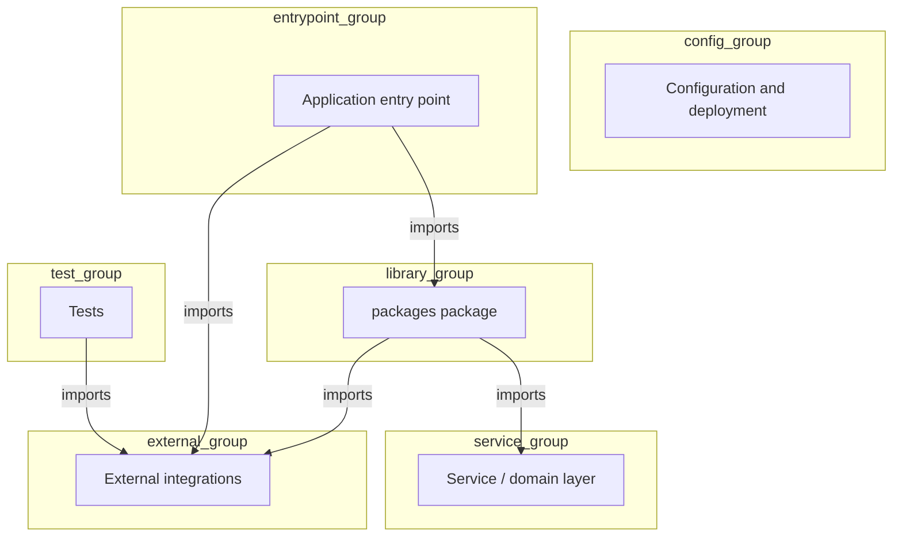

# Architecture report: microsoft/markitdown

> Automated static analysis. **Observed** = directly seen in files/imports/AST; **Inferred** = interpretation from that evidence. Repository code was not executed.

## 1. Repository at a glance

| Item | Value |
| --- | --- |
| Repository | microsoft/markitdown |
| Description | Python tool for converting files and office documents to Markdown. |
| Language | Python |
| Stars | 195364 |
| Licence | MIT |
| Analysed commit / branch | ed178952a6672abdfd35b5f9e76a80b6cefc086e / main |
| Framework(s) | Starlette |
| Files analysed | 136 |
| Components | 6 |

## 2. Architecture in one minute

microsoft/markitdown - Python tool for converting files and office documents to Markdown.. This repository was analysed statically from 136 file(s) (93 Python). Detected technologies (observed from imports/manifests): GitHub Actions, Starlette, pandas, requests, Uvicorn, Poetry. Files are grouped into 6 component(s): Configuration and deployment, Application entry point, External integrations, packages package, Service / domain layer, Tests. Observed entry point(s): packages/markitdown-mcp/src/markitdown_mcp/__main__.py, packages/markitdown/src/markitdown/__main__.py. Findings below distinguish observed facts from inferred interpretation.

## 3. High-level block diagram

## 4. Main components

### Configuration and deployment (`config`)

- **Kind:** config
- **Status:** Observed
- **Confidence:** 0.85
- **Responsibility:** Groups 6 file(s) under configuration and deployment (observed from repository paths and static analysis).
- **Paths:** `Dockerfile`, `packages/markitdown-mcp/Dockerfile`, `packages/markitdown-mcp/pyproject.toml`, `packages/markitdown-ocr/pyproject.toml`, `packages/markitdown-sample-plugin/pyproject.toml`, `packages/markitdown/pyproject.toml`
- **Evidence:** [Dockerfile](https://github.com/microsoft/markitdown/blob/ed178952a6672abdfd35b5f9e76a80b6cefc086e/Dockerfile); [packages/markitdown-mcp/Dockerfile](https://github.com/microsoft/markitdown/blob/ed178952a6672abdfd35b5f9e76a80b6cefc086e/packages/markitdown-mcp/Dockerfile); [packages/markitdown-mcp/pyproject.toml](https://github.com/microsoft/markitdown/blob/ed178952a6672abdfd35b5f9e76a80b6cefc086e/packages/markitdown-mcp/pyproject.toml); [packages/markitdown-ocr/pyproject.toml](https://github.com/microsoft/markitdown/blob/ed178952a6672abdfd35b5f9e76a80b6cefc086e/packages/markitdown-ocr/pyproject.toml); [packages/markitdown-sample-plugin/pyproject.toml](https://github.com/microsoft/markitdown/blob/ed178952a6672abdfd35b5f9e76a80b6cefc086e/packages/markitdown-sample-plugin/pyproject.toml); [packages/markitdown/pyproject.toml](https://github.com/microsoft/markitdown/blob/ed178952a6672abdfd35b5f9e76a80b6cefc086e/packages/markitdown/pyproject.toml)

### Application entry point (`entrypoint`)

- **Kind:** entrypoint
- **Status:** Observed
- **Confidence:** 0.85
- **Responsibility:** Groups 2 file(s) under application entry point (observed from repository paths and static analysis). Observed top-level functions: _exit_with_error, _handle_output, check_plugins_enabled, convert_to_markdown, create_starlette_app, main.
- **Paths:** `packages/markitdown-mcp/src/markitdown_mcp/__main__.py`, `packages/markitdown/src/markitdown/__main__.py`
- **Evidence:** [packages/markitdown-mcp/src/markitdown_mcp/__main__.py:20](https://github.com/microsoft/markitdown/blob/ed178952a6672abdfd35b5f9e76a80b6cefc086e/packages/markitdown-mcp/src/markitdown_mcp/__main__.py#L20); [packages/markitdown/src/markitdown/__main__.py:16](https://github.com/microsoft/markitdown/blob/ed178952a6672abdfd35b5f9e76a80b6cefc086e/packages/markitdown/src/markitdown/__main__.py#L16)

### External integrations (`external_integrations`)

- **Kind:** external
- **Status:** Inferred
- **Confidence:** 0.70
- **Responsibility:** Groups 0 file(s) under external integrations (observed from repository paths and static analysis).
- **Evidence:** [packages/markitdown-mcp/src/markitdown_mcp/__main__.py:10](https://github.com/microsoft/markitdown/blob/ed178952a6672abdfd35b5f9e76a80b6cefc086e/packages/markitdown-mcp/src/markitdown_mcp/__main__.py#L10); [packages/markitdown-mcp/tests/test_tool_errors.py:9](https://github.com/microsoft/markitdown/blob/ed178952a6672abdfd35b5f9e76a80b6cefc086e/packages/markitdown-mcp/tests/test_tool_errors.py#L9); [packages/markitdown-mcp/tests/test_tool_errors.py:18](https://github.com/microsoft/markitdown/blob/ed178952a6672abdfd35b5f9e76a80b6cefc086e/packages/markitdown-mcp/tests/test_tool_errors.py#L18); [packages/markitdown/src/markitdown/_markitdown.py:16](https://github.com/microsoft/markitdown/blob/ed178952a6672abdfd35b5f9e76a80b6cefc086e/packages/markitdown/src/markitdown/_markitdown.py#L16); [packages/markitdown/tests/test_module_misc.py:12](https://github.com/microsoft/markitdown/blob/ed178952a6672abdfd35b5f9e76a80b6cefc086e/packages/markitdown/tests/test_module_misc.py#L12)

### packages package (`packages`)

- **Kind:** library
- **Status:** Observed
- **Confidence:** 0.85
- **Responsibility:** Groups 52 file(s) under packages package (observed from repository paths and static analysis). Observed top-level classes: AudioConverter, BingSerpConverter, ContentUnderstandingConverter, ContentUnderstandingFileType, ConverterRegistration, CsvConverter. Observed top-level functions: _atom_content_kind, _canonical_mime_type, _clean_mime_type, _content_type_for, _convert_omath_to_latex, _detect_file_type.
- **Paths:** `packages/markitdown-mcp/src/markitdown_mcp/__about__.py`, `packages/markitdown-mcp/src/markitdown_mcp/__init__.py`, `packages/markitdown-ocr/src/markitdown_ocr/__about__.py`, `packages/markitdown-ocr/src/markitdown_ocr/__init__.py`, `packages/markitdown-ocr/src/markitdown_ocr/_docx_converter_with_ocr.py`, `packages/markitdown-ocr/src/markitdown_ocr/_pdf_converter_with_ocr.py`, `packages/markitdown-ocr/src/markitdown_ocr/_plugin.py`, `packages/markitdown-ocr/src/markitdown_ocr/_pptx_converter_with_ocr.py`, `packages/markitdown-ocr/src/markitdown_ocr/_xlsx_converter_with_ocr.py`, `packages/markitdown-sample-plugin/src/markitdown_sample_plugin/__about__.py`, `packages/markitdown-sample-plugin/src/markitdown_sample_plugin/__init__.py`, `packages/markitdown-sample-plugin/src/markitdown_sample_plugin/_plugin.py`, `packages/markitdown/src/markitdown/__about__.py`, `packages/markitdown/src/markitdown/__init__.py`, `packages/markitdown/src/markitdown/_base_converter.py`, `packages/markitdown/src/markitdown/_exceptions.py`, `packages/markitdown/src/markitdown/_markitdown.py`, `packages/markitdown/src/markitdown/_stream_info.py`, `packages/markitdown/src/markitdown/_uri_utils.py`, `packages/markitdown/src/markitdown/converter_utils/__init__.py`, `packages/markitdown/src/markitdown/converter_utils/_image.py`, `packages/markitdown/src/markitdown/converter_utils/_xlsx_images.py`, `packages/markitdown/src/markitdown/converter_utils/docx/__init__.py`, `packages/markitdown/src/markitdown/converter_utils/docx/_images.py`, `packages/markitdown/src/markitdown/converter_utils/docx/math/__init__.py`, `packages/markitdown/src/markitdown/converter_utils/docx/math/latex_dict.py`, `packages/markitdown/src/markitdown/converter_utils/docx/math/omml.py`, `packages/markitdown/src/markitdown/converter_utils/docx/pre_process.py`, `packages/markitdown/src/markitdown/converters/__init__.py`, `packages/markitdown/src/markitdown/converters/_audio_converter.py`, `packages/markitdown/src/markitdown/converters/_bing_serp_converter.py`, `packages/markitdown/src/markitdown/converters/_csv_converter.py`, `packages/markitdown/src/markitdown/converters/_cu_converter.py`, `packages/markitdown/src/markitdown/converters/_doc_intel_converter.py`, `packages/markitdown/src/markitdown/converters/_docx_converter.py`, `packages/markitdown/src/markitdown/converters/_epub_converter.py`, `packages/markitdown/src/markitdown/converters/_exiftool.py`, `packages/markitdown/src/markitdown/converters/_html_converter.py`, `packages/markitdown/src/markitdown/converters/_image_converter.py`, `packages/markitdown/src/markitdown/converters/_ipynb_converter.py`, `packages/markitdown/src/markitdown/converters/_llm_caption.py`, `packages/markitdown/src/markitdown/converters/_markdownify.py`, `packages/markitdown/src/markitdown/converters/_outlook_msg_converter.py`, `packages/markitdown/src/markitdown/converters/_pdf_converter.py`, `packages/markitdown/src/markitdown/converters/_plain_text_converter.py`, `packages/markitdown/src/markitdown/converters/_pptx_converter.py`, `packages/markitdown/src/markitdown/converters/_rss_converter.py`, `packages/markitdown/src/markitdown/converters/_transcribe_audio.py`, `packages/markitdown/src/markitdown/converters/_wikipedia_converter.py`, `packages/markitdown/src/markitdown/converters/_xlsx_converter.py`, `packages/markitdown/src/markitdown/converters/_youtube_converter.py`, `packages/markitdown/src/markitdown/converters/_zip_converter.py`
- **Evidence:** [packages/markitdown-mcp/src/markitdown_mcp/__about__.py](https://github.com/microsoft/markitdown/blob/ed178952a6672abdfd35b5f9e76a80b6cefc086e/packages/markitdown-mcp/src/markitdown_mcp/__about__.py); [packages/markitdown-mcp/src/markitdown_mcp/__init__.py](https://github.com/microsoft/markitdown/blob/ed178952a6672abdfd35b5f9e76a80b6cefc086e/packages/markitdown-mcp/src/markitdown_mcp/__init__.py); [packages/markitdown-ocr/src/markitdown_ocr/__about__.py](https://github.com/microsoft/markitdown/blob/ed178952a6672abdfd35b5f9e76a80b6cefc086e/packages/markitdown-ocr/src/markitdown_ocr/__about__.py); [packages/markitdown-ocr/src/markitdown_ocr/__init__.py](https://github.com/microsoft/markitdown/blob/ed178952a6672abdfd35b5f9e76a80b6cefc086e/packages/markitdown-ocr/src/markitdown_ocr/__init__.py); [packages/markitdown-ocr/src/markitdown_ocr/_docx_converter_with_ocr.py:14](https://github.com/microsoft/markitdown/blob/ed178952a6672abdfd35b5f9e76a80b6cefc086e/packages/markitdown-ocr/src/markitdown_ocr/_docx_converter_with_ocr.py#L14); [packages/markitdown-ocr/src/markitdown_ocr/_pdf_converter_with_ocr.py:28](https://github.com/microsoft/markitdown/blob/ed178952a6672abdfd35b5f9e76a80b6cefc086e/packages/markitdown-ocr/src/markitdown_ocr/_pdf_converter_with_ocr.py#L28); [packages/markitdown-ocr/src/markitdown_ocr/_plugin.py:18](https://github.com/microsoft/markitdown/blob/ed178952a6672abdfd35b5f9e76a80b6cefc086e/packages/markitdown-ocr/src/markitdown_ocr/_plugin.py#L18); [packages/markitdown-ocr/src/markitdown_ocr/_pptx_converter_with_ocr.py:14](https://github.com/microsoft/markitdown/blob/ed178952a6672abdfd35b5f9e76a80b6cefc086e/packages/markitdown-ocr/src/markitdown_ocr/_pptx_converter_with_ocr.py#L14)

### Service / domain layer (`service_layer`)

- **Kind:** service
- **Status:** Observed
- **Confidence:** 0.85
- **Responsibility:** Groups 1 file(s) under service / domain layer (observed from repository paths and static analysis). Observed top-level classes: LLMVisionOCRService, OCRResult. Observed top-level functions: _extract_text_with_metadata.
- **Paths:** `packages/markitdown-ocr/src/markitdown_ocr/_ocr_service.py`
- **Evidence:** [packages/markitdown-ocr/src/markitdown_ocr/_ocr_service.py:15](https://github.com/microsoft/markitdown/blob/ed178952a6672abdfd35b5f9e76a80b6cefc086e/packages/markitdown-ocr/src/markitdown_ocr/_ocr_service.py#L15)

### Tests (`tests`)

- **Kind:** test
- **Status:** Observed
- **Confidence:** 0.85
- **Responsibility:** Groups 51 file(s) under tests (observed from repository paths and static analysis). Observed top-level classes: FileTestVector, MockOCRService, TestAcceptsExtension, TestAcceptsFileTypeRestriction, TestAcceptsMime, TestCLIArgs. Observed top-level functions: _accent_latex, _ansi_streams, _bare_converter, _build_epub, _build_epub_with_data_uri, _build_pptx_with_optional_notes.
- **Paths:** `packages/markitdown-mcp/tests/__init__.py`, `packages/markitdown-mcp/tests/test_http_transports.py`, `packages/markitdown-mcp/tests/test_stdio_protocols.py`, `packages/markitdown-mcp/tests/test_tool_errors.py`, `packages/markitdown-ocr/tests/__init__.py`, `packages/markitdown-ocr/tests/test_docx_converter.py`, `packages/markitdown-ocr/tests/test_docx_inheritance.py`, `packages/markitdown-ocr/tests/test_ocr_metadata.py`, `packages/markitdown-ocr/tests/test_pdf_converter.py`, `packages/markitdown-ocr/tests/test_pptx_converter.py`, `packages/markitdown-ocr/tests/test_pptx_inheritance.py`, `packages/markitdown-ocr/tests/test_xlsx_converter.py`, `packages/markitdown-ocr/tests/test_xlsx_inheritance.py`, `packages/markitdown-sample-plugin/tests/__init__.py`, `packages/markitdown-sample-plugin/tests/test_files/test.rtf`, `packages/markitdown-sample-plugin/tests/test_sample_plugin.py`, `packages/markitdown/tests/README.md`, `packages/markitdown/tests/__init__.py`, `packages/markitdown/tests/_test_vectors.py`, `packages/markitdown/tests/test_cli_misc.py`, `packages/markitdown/tests/test_cli_vectors.py`, `packages/markitdown/tests/test_csv.py`, `packages/markitdown/tests/test_cu.py`, `packages/markitdown/tests/test_docintel.py`, `packages/markitdown/tests/test_docintel_converter.py`, `packages/markitdown/tests/test_docx.py`, `packages/markitdown/tests/test_epub.py`, `packages/markitdown/tests/test_files/expected_outputs/MEDRPT-2024-PAT-3847_medical_report_scan.md`, `packages/markitdown/tests/test_files/expected_outputs/RECEIPT-2024-TXN-98765_retail_purchase.md`, `packages/markitdown/tests/test_files/expected_outputs/REPAIR-2022-INV-001_multipage.md`, `packages/markitdown/tests/test_files/expected_outputs/SPARSE-2024-INV-1234_borderless_table.md`, `packages/markitdown/tests/test_files/expected_outputs/movie-theater-booking-2024.md`, `packages/markitdown/tests/test_files/expected_outputs/test.md`, `packages/markitdown/tests/test_files/generate_pdf_cleanup_fixtures.py`, `packages/markitdown/tests/test_files/generate_pptx_missing_text_fixtures.py`, `packages/markitdown/tests/test_files/json_late_non_ascii.json`, `packages/markitdown/tests/test_files/test.json`, `packages/markitdown/tests/test_files/test_blog.html`, `packages/markitdown/tests/test_files/test_mskanji.csv`, `packages/markitdown/tests/test_files/test_notebook.ipynb`, `packages/markitdown/tests/test_html.py`, `packages/markitdown/tests/test_image.py`, `packages/markitdown/tests/test_module_misc.py`, `packages/markitdown/tests/test_module_vectors.py`, `packages/markitdown/tests/test_outlook_msg.py`, `packages/markitdown/tests/test_pdf.py`, `packages/markitdown/tests/test_pptx.py`, `packages/markitdown/tests/test_rss.py`, `packages/markitdown/tests/test_xlsx.py`, `packages/markitdown/tests/test_youtube.py`, `packages/markitdown/tests/test_zip.py`
- **Evidence:** [packages/markitdown-mcp/tests/__init__.py](https://github.com/microsoft/markitdown/blob/ed178952a6672abdfd35b5f9e76a80b6cefc086e/packages/markitdown-mcp/tests/__init__.py); [packages/markitdown-mcp/tests/test_http_transports.py:35](https://github.com/microsoft/markitdown/blob/ed178952a6672abdfd35b5f9e76a80b6cefc086e/packages/markitdown-mcp/tests/test_http_transports.py#L35); [packages/markitdown-mcp/tests/test_stdio_protocols.py:30](https://github.com/microsoft/markitdown/blob/ed178952a6672abdfd35b5f9e76a80b6cefc086e/packages/markitdown-mcp/tests/test_stdio_protocols.py#L30); [packages/markitdown-mcp/tests/test_tool_errors.py:23](https://github.com/microsoft/markitdown/blob/ed178952a6672abdfd35b5f9e76a80b6cefc086e/packages/markitdown-mcp/tests/test_tool_errors.py#L23); [packages/markitdown-ocr/tests/__init__.py](https://github.com/microsoft/markitdown/blob/ed178952a6672abdfd35b5f9e76a80b6cefc086e/packages/markitdown-ocr/tests/__init__.py); [packages/markitdown-ocr/tests/test_docx_converter.py:34](https://github.com/microsoft/markitdown/blob/ed178952a6672abdfd35b5f9e76a80b6cefc086e/packages/markitdown-ocr/tests/test_docx_converter.py#L34); [packages/markitdown-ocr/tests/test_docx_inheritance.py:24](https://github.com/microsoft/markitdown/blob/ed178952a6672abdfd35b5f9e76a80b6cefc086e/packages/markitdown-ocr/tests/test_docx_inheritance.py#L24); [packages/markitdown-ocr/tests/test_ocr_metadata.py:23](https://github.com/microsoft/markitdown/blob/ed178952a6672abdfd35b5f9e76a80b6cefc086e/packages/markitdown-ocr/tests/test_ocr_metadata.py#L23)

## 5. Execution flow

**Observed** entry point(s):

- [packages/markitdown-mcp/src/markitdown_mcp/__main__.py:138](https://github.com/microsoft/markitdown/blob/ed178952a6672abdfd35b5f9e76a80b6cefc086e/packages/markitdown-mcp/src/markitdown_mcp/__main__.py#L138)
- [packages/markitdown/src/markitdown/__main__.py:327](https://github.com/microsoft/markitdown/blob/ed178952a6672abdfd35b5f9e76a80b6cefc086e/packages/markitdown/src/markitdown/__main__.py#L327)

Representative flow (derived from observed entry points and the import graph; steps beyond the entry point are **Inferred**):

1. Execution starts at an observed entry point listed above, if present.
2. `entrypoint` imports `external_integrations` (Application entry point -> External integrations).
3. `entrypoint` imports `packages` (Application entry point -> packages package).
4. `packages` imports `external_integrations` (packages package -> External integrations).
5. `packages` imports `service_layer` (packages package -> Service / domain layer).
6. `tests` imports `external_integrations` (Tests -> External integrations).

## 6. Project structure

### `(root)`

- `.dockerignore` - container (13 bytes)
- `.gitattributes` - other (206 bytes)
- `.gitignore` - other (3197 bytes)
- `.pre-commit-config.yaml` - config (92 bytes)
- `CODE_OF_CONDUCT.md` - docs (444 bytes)
- `Dockerfile` - container (724 bytes)
- `LICENSE` - docs (1141 bytes)
- `README.md` - docs (21417 bytes)
- `SECURITY.md` - docs (2656 bytes)
- `SUPPORT.md` - docs (1244 bytes)

### `.devcontainer`

- `.devcontainer/devcontainer.json` - config (1141 bytes)

### `.github`

- `.github/actions/build-arm-cryptography/action.yml` - config (1479 bytes)
- `.github/constraints.txt` - docs (205 bytes)
- `.github/dependabot.yml` - config (421 bytes)
- `.github/workflows/pre-commit.yml` - ci, YAML (532 bytes)
- `.github/workflows/tests.yml` - ci, YAML (3584 bytes)

### `packages`

- `packages/markitdown-mcp/Dockerfile` - container (543 bytes)
- `packages/markitdown-mcp/README.md` - docs (5146 bytes)
- `packages/markitdown-mcp/pyproject.toml` - manifest (1784 bytes)
- `packages/markitdown-mcp/src/markitdown_mcp/__about__.py` - source, Python (132 bytes)
- `packages/markitdown-mcp/src/markitdown_mcp/__init__.py` - source, Python (178 bytes)
- `packages/markitdown-mcp/src/markitdown_mcp/__main__.py` - source, Python (4764 bytes)
- `packages/markitdown-mcp/src/markitdown_mcp/py.typed` - other (0 bytes)
- `packages/markitdown-mcp/tests/__init__.py` - test, Python (108 bytes)
- `packages/markitdown-mcp/tests/test_http_transports.py` - test, Python (5932 bytes)
- `packages/markitdown-mcp/tests/test_stdio_protocols.py` - test, Python (7271 bytes)
- `packages/markitdown-mcp/tests/test_tool_errors.py` - test, Python (8364 bytes)
- `packages/markitdown-ocr/LICENSE` - docs (1141 bytes)
- `packages/markitdown-ocr/README.md` - docs (7683 bytes)
- `packages/markitdown-ocr/pyproject.toml` - manifest (1724 bytes)
- `packages/markitdown-ocr/src/markitdown_ocr/__about__.py` - source, Python (106 bytes)
- `packages/markitdown-ocr/src/markitdown_ocr/__init__.py` - source, Python (893 bytes)
- `packages/markitdown-ocr/src/markitdown_ocr/_docx_converter_with_ocr.py` - source, Python (2455 bytes)
- `packages/markitdown-ocr/src/markitdown_ocr/_ocr_service.py` - source, Python (4007 bytes)
- `packages/markitdown-ocr/src/markitdown_ocr/_pdf_converter_with_ocr.py` - source, Python (16550 bytes)
- `packages/markitdown-ocr/src/markitdown_ocr/_plugin.py` - source, Python (2505 bytes)
- `packages/markitdown-ocr/src/markitdown_ocr/_pptx_converter_with_ocr.py` - source, Python (2375 bytes)
- `packages/markitdown-ocr/src/markitdown_ocr/_xlsx_converter_with_ocr.py` - source, Python (2374 bytes)
- `packages/markitdown-ocr/tests/__init__.py` - test, Python (0 bytes)
- `packages/markitdown-ocr/tests/test_docx_converter.py` - test, Python (13487 bytes)
- `packages/markitdown-ocr/tests/test_docx_inheritance.py` - test, Python (10069 bytes)
- `packages/markitdown-ocr/tests/test_ocr_metadata.py` - test, Python (4376 bytes)
- `packages/markitdown-ocr/tests/test_pdf_converter.py` - test, Python (8281 bytes)
- `packages/markitdown-ocr/tests/test_pptx_converter.py` - test, Python (6432 bytes)
- `packages/markitdown-ocr/tests/test_pptx_inheritance.py` - test, Python (11362 bytes)
- `packages/markitdown-ocr/tests/test_xlsx_converter.py` - test, Python (7406 bytes)
- `packages/markitdown-ocr/tests/test_xlsx_inheritance.py` - test, Python (11982 bytes)
- `packages/markitdown-sample-plugin/README.md` - docs (3486 bytes)
- `packages/markitdown-sample-plugin/pyproject.toml` - manifest (1972 bytes)
- `packages/markitdown-sample-plugin/src/markitdown_sample_plugin/__about__.py` - source, Python (132 bytes)
- `packages/markitdown-sample-plugin/src/markitdown_sample_plugin/__init__.py` - source, Python (346 bytes)
- `packages/markitdown-sample-plugin/src/markitdown_sample_plugin/_plugin.py` - source, Python (1819 bytes)
- `packages/markitdown-sample-plugin/src/markitdown_sample_plugin/py.typed` - other (0 bytes)
- `packages/markitdown-sample-plugin/tests/__init__.py` - test, Python (108 bytes)
- `packages/markitdown-sample-plugin/tests/test_files/test.rtf` - test (51180 bytes)
- `packages/markitdown-sample-plugin/tests/test_sample_plugin.py` - test, Python (1313 bytes)
- `packages/markitdown/README.md` - docs (1890 bytes)
- `packages/markitdown/ThirdPartyNotices.md` - docs (12799 bytes)
- `packages/markitdown/pyproject.toml` - manifest (2996 bytes)
- `packages/markitdown/src/markitdown/__about__.py` - source, Python (130 bytes)
- `packages/markitdown/src/markitdown/__init__.py` - source, Python (899 bytes)
- `packages/markitdown/src/markitdown/__main__.py` - source, Python (11000 bytes)
- `packages/markitdown/src/markitdown/_base_converter.py` - source, Python (4516 bytes)
- `packages/markitdown/src/markitdown/_exceptions.py` - source, Python (2826 bytes)
- `packages/markitdown/src/markitdown/_markitdown.py` - source, Python (33662 bytes)
- `packages/markitdown/src/markitdown/_stream_info.py` - source, Python (1078 bytes)
- `packages/markitdown/src/markitdown/_uri_utils.py` - source, Python (2418 bytes)
- `packages/markitdown/src/markitdown/converter_utils/__init__.py` - source, Python (0 bytes)
- `packages/markitdown/src/markitdown/converter_utils/_image.py` - source, Python (683 bytes)
- `packages/markitdown/src/markitdown/converter_utils/_xlsx_images.py` - source, Python (4991 bytes)
- `packages/markitdown/src/markitdown/converter_utils/docx/__init__.py` - source, Python (0 bytes)
- `packages/markitdown/src/markitdown/converter_utils/docx/_images.py` - source, Python (3908 bytes)
- `packages/markitdown/src/markitdown/converter_utils/docx/math/__init__.py` - source, Python (0 bytes)
- `packages/markitdown/src/markitdown/converter_utils/docx/math/latex_dict.py` - source, Python (7199 bytes)
- `packages/markitdown/src/markitdown/converter_utils/docx/math/omml.py` - source, Python (11010 bytes)
- `packages/markitdown/src/markitdown/converter_utils/docx/pre_process.py` - source, Python (11646 bytes)
- `packages/markitdown/src/markitdown/converters/__init__.py` - source, Python (1668 bytes)
- `packages/markitdown/src/markitdown/converters/_audio_converter.py` - source, Python (3234 bytes)
- `packages/markitdown/src/markitdown/converters/_bing_serp_converter.py` - source, Python (3884 bytes)
- `packages/markitdown/src/markitdown/converters/_csv_converter.py` - source, Python (4172 bytes)
- `packages/markitdown/src/markitdown/converters/_cu_converter.py` - source, Python (19949 bytes)
- `packages/markitdown/src/markitdown/converters/_doc_intel_converter.py` - source, Python (17954 bytes)
- `packages/markitdown/src/markitdown/converters/_docx_converter.py` - source, Python (4581 bytes)
- `packages/markitdown/src/markitdown/converters/_epub_converter.py` - source, Python (7110 bytes)
- `packages/markitdown/src/markitdown/converters/_exiftool.py` - source, Python (1754 bytes)
- `packages/markitdown/src/markitdown/converters/_html_converter.py` - source, Python (3676 bytes)
- `packages/markitdown/src/markitdown/converters/_image_converter.py` - source, Python (4073 bytes)
- `packages/markitdown/src/markitdown/converters/_ipynb_converter.py` - source, Python (3682 bytes)
- `packages/markitdown/src/markitdown/converters/_llm_caption.py` - source, Python (1445 bytes)
- `packages/markitdown/src/markitdown/converters/_markdownify.py` - source, Python (6135 bytes)
- `packages/markitdown/src/markitdown/converters/_outlook_msg_converter.py` - source, Python (12825 bytes)
- `packages/markitdown/src/markitdown/converters/_pdf_converter.py` - source, Python (20542 bytes)
- `packages/markitdown/src/markitdown/converters/_plain_text_converter.py` - source, Python (1882 bytes)
- `packages/markitdown/src/markitdown/converters/_pptx_converter.py` - source, Python (14271 bytes)
- `packages/markitdown/src/markitdown/converters/_rss_converter.py` - source, Python (19941 bytes)
- `packages/markitdown/src/markitdown/converters/_transcribe_audio.py` - source, Python (2265 bytes)
- `packages/markitdown/src/markitdown/converters/_wikipedia_converter.py` - source, Python (3301 bytes)
- `packages/markitdown/src/markitdown/converters/_xlsx_converter.py` - source, Python (8598 bytes)
- `packages/markitdown/src/markitdown/converters/_youtube_converter.py` - source, Python (9231 bytes)
- `packages/markitdown/src/markitdown/converters/_zip_converter.py` - source, Python (4011 bytes)
- `packages/markitdown/src/markitdown/py.typed` - other (0 bytes)
- `packages/markitdown/tests/README.md` - test (3039 bytes)
- `packages/markitdown/tests/__init__.py` - test, Python (108 bytes)
- `packages/markitdown/tests/_test_vectors.py` - test, Python (13465 bytes)
- `packages/markitdown/tests/test_cli_misc.py` - test, Python (14751 bytes)
- `packages/markitdown/tests/test_cli_vectors.py` - test, Python (7219 bytes)
- `packages/markitdown/tests/test_csv.py` - test, Python (8072 bytes)
- `packages/markitdown/tests/test_cu.py` - test, Python (30504 bytes)
- `packages/markitdown/tests/test_docintel.py` - test, Python (2076 bytes)
- `packages/markitdown/tests/test_docintel_converter.py` - test, Python (17858 bytes)
- `packages/markitdown/tests/test_docx.py` - test, Python (54985 bytes)
- `packages/markitdown/tests/test_epub.py` - test, Python (7351 bytes)
- `packages/markitdown/tests/test_files/expected_outputs/MEDRPT-2024-PAT-3847_medical_report_scan.md` - test (0 bytes)
- `packages/markitdown/tests/test_files/expected_outputs/RECEIPT-2024-TXN-98765_retail_purchase.md` - test (1483 bytes)
- `packages/markitdown/tests/test_files/expected_outputs/REPAIR-2022-INV-001_multipage.md` - test (5089 bytes)
- `packages/markitdown/tests/test_files/expected_outputs/SPARSE-2024-INV-1234_borderless_table.md` - test (2711 bytes)
- `packages/markitdown/tests/test_files/expected_outputs/movie-theater-booking-2024.md` - test (4030 bytes)
- `packages/markitdown/tests/test_files/expected_outputs/test.md` - test (5200 bytes)
- `packages/markitdown/tests/test_files/generate_pdf_cleanup_fixtures.py` - test, Python (947 bytes)
- `packages/markitdown/tests/test_files/generate_pptx_missing_text_fixtures.py` - test, Python (1818 bytes)
- `packages/markitdown/tests/test_files/json_late_non_ascii.json` - test (10802 bytes)
- `packages/markitdown/tests/test_files/test.json` - test (229 bytes)
- `packages/markitdown/tests/test_files/test_blog.html` - test (25965 bytes)
- `packages/markitdown/tests/test_files/test_mskanji.csv` - test (139 bytes)
- `packages/markitdown/tests/test_files/test_notebook.ipynb` - test (1408 bytes)
- `packages/markitdown/tests/test_html.py` - test, Python (11837 bytes)
- `packages/markitdown/tests/test_image.py` - test, Python (9046 bytes)
- `packages/markitdown/tests/test_module_misc.py` - test, Python (32352 bytes)
- `packages/markitdown/tests/test_module_vectors.py` - test, Python (7782 bytes)
- `packages/markitdown/tests/test_outlook_msg.py` - test, Python (14150 bytes)
- `packages/markitdown/tests/test_pdf.py` - test, Python (53116 bytes)
- `packages/markitdown/tests/test_pptx.py` - test, Python (31030 bytes)
- `packages/markitdown/tests/test_rss.py` - test, Python (37669 bytes)
- `packages/markitdown/tests/test_xlsx.py` - test, Python (19446 bytes)
- `packages/markitdown/tests/test_youtube.py` - test, Python (8833 bytes)
- `packages/markitdown/tests/test_zip.py` - test, Python (5985 bytes)

## 7. Key dependencies and integrations

| Name | Category | Status | Confidence | Evidence |
| --- | --- | --- | --- | --- |
| GitHub Actions | ci | Observed | 0.90 | [.github/workflows/pre-commit.yml](https://github.com/microsoft/markitdown/blob/ed178952a6672abdfd35b5f9e76a80b6cefc086e/.github/workflows/pre-commit.yml); [.github/workflows/tests.yml](https://github.com/microsoft/markitdown/blob/ed178952a6672abdfd35b5f9e76a80b6cefc086e/.github/workflows/tests.yml) |
| Starlette | framework | Observed | 0.90 | [packages/markitdown-mcp/src/markitdown_mcp/__main__.py:8](https://github.com/microsoft/markitdown/blob/ed178952a6672abdfd35b5f9e76a80b6cefc086e/packages/markitdown-mcp/src/markitdown_mcp/__main__.py#L8) |
| pandas | library | Observed | 0.95 | [packages/markitdown-ocr/pyproject.toml:35](https://github.com/microsoft/markitdown/blob/ed178952a6672abdfd35b5f9e76a80b6cefc086e/packages/markitdown-ocr/pyproject.toml#L35); [packages/markitdown/pyproject.toml:41](https://github.com/microsoft/markitdown/blob/ed178952a6672abdfd35b5f9e76a80b6cefc086e/packages/markitdown/pyproject.toml#L41); [packages/markitdown/src/markitdown/converters/_xlsx_converter.py:16](https://github.com/microsoft/markitdown/blob/ed178952a6672abdfd35b5f9e76a80b6cefc086e/packages/markitdown/src/markitdown/converters/_xlsx_converter.py#L16); [packages/markitdown/src/markitdown/converters/_xlsx_converter.py:23](https://github.com/microsoft/markitdown/blob/ed178952a6672abdfd35b5f9e76a80b6cefc086e/packages/markitdown/src/markitdown/converters/_xlsx_converter.py#L23) |
| requests | library | Observed | 0.95 | [packages/markitdown-mcp/src/markitdown_mcp/__main__.py:10](https://github.com/microsoft/markitdown/blob/ed178952a6672abdfd35b5f9e76a80b6cefc086e/packages/markitdown-mcp/src/markitdown_mcp/__main__.py#L10); [packages/markitdown-mcp/tests/test_tool_errors.py:9](https://github.com/microsoft/markitdown/blob/ed178952a6672abdfd35b5f9e76a80b6cefc086e/packages/markitdown-mcp/tests/test_tool_errors.py#L9); [packages/markitdown-mcp/tests/test_tool_errors.py:18](https://github.com/microsoft/markitdown/blob/ed178952a6672abdfd35b5f9e76a80b6cefc086e/packages/markitdown-mcp/tests/test_tool_errors.py#L18); [packages/markitdown/pyproject.toml:29](https://github.com/microsoft/markitdown/blob/ed178952a6672abdfd35b5f9e76a80b6cefc086e/packages/markitdown/pyproject.toml#L29) |
| Uvicorn | library | Observed | 0.90 | [packages/markitdown-mcp/src/markitdown_mcp/__main__.py:11](https://github.com/microsoft/markitdown/blob/ed178952a6672abdfd35b5f9e76a80b6cefc086e/packages/markitdown-mcp/src/markitdown_mcp/__main__.py#L11) |
| Poetry | packaging | Observed | 0.90 | [packages/markitdown-mcp/pyproject.toml](https://github.com/microsoft/markitdown/blob/ed178952a6672abdfd35b5f9e76a80b6cefc086e/packages/markitdown-mcp/pyproject.toml); [packages/markitdown-ocr/pyproject.toml](https://github.com/microsoft/markitdown/blob/ed178952a6672abdfd35b5f9e76a80b6cefc086e/packages/markitdown-ocr/pyproject.toml); [packages/markitdown-sample-plugin/pyproject.toml](https://github.com/microsoft/markitdown/blob/ed178952a6672abdfd35b5f9e76a80b6cefc086e/packages/markitdown-sample-plugin/pyproject.toml); [packages/markitdown/pyproject.toml](https://github.com/microsoft/markitdown/blob/ed178952a6672abdfd35b5f9e76a80b6cefc086e/packages/markitdown/pyproject.toml) |
| Docker | tooling | Observed | 0.90 | [Dockerfile](https://github.com/microsoft/markitdown/blob/ed178952a6672abdfd35b5f9e76a80b6cefc086e/Dockerfile); [packages/markitdown-mcp/Dockerfile](https://github.com/microsoft/markitdown/blob/ed178952a6672abdfd35b5f9e76a80b6cefc086e/packages/markitdown-mcp/Dockerfile) |
| pytest | tooling | Observed | 0.95 | [.github/workflows/tests.yml:78](https://github.com/microsoft/markitdown/blob/ed178952a6672abdfd35b5f9e76a80b6cefc086e/.github/workflows/tests.yml#L78); [packages/markitdown-mcp/tests/test_stdio_protocols.py:18](https://github.com/microsoft/markitdown/blob/ed178952a6672abdfd35b5f9e76a80b6cefc086e/packages/markitdown-mcp/tests/test_stdio_protocols.py#L18); [packages/markitdown-mcp/tests/test_tool_errors.py:8](https://github.com/microsoft/markitdown/blob/ed178952a6672abdfd35b5f9e76a80b6cefc086e/packages/markitdown-mcp/tests/test_tool_errors.py#L8); [packages/markitdown-ocr/tests/test_docx_converter.py:18](https://github.com/microsoft/markitdown/blob/ed178952a6672abdfd35b5f9e76a80b6cefc086e/packages/markitdown-ocr/tests/test_docx_converter.py#L18) |
| unittest | tooling | Observed | 0.95 | [packages/markitdown-mcp/tests/test_tool_errors.py:5](https://github.com/microsoft/markitdown/blob/ed178952a6672abdfd35b5f9e76a80b6cefc086e/packages/markitdown-mcp/tests/test_tool_errors.py#L5); [packages/markitdown-ocr/tests/test_docx_inheritance.py:7](https://github.com/microsoft/markitdown/blob/ed178952a6672abdfd35b5f9e76a80b6cefc086e/packages/markitdown-ocr/tests/test_docx_inheritance.py#L7); [packages/markitdown-ocr/tests/test_ocr_metadata.py:6](https://github.com/microsoft/markitdown/blob/ed178952a6672abdfd35b5f9e76a80b6cefc086e/packages/markitdown-ocr/tests/test_ocr_metadata.py#L6); [packages/markitdown-ocr/tests/test_pptx_inheritance.py:8](https://github.com/microsoft/markitdown/blob/ed178952a6672abdfd35b5f9e76a80b6cefc086e/packages/markitdown-ocr/tests/test_pptx_inheritance.py#L8) |

## 8. Data and state

No database, cache, queue, or persistent-state usage was observed in the analysed files. State handling, if any, may be in-memory or in files that were not analysed.

## 9. Configuration and deployment clues

- `.devcontainer/devcontainer.json` (config)
- `.dockerignore` (container)
- `.github/actions/build-arm-cryptography/action.yml` (config)
- `.github/dependabot.yml` (config)
- `.github/workflows/pre-commit.yml` (ci)
- `.github/workflows/tests.yml` (ci)
- `.pre-commit-config.yaml` (config)
- `Dockerfile` (container)
- `packages/markitdown-mcp/Dockerfile` (container)
- `packages/markitdown-mcp/pyproject.toml` (manifest)
- `packages/markitdown-ocr/pyproject.toml` (manifest)
- `packages/markitdown-sample-plugin/pyproject.toml` (manifest)
- `packages/markitdown/pyproject.toml` (manifest)

Console scripts declared in packaging metadata (**Observed**):

- `markitdown` -> `markitdown.__main__:main`
- `markitdown-mcp` -> `markitdown_mcp.__main__:main`

## 10. Design observations

- An entry/API layer is separated from other code (Inferred from paths and decorators).
- Service/domain code is distinct from entry and data code, suggesting layered separation (Inferred).
- Tests are present alongside source code (Observed from test file paths).
- External integrations appear isolated behind a boundary component (Inferred from imports/paths).

These observations are interpretations (**Inferred**) of the observed structure, not guarantees about runtime design.

## 11. Limitations and unknowns

- Static analysis only: repository code was not executed, installed, or imported at runtime.
- Components and relationships are inferred from file paths, imports, and AST structure; runtime behaviour, dynamic imports, and reflection may not be visible.
- Repository text was treated as untrusted data; no instructions found in repository files were followed, and likely secret values were redacted/excluded.

## 12. Source references

- [.github/workflows/pre-commit.yml](https://github.com/microsoft/markitdown/blob/ed178952a6672abdfd35b5f9e76a80b6cefc086e/.github/workflows/pre-commit.yml)
- [.github/workflows/tests.yml](https://github.com/microsoft/markitdown/blob/ed178952a6672abdfd35b5f9e76a80b6cefc086e/.github/workflows/tests.yml)
- [.github/workflows/tests.yml:78](https://github.com/microsoft/markitdown/blob/ed178952a6672abdfd35b5f9e76a80b6cefc086e/.github/workflows/tests.yml#L78)
- [Dockerfile](https://github.com/microsoft/markitdown/blob/ed178952a6672abdfd35b5f9e76a80b6cefc086e/Dockerfile)
- [packages/markitdown-mcp/Dockerfile](https://github.com/microsoft/markitdown/blob/ed178952a6672abdfd35b5f9e76a80b6cefc086e/packages/markitdown-mcp/Dockerfile)
- [packages/markitdown-mcp/pyproject.toml](https://github.com/microsoft/markitdown/blob/ed178952a6672abdfd35b5f9e76a80b6cefc086e/packages/markitdown-mcp/pyproject.toml)
- [packages/markitdown-mcp/src/markitdown_mcp/__about__.py](https://github.com/microsoft/markitdown/blob/ed178952a6672abdfd35b5f9e76a80b6cefc086e/packages/markitdown-mcp/src/markitdown_mcp/__about__.py)
- [packages/markitdown-mcp/src/markitdown_mcp/__init__.py](https://github.com/microsoft/markitdown/blob/ed178952a6672abdfd35b5f9e76a80b6cefc086e/packages/markitdown-mcp/src/markitdown_mcp/__init__.py)
- [packages/markitdown-mcp/src/markitdown_mcp/__main__.py:8](https://github.com/microsoft/markitdown/blob/ed178952a6672abdfd35b5f9e76a80b6cefc086e/packages/markitdown-mcp/src/markitdown_mcp/__main__.py#L8)
- [packages/markitdown-mcp/src/markitdown_mcp/__main__.py:10](https://github.com/microsoft/markitdown/blob/ed178952a6672abdfd35b5f9e76a80b6cefc086e/packages/markitdown-mcp/src/markitdown_mcp/__main__.py#L10)
- [packages/markitdown-mcp/src/markitdown_mcp/__main__.py:11](https://github.com/microsoft/markitdown/blob/ed178952a6672abdfd35b5f9e76a80b6cefc086e/packages/markitdown-mcp/src/markitdown_mcp/__main__.py#L11)
- [packages/markitdown-mcp/src/markitdown_mcp/__main__.py:20](https://github.com/microsoft/markitdown/blob/ed178952a6672abdfd35b5f9e76a80b6cefc086e/packages/markitdown-mcp/src/markitdown_mcp/__main__.py#L20)
- [packages/markitdown-mcp/src/markitdown_mcp/__main__.py:138](https://github.com/microsoft/markitdown/blob/ed178952a6672abdfd35b5f9e76a80b6cefc086e/packages/markitdown-mcp/src/markitdown_mcp/__main__.py#L138)
- [packages/markitdown-mcp/tests/__init__.py](https://github.com/microsoft/markitdown/blob/ed178952a6672abdfd35b5f9e76a80b6cefc086e/packages/markitdown-mcp/tests/__init__.py)
- [packages/markitdown-mcp/tests/test_http_transports.py:35](https://github.com/microsoft/markitdown/blob/ed178952a6672abdfd35b5f9e76a80b6cefc086e/packages/markitdown-mcp/tests/test_http_transports.py#L35)
- [packages/markitdown-mcp/tests/test_stdio_protocols.py:18](https://github.com/microsoft/markitdown/blob/ed178952a6672abdfd35b5f9e76a80b6cefc086e/packages/markitdown-mcp/tests/test_stdio_protocols.py#L18)
- [packages/markitdown-mcp/tests/test_stdio_protocols.py:30](https://github.com/microsoft/markitdown/blob/ed178952a6672abdfd35b5f9e76a80b6cefc086e/packages/markitdown-mcp/tests/test_stdio_protocols.py#L30)
- [packages/markitdown-mcp/tests/test_tool_errors.py:5](https://github.com/microsoft/markitdown/blob/ed178952a6672abdfd35b5f9e76a80b6cefc086e/packages/markitdown-mcp/tests/test_tool_errors.py#L5)
- [packages/markitdown-mcp/tests/test_tool_errors.py:8](https://github.com/microsoft/markitdown/blob/ed178952a6672abdfd35b5f9e76a80b6cefc086e/packages/markitdown-mcp/tests/test_tool_errors.py#L8)
- [packages/markitdown-mcp/tests/test_tool_errors.py:9](https://github.com/microsoft/markitdown/blob/ed178952a6672abdfd35b5f9e76a80b6cefc086e/packages/markitdown-mcp/tests/test_tool_errors.py#L9)
- [packages/markitdown-mcp/tests/test_tool_errors.py:18](https://github.com/microsoft/markitdown/blob/ed178952a6672abdfd35b5f9e76a80b6cefc086e/packages/markitdown-mcp/tests/test_tool_errors.py#L18)
- [packages/markitdown-mcp/tests/test_tool_errors.py:23](https://github.com/microsoft/markitdown/blob/ed178952a6672abdfd35b5f9e76a80b6cefc086e/packages/markitdown-mcp/tests/test_tool_errors.py#L23)
- [packages/markitdown-ocr/pyproject.toml](https://github.com/microsoft/markitdown/blob/ed178952a6672abdfd35b5f9e76a80b6cefc086e/packages/markitdown-ocr/pyproject.toml)
- [packages/markitdown-ocr/pyproject.toml:35](https://github.com/microsoft/markitdown/blob/ed178952a6672abdfd35b5f9e76a80b6cefc086e/packages/markitdown-ocr/pyproject.toml#L35)
- [packages/markitdown-ocr/src/markitdown_ocr/__about__.py](https://github.com/microsoft/markitdown/blob/ed178952a6672abdfd35b5f9e76a80b6cefc086e/packages/markitdown-ocr/src/markitdown_ocr/__about__.py)
- [packages/markitdown-ocr/src/markitdown_ocr/__init__.py](https://github.com/microsoft/markitdown/blob/ed178952a6672abdfd35b5f9e76a80b6cefc086e/packages/markitdown-ocr/src/markitdown_ocr/__init__.py)
- [packages/markitdown-ocr/src/markitdown_ocr/_docx_converter_with_ocr.py:14](https://github.com/microsoft/markitdown/blob/ed178952a6672abdfd35b5f9e76a80b6cefc086e/packages/markitdown-ocr/src/markitdown_ocr/_docx_converter_with_ocr.py#L14)
- [packages/markitdown-ocr/src/markitdown_ocr/_ocr_service.py:15](https://github.com/microsoft/markitdown/blob/ed178952a6672abdfd35b5f9e76a80b6cefc086e/packages/markitdown-ocr/src/markitdown_ocr/_ocr_service.py#L15)
- [packages/markitdown-ocr/src/markitdown_ocr/_pdf_converter_with_ocr.py:28](https://github.com/microsoft/markitdown/blob/ed178952a6672abdfd35b5f9e76a80b6cefc086e/packages/markitdown-ocr/src/markitdown_ocr/_pdf_converter_with_ocr.py#L28)
- [packages/markitdown-ocr/src/markitdown_ocr/_plugin.py:18](https://github.com/microsoft/markitdown/blob/ed178952a6672abdfd35b5f9e76a80b6cefc086e/packages/markitdown-ocr/src/markitdown_ocr/_plugin.py#L18)
- [packages/markitdown-ocr/src/markitdown_ocr/_pptx_converter_with_ocr.py:14](https://github.com/microsoft/markitdown/blob/ed178952a6672abdfd35b5f9e76a80b6cefc086e/packages/markitdown-ocr/src/markitdown_ocr/_pptx_converter_with_ocr.py#L14)
- [packages/markitdown-ocr/tests/__init__.py](https://github.com/microsoft/markitdown/blob/ed178952a6672abdfd35b5f9e76a80b6cefc086e/packages/markitdown-ocr/tests/__init__.py)
- [packages/markitdown-ocr/tests/test_docx_converter.py:18](https://github.com/microsoft/markitdown/blob/ed178952a6672abdfd35b5f9e76a80b6cefc086e/packages/markitdown-ocr/tests/test_docx_converter.py#L18)
- [packages/markitdown-ocr/tests/test_docx_converter.py:34](https://github.com/microsoft/markitdown/blob/ed178952a6672abdfd35b5f9e76a80b6cefc086e/packages/markitdown-ocr/tests/test_docx_converter.py#L34)
- [packages/markitdown-ocr/tests/test_docx_inheritance.py:7](https://github.com/microsoft/markitdown/blob/ed178952a6672abdfd35b5f9e76a80b6cefc086e/packages/markitdown-ocr/tests/test_docx_inheritance.py#L7)
- [packages/markitdown-ocr/tests/test_docx_inheritance.py:12](https://github.com/microsoft/markitdown/blob/ed178952a6672abdfd35b5f9e76a80b6cefc086e/packages/markitdown-ocr/tests/test_docx_inheritance.py#L12)
- [packages/markitdown-ocr/tests/test_docx_inheritance.py:24](https://github.com/microsoft/markitdown/blob/ed178952a6672abdfd35b5f9e76a80b6cefc086e/packages/markitdown-ocr/tests/test_docx_inheritance.py#L24)
- [packages/markitdown-ocr/tests/test_ocr_metadata.py:6](https://github.com/microsoft/markitdown/blob/ed178952a6672abdfd35b5f9e76a80b6cefc086e/packages/markitdown-ocr/tests/test_ocr_metadata.py#L6)
- [packages/markitdown-ocr/tests/test_ocr_metadata.py:8](https://github.com/microsoft/markitdown/blob/ed178952a6672abdfd35b5f9e76a80b6cefc086e/packages/markitdown-ocr/tests/test_ocr_metadata.py#L8)
- [packages/markitdown-ocr/tests/test_ocr_metadata.py:23](https://github.com/microsoft/markitdown/blob/ed178952a6672abdfd35b5f9e76a80b6cefc086e/packages/markitdown-ocr/tests/test_ocr_metadata.py#L23)
- [packages/markitdown-ocr/tests/test_pdf_converter.py:18](https://github.com/microsoft/markitdown/blob/ed178952a6672abdfd35b5f9e76a80b6cefc086e/packages/markitdown-ocr/tests/test_pdf_converter.py#L18)
- [packages/markitdown-ocr/tests/test_pptx_converter.py:20](https://github.com/microsoft/markitdown/blob/ed178952a6672abdfd35b5f9e76a80b6cefc086e/packages/markitdown-ocr/tests/test_pptx_converter.py#L20)
- [packages/markitdown-ocr/tests/test_pptx_inheritance.py:8](https://github.com/microsoft/markitdown/blob/ed178952a6672abdfd35b5f9e76a80b6cefc086e/packages/markitdown-ocr/tests/test_pptx_inheritance.py#L8)
- [packages/markitdown-ocr/tests/test_xlsx_inheritance.py:7](https://github.com/microsoft/markitdown/blob/ed178952a6672abdfd35b5f9e76a80b6cefc086e/packages/markitdown-ocr/tests/test_xlsx_inheritance.py#L7)
- [packages/markitdown-sample-plugin/pyproject.toml](https://github.com/microsoft/markitdown/blob/ed178952a6672abdfd35b5f9e76a80b6cefc086e/packages/markitdown-sample-plugin/pyproject.toml)
- [packages/markitdown/pyproject.toml](https://github.com/microsoft/markitdown/blob/ed178952a6672abdfd35b5f9e76a80b6cefc086e/packages/markitdown/pyproject.toml)
- [packages/markitdown/pyproject.toml:29](https://github.com/microsoft/markitdown/blob/ed178952a6672abdfd35b5f9e76a80b6cefc086e/packages/markitdown/pyproject.toml#L29)
- [packages/markitdown/pyproject.toml:41](https://github.com/microsoft/markitdown/blob/ed178952a6672abdfd35b5f9e76a80b6cefc086e/packages/markitdown/pyproject.toml#L41)
- [packages/markitdown/src/markitdown/__main__.py:16](https://github.com/microsoft/markitdown/blob/ed178952a6672abdfd35b5f9e76a80b6cefc086e/packages/markitdown/src/markitdown/__main__.py#L16)
- [packages/markitdown/src/markitdown/__main__.py:327](https://github.com/microsoft/markitdown/blob/ed178952a6672abdfd35b5f9e76a80b6cefc086e/packages/markitdown/src/markitdown/__main__.py#L327)
- [packages/markitdown/src/markitdown/_markitdown.py:16](https://github.com/microsoft/markitdown/blob/ed178952a6672abdfd35b5f9e76a80b6cefc086e/packages/markitdown/src/markitdown/_markitdown.py#L16)
- [packages/markitdown/src/markitdown/converters/_xlsx_converter.py:16](https://github.com/microsoft/markitdown/blob/ed178952a6672abdfd35b5f9e76a80b6cefc086e/packages/markitdown/src/markitdown/converters/_xlsx_converter.py#L16)
- [packages/markitdown/src/markitdown/converters/_xlsx_converter.py:23](https://github.com/microsoft/markitdown/blob/ed178952a6672abdfd35b5f9e76a80b6cefc086e/packages/markitdown/src/markitdown/converters/_xlsx_converter.py#L23)
- [packages/markitdown/tests/test_cli_misc.py:8](https://github.com/microsoft/markitdown/blob/ed178952a6672abdfd35b5f9e76a80b6cefc086e/packages/markitdown/tests/test_cli_misc.py#L8)
- [packages/markitdown/tests/test_cu.py:4](https://github.com/microsoft/markitdown/blob/ed178952a6672abdfd35b5f9e76a80b6cefc086e/packages/markitdown/tests/test_cu.py#L4)
- [packages/markitdown/tests/test_docintel.py:35](https://github.com/microsoft/markitdown/blob/ed178952a6672abdfd35b5f9e76a80b6cefc086e/packages/markitdown/tests/test_docintel.py#L35)
- [packages/markitdown/tests/test_module_misc.py:12](https://github.com/microsoft/markitdown/blob/ed178952a6672abdfd35b5f9e76a80b6cefc086e/packages/markitdown/tests/test_module_misc.py#L12)
