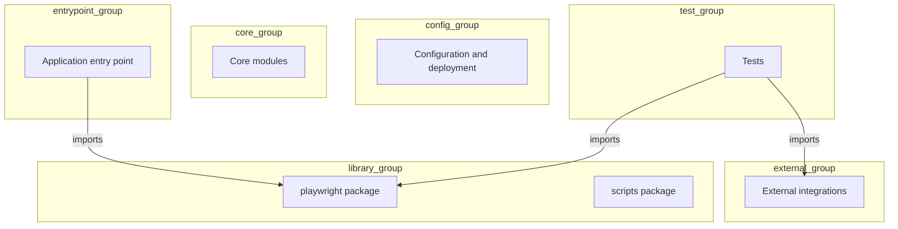

# Architecture report: microsoft/playwright-python

> Automated static analysis. **Observed** = directly seen in files/imports/AST; **Inferred** = interpretation from that evidence. Repository code was not executed.

## 1. Repository at a glance

| Item | Value |
| --- | --- |
| Repository | microsoft/playwright-python |
| Description | Python version of the Playwright testing and automation library. |
| Language | Python |
| Stars | 15108 |
| Licence | Apache-2.0 |
| Analysed commit / branch | 86a5f5a81010b1dbd155263e99782442b61d0cb2 / main |
| Framework(s) | None detected |
| Files analysed | 788 |
| Components | 7 |

## 2. Architecture in one minute

microsoft/playwright-python - Python version of the Playwright testing and automation library.. This repository was analysed statically from 788 file(s) (374 Python). Detected technologies (observed from imports/manifests): GitHub Actions, Poetry, setuptools, Docker, pytest. Files are grouped into 7 component(s): Configuration and deployment, Core modules, Application entry point, External integrations, playwright package, scripts package, Tests. Observed entry point(s): playwright/__main__.py, scripts/build_driver.py, scripts/check_test_registry.py. Findings below distinguish observed facts from inferred interpretation.

## 3. High-level block diagram

## 4. Main components

### Configuration and deployment (`config`)

- **Kind:** config
- **Status:** Observed
- **Confidence:** 0.85
- **Responsibility:** Groups 4 file(s) under configuration and deployment (observed from repository paths and static analysis). Observed top-level classes: PlaywrightBDistWheelCommand, PlaywrightSDistCommand. Observed top-level functions: driver_bundle_path, ensure_driver_bundle, extractall, read_driver_version.
- **Paths:** `pyproject.toml`, `requirements.txt`, `setup.cfg`, `setup.py`
- **Evidence:** [pyproject.toml](https://github.com/microsoft/playwright-python/blob/86a5f5a81010b1dbd155263e99782442b61d0cb2/pyproject.toml); [requirements.txt](https://github.com/microsoft/playwright-python/blob/86a5f5a81010b1dbd155263e99782442b61d0cb2/requirements.txt); [setup.cfg](https://github.com/microsoft/playwright-python/blob/86a5f5a81010b1dbd155263e99782442b61d0cb2/setup.cfg); [setup.py:34](https://github.com/microsoft/playwright-python/blob/86a5f5a81010b1dbd155263e99782442b61d0cb2/setup.py#L34)

### Core modules (`core`)

- **Kind:** core
- **Status:** Observed
- **Confidence:** 0.85
- **Responsibility:** Groups 1 file(s) under core modules (observed from repository paths and static analysis).
- **Paths:** `test.sh`
- **Evidence:** [test.sh](https://github.com/microsoft/playwright-python/blob/86a5f5a81010b1dbd155263e99782442b61d0cb2/test.sh)

### Application entry point (`entrypoint`)

- **Kind:** entrypoint
- **Status:** Observed
- **Confidence:** 0.85
- **Responsibility:** Groups 8 file(s) under application entry point (observed from repository paths and static analysis). Observed top-level classes: Command, Converter, Difference, Entry, Func, Interface. Observed top-level functions: _body_text, _canon_union, _extract_members, _extract_tar_file, _extract_zip_file, _git.
- **Paths:** `playwright/__main__.py`, `scripts/build_driver.py`, `scripts/check_test_registry.py`, `scripts/codegen/compare_api.py`, `scripts/codegen/generate_protocol.py`, `scripts/update_node_version.py`, `scripts/update_versions.py`, `scripts/upstream.py`
- **Evidence:** [playwright/__main__.py:26](https://github.com/microsoft/playwright-python/blob/86a5f5a81010b1dbd155263e99782442b61d0cb2/playwright/__main__.py#L26); [scripts/build_driver.py:67](https://github.com/microsoft/playwright-python/blob/86a5f5a81010b1dbd155263e99782442b61d0cb2/scripts/build_driver.py#L67); [scripts/check_test_registry.py:62](https://github.com/microsoft/playwright-python/blob/86a5f5a81010b1dbd155263e99782442b61d0cb2/scripts/check_test_registry.py#L62); [scripts/codegen/compare_api.py:50](https://github.com/microsoft/playwright-python/blob/86a5f5a81010b1dbd155263e99782442b61d0cb2/scripts/codegen/compare_api.py#L50); [scripts/codegen/generate_protocol.py:47](https://github.com/microsoft/playwright-python/blob/86a5f5a81010b1dbd155263e99782442b61d0cb2/scripts/codegen/generate_protocol.py#L47); [scripts/update_node_version.py:34](https://github.com/microsoft/playwright-python/blob/86a5f5a81010b1dbd155263e99782442b61d0cb2/scripts/update_node_version.py#L34); [scripts/update_versions.py:20](https://github.com/microsoft/playwright-python/blob/86a5f5a81010b1dbd155263e99782442b61d0cb2/scripts/update_versions.py#L20); [scripts/upstream.py:75](https://github.com/microsoft/playwright-python/blob/86a5f5a81010b1dbd155263e99782442b61d0cb2/scripts/upstream.py#L75)

### External integrations (`external_integrations`)

- **Kind:** external
- **Status:** Observed
- **Confidence:** 0.85
- **Responsibility:** Groups 2 file(s) under external integrations (observed from repository paths and static analysis).
- **Paths:** `playwright/_impl/__pyinstaller/hook-playwright.async_api.py`, `playwright/_impl/__pyinstaller/hook-playwright.sync_api.py`
- **Evidence:** [playwright/_impl/__pyinstaller/hook-playwright.async_api.py](https://github.com/microsoft/playwright-python/blob/86a5f5a81010b1dbd155263e99782442b61d0cb2/playwright/_impl/__pyinstaller/hook-playwright.async_api.py); [playwright/_impl/__pyinstaller/hook-playwright.sync_api.py](https://github.com/microsoft/playwright-python/blob/86a5f5a81010b1dbd155263e99782442b61d0cb2/playwright/_impl/__pyinstaller/hook-playwright.sync_api.py)

### playwright package (`playwright`)

- **Kind:** library
- **Status:** Observed
- **Confidence:** 0.85
- **Responsibility:** Groups 99 file(s) under playwright package (observed from repository paths and static analysis). Observed top-level classes: APIRequest, APIRequestContext, APIRequestContextChannel, APIRequestContextCookiesResult, APIRequestContextFetchLogResult, APIRequestContextFetchResponseBodyResult. Observed top-level functions: _access_chain_to_display_string, _basic_parse, _check_contain_class_expected, _domain_to_ascii, _ends_in_a_number, _find_command.
- **Paths:** `playwright/__init__.py`, `playwright/_impl/__init__.py`, `playwright/_impl/__pyinstaller/__init__.py`, `playwright/_impl/_api_classes.py`, `playwright/_impl/_api_structures.py`, `playwright/_impl/_assertions.py`, `playwright/_impl/_async_base.py`, `playwright/_impl/_driver.py`, `playwright/_impl/_errors.py`, `playwright/_impl/_form_data.py`, `playwright/_impl/_greenlets.py`, `playwright/_impl/_helper.py`, `playwright/_impl/_impl_to_api_mapping.py`, `playwright/_impl/_map.py`, `playwright/_impl/_protocol.py`, `playwright/_impl/_protocol_check.py`, `playwright/_impl/_signature.py`, `playwright/_impl/_sync_base.py`, `playwright/_impl/artifact.py`, `playwright/_impl/assertions.py`, `playwright/_impl/browser.py`, `playwright/_impl/browser_context.py`, `playwright/_impl/browser_type.py`, `playwright/_impl/cdp_session.py`, `playwright/_impl/channel_owner.py`, `playwright/_impl/client_helper.py`, `playwright/_impl/client_instrumentation.py`, `playwright/_impl/client_stack_trace.py`, `playwright/_impl/clock.py`, `playwright/_impl/connect.py`, `playwright/_impl/connection.py`, `playwright/_impl/console_message.py`, `playwright/_impl/credentials.py`, `playwright/_impl/debugger.py`, `playwright/_impl/dialog.py`, `playwright/_impl/disposable.py`, `playwright/_impl/download.py`, `playwright/_impl/element_handle.py`, `playwright/_impl/errors.py`, `playwright/_impl/event_context_manager.py`, `playwright/_impl/event_emitter.py`, `playwright/_impl/events.py`, `playwright/_impl/fetch.py`, `playwright/_impl/file_chooser.py`, `playwright/_impl/file_utils.py`, `playwright/_impl/frame.py`, `playwright/_impl/har_router.py`, `playwright/_impl/input.py`, `playwright/_impl/internal_structures.py`, `playwright/_impl/isomorphic/__init__.py`, `playwright/_impl/isomorphic/headers.py`, `playwright/_impl/isomorphic/locator_utils.py`, `playwright/_impl/isomorphic/manual_promise.py`, `playwright/_impl/isomorphic/mime_type.py`, `playwright/_impl/isomorphic/string_utils.py`, `playwright/_impl/isomorphic/time.py`, `playwright/_impl/isomorphic/trace_utils.py`, `playwright/_impl/isomorphic/url_match.py`, `playwright/_impl/js_handle.py`, `playwright/_impl/json_pipe.py`, `playwright/_impl/local_utils.py`, `playwright/_impl/locator.py`, `playwright/_impl/network.py`, `playwright/_impl/out_of_process.py`, `playwright/_impl/page.py`, `playwright/_impl/playwright.py`, `playwright/_impl/protocol/__init__.py`, `playwright/_impl/protocol/serializers.py`, `playwright/_impl/protocol/validator.py`, `playwright/_impl/protocol/validator_primitives.py`, `playwright/_impl/protocol_channels.py`, `playwright/_impl/protocol_types.py`, `playwright/_impl/screencast.py`, `playwright/_impl/selectors.py`, `playwright/_impl/stream.py`, `playwright/_impl/timeout_settings.py`, `playwright/_impl/tracing.py`, `playwright/_impl/transport.py`, `playwright/_impl/types.py`, `playwright/_impl/utils/__init__.py`, `playwright/_impl/utils/crypto.py`, `playwright/_impl/utils/debug.py`, `playwright/_impl/utils/debug_logger.py`, `playwright/_impl/utils/map.py`, `playwright/_impl/utils/stack_trace.py`, `playwright/_impl/utils/tasks.py`, `playwright/_impl/utils/whatwg_url.py`, `playwright/_impl/utils/zones.py`, `playwright/_impl/video.py`, `playwright/_impl/waiter.py`, `playwright/_impl/web_error.py`, `playwright/_impl/web_mcp.py`, `playwright/_impl/web_storage.py`, `playwright/_impl/worker.py`, `playwright/_impl/writable_stream.py`, `playwright/async_api/__init__.py`, `playwright/async_api/_context_manager.py`, `playwright/sync_api/__init__.py`, `playwright/sync_api/_context_manager.py`
- **Evidence:** [playwright/__init__.py](https://github.com/microsoft/playwright-python/blob/86a5f5a81010b1dbd155263e99782442b61d0cb2/playwright/__init__.py); [playwright/_impl/__init__.py](https://github.com/microsoft/playwright-python/blob/86a5f5a81010b1dbd155263e99782442b61d0cb2/playwright/_impl/__init__.py); [playwright/_impl/__pyinstaller/__init__.py:19](https://github.com/microsoft/playwright-python/blob/86a5f5a81010b1dbd155263e99782442b61d0cb2/playwright/_impl/__pyinstaller/__init__.py#L19); [playwright/_impl/_api_classes.py](https://github.com/microsoft/playwright-python/blob/86a5f5a81010b1dbd155263e99782442b61d0cb2/playwright/_impl/_api_classes.py); [playwright/_impl/_api_structures.py:21](https://github.com/microsoft/playwright-python/blob/86a5f5a81010b1dbd155263e99782442b61d0cb2/playwright/_impl/_api_structures.py#L21); [playwright/_impl/_assertions.py:29](https://github.com/microsoft/playwright-python/blob/86a5f5a81010b1dbd155263e99782442b61d0cb2/playwright/_impl/_assertions.py#L29); [playwright/_impl/_async_base.py:29](https://github.com/microsoft/playwright-python/blob/86a5f5a81010b1dbd155263e99782442b61d0cb2/playwright/_impl/_async_base.py#L29); [playwright/_impl/_driver.py:26](https://github.com/microsoft/playwright-python/blob/86a5f5a81010b1dbd155263e99782442b61d0cb2/playwright/_impl/_driver.py#L26)

### scripts package (`scripts`)

- **Kind:** library
- **Status:** Observed
- **Confidence:** 0.85
- **Responsibility:** Groups 6 file(s) under scripts package (observed from repository paths and static analysis). Observed top-level classes: DotStatus, LineStatus. Observed top-level functions: pytest_configure.
- **Paths:** `scripts/codegen/generate_api.js`, `scripts/codegen/python_rules.js`, `scripts/lint.sh`, `scripts/pytest_dot_reporter.py`, `scripts/pytest_line_reporter.py`, `scripts/update_api.sh`
- **Evidence:** [scripts/codegen/generate_api.js](https://github.com/microsoft/playwright-python/blob/86a5f5a81010b1dbd155263e99782442b61d0cb2/scripts/codegen/generate_api.js); [scripts/codegen/python_rules.js](https://github.com/microsoft/playwright-python/blob/86a5f5a81010b1dbd155263e99782442b61d0cb2/scripts/codegen/python_rules.js); [scripts/lint.sh](https://github.com/microsoft/playwright-python/blob/86a5f5a81010b1dbd155263e99782442b61d0cb2/scripts/lint.sh); [scripts/pytest_dot_reporter.py:46](https://github.com/microsoft/playwright-python/blob/86a5f5a81010b1dbd155263e99782442b61d0cb2/scripts/pytest_dot_reporter.py#L46); [scripts/pytest_line_reporter.py:33](https://github.com/microsoft/playwright-python/blob/86a5f5a81010b1dbd155263e99782442b61d0cb2/scripts/pytest_line_reporter.py#L33); [scripts/update_api.sh](https://github.com/microsoft/playwright-python/blob/86a5f5a81010b1dbd155263e99782442b61d0cb2/scripts/update_api.sh)

### Tests (`tests`)

- **Kind:** test
- **Status:** Observed
- **Confidence:** 0.85
- **Responsibility:** Groups 630 file(s) under tests (observed from repository paths and static analysis). Observed top-level classes: CdpEventWaiter, HarPage, StalledRoute, TraceViewerPage. Observed top-level functions: _download_route, _frame_route, _popup_route, _run_with_driver_env, _set_download_stall_route, _test_waiting.
- **Paths:** `examples/todomvc/mvctests/test_clear_completed_button.py`, `examples/todomvc/mvctests/test_counter.py`, `examples/todomvc/mvctests/test_editing.py`, `examples/todomvc/mvctests/test_item.py`, `examples/todomvc/mvctests/test_mark_all_as_completed.py`, `examples/todomvc/mvctests/test_new_todo.py`, `examples/todomvc/mvctests/test_persistence.py`, `examples/todomvc/mvctests/test_routing.py`, `tests/AGENTS.md`, `tests/__init__.py`, `tests/assets/axe-core/LICENSE`, `tests/assets/axe-core/README.md`, `tests/assets/axe-core/accessible-text.js`, `tests/assets/axe-core/implicit-role.js`, `tests/assets/background-color.html`, `tests/assets/beforeunload.html`, `tests/assets/button-overlay-oopif.html`, `tests/assets/cached/bfcached.html`, `tests/assets/cached/one-style.css`, `tests/assets/cached/one-style.html`, `tests/assets/callback.js`, `tests/assets/checkerboard.html`, `tests/assets/client-certificates/README.md`, `tests/assets/client-certificates/client/localhost/localhost.csr`, `tests/assets/client-certificates/client/localhost/localhost.ext`, `tests/assets/client-certificates/generate.sh`, `tests/assets/client.py`, `tests/assets/codicon.css`, `tests/assets/consolelog.html`, `tests/assets/counter.html`, `tests/assets/csp.html`, `tests/assets/css-transition.html`, `tests/assets/csscoverage/OFL.txt`, `tests/assets/csscoverage/involved.html`, `tests/assets/csscoverage/media.html`, `tests/assets/csscoverage/multiple.html`, `tests/assets/csscoverage/simple.html`, `tests/assets/csscoverage/sourceurl.html`, `tests/assets/csscoverage/stylesheet1.css`, `tests/assets/csscoverage/stylesheet2.css`, `tests/assets/csscoverage/unused.html`, `tests/assets/deep-shadow.html`, `tests/assets/device-motion.html`, `tests/assets/device-orientation.html`, `tests/assets/dom.html`, `tests/assets/download-blob.html`, `tests/assets/drag-n-drop.html`, `tests/assets/dummy_bad_browser_executable.js`, `tests/assets/dynamic-oopif.html`, `tests/assets/empty-standard-mode.html`, `tests/assets/empty.html`, `tests/assets/error.html`, `tests/assets/es6/.eslintrc`, `tests/assets/es6/es6import.js`, `tests/assets/es6/es6module.js`, `tests/assets/es6/es6pathimport.js`, `tests/assets/evals/fill-form-submit.html`, `tests/assets/evals/fill-form.html`, `tests/assets/extension-mv3-simple/content-script.js`, `tests/assets/extension-mv3-simple/index.js`, `tests/assets/extension-mv3-simple/manifest.json`, `tests/assets/extension-mv3-sw-lifecycle/background.js`, `tests/assets/extension-mv3-sw-lifecycle/manifest.json`, `tests/assets/extension-mv3-with-logging/background.js`, `tests/assets/extension-mv3-with-logging/content.js`, `tests/assets/extension-mv3-with-logging/manifest.json`, `tests/assets/file to upload.txt`, `tests/assets/file-to-upload-2.txt`, `tests/assets/file-to-upload.txt`, `tests/assets/formatted-number.html`, `tests/assets/frames/child-redirect.html`, `tests/assets/frames/frame.html`, `tests/assets/frames/frameset.html`, `tests/assets/frames/lazy-frame.html`, `tests/assets/frames/nested-frames.html`, `tests/assets/frames/one-frame.html`, `tests/assets/frames/redirect-my-parent.html`, `tests/assets/frames/script.js`, `tests/assets/frames/style.css`, `tests/assets/frames/two-frames.html`, `tests/assets/geolocation.html`, `tests/assets/global-var.html`, `tests/assets/grid-iframe-in-shadow.html`, `tests/assets/grid.html`, `tests/assets/har-fulfill.har`, `tests/assets/har-redirect.har`, `tests/assets/har-sha1-main-response.txt`, `tests/assets/har-sha1.har`, `tests/assets/har.html`, `tests/assets/headings.html`, `tests/assets/highdpi.html`, `tests/assets/historyapi.html`, `tests/assets/injectedfile.js`, `tests/assets/injectedstyle.css`, `tests/assets/input/animating-button.html`, `tests/assets/input/background-fixed.html`, `tests/assets/input/button.html`, `tests/assets/input/checkbox.html`, `tests/assets/input/drag-n-drop-manual.html`, `tests/assets/input/fileupload-multi.html`, `tests/assets/input/fileupload.html`, `tests/assets/input/folderupload.html`, `tests/assets/input/handle-locator.html`, `tests/assets/input/keyboard.html`, `tests/assets/input/mouse-helper.js`, `tests/assets/input/rotatedButton.html`, `tests/assets/input/scrollable.html`, `tests/assets/input/scrollable2.html`, `tests/assets/input/select.html`, `tests/assets/input/textarea.html`, `tests/assets/input/touches.html`, `tests/assets/jscoverage/eval.html`, `tests/assets/jscoverage/involved.html`, `tests/assets/jscoverage/multiple.html`, `tests/assets/jscoverage/ranges.html`, `tests/assets/jscoverage/script1.js`, `tests/assets/jscoverage/script2.js`, `tests/assets/jscoverage/simple.html`, `tests/assets/jscoverage/sourceurl.html`, `tests/assets/jscoverage/unused.html`, `tests/assets/load-event/load-event.html`, `tests/assets/load-event/module.js`, `tests/assets/media-query-prefers-color-scheme.svg`, `tests/assets/mobile.html`, `tests/assets/modernizr/README.md`, `tests/assets/modernizr/index.html`, `tests/assets/modernizr/mobile-safari-26.json`, `tests/assets/modernizr/roll.sh`, `tests/assets/modernizr/safari-26.json`, `tests/assets/mui.html`, `tests/assets/multi-value-rdn/README.md`, `tests/assets/network-tab/network.html`, `tests/assets/network-tab/script.js`, `tests/assets/network-tab/style.css`, `tests/assets/networkidle-frame.html`, `tests/assets/networkidle.html`, `tests/assets/networkidle.js`, `tests/assets/offscreenbuttons.html`, `tests/assets/one-style.css`, `tests/assets/one-style.html`, `tests/assets/overflow-large.html`, `tests/assets/overflow.html`, `tests/assets/player.html`, `tests/assets/playground.html`, `tests/assets/popup/popup.html`, `tests/assets/popup/window-open.html`, `tests/assets/prefetch.html`, `tests/assets/prefetch.js`, `tests/assets/preload.html`, `tests/assets/react.html`, `tests/assets/redirectloop1.html`, `tests/assets/redirectloop2.html`, `tests/assets/resetcss.html`, `tests/assets/rotate-pseudo.html`, `tests/assets/rotate-z-shadow-dom.html`, `tests/assets/rotate-z.html`, `tests/assets/screenshots/canvas.html`, `tests/assets/screenshots/controls.html`, `tests/assets/screenshots/translateZ.html`, `tests/assets/screenshots/webgl.html`, `tests/assets/sectionselectorengine.js`, `tests/assets/selenium-grid/broken-selenium-driver.js`, `tests/assets/selenium-grid/selenium-config-standalone.json`, `tests/assets/self-request.html`, `tests/assets/serviceworkers/bug-33561/index.html`, `tests/assets/serviceworkers/bug-33561/sw.js`, `tests/assets/serviceworkers/empty/sw.html`, `tests/assets/serviceworkers/empty/sw.js`, `tests/assets/serviceworkers/fetch/style.css`, `tests/assets/serviceworkers/fetch/sw.html`, `tests/assets/serviceworkers/fetch/sw.js`, `tests/assets/serviceworkers/fetchdummy/sw.html`, `tests/assets/serviceworkers/fetchdummy/sw.js`, `tests/assets/serviceworkers/slow-fallback/sw.html`, `tests/assets/serviceworkers/slow-fallback/sw.js`, `tests/assets/serviceworkers/stub/sw.html`, `tests/assets/serviceworkers/stub/sw.js`, `tests/assets/shadow-dom-link.html`, `tests/assets/shadow.html`, `tests/assets/shared-worker/shared-worker.html`, `tests/assets/shared-worker/shared-worker.js`, `tests/assets/simple.json`, `tests/assets/simplezip.json`, `tests/assets/synthetic-shadow.html`, `tests/assets/tamperable.html`, `tests/assets/title.html`, `tests/assets/to-do-notifications/LICENSE`, `tests/assets/to-do-notifications/README.md`, `tests/assets/to-do-notifications/index.html`, `tests/assets/to-do-notifications/manifest.webapp`, `tests/assets/to-do-notifications/scripts/todo.js`, `tests/assets/to-do-notifications/style/style.css`, `tests/assets/video.html`, `tests/assets/video_mp4.html`, `tests/assets/video_webm.html`, `tests/assets/wasm/table2.html`, `tests/assets/web-animation.html`, `tests/assets/webfont/README.md`, `tests/assets/webfont/generate_font.py`, `tests/assets/webfont/iconfont.svg`, `tests/assets/webfont/webfont.html`, `tests/assets/window-stop.html`, `tests/assets/worker/import-me.js`, `tests/assets/worker/worker-http-import.html`, `tests/assets/worker/worker-http-import.js`, `tests/assets/worker/worker.html`, `tests/assets/worker/worker.js`, `tests/assets/wpt/LICENSE.md`, `tests/assets/wpt/README.md`, `tests/assets/wpt/accname/manual/description_1.0_combobox-focusable-manual.html`, `tests/assets/wpt/accname/manual/description_from_content_of_describedby_element-manual.html`, `tests/assets/wpt/accname/manual/description_link-with-label-manual.html`, `tests/assets/wpt/accname/manual/description_test_case_557-manual.html`, `tests/assets/wpt/accname/manual/description_test_case_664-manual.html`, `tests/assets/wpt/accname/manual/description_test_case_665-manual.html`, `tests/assets/wpt/accname/manual/description_test_case_666-manual.html`, `tests/assets/wpt/accname/manual/description_test_case_772-manual.html`, `tests/assets/wpt/accname/manual/description_test_case_773-manual.html`, `tests/assets/wpt/accname/manual/description_test_case_774-manual.html`, `tests/assets/wpt/accname/manual/description_test_case_838-manual.html`, `tests/assets/wpt/accname/manual/description_test_case_broken_reference-manual.html`, `tests/assets/wpt/accname/manual/description_test_case_one_valid_reference-manual.html`, `tests/assets/wpt/accname/manual/description_title-same-element-manual.html`, `tests/assets/wpt/accname/manual/name_1.0_combobox-focusable-alternative-manual.html`, `tests/assets/wpt/accname/manual/name_1.0_combobox-focusable-manual.html`, `tests/assets/wpt/accname/manual/name_checkbox-label-embedded-combobox-manual.html`, `tests/assets/wpt/accname/manual/name_checkbox-label-embedded-listbox-manual.html`, `tests/assets/wpt/accname/manual/name_checkbox-label-embedded-menu-manual.html`, `tests/assets/wpt/accname/manual/name_checkbox-label-embedded-select-manual.html`, `tests/assets/wpt/accname/manual/name_checkbox-label-embedded-slider-manual.html`, `tests/assets/wpt/accname/manual/name_checkbox-label-embedded-spinbutton-manual.html`, `tests/assets/wpt/accname/manual/name_checkbox-label-embedded-textbox-manual.html`, `tests/assets/wpt/accname/manual/name_checkbox-label-multiple-label-alternative-manual.html`, `tests/assets/wpt/accname/manual/name_checkbox-label-multiple-label-manual.html`, `tests/assets/wpt/accname/manual/name_checkbox-title-manual.html`, `tests/assets/wpt/accname/manual/name_file-label-embedded-combobox-manual.html`, `tests/assets/wpt/accname/manual/name_file-label-embedded-menu-manual.html`, `tests/assets/wpt/accname/manual/name_file-label-embedded-select-manual.html`, `tests/assets/wpt/accname/manual/name_file-label-embedded-slider-manual.html`, `tests/assets/wpt/accname/manual/name_file-label-embedded-spinbutton-manual.html`, `tests/assets/wpt/accname/manual/name_file-label-inline-block-elements-manual.html`, `tests/assets/wpt/accname/manual/name_file-label-inline-block-styles-manual.html`, `tests/assets/wpt/accname/manual/name_file-label-inline-hidden-elements-manual.html`, `tests/assets/wpt/accname/manual/name_file-label-owned-combobox-manual.html`, `tests/assets/wpt/accname/manual/name_file-label-owned-combobox-owned-listbox-manual.html`, `tests/assets/wpt/accname/manual/name_file-title-manual.html`, `tests/assets/wpt/accname/manual/name_from_content-manual.html`, `tests/assets/wpt/accname/manual/name_from_content_of_label-manual.html`, `tests/assets/wpt/accname/manual/name_from_content_of_labelledby_element-manual.html`, `tests/assets/wpt/accname/manual/name_from_content_of_labelledby_elements_one_of_which_is_hidden-manual.html`, `tests/assets/wpt/accname/manual/name_heading-combobox-focusable-alternative-manual.html`, `tests/assets/wpt/accname/manual/name_image-title-manual.html`, `tests/assets/wpt/accname/manual/name_link-mixed-content-manual.html`, `tests/assets/wpt/accname/manual/name_link-with-label-manual.html`, `tests/assets/wpt/accname/manual/name_password-label-embedded-combobox-manual.html`, `tests/assets/wpt/accname/manual/name_password-label-embedded-menu-manual.html`, `tests/assets/wpt/accname/manual/name_password-label-embedded-select-manual.html`, `tests/assets/wpt/accname/manual/name_password-label-embedded-slider-manual.html`, `tests/assets/wpt/accname/manual/name_password-label-embedded-spinbutton-manual.html`, `tests/assets/wpt/accname/manual/name_password-title-manual.html`, `tests/assets/wpt/accname/manual/name_radio-label-embedded-combobox-manual.html`, `tests/assets/wpt/accname/manual/name_radio-label-embedded-menu-manual.html`, `tests/assets/wpt/accname/manual/name_radio-label-embedded-select-manual.html`, `tests/assets/wpt/accname/manual/name_radio-label-embedded-slider-manual.html`, `tests/assets/wpt/accname/manual/name_radio-label-embedded-spinbutton-manual.html`, `tests/assets/wpt/accname/manual/name_radio-title-manual.html`, `tests/assets/wpt/accname/manual/name_test_case_539-manual.html`, `tests/assets/wpt/accname/manual/name_test_case_540-manual.html`, `tests/assets/wpt/accname/manual/name_test_case_541-manual.html`, `tests/assets/wpt/accname/manual/name_test_case_543-manual.html`, `tests/assets/wpt/accname/manual/name_test_case_544-manual.html`, `tests/assets/wpt/accname/manual/name_test_case_545-manual.html`, `tests/assets/wpt/accname/manual/name_test_case_546-manual.html`, `tests/assets/wpt/accname/manual/name_test_case_547-manual.html`, `tests/assets/wpt/accname/manual/name_test_case_548-manual.html`, `tests/assets/wpt/accname/manual/name_test_case_549-manual.html`, `tests/assets/wpt/accname/manual/name_test_case_550-manual.html`, `tests/assets/wpt/accname/manual/name_test_case_551-manual.html`, `tests/assets/wpt/accname/manual/name_test_case_552-manual.html`, `tests/assets/wpt/accname/manual/name_test_case_553-manual.html`, `tests/assets/wpt/accname/manual/name_test_case_556-manual.html`, `tests/assets/wpt/accname/manual/name_test_case_557-manual.html`, `tests/assets/wpt/accname/manual/name_test_case_558-manual.html`, `tests/assets/wpt/accname/manual/name_test_case_559-manual.html`, `tests/assets/wpt/accname/manual/name_test_case_560-manual.html`, `tests/assets/wpt/accname/manual/name_test_case_561-manual.html`, `tests/assets/wpt/accname/manual/name_test_case_562-manual.html`, `tests/assets/wpt/accname/manual/name_test_case_563-manual.html`, `tests/assets/wpt/accname/manual/name_test_case_564-manual.html`, `tests/assets/wpt/accname/manual/name_test_case_565-manual.html`, `tests/assets/wpt/accname/manual/name_test_case_566-manual.html`, `tests/assets/wpt/accname/manual/name_test_case_596-manual.html`, `tests/assets/wpt/accname/manual/name_test_case_597-manual.html`, `tests/assets/wpt/accname/manual/name_test_case_598-manual.html`, `tests/assets/wpt/accname/manual/name_test_case_599-manual.html`, `tests/assets/wpt/accname/manual/name_test_case_600-manual.html`, `tests/assets/wpt/accname/manual/name_test_case_601-manual.html`, `tests/assets/wpt/accname/manual/name_test_case_602-manual.html`, `tests/assets/wpt/accname/manual/name_test_case_603-manual.html`, `tests/assets/wpt/accname/manual/name_test_case_604-manual.html`, `tests/assets/wpt/accname/manual/name_test_case_605-manual.html`, `tests/assets/wpt/accname/manual/name_test_case_606-manual.html`, `tests/assets/wpt/accname/manual/name_test_case_607-manual.html`, `tests/assets/wpt/accname/manual/name_test_case_608-manual.html`, `tests/assets/wpt/accname/manual/name_test_case_609-manual.html`, `tests/assets/wpt/accname/manual/name_test_case_610-manual.html`, `tests/assets/wpt/accname/manual/name_test_case_611-manual.html`, `tests/assets/wpt/accname/manual/name_test_case_612-manual.html`, `tests/assets/wpt/accname/manual/name_test_case_613-manual.html`, `tests/assets/wpt/accname/manual/name_test_case_614-manual.html`, `tests/assets/wpt/accname/manual/name_test_case_615-manual.html`, `tests/assets/wpt/accname/manual/name_test_case_616-manual.html`, `tests/assets/wpt/accname/manual/name_test_case_617-manual.html`, `tests/assets/wpt/accname/manual/name_test_case_618-manual.html`, `tests/assets/wpt/accname/manual/name_test_case_619-manual.html`, `tests/assets/wpt/accname/manual/name_test_case_620-manual.html`, `tests/assets/wpt/accname/manual/name_test_case_621-manual.html`, `tests/assets/wpt/accname/manual/name_test_case_659-manual.html`, `tests/assets/wpt/accname/manual/name_test_case_660-manual.html`, `tests/assets/wpt/accname/manual/name_test_case_661-manual.html`, `tests/assets/wpt/accname/manual/name_test_case_662-manual.html`, `tests/assets/wpt/accname/manual/name_test_case_663a-manual.html`, `tests/assets/wpt/accname/manual/name_test_case_721-manual.html`, `tests/assets/wpt/accname/manual/name_test_case_723-manual.html`, `tests/assets/wpt/accname/manual/name_test_case_724-manual.html`, `tests/assets/wpt/accname/manual/name_test_case_725-manual.html`, `tests/assets/wpt/accname/manual/name_test_case_726-manual.html`, `tests/assets/wpt/accname/manual/name_test_case_727-manual.html`, `tests/assets/wpt/accname/manual/name_test_case_728-manual.html`, `tests/assets/wpt/accname/manual/name_test_case_729-manual.html`, `tests/assets/wpt/accname/manual/name_test_case_730-manual.html`, `tests/assets/wpt/accname/manual/name_test_case_731-manual.html`, `tests/assets/wpt/accname/manual/name_test_case_733-manual.html`, `tests/assets/wpt/accname/manual/name_test_case_734-manual.html`, `tests/assets/wpt/accname/manual/name_test_case_735-manual.html`, `tests/assets/wpt/accname/manual/name_test_case_736-manual.html`, `tests/assets/wpt/accname/manual/name_test_case_737-manual.html`, `tests/assets/wpt/accname/manual/name_test_case_738-manual.html`, `tests/assets/wpt/accname/manual/name_test_case_739-manual.html`, `tests/assets/wpt/accname/manual/name_test_case_740-manual.html`, `tests/assets/wpt/accname/manual/name_test_case_741-manual.html`, `tests/assets/wpt/accname/manual/name_test_case_742-manual.html`, `tests/assets/wpt/accname/manual/name_test_case_743-manual.html`, `tests/assets/wpt/accname/manual/name_test_case_744-manual.html`, `tests/assets/wpt/accname/manual/name_test_case_745-manual.html`, `tests/assets/wpt/accname/manual/name_test_case_746-manual.html`, `tests/assets/wpt/accname/manual/name_test_case_747-manual.html`, `tests/assets/wpt/accname/manual/name_test_case_748-manual.html`, `tests/assets/wpt/accname/manual/name_test_case_749-manual.html`, `tests/assets/wpt/accname/manual/name_test_case_750-manual.html`, `tests/assets/wpt/accname/manual/name_test_case_751-manual.html`, `tests/assets/wpt/accname/manual/name_test_case_752-manual.html`, `tests/assets/wpt/accname/manual/name_test_case_753-manual.html`, `tests/assets/wpt/accname/manual/name_test_case_754-manual.html`, `tests/assets/wpt/accname/manual/name_test_case_755-manual.html`, `tests/assets/wpt/accname/manual/name_test_case_756-manual.html`, `tests/assets/wpt/accname/manual/name_test_case_757-manual.html`, `tests/assets/wpt/accname/manual/name_test_case_758-manual.html`, `tests/assets/wpt/accname/manual/name_test_case_759-manual.html`, `tests/assets/wpt/accname/manual/name_test_case_760-manual.html`, `tests/assets/wpt/accname/manual/name_test_case_761-manual.html`, `tests/assets/wpt/accname/manual/name_test_case_762-manual.html`, `tests/assets/wpt/accname/manual/name_text-label-embedded-combobox-manual.html`, `tests/assets/wpt/accname/manual/name_text-label-embedded-menu-manual.html`, `tests/assets/wpt/accname/manual/name_text-label-embedded-select-manual.html`, `tests/assets/wpt/accname/manual/name_text-label-embedded-slider-manual.html`, `tests/assets/wpt/accname/manual/name_text-label-embedded-spinbutton-manual.html`, `tests/assets/wpt/accname/manual/name_text-title-manual.html`, `tests/assets/wpt/accname/name/comp_embedded_control.html`, `tests/assets/wpt/accname/name/comp_hidden_not_referenced.html`, `tests/assets/wpt/accname/name/comp_host_language_label.html`, `tests/assets/wpt/accname/name/comp_label.html`, `tests/assets/wpt/accname/name/comp_labelledby.html`, `tests/assets/wpt/accname/name/comp_labelledby_hidden_nodes.html`, `tests/assets/wpt/accname/name/comp_name_from_content.html`, `tests/assets/wpt/accname/name/comp_text_node.html`, `tests/assets/wpt/accname/name/comp_tooltip.html`, `tests/assets/wpt/accname/name/shadowdom/basic.html`, `tests/assets/wpt/accname/name/shadowdom/slot.html`, `tests/assets/wpt/wai-aria/scripts/manual.css`, `tests/assets/wrappedlink.html`, `tests/async/__init__.py`, `tests/async/conftest.py`, `tests/async/library/__init__.py`, `tests/async/library/chromium/__init__.py`, `tests/async/library/chromium/test_bfcache.py`, `tests/async/library/chromium/test_chromium.py`, `tests/async/library/chromium/test_connect_over_cdp.py`, `tests/async/library/chromium/test_disable_web_security.py`, `tests/async/library/chromium/test_extensions.py`, `tests/async/library/chromium/test_launcher.py`, `tests/async/library/chromium/test_oopif.py`, `tests/async/library/chromium/test_session.py`, `tests/async/library/chromium/test_tracing.py`, `tests/async/library/firefox/__init__.py`, `tests/async/library/firefox/test_launcher.py`, `tests/async/library/test_beforeunload.py`, `tests/async/library/test_browser.py`, `tests/async/library/test_browser_server.py`, `tests/async/library/test_browsercontext_add_cookies.py`, `tests/async/library/test_browsercontext_add_init_script.py`, `tests/async/library/test_browsercontext_base_url.py`, `tests/async/library/test_browsercontext_basic.py`, `tests/async/library/test_browsercontext_clearcookies.py`, `tests/async/library/test_browsercontext_cookies.py`, `tests/async/library/test_browsercontext_cookies_third_party.py`, `tests/async/library/test_browsercontext_credentials.py`, `tests/async/library/test_browsercontext_csp.py`, `tests/async/library/test_browsercontext_device.py`, `tests/async/library/test_browsercontext_dsf.py`, `tests/async/library/test_browsercontext_events.py`, `tests/async/library/test_browsercontext_expose_function.py`, `tests/async/library/test_browsercontext_fetch.py`, `tests/async/library/test_browsercontext_fetch_algorithms.py`, `tests/async/library/test_browsercontext_fetch_happy_eyeballs.py`, `tests/async/library/test_browsercontext_har.py`, `tests/async/library/test_browsercontext_locale.py`, `tests/async/library/test_browsercontext_network_event.py`, `tests/async/library/test_browsercontext_page_event.py`, `tests/async/library/test_browsercontext_pages.py`, `tests/async/library/test_browsercontext_proxy.py`, `tests/async/library/test_browsercontext_route.py`, `tests/async/library/test_browsercontext_service_worker_policy.py`, `tests/async/library/test_browsercontext_set_extra_http_headers.py`, `tests/async/library/test_browsercontext_storage_state.py`, `tests/async/library/test_browsercontext_strict.py`, `tests/async/library/test_browsercontext_timezone_id.py`, `tests/async/library/test_browsercontext_user_agent.py`, `tests/async/library/test_browsercontext_viewport.py`, `tests/async/library/test_browsercontext_viewport_mobile.py`, `tests/async/library/test_browsercontext_webauthn.py`, `tests/async/library/test_browsertype_basic.py`, `tests/async/library/test_browsertype_connect.py`, `tests/async/library/test_browsertype_launch.py`, `tests/async/library/test_browsertype_launch_selenium.py`, `tests/async/library/test_capabilities.py`, `tests/async/library/test_client_certificates.py`, `tests/async/library/test_debugger.py`, `tests/async/library/test_defaultbrowsercontext_1.py`, `tests/async/library/test_defaultbrowsercontext_2.py`, `tests/async/library/test_download.py`, `tests/async/library/test_downloads_path.py`, `tests/async/library/test_emulation_coop.py`, `tests/async/library/test_emulation_focus.py`, `tests/async/library/test_favicon.py`, `tests/async/library/test_fetch_proxy.py`, `tests/async/library/test_geolocation.py`, `tests/async/library/test_global_fetch.py`, `tests/async/library/test_global_fetch_cookie.py`, `tests/async/library/test_har.py`, `tests/async/library/test_har_websocket.py`, `tests/async/library/test_headful.py`, `tests/async/library/test_hit_target.py`, `tests/async/library/test_ignorehttpserrors.py`, `tests/async/library/test_launcher.py`, `tests/async/library/test_locator_dispatchevent_touch.py`, `tests/async/library/test_locator_highlight.py`, `tests/async/library/test_modernizr.py`, `tests/async/library/test_multiclient.py`, `tests/async/library/test_page_clock.py`, `tests/async/library/test_page_clock_frozen.py`, `tests/async/library/test_page_close.py`, `tests/async/library/test_page_event_crash.py`, `tests/async/library/test_pdf.py`, `tests/async/library/test_permissions.py`, `tests/async/library/test_popup.py`, `tests/async/library/test_proxy.py`, `tests/async/library/test_resource_timing.py`, `tests/async/library/test_route_web_socket.py`, `tests/async/library/test_screencast.py`, `tests/async/library/test_screencast_actions.py`, `tests/async/library/test_screencast_overlay.py`, `tests/async/library/test_screenshot.py`, `tests/async/library/test_selectors_register.py`, `tests/async/library/test_shared_worker.py`, `tests/async/library/test_signals.py`, `tests/async/library/test_tap.py`, `tests/async/library/test_tracing.py`, `tests/async/library/test_unroute_behavior.py`, `tests/async/library/test_video.py`, `tests/async/library/test_web_socket.py`, `tests/async/library/test_webmcp.py`, `tests/async/library/test_webmcp_disabled.py`, `tests/async/page/__init__.py`, `tests/async/page/test_elementhandle_bounding_box.py`, `tests/async/page/test_elementhandle_click.py`, `tests/async/page/test_elementhandle_content_frame.py`, `tests/async/page/test_elementhandle_convenience.py`, `tests/async/page/test_elementhandle_eval_on_selector.py`, `tests/async/page/test_elementhandle_misc.py`, `tests/async/page/test_elementhandle_owner_frame.py`, `tests/async/page/test_elementhandle_press.py`, `tests/async/page/test_elementhandle_query_selector.py`, `tests/async/page/test_elementhandle_screenshot.py`, `tests/async/page/test_elementhandle_scroll_into_view.py`, `tests/async/page/test_elementhandle_select_text.py`, `tests/async/page/test_elementhandle_type.py`, `tests/async/page/test_elementhandle_wait_for_element_state.py`, `tests/async/page/test_eval_on_selector.py`, `tests/async/page/test_eval_on_selector_all.py`, `tests/async/page/test_expect_boolean.py`, `tests/async/page/test_expect_misc.py`, `tests/async/page/test_expect_timeout.py`, `tests/async/page/test_expect_to_have_accessible.py`, `tests/async/page/test_expect_to_have_text.py`, `tests/async/page/test_expect_to_have_value.py`, `tests/async/page/test_firefox_network_response.py`, `tests/async/page/test_frame_evaluate.py`, `tests/async/page/test_frame_frame_element.py`, `tests/async/page/test_frame_goto.py`, `tests/async/page/test_frame_hierarchy.py`, `tests/async/page/test_interception.py`, `tests/async/page/test_jshandle_as_element.py`, `tests/async/page/test_jshandle_evaluate.py`, `tests/async/page/test_jshandle_json_value.py`, `tests/async/page/test_jshandle_properties.py`, `tests/async/page/test_jshandle_to_string.py`, `tests/async/page/test_locator_any_frame.py`, `tests/async/page/test_locator_click.py`, `tests/async/page/test_locator_convenience.py`, `tests/async/page/test_locator_element_handle.py`, `tests/async/page/test_locator_evaluate.py`, `tests/async/page/test_locator_frame.py`, `tests/async/page/test_locator_highlight.py`, `tests/async/page/test_locator_is_visible.py`, `tests/async/page/test_locator_list.py`, `tests/async/page/test_locator_misc_1.py`, `tests/async/page/test_locator_misc_2.py`, `tests/async/page/test_locator_query.py`, `tests/async/page/test_locator_wait_for_function.py`, `tests/async/page/test_network_post_data.py`, `tests/async/page/test_page_add_init_script.py`, `tests/async/page/test_page_add_locator_handler.py`, `tests/async/page/test_page_add_script_tag.py`, `tests/async/page/test_page_add_style_tag.py`, `tests/async/page/test_page_aria_snapshot.py`, `tests/async/page/test_page_aria_snapshot_ai.py`, `tests/async/page/test_page_autowaiting_basic.py`, `tests/async/page/test_page_autowaiting_no_hang.py`, `tests/async/page/test_page_basic.py`, `tests/async/page/test_page_cache_storage.py`, `tests/async/page/test_page_check.py`, `tests/async/page/test_page_click.py`, `tests/async/page/test_page_click_react.py`, `tests/async/page/test_page_click_scroll.py`, `tests/async/page/test_page_click_timeout_1.py`, `tests/async/page/test_page_click_timeout_2.py`, `tests/async/page/test_page_click_timeout_3.py`, `tests/async/page/test_page_click_timeout_4.py`, `tests/async/page/test_page_dialog.py`, `tests/async/page/test_page_dispatchevent.py`, `tests/async/page/test_page_drag.py`, `tests/async/page/test_page_drop.py`, `tests/async/page/test_page_emulate_media.py`, `tests/async/page/test_page_evaluate.py`, `tests/async/page/test_page_evaluate_callback.py`, `tests/async/page/test_page_evaluate_handle.py`, `tests/async/page/test_page_event_console.py`, `tests/async/page/test_page_event_load.py`, `tests/async/page/test_page_event_network.py`, `tests/async/page/test_page_event_pageerror.py`, `tests/async/page/test_page_event_popup.py`, `tests/async/page/test_page_event_request.py`, `tests/async/page/test_page_expose_function.py`, `tests/async/page/test_page_filechooser.py`, `tests/async/page/test_page_fill.py`, `tests/async/page/test_page_focus.py`, `tests/async/page/test_page_goto.py`, `tests/async/page/test_page_history.py`, `tests/async/page/test_page_keyboard.py`, `tests/async/page/test_page_localstorage.py`, `tests/async/page/test_page_mouse.py`, `tests/async/page/test_page_navigation.py`, `tests/async/page/test_page_network_idle.py`, `tests/async/page/test_page_network_request.py`, `tests/async/page/test_page_network_response.py`, `tests/async/page/test_page_network_sizes.py`, `tests/async/page/test_page_request_continue.py`, `tests/async/page/test_page_request_fallback.py`, `tests/async/page/test_page_request_fulfill.py`, `tests/async/page/test_page_request_gc.py`, `tests/async/page/test_page_request_intercept.py`, `tests/async/page/test_page_route.py`, `tests/async/page/test_page_screenshot.py`, `tests/async/page/test_page_select_option.py`, `tests/async/page/test_page_set_content.py`, `tests/async/page/test_page_set_extra_http_headers.py`, `tests/async/page/test_page_set_input_files.py`, `tests/async/page/test_page_strict.py`, `tests/async/page/test_page_transition.py`, `tests/async/page/test_page_wait_for_function.py`, `tests/async/page/test_page_wait_for_load_state.py`, `tests/async/page/test_page_wait_for_navigation.py`, `tests/async/page/test_page_wait_for_request.py`, `tests/async/page/test_page_wait_for_response.py`, `tests/async/page/test_page_wait_for_selector_1.py`, `tests/async/page/test_page_wait_for_selector_2.py`, `tests/async/page/test_page_wait_for_url.py`, `tests/async/page/test_queryselector.py`, `tests/async/page/test_retarget.py`, `tests/async/page/test_selectors_css.py`, `tests/async/page/test_selectors_frame.py`, `tests/async/page/test_selectors_get_by.py`, `tests/async/page/test_selectors_misc.py`, `tests/async/page/test_selectors_register.py`, `tests/async/page/test_selectors_role.py`, `tests/async/page/test_selectors_text.py`, `tests/async/page/test_to_match_aria_snapshot.py`, `tests/async/page/test_wheel.py`, `tests/async/page/test_workers.py`, `tests/async/python/__init__.py`, `tests/async/python/test_assertions.py`, `tests/async/python/test_asyncio.py`, `tests/async/python/test_browsercontext.py`, `tests/async/python/test_browsercontext_credentials.py`, `tests/async/python/test_browsercontext_events.py`, `tests/async/python/test_browsercontext_proxy.py`, `tests/async/python/test_browsercontext_request_fallback.py`, `tests/async/python/test_browsercontext_request_intercept.py`, `tests/async/python/test_browsertype_connect.py`, `tests/async/python/test_cdp_session.py`, `tests/async/python/test_click.py`, `tests/async/python/test_console.py`, `tests/async/python/test_context_manager.py`, `tests/async/python/test_device_descriptors.py`, `tests/async/python/test_dialog.py`, `tests/async/python/test_download.py`, `tests/async/python/test_expect_misc.py`, `tests/async/python/test_fetch_browser_context.py`, `tests/async/python/test_fetch_global.py`
- **Evidence:** [examples/todomvc/mvctests/test_clear_completed_button.py:24](https://github.com/microsoft/playwright-python/blob/86a5f5a81010b1dbd155263e99782442b61d0cb2/examples/todomvc/mvctests/test_clear_completed_button.py#L24); [examples/todomvc/mvctests/test_counter.py:24](https://github.com/microsoft/playwright-python/blob/86a5f5a81010b1dbd155263e99782442b61d0cb2/examples/todomvc/mvctests/test_counter.py#L24); [examples/todomvc/mvctests/test_editing.py:29](https://github.com/microsoft/playwright-python/blob/86a5f5a81010b1dbd155263e99782442b61d0cb2/examples/todomvc/mvctests/test_editing.py#L29); [examples/todomvc/mvctests/test_item.py:29](https://github.com/microsoft/playwright-python/blob/86a5f5a81010b1dbd155263e99782442b61d0cb2/examples/todomvc/mvctests/test_item.py#L29); [examples/todomvc/mvctests/test_mark_all_as_completed.py:28](https://github.com/microsoft/playwright-python/blob/86a5f5a81010b1dbd155263e99782442b61d0cb2/examples/todomvc/mvctests/test_mark_all_as_completed.py#L28); [examples/todomvc/mvctests/test_new_todo.py:29](https://github.com/microsoft/playwright-python/blob/86a5f5a81010b1dbd155263e99782442b61d0cb2/examples/todomvc/mvctests/test_new_todo.py#L29); [examples/todomvc/mvctests/test_persistence.py:24](https://github.com/microsoft/playwright-python/blob/86a5f5a81010b1dbd155263e99782442b61d0cb2/examples/todomvc/mvctests/test_persistence.py#L24); [examples/todomvc/mvctests/test_routing.py:29](https://github.com/microsoft/playwright-python/blob/86a5f5a81010b1dbd155263e99782442b61d0cb2/examples/todomvc/mvctests/test_routing.py#L29)

## 5. Execution flow

**Observed** entry point(s):

- [playwright/__main__.py](https://github.com/microsoft/playwright-python/blob/86a5f5a81010b1dbd155263e99782442b61d0cb2/playwright/__main__.py)
- [scripts/build_driver.py:296](https://github.com/microsoft/playwright-python/blob/86a5f5a81010b1dbd155263e99782442b61d0cb2/scripts/build_driver.py#L296)
- [scripts/check_test_registry.py:295](https://github.com/microsoft/playwright-python/blob/86a5f5a81010b1dbd155263e99782442b61d0cb2/scripts/check_test_registry.py#L295)
- [scripts/codegen/compare_api.py:496](https://github.com/microsoft/playwright-python/blob/86a5f5a81010b1dbd155263e99782442b61d0cb2/scripts/codegen/compare_api.py#L496)
- [scripts/codegen/generate_protocol.py:763](https://github.com/microsoft/playwright-python/blob/86a5f5a81010b1dbd155263e99782442b61d0cb2/scripts/codegen/generate_protocol.py#L763)
- [scripts/update_node_version.py:52](https://github.com/microsoft/playwright-python/blob/86a5f5a81010b1dbd155263e99782442b61d0cb2/scripts/update_node_version.py#L52)
- [scripts/update_versions.py:39](https://github.com/microsoft/playwright-python/blob/86a5f5a81010b1dbd155263e99782442b61d0cb2/scripts/update_versions.py#L39)
- [scripts/upstream.py:331](https://github.com/microsoft/playwright-python/blob/86a5f5a81010b1dbd155263e99782442b61d0cb2/scripts/upstream.py#L331)

Representative flow (derived from observed entry points and the import graph; steps beyond the entry point are **Inferred**):

1. Execution starts at an observed entry point listed above, if present.
2. `entrypoint` imports `playwright` (Application entry point -> playwright package).
3. `tests` imports `external_integrations` (Tests -> External integrations).
4. `tests` imports `playwright` (Tests -> playwright package).

## 6. Project structure

### `(root)`

- `.gitattributes` - other (73 bytes)
- `.gitignore` - other (433 bytes)
- `.pre-commit-config.yaml` - config (1458 bytes)
- `AGENTS.md` - docs (9454 bytes)
- `CODE_OF_CONDUCT.md` - docs (444 bytes)
- `CONTRIBUTING.md` - docs (1341 bytes)
- `DRIVER_VERSION` - other (41 bytes)
- `LICENSE` - docs (11399 bytes)
- `NODE_VERSION` - other (8 bytes)
- `README.md` - docs (2331 bytes)
- `SECURITY.md` - docs (2780 bytes)
- `SUPPORT.md` - docs (829 bytes)
- `local-requirements.txt` - docs (385 bytes)
- `pyproject.toml` - manifest (4136 bytes)
- `requirements.txt` - manifest (172 bytes)
- `setup.cfg` - manifest (125 bytes)
- `setup.py` - manifest, Python (9580 bytes)
- `test.sh` - source, Shell (1196 bytes)

### `.azure-pipelines`

- `.azure-pipelines/guardian/SDL/.gdnsuppress` - other (3962 bytes)
- `.azure-pipelines/publish-docker.yml` - config (4769 bytes)

### `.claude`

- `.claude/skills/playwright-patch-release/SKILL.md` - docs (7845 bytes)
- `.claude/skills/playwright-release/SKILL.md` - docs (6909 bytes)
- `.claude/skills/playwright-roll/SKILL.md` - docs (2940 bytes)

### `.github`

- `.github/ISSUE_TEMPLATE/bug.yml` - config (3653 bytes)
- `.github/ISSUE_TEMPLATE/config.yml` - config (186 bytes)
- `.github/ISSUE_TEMPLATE/documentation.yml` - config (1131 bytes)
- `.github/ISSUE_TEMPLATE/feature.yml` - config (819 bytes)
- `.github/ISSUE_TEMPLATE/question.yml` - config (819 bytes)
- `.github/ISSUE_TEMPLATE/regression.yml` - config (2903 bytes)
- `.github/dependabot.yml` - config (338 bytes)
- `.github/workflows/agent-patch-release.yml` - ci, YAML (3172 bytes)
- `.github/workflows/agent-review.yml` - ci, YAML (1190 bytes)
- `.github/workflows/agent-roll.yml` - ci, YAML (3768 bytes)
- `.github/workflows/agent-task.yml` - ci, YAML (1140 bytes)
- `.github/workflows/agent-triage.yml` - ci, YAML (1248 bytes)
- `.github/workflows/ci.yml` - ci, YAML (9777 bytes)
- `.github/workflows/publish.yml` - ci, YAML (3049 bytes)
- `.github/workflows/test_docker.yml` - ci, YAML (3716 bytes)

### `examples`

- `examples/todomvc/mvctests/__init__.py` - source, Python (0 bytes)
- `examples/todomvc/mvctests/test_clear_completed_button.py` - test, Python (1774 bytes)
- `examples/todomvc/mvctests/test_counter.py` - test, Python (1429 bytes)
- `examples/todomvc/mvctests/test_editing.py` - test, Python (3049 bytes)
- `examples/todomvc/mvctests/test_item.py` - test, Python (3090 bytes)
- `examples/todomvc/mvctests/test_mark_all_as_completed.py` - test, Python (2857 bytes)
- `examples/todomvc/mvctests/test_new_todo.py` - test, Python (2913 bytes)
- `examples/todomvc/mvctests/test_persistence.py` - test, Python (1658 bytes)
- `examples/todomvc/mvctests/test_routing.py` - test, Python (3617 bytes)
- `examples/todomvc/mvctests/utils.py` - source, Python (1461 bytes)
- `examples/todomvc/requirements.txt` - manifest (18 bytes)

### `playwright`

- `playwright/__init__.py` - source, Python (805 bytes)
- `playwright/__main__.py` - source, Python (1429 bytes)
- `playwright/_impl/AGENTS.md` - docs (24992 bytes)
- `playwright/_impl/__init__.py` - source, Python (3060 bytes)
- `playwright/_impl/__pyinstaller/__init__.py` - source, Python (691 bytes)
- `playwright/_impl/__pyinstaller/hook-playwright.async_api.py` - source, Python (695 bytes)
- `playwright/_impl/__pyinstaller/hook-playwright.sync_api.py` - source, Python (695 bytes)
- `playwright/_impl/_api_classes.py` - source, Python (3231 bytes)
- `playwright/_impl/_api_structures.py` - source, Python (5528 bytes)
- `playwright/_impl/_assertions.py` - source, Python (1739 bytes)
- `playwright/_impl/_async_base.py` - source, Python (3617 bytes)
- `playwright/_impl/_driver.py` - source, Python (1913 bytes)
- `playwright/_impl/_errors.py` - source, Python (1669 bytes)
- `playwright/_impl/_form_data.py` - source, Python (1205 bytes)
- `playwright/_impl/_greenlets.py` - source, Python (4363 bytes)
- `playwright/_impl/_helper.py` - source, Python (1251 bytes)
- `playwright/_impl/_impl_to_api_mapping.py` - source, Python (6299 bytes)
- `playwright/_impl/_map.py` - source, Python (1045 bytes)
- `playwright/_impl/_protocol.py` - source, Python (85129 bytes)
- `playwright/_impl/_protocol_check.py` - source, Python (6012 bytes)
- `playwright/_impl/_signature.py` - source, Python (1261 bytes)
- `playwright/_impl/_sync_base.py` - source, Python (5262 bytes)
- `playwright/_impl/artifact.py` - source, Python (4118 bytes)
- `playwright/_impl/assertions.py` - source, Python (38006 bytes)
- `playwright/_impl/browser.py` - source, Python (17979 bytes)
- `playwright/_impl/browser_context.py` - source, Python (42651 bytes)
- `playwright/_impl/browser_type.py` - source, Python (19727 bytes)
- `playwright/_impl/cdp_session.py` - source, Python (2419 bytes)
- `playwright/_impl/channel_owner.py` - source, Python (17264 bytes)
- `playwright/_impl/client_helper.py` - source, Python (2690 bytes)
- `playwright/_impl/client_instrumentation.py` - source, Python (3829 bytes)
- `playwright/_impl/client_stack_trace.py` - source, Python (3599 bytes)
- `playwright/_impl/clock.py` - source, Python (5305 bytes)
- `playwright/_impl/connect.py` - source, Python (9510 bytes)
- `playwright/_impl/connection.py` - source, Python (19778 bytes)
- `playwright/_impl/console_message.py` - source, Python (4018 bytes)
- `playwright/_impl/credentials.py` - source, Python (2719 bytes)
- `playwright/_impl/debugger.py` - source, Python (2983 bytes)
- `playwright/_impl/dialog.py` - source, Python (2744 bytes)
- `playwright/_impl/disposable.py` - source, Python (3487 bytes)
- `playwright/_impl/download.py` - source, Python (2594 bytes)
- `playwright/_impl/element_handle.py` - source, Python (26776 bytes)
- `playwright/_impl/errors.py` - source, Python (4528 bytes)
- `playwright/_impl/event_context_manager.py` - source, Python (1142 bytes)
- `playwright/_impl/event_emitter.py` - source, Python (14783 bytes)
- `playwright/_impl/events.py` - source, Python (3094 bytes)
- `playwright/_impl/fetch.py` - source, Python (31946 bytes)
- `playwright/_impl/file_chooser.py` - source, Python (2410 bytes)
- `playwright/_impl/file_utils.py` - source, Python (1332 bytes)
- `playwright/_impl/frame.py` - source, Python (45398 bytes)
- `playwright/_impl/har_router.py` - source, Python (6554 bytes)
- `playwright/_impl/input.py` - source, Python (4810 bytes)
- `playwright/_impl/internal_structures.py` - source, Python (2839 bytes)
- `playwright/_impl/isomorphic/__init__.py` - source, Python (0 bytes)
- `playwright/_impl/isomorphic/headers.py` - source, Python (954 bytes)
- `playwright/_impl/isomorphic/locator_utils.py` - source, Python (3941 bytes)
- `playwright/_impl/isomorphic/manual_promise.py` - source, Python (5391 bytes)
- `playwright/_impl/isomorphic/mime_type.py` - source, Python (14678 bytes)
- `playwright/_impl/isomorphic/string_utils.py` - source, Python (3890 bytes)
- `playwright/_impl/isomorphic/time.py` - source, Python (892 bytes)
- `playwright/_impl/isomorphic/trace_utils.py` - source, Python (1092 bytes)
- `playwright/_impl/isomorphic/url_match.py` - source, Python (8592 bytes)
- `playwright/_impl/js_handle.py` - source, Python (8095 bytes)
- `playwright/_impl/json_pipe.py` - source, Python (1287 bytes)
- `playwright/_impl/local_utils.py` - source, Python (4687 bytes)
- `playwright/_impl/locator.py` - source, Python (38994 bytes)
- `playwright/_impl/network.py` - source, Python (50692 bytes)
- `playwright/_impl/out_of_process.py` - source, Python (3689 bytes)
- `playwright/_impl/page.py` - source, Python (69529 bytes)
- `playwright/_impl/playwright.py` - source, Python (3773 bytes)
- `playwright/_impl/protocol/__init__.py` - source, Python (0 bytes)
- `playwright/_impl/protocol/serializers.py` - source, Python (9481 bytes)
- `playwright/_impl/protocol/validator.py` - source, Python (151412 bytes)
- `playwright/_impl/protocol/validator_primitives.py` - source, Python (8270 bytes)
- `playwright/_impl/protocol_channels.py` - source, Python (175347 bytes)
- `playwright/_impl/protocol_types.py` - source, Python (50009 bytes)
- `playwright/_impl/screencast.py` - source, Python (7299 bytes)
- `playwright/_impl/selectors.py` - source, Python (4162 bytes)
- `playwright/_impl/stream.py` - source, Python (3360 bytes)
- `playwright/_impl/timeout_settings.py` - source, Python (3529 bytes)
- `playwright/_impl/tracing.py` - source, Python (14460 bytes)
- `playwright/_impl/transport.py` - source, Python (7687 bytes)
- `playwright/_impl/types.py` - source, Python (970 bytes)
- `playwright/_impl/utils/__init__.py` - source, Python (0 bytes)
- `playwright/_impl/utils/crypto.py` - source, Python (715 bytes)
- `playwright/_impl/utils/debug.py` - source, Python (1460 bytes)
- `playwright/_impl/utils/debug_logger.py` - source, Python (2184 bytes)
- `playwright/_impl/utils/map.py` - source, Python (1129 bytes)
- `playwright/_impl/utils/stack_trace.py` - source, Python (6381 bytes)
- `playwright/_impl/utils/tasks.py` - source, Python (4871 bytes)
- `playwright/_impl/utils/whatwg_url.py` - source, Python (23871 bytes)
- `playwright/_impl/utils/zones.py` - source, Python (2495 bytes)
- `playwright/_impl/video.py` - source, Python (2998 bytes)
- `playwright/_impl/waiter.py` - source, Python (11131 bytes)
- `playwright/_impl/web_error.py` - source, Python (1960 bytes)
- `playwright/_impl/web_mcp.py` - source, Python (2042 bytes)
- `playwright/_impl/web_storage.py` - source, Python (2450 bytes)
- `playwright/_impl/worker.py` - source, Python (7627 bytes)
- `playwright/_impl/writable_stream.py` - source, Python (3602 bytes)
- `playwright/async_api/__init__.py` - source, Python (8127 bytes)
- `playwright/async_api/_context_manager.py` - source, Python (1430 bytes)
- `playwright/py.typed` - other (0 bytes)
- `playwright/sync_api/__init__.py` - source, Python (8122 bytes)
- `playwright/sync_api/_context_manager.py` - source, Python (5158 bytes)

### `scripts`

- `scripts/build_driver.py` - source, Python (11231 bytes)
- `scripts/check_test_registry.py` - source, Python (10943 bytes)
- `scripts/codegen/compare_api.py` - source, Python (18170 bytes)
- `scripts/codegen/generate_api.js` - source, JavaScript (39732 bytes)
- `scripts/codegen/generate_protocol.py` - source, Python (30010 bytes)
- `scripts/codegen/python_rules.js` - source, JavaScript (3326 bytes)
- `scripts/lint.sh` - source, Shell (1369 bytes)
- `scripts/pytest_dot_reporter.py` - source, Python (4637 bytes)
- `scripts/pytest_line_reporter.py` - source, Python (4350 bytes)
- `scripts/update_api.sh` - source, Shell (2006 bytes)
- `scripts/update_node_version.py` - source, Python (1993 bytes)
- `scripts/update_versions.py` - source, Python (1364 bytes)
- `scripts/upstream.py` - source, Python (12484 bytes)

### `tests`

- `tests/AGENTS.md` - test (9171 bytes)
- `tests/__init__.py` - test, Python (0 bytes)
- `tests/assets/axe-core/LICENSE` - test (15921 bytes)
- `tests/assets/axe-core/README.md` - test (323 bytes)
- `tests/assets/axe-core/accessible-text.js` - test, JavaScript (28444 bytes)
- `tests/assets/axe-core/implicit-role.js` - test, JavaScript (10987 bytes)
- `tests/assets/background-color.html` - test (196 bytes)
- `tests/assets/beforeunload.html` - test (209 bytes)
- `tests/assets/button-overlay-oopif.html` - test (783 bytes)
- `tests/assets/cached/bfcached.html` - test (327 bytes)
- `tests/assets/cached/one-style.css` - test (35 bytes)
- `tests/assets/cached/one-style.html` - test (72 bytes)
- `tests/assets/callback.js` - test, JavaScript (65 bytes)
- `tests/assets/checkerboard.html` - test (673 bytes)
- `tests/assets/client-certificates/README.md` - test (106 bytes)
- `tests/assets/client-certificates/client/localhost/localhost.csr` - test (1651 bytes)
- `tests/assets/client-certificates/client/localhost/localhost.ext` - test (43 bytes)
- `tests/assets/client-certificates/generate.sh` - test, Shell (2043 bytes)
- `tests/assets/client.py` - test, Python (1117 bytes)
- `tests/assets/codicon.css` - test (29572 bytes)
- `tests/assets/consolelog.html` - test (175 bytes)
- `tests/assets/counter.html` - test (258 bytes)
- `tests/assets/csp.html` - test (147 bytes)
- `tests/assets/css-transition.html` - test (383 bytes)
- `tests/assets/csscoverage/OFL.txt` - test (4506 bytes)
- `tests/assets/csscoverage/involved.html` - test (506 bytes)
- `tests/assets/csscoverage/media.html` - test (82 bytes)
- `tests/assets/csscoverage/multiple.html` - test (269 bytes)
- `tests/assets/csscoverage/simple.html` - test (83 bytes)
- `tests/assets/csscoverage/sourceurl.html` - test (74 bytes)
- `tests/assets/csscoverage/stylesheet1.css` - test (23 bytes)
- `tests/assets/csscoverage/stylesheet2.css` - test (36 bytes)
- `tests/assets/csscoverage/unused.html` - test (86 bytes)
- `tests/assets/deep-shadow.html` - test (1327 bytes)
- `tests/assets/device-motion.html` - test (680 bytes)
- `tests/assets/device-orientation.html` - test (674 bytes)
- `tests/assets/dom.html` - test (268 bytes)
- `tests/assets/download-blob.html` - test (732 bytes)
- `tests/assets/drag-n-drop.html` - test (1116 bytes)
- `tests/assets/dummy_bad_browser_executable.js` - test, JavaScript (38 bytes)
- `tests/assets/dynamic-oopif.html` - test (723 bytes)
- `tests/assets/empty-standard-mode.html` - test (16 bytes)
- `tests/assets/empty.html` - test (0 bytes)
- `tests/assets/error.html` - test (208 bytes)
- `tests/assets/es6/.eslintrc` - test (64 bytes)
- `tests/assets/es6/es6import.js` - test, JavaScript (61 bytes)
- `tests/assets/es6/es6module.js` - test, JavaScript (18 bytes)
- `tests/assets/es6/es6pathimport.js` - test, JavaScript (65 bytes)
- `tests/assets/evals/fill-form-submit.html` - test (9801 bytes)
- `tests/assets/evals/fill-form.html` - test (4881 bytes)
- `tests/assets/extension-mv3-simple/content-script.js` - test, JavaScript (81 bytes)
- `tests/assets/extension-mv3-simple/index.js` - test, JavaScript (216 bytes)
- `tests/assets/extension-mv3-simple/manifest.json` - test (288 bytes)
- `tests/assets/extension-mv3-sw-lifecycle/background.js` - test, JavaScript (106 bytes)
- `tests/assets/extension-mv3-sw-lifecycle/manifest.json` - test (150 bytes)
- `tests/assets/extension-mv3-with-logging/background.js` - test, JavaScript (134 bytes)
- `tests/assets/extension-mv3-with-logging/content.js` - test, JavaScript (70 bytes)
- `tests/assets/extension-mv3-with-logging/manifest.json` - test (310 bytes)
- `tests/assets/file to upload.txt` - test (20 bytes)
- `tests/assets/file-to-upload-2.txt` - test (20 bytes)
- `tests/assets/file-to-upload.txt` - test (20 bytes)
- `tests/assets/formatted-number.html` - test (140 bytes)
- `tests/assets/frames/child-redirect.html` - test (50 bytes)
- `tests/assets/frames/frame.html` - test (307 bytes)
- `tests/assets/frames/frameset.html` - test (181 bytes)
- `tests/assets/frames/lazy-frame.html` - test (408 bytes)
- `tests/assets/frames/nested-frames.html` - test (595 bytes)
- `tests/assets/frames/one-frame.html` - test (37 bytes)
- `tests/assets/frames/redirect-my-parent.html` - test (66 bytes)
- `tests/assets/frames/script.js` - test, JavaScript (24 bytes)
- `tests/assets/frames/style.css` - test (25 bytes)
- `tests/assets/frames/two-frames.html` - test (275 bytes)
- `tests/assets/geolocation.html` - test (230 bytes)
- `tests/assets/global-var.html` - test (39 bytes)
- `tests/assets/grid-iframe-in-shadow.html` - test (476 bytes)
- `tests/assets/grid.html` - test (1465 bytes)
- `tests/assets/har-fulfill.har` - test (10287 bytes)
- `tests/assets/har-redirect.har` - test (18526 bytes)
- `tests/assets/har-sha1-main-response.txt` - test (12 bytes)
- `tests/assets/har-sha1.har` - test (2539 bytes)
- `tests/assets/har.html` - test (96 bytes)
- `tests/assets/headings.html` - test (179 bytes)
- `tests/assets/highdpi.html` - test (158 bytes)
- `tests/assets/historyapi.html` - test (110 bytes)
- `tests/assets/injectedfile.js` - test, JavaScript (88 bytes)
- `tests/assets/injectedstyle.css` - test (34 bytes)
- `tests/assets/input/animating-button.html` - test (979 bytes)
- `tests/assets/input/background-fixed.html` - test (363 bytes)
- `tests/assets/input/button.html` - test (861 bytes)
- `tests/assets/input/checkbox.html` - test (881 bytes)
- `tests/assets/input/drag-n-drop-manual.html` - test (970 bytes)
- `tests/assets/input/fileupload-multi.html` - test (265 bytes)
- `tests/assets/input/fileupload.html` - test (255 bytes)
- `tests/assets/input/folderupload.html` - test (273 bytes)
- `tests/assets/input/handle-locator.html` - test (2587 bytes)
- `tests/assets/input/keyboard.html` - test (1648 bytes)
- `tests/assets/input/mouse-helper.js` - test, JavaScript (1729 bytes)
- `tests/assets/input/rotatedButton.html` - test (422 bytes)
- `tests/assets/input/scrollable.html` - test (708 bytes)
- `tests/assets/input/scrollable2.html` - test (708 bytes)
- `tests/assets/input/select.html` - test (2146 bytes)
- `tests/assets/input/textarea.html` - test (603 bytes)
- `tests/assets/input/touches.html` - test (1100 bytes)
- `tests/assets/jscoverage/eval.html` - test (44 bytes)
- `tests/assets/jscoverage/involved.html` - test (225 bytes)
- `tests/assets/jscoverage/multiple.html` - test (70 bytes)
- `tests/assets/jscoverage/ranges.html` - test (59 bytes)
- `tests/assets/jscoverage/script1.js` - test, JavaScript (16 bytes)
- `tests/assets/jscoverage/script2.js` - test, JavaScript (16 bytes)
- `tests/assets/jscoverage/simple.html` - test (79 bytes)
- `tests/assets/jscoverage/sourceurl.html` - test (61 bytes)
- `tests/assets/jscoverage/unused.html` - test (36 bytes)
- `tests/assets/load-event/load-event.html` - test (630 bytes)
- `tests/assets/load-event/module.js` - test, JavaScript (89 bytes)
- `tests/assets/media-query-prefers-color-scheme.svg` - test (220 bytes)
- `tests/assets/mobile.html` - test (75 bytes)
- `tests/assets/modernizr/README.md` - test (745 bytes)
- `tests/assets/modernizr/index.html` - test (734 bytes)
- `tests/assets/modernizr/mobile-safari-26.json` - test (9618 bytes)
- `tests/assets/modernizr/roll.sh` - test, Shell (430 bytes)
- `tests/assets/modernizr/safari-26.json` - test (9866 bytes)
- `tests/assets/mui.html` - test (460 bytes)
- `tests/assets/multi-value-rdn/README.md` - test (322 bytes)
- `tests/assets/network-tab/network.html` - test (1379 bytes)
- `tests/assets/network-tab/script.js` - test, JavaScript (0 bytes)
- `tests/assets/network-tab/style.css` - test (0 bytes)
- `tests/assets/networkidle-frame.html` - test (41 bytes)
- `tests/assets/networkidle.html` - test (39 bytes)
- `tests/assets/networkidle.js` - test, JavaScript (314 bytes)
- `tests/assets/offscreenbuttons.html` - test (1296 bytes)
- `tests/assets/one-style.css` - test (37 bytes)
- `tests/assets/one-style.html` - test (88 bytes)
- `tests/assets/overflow-large.html` - test (446 bytes)
- `tests/assets/overflow.html` - test (447 bytes)
- `tests/assets/player.html` - test (1217 bytes)
- `tests/assets/playground.html` - test (299 bytes)
- `tests/assets/popup/popup.html` - test (191 bytes)
- `tests/assets/popup/window-open.html` - test (161 bytes)
- `tests/assets/prefetch.html` - test (40 bytes)
- `tests/assets/prefetch.js` - test, JavaScript (30 bytes)
- `tests/assets/preload.html` - test (206 bytes)
- `tests/assets/react.html` - test (1011 bytes)
- `tests/assets/redirectloop1.html` - test (345 bytes)
- `tests/assets/redirectloop2.html` - test (124 bytes)
- `tests/assets/resetcss.html` - test (1106 bytes)
- `tests/assets/rotate-pseudo.html` - test (682 bytes)
- `tests/assets/rotate-z-shadow-dom.html` - test (842 bytes)
- `tests/assets/rotate-z.html` - test (566 bytes)
- `tests/assets/screenshots/canvas.html` - test (339 bytes)
- `tests/assets/screenshots/controls.html` - test (362 bytes)
- `tests/assets/screenshots/translateZ.html` - test (261 bytes)
- `tests/assets/screenshots/webgl.html` - test (1569 bytes)
- `tests/assets/sectionselectorengine.js` - test, JavaScript (168 bytes)
- `tests/assets/selenium-grid/broken-selenium-driver.js` - test, JavaScript (38 bytes)
- `tests/assets/selenium-grid/selenium-config-standalone.json` - test (301 bytes)
- `tests/assets/self-request.html` - test (106 bytes)
- `tests/assets/serviceworkers/bug-33561/index.html` - test (200 bytes)
- `tests/assets/serviceworkers/bug-33561/sw.js` - test, JavaScript (348 bytes)
- `tests/assets/serviceworkers/empty/sw.html` - test (93 bytes)
- `tests/assets/serviceworkers/empty/sw.js` - test, JavaScript (0 bytes)
- `tests/assets/serviceworkers/fetch/style.css` - test (37 bytes)
- `tests/assets/serviceworkers/fetch/sw.html` - test (243 bytes)
- `tests/assets/serviceworkers/fetch/sw.js` - test, JavaScript (284 bytes)
- `tests/assets/serviceworkers/fetchdummy/sw.html` - test (408 bytes)
- `tests/assets/serviceworkers/fetchdummy/sw.js` - test, JavaScript (867 bytes)
- `tests/assets/serviceworkers/slow-fallback/sw.html` - test (200 bytes)
- `tests/assets/serviceworkers/slow-fallback/sw.js` - test, JavaScript (327 bytes)
- `tests/assets/serviceworkers/stub/sw.html` - test (200 bytes)
- `tests/assets/serviceworkers/stub/sw.js` - test, JavaScript (1138 bytes)
- `tests/assets/shadow-dom-link.html` - test (562 bytes)
- `tests/assets/shadow.html` - test (479 bytes)
- `tests/assets/shared-worker/shared-worker.html` - test (242 bytes)
- `tests/assets/shared-worker/shared-worker.js` - test, JavaScript (117 bytes)
- `tests/assets/simple.json` - test (15 bytes)
- `tests/assets/simplezip.json` - test (5100 bytes)
- `tests/assets/synthetic-shadow.html` - test (3795 bytes)
- `tests/assets/tamperable.html` - test (55 bytes)
- `tests/assets/title.html` - test (41 bytes)
- `tests/assets/to-do-notifications/LICENSE` - test (6554 bytes)
- `tests/assets/to-do-notifications/README.md` - test (74 bytes)
- `tests/assets/to-do-notifications/index.html` - test (3668 bytes)
- `tests/assets/to-do-notifications/manifest.webapp` - test (505 bytes)
- `tests/assets/to-do-notifications/scripts/todo.js` - test, JavaScript (14616 bytes)
- `tests/assets/to-do-notifications/style/style.css` - test (3476 bytes)
- `tests/assets/video.html` - test (309 bytes)
- `tests/assets/video_mp4.html` - test (271 bytes)
- `tests/assets/video_webm.html` - test (268 bytes)
- `tests/assets/wasm/table2.html` - test (321 bytes)
- `tests/assets/web-animation.html` - test (380 bytes)
- `tests/assets/webfont/README.md` - test (415 bytes)
- `tests/assets/webfont/generate_font.py` - test, Python (1993 bytes)
- `tests/assets/webfont/iconfont.svg` - test (666 bytes)
- `tests/assets/webfont/webfont.html` - test (282 bytes)
- `tests/assets/window-stop.html` - test (113 bytes)
- `tests/assets/worker/import-me.js` - test, JavaScript (40 bytes)
- `tests/assets/worker/worker-http-import.html` - test (326 bytes)
- `tests/assets/worker/worker-http-import.js` - test, JavaScript (149 bytes)
- `tests/assets/worker/worker.html` - test (259 bytes)
- `tests/assets/worker/worker.js` - test, JavaScript (344 bytes)
- `tests/assets/wpt/LICENSE.md` - test (1500 bytes)
- `tests/assets/wpt/README.md` - test (490 bytes)
- `tests/assets/wpt/accname/manual/description_1.0_combobox-focusable-manual.html` - test (1783 bytes)
- `tests/assets/wpt/accname/manual/description_from_content_of_describedby_element-manual.html` - test (2746 bytes)
- `tests/assets/wpt/accname/manual/description_link-with-label-manual.html` - test (1790 bytes)
- `tests/assets/wpt/accname/manual/description_test_case_557-manual.html` - test (1713 bytes)
- `tests/assets/wpt/accname/manual/description_test_case_664-manual.html` - test (1756 bytes)
- `tests/assets/wpt/accname/manual/description_test_case_665-manual.html` - test (1777 bytes)
- `tests/assets/wpt/accname/manual/description_test_case_666-manual.html` - test (1776 bytes)
- `tests/assets/wpt/accname/manual/description_test_case_772-manual.html` - test (1745 bytes)
- `tests/assets/wpt/accname/manual/description_test_case_773-manual.html` - test (1766 bytes)
- `tests/assets/wpt/accname/manual/description_test_case_774-manual.html` - test (1767 bytes)
- `tests/assets/wpt/accname/manual/description_test_case_838-manual.html` - test (1771 bytes)
- `tests/assets/wpt/accname/manual/description_test_case_broken_reference-manual.html` - test (1747 bytes)
- `tests/assets/wpt/accname/manual/description_test_case_one_valid_reference-manual.html` - test (1799 bytes)
- `tests/assets/wpt/accname/manual/description_title-same-element-manual.html` - test (1834 bytes)
- `tests/assets/wpt/accname/manual/name_1.0_combobox-focusable-alternative-manual.html` - test (1844 bytes)
- `tests/assets/wpt/accname/manual/name_1.0_combobox-focusable-manual.html` - test (1832 bytes)
- `tests/assets/wpt/accname/manual/name_checkbox-label-embedded-combobox-manual.html` - test (2113 bytes)
- `tests/assets/wpt/accname/manual/name_checkbox-label-embedded-listbox-manual.html` - test (2038 bytes)
- `tests/assets/wpt/accname/manual/name_checkbox-label-embedded-menu-manual.html` - test (2027 bytes)
- `tests/assets/wpt/accname/manual/name_checkbox-label-embedded-select-manual.html` - test (1987 bytes)
- `tests/assets/wpt/accname/manual/name_checkbox-label-embedded-slider-manual.html` - test (1889 bytes)
- `tests/assets/wpt/accname/manual/name_checkbox-label-embedded-spinbutton-manual.html` - test (1906 bytes)
- `tests/assets/wpt/accname/manual/name_checkbox-label-embedded-textbox-manual.html` - test (1907 bytes)
- `tests/assets/wpt/accname/manual/name_checkbox-label-multiple-label-alternative-manual.html` - test (1844 bytes)
- `tests/assets/wpt/accname/manual/name_checkbox-label-multiple-label-manual.html` - test (1808 bytes)
- `tests/assets/wpt/accname/manual/name_checkbox-title-manual.html` - test (1673 bytes)
- `tests/assets/wpt/accname/manual/name_file-label-embedded-combobox-manual.html` - test (2100 bytes)
- `tests/assets/wpt/accname/manual/name_file-label-embedded-menu-manual.html` - test (2007 bytes)
- `tests/assets/wpt/accname/manual/name_file-label-embedded-select-manual.html` - test (1971 bytes)
- `tests/assets/wpt/accname/manual/name_file-label-embedded-slider-manual.html` - test (1873 bytes)
- `tests/assets/wpt/accname/manual/name_file-label-embedded-spinbutton-manual.html` - test (1890 bytes)
- `tests/assets/wpt/accname/manual/name_file-label-inline-block-elements-manual.html` - test (1862 bytes)
- `tests/assets/wpt/accname/manual/name_file-label-inline-block-styles-manual.html` - test (1899 bytes)
- `tests/assets/wpt/accname/manual/name_file-label-inline-hidden-elements-manual.html` - test (2096 bytes)
- `tests/assets/wpt/accname/manual/name_file-label-owned-combobox-manual.html` - test (2139 bytes)
- `tests/assets/wpt/accname/manual/name_file-label-owned-combobox-owned-listbox-manual.html` - test (2222 bytes)
- `tests/assets/wpt/accname/manual/name_file-title-manual.html` - test (1657 bytes)
- `tests/assets/wpt/accname/manual/name_from_content-manual.html` - test (2521 bytes)
- `tests/assets/wpt/accname/manual/name_from_content_of_label-manual.html` - test (2560 bytes)
- `tests/assets/wpt/accname/manual/name_from_content_of_labelledby_element-manual.html` - test (2622 bytes)
- `tests/assets/wpt/accname/manual/name_from_content_of_labelledby_elements_one_of_which_is_hidden-manual.html` - test (2840 bytes)
- `tests/assets/wpt/accname/manual/name_heading-combobox-focusable-alternative-manual.html` - test (1949 bytes)
- `tests/assets/wpt/accname/manual/name_image-title-manual.html` - test (1676 bytes)
- `tests/assets/wpt/accname/manual/name_link-mixed-content-manual.html` - test (2217 bytes)
- `tests/assets/wpt/accname/manual/name_link-with-label-manual.html` - test (1743 bytes)
- `tests/assets/wpt/accname/manual/name_password-label-embedded-combobox-manual.html` - test (2113 bytes)
- `tests/assets/wpt/accname/manual/name_password-label-embedded-menu-manual.html` - test (2023 bytes)
- `tests/assets/wpt/accname/manual/name_password-label-embedded-select-manual.html` - test (1987 bytes)
- `tests/assets/wpt/accname/manual/name_password-label-embedded-slider-manual.html` - test (1889 bytes)
- `tests/assets/wpt/accname/manual/name_password-label-embedded-spinbutton-manual.html` - test (1906 bytes)
- `tests/assets/wpt/accname/manual/name_password-title-manual.html` - test (1673 bytes)
- `tests/assets/wpt/accname/manual/name_radio-label-embedded-combobox-manual.html` - test (2101 bytes)
- `tests/assets/wpt/accname/manual/name_radio-label-embedded-menu-manual.html` - test (2011 bytes)
- `tests/assets/wpt/accname/manual/name_radio-label-embedded-select-manual.html` - test (1975 bytes)
- `tests/assets/wpt/accname/manual/name_radio-label-embedded-slider-manual.html` - test (1877 bytes)
- `tests/assets/wpt/accname/manual/name_radio-label-embedded-spinbutton-manual.html` - test (1895 bytes)
- `tests/assets/wpt/accname/manual/name_radio-title-manual.html` - test (1661 bytes)
- `tests/assets/wpt/accname/manual/name_test_case_539-manual.html` - test (1676 bytes)
- `tests/assets/wpt/accname/manual/name_test_case_540-manual.html` - test (1752 bytes)
- `tests/assets/wpt/accname/manual/name_test_case_541-manual.html` - test (1770 bytes)
- `tests/assets/wpt/accname/manual/name_test_case_543-manual.html` - test (1662 bytes)
- `tests/assets/wpt/accname/manual/name_test_case_544-manual.html` - test (1667 bytes)
- `tests/assets/wpt/accname/manual/name_test_case_545-manual.html` - test (1679 bytes)
- `tests/assets/wpt/accname/manual/name_test_case_546-manual.html` - test (1705 bytes)
- `tests/assets/wpt/accname/manual/name_test_case_547-manual.html` - test (1764 bytes)
- `tests/assets/wpt/accname/manual/name_test_case_548-manual.html` - test (1921 bytes)
- `tests/assets/wpt/accname/manual/name_test_case_549-manual.html` - test (1862 bytes)
- `tests/assets/wpt/accname/manual/name_test_case_550-manual.html` - test (1816 bytes)
- `tests/assets/wpt/accname/manual/name_test_case_551-manual.html` - test (1687 bytes)
- `tests/assets/wpt/accname/manual/name_test_case_552-manual.html` - test (1779 bytes)
- `tests/assets/wpt/accname/manual/name_test_case_553-manual.html` - test (1834 bytes)
- `tests/assets/wpt/accname/manual/name_test_case_556-manual.html` - test (1660 bytes)
- `tests/assets/wpt/accname/manual/name_test_case_557-manual.html` - test (1678 bytes)
- `tests/assets/wpt/accname/manual/name_test_case_558-manual.html` - test (1702 bytes)
- `tests/assets/wpt/accname/manual/name_test_case_559-manual.html` - test (1664 bytes)
- `tests/assets/wpt/accname/manual/name_test_case_560-manual.html` - test (1717 bytes)
- `tests/assets/wpt/accname/manual/name_test_case_561-manual.html` - test (1683 bytes)
- `tests/assets/wpt/accname/manual/name_test_case_562-manual.html` - test (1924 bytes)
- `tests/assets/wpt/accname/manual/name_test_case_563-manual.html` - test (1766 bytes)
- `tests/assets/wpt/accname/manual/name_test_case_564-manual.html` - test (1849 bytes)
- `tests/assets/wpt/accname/manual/name_test_case_565-manual.html` - test (1971 bytes)
- `tests/assets/wpt/accname/manual/name_test_case_566-manual.html` - test (1968 bytes)
- `tests/assets/wpt/accname/manual/name_test_case_596-manual.html` - test (1697 bytes)
- `tests/assets/wpt/accname/manual/name_test_case_597-manual.html` - test (1664 bytes)
- `tests/assets/wpt/accname/manual/name_test_case_598-manual.html` - test (1714 bytes)
- `tests/assets/wpt/accname/manual/name_test_case_599-manual.html` - test (1762 bytes)
- `tests/assets/wpt/accname/manual/name_test_case_600-manual.html` - test (1645 bytes)
- `tests/assets/wpt/accname/manual/name_test_case_601-manual.html` - test (1661 bytes)
- `tests/assets/wpt/accname/manual/name_test_case_602-manual.html` - test (1732 bytes)
- `tests/assets/wpt/accname/manual/name_test_case_603-manual.html` - test (1708 bytes)
- `tests/assets/wpt/accname/manual/name_test_case_604-manual.html` - test (1677 bytes)
- `tests/assets/wpt/accname/manual/name_test_case_605-manual.html` - test (1721 bytes)
- `tests/assets/wpt/accname/manual/name_test_case_606-manual.html` - test (1739 bytes)
- `tests/assets/wpt/accname/manual/name_test_case_607-manual.html` - test (1660 bytes)
- `tests/assets/wpt/accname/manual/name_test_case_608-manual.html` - test (1669 bytes)
- `tests/assets/wpt/accname/manual/name_test_case_609-manual.html` - test (1780 bytes)
- `tests/assets/wpt/accname/manual/name_test_case_610-manual.html` - test (1738 bytes)
- `tests/assets/wpt/accname/manual/name_test_case_611-manual.html` - test (1685 bytes)
- `tests/assets/wpt/accname/manual/name_test_case_612-manual.html` - test (1688 bytes)
- `tests/assets/wpt/accname/manual/name_test_case_613-manual.html` - test (1695 bytes)
- `tests/assets/wpt/accname/manual/name_test_case_614-manual.html` - test (1685 bytes)
- `tests/assets/wpt/accname/manual/name_test_case_615-manual.html` - test (1684 bytes)
- `tests/assets/wpt/accname/manual/name_test_case_616-manual.html` - test (1685 bytes)
- `tests/assets/wpt/accname/manual/name_test_case_617-manual.html` - test (1754 bytes)
- `tests/assets/wpt/accname/manual/name_test_case_618-manual.html` - test (1750 bytes)
- `tests/assets/wpt/accname/manual/name_test_case_619-manual.html` - test (1754 bytes)
- `tests/assets/wpt/accname/manual/name_test_case_620-manual.html` - test (1751 bytes)
- `tests/assets/wpt/accname/manual/name_test_case_621-manual.html` - test (1752 bytes)
- `tests/assets/wpt/accname/manual/name_test_case_659-manual.html` - test (1877 bytes)
- `tests/assets/wpt/accname/manual/name_test_case_660-manual.html` - test (1881 bytes)
- `tests/assets/wpt/accname/manual/name_test_case_661-manual.html` - test (1855 bytes)
- `tests/assets/wpt/accname/manual/name_test_case_662-manual.html` - test (1852 bytes)
- `tests/assets/wpt/accname/manual/name_test_case_663a-manual.html` - test (1867 bytes)
- `tests/assets/wpt/accname/manual/name_test_case_721-manual.html` - test (1709 bytes)
- `tests/assets/wpt/accname/manual/name_test_case_723-manual.html` - test (1709 bytes)
- `tests/assets/wpt/accname/manual/name_test_case_724-manual.html` - test (1706 bytes)
- `tests/assets/wpt/accname/manual/name_test_case_725-manual.html` - test (1695 bytes)
- `tests/assets/wpt/accname/manual/name_test_case_726-manual.html` - test (1720 bytes)
- `tests/assets/wpt/accname/manual/name_test_case_727-manual.html` - test (1772 bytes)
- `tests/assets/wpt/accname/manual/name_test_case_728-manual.html` - test (1760 bytes)
- `tests/assets/wpt/accname/manual/name_test_case_729-manual.html` - test (1757 bytes)
- `tests/assets/wpt/accname/manual/name_test_case_730-manual.html` - test (1756 bytes)
- `tests/assets/wpt/accname/manual/name_test_case_731-manual.html` - test (1771 bytes)
- `tests/assets/wpt/accname/manual/name_test_case_733-manual.html` - test (1915 bytes)
- `tests/assets/wpt/accname/manual/name_test_case_734-manual.html` - test (1915 bytes)
- `tests/assets/wpt/accname/manual/name_test_case_735-manual.html` - test (1912 bytes)
- `tests/assets/wpt/accname/manual/name_test_case_736-manual.html` - test (1911 bytes)
- `tests/assets/wpt/accname/manual/name_test_case_737-manual.html` - test (1926 bytes)
- `tests/assets/wpt/accname/manual/name_test_case_738-manual.html` - test (1864 bytes)
- `tests/assets/wpt/accname/manual/name_test_case_739-manual.html` - test (1852 bytes)
- `tests/assets/wpt/accname/manual/name_test_case_740-manual.html` - test (1849 bytes)
- `tests/assets/wpt/accname/manual/name_test_case_741-manual.html` - test (1848 bytes)
- `tests/assets/wpt/accname/manual/name_test_case_742-manual.html` - test (1863 bytes)
- `tests/assets/wpt/accname/manual/name_test_case_743-manual.html` - test (1820 bytes)
- `tests/assets/wpt/accname/manual/name_test_case_744-manual.html` - test (1808 bytes)
- `tests/assets/wpt/accname/manual/name_test_case_745-manual.html` - test (1805 bytes)
- `tests/assets/wpt/accname/manual/name_test_case_746-manual.html` - test (1804 bytes)
- `tests/assets/wpt/accname/manual/name_test_case_747-manual.html` - test (1819 bytes)
- `tests/assets/wpt/accname/manual/name_test_case_748-manual.html` - test (1691 bytes)
- `tests/assets/wpt/accname/manual/name_test_case_749-manual.html` - test (1679 bytes)
- `tests/assets/wpt/accname/manual/name_test_case_750-manual.html` - test (1676 bytes)
- `tests/assets/wpt/accname/manual/name_test_case_751-manual.html` - test (1675 bytes)
- `tests/assets/wpt/accname/manual/name_test_case_752-manual.html` - test (1690 bytes)
- `tests/assets/wpt/accname/manual/name_test_case_753-manual.html` - test (1783 bytes)
- `tests/assets/wpt/accname/manual/name_test_case_754-manual.html` - test (1783 bytes)
- `tests/assets/wpt/accname/manual/name_test_case_755-manual.html` - test (1780 bytes)
- `tests/assets/wpt/accname/manual/name_test_case_756-manual.html` - test (1779 bytes)
- `tests/assets/wpt/accname/manual/name_test_case_757-manual.html` - test (1794 bytes)
- `tests/assets/wpt/accname/manual/name_test_case_758-manual.html` - test (1782 bytes)
- `tests/assets/wpt/accname/manual/name_test_case_759-manual.html` - test (1782 bytes)
- `tests/assets/wpt/accname/manual/name_test_case_760-manual.html` - test (1779 bytes)
- `tests/assets/wpt/accname/manual/name_test_case_761-manual.html` - test (1777 bytes)
- `tests/assets/wpt/accname/manual/name_test_case_762-manual.html` - test (1793 bytes)
- `tests/assets/wpt/accname/manual/name_text-label-embedded-combobox-manual.html` - test (2097 bytes)
- `tests/assets/wpt/accname/manual/name_text-label-embedded-menu-manual.html` - test (2007 bytes)
- `tests/assets/wpt/accname/manual/name_text-label-embedded-select-manual.html` - test (1971 bytes)
- `tests/assets/wpt/accname/manual/name_text-label-embedded-slider-manual.html` - test (1873 bytes)
- `tests/assets/wpt/accname/manual/name_text-label-embedded-spinbutton-manual.html` - test (1890 bytes)
- `tests/assets/wpt/accname/manual/name_text-title-manual.html` - test (1657 bytes)
- `tests/assets/wpt/accname/name/comp_embedded_control.html` - test (7606 bytes)
- `tests/assets/wpt/accname/name/comp_hidden_not_referenced.html` - test (3809 bytes)
- `tests/assets/wpt/accname/name/comp_host_language_label.html` - test (9996 bytes)
- `tests/assets/wpt/accname/name/comp_label.html` - test (22143 bytes)
- `tests/assets/wpt/accname/name/comp_labelledby.html` - test (2172 bytes)
- `tests/assets/wpt/accname/name/comp_labelledby_hidden_nodes.html` - test (10634 bytes)
- `tests/assets/wpt/accname/name/comp_name_from_content.html` - test (19487 bytes)
- `tests/assets/wpt/accname/name/comp_text_node.html` - test (10824 bytes)
- `tests/assets/wpt/accname/name/comp_tooltip.html` - test (5622 bytes)
- `tests/assets/wpt/accname/name/shadowdom/basic.html` - test (1366 bytes)
- `tests/assets/wpt/accname/name/shadowdom/slot.html` - test (2314 bytes)
- `tests/assets/wpt/wai-aria/scripts/manual.css` - test (1352 bytes)
- `tests/assets/wrappedlink.html` - test (459 bytes)
- `tests/async/__init__.py` - test, Python (0 bytes)
- `tests/async/conftest.py` - test, Python (7710 bytes)
- `tests/async/library/__init__.py` - test, Python (0 bytes)
- `tests/async/library/chromium/__init__.py` - test, Python (0 bytes)
- `tests/async/library/chromium/test_bfcache.py` - test, Python (1871 bytes)
- `tests/async/library/chromium/test_chromium.py` - test, Python (40649 bytes)
- `tests/async/library/chromium/test_connect_over_cdp.py` - test, Python (38063 bytes)
- `tests/async/library/chromium/test_disable_web_security.py` - test, Python (2892 bytes)
- `tests/async/library/chromium/test_extensions.py` - test, Python (11492 bytes)
- `tests/async/library/chromium/test_launcher.py` - test, Python (2446 bytes)
- `tests/async/library/chromium/test_oopif.py` - test, Python (25593 bytes)
- `tests/async/library/chromium/test_session.py` - test, Python (8615 bytes)
- `tests/async/library/chromium/test_tracing.py` - test, Python (4797 bytes)
- `tests/async/library/firefox/__init__.py` - test, Python (0 bytes)
- `tests/async/library/firefox/test_launcher.py` - test, Python (4492 bytes)
- `tests/async/library/test_beforeunload.py` - test, Python (7839 bytes)
- `tests/async/library/test_browser.py` - test, Python (2818 bytes)
- `tests/async/library/test_browser_server.py` - test, Python (4522 bytes)
- `tests/async/library/test_browsercontext_add_cookies.py` - test, Python (20701 bytes)
- `tests/async/library/test_browsercontext_add_init_script.py` - test, Python (4665 bytes)
- `tests/async/library/test_browsercontext_base_url.py` - test, Python (5324 bytes)
- `tests/async/library/test_browsercontext_basic.py` - test, Python (20822 bytes)
- `tests/async/library/test_browsercontext_clearcookies.py` - test, Python (10737 bytes)
- `tests/async/library/test_browsercontext_cookies.py` - test, Python (21626 bytes)
- `tests/async/library/test_browsercontext_cookies_third_party.py` - test, Python (32892 bytes)
- `tests/async/library/test_browsercontext_credentials.py` - test, Python (9478 bytes)
- `tests/async/library/test_browsercontext_csp.py` - test, Python (5694 bytes)
- `tests/async/library/test_browsercontext_device.py` - test, Python (12414 bytes)
- `tests/async/library/test_browsercontext_dsf.py` - test, Python (1636 bytes)
- `tests/async/library/test_browsercontext_events.py` - test, Python (13577 bytes)
- `tests/async/library/test_browsercontext_expose_function.py` - test, Python (6600 bytes)
- `tests/async/library/test_browsercontext_fetch.py` - test, Python (69369 bytes)
- `tests/async/library/test_browsercontext_fetch_algorithms.py` - test, Python (5402 bytes)
- `tests/async/library/test_browsercontext_fetch_happy_eyeballs.py` - test, Python (1558 bytes)
- `tests/async/library/test_browsercontext_har.py` - test, Python (31079 bytes)
- `tests/async/library/test_browsercontext_locale.py` - test, Python (11158 bytes)
- `tests/async/library/test_browsercontext_network_event.py` - test, Python (7794 bytes)
- `tests/async/library/test_browsercontext_page_event.py` - test, Python (7979 bytes)
- `tests/async/library/test_browsercontext_pages.py` - test, Python (8899 bytes)
- `tests/async/library/test_browsercontext_proxy.py` - test, Python (22410 bytes)
- `tests/async/library/test_browsercontext_route.py` - test, Python (16406 bytes)
- `tests/async/library/test_browsercontext_service_worker_policy.py` - test, Python (6621 bytes)
- `tests/async/library/test_browsercontext_set_extra_http_headers.py` - test, Python (1684 bytes)
- `tests/async/library/test_browsercontext_storage_state.py` - test, Python (34879 bytes)
- `tests/async/library/test_browsercontext_strict.py` - test, Python (2316 bytes)
- `tests/async/library/test_browsercontext_timezone_id.py` - test, Python (5246 bytes)
- `tests/async/library/test_browsercontext_user_agent.py` - test, Python (6791 bytes)
- `tests/async/library/test_browsercontext_viewport.py` - test, Python (11940 bytes)
- `tests/async/library/test_browsercontext_viewport_mobile.py` - test, Python (13913 bytes)
- `tests/async/library/test_browsercontext_webauthn.py` - test, Python (15905 bytes)
- `tests/async/library/test_browsertype_basic.py` - test, Python (1824 bytes)
- `tests/async/library/test_browsertype_connect.py` - test, Python (66403 bytes)
- `tests/async/library/test_browsertype_launch.py` - test, Python (4863 bytes)
- `tests/async/library/test_browsertype_launch_selenium.py` - test, Python (12058 bytes)
- `tests/async/library/test_capabilities.py` - test, Python (22509 bytes)
- `tests/async/library/test_client_certificates.py` - test, Python (40236 bytes)
- `tests/async/library/test_debugger.py` - test, Python (5135 bytes)
- `tests/async/library/test_defaultbrowsercontext_1.py` - test, Python (7458 bytes)
- `tests/async/library/test_defaultbrowsercontext_2.py` - test, Python (14519 bytes)
- `tests/async/library/test_download.py` - test, Python (32331 bytes)
- `tests/async/library/test_downloads_path.py` - test, Python (5486 bytes)
- `tests/async/library/test_emulation_coop.py` - test, Python (4930 bytes)
- `tests/async/library/test_emulation_focus.py` - test, Python (11282 bytes)
- `tests/async/library/test_favicon.py` - test, Python (2619 bytes)
- `tests/async/library/test_fetch_proxy.py` - test, Python (9425 bytes)
- `tests/async/library/test_geolocation.py` - test, Python (6790 bytes)
- `tests/async/library/test_global_fetch.py` - test, Python (40473 bytes)
- `tests/async/library/test_global_fetch_cookie.py` - test, Python (32994 bytes)
- `tests/async/library/test_har.py` - test, Python (58465 bytes)
- `tests/async/library/test_har_websocket.py` - test, Python (24688 bytes)
- `tests/async/library/test_headful.py` - test, Python (23981 bytes)
- `tests/async/library/test_hit_target.py` - test, Python (19751 bytes)
- `tests/async/library/test_ignorehttpserrors.py` - test, Python (6339 bytes)
- `tests/async/library/test_launcher.py` - test, Python (1773 bytes)
- `tests/async/library/test_locator_dispatchevent_touch.py` - test, Python (3283 bytes)
- `tests/async/library/test_locator_highlight.py` - test, Python (5993 bytes)
- `tests/async/library/test_modernizr.py` - test, Python (5842 bytes)
- `tests/async/library/test_multiclient.py` - test, Python (20604 bytes)
- `tests/async/library/test_page_clock.py` - test, Python (29612 bytes)
- `tests/async/library/test_page_clock_frozen.py` - test, Python (1808 bytes)
- `tests/async/library/test_page_close.py` - test, Python (9849 bytes)
- `tests/async/library/test_page_event_crash.py` - test, Python (7202 bytes)
- `tests/async/library/test_pdf.py` - test, Python (2043 bytes)
- `tests/async/library/test_permissions.py` - test, Python (22520 bytes)
- `tests/async/library/test_popup.py` - test, Python (12323 bytes)
- `tests/async/library/test_proxy.py` - test, Python (21073 bytes)
- `tests/async/library/test_resource_timing.py` - test, Python (6337 bytes)
- `tests/async/library/test_route_web_socket.py` - test, Python (34047 bytes)
- `tests/async/library/test_screencast.py` - test, Python (13050 bytes)
- `tests/async/library/test_screencast_actions.py` - test, Python (12367 bytes)
- `tests/async/library/test_screencast_overlay.py` - test, Python (9050 bytes)
- `tests/async/library/test_screenshot.py` - test, Python (21846 bytes)
- `tests/async/library/test_selectors_register.py` - test, Python (10341 bytes)
- `tests/async/library/test_shared_worker.py` - test, Python (1274 bytes)
- `tests/async/library/test_signals.py` - test, Python (6620 bytes)
- `tests/async/library/test_tap.py` - test, Python (9433 bytes)
- `tests/async/library/test_tracing.py` - test, Python (48560 bytes)
- `tests/async/library/test_unroute_behavior.py` - test, Python (14247 bytes)
- `tests/async/library/test_video.py` - test, Python (26879 bytes)
- `tests/async/library/test_web_socket.py` - test, Python (14213 bytes)
- `tests/async/library/test_webmcp.py` - test, Python (13457 bytes)
- `tests/async/library/test_webmcp_disabled.py` - test, Python (1170 bytes)
- `tests/async/page/__init__.py` - test, Python (0 bytes)
- `tests/async/page/test_elementhandle_bounding_box.py` - test, Python (6636 bytes)
- `tests/async/page/test_elementhandle_click.py` - test, Python (5249 bytes)
- `tests/async/page/test_elementhandle_content_frame.py` - test, Python (2887 bytes)
- `tests/async/page/test_elementhandle_convenience.py` - test, Python (10802 bytes)
- `tests/async/page/test_elementhandle_eval_on_selector.py` - test, Python (3471 bytes)
- `tests/async/page/test_elementhandle_misc.py` - test, Python (4273 bytes)
- `tests/async/page/test_elementhandle_owner_frame.py` - test, Python (4495 bytes)
- `tests/async/page/test_elementhandle_press.py` - test, Python (2699 bytes)
- `tests/async/page/test_elementhandle_query_selector.py` - test, Python (4612 bytes)
- `tests/async/page/test_elementhandle_screenshot.py` - test, Python (14380 bytes)
- `tests/async/page/test_elementhandle_scroll_into_view.py` - test, Python (6800 bytes)
- `tests/async/page/test_elementhandle_select_text.py` - test, Python (3051 bytes)
- `tests/async/page/test_elementhandle_type.py` - test, Python (2727 bytes)
- `tests/async/page/test_elementhandle_wait_for_element_state.py` - test, Python (7451 bytes)
- `tests/async/page/test_eval_on_selector.py` - test, Python (10865 bytes)
- `tests/async/page/test_eval_on_selector_all.py` - test, Python (4551 bytes)
- `tests/async/page/test_expect_boolean.py` - test, Python (29232 bytes)
- `tests/async/page/test_expect_misc.py` - test, Python (28840 bytes)
- `tests/async/page/test_expect_timeout.py` - test, Python (6132 bytes)
- `tests/async/page/test_expect_to_have_accessible.py` - test, Python (9895 bytes)
- `tests/async/page/test_expect_to_have_text.py` - test, Python (14240 bytes)
- `tests/async/page/test_expect_to_have_value.py` - test, Python (5729 bytes)
- `tests/async/page/test_firefox_network_response.py` - test, Python (10953 bytes)
- `tests/async/page/test_frame_evaluate.py` - test, Python (7059 bytes)
- `tests/async/page/test_frame_frame_element.py` - test, Python (3993 bytes)
- `tests/async/page/test_frame_goto.py` - test, Python (4310 bytes)
- `tests/async/page/test_frame_hierarchy.py` - test, Python (9348 bytes)
- `tests/async/page/test_interception.py` - test, Python (17379 bytes)
- `tests/async/page/test_jshandle_as_element.py` - test, Python (1742 bytes)
- `tests/async/page/test_jshandle_evaluate.py` - test, Python (1232 bytes)
- `tests/async/page/test_jshandle_json_value.py` - test, Python (1554 bytes)
- `tests/async/page/test_jshandle_properties.py` - test, Python (4659 bytes)
- `tests/async/page/test_jshandle_to_string.py` - test, Python (4188 bytes)
- `tests/async/page/test_locator_any_frame.py` - test, Python (35518 bytes)
- `tests/async/page/test_locator_click.py` - test, Python (2641 bytes)
- `tests/async/page/test_locator_convenience.py` - test, Python (10319 bytes)
- `tests/async/page/test_locator_element_handle.py` - test, Python (2980 bytes)
- `tests/async/page/test_locator_evaluate.py` - test, Python (2712 bytes)
- `tests/async/page/test_locator_frame.py` - test, Python (17809 bytes)
- `tests/async/page/test_locator_highlight.py` - test, Python (1566 bytes)
- `tests/async/page/test_locator_is_visible.py` - test, Python (6389 bytes)
- `tests/async/page/test_locator_list.py` - test, Python (1006 bytes)
- `tests/async/page/test_locator_misc_1.py` - test, Python (6184 bytes)
- `tests/async/page/test_locator_misc_2.py` - test, Python (10623 bytes)
- `tests/async/page/test_locator_query.py` - test, Python (18604 bytes)
- `tests/async/page/test_locator_wait_for_function.py` - test, Python (3852 bytes)
- `tests/async/page/test_network_post_data.py` - test, Python (5582 bytes)
- `tests/async/page/test_page_add_init_script.py` - test, Python (5322 bytes)
- `tests/async/page/test_page_add_locator_handler.py` - test, Python (13938 bytes)
- `tests/async/page/test_page_add_script_tag.py` - test, Python (5063 bytes)
- `tests/async/page/test_page_add_style_tag.py` - test, Python (3750 bytes)
- `tests/async/page/test_page_aria_snapshot.py` - test, Python (26619 bytes)
- `tests/async/page/test_page_aria_snapshot_ai.py` - test, Python (39155 bytes)
- `tests/async/page/test_page_autowaiting_basic.py` - test, Python (6555 bytes)
- `tests/async/page/test_page_autowaiting_no_hang.py` - test, Python (7603 bytes)
- `tests/async/page/test_page_basic.py` - test, Python (7570 bytes)
- `tests/async/page/test_page_cache_storage.py` - test, Python (1736 bytes)
- `tests/async/page/test_page_check.py` - test, Python (7214 bytes)
- `tests/async/page/test_page_click.py` - test, Python (55524 bytes)
- `tests/async/page/test_page_click_react.py` - test, Python (2334 bytes)
- `tests/async/page/test_page_click_scroll.py` - test, Python (8464 bytes)
- `tests/async/page/test_page_click_timeout_1.py` - test, Python (1902 bytes)
- `tests/async/page/test_page_click_timeout_2.py` - test, Python (2058 bytes)
- `tests/async/page/test_page_click_timeout_3.py` - test, Python (3687 bytes)
- `tests/async/page/test_page_click_timeout_4.py` - test, Python (3186 bytes)
- `tests/async/page/test_page_dialog.py` - test, Python (5912 bytes)
- `tests/async/page/test_page_dispatchevent.py` - test, Python (10993 bytes)
- `tests/async/page/test_page_drag.py` - test, Python (24435 bytes)
- `tests/async/page/test_page_drop.py` - test, Python (5180 bytes)
- `tests/async/page/test_page_emulate_media.py` - test, Python (10219 bytes)
- `tests/async/page/test_page_evaluate.py` - test, Python (38000 bytes)
- `tests/async/page/test_page_evaluate_callback.py` - test, Python (986 bytes)
- `tests/async/page/test_page_evaluate_handle.py` - test, Python (4098 bytes)
- `tests/async/page/test_page_event_console.py` - test, Python (14996 bytes)
- `tests/async/page/test_page_event_load.py` - test, Python (2974 bytes)
- `tests/async/page/test_page_event_network.py` - test, Python (10360 bytes)
- `tests/async/page/test_page_event_pageerror.py` - test, Python (12872 bytes)
- `tests/async/page/test_page_event_popup.py` - test, Python (8455 bytes)
- `tests/async/page/test_page_event_request.py` - test, Python (18520 bytes)
- `tests/async/page/test_page_expose_function.py` - test, Python (9867 bytes)
- `tests/async/page/test_page_filechooser.py` - test, Python (17619 bytes)
- `tests/async/page/test_page_fill.py` - test, Python (19574 bytes)
- `tests/async/page/test_page_focus.py` - test, Python (12786 bytes)
- `tests/async/page/test_page_goto.py` - test, Python (40298 bytes)
- `tests/async/page/test_page_history.py` - test, Python (12353 bytes)
- `tests/async/page/test_page_keyboard.py` - test, Python (38281 bytes)
- `tests/async/page/test_page_localstorage.py` - test, Python (4723 bytes)
- `tests/async/page/test_page_mouse.py` - test, Python (16818 bytes)
- `tests/async/page/test_page_navigation.py` - test, Python (3079 bytes)
- `tests/async/page/test_page_network_idle.py` - test, Python (10993 bytes)
- `tests/async/page/test_page_network_request.py` - test, Python (28623 bytes)
- `tests/async/page/test_page_network_response.py` - test, Python (26407 bytes)
- `tests/async/page/test_page_network_sizes.py` - test, Python (10463 bytes)
- `tests/async/page/test_page_request_continue.py` - test, Python (37893 bytes)
- `tests/async/page/test_page_request_fallback.py` - test, Python (11516 bytes)
- `tests/async/page/test_page_request_fulfill.py` - test, Python (20559 bytes)
- `tests/async/page/test_page_request_gc.py` - test, Python (2219 bytes)
- `tests/async/page/test_page_request_intercept.py` - test, Python (13191 bytes)
- `tests/async/page/test_page_route.py` - test, Python (51285 bytes)
- `tests/async/page/test_page_screenshot.py` - test, Python (49036 bytes)
- `tests/async/page/test_page_select_option.py` - test, Python (21227 bytes)
- `tests/async/page/test_page_set_content.py` - test, Python (6680 bytes)
- `tests/async/page/test_page_set_extra_http_headers.py` - test, Python (3181 bytes)
- `tests/async/page/test_page_set_input_files.py` - test, Python (20544 bytes)
- `tests/async/page/test_page_strict.py` - test, Python (5652 bytes)
- `tests/async/page/test_page_transition.py` - test, Python (1954 bytes)
- `tests/async/page/test_page_wait_for_function.py` - test, Python (12670 bytes)
- `tests/async/page/test_page_wait_for_load_state.py` - test, Python (10141 bytes)
- `tests/async/page/test_page_wait_for_navigation.py` - test, Python (13198 bytes)
- `tests/async/page/test_page_wait_for_request.py` - test, Python (4201 bytes)
- `tests/async/page/test_page_wait_for_response.py` - test, Python (5589 bytes)
- `tests/async/page/test_page_wait_for_selector_1.py` - test, Python (12532 bytes)
- `tests/async/page/test_page_wait_for_selector_2.py` - test, Python (17391 bytes)
- `tests/async/page/test_page_wait_for_url.py` - test, Python (7051 bytes)
- `tests/async/page/test_queryselector.py` - test, Python (5661 bytes)
- `tests/async/page/test_retarget.py` - test, Python (18839 bytes)
- `tests/async/page/test_selectors_css.py` - test, Python (29342 bytes)
- `tests/async/page/test_selectors_frame.py` - test, Python (18791 bytes)
- `tests/async/page/test_selectors_get_by.py` - test, Python (21498 bytes)
- `tests/async/page/test_selectors_misc.py` - test, Python (24013 bytes)
- `tests/async/page/test_selectors_register.py` - test, Python (6328 bytes)
- `tests/async/page/test_selectors_role.py` - test, Python (26680 bytes)
- `tests/async/page/test_selectors_text.py` - test, Python (27758 bytes)
- `tests/async/page/test_to_match_aria_snapshot.py` - test, Python (29875 bytes)
- `tests/async/page/test_wheel.py` - test, Python (7948 bytes)
- `tests/async/page/test_workers.py` - test, Python (22841 bytes)
- `tests/async/python/__init__.py` - test, Python (0 bytes)
- `tests/async/python/test_assertions.py` - test, Python (16246 bytes)
- `tests/async/python/test_asyncio.py` - test, Python (5105 bytes)
- `tests/async/python/test_browsercontext.py` - test, Python (1155 bytes)
- `tests/async/python/test_browsercontext_credentials.py` - test, Python (846 bytes)
- `tests/async/python/test_browsercontext_events.py` - test, Python (999 bytes)
- `tests/async/python/test_browsercontext_proxy.py` - test, Python (1472 bytes)
- `tests/async/python/test_browsercontext_request_fallback.py` - test, Python (1300 bytes)
- `tests/async/python/test_browsercontext_request_intercept.py` - test, Python (1223 bytes)
- `tests/async/python/test_browsertype_connect.py` - test, Python (3722 bytes)
- `tests/async/python/test_cdp_session.py` - test, Python (1319 bytes)
- `tests/async/python/test_click.py` - test, Python (976 bytes)
- `tests/async/python/test_console.py` - test, Python (2354 bytes)
- `tests/async/python/test_context_manager.py` - test, Python (924 bytes)
- `tests/async/python/test_device_descriptors.py` - test, Python (2108 bytes)
- `tests/async/python/test_dialog.py` - test, Python (1174 bytes)
- `tests/async/python/test_download.py` - test, Python (2287 bytes)
- `tests/async/python/test_expect_misc.py` - test, Python (1286 bytes)
- `tests/async/python/test_fetch_browser_context.py` - test, Python (3454 bytes)
- `tests/async/python/test_fetch_global.py` - test, Python (3759 bytes)

## 7. Key dependencies and integrations

| Name | Category | Status | Confidence | Evidence |
| --- | --- | --- | --- | --- |
| GitHub Actions | ci | Observed | 0.90 | [.github/workflows/agent-patch-release.yml](https://github.com/microsoft/playwright-python/blob/86a5f5a81010b1dbd155263e99782442b61d0cb2/.github/workflows/agent-patch-release.yml); [.github/workflows/agent-review.yml](https://github.com/microsoft/playwright-python/blob/86a5f5a81010b1dbd155263e99782442b61d0cb2/.github/workflows/agent-review.yml); [.github/workflows/agent-roll.yml](https://github.com/microsoft/playwright-python/blob/86a5f5a81010b1dbd155263e99782442b61d0cb2/.github/workflows/agent-roll.yml); [.github/workflows/agent-task.yml](https://github.com/microsoft/playwright-python/blob/86a5f5a81010b1dbd155263e99782442b61d0cb2/.github/workflows/agent-task.yml) |
| Poetry | packaging | Observed | 0.85 | [pyproject.toml](https://github.com/microsoft/playwright-python/blob/86a5f5a81010b1dbd155263e99782442b61d0cb2/pyproject.toml) |
| setuptools | packaging | Observed | 0.95 | [pyproject.toml:2](https://github.com/microsoft/playwright-python/blob/86a5f5a81010b1dbd155263e99782442b61d0cb2/pyproject.toml#L2); [setup.py:102](https://github.com/microsoft/playwright-python/blob/86a5f5a81010b1dbd155263e99782442b61d0cb2/setup.py#L102); [setup.py:103](https://github.com/microsoft/playwright-python/blob/86a5f5a81010b1dbd155263e99782442b61d0cb2/setup.py#L103) |
| Docker | tooling | Observed | 0.70 | [.github/workflows/test_docker.yml:1](https://github.com/microsoft/playwright-python/blob/86a5f5a81010b1dbd155263e99782442b61d0cb2/.github/workflows/test_docker.yml#L1) |
| pytest | tooling | Observed | 0.95 | [.github/workflows/ci.yml:50](https://github.com/microsoft/playwright-python/blob/86a5f5a81010b1dbd155263e99782442b61d0cb2/.github/workflows/ci.yml#L50); [.github/workflows/test_docker.yml:83](https://github.com/microsoft/playwright-python/blob/86a5f5a81010b1dbd155263e99782442b61d0cb2/.github/workflows/test_docker.yml#L83); [examples/todomvc/mvctests/test_clear_completed_button.py:16](https://github.com/microsoft/playwright-python/blob/86a5f5a81010b1dbd155263e99782442b61d0cb2/examples/todomvc/mvctests/test_clear_completed_button.py#L16); [examples/todomvc/mvctests/test_counter.py:16](https://github.com/microsoft/playwright-python/blob/86a5f5a81010b1dbd155263e99782442b61d0cb2/examples/todomvc/mvctests/test_counter.py#L16) |

## 8. Data and state

No database, cache, queue, or persistent-state usage was observed in the analysed files. State handling, if any, may be in-memory or in files that were not analysed.

## 9. Configuration and deployment clues

- `.azure-pipelines/publish-docker.yml` (config)
- `.github/ISSUE_TEMPLATE/bug.yml` (config)
- `.github/ISSUE_TEMPLATE/config.yml` (config)
- `.github/ISSUE_TEMPLATE/documentation.yml` (config)
- `.github/ISSUE_TEMPLATE/feature.yml` (config)
- `.github/ISSUE_TEMPLATE/question.yml` (config)
- `.github/ISSUE_TEMPLATE/regression.yml` (config)
- `.github/dependabot.yml` (config)
- `.github/workflows/agent-patch-release.yml` (ci)
- `.github/workflows/agent-review.yml` (ci)
- `.github/workflows/agent-roll.yml` (ci)
- `.github/workflows/agent-task.yml` (ci)
- `.github/workflows/agent-triage.yml` (ci)
- `.github/workflows/ci.yml` (ci)
- `.github/workflows/publish.yml` (ci)
- `.github/workflows/test_docker.yml` (ci)
- `.pre-commit-config.yaml` (config)
- `examples/todomvc/requirements.txt` (manifest)
- `pyproject.toml` (manifest)
- `requirements.txt` (manifest)
- `setup.cfg` (manifest)
- `setup.py` (manifest)

Console scripts declared in packaging metadata (**Observed**):

- `playwright` -> `playwright.__main__:main`

## 10. Design observations

- An entry/API layer is separated from other code (Inferred from paths and decorators).
- Tests are present alongside source code (Observed from test file paths).
- External integrations appear isolated behind a boundary component (Inferred from imports/paths).

These observations are interpretations (**Inferred**) of the observed structure, not guarantees about runtime design.

## 11. Limitations and unknowns

- Static analysis only: repository code was not executed, installed, or imported at runtime.
- Components and relationships are inferred from file paths, imports, and AST structure; runtime behaviour, dynamic imports, and reflection may not be visible.
- 12 file(s) were skipped during inventory (12 x likely secret file excluded).
- Repository text was treated as untrusted data; no instructions found in repository files were followed, and likely secret values were redacted/excluded.

## 12. Source references

- [.github/workflows/agent-patch-release.yml](https://github.com/microsoft/playwright-python/blob/86a5f5a81010b1dbd155263e99782442b61d0cb2/.github/workflows/agent-patch-release.yml)
- [.github/workflows/agent-review.yml](https://github.com/microsoft/playwright-python/blob/86a5f5a81010b1dbd155263e99782442b61d0cb2/.github/workflows/agent-review.yml)
- [.github/workflows/agent-roll.yml](https://github.com/microsoft/playwright-python/blob/86a5f5a81010b1dbd155263e99782442b61d0cb2/.github/workflows/agent-roll.yml)
- [.github/workflows/agent-task.yml](https://github.com/microsoft/playwright-python/blob/86a5f5a81010b1dbd155263e99782442b61d0cb2/.github/workflows/agent-task.yml)
- [.github/workflows/agent-triage.yml](https://github.com/microsoft/playwright-python/blob/86a5f5a81010b1dbd155263e99782442b61d0cb2/.github/workflows/agent-triage.yml)
- [.github/workflows/ci.yml](https://github.com/microsoft/playwright-python/blob/86a5f5a81010b1dbd155263e99782442b61d0cb2/.github/workflows/ci.yml)
- [.github/workflows/ci.yml:50](https://github.com/microsoft/playwright-python/blob/86a5f5a81010b1dbd155263e99782442b61d0cb2/.github/workflows/ci.yml#L50)
- [.github/workflows/publish.yml](https://github.com/microsoft/playwright-python/blob/86a5f5a81010b1dbd155263e99782442b61d0cb2/.github/workflows/publish.yml)
- [.github/workflows/test_docker.yml](https://github.com/microsoft/playwright-python/blob/86a5f5a81010b1dbd155263e99782442b61d0cb2/.github/workflows/test_docker.yml)
- [.github/workflows/test_docker.yml:1](https://github.com/microsoft/playwright-python/blob/86a5f5a81010b1dbd155263e99782442b61d0cb2/.github/workflows/test_docker.yml#L1)
- [.github/workflows/test_docker.yml:83](https://github.com/microsoft/playwright-python/blob/86a5f5a81010b1dbd155263e99782442b61d0cb2/.github/workflows/test_docker.yml#L83)
- [examples/todomvc/mvctests/test_clear_completed_button.py:16](https://github.com/microsoft/playwright-python/blob/86a5f5a81010b1dbd155263e99782442b61d0cb2/examples/todomvc/mvctests/test_clear_completed_button.py#L16)
- [examples/todomvc/mvctests/test_clear_completed_button.py:24](https://github.com/microsoft/playwright-python/blob/86a5f5a81010b1dbd155263e99782442b61d0cb2/examples/todomvc/mvctests/test_clear_completed_button.py#L24)
- [examples/todomvc/mvctests/test_counter.py:16](https://github.com/microsoft/playwright-python/blob/86a5f5a81010b1dbd155263e99782442b61d0cb2/examples/todomvc/mvctests/test_counter.py#L16)
- [examples/todomvc/mvctests/test_counter.py:24](https://github.com/microsoft/playwright-python/blob/86a5f5a81010b1dbd155263e99782442b61d0cb2/examples/todomvc/mvctests/test_counter.py#L24)
- [examples/todomvc/mvctests/test_editing.py:16](https://github.com/microsoft/playwright-python/blob/86a5f5a81010b1dbd155263e99782442b61d0cb2/examples/todomvc/mvctests/test_editing.py#L16)
- [examples/todomvc/mvctests/test_editing.py:29](https://github.com/microsoft/playwright-python/blob/86a5f5a81010b1dbd155263e99782442b61d0cb2/examples/todomvc/mvctests/test_editing.py#L29)
- [examples/todomvc/mvctests/test_item.py:16](https://github.com/microsoft/playwright-python/blob/86a5f5a81010b1dbd155263e99782442b61d0cb2/examples/todomvc/mvctests/test_item.py#L16)
- [examples/todomvc/mvctests/test_item.py:29](https://github.com/microsoft/playwright-python/blob/86a5f5a81010b1dbd155263e99782442b61d0cb2/examples/todomvc/mvctests/test_item.py#L29)
- [examples/todomvc/mvctests/test_mark_all_as_completed.py:16](https://github.com/microsoft/playwright-python/blob/86a5f5a81010b1dbd155263e99782442b61d0cb2/examples/todomvc/mvctests/test_mark_all_as_completed.py#L16)
- [examples/todomvc/mvctests/test_mark_all_as_completed.py:28](https://github.com/microsoft/playwright-python/blob/86a5f5a81010b1dbd155263e99782442b61d0cb2/examples/todomvc/mvctests/test_mark_all_as_completed.py#L28)
- [examples/todomvc/mvctests/test_new_todo.py:17](https://github.com/microsoft/playwright-python/blob/86a5f5a81010b1dbd155263e99782442b61d0cb2/examples/todomvc/mvctests/test_new_todo.py#L17)
- [examples/todomvc/mvctests/test_new_todo.py:29](https://github.com/microsoft/playwright-python/blob/86a5f5a81010b1dbd155263e99782442b61d0cb2/examples/todomvc/mvctests/test_new_todo.py#L29)
- [examples/todomvc/mvctests/test_persistence.py:24](https://github.com/microsoft/playwright-python/blob/86a5f5a81010b1dbd155263e99782442b61d0cb2/examples/todomvc/mvctests/test_persistence.py#L24)
- [examples/todomvc/mvctests/test_routing.py:29](https://github.com/microsoft/playwright-python/blob/86a5f5a81010b1dbd155263e99782442b61d0cb2/examples/todomvc/mvctests/test_routing.py#L29)
- [playwright/__init__.py](https://github.com/microsoft/playwright-python/blob/86a5f5a81010b1dbd155263e99782442b61d0cb2/playwright/__init__.py)
- [playwright/__main__.py](https://github.com/microsoft/playwright-python/blob/86a5f5a81010b1dbd155263e99782442b61d0cb2/playwright/__main__.py)
- [playwright/__main__.py:26](https://github.com/microsoft/playwright-python/blob/86a5f5a81010b1dbd155263e99782442b61d0cb2/playwright/__main__.py#L26)
- [playwright/_impl/__init__.py](https://github.com/microsoft/playwright-python/blob/86a5f5a81010b1dbd155263e99782442b61d0cb2/playwright/_impl/__init__.py)
- [playwright/_impl/__pyinstaller/__init__.py:19](https://github.com/microsoft/playwright-python/blob/86a5f5a81010b1dbd155263e99782442b61d0cb2/playwright/_impl/__pyinstaller/__init__.py#L19)
- [playwright/_impl/__pyinstaller/hook-playwright.async_api.py](https://github.com/microsoft/playwright-python/blob/86a5f5a81010b1dbd155263e99782442b61d0cb2/playwright/_impl/__pyinstaller/hook-playwright.async_api.py)
- [playwright/_impl/__pyinstaller/hook-playwright.sync_api.py](https://github.com/microsoft/playwright-python/blob/86a5f5a81010b1dbd155263e99782442b61d0cb2/playwright/_impl/__pyinstaller/hook-playwright.sync_api.py)
- [playwright/_impl/_api_classes.py](https://github.com/microsoft/playwright-python/blob/86a5f5a81010b1dbd155263e99782442b61d0cb2/playwright/_impl/_api_classes.py)
- [playwright/_impl/_api_structures.py:21](https://github.com/microsoft/playwright-python/blob/86a5f5a81010b1dbd155263e99782442b61d0cb2/playwright/_impl/_api_structures.py#L21)
- [playwright/_impl/_assertions.py:29](https://github.com/microsoft/playwright-python/blob/86a5f5a81010b1dbd155263e99782442b61d0cb2/playwright/_impl/_assertions.py#L29)
- [playwright/_impl/_async_base.py:29](https://github.com/microsoft/playwright-python/blob/86a5f5a81010b1dbd155263e99782442b61d0cb2/playwright/_impl/_async_base.py#L29)
- [playwright/_impl/_driver.py:26](https://github.com/microsoft/playwright-python/blob/86a5f5a81010b1dbd155263e99782442b61d0cb2/playwright/_impl/_driver.py#L26)
- [pyproject.toml](https://github.com/microsoft/playwright-python/blob/86a5f5a81010b1dbd155263e99782442b61d0cb2/pyproject.toml)
- [pyproject.toml:2](https://github.com/microsoft/playwright-python/blob/86a5f5a81010b1dbd155263e99782442b61d0cb2/pyproject.toml#L2)
- [requirements.txt](https://github.com/microsoft/playwright-python/blob/86a5f5a81010b1dbd155263e99782442b61d0cb2/requirements.txt)
- [scripts/build_driver.py:67](https://github.com/microsoft/playwright-python/blob/86a5f5a81010b1dbd155263e99782442b61d0cb2/scripts/build_driver.py#L67)
- [scripts/build_driver.py:296](https://github.com/microsoft/playwright-python/blob/86a5f5a81010b1dbd155263e99782442b61d0cb2/scripts/build_driver.py#L296)
- [scripts/check_test_registry.py:62](https://github.com/microsoft/playwright-python/blob/86a5f5a81010b1dbd155263e99782442b61d0cb2/scripts/check_test_registry.py#L62)
- [scripts/check_test_registry.py:295](https://github.com/microsoft/playwright-python/blob/86a5f5a81010b1dbd155263e99782442b61d0cb2/scripts/check_test_registry.py#L295)
- [scripts/codegen/compare_api.py:50](https://github.com/microsoft/playwright-python/blob/86a5f5a81010b1dbd155263e99782442b61d0cb2/scripts/codegen/compare_api.py#L50)
- [scripts/codegen/compare_api.py:496](https://github.com/microsoft/playwright-python/blob/86a5f5a81010b1dbd155263e99782442b61d0cb2/scripts/codegen/compare_api.py#L496)
- [scripts/codegen/generate_api.js](https://github.com/microsoft/playwright-python/blob/86a5f5a81010b1dbd155263e99782442b61d0cb2/scripts/codegen/generate_api.js)
- [scripts/codegen/generate_protocol.py:47](https://github.com/microsoft/playwright-python/blob/86a5f5a81010b1dbd155263e99782442b61d0cb2/scripts/codegen/generate_protocol.py#L47)
- [scripts/codegen/generate_protocol.py:763](https://github.com/microsoft/playwright-python/blob/86a5f5a81010b1dbd155263e99782442b61d0cb2/scripts/codegen/generate_protocol.py#L763)
- [scripts/codegen/python_rules.js](https://github.com/microsoft/playwright-python/blob/86a5f5a81010b1dbd155263e99782442b61d0cb2/scripts/codegen/python_rules.js)
- [scripts/lint.sh](https://github.com/microsoft/playwright-python/blob/86a5f5a81010b1dbd155263e99782442b61d0cb2/scripts/lint.sh)
- [scripts/pytest_dot_reporter.py:46](https://github.com/microsoft/playwright-python/blob/86a5f5a81010b1dbd155263e99782442b61d0cb2/scripts/pytest_dot_reporter.py#L46)
- [scripts/pytest_line_reporter.py:33](https://github.com/microsoft/playwright-python/blob/86a5f5a81010b1dbd155263e99782442b61d0cb2/scripts/pytest_line_reporter.py#L33)
- [scripts/update_api.sh](https://github.com/microsoft/playwright-python/blob/86a5f5a81010b1dbd155263e99782442b61d0cb2/scripts/update_api.sh)
- [scripts/update_node_version.py:34](https://github.com/microsoft/playwright-python/blob/86a5f5a81010b1dbd155263e99782442b61d0cb2/scripts/update_node_version.py#L34)
- [scripts/update_node_version.py:52](https://github.com/microsoft/playwright-python/blob/86a5f5a81010b1dbd155263e99782442b61d0cb2/scripts/update_node_version.py#L52)
- [scripts/update_versions.py:20](https://github.com/microsoft/playwright-python/blob/86a5f5a81010b1dbd155263e99782442b61d0cb2/scripts/update_versions.py#L20)
- [scripts/update_versions.py:39](https://github.com/microsoft/playwright-python/blob/86a5f5a81010b1dbd155263e99782442b61d0cb2/scripts/update_versions.py#L39)
- [scripts/upstream.py:75](https://github.com/microsoft/playwright-python/blob/86a5f5a81010b1dbd155263e99782442b61d0cb2/scripts/upstream.py#L75)
- [scripts/upstream.py:331](https://github.com/microsoft/playwright-python/blob/86a5f5a81010b1dbd155263e99782442b61d0cb2/scripts/upstream.py#L331)
- [setup.cfg](https://github.com/microsoft/playwright-python/blob/86a5f5a81010b1dbd155263e99782442b61d0cb2/setup.cfg)
- [setup.py:34](https://github.com/microsoft/playwright-python/blob/86a5f5a81010b1dbd155263e99782442b61d0cb2/setup.py#L34)
- [setup.py:102](https://github.com/microsoft/playwright-python/blob/86a5f5a81010b1dbd155263e99782442b61d0cb2/setup.py#L102)
- [setup.py:103](https://github.com/microsoft/playwright-python/blob/86a5f5a81010b1dbd155263e99782442b61d0cb2/setup.py#L103)
- [test.sh](https://github.com/microsoft/playwright-python/blob/86a5f5a81010b1dbd155263e99782442b61d0cb2/test.sh)
