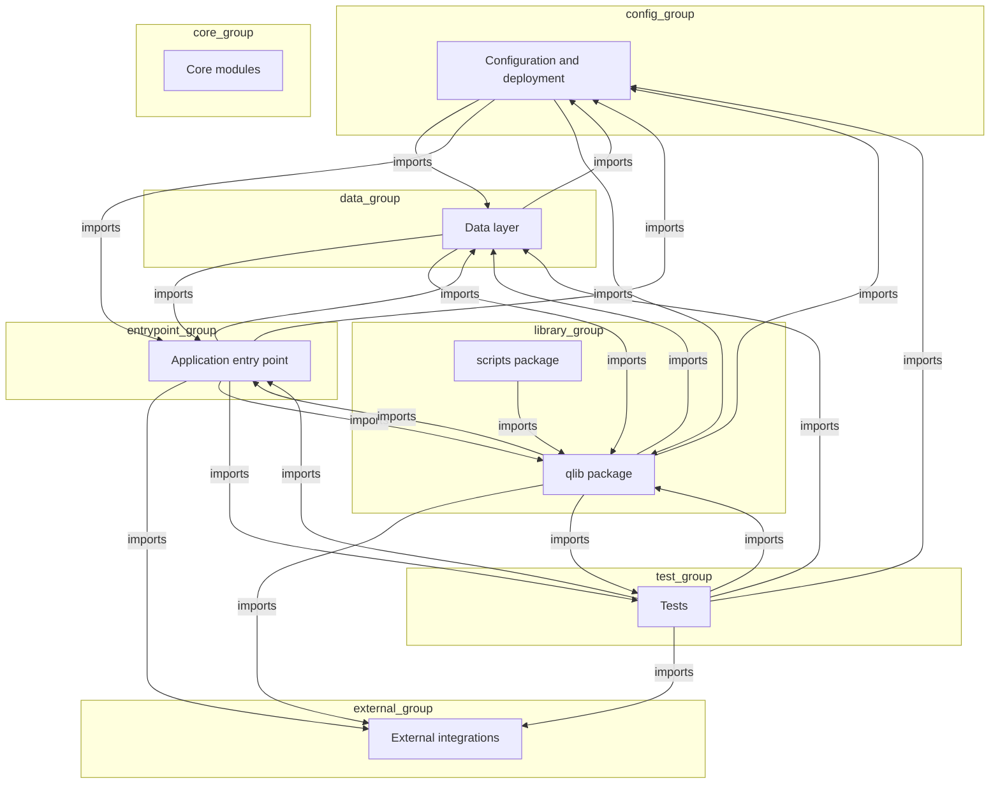

# Architecture report: microsoft/qlib

> Automated static analysis. **Observed** = directly seen in files/imports/AST; **Inferred** = interpretation from that evidence. Repository code was not executed.

## 1. Repository at a glance

| Item | Value |
| --- | --- |
| Repository | microsoft/qlib |
| Description | Qlib is an AI-oriented Quant investment platform that aims to use AI tech to empower Quant Research, from exploring ideas to implementing productions. Qlib supports diverse ML modeling paradigms, including supervised learning, market dynamics modeling, and RL, and is now equipped with https://githu… |
| Language | Python |
| Stars | 50283 |
| Licence | MIT |
| Analysed commit / branch | 54355232463878d2eebb91fe0ee5fa7fa1f5976c / main |
| Framework(s) | None detected |
| Files analysed | 600 |
| Components | 8 |

## 2. Architecture in one minute

microsoft/qlib - Qlib is an AI-oriented Quant investment platform that aims to use AI tech to empower Quant Research, from exploring ideas to implementing productions. Qlib supports diverse ML modeling paradigms, inc…. This repository was analysed statically from 600 file(s) (349 Python). Detected technologies (observed from imports/manifests): GitHub Actions, MongoDB, Redis, NumPy, pandas, requests. Files are grouped into 8 component(s): Configuration and deployment, Core modules, Data layer, Application entry point, External integrations, qlib package, scripts package, Tests. Observed entry point(s): qlib/cli/data.py, qlib/cli/run.py, qlib/contrib/data/utils/sepdf.py. Findings below distinguish observed facts from inferred interpretation.

## 3. High-level block diagram

## 4. Main components

### Configuration and deployment (`config`)

- **Kind:** config
- **Status:** Observed
- **Confidence:** 0.85
- **Responsibility:** Groups 16 file(s) under configuration and deployment (observed from repository paths and static analysis). Observed top-level classes: Config, MLflowSettings, OptimizationConfig, PipelineExperimentConfig, QSettings, QlibConfig.
- **Paths:** `Dockerfile`, `MANIFEST.in`, `package.json`, `pyproject.toml`, `qlib/config.py`, `qlib/contrib/tuner/config.py`, `scripts/data_collector/baostock_5min/requirements.txt`, `scripts/data_collector/br_index/requirements.txt`, `scripts/data_collector/cn_index/requirements.txt`, `scripts/data_collector/contrib/fill_cn_1min_data/requirements.txt`, `scripts/data_collector/contrib/future_trading_date_collector/requirements.txt`, `scripts/data_collector/fund/requirements.txt`, `scripts/data_collector/pit/requirements.txt`, `scripts/data_collector/us_index/requirements.txt`, `scripts/data_collector/yahoo/requirements.txt`, `setup.py`
- **Evidence:** [Dockerfile](https://github.com/microsoft/qlib/blob/54355232463878d2eebb91fe0ee5fa7fa1f5976c/Dockerfile); [MANIFEST.in](https://github.com/microsoft/qlib/blob/54355232463878d2eebb91fe0ee5fa7fa1f5976c/MANIFEST.in); [package.json](https://github.com/microsoft/qlib/blob/54355232463878d2eebb91fe0ee5fa7fa1f5976c/package.json); [pyproject.toml](https://github.com/microsoft/qlib/blob/54355232463878d2eebb91fe0ee5fa7fa1f5976c/pyproject.toml); [qlib/config.py:34](https://github.com/microsoft/qlib/blob/54355232463878d2eebb91fe0ee5fa7fa1f5976c/qlib/config.py#L34); [qlib/contrib/tuner/config.py:12](https://github.com/microsoft/qlib/blob/54355232463878d2eebb91fe0ee5fa7fa1f5976c/qlib/contrib/tuner/config.py#L12); [scripts/data_collector/baostock_5min/requirements.txt](https://github.com/microsoft/qlib/blob/54355232463878d2eebb91fe0ee5fa7fa1f5976c/scripts/data_collector/baostock_5min/requirements.txt); [scripts/data_collector/br_index/requirements.txt](https://github.com/microsoft/qlib/blob/54355232463878d2eebb91fe0ee5fa7fa1f5976c/scripts/data_collector/br_index/requirements.txt)

### Core modules (`core`)

- **Kind:** core
- **Status:** Observed
- **Confidence:** 0.85
- **Responsibility:** Groups 1 file(s) under core modules (observed from repository paths and static analysis).
- **Paths:** `build_docker_image.sh`
- **Evidence:** [build_docker_image.sh](https://github.com/microsoft/qlib/blob/54355232463878d2eebb91fe0ee5fa7fa1f5976c/build_docker_image.sh)

### Data layer (`data_layer`)

- **Kind:** data
- **Status:** Observed
- **Confidence:** 0.85
- **Responsibility:** Groups 41 file(s) under data layer (observed from repository paths and static analysis). Observed top-level classes: Abs, Add, Alpha158, Alpha158DL, Alpha158vwap, Alpha360. Observed top-level functions: _check_scalar, _check_size, _constant_arithmetic, _create_ts_slices, _evaluate, _find_pickle.
- **Paths:** `qlib/contrib/data/__init__.py`, `qlib/contrib/data/data.py`, `qlib/contrib/data/dataset.py`, `qlib/contrib/data/handler.py`, `qlib/contrib/data/highfreq_handler.py`, `qlib/contrib/data/highfreq_processor.py`, `qlib/contrib/data/highfreq_provider.py`, `qlib/contrib/data/loader.py`, `qlib/contrib/data/processor.py`, `qlib/contrib/data/utils/__init__.py`, `qlib/contrib/meta/data_selection/model.py`, `qlib/contrib/report/data/__init__.py`, `qlib/contrib/report/data/ana.py`, `qlib/contrib/report/data/base.py`, `qlib/data/__init__.py`, `qlib/data/_libs/__init__.py`, `qlib/data/base.py`, `qlib/data/cache.py`, `qlib/data/client.py`, `qlib/data/data.py`, `qlib/data/dataset/__init__.py`, `qlib/data/dataset/handler.py`, `qlib/data/dataset/loader.py`, `qlib/data/dataset/processor.py`, `qlib/data/dataset/storage.py`, `qlib/data/dataset/utils.py`, `qlib/data/dataset/weight.py`, `qlib/data/expression_parser.py`, `qlib/data/filter.py`, `qlib/data/inst_processor.py`, `qlib/data/ops.py`, `qlib/data/pit.py`, `qlib/data/storage/__init__.py`, `qlib/data/storage/file_storage.py`, `qlib/data/storage/storage.py`, `qlib/model/meta/model.py`, `qlib/rl/data/__init__.py`, `qlib/rl/data/base.py`, `qlib/rl/data/integration.py`, `qlib/rl/data/native.py`, `qlib/rl/data/pickle_styled.py`
- **Evidence:** [qlib/contrib/data/__init__.py](https://github.com/microsoft/qlib/blob/54355232463878d2eebb91fe0ee5fa7fa1f5976c/qlib/contrib/data/__init__.py); [qlib/contrib/data/data.py:19](https://github.com/microsoft/qlib/blob/54355232463878d2eebb91fe0ee5fa7fa1f5976c/qlib/contrib/data/data.py#L19); [qlib/contrib/data/dataset.py:17](https://github.com/microsoft/qlib/blob/54355232463878d2eebb91fe0ee5fa7fa1f5976c/qlib/contrib/data/dataset.py#L17); [qlib/contrib/data/handler.py:12](https://github.com/microsoft/qlib/blob/54355232463878d2eebb91fe0ee5fa7fa1f5976c/qlib/contrib/data/handler.py#L12); [qlib/contrib/data/highfreq_handler.py:8](https://github.com/microsoft/qlib/blob/54355232463878d2eebb91fe0ee5fa7fa1f5976c/qlib/contrib/data/highfreq_handler.py#L8); [qlib/contrib/data/highfreq_processor.py:10](https://github.com/microsoft/qlib/blob/54355232463878d2eebb91fe0ee5fa7fa1f5976c/qlib/contrib/data/highfreq_processor.py#L10); [qlib/contrib/data/highfreq_provider.py:20](https://github.com/microsoft/qlib/blob/54355232463878d2eebb91fe0ee5fa7fa1f5976c/qlib/contrib/data/highfreq_provider.py#L20); [qlib/contrib/data/loader.py:4](https://github.com/microsoft/qlib/blob/54355232463878d2eebb91fe0ee5fa7fa1f5976c/qlib/contrib/data/loader.py#L4)

### Application entry point (`entrypoint`)

- **Kind:** entrypoint
- **Status:** Observed
- **Confidence:** 0.85
- **Responsibility:** Groups 30 file(s) under application entry point (observed from repository paths and static analysis). Observed top-level classes: BaostockCollectorHS3005min, BaostockNormalizeHS3005min, CSI100Index, CSI300Index, CSI500Index, CSIIndex. Observed top-level functions: _convert_indicator_to_dataframe, _generate_report, _get_all_1d_data, _get_multi_level_executor_config, _isinstance, _read_orders.
- **Paths:** `qlib/cli/data.py`, `qlib/cli/run.py`, `qlib/contrib/data/utils/sepdf.py`, `qlib/contrib/evaluate.py`, `qlib/contrib/model/catboost_model.py`, `qlib/contrib/online/operator.py`, `qlib/contrib/rolling/__main__.py`, `qlib/contrib/rolling/base.py`, `qlib/rl/contrib/backtest.py`, `qlib/rl/contrib/train_onpolicy.py`, `qlib/utils/time.py`, `qlib/workflow/task/manage.py`, `scripts/check_data_health.py`, `scripts/check_dump_bin.py`, `scripts/collect_info.py`, `scripts/data_collector/baostock_5min/collector.py`, `scripts/data_collector/br_index/collector.py`, `scripts/data_collector/cn_index/collector.py`, `scripts/data_collector/contrib/fill_cn_1min_data/fill_cn_1min_data.py`, `scripts/data_collector/contrib/future_trading_date_collector/future_trading_date_collector.py`, `scripts/data_collector/crypto/collector.py`, `scripts/data_collector/fund/collector.py`, `scripts/data_collector/future_calendar_collector.py`, `scripts/data_collector/pit/collector.py`, `scripts/data_collector/us_index/collector.py`, `scripts/data_collector/utils.py`, `scripts/data_collector/yahoo/collector.py`, `scripts/dump_bin.py`, `scripts/dump_pit.py`, `scripts/get_data.py`
- **Evidence:** [qlib/cli/data.py](https://github.com/microsoft/qlib/blob/54355232463878d2eebb91fe0ee5fa7fa1f5976c/qlib/cli/data.py); [qlib/cli/run.py:23](https://github.com/microsoft/qlib/blob/54355232463878d2eebb91fe0ee5fa7fa1f5976c/qlib/cli/run.py#L23); [qlib/contrib/data/utils/sepdf.py:7](https://github.com/microsoft/qlib/blob/54355232463878d2eebb91fe0ee5fa7fa1f5976c/qlib/contrib/data/utils/sepdf.py#L7); [qlib/contrib/evaluate.py:26](https://github.com/microsoft/qlib/blob/54355232463878d2eebb91fe0ee5fa7fa1f5976c/qlib/contrib/evaluate.py#L26); [qlib/contrib/model/catboost_model.py:17](https://github.com/microsoft/qlib/blob/54355232463878d2eebb91fe0ee5fa7fa1f5976c/qlib/contrib/model/catboost_model.py#L17); [qlib/contrib/online/operator.py:27](https://github.com/microsoft/qlib/blob/54355232463878d2eebb91fe0ee5fa7fa1f5976c/qlib/contrib/online/operator.py#L27); [qlib/contrib/rolling/__main__.py](https://github.com/microsoft/qlib/blob/54355232463878d2eebb91fe0ee5fa7fa1f5976c/qlib/contrib/rolling/__main__.py); [qlib/contrib/rolling/base.py:24](https://github.com/microsoft/qlib/blob/54355232463878d2eebb91fe0ee5fa7fa1f5976c/qlib/contrib/rolling/base.py#L24)

### External integrations (`external_integrations`)

- **Kind:** external
- **Status:** Inferred
- **Confidence:** 0.70
- **Responsibility:** Groups 0 file(s) under external integrations (observed from repository paths and static analysis).
- **Evidence:** [examples/orderbook_data/create_dataset.py:28](https://github.com/microsoft/qlib/blob/54355232463878d2eebb91fe0ee5fa7fa1f5976c/examples/orderbook_data/create_dataset.py#L28); [qlib/contrib/data/data.py:14](https://github.com/microsoft/qlib/blob/54355232463878d2eebb91fe0ee5fa7fa1f5976c/qlib/contrib/data/data.py#L14); [qlib/model/trainer.py:14](https://github.com/microsoft/qlib/blob/54355232463878d2eebb91fe0ee5fa7fa1f5976c/qlib/model/trainer.py#L14); [qlib/tests/data.py:10](https://github.com/microsoft/qlib/blob/54355232463878d2eebb91fe0ee5fa7fa1f5976c/qlib/tests/data.py#L10); [qlib/utils/__init__.py:13](https://github.com/microsoft/qlib/blob/54355232463878d2eebb91fe0ee5fa7fa1f5976c/qlib/utils/__init__.py#L13); [qlib/utils/__init__.py:20](https://github.com/microsoft/qlib/blob/54355232463878d2eebb91fe0ee5fa7fa1f5976c/qlib/utils/__init__.py#L20)

### qlib package (`qlib`)

- **Kind:** library
- **Status:** Observed
- **Confidence:** 0.85
- **Responsibility:** Groups 174 file(s) under qlib package (observed from repository paths and static analysis). Observed top-level classes: ACRecordTemp, ACStrategy, ADARNN, ADD, ADDModel, ALSTM. Observed top-level functions: CORAL, _add_bench_to_position, _add_label_to_position, _calculate_label_rank, _calculate_maximum, _calculate_mdd.
- **Paths:** `qlib/__init__.py`, `qlib/backtest/__init__.py`, `qlib/backtest/account.py`, `qlib/backtest/backtest.py`, `qlib/backtest/decision.py`, `qlib/backtest/exchange.py`, `qlib/backtest/executor.py`, `qlib/backtest/high_performance_ds.py`, `qlib/backtest/position.py`, `qlib/backtest/profit_attribution.py`, `qlib/backtest/report.py`, `qlib/backtest/signal.py`, `qlib/backtest/utils.py`, `qlib/cli/__init__.py`, `qlib/constant.py`, `qlib/contrib/__init__.py`, `qlib/contrib/eva/__init__.py`, `qlib/contrib/eva/alpha.py`, `qlib/contrib/evaluate_portfolio.py`, `qlib/contrib/meta/__init__.py`, `qlib/contrib/meta/data_selection/__init__.py`, `qlib/contrib/meta/data_selection/dataset.py`, `qlib/contrib/meta/data_selection/net.py`, `qlib/contrib/meta/data_selection/utils.py`, `qlib/contrib/model/__init__.py`, `qlib/contrib/model/double_ensemble.py`, `qlib/contrib/model/gbdt.py`, `qlib/contrib/model/highfreq_gdbt_model.py`, `qlib/contrib/model/linear.py`, `qlib/contrib/model/pytorch_adarnn.py`, `qlib/contrib/model/pytorch_add.py`, `qlib/contrib/model/pytorch_alstm.py`, `qlib/contrib/model/pytorch_alstm_ts.py`, `qlib/contrib/model/pytorch_gats.py`, `qlib/contrib/model/pytorch_gats_ts.py`, `qlib/contrib/model/pytorch_general_nn.py`, `qlib/contrib/model/pytorch_gru.py`, `qlib/contrib/model/pytorch_gru_ts.py`, `qlib/contrib/model/pytorch_hist.py`, `qlib/contrib/model/pytorch_igmtf.py`, `qlib/contrib/model/pytorch_krnn.py`, `qlib/contrib/model/pytorch_localformer.py`, `qlib/contrib/model/pytorch_localformer_ts.py`, `qlib/contrib/model/pytorch_lstm.py`, `qlib/contrib/model/pytorch_lstm_ts.py`, `qlib/contrib/model/pytorch_nn.py`, `qlib/contrib/model/pytorch_sandwich.py`, `qlib/contrib/model/pytorch_sfm.py`, `qlib/contrib/model/pytorch_tabnet.py`, `qlib/contrib/model/pytorch_tcn.py`, `qlib/contrib/model/pytorch_tcn_ts.py`, `qlib/contrib/model/pytorch_tcts.py`, `qlib/contrib/model/pytorch_tra.py`, `qlib/contrib/model/pytorch_transformer.py`, `qlib/contrib/model/pytorch_transformer_ts.py`, `qlib/contrib/model/pytorch_utils.py`, `qlib/contrib/model/tcn.py`, `qlib/contrib/model/xgboost.py`, `qlib/contrib/online/__init__.py`, `qlib/contrib/online/manager.py`, `qlib/contrib/online/online_model.py`, `qlib/contrib/online/user.py`, `qlib/contrib/online/utils.py`, `qlib/contrib/ops/__init__.py`, `qlib/contrib/ops/high_freq.py`, `qlib/contrib/report/__init__.py`, `qlib/contrib/report/analysis_model/__init__.py`, `qlib/contrib/report/analysis_model/analysis_model_performance.py`, `qlib/contrib/report/analysis_position/__init__.py`, `qlib/contrib/report/analysis_position/cumulative_return.py`, `qlib/contrib/report/analysis_position/parse_position.py`, `qlib/contrib/report/analysis_position/rank_label.py`, `qlib/contrib/report/analysis_position/report.py`, `qlib/contrib/report/analysis_position/risk_analysis.py`, `qlib/contrib/report/analysis_position/score_ic.py`, `qlib/contrib/report/graph.py`, `qlib/contrib/report/utils.py`, `qlib/contrib/rolling/__init__.py`, `qlib/contrib/rolling/ddgda.py`, `qlib/contrib/strategy/__init__.py`, `qlib/contrib/strategy/cost_control.py`, `qlib/contrib/strategy/optimizer/__init__.py`, `qlib/contrib/strategy/optimizer/base.py`, `qlib/contrib/strategy/optimizer/enhanced_indexing.py`, `qlib/contrib/strategy/optimizer/optimizer.py`, `qlib/contrib/strategy/order_generator.py`, `qlib/contrib/strategy/rule_strategy.py`, `qlib/contrib/strategy/signal_strategy.py`, `qlib/contrib/torch.py`, `qlib/contrib/tuner/__init__.py`, `qlib/contrib/tuner/launcher.py`, `qlib/contrib/tuner/pipeline.py`, `qlib/contrib/tuner/space.py`, `qlib/contrib/tuner/tuner.py`, `qlib/contrib/workflow/__init__.py`, `qlib/contrib/workflow/record_temp.py`, `qlib/log.py`, `qlib/model/__init__.py`, `qlib/model/base.py`, `qlib/model/ens/__init__.py`, `qlib/model/ens/ensemble.py`, `qlib/model/ens/group.py`, `qlib/model/interpret/__init__.py`, `qlib/model/interpret/base.py`, `qlib/model/meta/__init__.py`, `qlib/model/meta/dataset.py`, `qlib/model/meta/task.py`, `qlib/model/riskmodel/__init__.py`, `qlib/model/riskmodel/base.py`, `qlib/model/riskmodel/poet.py`, `qlib/model/riskmodel/shrink.py`, `qlib/model/riskmodel/structured.py`, `qlib/model/trainer.py`, `qlib/model/utils.py`, `qlib/rl/__init__.py`, `qlib/rl/aux_info.py`, `qlib/rl/contrib/__init__.py`, `qlib/rl/contrib/naive_config_parser.py`, `qlib/rl/contrib/utils.py`, `qlib/rl/interpreter.py`, `qlib/rl/order_execution/__init__.py`, `qlib/rl/order_execution/interpreter.py`, `qlib/rl/order_execution/network.py`, `qlib/rl/order_execution/policy.py`, `qlib/rl/order_execution/reward.py`, `qlib/rl/order_execution/simulator_qlib.py`, `qlib/rl/order_execution/simulator_simple.py`, `qlib/rl/order_execution/state.py`, `qlib/rl/order_execution/strategy.py`, `qlib/rl/order_execution/utils.py`, `qlib/rl/reward.py`, `qlib/rl/seed.py`, `qlib/rl/simulator.py`, `qlib/rl/strategy/__init__.py`, `qlib/rl/strategy/single_order.py`, `qlib/rl/trainer/__init__.py`, `qlib/rl/trainer/api.py`, `qlib/rl/trainer/callbacks.py`, `qlib/rl/trainer/trainer.py`, `qlib/rl/trainer/vessel.py`, `qlib/rl/utils/__init__.py`, `qlib/rl/utils/data_queue.py`, `qlib/rl/utils/env_wrapper.py`, `qlib/rl/utils/finite_env.py`, `qlib/rl/utils/log.py`, `qlib/strategy/__init__.py`, `qlib/strategy/base.py`, `qlib/typehint.py`, `qlib/utils/__init__.py`, `qlib/utils/data.py`, `qlib/utils/exceptions.py`, `qlib/utils/file.py`, `qlib/utils/index_data.py`, `qlib/utils/mod.py`, `qlib/utils/objm.py`, `qlib/utils/paral.py`, `qlib/utils/pickle_utils.py`, `qlib/utils/resam.py`, `qlib/utils/serial.py`, `qlib/workflow/__init__.py`, `qlib/workflow/exp.py`, `qlib/workflow/expm.py`, `qlib/workflow/online/__init__.py`, `qlib/workflow/online/manager.py`, `qlib/workflow/online/strategy.py`, `qlib/workflow/online/update.py`, `qlib/workflow/online/utils.py`, `qlib/workflow/record_temp.py`, `qlib/workflow/recorder.py`, `qlib/workflow/task/__init__.py`, `qlib/workflow/task/collect.py`, `qlib/workflow/task/gen.py`, `qlib/workflow/task/utils.py`, `qlib/workflow/utils.py`
- **Evidence:** [qlib/__init__.py:25](https://github.com/microsoft/qlib/blob/54355232463878d2eebb91fe0ee5fa7fa1f5976c/qlib/__init__.py#L25); [qlib/backtest/__init__.py:33](https://github.com/microsoft/qlib/blob/54355232463878d2eebb91fe0ee5fa7fa1f5976c/qlib/backtest/__init__.py#L33); [qlib/backtest/account.py:35](https://github.com/microsoft/qlib/blob/54355232463878d2eebb91fe0ee5fa7fa1f5976c/qlib/backtest/account.py#L35); [qlib/backtest/backtest.py:25](https://github.com/microsoft/qlib/blob/54355232463878d2eebb91fe0ee5fa7fa1f5976c/qlib/backtest/backtest.py#L25); [qlib/backtest/decision.py:30](https://github.com/microsoft/qlib/blob/54355232463878d2eebb91fe0ee5fa7fa1f5976c/qlib/backtest/decision.py#L30); [qlib/backtest/exchange.py:28](https://github.com/microsoft/qlib/blob/54355232463878d2eebb91fe0ee5fa7fa1f5976c/qlib/backtest/exchange.py#L28); [qlib/backtest/executor.py:22](https://github.com/microsoft/qlib/blob/54355232463878d2eebb91fe0ee5fa7fa1f5976c/qlib/backtest/executor.py#L22); [qlib/backtest/high_performance_ds.py:23](https://github.com/microsoft/qlib/blob/54355232463878d2eebb91fe0ee5fa7fa1f5976c/qlib/backtest/high_performance_ds.py#L23)

### scripts package (`scripts`)

- **Kind:** library
- **Status:** Observed
- **Confidence:** 0.85
- **Responsibility:** Groups 2 file(s) under scripts package (observed from repository paths and static analysis). Observed top-level classes: BaseCollector, BaseNormalize, BaseRun, IndexBase, Normalize.
- **Paths:** `scripts/data_collector/base.py`, `scripts/data_collector/index.py`
- **Evidence:** [scripts/data_collector/base.py:20](https://github.com/microsoft/qlib/blob/54355232463878d2eebb91fe0ee5fa7fa1f5976c/scripts/data_collector/base.py#L20); [scripts/data_collector/index.py:17](https://github.com/microsoft/qlib/blob/54355232463878d2eebb91fe0ee5fa7fa1f5976c/scripts/data_collector/index.py#L17)

### Tests (`tests`)

- **Kind:** test
- **Status:** Observed
- **Confidence:** 0.85
- **Responsibility:** Groups 59 file(s) under tests (observed from repository paths and static analysis). Observed top-level classes: AccReward, AnyPolicy, DataUtils, Diff, Distance, DoNothingTracker. Observed top-level functions: _assert_rejects_without_execution, _check_artifacts, _entry_points, _facade, _finish_delayed, _finite_env_factory.
- **Paths:** `qlib/tests/__init__.py`, `qlib/tests/config.py`, `qlib/tests/data.py`, `qlib/tests/test_config_validation.py`, `tests/backtest/test_file_strategy.py`, `tests/backtest/test_high_freq_trading.py`, `tests/backtest/test_soft_topk_strategy.py`, `tests/backtest/test_soft_topk_strategy_cold_start.py`, `tests/conftest.py`, `tests/data_mid_layer_tests/README.md`, `tests/data_mid_layer_tests/test_dataloader.py`, `tests/data_mid_layer_tests/test_dataset.py`, `tests/data_mid_layer_tests/test_handler.py`, `tests/data_mid_layer_tests/test_handler_storage.py`, `tests/data_mid_layer_tests/test_processor.py`, `tests/dataset_tests/README.md`, `tests/dataset_tests/test_datalayer.py`, `tests/dependency_tests/README.md`, `tests/dependency_tests/test_mlflow.py`, `tests/misc/test_get_multi_proc.py`, `tests/misc/test_index_data.py`, `tests/misc/test_sepdf.py`, `tests/misc/test_utils.py`, `tests/model/test_general_nn.py`, `tests/model/test_hist_workflow.py`, `tests/ops/test_elem_operator.py`, `tests/ops/test_expression_compatibility.py`, `tests/ops/test_special_ops.py`, `tests/pytest.ini`, `tests/rl/test_data_queue.py`, `tests/rl/test_finite_env.py`, `tests/rl/test_logger.py`, `tests/rl/test_qlib_simulator.py`, `tests/rl/test_saoe_simple.py`, `tests/rl/test_trainer.py`, `tests/rolling_tests/test_ddgda.py`, `tests/rolling_tests/test_update_pred.py`, `tests/security/test_artifact_reader_trust.py`, `tests/security/test_artifact_trust_api.py`, `tests/security/test_eval_registries.py`, `tests/security/test_expression_parser.py`, `tests/security/test_highfreq_artifact_paths.py`, `tests/security/test_hist_artifacts.py`, `tests/security/test_mlflow_artifacts.py`, `tests/security/test_module_loading.py`, `tests/security/test_pickle_utils.py`, `tests/security/test_workflow_artifact_trust.py`, `tests/storage_tests/test_storage.py`, `tests/test_all_pipeline.py`, `tests/test_ci_configuration.py`, `tests/test_contrib_model.py`, `tests/test_contrib_workflow.py`, `tests/test_dump_data.py`, `tests/test_get_data.py`, `tests/test_pit.py`, `tests/test_register_ops.py`, `tests/test_structured_cov_estimator.py`, `tests/test_tra_example.py`, `tests/test_workflow.py`
- **Evidence:** [qlib/tests/__init__.py:16](https://github.com/microsoft/qlib/blob/54355232463878d2eebb91fe0ee5fa7fa1f5976c/qlib/tests/__init__.py#L16); [qlib/tests/config.py:53](https://github.com/microsoft/qlib/blob/54355232463878d2eebb91fe0ee5fa7fa1f5976c/qlib/tests/config.py#L53); [qlib/tests/data.py:18](https://github.com/microsoft/qlib/blob/54355232463878d2eebb91fe0ee5fa7fa1f5976c/qlib/tests/data.py#L18); [qlib/tests/test_config_validation.py:6](https://github.com/microsoft/qlib/blob/54355232463878d2eebb91fe0ee5fa7fa1f5976c/qlib/tests/test_config_validation.py#L6); [tests/backtest/test_file_strategy.py:15](https://github.com/microsoft/qlib/blob/54355232463878d2eebb91fe0ee5fa7fa1f5976c/tests/backtest/test_file_strategy.py#L15); [tests/backtest/test_high_freq_trading.py:12](https://github.com/microsoft/qlib/blob/54355232463878d2eebb91fe0ee5fa7fa1f5976c/tests/backtest/test_high_freq_trading.py#L12); [tests/backtest/test_soft_topk_strategy.py:6](https://github.com/microsoft/qlib/blob/54355232463878d2eebb91fe0ee5fa7fa1f5976c/tests/backtest/test_soft_topk_strategy.py#L6); [tests/backtest/test_soft_topk_strategy_cold_start.py:7](https://github.com/microsoft/qlib/blob/54355232463878d2eebb91fe0ee5fa7fa1f5976c/tests/backtest/test_soft_topk_strategy_cold_start.py#L7)

## 5. Execution flow

**Observed** entry point(s):

- [qlib/cli/data.py:7](https://github.com/microsoft/qlib/blob/54355232463878d2eebb91fe0ee5fa7fa1f5976c/qlib/cli/data.py#L7)
- [qlib/cli/run.py](https://github.com/microsoft/qlib/blob/54355232463878d2eebb91fe0ee5fa7fa1f5976c/qlib/cli/run.py)
- [qlib/contrib/data/utils/sepdf.py:207](https://github.com/microsoft/qlib/blob/54355232463878d2eebb91fe0ee5fa7fa1f5976c/qlib/contrib/data/utils/sepdf.py#L207)
- [qlib/contrib/evaluate.py:418](https://github.com/microsoft/qlib/blob/54355232463878d2eebb91fe0ee5fa7fa1f5976c/qlib/contrib/evaluate.py#L418)
- [qlib/contrib/model/catboost_model.py:99](https://github.com/microsoft/qlib/blob/54355232463878d2eebb91fe0ee5fa7fa1f5976c/qlib/contrib/model/catboost_model.py#L99)
- [qlib/contrib/online/operator.py:319](https://github.com/microsoft/qlib/blob/54355232463878d2eebb91fe0ee5fa7fa1f5976c/qlib/contrib/online/operator.py#L319)
- [qlib/contrib/rolling/__main__.py:6](https://github.com/microsoft/qlib/blob/54355232463878d2eebb91fe0ee5fa7fa1f5976c/qlib/contrib/rolling/__main__.py#L6)
- [qlib/contrib/rolling/base.py:262](https://github.com/microsoft/qlib/blob/54355232463878d2eebb91fe0ee5fa7fa1f5976c/qlib/contrib/rolling/base.py#L262)
- [qlib/rl/contrib/backtest.py:360](https://github.com/microsoft/qlib/blob/54355232463878d2eebb91fe0ee5fa7fa1f5976c/qlib/rl/contrib/backtest.py#L360)
- [qlib/rl/contrib/train_onpolicy.py:255](https://github.com/microsoft/qlib/blob/54355232463878d2eebb91fe0ee5fa7fa1f5976c/qlib/rl/contrib/train_onpolicy.py#L255)
- [qlib/utils/time.py:376](https://github.com/microsoft/qlib/blob/54355232463878d2eebb91fe0ee5fa7fa1f5976c/qlib/utils/time.py#L376)
- [qlib/workflow/task/manage.py:554](https://github.com/microsoft/qlib/blob/54355232463878d2eebb91fe0ee5fa7fa1f5976c/qlib/workflow/task/manage.py#L554)

Representative flow (derived from observed entry points and the import graph; steps beyond the entry point are **Inferred**):

1. Execution starts at an observed entry point listed above, if present.
2. `config` imports `data_layer` (Configuration and deployment -> Data layer).
3. `config` imports `entrypoint` (Configuration and deployment -> Application entry point).
4. `config` imports `qlib` (Configuration and deployment -> qlib package).
5. `data_layer` imports `config` (Data layer -> Configuration and deployment).
6. `data_layer` imports `entrypoint` (Data layer -> Application entry point).
7. `data_layer` imports `qlib` (Data layer -> qlib package).
8. `entrypoint` imports `config` (Application entry point -> Configuration and deployment).
9. `entrypoint` imports `data_layer` (Application entry point -> Data layer).

## 6. Project structure

### `(root)`

- `.commitlintrc.js` - source, JavaScript (928 bytes)
- `.deepsource.toml` - config (179 bytes)
- `.dockerignore` - container (49 bytes)
- `.gitignore` - other (636 bytes)
- `.mypy.ini` - config (359 bytes)
- `.pre-commit-config.yaml` - config (278 bytes)
- `.pylintrc` - other (218 bytes)
- `.readthedocs.yaml` - config (574 bytes)
- `CHANGELOG.md` - docs (1581 bytes)
- `CHANGES.rst` - docs (9780 bytes)
- `CODE_OF_CONDUCT.md` - docs (444 bytes)
- `Dockerfile` - container (796 bytes)
- `LICENSE` - docs (1141 bytes)
- `MANIFEST.in` - manifest (111 bytes)
- `Makefile` - other (9426 bytes)
- `README.md` - docs (44277 bytes)
- `SECURITY.md` - docs (2780 bytes)
- `build_docker_image.sh` - source, Shell (1069 bytes)
- `package.json` - manifest (267 bytes)
- `pyproject.toml` - manifest (3861 bytes)
- `setup.py` - manifest, Python (509 bytes)

### `.github`

- `.github/ISSUE_TEMPLATE/bug-report.md` - docs (835 bytes)
- `.github/ISSUE_TEMPLATE/documentation.md` - docs (204 bytes)
- `.github/ISSUE_TEMPLATE/feature-request.md` - docs (592 bytes)
- `.github/ISSUE_TEMPLATE/question.md` - docs (396 bytes)
- `.github/PULL_REQUEST_TEMPLATE.md` - docs (2310 bytes)
- `.github/brew_install.sh` - source, Shell (18880 bytes)
- `.github/ci/README.md` - docs (8108 bytes)
- `.github/ci/constraints.txt` - docs (939 bytes)
- `.github/ci/test-requirements.txt` - docs (330 bytes)
- `.github/dependabot.yml` - config (274 bytes)
- `.github/release-drafter.yml` - config (736 bytes)
- `.github/workflows/lint_title.yml` - ci, YAML (969 bytes)
- `.github/workflows/release.yml` - ci, YAML (3806 bytes)
- `.github/workflows/stale.yml` - ci, YAML (936 bytes)
- `.github/workflows/test_qlib_from_pip.yml` - ci, YAML (3115 bytes)
- `.github/workflows/test_qlib_from_source.yml` - ci, YAML (6300 bytes)
- `.github/workflows/test_qlib_from_source_slow.yml` - ci, YAML (3901 bytes)

### `docs`

- `docs/FAQ/FAQ.rst` - docs (6419 bytes)
- `docs/Makefile` - docs (643 bytes)
- `docs/_static/demo.sh` - docs (248 bytes)
- `docs/_static/img/framework.svg` - docs (147743 bytes)
- `docs/advanced/PIT.rst` - docs (7298 bytes)
- `docs/advanced/alpha.rst` - docs (8278 bytes)
- `docs/advanced/serial.rst` - docs (2546 bytes)
- `docs/advanced/server.rst` - docs (1117 bytes)
- `docs/advanced/task_management.rst` - docs (7120 bytes)
- `docs/changelog/changelog.rst` - docs (31 bytes)
- `docs/component/data.rst` - docs (27916 bytes)
- `docs/component/highfreq.rst` - docs (4213 bytes)
- `docs/component/meta.rst` - docs (3819 bytes)
- `docs/component/model.rst` - docs (5979 bytes)
- `docs/component/online.rst` - docs (3512 bytes)
- `docs/component/recorder.rst` - docs (7866 bytes)
- `docs/component/report.rst` - docs (12833 bytes)
- `docs/component/rl/framework.rst` - docs (4697 bytes)
- `docs/component/rl/guidance.rst` - docs (4398 bytes)
- `docs/component/rl/overall.rst` - docs (8059 bytes)
- `docs/component/rl/quickstart.rst` - docs (7642 bytes)
- `docs/component/rl/toctree.rst` - docs (317 bytes)
- `docs/component/strategy.rst` - docs (14358 bytes)
- `docs/component/workflow.rst` - docs (13121 bytes)
- `docs/conf.py` - docs (6646 bytes)
- `docs/developer/code_standard_and_dev_guide.rst` - docs (2478 bytes)
- `docs/developer/how_to_build_image.rst` - docs (2573 bytes)
- `docs/hidden/client.rst` - docs (8415 bytes)
- `docs/hidden/online.rst` - docs (8922 bytes)
- `docs/hidden/tuner.rst` - docs (14847 bytes)
- `docs/index.rst` - docs (2322 bytes)
- `docs/introduction/introduction.rst` - docs (4210 bytes)
- `docs/introduction/quick.rst` - docs (3948 bytes)
- `docs/make.bat` - docs (800 bytes)
- `docs/reference/api.rst` - docs (4313 bytes)
- `docs/requirements.txt` - manifest (71 bytes)
- `docs/start/artifact_migration.rst` - docs (26528 bytes)
- `docs/start/config_migration.rst` - docs (12895 bytes)
- `docs/start/getdata.rst` - docs (6449 bytes)
- `docs/start/initialization.rst` - docs (6008 bytes)
- `docs/start/installation.rst` - docs (2143 bytes)
- `docs/start/integration.rst` - docs (7973 bytes)

### `examples`

- `examples/README.md` - docs (5130 bytes)
- `examples/benchmarks/ADARNN/README.md` - docs (283 bytes)
- `examples/benchmarks/ADARNN/requirements.txt` - manifest (62 bytes)
- `examples/benchmarks/ADARNN/workflow_config_adarnn_Alpha360.yaml` - config (2497 bytes)
- `examples/benchmarks/ADD/README.md` - docs (145 bytes)
- `examples/benchmarks/ADD/requirements.txt` - manifest (62 bytes)
- `examples/benchmarks/ADD/workflow_config_add_Alpha360.yaml` - config (2620 bytes)
- `examples/benchmarks/ALSTM/README.md` - docs (402 bytes)
- `examples/benchmarks/ALSTM/requirements.txt` - manifest (62 bytes)
- `examples/benchmarks/ALSTM/workflow_config_alstm_Alpha158.yaml` - config (2953 bytes)
- `examples/benchmarks/ALSTM/workflow_config_alstm_Alpha360.yaml` - config (2521 bytes)
- `examples/benchmarks/CatBoost/README.md` - docs (343 bytes)
- `examples/benchmarks/CatBoost/requirements.txt` - manifest (45 bytes)
- `examples/benchmarks/CatBoost/workflow_config_catboost_Alpha158.yaml` - config (2070 bytes)
- `examples/benchmarks/CatBoost/workflow_config_catboost_Alpha158_csi500.yaml` - config (2070 bytes)
- `examples/benchmarks/CatBoost/workflow_config_catboost_Alpha360.yaml` - config (2279 bytes)
- `examples/benchmarks/CatBoost/workflow_config_catboost_Alpha360_csi500.yaml` - config (2279 bytes)
- `examples/benchmarks/DoubleEnsemble/README.md` - docs (843 bytes)
- `examples/benchmarks/DoubleEnsemble/requirements.txt` - manifest (45 bytes)
- `examples/benchmarks/DoubleEnsemble/workflow_config_doubleensemble_Alpha158.yaml` - config (2686 bytes)
- `examples/benchmarks/DoubleEnsemble/workflow_config_doubleensemble_Alpha158_csi500.yaml` - config (2664 bytes)
- `examples/benchmarks/DoubleEnsemble/workflow_config_doubleensemble_Alpha360.yaml` - config (2905 bytes)
- `examples/benchmarks/DoubleEnsemble/workflow_config_doubleensemble_Alpha360_csi500.yaml` - config (2876 bytes)
- `examples/benchmarks/DoubleEnsemble/workflow_config_doubleensemble_early_stop_Alpha158.yaml` - config (2727 bytes)
- `examples/benchmarks/GATs/README.md` - docs (487 bytes)
- `examples/benchmarks/GATs/requirements.txt` - manifest (62 bytes)
- `examples/benchmarks/GATs/workflow_config_gats_Alpha158.yaml` - config (2963 bytes)
- `examples/benchmarks/GATs/workflow_config_gats_Alpha360.yaml` - config (2558 bytes)
- `examples/benchmarks/GRU/README.md` - docs (176 bytes)
- `examples/benchmarks/GRU/requirements.txt` - manifest (62 bytes)
- `examples/benchmarks/GRU/workflow_config_gru_Alpha158.yaml` - config (2923 bytes)
- `examples/benchmarks/GRU/workflow_config_gru_Alpha360.yaml` - config (2491 bytes)
- `examples/benchmarks/GeneralPtNN/README.md` - docs (1067 bytes)
- `examples/benchmarks/GeneralPtNN/workflow_config_gru.yaml` - config (3078 bytes)
- `examples/benchmarks/GeneralPtNN/workflow_config_gru2mlp.yaml` - config (2890 bytes)
- `examples/benchmarks/GeneralPtNN/workflow_config_mlp.yaml` - config (2768 bytes)
- `examples/benchmarks/HIST/README.md` - docs (3499 bytes)
- `examples/benchmarks/HIST/qlib_csi300_stock_index.json` - config (13858 bytes)
- `examples/benchmarks/HIST/requirements.txt` - manifest (61 bytes)
- `examples/benchmarks/HIST/workflow_config_hist_Alpha360.yaml` - config (2701 bytes)
- `examples/benchmarks/IGMTF/README.md` - docs (221 bytes)
- `examples/benchmarks/IGMTF/requirements.txt` - manifest (62 bytes)
- `examples/benchmarks/IGMTF/workflow_config_igmtf_Alpha360.yaml` - config (2556 bytes)
- `examples/benchmarks/KRNN/README.md` - docs (406 bytes)
- `examples/benchmarks/KRNN/requirements.txt` - manifest (28 bytes)
- `examples/benchmarks/KRNN/workflow_config_krnn_Alpha360.yaml` - config (2523 bytes)
- `examples/benchmarks/LSTM/README.md` - docs (174 bytes)
- `examples/benchmarks/LSTM/requirements.txt` - manifest (62 bytes)
- `examples/benchmarks/LSTM/workflow_config_lstm_Alpha158.yaml` - config (2924 bytes)
- `examples/benchmarks/LSTM/workflow_config_lstm_Alpha360.yaml` - config (2493 bytes)
- `examples/benchmarks/LightGBM/README.md` - docs (541 bytes)
- `examples/benchmarks/LightGBM/features_resample_N.py` - source, Python (583 bytes)
- `examples/benchmarks/LightGBM/features_sample.py` - source, Python (623 bytes)
- `examples/benchmarks/LightGBM/multi_freq_handler.py` - source, Python (7014 bytes)
- `examples/benchmarks/LightGBM/requirements.txt` - manifest (37 bytes)
- `examples/benchmarks/LightGBM/workflow_config_lightgbm_Alpha158.yaml` - config (2080 bytes)
- `examples/benchmarks/LightGBM/workflow_config_lightgbm_Alpha158_csi500.yaml` - config (2074 bytes)
- `examples/benchmarks/LightGBM/workflow_config_lightgbm_Alpha158_multi_freq.yaml` - config (2421 bytes)
- `examples/benchmarks/LightGBM/workflow_config_lightgbm_Alpha360.yaml` - config (2292 bytes)
- `examples/benchmarks/LightGBM/workflow_config_lightgbm_Alpha360_csi500.yaml` - config (2292 bytes)
- `examples/benchmarks/LightGBM/workflow_config_lightgbm_configurable_dataset.yaml` - config (3131 bytes)
- `examples/benchmarks/LightGBM/workflow_config_lightgbm_multi_freq.yaml` - config (2597 bytes)
- `examples/benchmarks/Linear/requirements.txt` - manifest (49 bytes)
- `examples/benchmarks/Linear/workflow_config_linear_Alpha158.yaml` - config (2198 bytes)
- `examples/benchmarks/Linear/workflow_config_linear_Alpha158_csi500.yaml` - config (2198 bytes)
- `examples/benchmarks/Linear/workflow_config_linear_Alpha158_multi_pass_bt.yaml` - config (2255 bytes)
- `examples/benchmarks/Localformer/README.md` - docs (14 bytes)
- `examples/benchmarks/Localformer/requirements.txt` - manifest (42 bytes)
- `examples/benchmarks/Localformer/workflow_config_localformer_Alpha158.yaml` - config (2704 bytes)
- `examples/benchmarks/Localformer/workflow_config_localformer_Alpha360.yaml` - config (2229 bytes)
- `examples/benchmarks/MLP/README.md` - docs (31 bytes)
- `examples/benchmarks/MLP/requirements.txt` - manifest (62 bytes)
- `examples/benchmarks/MLP/workflow_config_mlp_Alpha158.yaml` - config (2708 bytes)
- `examples/benchmarks/MLP/workflow_config_mlp_Alpha158_csi500.yaml` - config (2708 bytes)
- `examples/benchmarks/MLP/workflow_config_mlp_Alpha360.yaml` - config (2440 bytes)
- `examples/benchmarks/MLP/workflow_config_mlp_Alpha360_csi500.yaml` - config (2440 bytes)
- `examples/benchmarks/README.md` - docs (16561 bytes)
- `examples/benchmarks/SFM/README.md` - docs (479 bytes)
- `examples/benchmarks/SFM/requirements.txt` - manifest (62 bytes)
- `examples/benchmarks/SFM/workflow_config_sfm_Alpha360.yaml` - config (2575 bytes)
- `examples/benchmarks/Sandwich/README.md` - docs (412 bytes)
- `examples/benchmarks/Sandwich/requirements.txt` - manifest (28 bytes)
- `examples/benchmarks/Sandwich/workflow_config_sandwich_Alpha360.yaml` - config (2587 bytes)
- `examples/benchmarks/TCN/README.md` - docs (222 bytes)
- `examples/benchmarks/TCN/requirements.txt` - manifest (62 bytes)
- `examples/benchmarks/TCN/workflow_config_tcn_Alpha158.yaml` - config (2974 bytes)
- `examples/benchmarks/TCN/workflow_config_tcn_Alpha360.yaml` - config (2544 bytes)
- `examples/benchmarks/TCTS/README.md` - docs (5594 bytes)
- `examples/benchmarks/TCTS/requirements.txt` - manifest (61 bytes)
- `examples/benchmarks/TCTS/workflow_config_tcts_Alpha360.yaml` - config (2821 bytes)
- `examples/benchmarks/TFT/README.md` - docs (826 bytes)
- `examples/benchmarks/TFT/data_formatters/__init__.py` - source, Python (621 bytes)
- `examples/benchmarks/TFT/data_formatters/base.py` - source, Python (7910 bytes)
- `examples/benchmarks/TFT/data_formatters/qlib_Alpha158.py` - source, Python (8466 bytes)
- `examples/benchmarks/TFT/expt_settings/__init__.py` - source, Python (621 bytes)
- `examples/benchmarks/TFT/expt_settings/configs.py` - source, Python (3380 bytes)
- `examples/benchmarks/TFT/libs/__init__.py` - source, Python (621 bytes)
- `examples/benchmarks/TFT/libs/hyperparam_opt.py` - source, Python (15323 bytes)
- `examples/benchmarks/TFT/libs/tft_model.py` - source, Python (48499 bytes)
- `examples/benchmarks/TFT/libs/utils.py` - source, Python (7165 bytes)
- `examples/benchmarks/TFT/requirements.txt` - manifest (39 bytes)
- `examples/benchmarks/TFT/tft.py` - source, Python (11011 bytes)
- `examples/benchmarks/TFT/workflow_config_tft_Alpha158.yaml` - config (1800 bytes)
- `examples/benchmarks/TRA/README.md` - docs (5372 bytes)
- `examples/benchmarks/TRA/Reports.ipynb` - other (78019 bytes)
- `examples/benchmarks/TRA/configs/config_alstm.yaml` - config (1383 bytes)
- `examples/benchmarks/TRA/configs/config_alstm_tra.yaml` - config (1423 bytes)
- `examples/benchmarks/TRA/configs/config_alstm_tra_init.yaml` - config (1391 bytes)
- `examples/benchmarks/TRA/configs/config_transformer.yaml` - config (1396 bytes)
- `examples/benchmarks/TRA/configs/config_transformer_tra.yaml` - config (1440 bytes)
- `examples/benchmarks/TRA/configs/config_transformer_tra_init.yaml` - config (1404 bytes)
- `examples/benchmarks/TRA/data/README.md` - docs (96 bytes)
- `examples/benchmarks/TRA/example.py` - source, Python (1119 bytes)
- `examples/benchmarks/TRA/requirements.txt` - manifest (70 bytes)
- `examples/benchmarks/TRA/run.sh` - source, Shell (807 bytes)
- `examples/benchmarks/TRA/src/dataset.py` - source, Python (8978 bytes)
- `examples/benchmarks/TRA/src/model.py` - source, Python (19366 bytes)
- `examples/benchmarks/TRA/workflow_config_tra_Alpha158.yaml` - config (3273 bytes)
- `examples/benchmarks/TRA/workflow_config_tra_Alpha158_full.yaml` - config (2968 bytes)
- `examples/benchmarks/TRA/workflow_config_tra_Alpha360.yaml` - config (2962 bytes)
- `examples/benchmarks/TabNet/README.md` - docs (199 bytes)
- `examples/benchmarks/TabNet/requirements.txt` - manifest (61 bytes)
- `examples/benchmarks/TabNet/workflow_config_TabNet_Alpha158.yaml` - config (2419 bytes)
- `examples/benchmarks/TabNet/workflow_config_TabNet_Alpha360.yaml` - config (2419 bytes)
- `examples/benchmarks/Transformer/README.md` - docs (242 bytes)
- `examples/benchmarks/Transformer/requirements.txt` - manifest (42 bytes)
- `examples/benchmarks/Transformer/workflow_config_transformer_Alpha158.yaml` - config (2694 bytes)
- `examples/benchmarks/Transformer/workflow_config_transformer_Alpha360.yaml` - config (2285 bytes)
- `examples/benchmarks/XGBoost/README.md` - docs (241 bytes)
- `examples/benchmarks/XGBoost/requirements.txt` - manifest (42 bytes)
- `examples/benchmarks/XGBoost/workflow_config_xgboost_Alpha158.yaml` - config (2018 bytes)
- `examples/benchmarks/XGBoost/workflow_config_xgboost_Alpha360.yaml` - config (2227 bytes)
- `examples/benchmarks_dynamic/DDG-DA/Makefile` - other (51 bytes)
- `examples/benchmarks_dynamic/DDG-DA/README.md` - docs (6100 bytes)
- `examples/benchmarks_dynamic/DDG-DA/requirements.txt` - manifest (15 bytes)
- `examples/benchmarks_dynamic/DDG-DA/vis_data.py` - source, Python (2787 bytes)
- `examples/benchmarks_dynamic/DDG-DA/workflow.py` - source, Python (1424 bytes)
- `examples/benchmarks_dynamic/README.md` - docs (2071 bytes)
- `examples/benchmarks_dynamic/baseline/README.md` - docs (606 bytes)
- `examples/benchmarks_dynamic/baseline/rolling_benchmark.py` - source, Python (1255 bytes)
- `examples/benchmarks_dynamic/baseline/workflow_config_lightgbm_Alpha158.yaml` - config (2080 bytes)
- `examples/benchmarks_dynamic/baseline/workflow_config_linear_Alpha158.yaml` - config (2224 bytes)
- `examples/data_demo/README.md` - docs (112 bytes)
- `examples/data_demo/data_cache_demo.py` - source, Python (1905 bytes)
- `examples/data_demo/data_mem_resuse_demo.py` - source, Python (2209 bytes)
- `examples/highfreq/README.md` - docs (1764 bytes)
- `examples/highfreq/highfreq_handler.py` - source, Python (6020 bytes)
- `examples/highfreq/highfreq_ops.py` - source, Python (4513 bytes)
- `examples/highfreq/highfreq_processor.py` - source, Python (3265 bytes)
- `examples/highfreq/workflow.py` - source, Python (5812 bytes)
- `examples/highfreq/workflow_config_High_Freq_Tree_Alpha158.yaml` - config (2091 bytes)
- `examples/hyperparameter/LightGBM/Readme.md` - docs (470 bytes)
- `examples/hyperparameter/LightGBM/hyperparameter_158.py` - source, Python (1902 bytes)
- `examples/hyperparameter/LightGBM/hyperparameter_360.py` - source, Python (2031 bytes)
- `examples/hyperparameter/LightGBM/requirements.txt` - manifest (82 bytes)
- `examples/model_interpreter/feature.py` - source, Python (938 bytes)
- `examples/model_rolling/requirements.txt` - manifest (8 bytes)
- `examples/model_rolling/task_manager_rolling.py` - source, Python (4290 bytes)
- `examples/nested_decision_execution/README.md` - docs (1190 bytes)
- `examples/nested_decision_execution/workflow.py` - source, Python (15636 bytes)
- `examples/online_srv/online_management_simulate.py` - source, Python (6544 bytes)
- `examples/online_srv/rolling_online_management.py` - source, Python (6825 bytes)
- `examples/online_srv/update_online_pred.py` - source, Python (2129 bytes)
- `examples/orderbook_data/README.md` - docs (1961 bytes)
- `examples/orderbook_data/create_dataset.py` - source, Python (12307 bytes)
- `examples/orderbook_data/example.py` - source, Python (12640 bytes)
- `examples/portfolio/README.md` - docs (1649 bytes)
- `examples/portfolio/config_enhanced_indexing.yaml` - config (2108 bytes)
- `examples/portfolio/prepare_riskdata.py` - source, Python (1711 bytes)
- `examples/rl/simple_example.ipynb` - other (69949 bytes)
- `examples/rl_order_execution/README.md` - docs (6155 bytes)
- `examples/rl_order_execution/exp_configs/backtest_opds.yml` - config (1711 bytes)
- `examples/rl_order_execution/exp_configs/backtest_ppo.yml` - config (1709 bytes)
- `examples/rl_order_execution/exp_configs/backtest_twap.yml` - config (492 bytes)
- `examples/rl_order_execution/exp_configs/train_opds.yml` - config (1667 bytes)
- `examples/rl_order_execution/exp_configs/train_ppo.yml` - config (1724 bytes)
- `examples/rl_order_execution/scripts/gen_pickle_data.py` - source, Python (1766 bytes)
- `examples/rl_order_execution/scripts/gen_training_orders.py` - source, Python (2024 bytes)
- `examples/rl_order_execution/scripts/merge_orders.py` - source, Python (540 bytes)
- `examples/rl_order_execution/scripts/pickle_data_config.yml` - config (2866 bytes)
- `examples/rolling_process_data/README.md` - docs (717 bytes)
- `examples/rolling_process_data/rolling_handler.py` - source, Python (1010 bytes)
- `examples/rolling_process_data/workflow.py` - source, Python (5492 bytes)
- `examples/run_all_model.py` - source, Python (16489 bytes)
- `examples/tutorial/detailed_workflow.ipynb` - other (29752 bytes)
- `examples/workflow_by_code.ipynb` - other (11349 bytes)
- `examples/workflow_by_code.py` - source, Python (3035 bytes)

### `qlib`

- `qlib/__init__.py` - source, Python (12612 bytes)
- `qlib/backtest/__init__.py` - source, Python (11864 bytes)
- `qlib/backtest/account.py` - source, Python (17999 bytes)
- `qlib/backtest/backtest.py` - source, Python (4038 bytes)
- `qlib/backtest/decision.py` - source, Python (21870 bytes)
- `qlib/backtest/exchange.py` - source, Python (44235 bytes)
- `qlib/backtest/executor.py` - source, Python (26612 bytes)
- `qlib/backtest/high_performance_ds.py` - source, Python (23270 bytes)
- `qlib/backtest/position.py` - source, Python (20033 bytes)
- `qlib/backtest/profit_attribution.py` - source, Python (14962 bytes)
- `qlib/backtest/report.py` - source, Python (27900 bytes)
- `qlib/backtest/signal.py` - source, Python (4003 bytes)
- `qlib/backtest/utils.py` - source, Python (10536 bytes)
- `qlib/cli/__init__.py` - source, Python (0 bytes)
- `qlib/cli/data.py` - source, Python (175 bytes)
- `qlib/cli/run.py` - source, Python (4754 bytes)
- `qlib/config.py` - source, Python (19654 bytes)
- `qlib/constant.py` - source, Python (499 bytes)
- `qlib/contrib/__init__.py` - source, Python (0 bytes)
- `qlib/contrib/data/__init__.py` - source, Python (0 bytes)
- `qlib/contrib/data/data.py` - source, Python (2130 bytes)
- `qlib/contrib/data/dataset.py` - source, Python (14051 bytes)
- `qlib/contrib/data/handler.py` - source, Python (5092 bytes)
- `qlib/contrib/data/highfreq_handler.py` - source, Python (18734 bytes)
- `qlib/contrib/data/highfreq_processor.py` - source, Python (3069 bytes)
- `qlib/contrib/data/highfreq_provider.py` - source, Python (14316 bytes)
- `qlib/contrib/data/loader.py` - source, Python (16080 bytes)
- `qlib/contrib/data/processor.py` - source, Python (4810 bytes)
- `qlib/contrib/data/utils/__init__.py` - source, Python (0 bytes)
- `qlib/contrib/data/utils/sepdf.py` - source, Python (6953 bytes)
- `qlib/contrib/eva/__init__.py` - source, Python (0 bytes)
- `qlib/contrib/eva/alpha.py` - source, Python (6758 bytes)
- `qlib/contrib/evaluate.py` - source, Python (14842 bytes)
- `qlib/contrib/evaluate_portfolio.py` - source, Python (6395 bytes)
- `qlib/contrib/meta/__init__.py` - source, Python (199 bytes)
- `qlib/contrib/meta/data_selection/__init__.py` - source, Python (210 bytes)
- `qlib/contrib/meta/data_selection/dataset.py` - source, Python (19887 bytes)
- `qlib/contrib/meta/data_selection/model.py` - source, Python (6806 bytes)
- `qlib/contrib/meta/data_selection/net.py` - source, Python (3024 bytes)
- `qlib/contrib/meta/data_selection/utils.py` - source, Python (4097 bytes)
- `qlib/contrib/model/__init__.py` - source, Python (1711 bytes)
- `qlib/contrib/model/catboost_model.py` - source, Python (3779 bytes)
- `qlib/contrib/model/double_ensemble.py` - source, Python (12217 bytes)
- `qlib/contrib/model/gbdt.py` - source, Python (5040 bytes)
- `qlib/contrib/model/highfreq_gdbt_model.py` - source, Python (6851 bytes)
- `qlib/contrib/model/linear.py` - source, Python (4240 bytes)
- `qlib/contrib/model/pytorch_adarnn.py` - source, Python (27898 bytes)
- `qlib/contrib/model/pytorch_add.py` - source, Python (21570 bytes)
- `qlib/contrib/model/pytorch_alstm.py` - source, Python (11333 bytes)
- `qlib/contrib/model/pytorch_alstm_ts.py` - source, Python (11747 bytes)
- `qlib/contrib/model/pytorch_gats.py` - source, Python (12724 bytes)
- `qlib/contrib/model/pytorch_gats_ts.py` - source, Python (13202 bytes)
- `qlib/contrib/model/pytorch_general_nn.py` - source, Python (12244 bytes)
- `qlib/contrib/model/pytorch_gru.py` - source, Python (10553 bytes)
- `qlib/contrib/model/pytorch_gru_ts.py` - source, Python (9855 bytes)
- `qlib/contrib/model/pytorch_hist.py` - source, Python (21070 bytes)
- `qlib/contrib/model/pytorch_igmtf.py` - source, Python (15862 bytes)
- `qlib/contrib/model/pytorch_krnn.py` - source, Python (16247 bytes)
- `qlib/contrib/model/pytorch_localformer.py` - source, Python (11039 bytes)
- `qlib/contrib/model/pytorch_localformer_ts.py` - source, Python (10366 bytes)
- `qlib/contrib/model/pytorch_lstm.py` - source, Python (9411 bytes)
- `qlib/contrib/model/pytorch_lstm_ts.py` - source, Python (9647 bytes)
- `qlib/contrib/model/pytorch_nn.py` - source, Python (18020 bytes)
- `qlib/contrib/model/pytorch_sandwich.py` - source, Python (11663 bytes)
- `qlib/contrib/model/pytorch_sfm.py` - source, Python (15887 bytes)
- `qlib/contrib/model/pytorch_tabnet.py` - source, Python (22851 bytes)
- `qlib/contrib/model/pytorch_tcn.py` - source, Python (9582 bytes)
- `qlib/contrib/model/pytorch_tcn_ts.py` - source, Python (9164 bytes)
- `qlib/contrib/model/pytorch_tcts.py` - source, Python (14290 bytes)
- `qlib/contrib/model/pytorch_tra.py` - source, Python (34712 bytes)
- `qlib/contrib/model/pytorch_transformer.py` - source, Python (9866 bytes)
- `qlib/contrib/model/pytorch_transformer_ts.py` - source, Python (9168 bytes)
- `qlib/contrib/model/pytorch_utils.py` - source, Python (1197 bytes)
- `qlib/contrib/model/tcn.py` - source, Python (2606 bytes)
- `qlib/contrib/model/xgboost.py` - source, Python (3085 bytes)
- `qlib/contrib/online/__init__.py` - source, Python (586 bytes)
- `qlib/contrib/online/manager.py` - source, Python (5548 bytes)
- `qlib/contrib/online/online_model.py` - source, Python (1110 bytes)
- `qlib/contrib/online/operator.py` - source, Python (13138 bytes)
- `qlib/contrib/online/user.py` - source, Python (2980 bytes)
- `qlib/contrib/online/utils.py` - source, Python (3206 bytes)
- `qlib/contrib/ops/__init__.py` - source, Python (0 bytes)
- `qlib/contrib/ops/high_freq.py` - source, Python (8157 bytes)
- `qlib/contrib/report/__init__.py` - source, Python (356 bytes)
- `qlib/contrib/report/analysis_model/__init__.py` - source, Python (177 bytes)
- `qlib/contrib/report/analysis_model/analysis_model_performance.py` - source, Python (12179 bytes)
- `qlib/contrib/report/analysis_position/__init__.py` - source, Python (403 bytes)
- `qlib/contrib/report/analysis_position/cumulative_return.py` - source, Python (9470 bytes)
- `qlib/contrib/report/analysis_position/parse_position.py` - source, Python (6560 bytes)
- `qlib/contrib/report/analysis_position/rank_label.py` - source, Python (4340 bytes)
- `qlib/contrib/report/analysis_position/report.py` - source, Python (8413 bytes)
- `qlib/contrib/report/analysis_position/risk_analysis.py` - source, Python (10719 bytes)
- `qlib/contrib/report/analysis_position/score_ic.py` - source, Python (2622 bytes)
- `qlib/contrib/report/data/__init__.py` - source, Python (124 bytes)
- `qlib/contrib/report/data/ana.py` - source, Python (7259 bytes)
- `qlib/contrib/report/data/base.py` - source, Python (1526 bytes)
- `qlib/contrib/report/graph.py` - source, Python (11191 bytes)
- `qlib/contrib/report/utils.py` - source, Python (2487 bytes)
- `qlib/contrib/rolling/__init__.py` - source, Python (319 bytes)
- `qlib/contrib/rolling/__main__.py` - source, Python (642 bytes)
- `qlib/contrib/rolling/base.py` - source, Python (11509 bytes)
- `qlib/contrib/rolling/ddgda.py` - source, Python (18151 bytes)
- `qlib/contrib/strategy/__init__.py` - source, Python (511 bytes)
- `qlib/contrib/strategy/cost_control.py` - source, Python (4471 bytes)
- `qlib/contrib/strategy/optimizer/__init__.py` - source, Python (285 bytes)
- `qlib/contrib/strategy/optimizer/base.py` - source, Python (314 bytes)
- `qlib/contrib/strategy/optimizer/enhanced_indexing.py` - source, Python (6514 bytes)
- `qlib/contrib/strategy/optimizer/optimizer.py` - source, Python (8639 bytes)
- `qlib/contrib/strategy/order_generator.py` - source, Python (8261 bytes)
- `qlib/contrib/strategy/rule_strategy.py` - source, Python (29498 bytes)
- `qlib/contrib/strategy/signal_strategy.py` - source, Python (22719 bytes)
- `qlib/contrib/torch.py` - source, Python (1063 bytes)
- `qlib/contrib/tuner/__init__.py` - source, Python (35 bytes)
- `qlib/contrib/tuner/config.py` - source, Python (3785 bytes)
- `qlib/contrib/tuner/launcher.py` - source, Python (820 bytes)
- `qlib/contrib/tuner/pipeline.py` - source, Python (3542 bytes)
- `qlib/contrib/tuner/space.py` - source, Python (432 bytes)
- `qlib/contrib/tuner/tuner.py` - source, Python (8056 bytes)
- `qlib/contrib/workflow/__init__.py` - source, Python (205 bytes)
- `qlib/contrib/workflow/record_temp.py` - source, Python (3368 bytes)
- `qlib/data/__init__.py` - source, Python (1409 bytes)
- `qlib/data/_libs/__init__.py` - source, Python (73 bytes)
- `qlib/data/_libs/expanding.pyx` - other (4151 bytes)
- `qlib/data/_libs/rolling.pyx` - other (6111 bytes)
- `qlib/data/base.py` - source, Python (8387 bytes)
- `qlib/data/cache.py` - source, Python (47317 bytes)
- `qlib/data/client.py` - source, Python (3670 bytes)
- `qlib/data/data.py` - source, Python (49619 bytes)
- `qlib/data/dataset/__init__.py` - source, Python (27496 bytes)
- `qlib/data/dataset/handler.py` - source, Python (28357 bytes)
- `qlib/data/dataset/loader.py` - source, Python (15136 bytes)
- `qlib/data/dataset/processor.py` - source, Python (14534 bytes)
- `qlib/data/dataset/storage.py` - source, Python (7895 bytes)
- `qlib/data/dataset/utils.py` - source, Python (4153 bytes)
- `qlib/data/dataset/weight.py` - source, Python (754 bytes)
- `qlib/data/expression_parser.py` - source, Python (11294 bytes)
- `qlib/data/filter.py` - source, Python (13950 bytes)
- `qlib/data/inst_processor.py` - source, Python (598 bytes)
- `qlib/data/ops.py` - source, Python (45712 bytes)
- `qlib/data/pit.py` - source, Python (3232 bytes)
- `qlib/data/storage/__init__.py` - source, Python (268 bytes)
- `qlib/data/storage/file_storage.py` - source, Python (14366 bytes)
- `qlib/data/storage/storage.py` - source, Python (14662 bytes)
- `qlib/log.py` - source, Python (7600 bytes)
- `qlib/model/__init__.py` - source, Python (148 bytes)
- `qlib/model/base.py` - source, Python (3785 bytes)
- `qlib/model/ens/__init__.py` - source, Python (0 bytes)
- `qlib/model/ens/ensemble.py` - source, Python (4551 bytes)
- `qlib/model/ens/group.py` - source, Python (3912 bytes)
- `qlib/model/interpret/__init__.py` - source, Python (0 bytes)
- `qlib/model/interpret/base.py` - source, Python (1133 bytes)
- `qlib/model/meta/__init__.py` - source, Python (181 bytes)
- `qlib/model/meta/dataset.py` - source, Python (2779 bytes)
- `qlib/model/meta/model.py` - source, Python (2355 bytes)
- `qlib/model/meta/task.py` - source, Python (1753 bytes)
- `qlib/model/riskmodel/__init__.py` - source, Python (335 bytes)
- `qlib/model/riskmodel/base.py` - source, Python (5035 bytes)
- `qlib/model/riskmodel/poet.py` - source, Python (3205 bytes)
- `qlib/model/riskmodel/shrink.py` - source, Python (10417 bytes)
- `qlib/model/riskmodel/structured.py` - source, Python (3801 bytes)
- `qlib/model/trainer.py` - source, Python (24151 bytes)
- `qlib/model/utils.py` - source, Python (579 bytes)
- `qlib/rl/__init__.py` - source, Python (339 bytes)
- `qlib/rl/aux_info.py` - source, Python (1122 bytes)
- `qlib/rl/contrib/__init__.py` - source, Python (0 bytes)
- `qlib/rl/contrib/backtest.py` - source, Python (13230 bytes)
- `qlib/rl/contrib/naive_config_parser.py` - source, Python (3452 bytes)
- `qlib/rl/contrib/train_onpolicy.py` - source, Python (10160 bytes)
- `qlib/rl/contrib/utils.py` - source, Python (836 bytes)
- `qlib/rl/data/__init__.py` - source, Python (245 bytes)
- `qlib/rl/data/base.py` - source, Python (1754 bytes)
- `qlib/rl/data/integration.py` - source, Python (3111 bytes)
- `qlib/rl/data/native.py` - source, Python (7469 bytes)
- `qlib/rl/data/pickle_styled.py` - source, Python (10544 bytes)
- `qlib/rl/interpreter.py` - source, Python (5235 bytes)
- `qlib/rl/order_execution/__init__.py` - source, Python (1008 bytes)
- `qlib/rl/order_execution/interpreter.py` - source, Python (9669 bytes)
- `qlib/rl/order_execution/network.py` - source, Python (4830 bytes)
- `qlib/rl/order_execution/policy.py` - source, Python (7008 bytes)
- `qlib/rl/order_execution/reward.py` - source, Python (3549 bytes)
- `qlib/rl/order_execution/simulator_qlib.py` - source, Python (4765 bytes)
- `qlib/rl/order_execution/simulator_simple.py` - source, Python (14742 bytes)
- `qlib/rl/order_execution/state.py` - source, Python (3690 bytes)
- `qlib/rl/order_execution/strategy.py` - source, Python (21177 bytes)
- `qlib/rl/order_execution/utils.py` - source, Python (1631 bytes)
- `qlib/rl/reward.py` - source, Python (2703 bytes)
- `qlib/rl/seed.py` - source, Python (339 bytes)
- `qlib/rl/simulator.py` - source, Python (3031 bytes)
- `qlib/rl/strategy/__init__.py` - source, Python (154 bytes)
- `qlib/rl/strategy/single_order.py` - source, Python (1049 bytes)
- `qlib/rl/trainer/__init__.py` - source, Python (463 bytes)
- `qlib/rl/trainer/api.py` - source, Python (3650 bytes)
- `qlib/rl/trainer/callbacks.py` - source, Python (11576 bytes)
- `qlib/rl/trainer/trainer.py` - source, Python (13496 bytes)
- `qlib/rl/trainer/vessel.py` - source, Python (9941 bytes)
- `qlib/rl/utils/__init__.py` - source, Python (527 bytes)
- `qlib/rl/utils/data_queue.py` - source, Python (6597 bytes)
- `qlib/rl/utils/env_wrapper.py` - source, Python (9844 bytes)
- `qlib/rl/utils/finite_env.py` - source, Python (13367 bytes)
- `qlib/rl/utils/log.py` - source, Python (18541 bytes)
- `qlib/strategy/__init__.py` - source, Python (73 bytes)
- `qlib/strategy/base.py` - source, Python (11155 bytes)
- `qlib/tests/__init__.py` - test, Python (12236 bytes)
- `qlib/tests/config.py` - test, Python (4834 bytes)
- `qlib/tests/data.py` - test, Python (8446 bytes)
- `qlib/tests/test_config_validation.py` - test, Python (325 bytes)
- `qlib/typehint.py` - source, Python (2166 bytes)
- `qlib/utils/__init__.py` - source, Python (32782 bytes)
- `qlib/utils/data.py` - source, Python (3353 bytes)
- `qlib/utils/exceptions.py` - source, Python (438 bytes)
- `qlib/utils/file.py` - source, Python (5738 bytes)
- `qlib/utils/index_data.py` - source, Python (22840 bytes)
- `qlib/utils/mod.py` - source, Python (11142 bytes)
- `qlib/utils/objm.py` - source, Python (3372 bytes)
- `qlib/utils/paral.py` - source, Python (10119 bytes)
- `qlib/utils/pickle_utils.py` - source, Python (10627 bytes)
- `qlib/utils/resam.py` - source, Python (9393 bytes)
- `qlib/utils/serial.py` - source, Python (6074 bytes)
- `qlib/utils/time.py` - source, Python (11778 bytes)
- `qlib/workflow/__init__.py` - source, Python (25783 bytes)
- `qlib/workflow/exp.py` - source, Python (15192 bytes)
- `qlib/workflow/expm.py` - source, Python (17853 bytes)
- `qlib/workflow/online/__init__.py` - source, Python (0 bytes)
- `qlib/workflow/online/manager.py` - source, Python (17366 bytes)
- `qlib/workflow/online/strategy.py` - source, Python (8901 bytes)
- `qlib/workflow/online/update.py` - source, Python (11469 bytes)
- `qlib/workflow/online/utils.py` - source, Python (6796 bytes)
- `qlib/workflow/record_temp.py` - source, Python (28460 bytes)
- `qlib/workflow/recorder.py` - source, Python (20931 bytes)
- `qlib/workflow/task/__init__.py` - source, Python (535 bytes)
- `qlib/workflow/task/collect.py` - source, Python (11637 bytes)
- `qlib/workflow/task/gen.py` - source, Python (11903 bytes)
- `qlib/workflow/task/manage.py` - source, Python (18482 bytes)
- `qlib/workflow/task/utils.py` - source, Python (10014 bytes)
- `qlib/workflow/utils.py` - source, Python (1616 bytes)

### `scripts`

- `scripts/README.md` - docs (1886 bytes)
- `scripts/check_data_health.py` - source, Python (10854 bytes)
- `scripts/check_dump_bin.py` - source, Python (5565 bytes)
- `scripts/collect_info.py` - source, Python (1825 bytes)
- `scripts/data_collector/README.md` - docs (2362 bytes)
- `scripts/data_collector/baostock_5min/README.md` - docs (4700 bytes)
- `scripts/data_collector/baostock_5min/collector.py` - source, Python (12149 bytes)
- `scripts/data_collector/baostock_5min/requirements.txt` - manifest (99 bytes)
- `scripts/data_collector/base.py` - source, Python (16605 bytes)
- `scripts/data_collector/br_index/README.md` - docs (3025 bytes)
- `scripts/data_collector/br_index/collector.py` - source, Python (10207 bytes)
- `scripts/data_collector/br_index/requirements.txt` - manifest (562 bytes)
- `scripts/data_collector/cn_index/README.md` - docs (507 bytes)
- `scripts/data_collector/cn_index/collector.py` - source, Python (16015 bytes)
- `scripts/data_collector/cn_index/requirements.txt` - manifest (67 bytes)
- `scripts/data_collector/contrib/fill_cn_1min_data/README.md` - docs (551 bytes)
- `scripts/data_collector/contrib/fill_cn_1min_data/fill_cn_1min_data.py` - source, Python (3683 bytes)
- `scripts/data_collector/contrib/fill_cn_1min_data/requirements.txt` - manifest (30 bytes)
- `scripts/data_collector/contrib/future_trading_date_collector/README.md` - docs (399 bytes)
- `scripts/data_collector/contrib/future_trading_date_collector/future_trading_date_collector.py` - source, Python (2873 bytes)
- `scripts/data_collector/contrib/future_trading_date_collector/requirements.txt` - manifest (34 bytes)
- `scripts/data_collector/crowd_source/README.md` - docs (1580 bytes)
- `scripts/data_collector/crypto/README.md` - docs (1617 bytes)
- `scripts/data_collector/crypto/collector.py` - source, Python (10135 bytes)
- `scripts/data_collector/crypto/requirement.txt` - docs (55 bytes)
- `scripts/data_collector/fund/README.md` - docs (1601 bytes)
- `scripts/data_collector/fund/collector.py` - source, Python (10038 bytes)
- `scripts/data_collector/fund/requirements.txt` - manifest (62 bytes)
- `scripts/data_collector/future_calendar_collector.py` - source, Python (4160 bytes)
- `scripts/data_collector/index.py` - source, Python (8400 bytes)
- `scripts/data_collector/pit/README.md` - docs (1644 bytes)
- `scripts/data_collector/pit/collector.py` - source, Python (10639 bytes)
- `scripts/data_collector/pit/requirements.txt` - manifest (80 bytes)
- `scripts/data_collector/us_index/README.md` - docs (518 bytes)
- `scripts/data_collector/us_index/collector.py` - source, Python (10210 bytes)
- `scripts/data_collector/us_index/requirements.txt` - manifest (48 bytes)
- `scripts/data_collector/utils.py` - source, Python (28568 bytes)
- `scripts/data_collector/yahoo/README.md` - docs (13499 bytes)
- `scripts/data_collector/yahoo/collector.py` - source, Python (37667 bytes)
- `scripts/data_collector/yahoo/requirements.txt` - manifest (98 bytes)
- `scripts/dump_bin.py` - source, Python (21847 bytes)
- `scripts/dump_pit.py` - source, Python (11326 bytes)
- `scripts/get_data.py` - source, Python (175 bytes)

### `tests`

- `tests/backtest/test_file_strategy.py` - test, Python (4258 bytes)
- `tests/backtest/test_high_freq_trading.py` - test, Python (4845 bytes)
- `tests/backtest/test_soft_topk_strategy.py` - test, Python (1912 bytes)
- `tests/backtest/test_soft_topk_strategy_cold_start.py` - test, Python (1065 bytes)
- `tests/conftest.py` - test, Python (3160 bytes)
- `tests/data_mid_layer_tests/README.md` - test (102 bytes)
- `tests/data_mid_layer_tests/test_dataloader.py` - test, Python (2830 bytes)
- `tests/data_mid_layer_tests/test_dataset.py` - test, Python (6016 bytes)
- `tests/data_mid_layer_tests/test_handler.py` - test, Python (1203 bytes)
- `tests/data_mid_layer_tests/test_handler_storage.py` - test, Python (3968 bytes)
- `tests/data_mid_layer_tests/test_processor.py` - test, Python (3170 bytes)
- `tests/dataset_tests/README.md` - test (91 bytes)
- `tests/dataset_tests/test_datalayer.py` - test, Python (1768 bytes)
- `tests/dependency_tests/README.md` - test (149 bytes)
- `tests/dependency_tests/test_mlflow.py` - test, Python (1479 bytes)
- `tests/misc/test_get_multi_proc.py` - test, Python (922 bytes)
- `tests/misc/test_index_data.py` - test, Python (4958 bytes)
- `tests/misc/test_sepdf.py` - test, Python (1875 bytes)
- `tests/misc/test_utils.py` - test, Python (4681 bytes)
- `tests/model/test_general_nn.py` - test, Python (2612 bytes)
- `tests/model/test_hist_workflow.py` - test, Python (12964 bytes)
- `tests/ops/test_elem_operator.py` - test, Python (2271 bytes)
- `tests/ops/test_expression_compatibility.py` - test, Python (2575 bytes)
- `tests/ops/test_special_ops.py` - test, Python (3646 bytes)
- `tests/pytest.ini` - test (198 bytes)
- `tests/rl/test_data_queue.py` - test, Python (2395 bytes)
- `tests/rl/test_finite_env.py` - test, Python (7863 bytes)
- `tests/rl/test_logger.py` - test, Python (5594 bytes)
- `tests/rl/test_qlib_simulator.py` - test, Python (7413 bytes)
- `tests/rl/test_saoe_simple.py` - test, Python (13012 bytes)
- `tests/rl/test_trainer.py` - test, Python (6265 bytes)
- `tests/rolling_tests/test_ddgda.py` - test, Python (15744 bytes)
- `tests/rolling_tests/test_update_pred.py` - test, Python (5292 bytes)
- `tests/security/test_artifact_reader_trust.py` - test, Python (8411 bytes)
- `tests/security/test_artifact_trust_api.py` - test, Python (5726 bytes)
- `tests/security/test_eval_registries.py` - test, Python (3159 bytes)
- `tests/security/test_expression_parser.py` - test, Python (20369 bytes)
- `tests/security/test_highfreq_artifact_paths.py` - test, Python (5123 bytes)
- `tests/security/test_hist_artifacts.py` - test, Python (2135 bytes)
- `tests/security/test_mlflow_artifacts.py` - test, Python (20457 bytes)
- `tests/security/test_module_loading.py` - test, Python (17583 bytes)
- `tests/security/test_pickle_utils.py` - test, Python (11626 bytes)
- `tests/security/test_workflow_artifact_trust.py` - test, Python (14116 bytes)
- `tests/storage_tests/test_storage.py` - test, Python (6253 bytes)
- `tests/test_all_pipeline.py` - test, Python (5731 bytes)
- `tests/test_ci_configuration.py` - test, Python (16634 bytes)
- `tests/test_contrib_model.py` - test, Python (684 bytes)
- `tests/test_contrib_workflow.py` - test, Python (2696 bytes)
- `tests/test_dump_data.py` - test, Python (3135 bytes)
- `tests/test_get_data.py` - test, Python (1608 bytes)
- `tests/test_pit.py` - test, Python (16767 bytes)
- `tests/test_register_ops.py` - test, Python (1804 bytes)
- `tests/test_structured_cov_estimator.py` - test, Python (3921 bytes)
- `tests/test_tra_example.py` - test, Python (1651 bytes)
- `tests/test_workflow.py` - test, Python (882 bytes)

## 7. Key dependencies and integrations

| Name | Category | Status | Confidence | Evidence |
| --- | --- | --- | --- | --- |
| GitHub Actions | ci | Observed | 0.90 | [.github/workflows/lint_title.yml](https://github.com/microsoft/qlib/blob/54355232463878d2eebb91fe0ee5fa7fa1f5976c/.github/workflows/lint_title.yml); [.github/workflows/release.yml](https://github.com/microsoft/qlib/blob/54355232463878d2eebb91fe0ee5fa7fa1f5976c/.github/workflows/release.yml); [.github/workflows/stale.yml](https://github.com/microsoft/qlib/blob/54355232463878d2eebb91fe0ee5fa7fa1f5976c/.github/workflows/stale.yml); [.github/workflows/test_qlib_from_pip.yml](https://github.com/microsoft/qlib/blob/54355232463878d2eebb91fe0ee5fa7fa1f5976c/.github/workflows/test_qlib_from_pip.yml) |
| MongoDB | database | Observed | 0.95 | [examples/orderbook_data/create_dataset.py:28](https://github.com/microsoft/qlib/blob/54355232463878d2eebb91fe0ee5fa7fa1f5976c/examples/orderbook_data/create_dataset.py#L28); [pyproject.toml:44](https://github.com/microsoft/qlib/blob/54355232463878d2eebb91fe0ee5fa7fa1f5976c/pyproject.toml#L44); [qlib/contrib/data/data.py:14](https://github.com/microsoft/qlib/blob/54355232463878d2eebb91fe0ee5fa7fa1f5976c/qlib/contrib/data/data.py#L14); [qlib/workflow/task/manage.py:23](https://github.com/microsoft/qlib/blob/54355232463878d2eebb91fe0ee5fa7fa1f5976c/qlib/workflow/task/manage.py#L23) |
| Redis | database | Observed | 0.90 | [pyproject.toml:38](https://github.com/microsoft/qlib/blob/54355232463878d2eebb91fe0ee5fa7fa1f5976c/pyproject.toml#L38); [qlib/utils/__init__.py:13](https://github.com/microsoft/qlib/blob/54355232463878d2eebb91fe0ee5fa7fa1f5976c/qlib/utils/__init__.py#L13) |
| NumPy | library | Observed | 0.95 | [docs/requirements.txt:3](https://github.com/microsoft/qlib/blob/54355232463878d2eebb91fe0ee5fa7fa1f5976c/docs/requirements.txt#L3); [examples/benchmarks/ADARNN/requirements.txt:2](https://github.com/microsoft/qlib/blob/54355232463878d2eebb91fe0ee5fa7fa1f5976c/examples/benchmarks/ADARNN/requirements.txt#L2); [examples/benchmarks/ADD/requirements.txt:1](https://github.com/microsoft/qlib/blob/54355232463878d2eebb91fe0ee5fa7fa1f5976c/examples/benchmarks/ADD/requirements.txt#L1); [examples/benchmarks/ALSTM/requirements.txt:1](https://github.com/microsoft/qlib/blob/54355232463878d2eebb91fe0ee5fa7fa1f5976c/examples/benchmarks/ALSTM/requirements.txt#L1) |
| pandas | library | Observed | 0.95 | [docs/requirements.txt:6](https://github.com/microsoft/qlib/blob/54355232463878d2eebb91fe0ee5fa7fa1f5976c/docs/requirements.txt#L6); [examples/benchmarks/ADARNN/requirements.txt:1](https://github.com/microsoft/qlib/blob/54355232463878d2eebb91fe0ee5fa7fa1f5976c/examples/benchmarks/ADARNN/requirements.txt#L1); [examples/benchmarks/ADD/requirements.txt:2](https://github.com/microsoft/qlib/blob/54355232463878d2eebb91fe0ee5fa7fa1f5976c/examples/benchmarks/ADD/requirements.txt#L2); [examples/benchmarks/ALSTM/requirements.txt:2](https://github.com/microsoft/qlib/blob/54355232463878d2eebb91fe0ee5fa7fa1f5976c/examples/benchmarks/ALSTM/requirements.txt#L2) |
| requests | library | Observed | 0.95 | [qlib/tests/data.py:10](https://github.com/microsoft/qlib/blob/54355232463878d2eebb91fe0ee5fa7fa1f5976c/qlib/tests/data.py#L10); [qlib/utils/__init__.py:20](https://github.com/microsoft/qlib/blob/54355232463878d2eebb91fe0ee5fa7fa1f5976c/qlib/utils/__init__.py#L20); [scripts/data_collector/baostock_5min/requirements.txt:3](https://github.com/microsoft/qlib/blob/54355232463878d2eebb91fe0ee5fa7fa1f5976c/scripts/data_collector/baostock_5min/requirements.txt#L3); [scripts/data_collector/br_index/requirements.txt:22](https://github.com/microsoft/qlib/blob/54355232463878d2eebb91fe0ee5fa7fa1f5976c/scripts/data_collector/br_index/requirements.txt#L22) |
| Poetry | packaging | Observed | 0.85 | [pyproject.toml](https://github.com/microsoft/qlib/blob/54355232463878d2eebb91fe0ee5fa7fa1f5976c/pyproject.toml) |
| setuptools | packaging | Observed | 0.90 | [pyproject.toml:2](https://github.com/microsoft/qlib/blob/54355232463878d2eebb91fe0ee5fa7fa1f5976c/pyproject.toml#L2); [setup.py:4](https://github.com/microsoft/qlib/blob/54355232463878d2eebb91fe0ee5fa7fa1f5976c/setup.py#L4) |
| Docker | tooling | Observed | 0.85 | [Dockerfile](https://github.com/microsoft/qlib/blob/54355232463878d2eebb91fe0ee5fa7fa1f5976c/Dockerfile) |
| pytest | tooling | Observed | 0.95 | [.github/workflows/test_qlib_from_source.yml:19](https://github.com/microsoft/qlib/blob/54355232463878d2eebb91fe0ee5fa7fa1f5976c/.github/workflows/test_qlib_from_source.yml#L19); [.github/workflows/test_qlib_from_source_slow.yml:19](https://github.com/microsoft/qlib/blob/54355232463878d2eebb91fe0ee5fa7fa1f5976c/.github/workflows/test_qlib_from_source_slow.yml#L19); [pyproject.toml:64](https://github.com/microsoft/qlib/blob/54355232463878d2eebb91fe0ee5fa7fa1f5976c/pyproject.toml#L64); [qlib/tests/test_config_validation.py:1](https://github.com/microsoft/qlib/blob/54355232463878d2eebb91fe0ee5fa7fa1f5976c/qlib/tests/test_config_validation.py#L1) |
| unittest | tooling | Observed | 0.95 | [examples/orderbook_data/example.py:7](https://github.com/microsoft/qlib/blob/54355232463878d2eebb91fe0ee5fa7fa1f5976c/examples/orderbook_data/example.py#L7); [qlib/tests/__init__.py:2](https://github.com/microsoft/qlib/blob/54355232463878d2eebb91fe0ee5fa7fa1f5976c/qlib/tests/__init__.py#L2); [tests/backtest/test_file_strategy.py:4](https://github.com/microsoft/qlib/blob/54355232463878d2eebb91fe0ee5fa7fa1f5976c/tests/backtest/test_file_strategy.py#L4); [tests/backtest/test_high_freq_trading.py:7](https://github.com/microsoft/qlib/blob/54355232463878d2eebb91fe0ee5fa7fa1f5976c/tests/backtest/test_high_freq_trading.py#L7) |

## 8. Data and state

- **MongoDB** (Observed, confidence 0.95) - evidence: [examples/orderbook_data/create_dataset.py:28](https://github.com/microsoft/qlib/blob/54355232463878d2eebb91fe0ee5fa7fa1f5976c/examples/orderbook_data/create_dataset.py#L28); [pyproject.toml:44](https://github.com/microsoft/qlib/blob/54355232463878d2eebb91fe0ee5fa7fa1f5976c/pyproject.toml#L44); [qlib/contrib/data/data.py:14](https://github.com/microsoft/qlib/blob/54355232463878d2eebb91fe0ee5fa7fa1f5976c/qlib/contrib/data/data.py#L14); [qlib/workflow/task/manage.py:23](https://github.com/microsoft/qlib/blob/54355232463878d2eebb91fe0ee5fa7fa1f5976c/qlib/workflow/task/manage.py#L23)
- **Redis** (Observed, confidence 0.90) - evidence: [pyproject.toml:38](https://github.com/microsoft/qlib/blob/54355232463878d2eebb91fe0ee5fa7fa1f5976c/pyproject.toml#L38); [qlib/utils/__init__.py:13](https://github.com/microsoft/qlib/blob/54355232463878d2eebb91fe0ee5fa7fa1f5976c/qlib/utils/__init__.py#L13)
- Data component `data_layer` (Observed): Groups 41 file(s) under data layer (observed from repository paths and static analysis). Observed top-level classes: Abs, Add, Alpha158, Alpha158DL, Alpha158vwap, Alpha360. Observed top-level functions: _check_scalar, _check_size, _constant_arithmetic, _create_ts_slices, _evaluate, _find_pickle.

## 9. Configuration and deployment clues

- `.deepsource.toml` (config)
- `.dockerignore` (container)
- `.github/dependabot.yml` (config)
- `.github/release-drafter.yml` (config)
- `.github/workflows/lint_title.yml` (ci)
- `.github/workflows/release.yml` (ci)
- `.github/workflows/stale.yml` (ci)
- `.github/workflows/test_qlib_from_pip.yml` (ci)
- `.github/workflows/test_qlib_from_source.yml` (ci)
- `.github/workflows/test_qlib_from_source_slow.yml` (ci)
- `.mypy.ini` (config)
- `.pre-commit-config.yaml` (config)
- `.readthedocs.yaml` (config)
- `Dockerfile` (container)
- `MANIFEST.in` (manifest)
- `docs/requirements.txt` (manifest)
- `examples/benchmarks/ADARNN/requirements.txt` (manifest)
- `examples/benchmarks/ADARNN/workflow_config_adarnn_Alpha360.yaml` (config)
- `examples/benchmarks/ADD/requirements.txt` (manifest)
- `examples/benchmarks/ADD/workflow_config_add_Alpha360.yaml` (config)
- `examples/benchmarks/ALSTM/requirements.txt` (manifest)
- `examples/benchmarks/ALSTM/workflow_config_alstm_Alpha158.yaml` (config)
- `examples/benchmarks/ALSTM/workflow_config_alstm_Alpha360.yaml` (config)
- `examples/benchmarks/CatBoost/requirements.txt` (manifest)
- `examples/benchmarks/CatBoost/workflow_config_catboost_Alpha158.yaml` (config)
- `examples/benchmarks/CatBoost/workflow_config_catboost_Alpha158_csi500.yaml` (config)
- `examples/benchmarks/CatBoost/workflow_config_catboost_Alpha360.yaml` (config)
- `examples/benchmarks/CatBoost/workflow_config_catboost_Alpha360_csi500.yaml` (config)
- `examples/benchmarks/DoubleEnsemble/requirements.txt` (manifest)
- `examples/benchmarks/DoubleEnsemble/workflow_config_doubleensemble_Alpha158.yaml` (config)
- `examples/benchmarks/DoubleEnsemble/workflow_config_doubleensemble_Alpha158_csi500.yaml` (config)
- `examples/benchmarks/DoubleEnsemble/workflow_config_doubleensemble_Alpha360.yaml` (config)
- `examples/benchmarks/DoubleEnsemble/workflow_config_doubleensemble_Alpha360_csi500.yaml` (config)
- `examples/benchmarks/DoubleEnsemble/workflow_config_doubleensemble_early_stop_Alpha158.yaml` (config)
- `examples/benchmarks/GATs/requirements.txt` (manifest)
- `examples/benchmarks/GATs/workflow_config_gats_Alpha158.yaml` (config)
- `examples/benchmarks/GATs/workflow_config_gats_Alpha360.yaml` (config)
- `examples/benchmarks/GRU/requirements.txt` (manifest)
- `examples/benchmarks/GRU/workflow_config_gru_Alpha158.yaml` (config)
- `examples/benchmarks/GRU/workflow_config_gru_Alpha360.yaml` (config)
- `examples/benchmarks/GeneralPtNN/workflow_config_gru.yaml` (config)
- `examples/benchmarks/GeneralPtNN/workflow_config_gru2mlp.yaml` (config)
- `examples/benchmarks/GeneralPtNN/workflow_config_mlp.yaml` (config)
- `examples/benchmarks/HIST/qlib_csi300_stock_index.json` (config)
- `examples/benchmarks/HIST/requirements.txt` (manifest)
- `examples/benchmarks/HIST/workflow_config_hist_Alpha360.yaml` (config)
- `examples/benchmarks/IGMTF/requirements.txt` (manifest)
- `examples/benchmarks/IGMTF/workflow_config_igmtf_Alpha360.yaml` (config)
- `examples/benchmarks/KRNN/requirements.txt` (manifest)
- `examples/benchmarks/KRNN/workflow_config_krnn_Alpha360.yaml` (config)
- `examples/benchmarks/LSTM/requirements.txt` (manifest)
- `examples/benchmarks/LSTM/workflow_config_lstm_Alpha158.yaml` (config)
- `examples/benchmarks/LSTM/workflow_config_lstm_Alpha360.yaml` (config)
- `examples/benchmarks/LightGBM/requirements.txt` (manifest)
- `examples/benchmarks/LightGBM/workflow_config_lightgbm_Alpha158.yaml` (config)
- `examples/benchmarks/LightGBM/workflow_config_lightgbm_Alpha158_csi500.yaml` (config)
- `examples/benchmarks/LightGBM/workflow_config_lightgbm_Alpha158_multi_freq.yaml` (config)
- `examples/benchmarks/LightGBM/workflow_config_lightgbm_Alpha360.yaml` (config)
- `examples/benchmarks/LightGBM/workflow_config_lightgbm_Alpha360_csi500.yaml` (config)
- `examples/benchmarks/LightGBM/workflow_config_lightgbm_configurable_dataset.yaml` (config)
- `examples/benchmarks/LightGBM/workflow_config_lightgbm_multi_freq.yaml` (config)
- `examples/benchmarks/Linear/requirements.txt` (manifest)
- `examples/benchmarks/Linear/workflow_config_linear_Alpha158.yaml` (config)
- `examples/benchmarks/Linear/workflow_config_linear_Alpha158_csi500.yaml` (config)
- `examples/benchmarks/Linear/workflow_config_linear_Alpha158_multi_pass_bt.yaml` (config)
- `examples/benchmarks/Localformer/requirements.txt` (manifest)
- `examples/benchmarks/Localformer/workflow_config_localformer_Alpha158.yaml` (config)
- `examples/benchmarks/Localformer/workflow_config_localformer_Alpha360.yaml` (config)
- `examples/benchmarks/MLP/requirements.txt` (manifest)
- `examples/benchmarks/MLP/workflow_config_mlp_Alpha158.yaml` (config)
- `examples/benchmarks/MLP/workflow_config_mlp_Alpha158_csi500.yaml` (config)
- `examples/benchmarks/MLP/workflow_config_mlp_Alpha360.yaml` (config)
- `examples/benchmarks/MLP/workflow_config_mlp_Alpha360_csi500.yaml` (config)
- `examples/benchmarks/SFM/requirements.txt` (manifest)
- `examples/benchmarks/SFM/workflow_config_sfm_Alpha360.yaml` (config)
- `examples/benchmarks/Sandwich/requirements.txt` (manifest)
- `examples/benchmarks/Sandwich/workflow_config_sandwich_Alpha360.yaml` (config)
- `examples/benchmarks/TCN/requirements.txt` (manifest)
- `examples/benchmarks/TCN/workflow_config_tcn_Alpha158.yaml` (config)
- `examples/benchmarks/TCN/workflow_config_tcn_Alpha360.yaml` (config)
- `examples/benchmarks/TCTS/requirements.txt` (manifest)
- `examples/benchmarks/TCTS/workflow_config_tcts_Alpha360.yaml` (config)
- `examples/benchmarks/TFT/requirements.txt` (manifest)
- `examples/benchmarks/TFT/workflow_config_tft_Alpha158.yaml` (config)
- `examples/benchmarks/TRA/configs/config_alstm.yaml` (config)
- `examples/benchmarks/TRA/configs/config_alstm_tra.yaml` (config)
- `examples/benchmarks/TRA/configs/config_alstm_tra_init.yaml` (config)
- `examples/benchmarks/TRA/configs/config_transformer.yaml` (config)
- `examples/benchmarks/TRA/configs/config_transformer_tra.yaml` (config)
- `examples/benchmarks/TRA/configs/config_transformer_tra_init.yaml` (config)
- `examples/benchmarks/TRA/requirements.txt` (manifest)
- `examples/benchmarks/TRA/workflow_config_tra_Alpha158.yaml` (config)
- `examples/benchmarks/TRA/workflow_config_tra_Alpha158_full.yaml` (config)
- `examples/benchmarks/TRA/workflow_config_tra_Alpha360.yaml` (config)
- `examples/benchmarks/TabNet/requirements.txt` (manifest)
- `examples/benchmarks/TabNet/workflow_config_TabNet_Alpha158.yaml` (config)
- `examples/benchmarks/TabNet/workflow_config_TabNet_Alpha360.yaml` (config)
- `examples/benchmarks/Transformer/requirements.txt` (manifest)
- `examples/benchmarks/Transformer/workflow_config_transformer_Alpha158.yaml` (config)
- `examples/benchmarks/Transformer/workflow_config_transformer_Alpha360.yaml` (config)
- `examples/benchmarks/XGBoost/requirements.txt` (manifest)
- `examples/benchmarks/XGBoost/workflow_config_xgboost_Alpha158.yaml` (config)
- `examples/benchmarks/XGBoost/workflow_config_xgboost_Alpha360.yaml` (config)
- `examples/benchmarks_dynamic/DDG-DA/requirements.txt` (manifest)
- `examples/benchmarks_dynamic/baseline/workflow_config_lightgbm_Alpha158.yaml` (config)
- `examples/benchmarks_dynamic/baseline/workflow_config_linear_Alpha158.yaml` (config)
- `examples/highfreq/workflow_config_High_Freq_Tree_Alpha158.yaml` (config)
- `examples/hyperparameter/LightGBM/requirements.txt` (manifest)
- `examples/model_rolling/requirements.txt` (manifest)
- `examples/portfolio/config_enhanced_indexing.yaml` (config)
- `examples/rl_order_execution/exp_configs/backtest_opds.yml` (config)
- `examples/rl_order_execution/exp_configs/backtest_ppo.yml` (config)
- `examples/rl_order_execution/exp_configs/backtest_twap.yml` (config)
- `examples/rl_order_execution/exp_configs/train_opds.yml` (config)
- `examples/rl_order_execution/exp_configs/train_ppo.yml` (config)
- `examples/rl_order_execution/scripts/pickle_data_config.yml` (config)
- `package.json` (manifest)
- `pyproject.toml` (manifest)
- `scripts/data_collector/baostock_5min/requirements.txt` (manifest)
- `scripts/data_collector/br_index/requirements.txt` (manifest)
- `scripts/data_collector/cn_index/requirements.txt` (manifest)
- `scripts/data_collector/contrib/fill_cn_1min_data/requirements.txt` (manifest)
- `scripts/data_collector/contrib/future_trading_date_collector/requirements.txt` (manifest)
- `scripts/data_collector/fund/requirements.txt` (manifest)
- `scripts/data_collector/pit/requirements.txt` (manifest)
- `scripts/data_collector/us_index/requirements.txt` (manifest)
- `scripts/data_collector/yahoo/requirements.txt` (manifest)
- `setup.py` (manifest)

Console scripts declared in packaging metadata (**Observed**):

- `qrun` -> `qlib.cli.run:run`

## 10. Design observations

- An entry/API layer is separated from other code (Inferred from paths and decorators).
- Data-related code is grouped separately, suggesting a data-layer boundary (Inferred).
- Tests are present alongside source code (Observed from test file paths).
- External integrations appear isolated behind a boundary component (Inferred from imports/paths).

These observations are interpretations (**Inferred**) of the observed structure, not guarantees about runtime design.

## 11. Limitations and unknowns

- Static analysis only: repository code was not executed, installed, or imported at runtime.
- Components and relationships are inferred from file paths, imports, and AST structure; runtime behaviour, dynamic imports, and reflection may not be visible.
- 1 file(s) were skipped during inventory (1 x lockfile excluded).
- Repository text was treated as untrusted data; no instructions found in repository files were followed, and likely secret values were redacted/excluded.

## 12. Source references

- [.github/workflows/lint_title.yml](https://github.com/microsoft/qlib/blob/54355232463878d2eebb91fe0ee5fa7fa1f5976c/.github/workflows/lint_title.yml)
- [.github/workflows/release.yml](https://github.com/microsoft/qlib/blob/54355232463878d2eebb91fe0ee5fa7fa1f5976c/.github/workflows/release.yml)
- [.github/workflows/stale.yml](https://github.com/microsoft/qlib/blob/54355232463878d2eebb91fe0ee5fa7fa1f5976c/.github/workflows/stale.yml)
- [.github/workflows/test_qlib_from_pip.yml](https://github.com/microsoft/qlib/blob/54355232463878d2eebb91fe0ee5fa7fa1f5976c/.github/workflows/test_qlib_from_pip.yml)
- [.github/workflows/test_qlib_from_source.yml](https://github.com/microsoft/qlib/blob/54355232463878d2eebb91fe0ee5fa7fa1f5976c/.github/workflows/test_qlib_from_source.yml)
- [.github/workflows/test_qlib_from_source.yml:19](https://github.com/microsoft/qlib/blob/54355232463878d2eebb91fe0ee5fa7fa1f5976c/.github/workflows/test_qlib_from_source.yml#L19)
- [.github/workflows/test_qlib_from_source_slow.yml](https://github.com/microsoft/qlib/blob/54355232463878d2eebb91fe0ee5fa7fa1f5976c/.github/workflows/test_qlib_from_source_slow.yml)
- [.github/workflows/test_qlib_from_source_slow.yml:19](https://github.com/microsoft/qlib/blob/54355232463878d2eebb91fe0ee5fa7fa1f5976c/.github/workflows/test_qlib_from_source_slow.yml#L19)
- [Dockerfile](https://github.com/microsoft/qlib/blob/54355232463878d2eebb91fe0ee5fa7fa1f5976c/Dockerfile)
- [MANIFEST.in](https://github.com/microsoft/qlib/blob/54355232463878d2eebb91fe0ee5fa7fa1f5976c/MANIFEST.in)
- [build_docker_image.sh](https://github.com/microsoft/qlib/blob/54355232463878d2eebb91fe0ee5fa7fa1f5976c/build_docker_image.sh)
- [docs/requirements.txt:3](https://github.com/microsoft/qlib/blob/54355232463878d2eebb91fe0ee5fa7fa1f5976c/docs/requirements.txt#L3)
- [docs/requirements.txt:6](https://github.com/microsoft/qlib/blob/54355232463878d2eebb91fe0ee5fa7fa1f5976c/docs/requirements.txt#L6)
- [examples/benchmarks/ADARNN/requirements.txt:1](https://github.com/microsoft/qlib/blob/54355232463878d2eebb91fe0ee5fa7fa1f5976c/examples/benchmarks/ADARNN/requirements.txt#L1)
- [examples/benchmarks/ADARNN/requirements.txt:2](https://github.com/microsoft/qlib/blob/54355232463878d2eebb91fe0ee5fa7fa1f5976c/examples/benchmarks/ADARNN/requirements.txt#L2)
- [examples/benchmarks/ADD/requirements.txt:1](https://github.com/microsoft/qlib/blob/54355232463878d2eebb91fe0ee5fa7fa1f5976c/examples/benchmarks/ADD/requirements.txt#L1)
- [examples/benchmarks/ADD/requirements.txt:2](https://github.com/microsoft/qlib/blob/54355232463878d2eebb91fe0ee5fa7fa1f5976c/examples/benchmarks/ADD/requirements.txt#L2)
- [examples/benchmarks/ALSTM/requirements.txt:1](https://github.com/microsoft/qlib/blob/54355232463878d2eebb91fe0ee5fa7fa1f5976c/examples/benchmarks/ALSTM/requirements.txt#L1)
- [examples/benchmarks/ALSTM/requirements.txt:2](https://github.com/microsoft/qlib/blob/54355232463878d2eebb91fe0ee5fa7fa1f5976c/examples/benchmarks/ALSTM/requirements.txt#L2)
- [examples/benchmarks/CatBoost/requirements.txt:1](https://github.com/microsoft/qlib/blob/54355232463878d2eebb91fe0ee5fa7fa1f5976c/examples/benchmarks/CatBoost/requirements.txt#L1)
- [examples/benchmarks/CatBoost/requirements.txt:2](https://github.com/microsoft/qlib/blob/54355232463878d2eebb91fe0ee5fa7fa1f5976c/examples/benchmarks/CatBoost/requirements.txt#L2)
- [examples/benchmarks/DoubleEnsemble/requirements.txt:1](https://github.com/microsoft/qlib/blob/54355232463878d2eebb91fe0ee5fa7fa1f5976c/examples/benchmarks/DoubleEnsemble/requirements.txt#L1)
- [examples/benchmarks/DoubleEnsemble/requirements.txt:2](https://github.com/microsoft/qlib/blob/54355232463878d2eebb91fe0ee5fa7fa1f5976c/examples/benchmarks/DoubleEnsemble/requirements.txt#L2)
- [examples/benchmarks/GATs/requirements.txt:1](https://github.com/microsoft/qlib/blob/54355232463878d2eebb91fe0ee5fa7fa1f5976c/examples/benchmarks/GATs/requirements.txt#L1)
- [examples/benchmarks/GATs/requirements.txt:2](https://github.com/microsoft/qlib/blob/54355232463878d2eebb91fe0ee5fa7fa1f5976c/examples/benchmarks/GATs/requirements.txt#L2)
- [examples/benchmarks/GRU/requirements.txt:1](https://github.com/microsoft/qlib/blob/54355232463878d2eebb91fe0ee5fa7fa1f5976c/examples/benchmarks/GRU/requirements.txt#L1)
- [examples/benchmarks/GRU/requirements.txt:2](https://github.com/microsoft/qlib/blob/54355232463878d2eebb91fe0ee5fa7fa1f5976c/examples/benchmarks/GRU/requirements.txt#L2)
- [examples/orderbook_data/create_dataset.py:28](https://github.com/microsoft/qlib/blob/54355232463878d2eebb91fe0ee5fa7fa1f5976c/examples/orderbook_data/create_dataset.py#L28)
- [examples/orderbook_data/example.py:7](https://github.com/microsoft/qlib/blob/54355232463878d2eebb91fe0ee5fa7fa1f5976c/examples/orderbook_data/example.py#L7)
- [package.json](https://github.com/microsoft/qlib/blob/54355232463878d2eebb91fe0ee5fa7fa1f5976c/package.json)
- [pyproject.toml](https://github.com/microsoft/qlib/blob/54355232463878d2eebb91fe0ee5fa7fa1f5976c/pyproject.toml)
- [pyproject.toml:2](https://github.com/microsoft/qlib/blob/54355232463878d2eebb91fe0ee5fa7fa1f5976c/pyproject.toml#L2)
- [pyproject.toml:38](https://github.com/microsoft/qlib/blob/54355232463878d2eebb91fe0ee5fa7fa1f5976c/pyproject.toml#L38)
- [pyproject.toml:44](https://github.com/microsoft/qlib/blob/54355232463878d2eebb91fe0ee5fa7fa1f5976c/pyproject.toml#L44)
- [pyproject.toml:64](https://github.com/microsoft/qlib/blob/54355232463878d2eebb91fe0ee5fa7fa1f5976c/pyproject.toml#L64)
- [qlib/__init__.py:25](https://github.com/microsoft/qlib/blob/54355232463878d2eebb91fe0ee5fa7fa1f5976c/qlib/__init__.py#L25)
- [qlib/backtest/__init__.py:33](https://github.com/microsoft/qlib/blob/54355232463878d2eebb91fe0ee5fa7fa1f5976c/qlib/backtest/__init__.py#L33)
- [qlib/backtest/account.py:35](https://github.com/microsoft/qlib/blob/54355232463878d2eebb91fe0ee5fa7fa1f5976c/qlib/backtest/account.py#L35)
- [qlib/backtest/backtest.py:25](https://github.com/microsoft/qlib/blob/54355232463878d2eebb91fe0ee5fa7fa1f5976c/qlib/backtest/backtest.py#L25)
- [qlib/backtest/decision.py:30](https://github.com/microsoft/qlib/blob/54355232463878d2eebb91fe0ee5fa7fa1f5976c/qlib/backtest/decision.py#L30)
- [qlib/backtest/exchange.py:28](https://github.com/microsoft/qlib/blob/54355232463878d2eebb91fe0ee5fa7fa1f5976c/qlib/backtest/exchange.py#L28)
- [qlib/backtest/executor.py:22](https://github.com/microsoft/qlib/blob/54355232463878d2eebb91fe0ee5fa7fa1f5976c/qlib/backtest/executor.py#L22)
- [qlib/backtest/high_performance_ds.py:23](https://github.com/microsoft/qlib/blob/54355232463878d2eebb91fe0ee5fa7fa1f5976c/qlib/backtest/high_performance_ds.py#L23)
- [qlib/cli/data.py](https://github.com/microsoft/qlib/blob/54355232463878d2eebb91fe0ee5fa7fa1f5976c/qlib/cli/data.py)
- [qlib/cli/data.py:7](https://github.com/microsoft/qlib/blob/54355232463878d2eebb91fe0ee5fa7fa1f5976c/qlib/cli/data.py#L7)
- [qlib/cli/run.py](https://github.com/microsoft/qlib/blob/54355232463878d2eebb91fe0ee5fa7fa1f5976c/qlib/cli/run.py)
- [qlib/cli/run.py:23](https://github.com/microsoft/qlib/blob/54355232463878d2eebb91fe0ee5fa7fa1f5976c/qlib/cli/run.py#L23)
- [qlib/config.py:34](https://github.com/microsoft/qlib/blob/54355232463878d2eebb91fe0ee5fa7fa1f5976c/qlib/config.py#L34)
- [qlib/contrib/data/__init__.py](https://github.com/microsoft/qlib/blob/54355232463878d2eebb91fe0ee5fa7fa1f5976c/qlib/contrib/data/__init__.py)
- [qlib/contrib/data/data.py:14](https://github.com/microsoft/qlib/blob/54355232463878d2eebb91fe0ee5fa7fa1f5976c/qlib/contrib/data/data.py#L14)
- [qlib/contrib/data/data.py:19](https://github.com/microsoft/qlib/blob/54355232463878d2eebb91fe0ee5fa7fa1f5976c/qlib/contrib/data/data.py#L19)
- [qlib/contrib/data/dataset.py:17](https://github.com/microsoft/qlib/blob/54355232463878d2eebb91fe0ee5fa7fa1f5976c/qlib/contrib/data/dataset.py#L17)
- [qlib/contrib/data/handler.py:12](https://github.com/microsoft/qlib/blob/54355232463878d2eebb91fe0ee5fa7fa1f5976c/qlib/contrib/data/handler.py#L12)
- [qlib/contrib/data/highfreq_handler.py:8](https://github.com/microsoft/qlib/blob/54355232463878d2eebb91fe0ee5fa7fa1f5976c/qlib/contrib/data/highfreq_handler.py#L8)
- [qlib/contrib/data/highfreq_processor.py:10](https://github.com/microsoft/qlib/blob/54355232463878d2eebb91fe0ee5fa7fa1f5976c/qlib/contrib/data/highfreq_processor.py#L10)
- [qlib/contrib/data/highfreq_provider.py:20](https://github.com/microsoft/qlib/blob/54355232463878d2eebb91fe0ee5fa7fa1f5976c/qlib/contrib/data/highfreq_provider.py#L20)
- [qlib/contrib/data/loader.py:4](https://github.com/microsoft/qlib/blob/54355232463878d2eebb91fe0ee5fa7fa1f5976c/qlib/contrib/data/loader.py#L4)
- [qlib/contrib/data/utils/sepdf.py:7](https://github.com/microsoft/qlib/blob/54355232463878d2eebb91fe0ee5fa7fa1f5976c/qlib/contrib/data/utils/sepdf.py#L7)
- [qlib/contrib/data/utils/sepdf.py:207](https://github.com/microsoft/qlib/blob/54355232463878d2eebb91fe0ee5fa7fa1f5976c/qlib/contrib/data/utils/sepdf.py#L207)
- [qlib/contrib/evaluate.py:26](https://github.com/microsoft/qlib/blob/54355232463878d2eebb91fe0ee5fa7fa1f5976c/qlib/contrib/evaluate.py#L26)
- [qlib/contrib/evaluate.py:418](https://github.com/microsoft/qlib/blob/54355232463878d2eebb91fe0ee5fa7fa1f5976c/qlib/contrib/evaluate.py#L418)
- [qlib/contrib/model/catboost_model.py:17](https://github.com/microsoft/qlib/blob/54355232463878d2eebb91fe0ee5fa7fa1f5976c/qlib/contrib/model/catboost_model.py#L17)
- [qlib/contrib/model/catboost_model.py:99](https://github.com/microsoft/qlib/blob/54355232463878d2eebb91fe0ee5fa7fa1f5976c/qlib/contrib/model/catboost_model.py#L99)
- [qlib/contrib/online/operator.py:27](https://github.com/microsoft/qlib/blob/54355232463878d2eebb91fe0ee5fa7fa1f5976c/qlib/contrib/online/operator.py#L27)
- [qlib/contrib/online/operator.py:319](https://github.com/microsoft/qlib/blob/54355232463878d2eebb91fe0ee5fa7fa1f5976c/qlib/contrib/online/operator.py#L319)
- [qlib/contrib/rolling/__main__.py](https://github.com/microsoft/qlib/blob/54355232463878d2eebb91fe0ee5fa7fa1f5976c/qlib/contrib/rolling/__main__.py)
- [qlib/contrib/rolling/__main__.py:6](https://github.com/microsoft/qlib/blob/54355232463878d2eebb91fe0ee5fa7fa1f5976c/qlib/contrib/rolling/__main__.py#L6)
- [qlib/contrib/rolling/base.py:24](https://github.com/microsoft/qlib/blob/54355232463878d2eebb91fe0ee5fa7fa1f5976c/qlib/contrib/rolling/base.py#L24)
- [qlib/contrib/rolling/base.py:262](https://github.com/microsoft/qlib/blob/54355232463878d2eebb91fe0ee5fa7fa1f5976c/qlib/contrib/rolling/base.py#L262)
- [qlib/contrib/tuner/config.py:12](https://github.com/microsoft/qlib/blob/54355232463878d2eebb91fe0ee5fa7fa1f5976c/qlib/contrib/tuner/config.py#L12)
- [qlib/model/trainer.py:14](https://github.com/microsoft/qlib/blob/54355232463878d2eebb91fe0ee5fa7fa1f5976c/qlib/model/trainer.py#L14)
- [qlib/rl/contrib/backtest.py:360](https://github.com/microsoft/qlib/blob/54355232463878d2eebb91fe0ee5fa7fa1f5976c/qlib/rl/contrib/backtest.py#L360)
- [qlib/rl/contrib/train_onpolicy.py:255](https://github.com/microsoft/qlib/blob/54355232463878d2eebb91fe0ee5fa7fa1f5976c/qlib/rl/contrib/train_onpolicy.py#L255)
- [qlib/tests/__init__.py:2](https://github.com/microsoft/qlib/blob/54355232463878d2eebb91fe0ee5fa7fa1f5976c/qlib/tests/__init__.py#L2)
- [qlib/tests/__init__.py:16](https://github.com/microsoft/qlib/blob/54355232463878d2eebb91fe0ee5fa7fa1f5976c/qlib/tests/__init__.py#L16)
- [qlib/tests/config.py:53](https://github.com/microsoft/qlib/blob/54355232463878d2eebb91fe0ee5fa7fa1f5976c/qlib/tests/config.py#L53)
- [qlib/tests/data.py:10](https://github.com/microsoft/qlib/blob/54355232463878d2eebb91fe0ee5fa7fa1f5976c/qlib/tests/data.py#L10)
- [qlib/tests/data.py:18](https://github.com/microsoft/qlib/blob/54355232463878d2eebb91fe0ee5fa7fa1f5976c/qlib/tests/data.py#L18)
- [qlib/tests/test_config_validation.py:1](https://github.com/microsoft/qlib/blob/54355232463878d2eebb91fe0ee5fa7fa1f5976c/qlib/tests/test_config_validation.py#L1)
- [qlib/tests/test_config_validation.py:6](https://github.com/microsoft/qlib/blob/54355232463878d2eebb91fe0ee5fa7fa1f5976c/qlib/tests/test_config_validation.py#L6)
- [qlib/utils/__init__.py:13](https://github.com/microsoft/qlib/blob/54355232463878d2eebb91fe0ee5fa7fa1f5976c/qlib/utils/__init__.py#L13)
- [qlib/utils/__init__.py:20](https://github.com/microsoft/qlib/blob/54355232463878d2eebb91fe0ee5fa7fa1f5976c/qlib/utils/__init__.py#L20)
- [qlib/utils/time.py:376](https://github.com/microsoft/qlib/blob/54355232463878d2eebb91fe0ee5fa7fa1f5976c/qlib/utils/time.py#L376)
- [qlib/workflow/task/manage.py:23](https://github.com/microsoft/qlib/blob/54355232463878d2eebb91fe0ee5fa7fa1f5976c/qlib/workflow/task/manage.py#L23)
- [qlib/workflow/task/manage.py:26](https://github.com/microsoft/qlib/blob/54355232463878d2eebb91fe0ee5fa7fa1f5976c/qlib/workflow/task/manage.py#L26)
- [qlib/workflow/task/manage.py:554](https://github.com/microsoft/qlib/blob/54355232463878d2eebb91fe0ee5fa7fa1f5976c/qlib/workflow/task/manage.py#L554)
- [qlib/workflow/task/utils.py:16](https://github.com/microsoft/qlib/blob/54355232463878d2eebb91fe0ee5fa7fa1f5976c/qlib/workflow/task/utils.py#L16)
- [qlib/workflow/task/utils.py:17](https://github.com/microsoft/qlib/blob/54355232463878d2eebb91fe0ee5fa7fa1f5976c/qlib/workflow/task/utils.py#L17)
- [scripts/data_collector/baostock_5min/requirements.txt](https://github.com/microsoft/qlib/blob/54355232463878d2eebb91fe0ee5fa7fa1f5976c/scripts/data_collector/baostock_5min/requirements.txt)
- [scripts/data_collector/baostock_5min/requirements.txt:3](https://github.com/microsoft/qlib/blob/54355232463878d2eebb91fe0ee5fa7fa1f5976c/scripts/data_collector/baostock_5min/requirements.txt#L3)
- [scripts/data_collector/base.py:20](https://github.com/microsoft/qlib/blob/54355232463878d2eebb91fe0ee5fa7fa1f5976c/scripts/data_collector/base.py#L20)
- [scripts/data_collector/br_index/requirements.txt](https://github.com/microsoft/qlib/blob/54355232463878d2eebb91fe0ee5fa7fa1f5976c/scripts/data_collector/br_index/requirements.txt)
- [scripts/data_collector/br_index/requirements.txt:22](https://github.com/microsoft/qlib/blob/54355232463878d2eebb91fe0ee5fa7fa1f5976c/scripts/data_collector/br_index/requirements.txt#L22)
- [scripts/data_collector/cn_index/collector.py:12](https://github.com/microsoft/qlib/blob/54355232463878d2eebb91fe0ee5fa7fa1f5976c/scripts/data_collector/cn_index/collector.py#L12)
- [scripts/data_collector/cn_index/requirements.txt:3](https://github.com/microsoft/qlib/blob/54355232463878d2eebb91fe0ee5fa7fa1f5976c/scripts/data_collector/cn_index/requirements.txt#L3)
- [scripts/data_collector/fund/collector.py:12](https://github.com/microsoft/qlib/blob/54355232463878d2eebb91fe0ee5fa7fa1f5976c/scripts/data_collector/fund/collector.py#L12)
- [scripts/data_collector/fund/requirements.txt:3](https://github.com/microsoft/qlib/blob/54355232463878d2eebb91fe0ee5fa7fa1f5976c/scripts/data_collector/fund/requirements.txt#L3)
- [scripts/data_collector/index.py:17](https://github.com/microsoft/qlib/blob/54355232463878d2eebb91fe0ee5fa7fa1f5976c/scripts/data_collector/index.py#L17)
- [setup.py:4](https://github.com/microsoft/qlib/blob/54355232463878d2eebb91fe0ee5fa7fa1f5976c/setup.py#L4)
- [tests/backtest/test_file_strategy.py:4](https://github.com/microsoft/qlib/blob/54355232463878d2eebb91fe0ee5fa7fa1f5976c/tests/backtest/test_file_strategy.py#L4)
- [tests/backtest/test_file_strategy.py:15](https://github.com/microsoft/qlib/blob/54355232463878d2eebb91fe0ee5fa7fa1f5976c/tests/backtest/test_file_strategy.py#L15)
- [tests/backtest/test_high_freq_trading.py:7](https://github.com/microsoft/qlib/blob/54355232463878d2eebb91fe0ee5fa7fa1f5976c/tests/backtest/test_high_freq_trading.py#L7)
- [tests/backtest/test_high_freq_trading.py:12](https://github.com/microsoft/qlib/blob/54355232463878d2eebb91fe0ee5fa7fa1f5976c/tests/backtest/test_high_freq_trading.py#L12)
- [tests/backtest/test_soft_topk_strategy.py:2](https://github.com/microsoft/qlib/blob/54355232463878d2eebb91fe0ee5fa7fa1f5976c/tests/backtest/test_soft_topk_strategy.py#L2)
- [tests/backtest/test_soft_topk_strategy.py:6](https://github.com/microsoft/qlib/blob/54355232463878d2eebb91fe0ee5fa7fa1f5976c/tests/backtest/test_soft_topk_strategy.py#L6)
- [tests/backtest/test_soft_topk_strategy_cold_start.py:2](https://github.com/microsoft/qlib/blob/54355232463878d2eebb91fe0ee5fa7fa1f5976c/tests/backtest/test_soft_topk_strategy_cold_start.py#L2)
- [tests/backtest/test_soft_topk_strategy_cold_start.py:7](https://github.com/microsoft/qlib/blob/54355232463878d2eebb91fe0ee5fa7fa1f5976c/tests/backtest/test_soft_topk_strategy_cold_start.py#L7)
- [tests/conftest.py:4](https://github.com/microsoft/qlib/blob/54355232463878d2eebb91fe0ee5fa7fa1f5976c/tests/conftest.py#L4)
- [tests/data_mid_layer_tests/test_dataloader.py:5](https://github.com/microsoft/qlib/blob/54355232463878d2eebb91fe0ee5fa7fa1f5976c/tests/data_mid_layer_tests/test_dataloader.py#L5)
- [tests/data_mid_layer_tests/test_dataset.py:4](https://github.com/microsoft/qlib/blob/54355232463878d2eebb91fe0ee5fa7fa1f5976c/tests/data_mid_layer_tests/test_dataset.py#L4)
- [tests/data_mid_layer_tests/test_dataset.py:5](https://github.com/microsoft/qlib/blob/54355232463878d2eebb91fe0ee5fa7fa1f5976c/tests/data_mid_layer_tests/test_dataset.py#L5)
- [tests/data_mid_layer_tests/test_handler.py:2](https://github.com/microsoft/qlib/blob/54355232463878d2eebb91fe0ee5fa7fa1f5976c/tests/data_mid_layer_tests/test_handler.py#L2)
- [tests/data_mid_layer_tests/test_handler_storage.py:1](https://github.com/microsoft/qlib/blob/54355232463878d2eebb91fe0ee5fa7fa1f5976c/tests/data_mid_layer_tests/test_handler_storage.py#L1)
