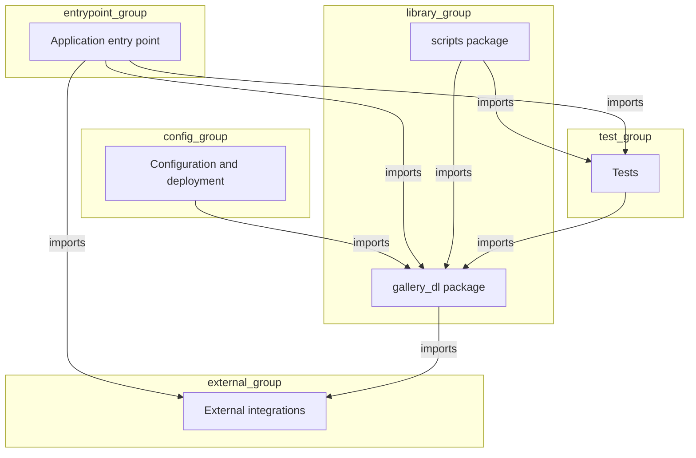

# Architecture report: mikf/gallery-dl

> Automated static analysis. **Observed** = directly seen in files/imports/AST; **Inferred** = interpretation from that evidence. Repository code was not executed.

## 1. Repository at a glance

| Item | Value |
| --- | --- |
| Repository | mikf/gallery-dl |
| Description | Command-line program to download image galleries and collections from several image hosting sites |
| Language | Python |
| Stars | 20503 |
| Licence | GPL-2.0 |
| Analysed commit / branch | 26dfd4eea885577fef45e9b614538e5a7d24583a / master |
| Framework(s) | None detected |
| Files analysed | 761 |
| Components | 6 |

## 2. Architecture in one minute

mikf/gallery-dl - Command-line program to download image galleries and collections from several image hosting sites. This repository was analysed statically from 761 file(s) (718 Python). Detected technologies (observed from imports/manifests): GitHub Actions, SQLite, requests, Poetry, setuptools, Docker. Files are grouped into 6 component(s): Configuration and deployment, Application entry point, External integrations, gallery_dl package, scripts package, Tests. Observed entry point(s): gallery_dl/__init__.py, gallery_dl/__main__.py, scripts/generate_test_result.py. Findings below distinguish observed facts from inferred interpretation.

## 3. High-level block diagram

## 4. Main components

### Configuration and deployment (`config`)

- **Kind:** config
- **Status:** Observed
- **Confidence:** 0.85
- **Responsibility:** Groups 8 file(s) under configuration and deployment (observed from repository paths and static analysis). Observed top-level classes: apply. Observed top-level functions: accumulate, build_py2exe, build_setuptools, check_file, clear, default.
- **Paths:** `Dockerfile`, `MANIFEST.in`, `gallery_dl/config.py`, `pyproject.toml`, `requirements.txt`, `setup.cfg`, `setup.py`, `snap/snapcraft.yaml`
- **Evidence:** [Dockerfile](https://github.com/mikf/gallery-dl/blob/26dfd4eea885577fef45e9b614538e5a7d24583a/Dockerfile); [MANIFEST.in](https://github.com/mikf/gallery-dl/blob/26dfd4eea885577fef45e9b614538e5a7d24583a/MANIFEST.in); [gallery_dl/config.py:33](https://github.com/mikf/gallery-dl/blob/26dfd4eea885577fef45e9b614538e5a7d24583a/gallery_dl/config.py#L33); [pyproject.toml](https://github.com/mikf/gallery-dl/blob/26dfd4eea885577fef45e9b614538e5a7d24583a/pyproject.toml); [requirements.txt](https://github.com/mikf/gallery-dl/blob/26dfd4eea885577fef45e9b614538e5a7d24583a/requirements.txt); [setup.cfg](https://github.com/mikf/gallery-dl/blob/26dfd4eea885577fef45e9b614538e5a7d24583a/setup.cfg); [setup.py:10](https://github.com/mikf/gallery-dl/blob/26dfd4eea885577fef45e9b614538e5a7d24583a/setup.py#L10); [snap/snapcraft.yaml](https://github.com/mikf/gallery-dl/blob/26dfd4eea885577fef45e9b614538e5a7d24583a/snap/snapcraft.yaml)

### Application entry point (`entrypoint`)

- **Kind:** entrypoint
- **Status:** Observed
- **Confidence:** 0.85
- **Responsibility:** Groups 8 file(s) under application entry point (observed from repository paths and static analysis). Observed top-level classes: LoggingCapture. Observed top-level functions: build_base_pattern, build_extractor_list, build_gallery_dl_1, build_gallery_dl_conf_5, category_key, category_text.
- **Paths:** `gallery_dl/__main__.py`, `scripts/generate_test_result.py`, `scripts/init.py`, `scripts/man.py`, `scripts/pyinstaller.py`, `scripts/requirements.py`, `scripts/rm.py`, `scripts/supportedsites.py`
- **Evidence:** [gallery_dl/__main__.py](https://github.com/mikf/gallery-dl/blob/26dfd4eea885577fef45e9b614538e5a7d24583a/gallery_dl/__main__.py); [scripts/generate_test_result.py:22](https://github.com/mikf/gallery-dl/blob/26dfd4eea885577fef45e9b614538e5a7d24583a/scripts/generate_test_result.py#L22); [scripts/init.py:32](https://github.com/mikf/gallery-dl/blob/26dfd4eea885577fef45e9b614538e5a7d24583a/scripts/init.py#L32); [scripts/man.py:20](https://github.com/mikf/gallery-dl/blob/26dfd4eea885577fef45e9b614538e5a7d24583a/scripts/man.py#L20); [scripts/pyinstaller.py:11](https://github.com/mikf/gallery-dl/blob/26dfd4eea885577fef45e9b614538e5a7d24583a/scripts/pyinstaller.py#L11); [scripts/requirements.py:20](https://github.com/mikf/gallery-dl/blob/26dfd4eea885577fef45e9b614538e5a7d24583a/scripts/requirements.py#L20); [scripts/rm.py:21](https://github.com/mikf/gallery-dl/blob/26dfd4eea885577fef45e9b614538e5a7d24583a/scripts/rm.py#L21); [scripts/supportedsites.py:610](https://github.com/mikf/gallery-dl/blob/26dfd4eea885577fef45e9b614538e5a7d24583a/scripts/supportedsites.py#L610)

### External integrations (`external_integrations`)

- **Kind:** external
- **Status:** Inferred
- **Confidence:** 0.70
- **Responsibility:** Groups 0 file(s) under external integrations (observed from repository paths and static analysis).
- **Evidence:** [gallery_dl/__init__.py:150](https://github.com/mikf/gallery-dl/blob/26dfd4eea885577fef45e9b614538e5a7d24583a/gallery_dl/__init__.py#L150); [gallery_dl/__init__.py:271](https://github.com/mikf/gallery-dl/blob/26dfd4eea885577fef45e9b614538e5a7d24583a/gallery_dl/__init__.py#L271); [gallery_dl/cache.py:30](https://github.com/mikf/gallery-dl/blob/26dfd4eea885577fef45e9b614538e5a7d24583a/gallery_dl/cache.py#L30); [gallery_dl/cookies.py:17](https://github.com/mikf/gallery-dl/blob/26dfd4eea885577fef45e9b614538e5a7d24583a/gallery_dl/cookies.py#L17); [gallery_dl/downloader/http.py:13](https://github.com/mikf/gallery-dl/blob/26dfd4eea885577fef45e9b614538e5a7d24583a/gallery_dl/downloader/http.py#L13); [gallery_dl/extractor/common.py:21](https://github.com/mikf/gallery-dl/blob/26dfd4eea885577fef45e9b614538e5a7d24583a/gallery_dl/extractor/common.py#L21)

### gallery_dl package (`gallery_dl`)

- **Kind:** library
- **Status:** Observed
- **Confidence:** 0.85
- **Responsibility:** Groups 310 file(s) under gallery_dl package (observed from repository paths and static analysis). Observed top-level classes: AbortExtraction, AcidimgImageExtractor, ActionsPP, AdultempireGalleryExtractor, AgnphExtractor, AgnphPostExtractor. Observed top-level functions: HTTPBasicAuth, Popen_communicate, _access_token_cache, _attrgetter, _bool, _browser_useragent.
- **Paths:** `gallery_dl/__init__.py`, `gallery_dl/actions.py`, `gallery_dl/aes.py`, `gallery_dl/archive.py`, `gallery_dl/cache.py`, `gallery_dl/cookies.py`, `gallery_dl/downloader/__init__.py`, `gallery_dl/downloader/common.py`, `gallery_dl/downloader/http.py`, `gallery_dl/downloader/text.py`, `gallery_dl/downloader/ytdl.py`, `gallery_dl/dt.py`, `gallery_dl/exception.py`, `gallery_dl/extractor/2ch.py`, `gallery_dl/extractor/2chan.py`, `gallery_dl/extractor/2chen.py`, `gallery_dl/extractor/35photo.py`, `gallery_dl/extractor/3dbooru.py`, `gallery_dl/extractor/4archive.py`, `gallery_dl/extractor/4chan.py`, `gallery_dl/extractor/4chanarchives.py`, `gallery_dl/extractor/500px.py`, `gallery_dl/extractor/8chan.py`, `gallery_dl/extractor/8muses.py`, `gallery_dl/extractor/__init__.py`, `gallery_dl/extractor/adultempire.py`, `gallery_dl/extractor/agnph.py`, `gallery_dl/extractor/ahottie.py`, `gallery_dl/extractor/allporncomic.py`, `gallery_dl/extractor/ao3.py`, `gallery_dl/extractor/arcalive.py`, `gallery_dl/extractor/architizer.py`, `gallery_dl/extractor/arena.py`, `gallery_dl/extractor/artstation.py`, `gallery_dl/extractor/aryion.py`, `gallery_dl/extractor/audiochan.py`, `gallery_dl/extractor/bbc.py`, `gallery_dl/extractor/behance.py`, `gallery_dl/extractor/bellazon.py`, `gallery_dl/extractor/bilibili.py`, `gallery_dl/extractor/blogger.py`, `gallery_dl/extractor/bluesky.py`, `gallery_dl/extractor/booru.py`, `gallery_dl/extractor/boosty.py`, `gallery_dl/extractor/booth.py`, `gallery_dl/extractor/bunkr.py`, `gallery_dl/extractor/catbox.py`, `gallery_dl/extractor/cfake.py`, `gallery_dl/extractor/chevereto.py`, `gallery_dl/extractor/cien.py`, `gallery_dl/extractor/civitai.py`, `gallery_dl/extractor/comedywildlifephoto.py`, `gallery_dl/extractor/comick.py`, `gallery_dl/extractor/comicvine.py`, `gallery_dl/extractor/common.py`, `gallery_dl/extractor/cyberdrop.py`, `gallery_dl/extractor/cyberfile.py`, `gallery_dl/extractor/danbooru.py`, `gallery_dl/extractor/dandadan.py`, `gallery_dl/extractor/dankefuerslesen.py`, `gallery_dl/extractor/desktopography.py`, `gallery_dl/extractor/deviantart.py`, `gallery_dl/extractor/directlink.py`, `gallery_dl/extractor/discord.py`, `gallery_dl/extractor/dynastyscans.py`, `gallery_dl/extractor/e621.py`, `gallery_dl/extractor/eporner.py`, `gallery_dl/extractor/erome.py`, `gallery_dl/extractor/everia.py`, `gallery_dl/extractor/facebook.py`, `gallery_dl/extractor/fanbox.py`, `gallery_dl/extractor/fansly.py`, `gallery_dl/extractor/fantia.py`, `gallery_dl/extractor/fapachi.py`, `gallery_dl/extractor/fapello.py`, `gallery_dl/extractor/fikfap.py`, `gallery_dl/extractor/filester.py`, `gallery_dl/extractor/fitnakedgirls.py`, `gallery_dl/extractor/flickr.py`, `gallery_dl/extractor/foolfuuka.py`, `gallery_dl/extractor/foolslide.py`, `gallery_dl/extractor/foriio.py`, `gallery_dl/extractor/furaffinity.py`, `gallery_dl/extractor/furry34.py`, `gallery_dl/extractor/fuskator.py`, `gallery_dl/extractor/gelbooru.py`, `gallery_dl/extractor/gelbooru_v01.py`, `gallery_dl/extractor/gelbooru_v02.py`, `gallery_dl/extractor/generic.py`, `gallery_dl/extractor/girlsreleased.py`, `gallery_dl/extractor/girlswithmuscle.py`, `gallery_dl/extractor/gofile.py`, `gallery_dl/extractor/hatenablog.py`, `gallery_dl/extractor/hentai2read.py`, `gallery_dl/extractor/hentaicosplays.py`, `gallery_dl/extractor/hentaihere.py`, `gallery_dl/extractor/hiperdex.py`, `gallery_dl/extractor/hotleak.py`, `gallery_dl/extractor/idolcomplex.py`, `gallery_dl/extractor/imagebam.py`, `gallery_dl/extractor/imagechest.py`, `gallery_dl/extractor/imagefap.py`, `gallery_dl/extractor/imagehosts.py`, `gallery_dl/extractor/imagepond.py`, `gallery_dl/extractor/imageshack.py`, `gallery_dl/extractor/imgbb.py`, `gallery_dl/extractor/imgbox.py`, `gallery_dl/extractor/imgpile.py`, `gallery_dl/extractor/imgth.py`, `gallery_dl/extractor/imgur.py`, `gallery_dl/extractor/imhentai.py`, `gallery_dl/extractor/inkbunny.py`, `gallery_dl/extractor/instagram.py`, `gallery_dl/extractor/issuu.py`, `gallery_dl/extractor/itaku.py`, `gallery_dl/extractor/itchio.py`, `gallery_dl/extractor/iwara.py`, `gallery_dl/extractor/joyreactor.py`, `gallery_dl/extractor/jschan.py`, `gallery_dl/extractor/kabeuchi.py`, `gallery_dl/extractor/kaliscan.py`, `gallery_dl/extractor/keenspot.py`, `gallery_dl/extractor/kemono.py`, `gallery_dl/extractor/khinsider.py`, `gallery_dl/extractor/komikcast.py`, `gallery_dl/extractor/koofr.py`, `gallery_dl/extractor/leakgallery.py`, `gallery_dl/extractor/lensdump.py`, `gallery_dl/extractor/lexica.py`, `gallery_dl/extractor/lightroom.py`, `gallery_dl/extractor/listal.py`, `gallery_dl/extractor/livedoor.py`, `gallery_dl/extractor/lofter.py`, `gallery_dl/extractor/lolisafe.py`, `gallery_dl/extractor/luscious.py`, `gallery_dl/extractor/lynxchan.py`, `gallery_dl/extractor/madokami.py`, `gallery_dl/extractor/mangadex.py`, `gallery_dl/extractor/mangafire.py`, `gallery_dl/extractor/mangafox.py`, `gallery_dl/extractor/mangafreak.py`, `gallery_dl/extractor/mangahere.py`, `gallery_dl/extractor/manganelo.py`, `gallery_dl/extractor/mangapark.py`, `gallery_dl/extractor/mangaread.py`, `gallery_dl/extractor/mangareader.py`, `gallery_dl/extractor/mangataro.py`, `gallery_dl/extractor/mangatown.py`, `gallery_dl/extractor/mangoxo.py`, `gallery_dl/extractor/mastodon.py`, `gallery_dl/extractor/message.py`, `gallery_dl/extractor/misskey.py`, `gallery_dl/extractor/mixdrop.py`, `gallery_dl/extractor/moebooru.py`, `gallery_dl/extractor/motherless.py`, `gallery_dl/extractor/myhentaigallery.py`, `gallery_dl/extractor/myportfolio.py`, `gallery_dl/extractor/naverblog.py`, `gallery_dl/extractor/naverchzzk.py`, `gallery_dl/extractor/naverwebtoon.py`, `gallery_dl/extractor/nekohouse.py`, `gallery_dl/extractor/newgrounds.py`, `gallery_dl/extractor/nijie.py`, `gallery_dl/extractor/nitter.py`, `gallery_dl/extractor/noop.py`, `gallery_dl/extractor/nozomi.py`, `gallery_dl/extractor/nsfwalbum.py`, `gallery_dl/extractor/nudostar.py`, `gallery_dl/extractor/oauth.py`, `gallery_dl/extractor/okporn.py`, `gallery_dl/extractor/paheal.py`, `gallery_dl/extractor/patreon.py`, `gallery_dl/extractor/pexels.py`, `gallery_dl/extractor/philomena.py`, `gallery_dl/extractor/pholder.py`, `gallery_dl/extractor/photovogue.py`, `gallery_dl/extractor/picarto.py`, `gallery_dl/extractor/picazor.py`, `gallery_dl/extractor/pictoa.py`, `gallery_dl/extractor/piczel.py`, `gallery_dl/extractor/pillowfort.py`, `gallery_dl/extractor/pinterest.py`, `gallery_dl/extractor/pixeldrain.py`, `gallery_dl/extractor/pixiv.py`, `gallery_dl/extractor/pixnet.py`, `gallery_dl/extractor/plurk.py`, `gallery_dl/extractor/poipiku.py`, `gallery_dl/extractor/poringa.py`, `gallery_dl/extractor/pornhub.py`, `gallery_dl/extractor/pornpics.py`, `gallery_dl/extractor/pornstarstube.py`, `gallery_dl/extractor/postmill.py`, `gallery_dl/extractor/rawkuma.py`, `gallery_dl/extractor/reactor.py`, `gallery_dl/extractor/readcomiconline.py`, `gallery_dl/extractor/realbooru.py`, `gallery_dl/extractor/recursive.py`, `gallery_dl/extractor/reddit.py`, `gallery_dl/extractor/redgifs.py`, `gallery_dl/extractor/rule34us.py`, `gallery_dl/extractor/rule34vault.py`, `gallery_dl/extractor/rule34xyz.py`, `gallery_dl/extractor/s3ndpics.py`, `gallery_dl/extractor/sankaku.py`, `gallery_dl/extractor/sankakucomplex.py`, `gallery_dl/extractor/scatbooru.py`, `gallery_dl/extractor/scrolller.py`, `gallery_dl/extractor/seiga.py`, `gallery_dl/extractor/senmanga.py`, `gallery_dl/extractor/sexcom.py`, `gallery_dl/extractor/shimmie2.py`, `gallery_dl/extractor/shopify.py`, `gallery_dl/extractor/simplyhentai.py`, `gallery_dl/extractor/sizebooru.py`, `gallery_dl/extractor/skeb.py`, `gallery_dl/extractor/slickpic.py`, `gallery_dl/extractor/slideshare.py`, `gallery_dl/extractor/smugmug.py`, `gallery_dl/extractor/soundgasm.py`, `gallery_dl/extractor/speakerdeck.py`, `gallery_dl/extractor/steamgriddb.py`, `gallery_dl/extractor/subscribestar.py`, `gallery_dl/extractor/sxypix.py`, `gallery_dl/extractor/szurubooru.py`, `gallery_dl/extractor/tapas.py`, `gallery_dl/extractor/tcbscans.py`, `gallery_dl/extractor/telegraph.py`, `gallery_dl/extractor/tenor.py`, `gallery_dl/extractor/thefap.py`, `gallery_dl/extractor/thehentaiworld.py`, `gallery_dl/extractor/tiktok.py`, `gallery_dl/extractor/tmohentai.py`, `gallery_dl/extractor/toyhouse.py`, `gallery_dl/extractor/tumblr.py`, `gallery_dl/extractor/tumblrgallery.py`, `gallery_dl/extractor/tungsten.py`, `gallery_dl/extractor/turbo.py`, `gallery_dl/extractor/twibooru.py`, `gallery_dl/extractor/twitter.py`, `gallery_dl/extractor/unsplash.py`, `gallery_dl/extractor/uploadir.py`, `gallery_dl/extractor/urlgalleries.py`, `gallery_dl/extractor/urlshortener.py`, `gallery_dl/extractor/utils/500px_graphql.py`, `gallery_dl/extractor/utils/__init__.py`, `gallery_dl/extractor/utils/behance_graphql.py`, `gallery_dl/extractor/utils/deviantart_journal.py`, `gallery_dl/extractor/utils/deviantart_tiptap.py`, `gallery_dl/extractor/utils/geo.py`, `gallery_dl/extractor/utils/joyreactor_graphql.py`, `gallery_dl/extractor/utils/jsurl.py`, `gallery_dl/extractor/utils/luscious_graphql.py`, `gallery_dl/extractor/utils/mangafire_vrf.py`, `gallery_dl/extractor/utils/mangapark_graphql.py`, `gallery_dl/extractor/utils/patreon_tiptap.py`, `gallery_dl/extractor/utils/scrolller_graphql.py`, `gallery_dl/extractor/utils/twitter_article.py`, `gallery_dl/extractor/utils/twitter_transaction_id.py`, `gallery_dl/extractor/vanillarock.py`, `gallery_dl/extractor/vichan.py`, `gallery_dl/extractor/vipergirls.py`, `gallery_dl/extractor/vk.py`, `gallery_dl/extractor/vsco.py`, `gallery_dl/extractor/wallhaven.py`, `gallery_dl/extractor/wallpapercave.py`, `gallery_dl/extractor/warosu.py`, `gallery_dl/extractor/weasyl.py`, `gallery_dl/extractor/webmshare.py`, `gallery_dl/extractor/webtoons.py`, `gallery_dl/extractor/weebcentral.py`, `gallery_dl/extractor/weebdex.py`, `gallery_dl/extractor/weibo.py`, `gallery_dl/extractor/whyp.py`, `gallery_dl/extractor/wikiart.py`, `gallery_dl/extractor/wikifeet.py`, `gallery_dl/extractor/wikimedia.py`, `gallery_dl/extractor/xasiat.py`, `gallery_dl/extractor/xenforo.py`, `gallery_dl/extractor/xfolio.py`, `gallery_dl/extractor/xhamster.py`, `gallery_dl/extractor/xvideos.py`, `gallery_dl/extractor/yiffverse.py`, `gallery_dl/extractor/yourlesbians.py`, `gallery_dl/extractor/ytdl.py`, `gallery_dl/extractor/zerochan.py`, `gallery_dl/formatter.py`, `gallery_dl/job.py`, `gallery_dl/oauth.py`, `gallery_dl/option.py`, `gallery_dl/output.py`, `gallery_dl/path.py`, `gallery_dl/postprocessor/__init__.py`, `gallery_dl/postprocessor/actions.py`, `gallery_dl/postprocessor/classify.py`, `gallery_dl/postprocessor/common.py`, `gallery_dl/postprocessor/compare.py`, `gallery_dl/postprocessor/directory.py`, `gallery_dl/postprocessor/exec.py`, `gallery_dl/postprocessor/hash.py`, `gallery_dl/postprocessor/metadata.py`, `gallery_dl/postprocessor/mtime.py`, `gallery_dl/postprocessor/python.py`, `gallery_dl/postprocessor/rename.py`, `gallery_dl/postprocessor/ugoira.py`, `gallery_dl/postprocessor/zip.py`, `gallery_dl/text.py`, `gallery_dl/update.py`, `gallery_dl/util.py`, `gallery_dl/version.py`, `gallery_dl/ytdl.py`
- **Evidence:** [gallery_dl/__init__.py:22](https://github.com/mikf/gallery-dl/blob/26dfd4eea885577fef45e9b614538e5a7d24583a/gallery_dl/__init__.py#L22); [gallery_dl/actions.py:18](https://github.com/mikf/gallery-dl/blob/26dfd4eea885577fef45e9b614538e5a7d24583a/gallery_dl/actions.py#L18); [gallery_dl/aes.py:58](https://github.com/mikf/gallery-dl/blob/26dfd4eea885577fef45e9b614538e5a7d24583a/gallery_dl/aes.py#L58); [gallery_dl/archive.py:18](https://github.com/mikf/gallery-dl/blob/26dfd4eea885577fef45e9b614538e5a7d24583a/gallery_dl/archive.py#L18); [gallery_dl/cache.py:20](https://github.com/mikf/gallery-dl/blob/26dfd4eea885577fef45e9b614538e5a7d24583a/gallery_dl/cache.py#L20); [gallery_dl/cookies.py:39](https://github.com/mikf/gallery-dl/blob/26dfd4eea885577fef45e9b614538e5a7d24583a/gallery_dl/cookies.py#L39); [gallery_dl/downloader/__init__.py:18](https://github.com/mikf/gallery-dl/blob/26dfd4eea885577fef45e9b614538e5a7d24583a/gallery_dl/downloader/__init__.py#L18); [gallery_dl/downloader/common.py:16](https://github.com/mikf/gallery-dl/blob/26dfd4eea885577fef45e9b614538e5a7d24583a/gallery_dl/downloader/common.py#L16)

### scripts package (`scripts`)

- **Kind:** library
- **Status:** Observed
- **Confidence:** 0.85
- **Responsibility:** Groups 10 file(s) under scripts package (observed from repository paths and static analysis). Observed top-level classes: Formatter, lazy, lines. Observed top-level functions: git, open, opts_category, opts_general, path, pyprint.
- **Paths:** `scripts/build_testresult_db.py`, `scripts/completion_bash.py`, `scripts/completion_fish.py`, `scripts/completion_zsh.py`, `scripts/docs_compare.py`, `scripts/hook-gallery_dl.py`, `scripts/options.py`, `scripts/pyprint.py`, `scripts/release.sh`, `scripts/util.py`
- **Evidence:** [scripts/build_testresult_db.py](https://github.com/mikf/gallery-dl/blob/26dfd4eea885577fef45e9b614538e5a7d24583a/scripts/build_testresult_db.py); [scripts/completion_bash.py](https://github.com/mikf/gallery-dl/blob/26dfd4eea885577fef45e9b614538e5a7d24583a/scripts/completion_bash.py); [scripts/completion_fish.py](https://github.com/mikf/gallery-dl/blob/26dfd4eea885577fef45e9b614538e5a7d24583a/scripts/completion_fish.py); [scripts/completion_zsh.py](https://github.com/mikf/gallery-dl/blob/26dfd4eea885577fef45e9b614538e5a7d24583a/scripts/completion_zsh.py); [scripts/docs_compare.py:14](https://github.com/mikf/gallery-dl/blob/26dfd4eea885577fef45e9b614538e5a7d24583a/scripts/docs_compare.py#L14); [scripts/hook-gallery_dl.py](https://github.com/mikf/gallery-dl/blob/26dfd4eea885577fef45e9b614538e5a7d24583a/scripts/hook-gallery_dl.py); [scripts/options.py:23](https://github.com/mikf/gallery-dl/blob/26dfd4eea885577fef45e9b614538e5a7d24583a/scripts/options.py#L23); [scripts/pyprint.py:11](https://github.com/mikf/gallery-dl/blob/26dfd4eea885577fef45e9b614538e5a7d24583a/scripts/pyprint.py#L11)

### Tests (`tests`)

- **Kind:** test
- **Status:** Observed
- **Confidence:** 0.85
- **Responsibility:** Groups 389 file(s) under tests (observed from repository paths and static analysis). Observed routes: PATCH builtins.__import__, PATCH builtins.__import__, PATCH builtins.__import__, PATCH os.sep, PATCH gallery_dl.path.WINDOWS. Observed top-level classes: ActionsTest, BasePostprocessorTest, ClassifyTest, DirectoryTest, ExecTest, FakeExtractor. Observed top-level functions: _get_extractor, all, category, extractor_find_external, generate_tests, load_test_config.
- **Paths:** `scripts/run_tests.py`, `test/__init__.py`, `test/results/2ch.py`, `test/results/2chan.py`, `test/results/35photo.py`, `test/results/3dbooru.py`, `test/results/4archive.py`, `test/results/4chan.py`, `test/results/4chanarchives.py`, `test/results/4plebs.py`, `test/results/500px.py`, `test/results/8chan.py`, `test/results/8kun.py`, `test/results/8muses.py`, `test/results/94chan.py`, `test/results/__init__.py`, `test/results/acidimg.py`, `test/results/adultempire.py`, `test/results/agnph.py`, `test/results/ahottie.py`, `test/results/aibooru.py`, `test/results/allgirlbooru.py`, `test/results/allporncomic.py`, `test/results/animereactor.py`, `test/results/ao3.py`, `test/results/arcalive.py`, `test/results/architizer.py`, `test/results/archivedmoe.py`, `test/results/archiveofsins.py`, `test/results/arena.py`, `test/results/artstation.py`, `test/results/aryion.py`, `test/results/atfbooru.py`, `test/results/atfforum.py`, `test/results/audiochan.py`, `test/results/azurlanewiki.py`, `test/results/b4k.py`, `test/results/baraag.py`, `test/results/bbc.py`, `test/results/bbw-chan.py`, `test/results/bcbnsfw.py`, `test/results/behance.py`, `test/results/bellazon.py`, `test/results/bilibili.py`, `test/results/bitly.py`, `test/results/blacktowhite.py`, `test/results/blogger.py`, `test/results/blogspot.py`, `test/results/bluesky.py`, `test/results/booruvar.py`, `test/results/boosty.py`, `test/results/booth.py`, `test/results/bulbapedia.py`, `test/results/bunkr.py`, `test/results/catbox.py`, `test/results/cavemanon.py`, `test/results/celebforum.py`, `test/results/cfake.py`, `test/results/chelseacrew.py`, `test/results/cien.py`, `test/results/civitai.py`, `test/results/comedywildlifephoto.py`, `test/results/comick.py`, `test/results/comicvine.py`, `test/results/coomer.py`, `test/results/cyberdrop.py`, `test/results/cyberfile.py`, `test/results/danbooru.py`, `test/results/dandadan.py`, `test/results/dankefuerslesen.py`, `test/results/derpibooru.py`, `test/results/desktopography.py`, `test/results/desuarchive.py`, `test/results/deviantart.py`, `test/results/directlink.py`, `test/results/discord.py`, `test/results/drawfriends.py`, `test/results/dynastyscans.py`, `test/results/e621.py`, `test/results/e6ai.py`, `test/results/e926.py`, `test/results/endchan.py`, `test/results/eporner.py`, `test/results/erome.py`, `test/results/everia.py`, `test/results/facebook.py`, `test/results/fanbox.py`, `test/results/fandom.py`, `test/results/fansly.py`, `test/results/fantia.py`, `test/results/fapachi.py`, `test/results/fapello.py`, `test/results/fappic.py`, `test/results/fashionnova.py`, `test/results/fikfap.py`, `test/results/filester.py`, `test/results/fireden.py`, `test/results/fitnakedgirls.py`, `test/results/flickr.py`, `test/results/foriio.py`, `test/results/furaffinity.py`, `test/results/furbooru.py`, `test/results/furry34.py`, `test/results/fuskator.py`, `test/results/gelbooru.py`, `test/results/generic.py`, `test/results/girlsreleased.py`, `test/results/girlswithmuscle.py`, `test/results/gofile.py`, `test/results/gurochan.py`, `test/results/hatenablog.py`, `test/results/hentai2read.py`, `test/results/hentaicosplays.py`, `test/results/hentaienvy.py`, `test/results/hentaiera.py`, `test/results/hentaifox.py`, `test/results/hentaihere.py`, `test/results/hentairox.py`, `test/results/hentaizap.py`, `test/results/hiperdex.py`, `test/results/horne.py`, `test/results/hotleak.py`, `test/results/hypnohub.py`, `test/results/idolcomplex.py`, `test/results/illusioncardsbooru.py`, `test/results/imagebam.py`, `test/results/imagechest.py`, `test/results/imagefap.py`, `test/results/imagepond.py`, `test/results/imageshack.py`, `test/results/imagetwist.py`, `test/results/imagevenue.py`, `test/results/imgadult.py`, `test/results/imgbb.py`, `test/results/imgbox.py`, `test/results/imgclick.py`, `test/results/imgdrive.py`, `test/results/imglike.py`, `test/results/imgpile.py`, `test/results/imgpv.py`, `test/results/imgspice.py`, `test/results/imgtaxi.py`, `test/results/imgth.py`, `test/results/imgur.py`, `test/results/imgwallet.py`, `test/results/imhentai.py`, `test/results/imxto.py`, `test/results/inkbunny.py`, `test/results/instagram.py`, `test/results/issuu.py`, `test/results/itaku.py`, `test/results/itchio.py`, `test/results/iwara.py`, `test/results/joyreactor.py`, `test/results/jpgfish.py`, `test/results/kabeuchi.py`, `test/results/kaliscan.py`, `test/results/keenspot.py`, `test/results/kemono.py`, `test/results/khinsider.py`, `test/results/kohlchan.py`, `test/results/komikcast.py`, `test/results/konachan.py`, `test/results/koofr.py`, `test/results/leakgallery.py`, `test/results/lensdump.py`, `test/results/lesbianenergy.py`, `test/results/lexica.py`, `test/results/lightbrd.py`, `test/results/lightroom.py`, `test/results/listal.py`, `test/results/livedoor.py`, `test/results/lofter.py`, `test/results/lolibooru.py`, `test/results/loungeunderwear.py`, `test/results/luscious.py`, `test/results/madokami.py`, `test/results/mangadex.py`, `test/results/mangafire.py`, `test/results/mangafox.py`, `test/results/mangafreak.py`, `test/results/mangahere.py`, `test/results/mangakakalot.py`, `test/results/manganato.py`, `test/results/mangapark.py`, `test/results/mangaread.py`, `test/results/mangareader.py`, `test/results/mangataro.py`, `test/results/mangatown.py`, `test/results/mangoxo.py`, `test/results/mariowiki.py`, `test/results/mastodon.py`, `test/results/mastodonsocial.py`, `test/results/mediawiki.py`, `test/results/mgewiki.py`, `test/results/michaelscameras.py`, `test/results/misskeyart.py`, `test/results/misskeydesign.py`, `test/results/misskeyio.py`, `test/results/mixdrop.py`, `test/results/modcloth.py`, `test/results/motherless.py`, `test/results/myhentaigallery.py`, `test/results/myportfolio.py`, `test/results/natomanga.py`, `test/results/naverblog.py`, `test/results/naverchzzk.py`, `test/results/naverwebtoon.py`, `test/results/nekohouse.py`, `test/results/nelomanga.py`, `test/results/newgrounds.py`, `test/results/nijie.py`, `test/results/nitternet.py`, `test/results/nitterspace.py`, `test/results/nittertiekoetter.py`, `test/results/noop.py`, `test/results/nozomi.py`, `test/results/nozrip.py`, `test/results/nsfwalbum.py`, `test/results/nudostar.py`, `test/results/nudostarforum.py`, `test/results/ohpolly.py`, `test/results/okporn.py`, `test/results/omgmiamiswimwear.py`, `test/results/paheal.py`, `test/results/palanq.py`, `test/results/patreon.py`, `test/results/pawoo.py`, `test/results/pexels.py`, `test/results/philomena.py`, `test/results/pholder.py`, `test/results/photovogue.py`, `test/results/picarto.py`, `test/results/picazor.py`, `test/results/picstate.py`, `test/results/pictoa.py`, `test/results/piczel.py`, `test/results/pidgiwiki.py`, `test/results/pillowfort.py`, `test/results/pinterest.py`, `test/results/pinupgirlclothing.py`, `test/results/pixeldrain.py`, `test/results/pixhost.py`, `test/results/pixiv.py`, `test/results/pixivnovel.py`, `test/results/pixnet.py`, `test/results/plurk.py`, `test/results/poipiku.py`, `test/results/ponybooru.py`, `test/results/poringa.py`, `test/results/pornhub.py`, `test/results/pornpics.py`, `test/results/pornreactor.py`, `test/results/pornstarstube.py`, `test/results/postimg.py`, `test/results/putmega.py`, `test/results/raddle.py`, `test/results/raidlondon.py`, `test/results/rawkuma.py`, `test/results/rbt.py`, `test/results/reactor.py`, `test/results/readcomiconline.py`, `test/results/realbooru.py`, `test/results/recursive.py`, `test/results/reddit.py`, `test/results/redgifs.py`, `test/results/rule34.py`, `test/results/rule34hentai.py`, `test/results/rule34us.py`, `test/results/rule34vault.py`, `test/results/rule34world.py`, `test/results/rule34xyz.py`, `test/results/s3ndpics.py`, `test/results/safebooru.py`, `test/results/sakugabooru.py`, `test/results/sankaku.py`, `test/results/sankakucomplex.py`, `test/results/scatbooru.py`, `test/results/schan.py`, `test/results/scrolller.py`, `test/results/seiga.py`, `test/results/senmanga.py`, `test/results/sexcom.py`, `test/results/silverpic.py`, `test/results/simpcity.py`, `test/results/simplyhentai.py`, `test/results/sizebooru.py`, `test/results/skeb.py`, `test/results/slickpic.py`, `test/results/slideshare.py`, `test/results/smugloli.py`, `test/results/smugmug.py`, `test/results/snootbooru.py`, `test/results/socialmediagirlsforum.py`, `test/results/soundgasm.py`, `test/results/soybooru.py`, `test/results/speakerdeck.py`, `test/results/steamgriddb.py`, `test/results/sturdychan.py`, `test/results/subscribestar.py`, `test/results/sushiski.py`, `test/results/sxypix.py`, `test/results/tapas.py`, `test/results/tbib.py`, `test/results/tcbscans.py`, `test/results/tco.py`, `test/results/telegraph.py`, `test/results/tenor.py`, `test/results/thebarchive.py`, `test/results/thecollection.py`, `test/results/thecollectionS.py`, `test/results/thefap.py`, `test/results/thehentaiworld.py`, `test/results/tiktok.py`, `test/results/titsintops.py`, `test/results/tmohentai.py`, `test/results/toyhouse.py`, `test/results/tumblr.py`, `test/results/tumblrgallery.py`, `test/results/tungsten.py`, `test/results/turbo.py`, `test/results/turboimagehost.py`, `test/results/twibooru.py`, `test/results/twitter.py`, `test/results/unique-vintage.py`, `test/results/unsplash.py`, `test/results/uploadir.py`, `test/results/urlgalleries.py`, `test/results/vanillarock.py`, `test/results/vidyapics.py`, `test/results/vidyart2.py`, `test/results/vipergirls.py`, `test/results/vipr.py`, `test/results/visuabusters.py`, `test/results/vk.py`, `test/results/vsco.py`, `test/results/wallhaven.py`, `test/results/wallpapercave.py`, `test/results/warosu.py`, `test/results/weasyl.py`, `test/results/webmshare.py`, `test/results/webtoons.py`, `test/results/weebcentral.py`, `test/results/weebdex.py`, `test/results/weibo.py`, `test/results/whyp.py`, `test/results/wikiart.py`, `test/results/wikibooks.py`, `test/results/wikidata.py`, `test/results/wikifeet.py`, `test/results/wikifeetx.py`, `test/results/wikigg.py`, `test/results/wikimediacommons.py`, `test/results/wikinews.py`, `test/results/wikipedia.py`, `test/results/wikiquote.py`, `test/results/wikisource.py`, `test/results/wikispecies.py`, `test/results/wikiversity.py`, `test/results/wikivoyage.py`, `test/results/wiktionary.py`, `test/results/windsorstore.py`, `test/results/xasiat.py`, `test/results/xbooru.py`, `test/results/xcancel.py`, `test/results/xfolio.py`, `test/results/xhamster.py`, `test/results/xvideos.py`, `test/results/yandere.py`, `test/results/yiffverse.py`, `test/results/yourlesbians.py`, `test/results/ytdl.py`, `test/results/zerochan.py`, `test/test_cache.py`, `test/test_config.py`, `test/test_cookies.py`, `test/test_downloader.py`, `test/test_dt.py`, `test/test_extractor.py`, `test/test_formatter.py`, `test/test_job.py`, `test/test_oauth.py`, `test/test_output.py`, `test/test_path.py`, `test/test_postprocessor.py`, `test/test_results.py`, `test/test_text.py`, `test/test_util.py`, `test/test_ytdl.py`
- **Evidence:** [scripts/run_tests.py](https://github.com/mikf/gallery-dl/blob/26dfd4eea885577fef45e9b614538e5a7d24583a/scripts/run_tests.py); [test/__init__.py](https://github.com/mikf/gallery-dl/blob/26dfd4eea885577fef45e9b614538e5a7d24583a/test/__init__.py); [test/results/2ch.py](https://github.com/mikf/gallery-dl/blob/26dfd4eea885577fef45e9b614538e5a7d24583a/test/results/2ch.py); [test/results/2chan.py](https://github.com/mikf/gallery-dl/blob/26dfd4eea885577fef45e9b614538e5a7d24583a/test/results/2chan.py); [test/results/35photo.py](https://github.com/mikf/gallery-dl/blob/26dfd4eea885577fef45e9b614538e5a7d24583a/test/results/35photo.py); [test/results/3dbooru.py](https://github.com/mikf/gallery-dl/blob/26dfd4eea885577fef45e9b614538e5a7d24583a/test/results/3dbooru.py); [test/results/4archive.py](https://github.com/mikf/gallery-dl/blob/26dfd4eea885577fef45e9b614538e5a7d24583a/test/results/4archive.py); [test/results/4chan.py](https://github.com/mikf/gallery-dl/blob/26dfd4eea885577fef45e9b614538e5a7d24583a/test/results/4chan.py)

## 5. Execution flow

**Observed** entry point(s):

- [gallery_dl/__init__.py](https://github.com/mikf/gallery-dl/blob/26dfd4eea885577fef45e9b614538e5a7d24583a/gallery_dl/__init__.py)
- [gallery_dl/__main__.py:19](https://github.com/mikf/gallery-dl/blob/26dfd4eea885577fef45e9b614538e5a7d24583a/gallery_dl/__main__.py#L19)
- [scripts/generate_test_result.py:266](https://github.com/mikf/gallery-dl/blob/26dfd4eea885577fef45e9b614538e5a7d24583a/scripts/generate_test_result.py#L266)
- [scripts/init.py:398](https://github.com/mikf/gallery-dl/blob/26dfd4eea885577fef45e9b614538e5a7d24583a/scripts/init.py#L398)
- [scripts/man.py:309](https://github.com/mikf/gallery-dl/blob/26dfd4eea885577fef45e9b614538e5a7d24583a/scripts/man.py#L309)
- [scripts/pyinstaller.py:58](https://github.com/mikf/gallery-dl/blob/26dfd4eea885577fef45e9b614538e5a7d24583a/scripts/pyinstaller.py#L58)
- [scripts/requirements.py:255](https://github.com/mikf/gallery-dl/blob/26dfd4eea885577fef45e9b614538e5a7d24583a/scripts/requirements.py#L255)
- [scripts/rm.py:136](https://github.com/mikf/gallery-dl/blob/26dfd4eea885577fef45e9b614538e5a7d24583a/scripts/rm.py#L136)
- [scripts/run_tests.py:43](https://github.com/mikf/gallery-dl/blob/26dfd4eea885577fef45e9b614538e5a7d24583a/scripts/run_tests.py#L43)
- [scripts/supportedsites.py:816](https://github.com/mikf/gallery-dl/blob/26dfd4eea885577fef45e9b614538e5a7d24583a/scripts/supportedsites.py#L816)

**Observed** routes (from decorators):

- `PATCH builtins.__import__` -> `test_cache` in `test/test_downloader.py:86`
- `PATCH builtins.__import__` -> `test_cache_http` in `test/test_downloader.py:98`
- `PATCH builtins.__import__` -> `test_cache_https` in `test/test_downloader.py:105`
- `PATCH os.sep` -> `test_generate_path_unix` in `test/test_path.py:99`
- `PATCH gallery_dl.path.WINDOWS` -> `test_generate_path_unix` in `test/test_path.py:99`
- `PATCH os.sep` -> `test_generate_path_windows` in `test/test_path.py:135`
- `PATCH gallery_dl.path.WINDOWS` -> `test_generate_path_windows` in `test/test_path.py:135`
- `PATCH builtins.__import__` -> `test_cache` in `test/test_postprocessor.py:66`

Representative flow (derived from observed entry points and the import graph; steps beyond the entry point are **Inferred**):

1. Execution starts at an observed entry point listed above, if present.
2. `config` imports `gallery_dl` (Configuration and deployment -> gallery_dl package).
3. `entrypoint` imports `external_integrations` (Application entry point -> External integrations).
4. `entrypoint` imports `gallery_dl` (Application entry point -> gallery_dl package).
5. `entrypoint` imports `tests` (Application entry point -> Tests).
6. `gallery_dl` imports `external_integrations` (gallery_dl package -> External integrations).
7. `scripts` imports `gallery_dl` (scripts package -> gallery_dl package).
8. `scripts` imports `tests` (scripts package -> Tests).
9. `tests` imports `gallery_dl` (Tests -> gallery_dl package).

## 6. Project structure

### `(root)`

- `.editorconfig` - config (208 bytes)
- `.gitignore` - other (826 bytes)
- `CONTRIBUTING.md` - docs (503 bytes)
- `Dockerfile` - container (1198 bytes)
- `LICENSE` - docs (18092 bytes)
- `MANIFEST.in` - manifest (91 bytes)
- `Makefile` - other (1713 bytes)
- `README.rst` - docs (14375 bytes)
- `pyproject.toml` - manifest (81 bytes)
- `requirements.txt` - manifest (17 bytes)
- `setup.cfg` - manifest (272 bytes)
- `setup.py` - manifest, Python (5071 bytes)

### `.github`

- `.github/FUNDING.yml` - config (65 bytes)
- `.github/PULL_REQUEST_TEMPLATE.md` - docs (473 bytes)
- `.github/workflows/docker.yml` - ci, YAML (1724 bytes)
- `.github/workflows/executables.yml` - ci, YAML (3438 bytes)
- `.github/workflows/pages.yml` - ci, YAML (1415 bytes)
- `.github/workflows/tests.yml` - ci, YAML (1583 bytes)

### `bin`

- `bin/gallery-dl` - other (105 bytes)

### `docs`

- `docs/_layouts/default.html` - docs (497 bytes)
- `docs/formatting.md` - docs (17876 bytes)
- `docs/gallery-dl-example.conf` - docs (14727 bytes)
- `docs/gallery-dl.conf` - docs (31532 bytes)
- `docs/index.md` - docs (305 bytes)
- `docs/links.js` - docs (1101 bytes)
- `docs/oauth-redirect.html` - docs (244 bytes)
- `docs/options.md` - docs (15876 bytes)
- `docs/supportedsites.md` - docs (66251 bytes)

### `gallery_dl`

- `gallery_dl/__init__.py` - source, Python (23801 bytes)
- `gallery_dl/__main__.py` - source, Python (559 bytes)
- `gallery_dl/actions.py` - source, Python (8062 bytes)
- `gallery_dl/aes.py` - source, Python (21327 bytes)
- `gallery_dl/archive.py` - source, Python (7940 bytes)
- `gallery_dl/cache.py` - source, Python (3581 bytes)
- `gallery_dl/config.py` - source, Python (10063 bytes)
- `gallery_dl/cookies.py` - source, Python (41094 bytes)
- `gallery_dl/downloader/__init__.py` - source, Python (1014 bytes)
- `gallery_dl/downloader/common.py` - source, Python (3488 bytes)
- `gallery_dl/downloader/http.py` - source, Python (21770 bytes)
- `gallery_dl/downloader/text.py` - source, Python (660 bytes)
- `gallery_dl/downloader/ytdl.py` - source, Python (14468 bytes)
- `gallery_dl/dt.py` - source, Python (2968 bytes)
- `gallery_dl/exception.py` - source, Python (5940 bytes)
- `gallery_dl/extractor/2ch.py` - source, Python (3145 bytes)
- `gallery_dl/extractor/2chan.py` - source, Python (3207 bytes)
- `gallery_dl/extractor/2chen.py` - source, Python (3215 bytes)
- `gallery_dl/extractor/35photo.py` - source, Python (6763 bytes)
- `gallery_dl/extractor/3dbooru.py` - source, Python (2260 bytes)
- `gallery_dl/extractor/4archive.py` - source, Python (3767 bytes)
- `gallery_dl/extractor/4chan.py` - source, Python (2873 bytes)
- `gallery_dl/extractor/4chanarchives.py` - source, Python (3985 bytes)
- `gallery_dl/extractor/500px.py` - source, Python (7004 bytes)
- `gallery_dl/extractor/8chan.py` - source, Python (5229 bytes)
- `gallery_dl/extractor/8muses.py` - source, Python (3612 bytes)
- `gallery_dl/extractor/__init__.py` - source, Python (6205 bytes)
- `gallery_dl/extractor/adultempire.py` - source, Python (1892 bytes)
- `gallery_dl/extractor/agnph.py` - source, Python (3277 bytes)
- `gallery_dl/extractor/ahottie.py` - source, Python (3578 bytes)
- `gallery_dl/extractor/allporncomic.py` - source, Python (6404 bytes)
- `gallery_dl/extractor/ao3.py` - source, Python (11770 bytes)
- `gallery_dl/extractor/arcalive.py` - source, Python (6298 bytes)
- `gallery_dl/extractor/architizer.py` - source, Python (2994 bytes)
- `gallery_dl/extractor/arena.py` - source, Python (3051 bytes)
- `gallery_dl/extractor/artstation.py` - source, Python (17170 bytes)
- `gallery_dl/extractor/aryion.py` - source, Python (11285 bytes)
- `gallery_dl/extractor/audiochan.py` - source, Python (5013 bytes)
- `gallery_dl/extractor/bbc.py` - source, Python (3348 bytes)
- `gallery_dl/extractor/behance.py` - source, Python (10294 bytes)
- `gallery_dl/extractor/bellazon.py` - source, Python (9562 bytes)
- `gallery_dl/extractor/bilibili.py` - source, Python (6219 bytes)
- `gallery_dl/extractor/blogger.py` - source, Python (6720 bytes)
- `gallery_dl/extractor/bluesky.py` - source, Python (20715 bytes)
- `gallery_dl/extractor/booru.py` - source, Python (2852 bytes)
- `gallery_dl/extractor/boosty.py` - source, Python (15338 bytes)
- `gallery_dl/extractor/booth.py` - source, Python (4675 bytes)
- `gallery_dl/extractor/bunkr.py` - source, Python (8452 bytes)
- `gallery_dl/extractor/catbox.py` - source, Python (1870 bytes)
- `gallery_dl/extractor/cfake.py` - source, Python (5312 bytes)
- `gallery_dl/extractor/chevereto.py` - source, Python (8551 bytes)
- `gallery_dl/extractor/cien.py` - source, Python (7354 bytes)
- `gallery_dl/extractor/civitai.py` - source, Python (35210 bytes)
- `gallery_dl/extractor/comedywildlifephoto.py` - source, Python (1775 bytes)
- `gallery_dl/extractor/comick.py` - source, Python (10200 bytes)
- `gallery_dl/extractor/comicvine.py` - source, Python (2047 bytes)
- `gallery_dl/extractor/common.py` - source, Python (47027 bytes)
- `gallery_dl/extractor/cyberdrop.py` - source, Python (3118 bytes)
- `gallery_dl/extractor/cyberfile.py` - source, Python (5816 bytes)
- `gallery_dl/extractor/danbooru.py` - source, Python (15258 bytes)
- `gallery_dl/extractor/dandadan.py` - source, Python (1942 bytes)
- `gallery_dl/extractor/dankefuerslesen.py` - source, Python (3983 bytes)
- `gallery_dl/extractor/desktopography.py` - source, Python (3117 bytes)
- `gallery_dl/extractor/deviantart.py` - source, Python (70945 bytes)
- `gallery_dl/extractor/directlink.py` - source, Python (1609 bytes)
- `gallery_dl/extractor/discord.py` - source, Python (18953 bytes)
- `gallery_dl/extractor/dynastyscans.py` - source, Python (6118 bytes)
- `gallery_dl/extractor/e621.py` - source, Python (6618 bytes)
- `gallery_dl/extractor/eporner.py` - source, Python (2136 bytes)
- `gallery_dl/extractor/erome.py` - source, Python (4799 bytes)
- `gallery_dl/extractor/everia.py` - source, Python (3109 bytes)
- `gallery_dl/extractor/facebook.py` - source, Python (22782 bytes)
- `gallery_dl/extractor/fanbox.py` - source, Python (16338 bytes)
- `gallery_dl/extractor/fansly.py` - source, Python (14103 bytes)
- `gallery_dl/extractor/fantia.py` - source, Python (7603 bytes)
- `gallery_dl/extractor/fapachi.py` - source, Python (2279 bytes)
- `gallery_dl/extractor/fapello.py` - source, Python (4013 bytes)
- `gallery_dl/extractor/fikfap.py` - source, Python (3870 bytes)
- `gallery_dl/extractor/filester.py` - source, Python (3884 bytes)
- `gallery_dl/extractor/fitnakedgirls.py` - source, Python (7729 bytes)
- `gallery_dl/extractor/flickr.py` - source, Python (22546 bytes)
- `gallery_dl/extractor/foolfuuka.py` - source, Python (9377 bytes)
- `gallery_dl/extractor/foolslide.py` - source, Python (4376 bytes)
- `gallery_dl/extractor/foriio.py` - source, Python (6092 bytes)
- `gallery_dl/extractor/furaffinity.py` - source, Python (13842 bytes)
- `gallery_dl/extractor/furry34.py` - source, Python (4570 bytes)
- `gallery_dl/extractor/fuskator.py` - source, Python (2941 bytes)
- `gallery_dl/extractor/gelbooru.py` - source, Python (9659 bytes)
- `gallery_dl/extractor/gelbooru_v01.py` - source, Python (4159 bytes)
- `gallery_dl/extractor/gelbooru_v02.py` - source, Python (9481 bytes)
- `gallery_dl/extractor/generic.py` - source, Python (8333 bytes)
- `gallery_dl/extractor/girlsreleased.py` - source, Python (2615 bytes)
- `gallery_dl/extractor/girlswithmuscle.py` - source, Python (6107 bytes)
- `gallery_dl/extractor/gofile.py` - source, Python (4097 bytes)
- `gallery_dl/extractor/hatenablog.py` - source, Python (5545 bytes)
- `gallery_dl/extractor/hentai2read.py` - source, Python (3737 bytes)
- `gallery_dl/extractor/hentaicosplays.py` - source, Python (2137 bytes)
- `gallery_dl/extractor/hentaihere.py` - source, Python (3634 bytes)
- `gallery_dl/extractor/hiperdex.py` - source, Python (5008 bytes)
- `gallery_dl/extractor/hotleak.py` - source, Python (6202 bytes)
- `gallery_dl/extractor/idolcomplex.py` - source, Python (1573 bytes)
- `gallery_dl/extractor/imagebam.py` - source, Python (3439 bytes)
- `gallery_dl/extractor/imagechest.py` - source, Python (4601 bytes)
- `gallery_dl/extractor/imagefap.py` - source, Python (8656 bytes)
- `gallery_dl/extractor/imagehosts.py` - source, Python (19389 bytes)
- `gallery_dl/extractor/imagepond.py` - source, Python (5026 bytes)
- `gallery_dl/extractor/imageshack.py` - source, Python (4198 bytes)
- `gallery_dl/extractor/imgbb.py` - source, Python (7309 bytes)
- `gallery_dl/extractor/imgbox.py` - source, Python (3665 bytes)
- `gallery_dl/extractor/imgpile.py` - source, Python (3717 bytes)
- `gallery_dl/extractor/imgth.py` - source, Python (1909 bytes)
- `gallery_dl/extractor/imgur.py` - source, Python (10670 bytes)
- `gallery_dl/extractor/imhentai.py` - source, Python (5818 bytes)
- `gallery_dl/extractor/inkbunny.py` - source, Python (12875 bytes)
- `gallery_dl/extractor/instagram.py` - source, Python (48792 bytes)
- `gallery_dl/extractor/issuu.py` - source, Python (2730 bytes)
- `gallery_dl/extractor/itaku.py` - source, Python (10829 bytes)
- `gallery_dl/extractor/itchio.py` - source, Python (2027 bytes)
- `gallery_dl/extractor/iwara.py` - source, Python (17166 bytes)
- `gallery_dl/extractor/joyreactor.py` - source, Python (9218 bytes)
- `gallery_dl/extractor/jschan.py` - source, Python (2395 bytes)
- `gallery_dl/extractor/kabeuchi.py` - source, Python (2642 bytes)
- `gallery_dl/extractor/kaliscan.py` - source, Python (4075 bytes)
- `gallery_dl/extractor/keenspot.py` - source, Python (4613 bytes)
- `gallery_dl/extractor/kemono.py` - source, Python (27803 bytes)
- `gallery_dl/extractor/khinsider.py` - source, Python (3891 bytes)
- `gallery_dl/extractor/komikcast.py` - source, Python (3388 bytes)
- `gallery_dl/extractor/koofr.py` - source, Python (4025 bytes)
- `gallery_dl/extractor/leakgallery.py` - source, Python (4924 bytes)
- `gallery_dl/extractor/lensdump.py` - source, Python (4456 bytes)
- `gallery_dl/extractor/lexica.py` - source, Python (2258 bytes)
- `gallery_dl/extractor/lightroom.py` - source, Python (2936 bytes)
- `gallery_dl/extractor/listal.py` - source, Python (2738 bytes)
- `gallery_dl/extractor/livedoor.py` - source, Python (4094 bytes)
- `gallery_dl/extractor/lofter.py` - source, Python (5011 bytes)
- `gallery_dl/extractor/lolisafe.py` - source, Python (2621 bytes)
- `gallery_dl/extractor/luscious.py` - source, Python (5319 bytes)
- `gallery_dl/extractor/lynxchan.py` - source, Python (2501 bytes)
- `gallery_dl/extractor/madokami.py` - source, Python (3428 bytes)
- `gallery_dl/extractor/mangadex.py` - source, Python (17837 bytes)
- `gallery_dl/extractor/mangafire.py` - source, Python (6400 bytes)
- `gallery_dl/extractor/mangafox.py` - source, Python (3911 bytes)
- `gallery_dl/extractor/mangafreak.py` - source, Python (3061 bytes)
- `gallery_dl/extractor/mangahere.py` - source, Python (4587 bytes)
- `gallery_dl/extractor/manganelo.py` - source, Python (5426 bytes)
- `gallery_dl/extractor/mangapark.py` - source, Python (6268 bytes)
- `gallery_dl/extractor/mangaread.py` - source, Python (4085 bytes)
- `gallery_dl/extractor/mangareader.py` - source, Python (6439 bytes)
- `gallery_dl/extractor/mangataro.py` - source, Python (4687 bytes)
- `gallery_dl/extractor/mangatown.py` - source, Python (3525 bytes)
- `gallery_dl/extractor/mangoxo.py` - source, Python (5701 bytes)
- `gallery_dl/extractor/mastodon.py` - source, Python (12216 bytes)
- `gallery_dl/extractor/message.py` - source, Python (1880 bytes)
- `gallery_dl/extractor/misskey.py` - source, Python (9725 bytes)
- `gallery_dl/extractor/mixdrop.py` - source, Python (1512 bytes)
- `gallery_dl/extractor/moebooru.py` - source, Python (5892 bytes)
- `gallery_dl/extractor/motherless.py` - source, Python (8235 bytes)
- `gallery_dl/extractor/myhentaigallery.py` - source, Python (3030 bytes)
- `gallery_dl/extractor/myportfolio.py` - source, Python (3222 bytes)
- `gallery_dl/extractor/naverblog.py` - source, Python (6213 bytes)
- `gallery_dl/extractor/naverchzzk.py` - source, Python (3055 bytes)
- `gallery_dl/extractor/naverwebtoon.py` - source, Python (3648 bytes)
- `gallery_dl/extractor/nekohouse.py` - source, Python (4043 bytes)
- `gallery_dl/extractor/newgrounds.py` - source, Python (20056 bytes)
- `gallery_dl/extractor/nijie.py` - source, Python (10255 bytes)
- `gallery_dl/extractor/nitter.py` - source, Python (11538 bytes)
- `gallery_dl/extractor/noop.py` - source, Python (724 bytes)
- `gallery_dl/extractor/nozomi.py` - source, Python (6187 bytes)
- `gallery_dl/extractor/nsfwalbum.py` - source, Python (2898 bytes)
- `gallery_dl/extractor/nudostar.py` - source, Python (2234 bytes)
- `gallery_dl/extractor/oauth.py` - source, Python (16406 bytes)
- `gallery_dl/extractor/okporn.py` - source, Python (1288 bytes)
- `gallery_dl/extractor/paheal.py` - source, Python (5644 bytes)
- `gallery_dl/extractor/patreon.py` - source, Python (19194 bytes)
- `gallery_dl/extractor/pexels.py` - source, Python (5944 bytes)
- `gallery_dl/extractor/philomena.py` - source, Python (5470 bytes)
- `gallery_dl/extractor/pholder.py` - source, Python (5664 bytes)
- `gallery_dl/extractor/photovogue.py` - source, Python (1640 bytes)
- `gallery_dl/extractor/picarto.py` - source, Python (2262 bytes)
- `gallery_dl/extractor/picazor.py` - source, Python (1838 bytes)
- `gallery_dl/extractor/pictoa.py` - source, Python (2650 bytes)
- `gallery_dl/extractor/piczel.py` - source, Python (3250 bytes)
- `gallery_dl/extractor/pillowfort.py` - source, Python (4778 bytes)
- `gallery_dl/extractor/pinterest.py` - source, Python (20090 bytes)
- `gallery_dl/extractor/pixeldrain.py` - source, Python (6696 bytes)
- `gallery_dl/extractor/pixiv.py` - source, Python (51957 bytes)
- `gallery_dl/extractor/pixnet.py` - source, Python (5530 bytes)
- `gallery_dl/extractor/plurk.py` - source, Python (3934 bytes)
- `gallery_dl/extractor/poipiku.py` - source, Python (7336 bytes)
- `gallery_dl/extractor/poringa.py` - source, Python (4329 bytes)
- `gallery_dl/extractor/pornhub.py` - source, Python (7425 bytes)
- `gallery_dl/extractor/pornpics.py` - source, Python (5058 bytes)
- `gallery_dl/extractor/pornstarstube.py` - source, Python (1524 bytes)
- `gallery_dl/extractor/postmill.py` - source, Python (7193 bytes)
- `gallery_dl/extractor/rawkuma.py` - source, Python (3519 bytes)
- `gallery_dl/extractor/reactor.py` - source, Python (7859 bytes)
- `gallery_dl/extractor/readcomiconline.py` - source, Python (6551 bytes)
- `gallery_dl/extractor/realbooru.py` - source, Python (5246 bytes)
- `gallery_dl/extractor/recursive.py` - source, Python (949 bytes)
- `gallery_dl/extractor/reddit.py` - source, Python (24725 bytes)
- `gallery_dl/extractor/redgifs.py` - source, Python (9859 bytes)
- `gallery_dl/extractor/rule34us.py` - source, Python (3364 bytes)
- `gallery_dl/extractor/rule34vault.py` - source, Python (3702 bytes)
- `gallery_dl/extractor/rule34xyz.py` - source, Python (5718 bytes)
- `gallery_dl/extractor/s3ndpics.py` - source, Python (3160 bytes)
- `gallery_dl/extractor/sankaku.py` - source, Python (13353 bytes)
- `gallery_dl/extractor/sankakucomplex.py` - source, Python (3725 bytes)
- `gallery_dl/extractor/scatbooru.py` - source, Python (3034 bytes)
- `gallery_dl/extractor/scrolller.py` - source, Python (7342 bytes)
- `gallery_dl/extractor/seiga.py` - source, Python (7730 bytes)
- `gallery_dl/extractor/senmanga.py` - source, Python (1454 bytes)
- `gallery_dl/extractor/sexcom.py` - source, Python (12406 bytes)
- `gallery_dl/extractor/shimmie2.py` - source, Python (6165 bytes)
- `gallery_dl/extractor/shopify.py` - source, Python (3897 bytes)
- `gallery_dl/extractor/simplyhentai.py` - source, Python (5966 bytes)
- `gallery_dl/extractor/sizebooru.py` - source, Python (5664 bytes)
- `gallery_dl/extractor/skeb.py` - source, Python (10997 bytes)
- `gallery_dl/extractor/slickpic.py` - source, Python (3914 bytes)
- `gallery_dl/extractor/slideshare.py` - source, Python (2020 bytes)
- `gallery_dl/extractor/smugmug.py` - source, Python (8975 bytes)
- `gallery_dl/extractor/soundgasm.py` - source, Python (2540 bytes)
- `gallery_dl/extractor/speakerdeck.py` - source, Python (1744 bytes)
- `gallery_dl/extractor/steamgriddb.py` - source, Python (8316 bytes)
- `gallery_dl/extractor/subscribestar.py` - source, Python (10443 bytes)
- `gallery_dl/extractor/sxypix.py` - source, Python (1256 bytes)
- `gallery_dl/extractor/szurubooru.py` - source, Python (3563 bytes)
- `gallery_dl/extractor/tapas.py` - source, Python (5466 bytes)
- `gallery_dl/extractor/tcbscans.py` - source, Python (2623 bytes)
- `gallery_dl/extractor/telegraph.py` - source, Python (2258 bytes)
- `gallery_dl/extractor/tenor.py` - source, Python (5187 bytes)
- `gallery_dl/extractor/thefap.py` - source, Python (4158 bytes)
- `gallery_dl/extractor/thehentaiworld.py` - source, Python (5040 bytes)
- `gallery_dl/extractor/tiktok.py` - source, Python (61677 bytes)
- `gallery_dl/extractor/tmohentai.py` - source, Python (1731 bytes)
- `gallery_dl/extractor/toyhouse.py` - source, Python (4030 bytes)
- `gallery_dl/extractor/tumblr.py` - source, Python (22952 bytes)
- `gallery_dl/extractor/tumblrgallery.py` - source, Python (4517 bytes)
- `gallery_dl/extractor/tungsten.py` - source, Python (3322 bytes)
- `gallery_dl/extractor/turbo.py` - source, Python (3487 bytes)
- `gallery_dl/extractor/twibooru.py` - source, Python (5418 bytes)
- `gallery_dl/extractor/twitter.py` - source, Python (95248 bytes)
- `gallery_dl/extractor/unsplash.py` - source, Python (4502 bytes)
- `gallery_dl/extractor/uploadir.py` - source, Python (1921 bytes)
- `gallery_dl/extractor/urlgalleries.py` - source, Python (2203 bytes)
- `gallery_dl/extractor/urlshortener.py` - source, Python (1307 bytes)
- `gallery_dl/extractor/utils/500px_graphql.py` - source, Python (9376 bytes)
- `gallery_dl/extractor/utils/__init__.py` - source, Python (0 bytes)
- `gallery_dl/extractor/utils/behance_graphql.py` - source, Python (6316 bytes)
- `gallery_dl/extractor/utils/deviantart_journal.py` - source, Python (3485 bytes)
- `gallery_dl/extractor/utils/deviantart_tiptap.py` - source, Python (8841 bytes)
- `gallery_dl/extractor/utils/geo.py` - source, Python (7666 bytes)
- `gallery_dl/extractor/utils/joyreactor_graphql.py` - source, Python (21141 bytes)
- `gallery_dl/extractor/utils/jsurl.py` - source, Python (3444 bytes)
- `gallery_dl/extractor/utils/luscious_graphql.py` - source, Python (3754 bytes)
- `gallery_dl/extractor/utils/mangafire_vrf.py` - source, Python (3387 bytes)
- `gallery_dl/extractor/utils/mangapark_graphql.py` - source, Python (2675 bytes)
- `gallery_dl/extractor/utils/patreon_tiptap.py` - source, Python (4323 bytes)
- `gallery_dl/extractor/utils/scrolller_graphql.py` - source, Python (5003 bytes)
- `gallery_dl/extractor/utils/twitter_article.py` - source, Python (5854 bytes)
- `gallery_dl/extractor/utils/twitter_transaction_id.py` - source, Python (7729 bytes)
- `gallery_dl/extractor/vanillarock.py` - source, Python (2677 bytes)
- `gallery_dl/extractor/vichan.py` - source, Python (3401 bytes)
- `gallery_dl/extractor/vipergirls.py` - source, Python (5119 bytes)
- `gallery_dl/extractor/vk.py` - source, Python (8918 bytes)
- `gallery_dl/extractor/vsco.py` - source, Python (11826 bytes)
- `gallery_dl/extractor/wallhaven.py` - source, Python (8002 bytes)
- `gallery_dl/extractor/wallpapercave.py` - source, Python (1796 bytes)
- `gallery_dl/extractor/warosu.py` - source, Python (3772 bytes)
- `gallery_dl/extractor/weasyl.py` - source, Python (7144 bytes)
- `gallery_dl/extractor/webmshare.py` - source, Python (1948 bytes)
- `gallery_dl/extractor/webtoons.py` - source, Python (10593 bytes)
- `gallery_dl/extractor/weebcentral.py` - source, Python (4711 bytes)
- `gallery_dl/extractor/weebdex.py` - source, Python (5132 bytes)
- `gallery_dl/extractor/weibo.py` - source, Python (18273 bytes)
- `gallery_dl/extractor/whyp.py` - source, Python (3334 bytes)
- `gallery_dl/extractor/wikiart.py` - source, Python (4815 bytes)
- `gallery_dl/extractor/wikifeet.py` - source, Python (2378 bytes)
- `gallery_dl/extractor/wikimedia.py` - source, Python (9893 bytes)
- `gallery_dl/extractor/xasiat.py` - source, Python (3266 bytes)
- `gallery_dl/extractor/xenforo.py` - source, Python (25486 bytes)
- `gallery_dl/extractor/xfolio.py` - source, Python (6039 bytes)
- `gallery_dl/extractor/xhamster.py` - source, Python (4261 bytes)
- `gallery_dl/extractor/xvideos.py` - source, Python (4048 bytes)
- `gallery_dl/extractor/yiffverse.py` - source, Python (4648 bytes)
- `gallery_dl/extractor/yourlesbians.py` - source, Python (1787 bytes)
- `gallery_dl/extractor/ytdl.py` - source, Python (5769 bytes)
- `gallery_dl/extractor/zerochan.py` - source, Python (9905 bytes)
- `gallery_dl/formatter.py` - source, Python (18555 bytes)
- `gallery_dl/job.py` - source, Python (41114 bytes)
- `gallery_dl/oauth.py` - source, Python (4528 bytes)
- `gallery_dl/option.py` - source, Python (36972 bytes)
- `gallery_dl/output.py` - source, Python (17459 bytes)
- `gallery_dl/path.py` - source, Python (16128 bytes)
- `gallery_dl/postprocessor/__init__.py` - source, Python (994 bytes)
- `gallery_dl/postprocessor/actions.py` - source, Python (1044 bytes)
- `gallery_dl/postprocessor/classify.py` - source, Python (1831 bytes)
- `gallery_dl/postprocessor/common.py` - source, Python (2203 bytes)
- `gallery_dl/postprocessor/compare.py` - source, Python (2806 bytes)
- `gallery_dl/postprocessor/directory.py` - source, Python (806 bytes)
- `gallery_dl/postprocessor/exec.py` - source, Python (5312 bytes)
- `gallery_dl/postprocessor/hash.py` - source, Python (2025 bytes)
- `gallery_dl/postprocessor/metadata.py` - source, Python (10068 bytes)
- `gallery_dl/postprocessor/mtime.py` - source, Python (1332 bytes)
- `gallery_dl/postprocessor/python.py` - source, Python (1548 bytes)
- `gallery_dl/postprocessor/rename.py` - source, Python (2959 bytes)
- `gallery_dl/postprocessor/ugoira.py` - source, Python (16182 bytes)
- `gallery_dl/postprocessor/zip.py` - source, Python (3399 bytes)
- `gallery_dl/text.py` - source, Python (9970 bytes)
- `gallery_dl/update.py` - source, Python (6476 bytes)
- `gallery_dl/util.py` - source, Python (33198 bytes)
- `gallery_dl/version.py` - source, Python (292 bytes)
- `gallery_dl/ytdl.py` - source, Python (23988 bytes)

### `requirements`

- `requirements/brotli` - other (866 bytes)
- `requirements/docker` - other (2327 bytes)
- `requirements/jinja2` - other (1075 bytes)
- `requirements/pip` - other (133 bytes)
- `requirements/pycryptodomex` - other (109 bytes)
- `requirements/pyyaml` - other (781 bytes)
- `requirements/requests` - other (2097 bytes)
- `requirements/truststore` - other (106 bytes)
- `requirements/versions` - other (273 bytes)
- `requirements/yt-dlp` - other (3018 bytes)

### `scripts`

- `scripts/build_testresult_db.py` - source, Python (1347 bytes)
- `scripts/completion_bash.py` - source, Python (1422 bytes)
- `scripts/completion_fish.py` - source, Python (1170 bytes)
- `scripts/completion_zsh.py` - source, Python (1284 bytes)
- `scripts/docs_compare.py` - source, Python (3568 bytes)
- `scripts/generate_test_result.py` - source, Python (7489 bytes)
- `scripts/hook-gallery_dl.py` - source, Python (763 bytes)
- `scripts/init.py` - source, Python (10801 bytes)
- `scripts/man.py` - source, Python (7529 bytes)
- `scripts/options.py` - source, Python (1443 bytes)
- `scripts/pre-commit` - other (1055 bytes)
- `scripts/pull-request` - other (1231 bytes)
- `scripts/pyinstaller.py` - source, Python (1490 bytes)
- `scripts/pyprint.py` - source, Python (3822 bytes)
- `scripts/release.sh` - source, Shell (1537 bytes)
- `scripts/requirements.py` - source, Python (7713 bytes)
- `scripts/rm.py` - source, Python (3372 bytes)
- `scripts/run_tests.py` - test, Python (1194 bytes)
- `scripts/supportedsites.py` - source, Python (24553 bytes)
- `scripts/util.py` - source, Python (2132 bytes)

### `snap`

- `snap/local/launchers/gallery-dl-launch` - other (1284 bytes)
- `snap/local/scriptlets/selective-checkout` - other (66242 bytes)
- `snap/snapcraft.yaml` - config (2716 bytes)

### `test`

- `test/__init__.py` - test, Python (0 bytes)
- `test/results/2ch.py` - test, Python (2764 bytes)
- `test/results/2chan.py` - test, Python (984 bytes)
- `test/results/35photo.py` - test, Python (2135 bytes)
- `test/results/3dbooru.py` - test, Python (1679 bytes)
- `test/results/4archive.py` - test, Python (1754 bytes)
- `test/results/4chan.py` - test, Python (1598 bytes)
- `test/results/4chanarchives.py` - test, Python (1468 bytes)
- `test/results/4plebs.py` - test, Python (1053 bytes)
- `test/results/500px.py` - test, Python (3082 bytes)
- `test/results/8chan.py` - test, Python (2353 bytes)
- `test/results/8kun.py` - test, Python (1064 bytes)
- `test/results/8muses.py` - test, Python (2280 bytes)
- `test/results/94chan.py` - test, Python (1205 bytes)
- `test/results/__init__.py` - test, Python (669 bytes)
- `test/results/acidimg.py` - test, Python (641 bytes)
- `test/results/adultempire.py` - test, Python (925 bytes)
- `test/results/agnph.py` - test, Python (1900 bytes)
- `test/results/ahottie.py` - test, Python (1694 bytes)
- `test/results/aibooru.py` - test, Python (3341 bytes)
- `test/results/allgirlbooru.py` - test, Python (1623 bytes)
- `test/results/allporncomic.py` - test, Python (10310 bytes)
- `test/results/animereactor.py` - test, Python (763 bytes)
- `test/results/ao3.py` - test, Python (7992 bytes)
- `test/results/arcalive.py` - test, Python (6547 bytes)
- `test/results/architizer.py` - test, Python (1212 bytes)
- `test/results/archivedmoe.py` - test, Python (2128 bytes)
- `test/results/archiveofsins.py` - test, Python (1294 bytes)
- `test/results/arena.py` - test, Python (9482 bytes)
- `test/results/artstation.py` - test, Python (7219 bytes)
- `test/results/aryion.py` - test, Python (5006 bytes)
- `test/results/atfbooru.py` - test, Python (1500 bytes)
- `test/results/atfforum.py` - test, Python (6303 bytes)
- `test/results/audiochan.py` - test, Python (2750 bytes)
- `test/results/azurlanewiki.py` - test, Python (737 bytes)
- `test/results/b4k.py` - test, Python (1090 bytes)
- `test/results/baraag.py` - test, Python (1012 bytes)
- `test/results/bbc.py` - test, Python (2872 bytes)
- `test/results/bbw-chan.py` - test, Python (1123 bytes)
- `test/results/bcbnsfw.py` - test, Python (833 bytes)
- `test/results/behance.py` - test, Python (4549 bytes)
- `test/results/bellazon.py` - test, Python (26689 bytes)
- `test/results/bilibili.py` - test, Python (3937 bytes)
- `test/results/bitly.py` - test, Python (504 bytes)
- `test/results/blacktowhite.py` - test, Python (5010 bytes)
- `test/results/blogger.py` - test, Python (1060 bytes)
- `test/results/blogspot.py` - test, Python (3415 bytes)
- `test/results/bluesky.py` - test, Python (16939 bytes)
- `test/results/booruvar.py` - test, Python (1566 bytes)
- `test/results/boosty.py` - test, Python (4989 bytes)
- `test/results/booth.py` - test, Python (10755 bytes)
- `test/results/bulbapedia.py` - test, Python (908 bytes)
- `test/results/bunkr.py` - test, Python (10617 bytes)
- `test/results/catbox.py` - test, Python (1652 bytes)
- `test/results/cavemanon.py` - test, Python (1391 bytes)
- `test/results/celebforum.py` - test, Python (3333 bytes)
- `test/results/cfake.py` - test, Python (3969 bytes)
- `test/results/chelseacrew.py` - test, Python (838 bytes)
- `test/results/cien.py` - test, Python (3825 bytes)
- `test/results/civitai.py` - test, Python (25516 bytes)
- `test/results/comedywildlifephoto.py` - test, Python (1736 bytes)
- `test/results/comick.py` - test, Python (13500 bytes)
- `test/results/comicvine.py` - test, Python (892 bytes)
- `test/results/coomer.py` - test, Python (1291 bytes)
- `test/results/cyberdrop.py` - test, Python (3975 bytes)
- `test/results/cyberfile.py` - test, Python (4020 bytes)
- `test/results/danbooru.py` - test, Python (17291 bytes)
- `test/results/dandadan.py` - test, Python (1422 bytes)
- `test/results/dankefuerslesen.py` - test, Python (4578 bytes)
- `test/results/derpibooru.py` - test, Python (4208 bytes)
- `test/results/desktopography.py` - test, Python (817 bytes)
- `test/results/desuarchive.py` - test, Python (1598 bytes)
- `test/results/deviantart.py` - test, Python (39724 bytes)
- `test/results/directlink.py` - test, Python (6452 bytes)
- `test/results/discord.py` - test, Python (3644 bytes)
- `test/results/drawfriends.py` - test, Python (900 bytes)
- `test/results/dynastyscans.py` - test, Python (4816 bytes)
- `test/results/e621.py` - test, Python (9756 bytes)
- `test/results/e6ai.py` - test, Python (1731 bytes)
- `test/results/e926.py` - test, Python (2467 bytes)
- `test/results/endchan.py` - test, Python (1104 bytes)
- `test/results/eporner.py` - test, Python (1717 bytes)
- `test/results/erome.py` - test, Python (2482 bytes)
- `test/results/everia.py` - test, Python (3251 bytes)
- `test/results/facebook.py` - test, Python (14344 bytes)
- `test/results/fanbox.py` - test, Python (10037 bytes)
- `test/results/fandom.py` - test, Python (4726 bytes)
- `test/results/fansly.py` - test, Python (5649 bytes)
- `test/results/fantia.py` - test, Python (3227 bytes)
- `test/results/fapachi.py` - test, Python (1149 bytes)
- `test/results/fapello.py` - test, Python (3889 bytes)
- `test/results/fappic.py` - test, Python (1327 bytes)
- `test/results/fashionnova.py` - test, Python (1365 bytes)
- `test/results/fikfap.py` - test, Python (5598 bytes)
- `test/results/filester.py` - test, Python (1920 bytes)
- `test/results/fireden.py` - test, Python (1028 bytes)
- `test/results/fitnakedgirls.py` - test, Python (2889 bytes)
- `test/results/flickr.py` - test, Python (8000 bytes)
- `test/results/foriio.py` - test, Python (7892 bytes)
- `test/results/furaffinity.py` - test, Python (10804 bytes)
- `test/results/furbooru.py` - test, Python (905 bytes)
- `test/results/furry34.py` - test, Python (3994 bytes)
- `test/results/fuskator.py` - test, Python (1362 bytes)
- `test/results/gelbooru.py` - test, Python (6487 bytes)
- `test/results/generic.py` - test, Python (2098 bytes)
- `test/results/girlsreleased.py` - test, Python (1848 bytes)
- `test/results/girlswithmuscle.py` - test, Python (1506 bytes)
- `test/results/gofile.py` - test, Python (2040 bytes)
- `test/results/gurochan.py` - test, Python (773 bytes)
- `test/results/hatenablog.py` - test, Python (4104 bytes)
- `test/results/hentai2read.py` - test, Python (3102 bytes)
- `test/results/hentaicosplays.py` - test, Python (2317 bytes)
- `test/results/hentaienvy.py` - test, Python (4383 bytes)
- `test/results/hentaiera.py` - test, Python (3341 bytes)
- `test/results/hentaifox.py` - test, Python (3842 bytes)
- `test/results/hentaihere.py` - test, Python (2069 bytes)
- `test/results/hentairox.py` - test, Python (3343 bytes)
- `test/results/hentaizap.py` - test, Python (3274 bytes)
- `test/results/hiperdex.py` - test, Python (5384 bytes)
- `test/results/horne.py` - test, Python (5098 bytes)
- `test/results/hotleak.py` - test, Python (2829 bytes)
- `test/results/hypnohub.py` - test, Python (2390 bytes)
- `test/results/idolcomplex.py` - test, Python (7295 bytes)
- `test/results/illusioncardsbooru.py` - test, Python (1131 bytes)
- `test/results/imagebam.py` - test, Python (3093 bytes)
- `test/results/imagechest.py` - test, Python (1669 bytes)
- `test/results/imagefap.py` - test, Python (6991 bytes)
- `test/results/imagepond.py` - test, Python (3718 bytes)
- `test/results/imageshack.py` - test, Python (5061 bytes)
- `test/results/imagetwist.py` - test, Python (3012 bytes)
- `test/results/imagevenue.py` - test, Python (2406 bytes)
- `test/results/imgadult.py` - test, Python (630 bytes)
- `test/results/imgbb.py` - test, Python (5814 bytes)
- `test/results/imgbox.py` - test, Python (2510 bytes)
- `test/results/imgclick.py` - test, Python (652 bytes)
- `test/results/imgdrive.py` - test, Python (616 bytes)
- `test/results/imglike.py` - test, Python (2467 bytes)
- `test/results/imgpile.py` - test, Python (1555 bytes)
- `test/results/imgpv.py` - test, Python (1411 bytes)
- `test/results/imgspice.py` - test, Python (725 bytes)
- `test/results/imgtaxi.py` - test, Python (613 bytes)
- `test/results/imgth.py` - test, Python (987 bytes)
- `test/results/imgur.py` - test, Python (12013 bytes)
- `test/results/imgwallet.py` - test, Python (619 bytes)
- `test/results/imhentai.py` - test, Python (3631 bytes)
- `test/results/imxto.py` - test, Python (2747 bytes)
- `test/results/inkbunny.py` - test, Python (5738 bytes)
- `test/results/instagram.py` - test, Python (9718 bytes)
- `test/results/issuu.py` - test, Python (2600 bytes)
- `test/results/itaku.py` - test, Python (9163 bytes)
- `test/results/itchio.py` - test, Python (914 bytes)
- `test/results/iwara.py` - test, Python (12719 bytes)
- `test/results/joyreactor.py` - test, Python (7157 bytes)
- `test/results/jpgfish.py` - test, Python (6996 bytes)
- `test/results/kabeuchi.py` - test, Python (807 bytes)
- `test/results/kaliscan.py` - test, Python (1654 bytes)
- `test/results/keenspot.py` - test, Python (1559 bytes)
- `test/results/kemono.py` - test, Python (33811 bytes)
- `test/results/khinsider.py` - test, Python (3556 bytes)
- `test/results/kohlchan.py` - test, Python (1096 bytes)
- `test/results/komikcast.py` - test, Python (2823 bytes)
- `test/results/konachan.py` - test, Python (2676 bytes)
- `test/results/koofr.py` - test, Python (4571 bytes)
- `test/results/leakgallery.py` - test, Python (1343 bytes)
- `test/results/lensdump.py` - test, Python (3158 bytes)
- `test/results/lesbianenergy.py` - test, Python (1265 bytes)
- `test/results/lexica.py` - test, Python (1265 bytes)
- `test/results/lightbrd.py` - test, Python (614 bytes)
- `test/results/lightroom.py` - test, Python (847 bytes)
- `test/results/listal.py` - test, Python (1412 bytes)
- `test/results/livedoor.py` - test, Python (1994 bytes)
- `test/results/lofter.py` - test, Python (2317 bytes)
- `test/results/lolibooru.py` - test, Python (1239 bytes)
- `test/results/loungeunderwear.py` - test, Python (657 bytes)
- `test/results/luscious.py` - test, Python (3921 bytes)
- `test/results/madokami.py` - test, Python (2503 bytes)
- `test/results/mangadex.py` - test, Python (11773 bytes)
- `test/results/mangafire.py` - test, Python (9385 bytes)
- `test/results/mangafox.py` - test, Python (2347 bytes)
- `test/results/mangafreak.py` - test, Python (4176 bytes)
- `test/results/mangahere.py` - test, Python (2465 bytes)
- `test/results/mangakakalot.py` - test, Python (2259 bytes)
- `test/results/manganato.py` - test, Python (2144 bytes)
- `test/results/mangapark.py` - test, Python (5566 bytes)
- `test/results/mangaread.py` - test, Python (3759 bytes)
- `test/results/mangareader.py` - test, Python (7876 bytes)
- `test/results/mangataro.py` - test, Python (8085 bytes)
- `test/results/mangatown.py` - test, Python (1700 bytes)
- `test/results/mangoxo.py` - test, Python (1123 bytes)
- `test/results/mariowiki.py` - test, Python (532 bytes)
- `test/results/mastodon.py` - test, Python (3310 bytes)
- `test/results/mastodonsocial.py` - test, Python (7674 bytes)
- `test/results/mediawiki.py` - test, Python (992 bytes)
- `test/results/mgewiki.py` - test, Python (465 bytes)
- `test/results/michaelscameras.py` - test, Python (695 bytes)
- `test/results/misskeyart.py` - test, Python (2825 bytes)
- `test/results/misskeydesign.py` - test, Python (3209 bytes)
- `test/results/misskeyio.py` - test, Python (3863 bytes)
- `test/results/mixdrop.py` - test, Python (1504 bytes)
- `test/results/modcloth.py` - test, Python (631 bytes)
- `test/results/motherless.py` - test, Python (5988 bytes)
- `test/results/myhentaigallery.py` - test, Python (1778 bytes)
- `test/results/myportfolio.py` - test, Python (1673 bytes)
- `test/results/natomanga.py` - test, Python (2239 bytes)
- `test/results/naverblog.py` - test, Python (8691 bytes)
- `test/results/naverchzzk.py` - test, Python (3020 bytes)
- `test/results/naverwebtoon.py` - test, Python (3538 bytes)
- `test/results/nekohouse.py` - test, Python (2585 bytes)
- `test/results/nelomanga.py` - test, Python (2746 bytes)
- `test/results/newgrounds.py` - test, Python (15756 bytes)
- `test/results/nijie.py` - test, Python (7957 bytes)
- `test/results/nitternet.py` - test, Python (1320 bytes)
- `test/results/nitterspace.py` - test, Python (622 bytes)
- `test/results/nittertiekoetter.py` - test, Python (650 bytes)
- `test/results/noop.py` - test, Python (510 bytes)
- `test/results/nozomi.py` - test, Python (4361 bytes)
- `test/results/nozrip.py` - test, Python (1566 bytes)
- `test/results/nsfwalbum.py` - test, Python (1137 bytes)
- `test/results/nudostar.py` - test, Python (2119 bytes)
- `test/results/nudostarforum.py` - test, Python (3285 bytes)
- `test/results/ohpolly.py` - test, Python (672 bytes)
- `test/results/okporn.py` - test, Python (1382 bytes)
- `test/results/omgmiamiswimwear.py` - test, Python (751 bytes)
- `test/results/paheal.py` - test, Python (5054 bytes)
- `test/results/palanq.py` - test, Python (1015 bytes)
- `test/results/patreon.py` - test, Python (15037 bytes)
- `test/results/pawoo.py` - test, Python (1045 bytes)
- `test/results/pexels.py` - test, Python (3094 bytes)
- `test/results/philomena.py` - test, Python (970 bytes)
- `test/results/pholder.py` - test, Python (1481 bytes)
- `test/results/photovogue.py` - test, Python (1515 bytes)
- `test/results/picarto.py` - test, Python (606 bytes)
- `test/results/picazor.py` - test, Python (968 bytes)
- `test/results/picstate.py` - test, Python (1065 bytes)
- `test/results/pictoa.py` - test, Python (2575 bytes)
- `test/results/piczel.py` - test, Python (3584 bytes)
- `test/results/pidgiwiki.py` - test, Python (748 bytes)
- `test/results/pillowfort.py` - test, Python (5900 bytes)
- `test/results/pinterest.py` - test, Python (8259 bytes)
- `test/results/pinupgirlclothing.py` - test, Python (725 bytes)
- `test/results/pixeldrain.py` - test, Python (6737 bytes)
- `test/results/pixhost.py` - test, Python (1009 bytes)
- `test/results/pixiv.py` - test, Python (24578 bytes)
- `test/results/pixivnovel.py` - test, Python (4116 bytes)
- `test/results/pixnet.py` - test, Python (2595 bytes)
- `test/results/plurk.py` - test, Python (898 bytes)
- `test/results/poipiku.py` - test, Python (5822 bytes)
- `test/results/ponybooru.py` - test, Python (1076 bytes)
- `test/results/poringa.py` - test, Python (1602 bytes)
- `test/results/pornhub.py` - test, Python (3962 bytes)
- `test/results/pornpics.py` - test, Python (5730 bytes)
- `test/results/pornreactor.py` - test, Python (1876 bytes)
- `test/results/pornstarstube.py` - test, Python (1829 bytes)
- `test/results/postimg.py` - test, Python (3058 bytes)
- `test/results/putmega.py` - test, Python (2527 bytes)
- `test/results/raddle.py` - test, Python (3754 bytes)
- `test/results/raidlondon.py` - test, Python (675 bytes)
- `test/results/rawkuma.py` - test, Python (2489 bytes)
- `test/results/rbt.py` - test, Python (1211 bytes)
- `test/results/reactor.py` - test, Python (939 bytes)
- `test/results/readcomiconline.py` - test, Python (3375 bytes)
- `test/results/realbooru.py` - test, Python (6029 bytes)
- `test/results/recursive.py` - test, Python (489 bytes)
- `test/results/reddit.py` - test, Python (13012 bytes)
- `test/results/redgifs.py` - test, Python (5484 bytes)
- `test/results/rule34.py` - test, Python (3211 bytes)
- `test/results/rule34hentai.py` - test, Python (2029 bytes)
- `test/results/rule34us.py` - test, Python (1952 bytes)
- `test/results/rule34vault.py` - test, Python (2546 bytes)
- `test/results/rule34world.py` - test, Python (4277 bytes)
- `test/results/rule34xyz.py` - test, Python (3678 bytes)
- `test/results/s3ndpics.py` - test, Python (3379 bytes)
- `test/results/safebooru.py` - test, Python (2514 bytes)
- `test/results/sakugabooru.py` - test, Python (3692 bytes)
- `test/results/sankaku.py` - test, Python (16563 bytes)
- `test/results/sankakucomplex.py` - test, Python (2496 bytes)
- `test/results/scatbooru.py` - test, Python (2842 bytes)
- `test/results/schan.py` - test, Python (1005 bytes)
- `test/results/scrolller.py` - test, Python (5371 bytes)
- `test/results/seiga.py` - test, Python (2987 bytes)
- `test/results/senmanga.py` - test, Python (2107 bytes)
- `test/results/sexcom.py` - test, Python (7599 bytes)
- `test/results/silverpic.py` - test, Python (957 bytes)
- `test/results/simpcity.py` - test, Python (13880 bytes)
- `test/results/simplyhentai.py` - test, Python (7236 bytes)
- `test/results/sizebooru.py` - test, Python (5073 bytes)
- `test/results/skeb.py` - test, Python (6469 bytes)
- `test/results/slickpic.py` - test, Python (1560 bytes)
- `test/results/slideshare.py` - test, Python (2567 bytes)
- `test/results/smugloli.py` - test, Python (1295 bytes)
- `test/results/smugmug.py` - test, Python (6191 bytes)
- `test/results/snootbooru.py` - test, Python (2318 bytes)
- `test/results/socialmediagirlsforum.py` - test, Python (3498 bytes)
- `test/results/soundgasm.py` - test, Python (1795 bytes)
- `test/results/soybooru.py` - test, Python (1543 bytes)
- `test/results/speakerdeck.py` - test, Python (976 bytes)
- `test/results/steamgriddb.py` - test, Python (3397 bytes)
- `test/results/sturdychan.py` - test, Python (1794 bytes)
- `test/results/subscribestar.py` - test, Python (7157 bytes)
- `test/results/sushiski.py` - test, Python (1015 bytes)
- `test/results/sxypix.py` - test, Python (692 bytes)
- `test/results/tapas.py` - test, Python (5046 bytes)
- `test/results/tbib.py` - test, Python (1027 bytes)
- `test/results/tcbscans.py` - test, Python (2974 bytes)
- `test/results/tco.py` - test, Python (769 bytes)
- `test/results/telegraph.py` - test, Python (2897 bytes)
- `test/results/tenor.py` - test, Python (7577 bytes)
- `test/results/thebarchive.py` - test, Python (1027 bytes)
- `test/results/thecollection.py` - test, Python (1117 bytes)
- `test/results/thecollectionS.py` - test, Python (1691 bytes)
- `test/results/thefap.py` - test, Python (2364 bytes)
- `test/results/thehentaiworld.py` - test, Python (6895 bytes)
- `test/results/tiktok.py` - test, Python (13790 bytes)
- `test/results/titsintops.py` - test, Python (6758 bytes)
- `test/results/tmohentai.py` - test, Python (1402 bytes)
- `test/results/toyhouse.py` - test, Python (2211 bytes)
- `test/results/tumblr.py` - test, Python (12308 bytes)
- `test/results/tumblrgallery.py` - test, Python (1063 bytes)
- `test/results/tungsten.py` - test, Python (6580 bytes)
- `test/results/turbo.py` - test, Python (4335 bytes)
- `test/results/turboimagehost.py` - test, Python (1241 bytes)
- `test/results/twibooru.py` - test, Python (3953 bytes)
- `test/results/twitter.py` - test, Python (27887 bytes)
- `test/results/unique-vintage.py` - test, Python (734 bytes)
- `test/results/unsplash.py` - test, Python (5957 bytes)
- `test/results/uploadir.py` - test, Python (1667 bytes)
- `test/results/urlgalleries.py` - test, Python (3201 bytes)
- `test/results/vanillarock.py` - test, Python (1231 bytes)
- `test/results/vidyapics.py` - test, Python (1337 bytes)
- `test/results/vidyart2.py` - test, Python (881 bytes)
- `test/results/vipergirls.py` - test, Python (2385 bytes)
- `test/results/vipr.py` - test, Python (835 bytes)
- `test/results/visuabusters.py` - test, Python (1301 bytes)
- `test/results/vk.py` - test, Python (5865 bytes)
- `test/results/vsco.py` - test, Python (5079 bytes)
- `test/results/wallhaven.py` - test, Python (3579 bytes)
- `test/results/wallpapercave.py` - test, Python (1143 bytes)
- `test/results/warosu.py` - test, Python (3624 bytes)
- `test/results/weasyl.py` - test, Python (3032 bytes)
- `test/results/webmshare.py` - test, Python (1491 bytes)
- `test/results/webtoons.py` - test, Python (10679 bytes)
- `test/results/weebcentral.py` - test, Python (3978 bytes)
- `test/results/weebdex.py` - test, Python (10610 bytes)
- `test/results/weibo.py` - test, Python (16119 bytes)
- `test/results/whyp.py` - test, Python (5439 bytes)
- `test/results/wikiart.py` - test, Python (13042 bytes)
- `test/results/wikibooks.py` - test, Python (626 bytes)
- `test/results/wikidata.py` - test, Python (622 bytes)
- `test/results/wikifeet.py` - test, Python (1445 bytes)
- `test/results/wikifeetx.py` - test, Python (821 bytes)
- `test/results/wikigg.py` - test, Python (967 bytes)
- `test/results/wikimediacommons.py` - test, Python (1947 bytes)
- `test/results/wikinews.py` - test, Python (622 bytes)
- `test/results/wikipedia.py` - test, Python (2124 bytes)
- `test/results/wikiquote.py` - test, Python (626 bytes)
- `test/results/wikisource.py` - test, Python (630 bytes)
- `test/results/wikispecies.py` - test, Python (831 bytes)
- `test/results/wikiversity.py` - test, Python (634 bytes)
- `test/results/wikivoyage.py` - test, Python (630 bytes)
- `test/results/wiktionary.py` - test, Python (629 bytes)
- `test/results/windsorstore.py` - test, Python (720 bytes)
- `test/results/xasiat.py` - test, Python (3236 bytes)
- `test/results/xbooru.py` - test, Python (1706 bytes)
- `test/results/xcancel.py` - test, Python (610 bytes)
- `test/results/xfolio.py` - test, Python (5237 bytes)
- `test/results/xhamster.py` - test, Python (3651 bytes)
- `test/results/xvideos.py` - test, Python (2510 bytes)
- `test/results/yandere.py` - test, Python (3367 bytes)
- `test/results/yiffverse.py` - test, Python (2201 bytes)
- `test/results/yourlesbians.py` - test, Python (3235 bytes)
- `test/results/ytdl.py` - test, Python (611 bytes)
- `test/results/zerochan.py` - test, Python (10714 bytes)
- `test/test_cache.py` - test, Python (7308 bytes)
- `test/test_config.py` - test, Python (8702 bytes)
- `test/test_cookies.py` - test, Python (8935 bytes)
- `test/test_downloader.py` - test, Python (14690 bytes)
- `test/test_dt.py` - test, Python (5520 bytes)
- `test/test_extractor.py` - test, Python (14344 bytes)
- `test/test_formatter.py` - test, Python (26829 bytes)
- `test/test_job.py` - test, Python (16646 bytes)
- `test/test_oauth.py` - test, Python (5663 bytes)
- `test/test_output.py` - test, Python (7357 bytes)
- `test/test_path.py` - test, Python (14963 bytes)
- `test/test_postprocessor.py` - test, Python (40377 bytes)
- `test/test_results.py` - test, Python (23051 bytes)
- `test/test_text.py` - test, Python (22699 bytes)
- `test/test_util.py` - test, Python (49576 bytes)
- `test/test_ytdl.py` - test, Python (13608 bytes)

## 7. Key dependencies and integrations

| Name | Category | Status | Confidence | Evidence |
| --- | --- | --- | --- | --- |
| GitHub Actions | ci | Observed | 0.90 | [.github/workflows/docker.yml](https://github.com/mikf/gallery-dl/blob/26dfd4eea885577fef45e9b614538e5a7d24583a/.github/workflows/docker.yml); [.github/workflows/executables.yml](https://github.com/mikf/gallery-dl/blob/26dfd4eea885577fef45e9b614538e5a7d24583a/.github/workflows/executables.yml); [.github/workflows/pages.yml](https://github.com/mikf/gallery-dl/blob/26dfd4eea885577fef45e9b614538e5a7d24583a/.github/workflows/pages.yml); [.github/workflows/tests.yml](https://github.com/mikf/gallery-dl/blob/26dfd4eea885577fef45e9b614538e5a7d24583a/.github/workflows/tests.yml) |
| SQLite | database | Observed | 0.95 | [gallery_dl/cache.py:30](https://github.com/mikf/gallery-dl/blob/26dfd4eea885577fef45e9b614538e5a7d24583a/gallery_dl/cache.py#L30); [gallery_dl/cookies.py:17](https://github.com/mikf/gallery-dl/blob/26dfd4eea885577fef45e9b614538e5a7d24583a/gallery_dl/cookies.py#L17) |
| requests | library | Observed | 0.95 | [gallery_dl/__init__.py:150](https://github.com/mikf/gallery-dl/blob/26dfd4eea885577fef45e9b614538e5a7d24583a/gallery_dl/__init__.py#L150); [gallery_dl/__init__.py:271](https://github.com/mikf/gallery-dl/blob/26dfd4eea885577fef45e9b614538e5a7d24583a/gallery_dl/__init__.py#L271); [gallery_dl/downloader/http.py:13](https://github.com/mikf/gallery-dl/blob/26dfd4eea885577fef45e9b614538e5a7d24583a/gallery_dl/downloader/http.py#L13); [gallery_dl/extractor/common.py:21](https://github.com/mikf/gallery-dl/blob/26dfd4eea885577fef45e9b614538e5a7d24583a/gallery_dl/extractor/common.py#L21) |
| Poetry | packaging | Observed | 0.85 | [pyproject.toml](https://github.com/mikf/gallery-dl/blob/26dfd4eea885577fef45e9b614538e5a7d24583a/pyproject.toml) |
| setuptools | packaging | Observed | 0.90 | [pyproject.toml:2](https://github.com/mikf/gallery-dl/blob/26dfd4eea885577fef45e9b614538e5a7d24583a/pyproject.toml#L2); [setup.py:90](https://github.com/mikf/gallery-dl/blob/26dfd4eea885577fef45e9b614538e5a7d24583a/setup.py#L90) |
| Docker | tooling | Observed | 0.90 | [.github/workflows/docker.yml:1](https://github.com/mikf/gallery-dl/blob/26dfd4eea885577fef45e9b614538e5a7d24583a/.github/workflows/docker.yml#L1); [Dockerfile](https://github.com/mikf/gallery-dl/blob/26dfd4eea885577fef45e9b614538e5a7d24583a/Dockerfile) |
| unittest | tooling | Observed | 0.95 | [scripts/run_tests.py:12](https://github.com/mikf/gallery-dl/blob/26dfd4eea885577fef45e9b614538e5a7d24583a/scripts/run_tests.py#L12); [test/test_cache.py:12](https://github.com/mikf/gallery-dl/blob/26dfd4eea885577fef45e9b614538e5a7d24583a/test/test_cache.py#L12); [test/test_cache.py:13](https://github.com/mikf/gallery-dl/blob/26dfd4eea885577fef45e9b614538e5a7d24583a/test/test_cache.py#L13); [test/test_config.py:12](https://github.com/mikf/gallery-dl/blob/26dfd4eea885577fef45e9b614538e5a7d24583a/test/test_config.py#L12) |

## 8. Data and state

- **SQLite** (Observed, confidence 0.95) - evidence: [gallery_dl/cache.py:30](https://github.com/mikf/gallery-dl/blob/26dfd4eea885577fef45e9b614538e5a7d24583a/gallery_dl/cache.py#L30); [gallery_dl/cookies.py:17](https://github.com/mikf/gallery-dl/blob/26dfd4eea885577fef45e9b614538e5a7d24583a/gallery_dl/cookies.py#L17)

## 9. Configuration and deployment clues

- `.editorconfig` (config)
- `.github/FUNDING.yml` (config)
- `.github/workflows/docker.yml` (ci)
- `.github/workflows/executables.yml` (ci)
- `.github/workflows/pages.yml` (ci)
- `.github/workflows/tests.yml` (ci)
- `Dockerfile` (container)
- `MANIFEST.in` (manifest)
- `pyproject.toml` (manifest)
- `requirements.txt` (manifest)
- `setup.cfg` (manifest)
- `setup.py` (manifest)
- `snap/snapcraft.yaml` (config)

Console scripts declared in packaging metadata (**Observed**):

- `gallery-dl` -> `gallery_dl:main`

## 10. Design observations

- An entry/API layer is separated from other code (Inferred from paths and decorators).
- Tests are present alongside source code (Observed from test file paths).
- External integrations appear isolated behind a boundary component (Inferred from imports/paths).

These observations are interpretations (**Inferred**) of the observed structure, not guarantees about runtime design.

## 11. Limitations and unknowns

- Static analysis only: repository code was not executed, installed, or imported at runtime.
- Components and relationships are inferred from file paths, imports, and AST structure; runtime behaviour, dynamic imports, and reflection may not be visible.
- Repository text was treated as untrusted data; no instructions found in repository files were followed, and likely secret values were redacted/excluded.

## 12. Source references

- [.github/workflows/docker.yml](https://github.com/mikf/gallery-dl/blob/26dfd4eea885577fef45e9b614538e5a7d24583a/.github/workflows/docker.yml)
- [.github/workflows/docker.yml:1](https://github.com/mikf/gallery-dl/blob/26dfd4eea885577fef45e9b614538e5a7d24583a/.github/workflows/docker.yml#L1)
- [.github/workflows/executables.yml](https://github.com/mikf/gallery-dl/blob/26dfd4eea885577fef45e9b614538e5a7d24583a/.github/workflows/executables.yml)
- [.github/workflows/pages.yml](https://github.com/mikf/gallery-dl/blob/26dfd4eea885577fef45e9b614538e5a7d24583a/.github/workflows/pages.yml)
- [.github/workflows/tests.yml](https://github.com/mikf/gallery-dl/blob/26dfd4eea885577fef45e9b614538e5a7d24583a/.github/workflows/tests.yml)
- [Dockerfile](https://github.com/mikf/gallery-dl/blob/26dfd4eea885577fef45e9b614538e5a7d24583a/Dockerfile)
- [MANIFEST.in](https://github.com/mikf/gallery-dl/blob/26dfd4eea885577fef45e9b614538e5a7d24583a/MANIFEST.in)
- [gallery_dl/__init__.py](https://github.com/mikf/gallery-dl/blob/26dfd4eea885577fef45e9b614538e5a7d24583a/gallery_dl/__init__.py)
- [gallery_dl/__init__.py:22](https://github.com/mikf/gallery-dl/blob/26dfd4eea885577fef45e9b614538e5a7d24583a/gallery_dl/__init__.py#L22)
- [gallery_dl/__init__.py:150](https://github.com/mikf/gallery-dl/blob/26dfd4eea885577fef45e9b614538e5a7d24583a/gallery_dl/__init__.py#L150)
- [gallery_dl/__init__.py:271](https://github.com/mikf/gallery-dl/blob/26dfd4eea885577fef45e9b614538e5a7d24583a/gallery_dl/__init__.py#L271)
- [gallery_dl/__main__.py](https://github.com/mikf/gallery-dl/blob/26dfd4eea885577fef45e9b614538e5a7d24583a/gallery_dl/__main__.py)
- [gallery_dl/__main__.py:19](https://github.com/mikf/gallery-dl/blob/26dfd4eea885577fef45e9b614538e5a7d24583a/gallery_dl/__main__.py#L19)
- [gallery_dl/actions.py:18](https://github.com/mikf/gallery-dl/blob/26dfd4eea885577fef45e9b614538e5a7d24583a/gallery_dl/actions.py#L18)
- [gallery_dl/aes.py:58](https://github.com/mikf/gallery-dl/blob/26dfd4eea885577fef45e9b614538e5a7d24583a/gallery_dl/aes.py#L58)
- [gallery_dl/archive.py:18](https://github.com/mikf/gallery-dl/blob/26dfd4eea885577fef45e9b614538e5a7d24583a/gallery_dl/archive.py#L18)
- [gallery_dl/cache.py:20](https://github.com/mikf/gallery-dl/blob/26dfd4eea885577fef45e9b614538e5a7d24583a/gallery_dl/cache.py#L20)
- [gallery_dl/cache.py:30](https://github.com/mikf/gallery-dl/blob/26dfd4eea885577fef45e9b614538e5a7d24583a/gallery_dl/cache.py#L30)
- [gallery_dl/config.py:33](https://github.com/mikf/gallery-dl/blob/26dfd4eea885577fef45e9b614538e5a7d24583a/gallery_dl/config.py#L33)
- [gallery_dl/cookies.py:17](https://github.com/mikf/gallery-dl/blob/26dfd4eea885577fef45e9b614538e5a7d24583a/gallery_dl/cookies.py#L17)
- [gallery_dl/cookies.py:39](https://github.com/mikf/gallery-dl/blob/26dfd4eea885577fef45e9b614538e5a7d24583a/gallery_dl/cookies.py#L39)
- [gallery_dl/downloader/__init__.py:18](https://github.com/mikf/gallery-dl/blob/26dfd4eea885577fef45e9b614538e5a7d24583a/gallery_dl/downloader/__init__.py#L18)
- [gallery_dl/downloader/common.py:16](https://github.com/mikf/gallery-dl/blob/26dfd4eea885577fef45e9b614538e5a7d24583a/gallery_dl/downloader/common.py#L16)
- [gallery_dl/downloader/http.py:13](https://github.com/mikf/gallery-dl/blob/26dfd4eea885577fef45e9b614538e5a7d24583a/gallery_dl/downloader/http.py#L13)
- [gallery_dl/extractor/common.py:21](https://github.com/mikf/gallery-dl/blob/26dfd4eea885577fef45e9b614538e5a7d24583a/gallery_dl/extractor/common.py#L21)
- [gallery_dl/extractor/common.py:24](https://github.com/mikf/gallery-dl/blob/26dfd4eea885577fef45e9b614538e5a7d24583a/gallery_dl/extractor/common.py#L24)
- [gallery_dl/oauth.py:19](https://github.com/mikf/gallery-dl/blob/26dfd4eea885577fef45e9b614538e5a7d24583a/gallery_dl/oauth.py#L19)
- [gallery_dl/oauth.py:20](https://github.com/mikf/gallery-dl/blob/26dfd4eea885577fef45e9b614538e5a7d24583a/gallery_dl/oauth.py#L20)
- [pyproject.toml](https://github.com/mikf/gallery-dl/blob/26dfd4eea885577fef45e9b614538e5a7d24583a/pyproject.toml)
- [pyproject.toml:2](https://github.com/mikf/gallery-dl/blob/26dfd4eea885577fef45e9b614538e5a7d24583a/pyproject.toml#L2)
- [requirements.txt](https://github.com/mikf/gallery-dl/blob/26dfd4eea885577fef45e9b614538e5a7d24583a/requirements.txt)
- [requirements.txt:1](https://github.com/mikf/gallery-dl/blob/26dfd4eea885577fef45e9b614538e5a7d24583a/requirements.txt#L1)
- [scripts/build_testresult_db.py](https://github.com/mikf/gallery-dl/blob/26dfd4eea885577fef45e9b614538e5a7d24583a/scripts/build_testresult_db.py)
- [scripts/completion_bash.py](https://github.com/mikf/gallery-dl/blob/26dfd4eea885577fef45e9b614538e5a7d24583a/scripts/completion_bash.py)
- [scripts/completion_fish.py](https://github.com/mikf/gallery-dl/blob/26dfd4eea885577fef45e9b614538e5a7d24583a/scripts/completion_fish.py)
- [scripts/completion_zsh.py](https://github.com/mikf/gallery-dl/blob/26dfd4eea885577fef45e9b614538e5a7d24583a/scripts/completion_zsh.py)
- [scripts/docs_compare.py:14](https://github.com/mikf/gallery-dl/blob/26dfd4eea885577fef45e9b614538e5a7d24583a/scripts/docs_compare.py#L14)
- [scripts/generate_test_result.py:22](https://github.com/mikf/gallery-dl/blob/26dfd4eea885577fef45e9b614538e5a7d24583a/scripts/generate_test_result.py#L22)
- [scripts/generate_test_result.py:266](https://github.com/mikf/gallery-dl/blob/26dfd4eea885577fef45e9b614538e5a7d24583a/scripts/generate_test_result.py#L266)
- [scripts/hook-gallery_dl.py](https://github.com/mikf/gallery-dl/blob/26dfd4eea885577fef45e9b614538e5a7d24583a/scripts/hook-gallery_dl.py)
- [scripts/init.py:32](https://github.com/mikf/gallery-dl/blob/26dfd4eea885577fef45e9b614538e5a7d24583a/scripts/init.py#L32)
- [scripts/init.py:398](https://github.com/mikf/gallery-dl/blob/26dfd4eea885577fef45e9b614538e5a7d24583a/scripts/init.py#L398)
- [scripts/man.py:20](https://github.com/mikf/gallery-dl/blob/26dfd4eea885577fef45e9b614538e5a7d24583a/scripts/man.py#L20)
- [scripts/man.py:309](https://github.com/mikf/gallery-dl/blob/26dfd4eea885577fef45e9b614538e5a7d24583a/scripts/man.py#L309)
- [scripts/options.py:23](https://github.com/mikf/gallery-dl/blob/26dfd4eea885577fef45e9b614538e5a7d24583a/scripts/options.py#L23)
- [scripts/pyinstaller.py:11](https://github.com/mikf/gallery-dl/blob/26dfd4eea885577fef45e9b614538e5a7d24583a/scripts/pyinstaller.py#L11)
- [scripts/pyinstaller.py:58](https://github.com/mikf/gallery-dl/blob/26dfd4eea885577fef45e9b614538e5a7d24583a/scripts/pyinstaller.py#L58)
- [scripts/pyprint.py:11](https://github.com/mikf/gallery-dl/blob/26dfd4eea885577fef45e9b614538e5a7d24583a/scripts/pyprint.py#L11)
- [scripts/requirements.py:20](https://github.com/mikf/gallery-dl/blob/26dfd4eea885577fef45e9b614538e5a7d24583a/scripts/requirements.py#L20)
- [scripts/requirements.py:255](https://github.com/mikf/gallery-dl/blob/26dfd4eea885577fef45e9b614538e5a7d24583a/scripts/requirements.py#L255)
- [scripts/rm.py:21](https://github.com/mikf/gallery-dl/blob/26dfd4eea885577fef45e9b614538e5a7d24583a/scripts/rm.py#L21)
- [scripts/rm.py:136](https://github.com/mikf/gallery-dl/blob/26dfd4eea885577fef45e9b614538e5a7d24583a/scripts/rm.py#L136)
- [scripts/run_tests.py](https://github.com/mikf/gallery-dl/blob/26dfd4eea885577fef45e9b614538e5a7d24583a/scripts/run_tests.py)
- [scripts/run_tests.py:12](https://github.com/mikf/gallery-dl/blob/26dfd4eea885577fef45e9b614538e5a7d24583a/scripts/run_tests.py#L12)
- [scripts/run_tests.py:43](https://github.com/mikf/gallery-dl/blob/26dfd4eea885577fef45e9b614538e5a7d24583a/scripts/run_tests.py#L43)
- [scripts/supportedsites.py:610](https://github.com/mikf/gallery-dl/blob/26dfd4eea885577fef45e9b614538e5a7d24583a/scripts/supportedsites.py#L610)
- [scripts/supportedsites.py:816](https://github.com/mikf/gallery-dl/blob/26dfd4eea885577fef45e9b614538e5a7d24583a/scripts/supportedsites.py#L816)
- [setup.cfg](https://github.com/mikf/gallery-dl/blob/26dfd4eea885577fef45e9b614538e5a7d24583a/setup.cfg)
- [setup.py:10](https://github.com/mikf/gallery-dl/blob/26dfd4eea885577fef45e9b614538e5a7d24583a/setup.py#L10)
- [setup.py:90](https://github.com/mikf/gallery-dl/blob/26dfd4eea885577fef45e9b614538e5a7d24583a/setup.py#L90)
- [snap/snapcraft.yaml](https://github.com/mikf/gallery-dl/blob/26dfd4eea885577fef45e9b614538e5a7d24583a/snap/snapcraft.yaml)
- [test/__init__.py](https://github.com/mikf/gallery-dl/blob/26dfd4eea885577fef45e9b614538e5a7d24583a/test/__init__.py)
- [test/results/2ch.py](https://github.com/mikf/gallery-dl/blob/26dfd4eea885577fef45e9b614538e5a7d24583a/test/results/2ch.py)
- [test/results/2chan.py](https://github.com/mikf/gallery-dl/blob/26dfd4eea885577fef45e9b614538e5a7d24583a/test/results/2chan.py)
- [test/results/35photo.py](https://github.com/mikf/gallery-dl/blob/26dfd4eea885577fef45e9b614538e5a7d24583a/test/results/35photo.py)
- [test/results/3dbooru.py](https://github.com/mikf/gallery-dl/blob/26dfd4eea885577fef45e9b614538e5a7d24583a/test/results/3dbooru.py)
- [test/results/4archive.py](https://github.com/mikf/gallery-dl/blob/26dfd4eea885577fef45e9b614538e5a7d24583a/test/results/4archive.py)
- [test/results/4chan.py](https://github.com/mikf/gallery-dl/blob/26dfd4eea885577fef45e9b614538e5a7d24583a/test/results/4chan.py)
- [test/test_cache.py:12](https://github.com/mikf/gallery-dl/blob/26dfd4eea885577fef45e9b614538e5a7d24583a/test/test_cache.py#L12)
- [test/test_cache.py:13](https://github.com/mikf/gallery-dl/blob/26dfd4eea885577fef45e9b614538e5a7d24583a/test/test_cache.py#L13)
- [test/test_config.py:12](https://github.com/mikf/gallery-dl/blob/26dfd4eea885577fef45e9b614538e5a7d24583a/test/test_config.py#L12)
- [test/test_cookies.py:12](https://github.com/mikf/gallery-dl/blob/26dfd4eea885577fef45e9b614538e5a7d24583a/test/test_cookies.py#L12)
- [test/test_cookies.py:13](https://github.com/mikf/gallery-dl/blob/26dfd4eea885577fef45e9b614538e5a7d24583a/test/test_cookies.py#L13)
- [test/test_downloader.py:12](https://github.com/mikf/gallery-dl/blob/26dfd4eea885577fef45e9b614538e5a7d24583a/test/test_downloader.py#L12)
- [test/test_downloader.py:13](https://github.com/mikf/gallery-dl/blob/26dfd4eea885577fef45e9b614538e5a7d24583a/test/test_downloader.py#L13)
