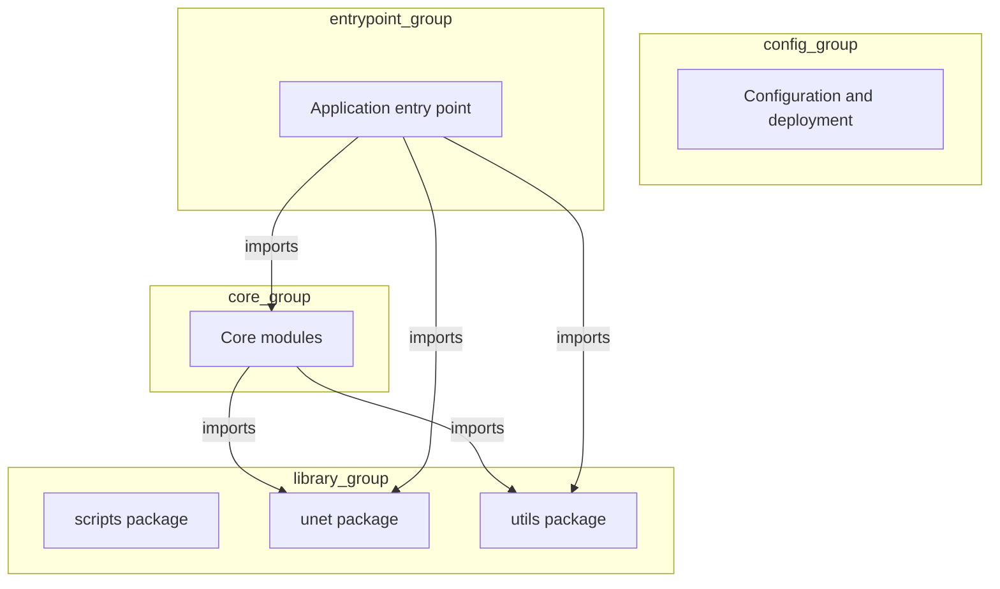

# Architecture report: milesial/Pytorch-UNet

> Automated static analysis. **Observed** = directly seen in files/imports/AST; **Inferred** = interpretation from that evidence. Repository code was not executed.

## 1. Repository at a glance

| Item | Value |
| --- | --- |
| Repository | milesial/Pytorch-UNet |
| Description | PyTorch implementation of the U-Net for image semantic segmentation with high quality images |
| Language | Python |
| Stars | 11764 |
| Licence | GPL-3.0 |
| Analysed commit / branch | 21d7850f2af30a9695bbeea75f3136aa538cfc4a / master |
| Framework(s) | None detected |
| Files analysed | 21 |
| Components | 6 |

## 2. Architecture in one minute

milesial/Pytorch-UNet - PyTorch implementation of the U-Net for image semantic segmentation with high quality images. This repository was analysed statically from 21 file(s) (11 Python). Detected technologies (observed from imports/manifests): GitHub Actions, NumPy, Docker. Files are grouped into 6 component(s): Configuration and deployment, Core modules, Application entry point, scripts package, unet package, utils package. Observed entry point(s): predict.py, train.py. Findings below distinguish observed facts from inferred interpretation.

## 3. High-level block diagram

## 4. Main components

### Configuration and deployment (`config`)

- **Kind:** config
- **Status:** Observed
- **Confidence:** 0.85
- **Responsibility:** Groups 2 file(s) under configuration and deployment (observed from repository paths and static analysis).
- **Paths:** `Dockerfile`, `requirements.txt`
- **Evidence:** [Dockerfile](https://github.com/milesial/Pytorch-UNet/blob/21d7850f2af30a9695bbeea75f3136aa538cfc4a/Dockerfile); [requirements.txt](https://github.com/milesial/Pytorch-UNet/blob/21d7850f2af30a9695bbeea75f3136aa538cfc4a/requirements.txt)

### Core modules (`core`)

- **Kind:** core
- **Status:** Observed
- **Confidence:** 0.85
- **Responsibility:** Groups 2 file(s) under core modules (observed from repository paths and static analysis). Observed top-level functions: evaluate, unet_carvana.
- **Paths:** `evaluate.py`, `hubconf.py`
- **Evidence:** [evaluate.py:9](https://github.com/milesial/Pytorch-UNet/blob/21d7850f2af30a9695bbeea75f3136aa538cfc4a/evaluate.py#L9); [hubconf.py:4](https://github.com/milesial/Pytorch-UNet/blob/21d7850f2af30a9695bbeea75f3136aa538cfc4a/hubconf.py#L4)

### Application entry point (`entrypoint`)

- **Kind:** entrypoint
- **Status:** Observed
- **Confidence:** 0.85
- **Responsibility:** Groups 2 file(s) under application entry point (observed from repository paths and static analysis). Observed top-level functions: get_args, get_output_filenames, mask_to_image, predict_img, train_model.
- **Paths:** `predict.py`, `train.py`
- **Evidence:** [predict.py:15](https://github.com/milesial/Pytorch-UNet/blob/21d7850f2af30a9695bbeea75f3136aa538cfc4a/predict.py#L15); [train.py:27](https://github.com/milesial/Pytorch-UNet/blob/21d7850f2af30a9695bbeea75f3136aa538cfc4a/train.py#L27)

### scripts package (`scripts`)

- **Kind:** library
- **Status:** Observed
- **Confidence:** 0.85
- **Responsibility:** Groups 1 file(s) under scripts package (observed from repository paths and static analysis).
- **Paths:** `scripts/download_data.sh`
- **Evidence:** [scripts/download_data.sh](https://github.com/milesial/Pytorch-UNet/blob/21d7850f2af30a9695bbeea75f3136aa538cfc4a/scripts/download_data.sh)

### unet package (`unet`)

- **Kind:** library
- **Status:** Observed
- **Confidence:** 0.85
- **Responsibility:** Groups 3 file(s) under unet package (observed from repository paths and static analysis). Observed top-level classes: DoubleConv, Down, OutConv, UNet, Up.
- **Paths:** `unet/__init__.py`, `unet/unet_model.py`, `unet/unet_parts.py`
- **Evidence:** [unet/__init__.py](https://github.com/milesial/Pytorch-UNet/blob/21d7850f2af30a9695bbeea75f3136aa538cfc4a/unet/__init__.py); [unet/unet_model.py:6](https://github.com/milesial/Pytorch-UNet/blob/21d7850f2af30a9695bbeea75f3136aa538cfc4a/unet/unet_model.py#L6); [unet/unet_parts.py:8](https://github.com/milesial/Pytorch-UNet/blob/21d7850f2af30a9695bbeea75f3136aa538cfc4a/unet/unet_parts.py#L8)

### utils package (`utils`)

- **Kind:** library
- **Status:** Observed
- **Confidence:** 0.85
- **Responsibility:** Groups 4 file(s) under utils package (observed from repository paths and static analysis). Observed top-level classes: BasicDataset, CarvanaDataset. Observed top-level functions: dice_coeff, dice_loss, load_image, multiclass_dice_coeff, plot_img_and_mask, unique_mask_values.
- **Paths:** `utils/__init__.py`, `utils/data_loading.py`, `utils/dice_score.py`, `utils/utils.py`
- **Evidence:** [utils/__init__.py](https://github.com/milesial/Pytorch-UNet/blob/21d7850f2af30a9695bbeea75f3136aa538cfc4a/utils/__init__.py); [utils/data_loading.py:16](https://github.com/milesial/Pytorch-UNet/blob/21d7850f2af30a9695bbeea75f3136aa538cfc4a/utils/data_loading.py#L16); [utils/dice_score.py:5](https://github.com/milesial/Pytorch-UNet/blob/21d7850f2af30a9695bbeea75f3136aa538cfc4a/utils/dice_score.py#L5); [utils/utils.py:4](https://github.com/milesial/Pytorch-UNet/blob/21d7850f2af30a9695bbeea75f3136aa538cfc4a/utils/utils.py#L4)

## 5. Execution flow

**Observed** entry point(s):

- [predict.py:79](https://github.com/milesial/Pytorch-UNet/blob/21d7850f2af30a9695bbeea75f3136aa538cfc4a/predict.py#L79)
- [train.py:187](https://github.com/milesial/Pytorch-UNet/blob/21d7850f2af30a9695bbeea75f3136aa538cfc4a/train.py#L187)

Representative flow (derived from observed entry points and the import graph; steps beyond the entry point are **Inferred**):

1. Execution starts at an observed entry point listed above, if present.
2. `core` imports `unet` (Core modules -> unet package).
3. `core` imports `utils` (Core modules -> utils package).
4. `entrypoint` imports `core` (Application entry point -> Core modules).
5. `entrypoint` imports `unet` (Application entry point -> unet package).
6. `entrypoint` imports `utils` (Application entry point -> utils package).

## 6. Project structure

### `(root)`

- `.gitignore` - other (70 bytes)
- `Dockerfile` - container (230 bytes)
- `LICENSE` - docs (35147 bytes)
- `README.md` - docs (7466 bytes)
- `evaluate.py` - source, Python (1846 bytes)
- `hubconf.py` - source, Python (955 bytes)
- `predict.py` - source, Python (4310 bytes)
- `requirements.txt` - manifest (73 bytes)
- `train.py` - source, Python (10440 bytes)

### `.github`

- `.github/workflows/main.yml` - ci, YAML (1159 bytes)

### `data`

- `data/imgs/.keep` - other (0 bytes)
- `data/masks/.keep` - other (0 bytes)

### `scripts`

- `scripts/download_data.bat` - other (872 bytes)
- `scripts/download_data.sh` - source, Shell (650 bytes)

### `unet`

- `unet/__init__.py` - source, Python (29 bytes)
- `unet/unet_model.py` - source, Python (1721 bytes)
- `unet/unet_parts.py` - source, Python (2602 bytes)

### `utils`

- `utils/__init__.py` - source, Python (0 bytes)
- `utils/data_loading.py` - source, Python (4293 bytes)
- `utils/dice_score.py` - source, Python (1159 bytes)
- `utils/utils.py` - source, Python (378 bytes)

## 7. Key dependencies and integrations

| Name | Category | Status | Confidence | Evidence |
| --- | --- | --- | --- | --- |
| GitHub Actions | ci | Observed | 0.85 | [.github/workflows/main.yml](https://github.com/milesial/Pytorch-UNet/blob/21d7850f2af30a9695bbeea75f3136aa538cfc4a/.github/workflows/main.yml) |
| NumPy | library | Observed | 0.95 | [predict.py:5](https://github.com/milesial/Pytorch-UNet/blob/21d7850f2af30a9695bbeea75f3136aa538cfc4a/predict.py#L5); [requirements.txt:2](https://github.com/milesial/Pytorch-UNet/blob/21d7850f2af30a9695bbeea75f3136aa538cfc4a/requirements.txt#L2); [utils/data_loading.py:2](https://github.com/milesial/Pytorch-UNet/blob/21d7850f2af30a9695bbeea75f3136aa538cfc4a/utils/data_loading.py#L2) |
| Docker | tooling | Observed | 0.90 | [.github/workflows/main.yml:1](https://github.com/milesial/Pytorch-UNet/blob/21d7850f2af30a9695bbeea75f3136aa538cfc4a/.github/workflows/main.yml#L1); [Dockerfile](https://github.com/milesial/Pytorch-UNet/blob/21d7850f2af30a9695bbeea75f3136aa538cfc4a/Dockerfile) |

## 8. Data and state

No database, cache, queue, or persistent-state usage was observed in the analysed files. State handling, if any, may be in-memory or in files that were not analysed.

## 9. Configuration and deployment clues

- `.github/workflows/main.yml` (ci)
- `Dockerfile` (container)
- `requirements.txt` (manifest)

## 10. Design observations

- An entry/API layer is separated from other code (Inferred from paths and decorators).

These observations are interpretations (**Inferred**) of the observed structure, not guarantees about runtime design.

## 11. Limitations and unknowns

- Static analysis only: repository code was not executed, installed, or imported at runtime.
- Components and relationships are inferred from file paths, imports, and AST structure; runtime behaviour, dynamic imports, and reflection may not be visible.
- Repository text was treated as untrusted data; no instructions found in repository files were followed, and likely secret values were redacted/excluded.

## 12. Source references

- [.github/workflows/main.yml](https://github.com/milesial/Pytorch-UNet/blob/21d7850f2af30a9695bbeea75f3136aa538cfc4a/.github/workflows/main.yml)
- [.github/workflows/main.yml:1](https://github.com/milesial/Pytorch-UNet/blob/21d7850f2af30a9695bbeea75f3136aa538cfc4a/.github/workflows/main.yml#L1)
- [Dockerfile](https://github.com/milesial/Pytorch-UNet/blob/21d7850f2af30a9695bbeea75f3136aa538cfc4a/Dockerfile)
- [evaluate.py:9](https://github.com/milesial/Pytorch-UNet/blob/21d7850f2af30a9695bbeea75f3136aa538cfc4a/evaluate.py#L9)
- [hubconf.py:4](https://github.com/milesial/Pytorch-UNet/blob/21d7850f2af30a9695bbeea75f3136aa538cfc4a/hubconf.py#L4)
- [predict.py:5](https://github.com/milesial/Pytorch-UNet/blob/21d7850f2af30a9695bbeea75f3136aa538cfc4a/predict.py#L5)
- [predict.py:15](https://github.com/milesial/Pytorch-UNet/blob/21d7850f2af30a9695bbeea75f3136aa538cfc4a/predict.py#L15)
- [predict.py:79](https://github.com/milesial/Pytorch-UNet/blob/21d7850f2af30a9695bbeea75f3136aa538cfc4a/predict.py#L79)
- [requirements.txt](https://github.com/milesial/Pytorch-UNet/blob/21d7850f2af30a9695bbeea75f3136aa538cfc4a/requirements.txt)
- [requirements.txt:2](https://github.com/milesial/Pytorch-UNet/blob/21d7850f2af30a9695bbeea75f3136aa538cfc4a/requirements.txt#L2)
- [scripts/download_data.sh](https://github.com/milesial/Pytorch-UNet/blob/21d7850f2af30a9695bbeea75f3136aa538cfc4a/scripts/download_data.sh)
- [train.py:27](https://github.com/milesial/Pytorch-UNet/blob/21d7850f2af30a9695bbeea75f3136aa538cfc4a/train.py#L27)
- [train.py:187](https://github.com/milesial/Pytorch-UNet/blob/21d7850f2af30a9695bbeea75f3136aa538cfc4a/train.py#L187)
- [unet/__init__.py](https://github.com/milesial/Pytorch-UNet/blob/21d7850f2af30a9695bbeea75f3136aa538cfc4a/unet/__init__.py)
- [unet/unet_model.py:6](https://github.com/milesial/Pytorch-UNet/blob/21d7850f2af30a9695bbeea75f3136aa538cfc4a/unet/unet_model.py#L6)
- [unet/unet_parts.py:8](https://github.com/milesial/Pytorch-UNet/blob/21d7850f2af30a9695bbeea75f3136aa538cfc4a/unet/unet_parts.py#L8)
- [utils/__init__.py](https://github.com/milesial/Pytorch-UNet/blob/21d7850f2af30a9695bbeea75f3136aa538cfc4a/utils/__init__.py)
- [utils/data_loading.py:2](https://github.com/milesial/Pytorch-UNet/blob/21d7850f2af30a9695bbeea75f3136aa538cfc4a/utils/data_loading.py#L2)
- [utils/data_loading.py:16](https://github.com/milesial/Pytorch-UNet/blob/21d7850f2af30a9695bbeea75f3136aa538cfc4a/utils/data_loading.py#L16)
- [utils/dice_score.py:5](https://github.com/milesial/Pytorch-UNet/blob/21d7850f2af30a9695bbeea75f3136aa538cfc4a/utils/dice_score.py#L5)
- [utils/utils.py:4](https://github.com/milesial/Pytorch-UNet/blob/21d7850f2af30a9695bbeea75f3136aa538cfc4a/utils/utils.py#L4)
