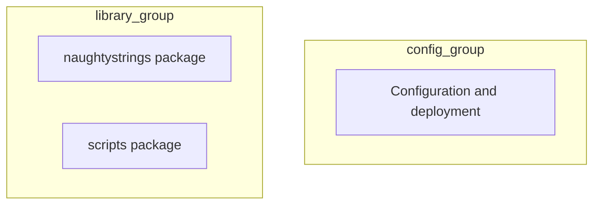

# Architecture report: minimaxir/big-list-of-naughty-strings

> Automated static analysis. **Observed** = directly seen in files/imports/AST; **Inferred** = interpretation from that evidence. Repository code was not executed.

## 1. Repository at a glance

| Item | Value |
| --- | --- |
| Repository | minimaxir/big-list-of-naughty-strings |
| Description | The Big List of Naughty Strings is a list of strings which have a high probability of causing issues when used as user-input data. |
| Language | Python |
| Stars | 47716 |
| Licence | MIT |
| Analysed commit / branch | db33ec7b1d5d9616a88c76394b7d0897bd0b97eb / master |
| Framework(s) | None detected |
| Files analysed | 16 |
| Components | 3 |

## 2. Architecture in one minute

minimaxir/big-list-of-naughty-strings - The Big List of Naughty Strings is a list of strings which have a high probability of causing issues when used as user-input data.. This repository was analysed statically from 16 file(s) (2 Python). Detected technologies (observed from imports/manifests): no known frameworks/libraries. Files are grouped into 3 component(s): Configuration and deployment, naughtystrings package, scripts package. Findings below distinguish observed facts from inferred interpretation.

## 3. High-level block diagram

## 4. Main components

### Configuration and deployment (`config`)

- **Kind:** config
- **Status:** Observed
- **Confidence:** 0.85
- **Responsibility:** Groups 4 file(s) under configuration and deployment (observed from repository paths and static analysis).
- **Paths:** `blns.base64.json`, `blns.json`, `naughtystrings/go.mod`, `package.json`
- **Evidence:** [blns.base64.json](https://github.com/minimaxir/big-list-of-naughty-strings/blob/db33ec7b1d5d9616a88c76394b7d0897bd0b97eb/blns.base64.json); [blns.json](https://github.com/minimaxir/big-list-of-naughty-strings/blob/db33ec7b1d5d9616a88c76394b7d0897bd0b97eb/blns.json); [naughtystrings/go.mod](https://github.com/minimaxir/big-list-of-naughty-strings/blob/db33ec7b1d5d9616a88c76394b7d0897bd0b97eb/naughtystrings/go.mod); [package.json](https://github.com/minimaxir/big-list-of-naughty-strings/blob/db33ec7b1d5d9616a88c76394b7d0897bd0b97eb/package.json)

### naughtystrings package (`naughtystrings`)

- **Kind:** library
- **Status:** Observed
- **Confidence:** 0.85
- **Responsibility:** Groups 4 file(s) under naughtystrings package (observed from repository paths and static analysis). Observed top-level functions: naughty_strings.
- **Paths:** `naughtystrings/__init__.py`, `naughtystrings/internal/resource.go`, `naughtystrings/naughtystrings.go`, `naughtystrings/naughtystrings_test.go`
- **Evidence:** [naughtystrings/__init__.py:9](https://github.com/minimaxir/big-list-of-naughty-strings/blob/db33ec7b1d5d9616a88c76394b7d0897bd0b97eb/naughtystrings/__init__.py#L9); [naughtystrings/internal/resource.go](https://github.com/minimaxir/big-list-of-naughty-strings/blob/db33ec7b1d5d9616a88c76394b7d0897bd0b97eb/naughtystrings/internal/resource.go); [naughtystrings/naughtystrings.go](https://github.com/minimaxir/big-list-of-naughty-strings/blob/db33ec7b1d5d9616a88c76394b7d0897bd0b97eb/naughtystrings/naughtystrings.go); [naughtystrings/naughtystrings_test.go](https://github.com/minimaxir/big-list-of-naughty-strings/blob/db33ec7b1d5d9616a88c76394b7d0897bd0b97eb/naughtystrings/naughtystrings_test.go)

### scripts package (`scripts`)

- **Kind:** library
- **Status:** Observed
- **Confidence:** 0.85
- **Responsibility:** Groups 2 file(s) under scripts package (observed from repository paths and static analysis).
- **Paths:** `scripts/texttobase64.sh`, `scripts/txt_to_json.py`
- **Evidence:** [scripts/texttobase64.sh](https://github.com/minimaxir/big-list-of-naughty-strings/blob/db33ec7b1d5d9616a88c76394b7d0897bd0b97eb/scripts/texttobase64.sh); [scripts/txt_to_json.py](https://github.com/minimaxir/big-list-of-naughty-strings/blob/db33ec7b1d5d9616a88c76394b7d0897bd0b97eb/scripts/txt_to_json.py)

## 5. Execution flow

No entry point was observed; the startup flow below is therefore limited.

Representative flow (derived from observed entry points and the import graph; steps beyond the entry point are **Inferred**):

1. Execution starts at an observed entry point listed above, if present.
2. No internal import relationships between components were observed.

## 6. Project structure

### `(root)`

- `.gitattributes` - other (30 bytes)
- `LICENSE` - docs (1082 bytes)
- `README.md` - docs (4526 bytes)
- `blns.base64.json` - config (34584 bytes)
- `blns.base64.txt` - docs (37469 bytes)
- `blns.json` - config (27191 bytes)
- `blns.txt` - docs (30079 bytes)
- `package.json` - manifest (536 bytes)

### `naughtystrings`

- `naughtystrings/Makefile` - other (161 bytes)
- `naughtystrings/__init__.py` - source, Python (982 bytes)
- `naughtystrings/go.mod` - manifest (71 bytes)
- `naughtystrings/internal/resource.go` - source, Go (66588 bytes)
- `naughtystrings/naughtystrings.go` - source, Go (1140 bytes)
- `naughtystrings/naughtystrings_test.go` - source, Go (238 bytes)

### `scripts`

- `scripts/texttobase64.sh` - source, Shell (271 bytes)
- `scripts/txt_to_json.py` - source, Python (826 bytes)

## 7. Key dependencies and integrations

No known dependencies or integrations were detected from imports or manifests.

## 8. Data and state

No database, cache, queue, or persistent-state usage was observed in the analysed files. State handling, if any, may be in-memory or in files that were not analysed.

## 9. Configuration and deployment clues

- `blns.base64.json` (config)
- `blns.json` (config)
- `naughtystrings/go.mod` (manifest)
- `package.json` (manifest)

## 10. Design observations

- No strong design patterns could be established from the available evidence.

These observations are interpretations (**Inferred**) of the observed structure, not guarantees about runtime design.

## 11. Limitations and unknowns

- Static analysis only: repository code was not executed, installed, or imported at runtime.
- Components and relationships are inferred from file paths, imports, and AST structure; runtime behaviour, dynamic imports, and reflection may not be visible.
- No clear application entry point was observed in the analysed files.
- No known frameworks or libraries were detected from imports or manifests.
- Repository text was treated as untrusted data; no instructions found in repository files were followed, and likely secret values were redacted/excluded.

## 12. Source references

- [blns.base64.json](https://github.com/minimaxir/big-list-of-naughty-strings/blob/db33ec7b1d5d9616a88c76394b7d0897bd0b97eb/blns.base64.json)
- [blns.json](https://github.com/minimaxir/big-list-of-naughty-strings/blob/db33ec7b1d5d9616a88c76394b7d0897bd0b97eb/blns.json)
- [naughtystrings/__init__.py:9](https://github.com/minimaxir/big-list-of-naughty-strings/blob/db33ec7b1d5d9616a88c76394b7d0897bd0b97eb/naughtystrings/__init__.py#L9)
- [naughtystrings/go.mod](https://github.com/minimaxir/big-list-of-naughty-strings/blob/db33ec7b1d5d9616a88c76394b7d0897bd0b97eb/naughtystrings/go.mod)
- [naughtystrings/internal/resource.go](https://github.com/minimaxir/big-list-of-naughty-strings/blob/db33ec7b1d5d9616a88c76394b7d0897bd0b97eb/naughtystrings/internal/resource.go)
- [naughtystrings/naughtystrings.go](https://github.com/minimaxir/big-list-of-naughty-strings/blob/db33ec7b1d5d9616a88c76394b7d0897bd0b97eb/naughtystrings/naughtystrings.go)
- [naughtystrings/naughtystrings_test.go](https://github.com/minimaxir/big-list-of-naughty-strings/blob/db33ec7b1d5d9616a88c76394b7d0897bd0b97eb/naughtystrings/naughtystrings_test.go)
- [package.json](https://github.com/minimaxir/big-list-of-naughty-strings/blob/db33ec7b1d5d9616a88c76394b7d0897bd0b97eb/package.json)
- [scripts/texttobase64.sh](https://github.com/minimaxir/big-list-of-naughty-strings/blob/db33ec7b1d5d9616a88c76394b7d0897bd0b97eb/scripts/texttobase64.sh)
- [scripts/txt_to_json.py](https://github.com/minimaxir/big-list-of-naughty-strings/blob/db33ec7b1d5d9616a88c76394b7d0897bd0b97eb/scripts/txt_to_json.py)
