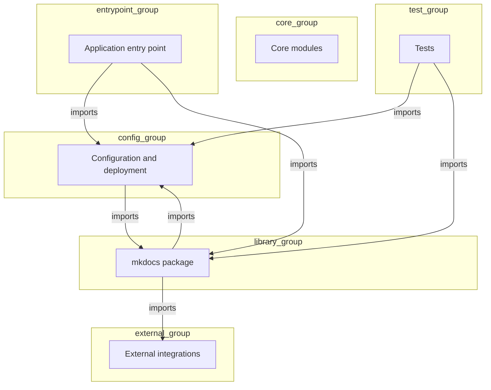

# Architecture report: mkdocs/mkdocs

> Automated static analysis. **Observed** = directly seen in files/imports/AST; **Inferred** = interpretation from that evidence. Repository code was not executed.

## 1. Repository at a glance

| Item | Value |
| --- | --- |
| Repository | mkdocs/mkdocs |
| Description | Project documentation with Markdown. |
| Language | Python |
| Stars | 22550 |
| Licence | BSD-2-Clause |
| Analysed commit / branch | 2862536793b3c67d9d83c33e0dd6d50a791928f8 / master |
| Framework(s) | None detected |
| Files analysed | 230 |
| Components | 6 |

## 2. Architecture in one minute

mkdocs/mkdocs - Project documentation with Markdown.. This repository was analysed statically from 230 file(s) (65 Python). Detected technologies (observed from imports/manifests): GitHub Actions, Click, Poetry, setuptools, unittest. Files are grouped into 6 component(s): Configuration and deployment, Core modules, Application entry point, External integrations, mkdocs package, Tests. Observed entry point(s): mkdocs/__main__.py. Findings below distinguish observed facts from inferred interpretation.

## 3. High-level block diagram

## 4. Main components

### Configuration and deployment (`config`)

- **Kind:** config
- **Status:** Observed
- **Confidence:** 0.85
- **Responsibility:** Groups 13 file(s) under configuration and deployment (observed from repository paths and static analysis). Observed top-level classes: BaseConfigOption, Choice, Config, ConfigItems, Deprecated, DictOfItems. Observed top-level functions: _open_config_file, get_schema, load_config.
- **Paths:** `FUNDING.yml`, `mkdocs.yml`, `mkdocs/config/__init__.py`, `mkdocs/config/base.py`, `mkdocs/config/config_options.py`, `mkdocs/config/defaults.py`, `mkdocs/themes/babel.cfg`, `mkdocs/themes/mkdocs/mkdocs_theme.yml`, `mkdocs/themes/readthedocs/mkdocs_theme.yml`, `pyproject.toml`, `requirements/requirements-docs.txt`, `requirements/requirements-style.txt`, `setup.py`
- **Evidence:** [FUNDING.yml](https://github.com/mkdocs/mkdocs/blob/2862536793b3c67d9d83c33e0dd6d50a791928f8/FUNDING.yml); [mkdocs.yml](https://github.com/mkdocs/mkdocs/blob/2862536793b3c67d9d83c33e0dd6d50a791928f8/mkdocs.yml); [mkdocs/config/__init__.py](https://github.com/mkdocs/mkdocs/blob/2862536793b3c67d9d83c33e0dd6d50a791928f8/mkdocs/config/__init__.py); [mkdocs/config/base.py:37](https://github.com/mkdocs/mkdocs/blob/2862536793b3c67d9d83c33e0dd6d50a791928f8/mkdocs/config/base.py#L37); [mkdocs/config/config_options.py:52](https://github.com/mkdocs/mkdocs/blob/2862536793b3c67d9d83c33e0dd6d50a791928f8/mkdocs/config/config_options.py#L52); [mkdocs/config/defaults.py:12](https://github.com/mkdocs/mkdocs/blob/2862536793b3c67d9d83c33e0dd6d50a791928f8/mkdocs/config/defaults.py#L12); [mkdocs/themes/babel.cfg](https://github.com/mkdocs/mkdocs/blob/2862536793b3c67d9d83c33e0dd6d50a791928f8/mkdocs/themes/babel.cfg); [mkdocs/themes/mkdocs/mkdocs_theme.yml](https://github.com/mkdocs/mkdocs/blob/2862536793b3c67d9d83c33e0dd6d50a791928f8/mkdocs/themes/mkdocs/mkdocs_theme.yml)

### Core modules (`core`)

- **Kind:** core
- **Status:** Observed
- **Confidence:** 0.85
- **Responsibility:** Groups 1 file(s) under core modules (observed from repository paths and static analysis). Observed top-level classes: CustomBuildHook.
- **Paths:** `hatch_build.py`
- **Evidence:** [hatch_build.py:6](https://github.com/mkdocs/mkdocs/blob/2862536793b3c67d9d83c33e0dd6d50a791928f8/hatch_build.py#L6)

### Application entry point (`entrypoint`)

- **Kind:** entrypoint
- **Status:** Observed
- **Confidence:** 0.85
- **Responsibility:** Groups 1 file(s) under application entry point (observed from repository paths and static analysis). Observed top-level classes: ColorFormatter, State. Observed top-level functions: _enable_warnings, _showwarning, add_options, build_command, cli, color_option.
- **Paths:** `mkdocs/__main__.py`
- **Evidence:** [mkdocs/__main__.py:28](https://github.com/mkdocs/mkdocs/blob/2862536793b3c67d9d83c33e0dd6d50a791928f8/mkdocs/__main__.py#L28)

### External integrations (`external_integrations`)

- **Kind:** external
- **Status:** Inferred
- **Confidence:** 0.70
- **Responsibility:** Groups 0 file(s) under external integrations (observed from repository paths and static analysis).
- **Evidence:** [mkdocs/livereload/__init__.py:13](https://github.com/mkdocs/mkdocs/blob/2862536793b3c67d9d83c33e0dd6d50a791928f8/mkdocs/livereload/__init__.py#L13)

### mkdocs package (`mkdocs`)

- **Kind:** library
- **Status:** Observed
- **Confidence:** 0.85
- **Responsibility:** Groups 69 file(s) under mkdocs package (observed from repository paths and static analysis). Observed top-level classes: Abort, AnchorLink, BasePlugin, BuildError, CombinedEvent, ConfigDirPlaceholder. Observed top-level functions: __getattr__, _add_parent_links, _add_previous_and_next_links, _build_extra_template, _build_page, _build_template.
- **Paths:** `mkdocs/__init__.py`, `mkdocs/commands/__init__.py`, `mkdocs/commands/build.py`, `mkdocs/commands/gh_deploy.py`, `mkdocs/commands/new.py`, `mkdocs/commands/serve.py`, `mkdocs/contrib/__init__.py`, `mkdocs/contrib/search/__init__.py`, `mkdocs/contrib/search/lunr-language/lunr.ar.js`, `mkdocs/contrib/search/lunr-language/lunr.da.js`, `mkdocs/contrib/search/lunr-language/lunr.de.js`, `mkdocs/contrib/search/lunr-language/lunr.du.js`, `mkdocs/contrib/search/lunr-language/lunr.es.js`, `mkdocs/contrib/search/lunr-language/lunr.fi.js`, `mkdocs/contrib/search/lunr-language/lunr.fr.js`, `mkdocs/contrib/search/lunr-language/lunr.hi.js`, `mkdocs/contrib/search/lunr-language/lunr.hu.js`, `mkdocs/contrib/search/lunr-language/lunr.hy.js`, `mkdocs/contrib/search/lunr-language/lunr.it.js`, `mkdocs/contrib/search/lunr-language/lunr.ja.js`, `mkdocs/contrib/search/lunr-language/lunr.jp.js`, `mkdocs/contrib/search/lunr-language/lunr.kn.js`, `mkdocs/contrib/search/lunr-language/lunr.ko.js`, `mkdocs/contrib/search/lunr-language/lunr.multi.js`, `mkdocs/contrib/search/lunr-language/lunr.nl.js`, `mkdocs/contrib/search/lunr-language/lunr.no.js`, `mkdocs/contrib/search/lunr-language/lunr.pt.js`, `mkdocs/contrib/search/lunr-language/lunr.ro.js`, `mkdocs/contrib/search/lunr-language/lunr.ru.js`, `mkdocs/contrib/search/lunr-language/lunr.sa.js`, `mkdocs/contrib/search/lunr-language/lunr.stemmer.support.js`, `mkdocs/contrib/search/lunr-language/lunr.sv.js`, `mkdocs/contrib/search/lunr-language/lunr.ta.js`, `mkdocs/contrib/search/lunr-language/lunr.te.js`, `mkdocs/contrib/search/lunr-language/lunr.th.js`, `mkdocs/contrib/search/lunr-language/lunr.tr.js`, `mkdocs/contrib/search/lunr-language/lunr.vi.js`, `mkdocs/contrib/search/lunr-language/lunr.zh.js`, `mkdocs/contrib/search/lunr-language/tinyseg.js`, `mkdocs/contrib/search/prebuild-index.js`, `mkdocs/contrib/search/search_index.py`, `mkdocs/contrib/search/templates/search/lunr.js`, `mkdocs/contrib/search/templates/search/main.js`, `mkdocs/contrib/search/templates/search/worker.js`, `mkdocs/exceptions.py`, `mkdocs/livereload/__init__.py`, `mkdocs/localization.py`, `mkdocs/plugins.py`, `mkdocs/structure/__init__.py`, `mkdocs/structure/files.py`, `mkdocs/structure/nav.py`, `mkdocs/structure/pages.py`, `mkdocs/structure/toc.py`, `mkdocs/theme.py`, `mkdocs/themes/__init__.py`, `mkdocs/themes/mkdocs/__init__.py`, `mkdocs/themes/mkdocs/js/base.js`, `mkdocs/themes/mkdocs/js/darkmode.js`, `mkdocs/themes/readthedocs/__init__.py`, `mkdocs/themes/readthedocs/js/theme.js`, `mkdocs/themes/readthedocs/js/theme_extra.js`, `mkdocs/utils/__init__.py`, `mkdocs/utils/babel_stub.py`, `mkdocs/utils/cache.py`, `mkdocs/utils/filters.py`, `mkdocs/utils/meta.py`, `mkdocs/utils/rendering.py`, `mkdocs/utils/templates.py`, `mkdocs/utils/yaml.py`
- **Evidence:** [mkdocs/__init__.py](https://github.com/mkdocs/mkdocs/blob/2862536793b3c67d9d83c33e0dd6d50a791928f8/mkdocs/__init__.py); [mkdocs/commands/__init__.py](https://github.com/mkdocs/mkdocs/blob/2862536793b3c67d9d83c33e0dd6d50a791928f8/mkdocs/commands/__init__.py); [mkdocs/commands/build.py:29](https://github.com/mkdocs/mkdocs/blob/2862536793b3c67d9d83c33e0dd6d50a791928f8/mkdocs/commands/build.py#L29); [mkdocs/commands/gh_deploy.py:23](https://github.com/mkdocs/mkdocs/blob/2862536793b3c67d9d83c33e0dd6d50a791928f8/mkdocs/commands/gh_deploy.py#L23); [mkdocs/commands/new.py:29](https://github.com/mkdocs/mkdocs/blob/2862536793b3c67d9d83c33e0dd6d50a791928f8/mkdocs/commands/new.py#L29); [mkdocs/commands/serve.py:20](https://github.com/mkdocs/mkdocs/blob/2862536793b3c67d9d83c33e0dd6d50a791928f8/mkdocs/commands/serve.py#L20); [mkdocs/contrib/__init__.py](https://github.com/mkdocs/mkdocs/blob/2862536793b3c67d9d83c33e0dd6d50a791928f8/mkdocs/contrib/__init__.py); [mkdocs/contrib/search/__init__.py:23](https://github.com/mkdocs/mkdocs/blob/2862536793b3c67d9d83c33e0dd6d50a791928f8/mkdocs/contrib/search/__init__.py#L23)

### Tests (`tests`)

- **Kind:** test
- **Status:** Observed
- **Confidence:** 0.85
- **Responsibility:** Groups 51 file(s) under tests (observed from repository paths and static analysis). Observed routes: PATCH mkdocs.utils.write_file, PATCH mkdocs.commands.build._build_template, PATCH mkdocs.utils.write_file, PATCH mkdocs.commands.build._build_template, PATCH gzip.GzipFile. Observed top-level classes: BabelStubTests, BuildTests, CLITests, ChoiceTest, ConfigBaseTests, ConfigItemsTest. Observed top-level functions: build_page, change_dir, dedent, do_request, get_markdown_toc, load_config.
- **Paths:** `mkdocs/tests/__init__.py`, `mkdocs/tests/base.py`, `mkdocs/tests/build_tests.py`, `mkdocs/tests/cli_tests.py`, `mkdocs/tests/config/__init__.py`, `mkdocs/tests/config/base_tests.py`, `mkdocs/tests/config/config_options_legacy_tests.py`, `mkdocs/tests/config/config_options_tests.py`, `mkdocs/tests/config/config_tests.py`, `mkdocs/tests/gh_deploy_tests.py`, `mkdocs/tests/integration.py`, `mkdocs/tests/integration/complicated_config/documentation/custom.html`, `mkdocs/tests/integration/complicated_config/documentation/index.md`, `mkdocs/tests/integration/complicated_config/documentation/tweak.css`, `mkdocs/tests/integration/complicated_config/documentation/tweak.js`, `mkdocs/tests/integration/complicated_config/mkdocs.yml`, `mkdocs/tests/integration/complicated_config/theme_tweaks/404.html`, `mkdocs/tests/integration/minimal/docs/testing.md`, `mkdocs/tests/integration/minimal/mkdocs.yml`, `mkdocs/tests/integration/projects.yaml`, `mkdocs/tests/integration/subpages/docs/index.md`, `mkdocs/tests/integration/subpages/docs/metadata.md`, `mkdocs/tests/integration/subpages/docs/non-index.md`, `mkdocs/tests/integration/subpages/docs/page-title.md`, `mkdocs/tests/integration/subpages/docs/pageTitle.md`, `mkdocs/tests/integration/subpages/docs/sub1/index.md`, `mkdocs/tests/integration/subpages/docs/sub1/non-index.md`, `mkdocs/tests/integration/subpages/docs/sub1/sub1a/index.md`, `mkdocs/tests/integration/subpages/docs/sub1/sub1a/non-index.md`, `mkdocs/tests/integration/subpages/docs/sub2/index.md`, `mkdocs/tests/integration/subpages/docs/sub2/non-index.md`, `mkdocs/tests/integration/subpages/mkdocs.yml`, `mkdocs/tests/integration/unicode/docs/index.md`, `mkdocs/tests/integration/unicode/docs/Übersicht.md`, `mkdocs/tests/integration/unicode/docs/♪.md`, `mkdocs/tests/integration/unicode/mkdocs.yml`, `mkdocs/tests/livereload_tests.py`, `mkdocs/tests/localization_tests.py`, `mkdocs/tests/new_tests.py`, `mkdocs/tests/plugin_tests.py`, `mkdocs/tests/search_tests.py`, `mkdocs/tests/structure/__init__.py`, `mkdocs/tests/structure/file_tests.py`, `mkdocs/tests/structure/nav_tests.py`, `mkdocs/tests/structure/page_tests.py`, `mkdocs/tests/structure/toc_tests.py`, `mkdocs/tests/theme_tests.py`, `mkdocs/tests/utils/__init__.py`, `mkdocs/tests/utils/babel_stub_tests.py`, `mkdocs/tests/utils/templates_tests.py`, `mkdocs/tests/utils/utils_tests.py`
- **Evidence:** [mkdocs/tests/__init__.py:7](https://github.com/mkdocs/mkdocs/blob/2862536793b3c67d9d83c33e0dd6d50a791928f8/mkdocs/tests/__init__.py#L7); [mkdocs/tests/base.py:15](https://github.com/mkdocs/mkdocs/blob/2862536793b3c67d9d83c33e0dd6d50a791928f8/mkdocs/tests/base.py#L15); [mkdocs/tests/build_tests.py:29](https://github.com/mkdocs/mkdocs/blob/2862536793b3c67d9d83c33e0dd6d50a791928f8/mkdocs/tests/build_tests.py#L29); [mkdocs/tests/cli_tests.py:13](https://github.com/mkdocs/mkdocs/blob/2862536793b3c67d9d83c33e0dd6d50a791928f8/mkdocs/tests/cli_tests.py#L13); [mkdocs/tests/config/__init__.py](https://github.com/mkdocs/mkdocs/blob/2862536793b3c67d9d83c33e0dd6d50a791928f8/mkdocs/tests/config/__init__.py); [mkdocs/tests/config/base_tests.py:12](https://github.com/mkdocs/mkdocs/blob/2862536793b3c67d9d83c33e0dd6d50a791928f8/mkdocs/tests/config/base_tests.py#L12); [mkdocs/tests/config/config_options_legacy_tests.py:21](https://github.com/mkdocs/mkdocs/blob/2862536793b3c67d9d83c33e0dd6d50a791928f8/mkdocs/tests/config/config_options_legacy_tests.py#L21); [mkdocs/tests/config/config_options_tests.py:35](https://github.com/mkdocs/mkdocs/blob/2862536793b3c67d9d83c33e0dd6d50a791928f8/mkdocs/tests/config/config_options_tests.py#L35)

## 5. Execution flow

**Observed** entry point(s):

- [mkdocs/__main__.py](https://github.com/mkdocs/mkdocs/blob/2862536793b3c67d9d83c33e0dd6d50a791928f8/mkdocs/__main__.py)

**Observed** routes (from decorators):

- `PATCH mkdocs.utils.write_file` -> `test_build_theme_template` in `mkdocs/tests/build_tests.py:225`
- `PATCH mkdocs.commands.build._build_template` -> `test_build_theme_template` in `mkdocs/tests/build_tests.py:225`
- `PATCH mkdocs.utils.write_file` -> `test_build_sitemap_template` in `mkdocs/tests/build_tests.py:236`
- `PATCH mkdocs.commands.build._build_template` -> `test_build_sitemap_template` in `mkdocs/tests/build_tests.py:236`
- `PATCH gzip.GzipFile` -> `test_build_sitemap_template` in `mkdocs/tests/build_tests.py:236`
- `PATCH mkdocs.utils.write_file` -> `test_skip_missing_theme_template` in `mkdocs/tests/build_tests.py:248`
- `PATCH mkdocs.commands.build._build_template` -> `test_skip_missing_theme_template` in `mkdocs/tests/build_tests.py:248`
- `PATCH mkdocs.utils.write_file` -> `test_skip_theme_template_empty_output` in `mkdocs/tests/build_tests.py:262`
- `PATCH mkdocs.commands.build._build_template` -> `test_skip_theme_template_empty_output` in `mkdocs/tests/build_tests.py:262`
- `PATCH mkdocs.structure.files.open` -> `test_build_extra_template` in `mkdocs/tests/build_tests.py:278`
- `PATCH mkdocs.structure.files.open` -> `test_skip_missing_extra_template` in `mkdocs/tests/build_tests.py:285`
- `PATCH mkdocs.structure.files.open` -> `test_skip_ioerror_extra_template` in `mkdocs/tests/build_tests.py:297`
- `PATCH mkdocs.structure.files.open` -> `test_skip_extra_template_empty_output` in `mkdocs/tests/build_tests.py:309`
- `PATCH mkdocs.structure.files.open` -> `test_populate_page_read_error` in `mkdocs/tests/build_tests.py:354`
- `PATCH jinja2.environment.Template.render` -> `test_build_page_empty` in `mkdocs/tests/build_tests.py:406`
- `PATCH mkdocs.utils.write_file` -> `test_build_page_dirty_modified` in `mkdocs/tests/build_tests.py:425`
- `PATCH mkdocs.utils.write_file` -> `test_build_page_dirty_not_modified` in `mkdocs/tests/build_tests.py:442`
- `PATCH mkdocs.utils.write_file` -> `test_build_page_error` in `mkdocs/tests/build_tests.py:474`
- `PATCH mkdocs.commands.serve.serve` -> `test_serve_default` in `mkdocs/tests/cli_tests.py:18`
- `PATCH mkdocs.commands.serve.serve` -> `test_serve_config_file` in `mkdocs/tests/cli_tests.py:36`
- `PATCH mkdocs.commands.serve.serve` -> `test_serve_dev_addr` in `mkdocs/tests/cli_tests.py:49`
- `PATCH mkdocs.commands.serve.serve` -> `test_serve_strict` in `mkdocs/tests/cli_tests.py:69`
- `PATCH mkdocs.commands.serve.serve` -> `test_serve_theme` in `mkdocs/tests/cli_tests.py:87`
- `PATCH mkdocs.commands.serve.serve` -> `test_serve_use_directory_urls` in `mkdocs/tests/cli_tests.py:107`
- `PATCH mkdocs.commands.serve.serve` -> `test_serve_no_directory_urls` in `mkdocs/tests/cli_tests.py:127`
- `PATCH mkdocs.commands.serve.serve` -> `test_serve_livereload` in `mkdocs/tests/cli_tests.py:147`
- `PATCH mkdocs.commands.serve.serve` -> `test_serve_no_livereload` in `mkdocs/tests/cli_tests.py:165`
- `PATCH mkdocs.commands.serve.serve` -> `test_serve_dirtyreload` in `mkdocs/tests/cli_tests.py:183`
- `PATCH mkdocs.commands.serve.serve` -> `test_serve_watch_theme` in `mkdocs/tests/cli_tests.py:201`
- `PATCH mkdocs.config.load_config` -> `test_build_defaults` in `mkdocs/tests/cli_tests.py:220`
- `PATCH mkdocs.commands.build.build` -> `test_build_defaults` in `mkdocs/tests/cli_tests.py:220`
- `PATCH mkdocs.config.load_config` -> `test_build_clean` in `mkdocs/tests/cli_tests.py:240`
- `PATCH mkdocs.commands.build.build` -> `test_build_clean` in `mkdocs/tests/cli_tests.py:240`
- `PATCH mkdocs.config.load_config` -> `test_build_dirty` in `mkdocs/tests/cli_tests.py:251`
- `PATCH mkdocs.commands.build.build` -> `test_build_dirty` in `mkdocs/tests/cli_tests.py:251`
- `PATCH mkdocs.config.load_config` -> `test_build_config_file` in `mkdocs/tests/cli_tests.py:262`
- `PATCH mkdocs.commands.build.build` -> `test_build_config_file` in `mkdocs/tests/cli_tests.py:262`
- `PATCH mkdocs.config.load_config` -> `test_build_strict` in `mkdocs/tests/cli_tests.py:277`
- `PATCH mkdocs.commands.build.build` -> `test_build_strict` in `mkdocs/tests/cli_tests.py:277`
- `PATCH mkdocs.config.load_config` -> `test_build_theme` in `mkdocs/tests/cli_tests.py:292`
- `PATCH mkdocs.commands.build.build` -> `test_build_theme` in `mkdocs/tests/cli_tests.py:292`
- `PATCH mkdocs.config.load_config` -> `test_build_use_directory_urls` in `mkdocs/tests/cli_tests.py:309`
- `PATCH mkdocs.commands.build.build` -> `test_build_use_directory_urls` in `mkdocs/tests/cli_tests.py:309`
- `PATCH mkdocs.config.load_config` -> `test_build_no_directory_urls` in `mkdocs/tests/cli_tests.py:326`
- `PATCH mkdocs.commands.build.build` -> `test_build_no_directory_urls` in `mkdocs/tests/cli_tests.py:326`
- `PATCH mkdocs.config.load_config` -> `test_build_site_dir` in `mkdocs/tests/cli_tests.py:343`
- `PATCH mkdocs.commands.build.build` -> `test_build_site_dir` in `mkdocs/tests/cli_tests.py:343`
- `PATCH mkdocs.config.load_config` -> `test_build_verbose` in `mkdocs/tests/cli_tests.py:360`
- `PATCH mkdocs.commands.build.build` -> `test_build_verbose` in `mkdocs/tests/cli_tests.py:360`
- `PATCH mkdocs.config.load_config` -> `test_build_quiet` in `mkdocs/tests/cli_tests.py:370`
- `PATCH mkdocs.commands.build.build` -> `test_build_quiet` in `mkdocs/tests/cli_tests.py:370`
- `PATCH mkdocs.commands.new.new` -> `test_new` in `mkdocs/tests/cli_tests.py:379`
- `PATCH mkdocs.config.load_config` -> `test_gh_deploy_defaults` in `mkdocs/tests/cli_tests.py:388`
- `PATCH mkdocs.commands.build.build` -> `test_gh_deploy_defaults` in `mkdocs/tests/cli_tests.py:388`
- `PATCH mkdocs.commands.gh_deploy.gh_deploy` -> `test_gh_deploy_defaults` in `mkdocs/tests/cli_tests.py:388`
- `PATCH mkdocs.config.load_config` -> `test_gh_deploy_clean` in `mkdocs/tests/cli_tests.py:417`
- `PATCH mkdocs.commands.build.build` -> `test_gh_deploy_clean` in `mkdocs/tests/cli_tests.py:417`
- `PATCH mkdocs.commands.gh_deploy.gh_deploy` -> `test_gh_deploy_clean` in `mkdocs/tests/cli_tests.py:417`
- `PATCH mkdocs.config.load_config` -> `test_gh_deploy_dirty` in `mkdocs/tests/cli_tests.py:430`
- `PATCH mkdocs.commands.build.build` -> `test_gh_deploy_dirty` in `mkdocs/tests/cli_tests.py:430`
- `PATCH mkdocs.commands.gh_deploy.gh_deploy` -> `test_gh_deploy_dirty` in `mkdocs/tests/cli_tests.py:430`
- `PATCH mkdocs.config.load_config` -> `test_gh_deploy_config_file` in `mkdocs/tests/cli_tests.py:443`
- `PATCH mkdocs.commands.build.build` -> `test_gh_deploy_config_file` in `mkdocs/tests/cli_tests.py:443`
- `PATCH mkdocs.commands.gh_deploy.gh_deploy` -> `test_gh_deploy_config_file` in `mkdocs/tests/cli_tests.py:443`
- `PATCH mkdocs.config.load_config` -> `test_gh_deploy_message` in `mkdocs/tests/cli_tests.py:460`
- `PATCH mkdocs.commands.build.build` -> `test_gh_deploy_message` in `mkdocs/tests/cli_tests.py:460`
- `PATCH mkdocs.commands.gh_deploy.gh_deploy` -> `test_gh_deploy_message` in `mkdocs/tests/cli_tests.py:460`
- `PATCH mkdocs.config.load_config` -> `test_gh_deploy_remote_branch` in `mkdocs/tests/cli_tests.py:476`
- `PATCH mkdocs.commands.build.build` -> `test_gh_deploy_remote_branch` in `mkdocs/tests/cli_tests.py:476`
- `PATCH mkdocs.commands.gh_deploy.gh_deploy` -> `test_gh_deploy_remote_branch` in `mkdocs/tests/cli_tests.py:476`
- `PATCH mkdocs.config.load_config` -> `test_gh_deploy_remote_name` in `mkdocs/tests/cli_tests.py:497`
- `PATCH mkdocs.commands.build.build` -> `test_gh_deploy_remote_name` in `mkdocs/tests/cli_tests.py:497`
- `PATCH mkdocs.commands.gh_deploy.gh_deploy` -> `test_gh_deploy_remote_name` in `mkdocs/tests/cli_tests.py:497`
- `PATCH mkdocs.config.load_config` -> `test_gh_deploy_force` in `mkdocs/tests/cli_tests.py:518`
- `PATCH mkdocs.commands.build.build` -> `test_gh_deploy_force` in `mkdocs/tests/cli_tests.py:518`
- `PATCH mkdocs.commands.gh_deploy.gh_deploy` -> `test_gh_deploy_force` in `mkdocs/tests/cli_tests.py:518`
- `PATCH mkdocs.config.load_config` -> `test_gh_deploy_ignore_version` in `mkdocs/tests/cli_tests.py:532`
- `PATCH mkdocs.commands.build.build` -> `test_gh_deploy_ignore_version` in `mkdocs/tests/cli_tests.py:532`
- `PATCH mkdocs.commands.gh_deploy.gh_deploy` -> `test_gh_deploy_ignore_version` in `mkdocs/tests/cli_tests.py:532`
- `PATCH mkdocs.config.load_config` -> `test_gh_deploy_strict` in `mkdocs/tests/cli_tests.py:548`
- `PATCH mkdocs.commands.build.build` -> `test_gh_deploy_strict` in `mkdocs/tests/cli_tests.py:548`
- `PATCH mkdocs.commands.gh_deploy.gh_deploy` -> `test_gh_deploy_strict` in `mkdocs/tests/cli_tests.py:548`
- `PATCH mkdocs.config.load_config` -> `test_gh_deploy_theme` in `mkdocs/tests/cli_tests.py:567`
- `PATCH mkdocs.commands.build.build` -> `test_gh_deploy_theme` in `mkdocs/tests/cli_tests.py:567`
- `PATCH mkdocs.commands.gh_deploy.gh_deploy` -> `test_gh_deploy_theme` in `mkdocs/tests/cli_tests.py:567`
- `PATCH mkdocs.config.load_config` -> `test_gh_deploy_use_directory_urls` in `mkdocs/tests/cli_tests.py:588`
- `PATCH mkdocs.commands.build.build` -> `test_gh_deploy_use_directory_urls` in `mkdocs/tests/cli_tests.py:588`
- `PATCH mkdocs.commands.gh_deploy.gh_deploy` -> `test_gh_deploy_use_directory_urls` in `mkdocs/tests/cli_tests.py:588`
- `PATCH mkdocs.config.load_config` -> `test_gh_deploy_no_directory_urls` in `mkdocs/tests/cli_tests.py:609`
- `PATCH mkdocs.commands.build.build` -> `test_gh_deploy_no_directory_urls` in `mkdocs/tests/cli_tests.py:609`
- `PATCH mkdocs.commands.gh_deploy.gh_deploy` -> `test_gh_deploy_no_directory_urls` in `mkdocs/tests/cli_tests.py:609`
- `PATCH mkdocs.config.load_config` -> `test_gh_deploy_site_dir` in `mkdocs/tests/cli_tests.py:630`
- `PATCH mkdocs.commands.build.build` -> `test_gh_deploy_site_dir` in `mkdocs/tests/cli_tests.py:630`
- `PATCH mkdocs.commands.gh_deploy.gh_deploy` -> `test_gh_deploy_site_dir` in `mkdocs/tests/cli_tests.py:630`
- `PATCH markdown.Markdown` -> `test_simple_list` in `mkdocs/tests/config/config_options_legacy_tests.py:1359`
- `PATCH markdown.Markdown` -> `test_list_dicts` in `mkdocs/tests/config/config_options_legacy_tests.py:1372`
- `PATCH markdown.Markdown` -> `test_mixed_list` in `mkdocs/tests/config/config_options_legacy_tests.py:1395`
- `PATCH markdown.Markdown` -> `test_dict_of_dicts` in `mkdocs/tests/config/config_options_legacy_tests.py:1416`
- `PATCH markdown.Markdown` -> `test_builtins` in `mkdocs/tests/config/config_options_legacy_tests.py:1439`
- `PATCH markdown.Markdown` -> `test_configkey` in `mkdocs/tests/config/config_options_legacy_tests.py:1478`
- `PATCH markdown.Markdown` -> `test_not_list` in `mkdocs/tests/config/config_options_legacy_tests.py:1519`
- `PATCH markdown.Markdown` -> `test_invalid_config_option` in `mkdocs/tests/config/config_options_legacy_tests.py:1527`
- `PATCH markdown.Markdown` -> `test_invalid_config_item` in `mkdocs/tests/config/config_options_legacy_tests.py:1542`
- `PATCH markdown.Markdown` -> `test_invalid_dict_item` in `mkdocs/tests/config/config_options_legacy_tests.py:1555`
- `PATCH markdown.Markdown` -> `test_simple_list` in `mkdocs/tests/config/config_options_tests.py:1660`
- `PATCH markdown.Markdown` -> `test_list_dicts` in `mkdocs/tests/config/config_options_tests.py:1675`
- `PATCH markdown.Markdown` -> `test_mixed_list` in `mkdocs/tests/config/config_options_tests.py:1698`
- `PATCH markdown.Markdown` -> `test_dict_of_dicts` in `mkdocs/tests/config/config_options_tests.py:1719`
- `PATCH markdown.Markdown` -> `test_builtins` in `mkdocs/tests/config/config_options_tests.py:1742`
- `PATCH markdown.Markdown` -> `test_configkey` in `mkdocs/tests/config/config_options_tests.py:1781`
- `PATCH markdown.Markdown` -> `test_not_list` in `mkdocs/tests/config/config_options_tests.py:1822`
- `PATCH markdown.Markdown` -> `test_invalid_config_option` in `mkdocs/tests/config/config_options_tests.py:1830`
- `PATCH markdown.Markdown` -> `test_invalid_config_item` in `mkdocs/tests/config/config_options_tests.py:1845`
- `PATCH markdown.Markdown` -> `test_invalid_dict_item` in `mkdocs/tests/config/config_options_tests.py:1858`
- `PATCH subprocess.Popen` -> `test_is_cwd_git_repo` in `mkdocs/tests/gh_deploy_tests.py:14`
- `PATCH subprocess.Popen` -> `test_is_cwd_not_git_repo` in `mkdocs/tests/gh_deploy_tests.py:20`
- `PATCH subprocess.Popen` -> `test_get_current_sha` in `mkdocs/tests/gh_deploy_tests.py:26`
- `PATCH subprocess.Popen` -> `test_get_remote_url_ssh` in `mkdocs/tests/gh_deploy_tests.py:32`
- `PATCH subprocess.Popen` -> `test_get_remote_url_http` in `mkdocs/tests/gh_deploy_tests.py:42`
- `PATCH subprocess.Popen` -> `test_get_remote_url_enterprise` in `mkdocs/tests/gh_deploy_tests.py:52`
- `PATCH mkdocs.commands.gh_deploy._is_cwd_git_repo` -> `test_deploy` in `mkdocs/tests/gh_deploy_tests.py:66`
- `PATCH mkdocs.commands.gh_deploy._get_current_sha` -> `test_deploy` in `mkdocs/tests/gh_deploy_tests.py:66`
- `PATCH mkdocs.commands.gh_deploy._get_remote_url` -> `test_deploy` in `mkdocs/tests/gh_deploy_tests.py:66`
- `PATCH mkdocs.commands.gh_deploy._check_version` -> `test_deploy` in `mkdocs/tests/gh_deploy_tests.py:66`
- `PATCH ghp_import.ghp_import` -> `test_deploy` in `mkdocs/tests/gh_deploy_tests.py:66`
- `PATCH mkdocs.commands.gh_deploy._is_cwd_git_repo` -> `test_deploy_no_cname` in `mkdocs/tests/gh_deploy_tests.py:78`
- `PATCH mkdocs.commands.gh_deploy._get_current_sha` -> `test_deploy_no_cname` in `mkdocs/tests/gh_deploy_tests.py:78`
- `PATCH mkdocs.commands.gh_deploy._get_remote_url` -> `test_deploy_no_cname` in `mkdocs/tests/gh_deploy_tests.py:78`
- `PATCH mkdocs.commands.gh_deploy._check_version` -> `test_deploy_no_cname` in `mkdocs/tests/gh_deploy_tests.py:78`
- `PATCH ghp_import.ghp_import` -> `test_deploy_no_cname` in `mkdocs/tests/gh_deploy_tests.py:78`
- `PATCH os.path.isfile` -> `test_deploy_no_cname` in `mkdocs/tests/gh_deploy_tests.py:78`
- `PATCH mkdocs.commands.gh_deploy._is_cwd_git_repo` -> `test_deploy_hostname` in `mkdocs/tests/gh_deploy_tests.py:92`
- `PATCH mkdocs.commands.gh_deploy._get_current_sha` -> `test_deploy_hostname` in `mkdocs/tests/gh_deploy_tests.py:92`
- `PATCH mkdocs.commands.gh_deploy._get_remote_url` -> `test_deploy_hostname` in `mkdocs/tests/gh_deploy_tests.py:92`
- `PATCH mkdocs.commands.gh_deploy._check_version` -> `test_deploy_hostname` in `mkdocs/tests/gh_deploy_tests.py:92`
- `PATCH ghp_import.ghp_import` -> `test_deploy_hostname` in `mkdocs/tests/gh_deploy_tests.py:92`
- `PATCH mkdocs.commands.gh_deploy._is_cwd_git_repo` -> `test_deploy_ignore_version_default` in `mkdocs/tests/gh_deploy_tests.py:103`
- `PATCH mkdocs.commands.gh_deploy._get_current_sha` -> `test_deploy_ignore_version_default` in `mkdocs/tests/gh_deploy_tests.py:103`
- `PATCH mkdocs.commands.gh_deploy._get_remote_url` -> `test_deploy_ignore_version_default` in `mkdocs/tests/gh_deploy_tests.py:103`
- `PATCH mkdocs.commands.gh_deploy._check_version` -> `test_deploy_ignore_version_default` in `mkdocs/tests/gh_deploy_tests.py:103`
- `PATCH ghp_import.ghp_import` -> `test_deploy_ignore_version_default` in `mkdocs/tests/gh_deploy_tests.py:103`
- `PATCH mkdocs.commands.gh_deploy._is_cwd_git_repo` -> `test_deploy_ignore_version` in `mkdocs/tests/gh_deploy_tests.py:115`
- `PATCH mkdocs.commands.gh_deploy._get_current_sha` -> `test_deploy_ignore_version` in `mkdocs/tests/gh_deploy_tests.py:115`
- `PATCH mkdocs.commands.gh_deploy._get_remote_url` -> `test_deploy_ignore_version` in `mkdocs/tests/gh_deploy_tests.py:115`
- `PATCH mkdocs.commands.gh_deploy._check_version` -> `test_deploy_ignore_version` in `mkdocs/tests/gh_deploy_tests.py:115`
- `PATCH ghp_import.ghp_import` -> `test_deploy_ignore_version` in `mkdocs/tests/gh_deploy_tests.py:115`
- `PATCH mkdocs.commands.gh_deploy._is_cwd_git_repo` -> `test_deploy_error` in `mkdocs/tests/gh_deploy_tests.py:126`
- `PATCH mkdocs.commands.gh_deploy._get_current_sha` -> `test_deploy_error` in `mkdocs/tests/gh_deploy_tests.py:126`
- `PATCH mkdocs.commands.gh_deploy._check_version` -> `test_deploy_error` in `mkdocs/tests/gh_deploy_tests.py:126`
- `PATCH ghp_import.ghp_import` -> `test_deploy_error` in `mkdocs/tests/gh_deploy_tests.py:126`
- `PATCH subprocess.Popen` -> `test_mkdocs_newer` in `mkdocs/tests/gh_deploy_tests.py:145`
- `PATCH subprocess.Popen` -> `test_mkdocs_older` in `mkdocs/tests/gh_deploy_tests.py:160`
- `PATCH subprocess.Popen` -> `test_version_unknown` in `mkdocs/tests/gh_deploy_tests.py:177`
- `PATCH mkdocs.utils.write_file` -> `test_event_on_post_build_defaults` in `mkdocs/tests/search_tests.py:227`
- `PATCH mkdocs.utils.copy_file` -> `test_event_on_post_build_defaults` in `mkdocs/tests/search_tests.py:227`
- `PATCH mkdocs.utils.write_file` -> `test_event_on_post_build_single_lang` in `mkdocs/tests/search_tests.py:239`
- `PATCH mkdocs.utils.copy_file` -> `test_event_on_post_build_single_lang` in `mkdocs/tests/search_tests.py:239`
- `PATCH mkdocs.utils.write_file` -> `test_event_on_post_build_multi_lang` in `mkdocs/tests/search_tests.py:250`
- `PATCH mkdocs.utils.copy_file` -> `test_event_on_post_build_multi_lang` in `mkdocs/tests/search_tests.py:250`
- `PATCH mkdocs.utils.write_file` -> `test_event_on_post_build_search_index_only` in `mkdocs/tests/search_tests.py:261`
- `PATCH mkdocs.utils.copy_file` -> `test_event_on_post_build_search_index_only` in `mkdocs/tests/search_tests.py:261`
- `PATCH subprocess.Popen` -> `test_prebuild_index` in `mkdocs/tests/search_tests.py:482`
- `PATCH subprocess.Popen` -> `test_prebuild_index_returns_error` in `mkdocs/tests/search_tests.py:501`
- `PATCH subprocess.Popen` -> `test_prebuild_index_raises_ioerror` in `mkdocs/tests/search_tests.py:525`
- `PATCH subprocess.Popen` -> `test_prebuild_index_raises_oserror` in `mkdocs/tests/search_tests.py:549`
- `PATCH subprocess.Popen` -> `test_prebuild_index_false` in `mkdocs/tests/search_tests.py:573`
- `PATCH mkdocs.contrib.search.search_index.lunr` -> `test_prebuild_index_python` in `mkdocs/tests/search_tests.py:592`
- `PATCH subprocess.Popen` -> `test_prebuild_index_node` in `mkdocs/tests/search_tests.py:617`
- `PATCH yaml.load` -> `test_no_theme_config` in `mkdocs/tests/theme_tests.py:83`
- `PATCH mkdocs.utils.entry_points` -> `test_get_theme_dir` in `mkdocs/tests/utils/utils_tests.py:463`
- `PATCH mkdocs.utils.entry_points` -> `test_get_theme_dir_importerror` in `mkdocs/tests/utils/utils_tests.py:480`
- `PATCH mkdocs.utils.entry_points` -> `test_get_themes_warning` in `mkdocs/tests/utils/utils_tests.py:492`
- `PATCH mkdocs.utils.entry_points` -> `test_get_themes_error` in `mkdocs/tests/utils/utils_tests.py:515`

Representative flow (derived from observed entry points and the import graph; steps beyond the entry point are **Inferred**):

1. Execution starts at an observed entry point listed above, if present.
2. `config` imports `mkdocs` (Configuration and deployment -> mkdocs package).
3. `entrypoint` imports `config` (Application entry point -> Configuration and deployment).
4. `entrypoint` imports `mkdocs` (Application entry point -> mkdocs package).
5. `mkdocs` imports `config` (mkdocs package -> Configuration and deployment).
6. `mkdocs` imports `external_integrations` (mkdocs package -> External integrations).
7. `tests` imports `config` (Tests -> Configuration and deployment).
8. `tests` imports `mkdocs` (Tests -> mkdocs package).

## 6. Project structure

### `(root)`

- `.codecov.yml` - config (140 bytes)
- `.coveragerc` - other (29 bytes)
- `.editorconfig` - config (215 bytes)
- `.gitattributes` - other (541 bytes)
- `.gitignore` - other (833 bytes)
- `.jshintignore` - other (396 bytes)
- `.markdownlint.yaml` - config (6654 bytes)
- `CONTRIBUTING.md` - docs (7752 bytes)
- `FUNDING.yml` - config (15 bytes)
- `LICENSE` - docs (1292 bytes)
- `README.md` - docs (3117 bytes)
- `hatch_build.py` - source, Python (455 bytes)
- `mkdocs.yml` - config (1778 bytes)
- `pyproject.toml` - manifest (6669 bytes)
- `setup.py` - manifest, Python (273 bytes)

### `.github`

- `.github/workflows/autofix.yml` - ci, YAML (678 bytes)
- `.github/workflows/ci.yml` - ci, YAML (3419 bytes)
- `.github/workflows/deploy-release.yml` - ci, YAML (501 bytes)
- `.github/workflows/docs.yml` - ci, YAML (474 bytes)

### `docs`

- `docs/CNAME` - docs (15 bytes)
- `docs/about/contributing.md` - docs (25 bytes)
- `docs/about/license.md` - docs (1599 bytes)
- `docs/about/release-notes.md` - docs (110725 bytes)
- `docs/css/extra.css` - docs (1539 bytes)
- `docs/dev-guide/README.md` - docs (559 bytes)
- `docs/dev-guide/api.md` - docs (605 bytes)
- `docs/dev-guide/plugins.md` - docs (18169 bytes)
- `docs/dev-guide/themes.md` - docs (37761 bytes)
- `docs/dev-guide/translations.md` - docs (9650 bytes)
- `docs/getting-started.md` - docs (6529 bytes)
- `docs/hooks.py` - docs (1155 bytes)
- `docs/img/plugin-events.py` - docs (5724 bytes)
- `docs/img/plugin-events.svg` - docs (37588 bytes)
- `docs/index.md` - docs (3281 bytes)
- `docs/user-guide/README.md` - docs (743 bytes)
- `docs/user-guide/choosing-your-theme.md` - docs (8680 bytes)
- `docs/user-guide/cli.md` - docs (159 bytes)
- `docs/user-guide/configuration.md` - docs (43563 bytes)
- `docs/user-guide/customizing-your-theme.md` - docs (8308 bytes)
- `docs/user-guide/deploying-your-docs.md` - docs (9434 bytes)
- `docs/user-guide/installation.md` - docs (3229 bytes)
- `docs/user-guide/localizing-your-theme.md` - docs (1993 bytes)
- `docs/user-guide/writing-your-docs.md` - docs (19342 bytes)

### `mkdocs`

- `mkdocs/__init__.py` - source, Python (126 bytes)
- `mkdocs/__main__.py` - source, Python (12347 bytes)
- `mkdocs/commands/__init__.py` - source, Python (0 bytes)
- `mkdocs/commands/build.py` - source, Python (13615 bytes)
- `mkdocs/commands/gh_deploy.py` - source, Python (5231 bytes)
- `mkdocs/commands/new.py` - source, Python (1454 bytes)
- `mkdocs/commands/serve.py` - source, Python (3245 bytes)
- `mkdocs/config/__init__.py` - source, Python (88 bytes)
- `mkdocs/config/base.py` - source, Python (13159 bytes)
- `mkdocs/config/config_options.py` - source, Python (44182 bytes)
- `mkdocs/config/defaults.py` - source, Python (8948 bytes)
- `mkdocs/contrib/__init__.py` - source, Python (0 bytes)
- `mkdocs/contrib/search/__init__.py` - source, Python (5230 bytes)
- `mkdocs/contrib/search/lunr-language/lunr.ar.js` - source, JavaScript (24542 bytes)
- `mkdocs/contrib/search/lunr-language/lunr.da.js` - source, JavaScript (10349 bytes)
- `mkdocs/contrib/search/lunr-language/lunr.de.js` - source, JavaScript (13949 bytes)
- `mkdocs/contrib/search/lunr-language/lunr.du.js` - source, JavaScript (15330 bytes)
- `mkdocs/contrib/search/lunr-language/lunr.es.js` - source, JavaScript (24406 bytes)
- `mkdocs/contrib/search/lunr-language/lunr.fi.js` - source, JavaScript (20949 bytes)
- `mkdocs/contrib/search/lunr-language/lunr.fr.js` - source, JavaScript (25654 bytes)
- `mkdocs/contrib/search/lunr-language/lunr.hi.js` - source, JavaScript (6212 bytes)
- `mkdocs/contrib/search/lunr-language/lunr.hu.js` - source, JavaScript (21265 bytes)
- `mkdocs/contrib/search/lunr-language/lunr.hy.js` - source, JavaScript (3164 bytes)
- `mkdocs/contrib/search/lunr-language/lunr.it.js` - source, JavaScript (24077 bytes)
- `mkdocs/contrib/search/lunr-language/lunr.ja.js` - source, JavaScript (6125 bytes)
- `mkdocs/contrib/search/lunr-language/lunr.jp.js` - source, JavaScript (273 bytes)
- `mkdocs/contrib/search/lunr-language/lunr.kn.js` - source, JavaScript (5458 bytes)
- `mkdocs/contrib/search/lunr-language/lunr.ko.js` - source, JavaScript (10344 bytes)
- `mkdocs/contrib/search/lunr-language/lunr.multi.js` - source, JavaScript (3288 bytes)
- `mkdocs/contrib/search/lunr-language/lunr.nl.js` - source, JavaScript (15134 bytes)
- `mkdocs/contrib/search/lunr-language/lunr.no.js` - source, JavaScript (9947 bytes)
- `mkdocs/contrib/search/lunr-language/lunr.pt.js` - source, JavaScript (22141 bytes)
- `mkdocs/contrib/search/lunr-language/lunr.ro.js` - source, JavaScript (23157 bytes)
- `mkdocs/contrib/search/lunr-language/lunr.ru.js` - source, JavaScript (19114 bytes)
- `mkdocs/contrib/search/lunr-language/lunr.sa.js` - source, JavaScript (6884 bytes)
- `mkdocs/contrib/search/lunr-language/lunr.stemmer.support.js` - source, JavaScript (13504 bytes)
- `mkdocs/contrib/search/lunr-language/lunr.sv.js` - source, JavaScript (9635 bytes)
- `mkdocs/contrib/search/lunr-language/lunr.ta.js` - source, JavaScript (4841 bytes)
- `mkdocs/contrib/search/lunr-language/lunr.te.js` - source, JavaScript (4730 bytes)
- `mkdocs/contrib/search/lunr-language/lunr.th.js` - source, JavaScript (3070 bytes)
- `mkdocs/contrib/search/lunr-language/lunr.tr.js` - source, JavaScript (38283 bytes)
- `mkdocs/contrib/search/lunr-language/lunr.vi.js` - source, JavaScript (2558 bytes)
- `mkdocs/contrib/search/lunr-language/lunr.zh.js` - source, JavaScript (5018 bytes)
- `mkdocs/contrib/search/lunr-language/tinyseg.js` - source, JavaScript (22878 bytes)
- `mkdocs/contrib/search/prebuild-index.js` - source, JavaScript (1496 bytes)
- `mkdocs/contrib/search/search_index.py` - source, Python (7945 bytes)
- `mkdocs/contrib/search/templates/search/lunr.js` - source, JavaScript (99805 bytes)
- `mkdocs/contrib/search/templates/search/main.js` - source, JavaScript (3206 bytes)
- `mkdocs/contrib/search/templates/search/worker.js` - source, JavaScript (3724 bytes)
- `mkdocs/exceptions.py` - source, Python (1018 bytes)
- `mkdocs/livereload/__init__.py` - source, Python (13530 bytes)
- `mkdocs/localization.py` - source, Python (3049 bytes)
- `mkdocs/plugins.py` - source, Python (25265 bytes)
- `mkdocs/py.typed` - other (0 bytes)
- `mkdocs/structure/__init__.py` - source, Python (945 bytes)
- `mkdocs/structure/files.py` - source, Python (23569 bytes)
- `mkdocs/structure/nav.py` - source, Python (9033 bytes)
- `mkdocs/structure/pages.py` - source, Python (22168 bytes)
- `mkdocs/structure/toc.py` - source, Python (2248 bytes)
- `mkdocs/templates/sitemap.xml` - other (499 bytes)
- `mkdocs/tests/__init__.py` - test, Python (469 bytes)
- `mkdocs/tests/base.py` - test, Python (4374 bytes)
- `mkdocs/tests/build_tests.py` - test, Python (40269 bytes)
- `mkdocs/tests/cli_tests.py` - test, Python (25528 bytes)
- `mkdocs/tests/config/__init__.py` - test, Python (0 bytes)
- `mkdocs/tests/config/base_tests.py` - test, Python (10551 bytes)
- `mkdocs/tests/config/config_options_legacy_tests.py` - test, Python (54973 bytes)
- `mkdocs/tests/config/config_options_tests.py` - test, Python (84508 bytes)
- `mkdocs/tests/config/config_tests.py` - test, Python (11000 bytes)
- `mkdocs/tests/gh_deploy_tests.py` - test, Python (7544 bytes)
- `mkdocs/tests/integration.py` - test, Python (2156 bytes)
- `mkdocs/tests/integration/complicated_config/documentation/custom.html` - test (126 bytes)
- `mkdocs/tests/integration/complicated_config/documentation/index.md` - test (148 bytes)
- `mkdocs/tests/integration/complicated_config/documentation/tweak.css` - test (25 bytes)
- `mkdocs/tests/integration/complicated_config/documentation/tweak.js` - test, JavaScript (34 bytes)
- `mkdocs/tests/integration/complicated_config/mkdocs.yml` - test (807 bytes)
- `mkdocs/tests/integration/complicated_config/theme_tweaks/404.html` - test (94 bytes)
- `mkdocs/tests/integration/minimal/docs/testing.md` - test (489 bytes)
- `mkdocs/tests/integration/minimal/mkdocs.yml` - test (88 bytes)
- `mkdocs/tests/integration/projects.yaml` - test (3146 bytes)
- `mkdocs/tests/integration/subpages/docs/index.md` - test (275 bytes)
- `mkdocs/tests/integration/subpages/docs/metadata.md` - test (71 bytes)
- `mkdocs/tests/integration/subpages/docs/non-index.md` - test (274 bytes)
- `mkdocs/tests/integration/subpages/docs/page-title.md` - test (14 bytes)
- `mkdocs/tests/integration/subpages/docs/pageTitle.md` - test (14 bytes)
- `mkdocs/tests/integration/subpages/docs/sub1/index.md` - test (457 bytes)
- `mkdocs/tests/integration/subpages/docs/sub1/non-index.md` - test (457 bytes)
- `mkdocs/tests/integration/subpages/docs/sub1/sub1a/index.md` - test (396 bytes)
- `mkdocs/tests/integration/subpages/docs/sub1/sub1a/non-index.md` - test (396 bytes)
- `mkdocs/tests/integration/subpages/docs/sub2/index.md` - test (401 bytes)
- `mkdocs/tests/integration/subpages/docs/sub2/non-index.md` - test (401 bytes)
- `mkdocs/tests/integration/subpages/mkdocs.yml` - test (19 bytes)
- `mkdocs/tests/integration/unicode/docs/index.md` - test (35 bytes)
- `mkdocs/tests/integration/unicode/docs/Übersicht.md` - test (485 bytes)
- `mkdocs/tests/integration/unicode/docs/♪.md` - test (487 bytes)
- `mkdocs/tests/integration/unicode/mkdocs.yml` - test (19 bytes)
- `mkdocs/tests/livereload_tests.py` - test, Python (24723 bytes)
- `mkdocs/tests/localization_tests.py` - test, Python (2645 bytes)
- `mkdocs/tests/new_tests.py` - test, Python (699 bytes)
- `mkdocs/tests/plugin_tests.py` - test, Python (11953 bytes)
- `mkdocs/tests/search_tests.py` - test, Python (24300 bytes)
- `mkdocs/tests/structure/__init__.py` - test, Python (0 bytes)
- `mkdocs/tests/structure/file_tests.py` - test, Python (34496 bytes)
- `mkdocs/tests/structure/nav_tests.py` - test, Python (22939 bytes)
- `mkdocs/tests/structure/page_tests.py` - test, Python (58588 bytes)
- `mkdocs/tests/structure/toc_tests.py` - test, Python (5255 bytes)
- `mkdocs/tests/theme_tests.py` - test, Python (4252 bytes)
- `mkdocs/tests/utils/__init__.py` - test, Python (0 bytes)
- `mkdocs/tests/utils/babel_stub_tests.py` - test, Python (1931 bytes)
- `mkdocs/tests/utils/templates_tests.py` - test, Python (1801 bytes)
- `mkdocs/tests/utils/utils_tests.py` - test, Python (21662 bytes)
- `mkdocs/theme.py` - source, Python (5304 bytes)
- `mkdocs/themes/__init__.py` - source, Python (0 bytes)
- `mkdocs/themes/babel.cfg` - config (127 bytes)
- `mkdocs/themes/mkdocs/404.html` - other (332 bytes)
- `mkdocs/themes/mkdocs/__init__.py` - source, Python (0 bytes)
- `mkdocs/themes/mkdocs/base.html` - other (14314 bytes)
- `mkdocs/themes/mkdocs/content.html` - other (204 bytes)
- `mkdocs/themes/mkdocs/css/base.css` - other (8479 bytes)
- `mkdocs/themes/mkdocs/js/base.js` - source, JavaScript (8242 bytes)
- `mkdocs/themes/mkdocs/js/darkmode.js` - source, JavaScript (2618 bytes)
- `mkdocs/themes/mkdocs/keyboard-modal.html` - other (1702 bytes)
- `mkdocs/themes/mkdocs/locales/de/LC_MESSAGES/messages.po` - other (2803 bytes)
- `mkdocs/themes/mkdocs/locales/es/LC_MESSAGES/messages.po` - other (2800 bytes)
- `mkdocs/themes/mkdocs/locales/fa/LC_MESSAGES/messages.po` - other (2926 bytes)
- `mkdocs/themes/mkdocs/locales/fr/LC_MESSAGES/messages.po` - other (2744 bytes)
- `mkdocs/themes/mkdocs/locales/id/LC_MESSAGES/messages.po` - other (2790 bytes)
- `mkdocs/themes/mkdocs/locales/it/LC_MESSAGES/messages.po` - other (2781 bytes)
- `mkdocs/themes/mkdocs/locales/ja/LC_MESSAGES/messages.po` - other (2850 bytes)
- `mkdocs/themes/mkdocs/locales/nb/LC_MESSAGES/messages.po` - other (2743 bytes)
- `mkdocs/themes/mkdocs/locales/nl/LC_MESSAGES/messages.po` - other (2774 bytes)
- `mkdocs/themes/mkdocs/locales/nn/LC_MESSAGES/messages.po` - other (2724 bytes)
- `mkdocs/themes/mkdocs/locales/pl/LC_MESSAGES/messages.po` - other (2861 bytes)
- `mkdocs/themes/mkdocs/locales/pt_BR/LC_MESSAGES/messages.po` - other (2800 bytes)
- `mkdocs/themes/mkdocs/locales/ru/LC_MESSAGES/messages.po` - other (3130 bytes)
- `mkdocs/themes/mkdocs/locales/tr/LC_MESSAGES/messages.po` - other (2742 bytes)
- `mkdocs/themes/mkdocs/locales/uk/LC_MESSAGES/messages.po` - other (3053 bytes)
- `mkdocs/themes/mkdocs/locales/zh_CN/LC_MESSAGES/messages.po` - other (2783 bytes)
- `mkdocs/themes/mkdocs/locales/zh_TW/LC_MESSAGES/messages.po` - other (2778 bytes)
- `mkdocs/themes/mkdocs/main.html` - other (379 bytes)
- `mkdocs/themes/mkdocs/messages.pot` - other (2381 bytes)
- `mkdocs/themes/mkdocs/mkdocs_theme.yml` - config (420 bytes)
- `mkdocs/themes/mkdocs/nav-sub.html` - other (470 bytes)
- `mkdocs/themes/mkdocs/search-modal.html` - other (1197 bytes)
- `mkdocs/themes/mkdocs/toc.html` - other (1077 bytes)
- `mkdocs/themes/readthedocs/404.html` - other (170 bytes)
- `mkdocs/themes/readthedocs/__init__.py` - source, Python (0 bytes)
- `mkdocs/themes/readthedocs/base.html` - other (7915 bytes)
- `mkdocs/themes/readthedocs/breadcrumbs.html` - other (2487 bytes)
- `mkdocs/themes/readthedocs/css/theme.css` - other (135539 bytes)
- `mkdocs/themes/readthedocs/css/theme_extra.css` - other (4656 bytes)
- `mkdocs/themes/readthedocs/footer.html` - other (1349 bytes)
- `mkdocs/themes/readthedocs/js/theme.js` - source, JavaScript (5066 bytes)
- `mkdocs/themes/readthedocs/js/theme_extra.js` - source, JavaScript (195 bytes)
- `mkdocs/themes/readthedocs/locales/de/LC_MESSAGES/messages.po` - other (3041 bytes)
- `mkdocs/themes/readthedocs/locales/es/LC_MESSAGES/messages.po` - other (3088 bytes)
- `mkdocs/themes/readthedocs/locales/fa/LC_MESSAGES/messages.po` - other (3170 bytes)
- `mkdocs/themes/readthedocs/locales/fr/LC_MESSAGES/messages.po` - other (3059 bytes)
- `mkdocs/themes/readthedocs/locales/id/LC_MESSAGES/messages.po` - other (3080 bytes)
- `mkdocs/themes/readthedocs/locales/it/LC_MESSAGES/messages.po` - other (3066 bytes)
- `mkdocs/themes/readthedocs/locales/ja/LC_MESSAGES/messages.po` - other (3163 bytes)
- `mkdocs/themes/readthedocs/locales/nl/LC_MESSAGES/messages.po` - other (3072 bytes)
- `mkdocs/themes/readthedocs/locales/pl/LC_MESSAGES/messages.po` - other (3145 bytes)
- `mkdocs/themes/readthedocs/locales/pt_BR/LC_MESSAGES/messages.po` - other (3106 bytes)
- `mkdocs/themes/readthedocs/locales/ru/LC_MESSAGES/messages.po` - other (3388 bytes)
- `mkdocs/themes/readthedocs/locales/tr/LC_MESSAGES/messages.po` - other (3033 bytes)
- `mkdocs/themes/readthedocs/locales/uk/LC_MESSAGES/messages.po` - other (3347 bytes)
- `mkdocs/themes/readthedocs/locales/zh_CN/LC_MESSAGES/messages.po` - other (3046 bytes)
- `mkdocs/themes/readthedocs/locales/zh_TW/LC_MESSAGES/messages.po` - other (3034 bytes)
- `mkdocs/themes/readthedocs/main.html` - other (384 bytes)
- `mkdocs/themes/readthedocs/messages.pot` - other (2636 bytes)
- `mkdocs/themes/readthedocs/mkdocs_theme.yml` - config (411 bytes)
- `mkdocs/themes/readthedocs/nav.html` - other (1187 bytes)
- `mkdocs/themes/readthedocs/search.html` - other (757 bytes)
- `mkdocs/themes/readthedocs/searchbox.html` - other (326 bytes)
- `mkdocs/themes/readthedocs/toc.html` - other (486 bytes)
- `mkdocs/themes/readthedocs/versions.html` - other (1250 bytes)
- `mkdocs/utils/__init__.py` - source, Python (12280 bytes)
- `mkdocs/utils/babel_stub.py` - source, Python (860 bytes)
- `mkdocs/utils/cache.py` - source, Python (1127 bytes)
- `mkdocs/utils/filters.py` - source, Python (67 bytes)
- `mkdocs/utils/meta.py` - source, Python (3645 bytes)
- `mkdocs/utils/rendering.py` - source, Python (3504 bytes)
- `mkdocs/utils/templates.py` - source, Python (1740 bytes)
- `mkdocs/utils/yaml.py` - source, Python (5108 bytes)

### `requirements`

- `requirements/requirements-docs.txt` - manifest (2654 bytes)
- `requirements/requirements-style.txt` - manifest (395 bytes)

## 7. Key dependencies and integrations

| Name | Category | Status | Confidence | Evidence |
| --- | --- | --- | --- | --- |
| GitHub Actions | ci | Observed | 0.90 | [.github/workflows/autofix.yml](https://github.com/mkdocs/mkdocs/blob/2862536793b3c67d9d83c33e0dd6d50a791928f8/.github/workflows/autofix.yml); [.github/workflows/ci.yml](https://github.com/mkdocs/mkdocs/blob/2862536793b3c67d9d83c33e0dd6d50a791928f8/.github/workflows/ci.yml); [.github/workflows/deploy-release.yml](https://github.com/mkdocs/mkdocs/blob/2862536793b3c67d9d83c33e0dd6d50a791928f8/.github/workflows/deploy-release.yml); [.github/workflows/docs.yml](https://github.com/mkdocs/mkdocs/blob/2862536793b3c67d9d83c33e0dd6d50a791928f8/.github/workflows/docs.yml) |
| Click | library | Observed | 0.95 | [mkdocs/__main__.py:13](https://github.com/mkdocs/mkdocs/blob/2862536793b3c67d9d83c33e0dd6d50a791928f8/mkdocs/__main__.py#L13); [mkdocs/exceptions.py:3](https://github.com/mkdocs/mkdocs/blob/2862536793b3c67d9d83c33e0dd6d50a791928f8/mkdocs/exceptions.py#L3); [mkdocs/tests/cli_tests.py:8](https://github.com/mkdocs/mkdocs/blob/2862536793b3c67d9d83c33e0dd6d50a791928f8/mkdocs/tests/cli_tests.py#L8); [mkdocs/tests/integration.py:23](https://github.com/mkdocs/mkdocs/blob/2862536793b3c67d9d83c33e0dd6d50a791928f8/mkdocs/tests/integration.py#L23) |
| Poetry | packaging | Observed | 0.85 | [pyproject.toml](https://github.com/mkdocs/mkdocs/blob/2862536793b3c67d9d83c33e0dd6d50a791928f8/pyproject.toml) |
| setuptools | packaging | Observed | 0.90 | [setup.py:6](https://github.com/mkdocs/mkdocs/blob/2862536793b3c67d9d83c33e0dd6d50a791928f8/setup.py#L6) |
| unittest | tooling | Observed | 0.95 | [mkdocs/tests/__init__.py:2](https://github.com/mkdocs/mkdocs/blob/2862536793b3c67d9d83c33e0dd6d50a791928f8/mkdocs/tests/__init__.py#L2); [mkdocs/tests/build_tests.py:9](https://github.com/mkdocs/mkdocs/blob/2862536793b3c67d9d83c33e0dd6d50a791928f8/mkdocs/tests/build_tests.py#L9); [mkdocs/tests/build_tests.py:12](https://github.com/mkdocs/mkdocs/blob/2862536793b3c67d9d83c33e0dd6d50a791928f8/mkdocs/tests/build_tests.py#L12); [mkdocs/tests/cli_tests.py:5](https://github.com/mkdocs/mkdocs/blob/2862536793b3c67d9d83c33e0dd6d50a791928f8/mkdocs/tests/cli_tests.py#L5) |

## 8. Data and state

No database, cache, queue, or persistent-state usage was observed in the analysed files. State handling, if any, may be in-memory or in files that were not analysed.

## 9. Configuration and deployment clues

- `.codecov.yml` (config)
- `.editorconfig` (config)
- `.github/workflows/autofix.yml` (ci)
- `.github/workflows/ci.yml` (ci)
- `.github/workflows/deploy-release.yml` (ci)
- `.github/workflows/docs.yml` (ci)
- `.markdownlint.yaml` (config)
- `FUNDING.yml` (config)
- `mkdocs.yml` (config)
- `mkdocs/themes/babel.cfg` (config)
- `mkdocs/themes/mkdocs/mkdocs_theme.yml` (config)
- `mkdocs/themes/readthedocs/mkdocs_theme.yml` (config)
- `pyproject.toml` (manifest)
- `requirements/requirements-docs.txt` (manifest)
- `requirements/requirements-style.txt` (manifest)
- `setup.py` (manifest)

Console scripts declared in packaging metadata (**Observed**):

- `mkdocs` -> `mkdocs.__main__:cli`

## 10. Design observations

- An entry/API layer is separated from other code (Inferred from paths and decorators).
- Tests are present alongside source code (Observed from test file paths).
- External integrations appear isolated behind a boundary component (Inferred from imports/paths).

These observations are interpretations (**Inferred**) of the observed structure, not guarantees about runtime design.

## 11. Limitations and unknowns

- Static analysis only: repository code was not executed, installed, or imported at runtime.
- Components and relationships are inferred from file paths, imports, and AST structure; runtime behaviour, dynamic imports, and reflection may not be visible.
- 4 file(s) were skipped during inventory (4 x generated/minified file excluded).
- Repository text was treated as untrusted data; no instructions found in repository files were followed, and likely secret values were redacted/excluded.

## 12. Source references

- [.github/workflows/autofix.yml](https://github.com/mkdocs/mkdocs/blob/2862536793b3c67d9d83c33e0dd6d50a791928f8/.github/workflows/autofix.yml)
- [.github/workflows/ci.yml](https://github.com/mkdocs/mkdocs/blob/2862536793b3c67d9d83c33e0dd6d50a791928f8/.github/workflows/ci.yml)
- [.github/workflows/deploy-release.yml](https://github.com/mkdocs/mkdocs/blob/2862536793b3c67d9d83c33e0dd6d50a791928f8/.github/workflows/deploy-release.yml)
- [.github/workflows/docs.yml](https://github.com/mkdocs/mkdocs/blob/2862536793b3c67d9d83c33e0dd6d50a791928f8/.github/workflows/docs.yml)
- [FUNDING.yml](https://github.com/mkdocs/mkdocs/blob/2862536793b3c67d9d83c33e0dd6d50a791928f8/FUNDING.yml)
- [hatch_build.py:6](https://github.com/mkdocs/mkdocs/blob/2862536793b3c67d9d83c33e0dd6d50a791928f8/hatch_build.py#L6)
- [mkdocs.yml](https://github.com/mkdocs/mkdocs/blob/2862536793b3c67d9d83c33e0dd6d50a791928f8/mkdocs.yml)
- [mkdocs/__init__.py](https://github.com/mkdocs/mkdocs/blob/2862536793b3c67d9d83c33e0dd6d50a791928f8/mkdocs/__init__.py)
- [mkdocs/__main__.py](https://github.com/mkdocs/mkdocs/blob/2862536793b3c67d9d83c33e0dd6d50a791928f8/mkdocs/__main__.py)
- [mkdocs/__main__.py:13](https://github.com/mkdocs/mkdocs/blob/2862536793b3c67d9d83c33e0dd6d50a791928f8/mkdocs/__main__.py#L13)
- [mkdocs/__main__.py:28](https://github.com/mkdocs/mkdocs/blob/2862536793b3c67d9d83c33e0dd6d50a791928f8/mkdocs/__main__.py#L28)
- [mkdocs/commands/__init__.py](https://github.com/mkdocs/mkdocs/blob/2862536793b3c67d9d83c33e0dd6d50a791928f8/mkdocs/commands/__init__.py)
- [mkdocs/commands/build.py:29](https://github.com/mkdocs/mkdocs/blob/2862536793b3c67d9d83c33e0dd6d50a791928f8/mkdocs/commands/build.py#L29)
- [mkdocs/commands/gh_deploy.py:23](https://github.com/mkdocs/mkdocs/blob/2862536793b3c67d9d83c33e0dd6d50a791928f8/mkdocs/commands/gh_deploy.py#L23)
- [mkdocs/commands/new.py:29](https://github.com/mkdocs/mkdocs/blob/2862536793b3c67d9d83c33e0dd6d50a791928f8/mkdocs/commands/new.py#L29)
- [mkdocs/commands/serve.py:20](https://github.com/mkdocs/mkdocs/blob/2862536793b3c67d9d83c33e0dd6d50a791928f8/mkdocs/commands/serve.py#L20)
- [mkdocs/config/__init__.py](https://github.com/mkdocs/mkdocs/blob/2862536793b3c67d9d83c33e0dd6d50a791928f8/mkdocs/config/__init__.py)
- [mkdocs/config/base.py:37](https://github.com/mkdocs/mkdocs/blob/2862536793b3c67d9d83c33e0dd6d50a791928f8/mkdocs/config/base.py#L37)
- [mkdocs/config/config_options.py:52](https://github.com/mkdocs/mkdocs/blob/2862536793b3c67d9d83c33e0dd6d50a791928f8/mkdocs/config/config_options.py#L52)
- [mkdocs/config/defaults.py:12](https://github.com/mkdocs/mkdocs/blob/2862536793b3c67d9d83c33e0dd6d50a791928f8/mkdocs/config/defaults.py#L12)
- [mkdocs/contrib/__init__.py](https://github.com/mkdocs/mkdocs/blob/2862536793b3c67d9d83c33e0dd6d50a791928f8/mkdocs/contrib/__init__.py)
- [mkdocs/contrib/search/__init__.py:23](https://github.com/mkdocs/mkdocs/blob/2862536793b3c67d9d83c33e0dd6d50a791928f8/mkdocs/contrib/search/__init__.py#L23)
- [mkdocs/exceptions.py:3](https://github.com/mkdocs/mkdocs/blob/2862536793b3c67d9d83c33e0dd6d50a791928f8/mkdocs/exceptions.py#L3)
- [mkdocs/livereload/__init__.py:13](https://github.com/mkdocs/mkdocs/blob/2862536793b3c67d9d83c33e0dd6d50a791928f8/mkdocs/livereload/__init__.py#L13)
- [mkdocs/tests/__init__.py:2](https://github.com/mkdocs/mkdocs/blob/2862536793b3c67d9d83c33e0dd6d50a791928f8/mkdocs/tests/__init__.py#L2)
- [mkdocs/tests/__init__.py:7](https://github.com/mkdocs/mkdocs/blob/2862536793b3c67d9d83c33e0dd6d50a791928f8/mkdocs/tests/__init__.py#L7)
- [mkdocs/tests/base.py:15](https://github.com/mkdocs/mkdocs/blob/2862536793b3c67d9d83c33e0dd6d50a791928f8/mkdocs/tests/base.py#L15)
- [mkdocs/tests/build_tests.py:9](https://github.com/mkdocs/mkdocs/blob/2862536793b3c67d9d83c33e0dd6d50a791928f8/mkdocs/tests/build_tests.py#L9)
- [mkdocs/tests/build_tests.py:12](https://github.com/mkdocs/mkdocs/blob/2862536793b3c67d9d83c33e0dd6d50a791928f8/mkdocs/tests/build_tests.py#L12)
- [mkdocs/tests/build_tests.py:29](https://github.com/mkdocs/mkdocs/blob/2862536793b3c67d9d83c33e0dd6d50a791928f8/mkdocs/tests/build_tests.py#L29)
- [mkdocs/tests/cli_tests.py:5](https://github.com/mkdocs/mkdocs/blob/2862536793b3c67d9d83c33e0dd6d50a791928f8/mkdocs/tests/cli_tests.py#L5)
- [mkdocs/tests/cli_tests.py:6](https://github.com/mkdocs/mkdocs/blob/2862536793b3c67d9d83c33e0dd6d50a791928f8/mkdocs/tests/cli_tests.py#L6)
- [mkdocs/tests/cli_tests.py:8](https://github.com/mkdocs/mkdocs/blob/2862536793b3c67d9d83c33e0dd6d50a791928f8/mkdocs/tests/cli_tests.py#L8)
- [mkdocs/tests/cli_tests.py:13](https://github.com/mkdocs/mkdocs/blob/2862536793b3c67d9d83c33e0dd6d50a791928f8/mkdocs/tests/cli_tests.py#L13)
- [mkdocs/tests/config/__init__.py](https://github.com/mkdocs/mkdocs/blob/2862536793b3c67d9d83c33e0dd6d50a791928f8/mkdocs/tests/config/__init__.py)
- [mkdocs/tests/config/base_tests.py:2](https://github.com/mkdocs/mkdocs/blob/2862536793b3c67d9d83c33e0dd6d50a791928f8/mkdocs/tests/config/base_tests.py#L2)
- [mkdocs/tests/config/base_tests.py:12](https://github.com/mkdocs/mkdocs/blob/2862536793b3c67d9d83c33e0dd6d50a791928f8/mkdocs/tests/config/base_tests.py#L12)
- [mkdocs/tests/config/config_options_legacy_tests.py:10](https://github.com/mkdocs/mkdocs/blob/2862536793b3c67d9d83c33e0dd6d50a791928f8/mkdocs/tests/config/config_options_legacy_tests.py#L10)
- [mkdocs/tests/config/config_options_legacy_tests.py:12](https://github.com/mkdocs/mkdocs/blob/2862536793b3c67d9d83c33e0dd6d50a791928f8/mkdocs/tests/config/config_options_legacy_tests.py#L12)
- [mkdocs/tests/config/config_options_legacy_tests.py:21](https://github.com/mkdocs/mkdocs/blob/2862536793b3c67d9d83c33e0dd6d50a791928f8/mkdocs/tests/config/config_options_legacy_tests.py#L21)
- [mkdocs/tests/config/config_options_tests.py:35](https://github.com/mkdocs/mkdocs/blob/2862536793b3c67d9d83c33e0dd6d50a791928f8/mkdocs/tests/config/config_options_tests.py#L35)
- [mkdocs/tests/integration.py:23](https://github.com/mkdocs/mkdocs/blob/2862536793b3c67d9d83c33e0dd6d50a791928f8/mkdocs/tests/integration.py#L23)
- [mkdocs/themes/babel.cfg](https://github.com/mkdocs/mkdocs/blob/2862536793b3c67d9d83c33e0dd6d50a791928f8/mkdocs/themes/babel.cfg)
- [mkdocs/themes/mkdocs/mkdocs_theme.yml](https://github.com/mkdocs/mkdocs/blob/2862536793b3c67d9d83c33e0dd6d50a791928f8/mkdocs/themes/mkdocs/mkdocs_theme.yml)
- [pyproject.toml](https://github.com/mkdocs/mkdocs/blob/2862536793b3c67d9d83c33e0dd6d50a791928f8/pyproject.toml)
- [pyproject.toml:36](https://github.com/mkdocs/mkdocs/blob/2862536793b3c67d9d83c33e0dd6d50a791928f8/pyproject.toml#L36)
- [requirements/requirements-docs.txt:8](https://github.com/mkdocs/mkdocs/blob/2862536793b3c67d9d83c33e0dd6d50a791928f8/requirements/requirements-docs.txt#L8)
- [requirements/requirements-style.txt:11](https://github.com/mkdocs/mkdocs/blob/2862536793b3c67d9d83c33e0dd6d50a791928f8/requirements/requirements-style.txt#L11)
- [setup.py:6](https://github.com/mkdocs/mkdocs/blob/2862536793b3c67d9d83c33e0dd6d50a791928f8/setup.py#L6)
