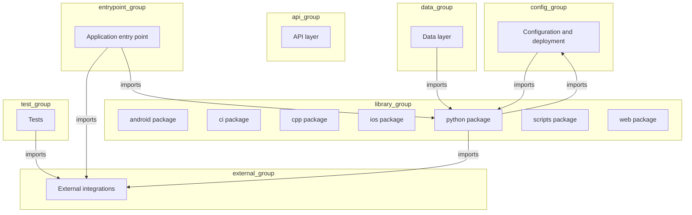

# Architecture report: mlc-ai/mlc-llm

> Automated static analysis. **Observed** = directly seen in files/imports/AST; **Inferred** = interpretation from that evidence. Repository code was not executed.

## 1. Repository at a glance

| Item | Value |
| --- | --- |
| Repository | mlc-ai/mlc-llm |
| Description | Universal LLM Deployment Engine with ML Compilation |
| Language | Python |
| Stars | 23417 |
| Licence | Apache-2.0 |
| Analysed commit / branch | 3b7663abb6962c1ac1be0337630321fd7bfcf9ff / main |
| Framework(s) | FastAPI |
| Files analysed | 703 |
| Components | 13 |

## 2. Architecture in one minute

mlc-ai/mlc-llm - Universal LLM Deployment Engine with ML Compilation. This repository was analysed statically from 703 file(s) (415 Python). Detected technologies (observed from imports/manifests): GitHub Actions, FastAPI, aiohttp, NumPy, pandas, Pydantic. Files are grouped into 13 component(s): android package, API layer, ci package, Configuration and deployment, cpp package, Data layer, Application entry point, External integrations. Observed entry point(s): android/MLCChat/bundle_weight.py, android/MLCEngineExample/bundle_weight.py, android/mlc4j/prepare_libs.py. Findings below distinguish observed facts from inferred interpretation.

## 3. High-level block diagram

## 4. Main components

### android package (`android`)

- **Kind:** library
- **Status:** Observed
- **Confidence:** 0.85
- **Responsibility:** Groups 2 file(s) under android package (observed from repository paths and static analysis).
- **Paths:** `android/mlc4j/src/cpp/tvm_runtime.h`, `android/mlc4j/src/main/java/ai/mlc/mlcllm/JSONFFIEngine.java`
- **Evidence:** [android/mlc4j/src/cpp/tvm_runtime.h](https://github.com/mlc-ai/mlc-llm/blob/3b7663abb6962c1ac1be0337630321fd7bfcf9ff/android/mlc4j/src/cpp/tvm_runtime.h); [android/mlc4j/src/main/java/ai/mlc/mlcllm/JSONFFIEngine.java](https://github.com/mlc-ai/mlc-llm/blob/3b7663abb6962c1ac1be0337630321fd7bfcf9ff/android/mlc4j/src/main/java/ai/mlc/mlcllm/JSONFFIEngine.java)

### API layer (`api_layer`)

- **Kind:** api
- **Status:** Observed
- **Confidence:** 0.85
- **Responsibility:** Groups 4 file(s) under api layer (observed from repository paths and static analysis). Observed routes: POST /debug/dump_event_trace, POST /debug/cuda_profiler_start, POST /debug/cuda_profiler_stop, POST /debug/dump_engine_metrics, POST /debug/reset_engine. Observed top-level functions: debug_cuda_profiler_start, debug_cuda_profiler_stop, debug_dump_engine_metrics, debug_dump_event_trace, debug_reset_engine_stats, metrics.
- **Paths:** `python/mlc_llm/serve/entrypoints/debug_entrypoints.py`, `python/mlc_llm/serve/entrypoints/metrics_entrypoints.py`, `python/mlc_llm/serve/entrypoints/microserving_entrypoints.py`, `python/mlc_llm/serve/entrypoints/openai_entrypoints.py`
- **Evidence:** [python/mlc_llm/serve/entrypoints/debug_entrypoints.py:17](https://github.com/mlc-ai/mlc-llm/blob/3b7663abb6962c1ac1be0337630321fd7bfcf9ff/python/mlc_llm/serve/entrypoints/debug_entrypoints.py#L17); [python/mlc_llm/serve/entrypoints/metrics_entrypoints.py:14](https://github.com/mlc-ai/mlc-llm/blob/3b7663abb6962c1ac1be0337630321fd7bfcf9ff/python/mlc_llm/serve/entrypoints/metrics_entrypoints.py#L14); [python/mlc_llm/serve/entrypoints/microserving_entrypoints.py:23](https://github.com/mlc-ai/mlc-llm/blob/3b7663abb6962c1ac1be0337630321fd7bfcf9ff/python/mlc_llm/serve/entrypoints/microserving_entrypoints.py#L23); [python/mlc_llm/serve/entrypoints/openai_entrypoints.py:29](https://github.com/mlc-ai/mlc-llm/blob/3b7663abb6962c1ac1be0337630321fd7bfcf9ff/python/mlc_llm/serve/entrypoints/openai_entrypoints.py#L29)

### ci package (`ci`)

- **Kind:** library
- **Status:** Observed
- **Confidence:** 0.85
- **Responsibility:** Groups 3 file(s) under ci package (observed from repository paths and static analysis).
- **Paths:** `ci/bash.sh`, `ci/task/build_clean.sh`, `ci/task/build_lib.sh`
- **Evidence:** [ci/bash.sh](https://github.com/mlc-ai/mlc-llm/blob/3b7663abb6962c1ac1be0337630321fd7bfcf9ff/ci/bash.sh); [ci/task/build_clean.sh](https://github.com/mlc-ai/mlc-llm/blob/3b7663abb6962c1ac1be0337630321fd7bfcf9ff/ci/task/build_clean.sh); [ci/task/build_lib.sh](https://github.com/mlc-ai/mlc-llm/blob/3b7663abb6962c1ac1be0337630321fd7bfcf9ff/ci/task/build_lib.sh)

### Configuration and deployment (`config`)

- **Kind:** config
- **Status:** Observed
- **Confidence:** 0.85
- **Responsibility:** Groups 24 file(s) under configuration and deployment (observed from repository paths and static analysis). Observed top-level classes: BinaryDistribution, ConfigBase, ConfigOverrideBase, EngineConfig. Observed top-level functions: get_lib_path, git_describe_version, main, parse_requirements.
- **Paths:** `android/MLCChat/app/build.gradle`, `android/MLCChat/build.gradle`, `android/MLCChat/mlc-package-config.json`, `android/MLCEngineExample/app/build.gradle`, `android/MLCEngineExample/build.gradle`, `android/MLCEngineExample/mlc-package-config.json`, `android/mlc4j/build.gradle`, `ci/build-environment.yaml`, `ios/MLCChat/MLCChat/Assets.xcassets/AccentColor.colorset/Contents.json`, `ios/MLCChat/MLCChat/Assets.xcassets/AppIcon.appiconset/Contents.json`, `ios/MLCChat/MLCChat/Assets.xcassets/Contents.json`, `ios/MLCChat/MLCChat/Preview Content/Preview Assets.xcassets/Contents.json`, `ios/MLCChat/mlc-package-config.json`, `ios/MLCEngineExample/MLCEngineExample/Assets.xcassets/AccentColor.colorset/Contents.json`, `ios/MLCEngineExample/MLCEngineExample/Assets.xcassets/AppIcon.appiconset/Contents.json`, `ios/MLCEngineExample/MLCEngineExample/Assets.xcassets/Contents.json`, `ios/MLCEngineExample/MLCEngineExample/Preview Content/Preview Assets.xcassets/Contents.json`, `ios/MLCEngineExample/mlc-package-config.json`, `pyproject.toml`, `python/mlc_llm/serve/config.py`, `python/mlc_llm/support/config.py`, `python/requirements.txt`, `python/setup.py`, `site/_config.yml`
- **Evidence:** [android/MLCChat/app/build.gradle](https://github.com/mlc-ai/mlc-llm/blob/3b7663abb6962c1ac1be0337630321fd7bfcf9ff/android/MLCChat/app/build.gradle); [android/MLCChat/build.gradle](https://github.com/mlc-ai/mlc-llm/blob/3b7663abb6962c1ac1be0337630321fd7bfcf9ff/android/MLCChat/build.gradle); [android/MLCChat/mlc-package-config.json](https://github.com/mlc-ai/mlc-llm/blob/3b7663abb6962c1ac1be0337630321fd7bfcf9ff/android/MLCChat/mlc-package-config.json); [android/MLCEngineExample/app/build.gradle](https://github.com/mlc-ai/mlc-llm/blob/3b7663abb6962c1ac1be0337630321fd7bfcf9ff/android/MLCEngineExample/app/build.gradle); [android/MLCEngineExample/build.gradle](https://github.com/mlc-ai/mlc-llm/blob/3b7663abb6962c1ac1be0337630321fd7bfcf9ff/android/MLCEngineExample/build.gradle); [android/MLCEngineExample/mlc-package-config.json](https://github.com/mlc-ai/mlc-llm/blob/3b7663abb6962c1ac1be0337630321fd7bfcf9ff/android/MLCEngineExample/mlc-package-config.json); [android/mlc4j/build.gradle](https://github.com/mlc-ai/mlc-llm/blob/3b7663abb6962c1ac1be0337630321fd7bfcf9ff/android/mlc4j/build.gradle); [ci/build-environment.yaml](https://github.com/mlc-ai/mlc-llm/blob/3b7663abb6962c1ac1be0337630321fd7bfcf9ff/ci/build-environment.yaml)

### cpp package (`cpp`)

- **Kind:** library
- **Status:** Observed
- **Confidence:** 0.85
- **Responsibility:** Groups 41 file(s) under cpp package (observed from repository paths and static analysis).
- **Paths:** `cpp/base.h`, `cpp/json_ffi/conv_template.h`, `cpp/json_ffi/image_utils.h`, `cpp/json_ffi/json_ffi_engine.h`, `cpp/json_ffi/openai_api_protocol.h`, `cpp/metadata/model.h`, `cpp/serve/config.h`, `cpp/serve/data.h`, `cpp/serve/draft_token_workspace_manager.h`, `cpp/serve/engine.h`, `cpp/serve/engine_actions/action.h`, `cpp/serve/engine_actions/action_commons.h`, `cpp/serve/engine_actions/batch_prefill_base.h`, `cpp/serve/engine_state.h`, `cpp/serve/event_trace_recorder.h`, `cpp/serve/function_table.h`, `cpp/serve/logit_processor.h`, `cpp/serve/metrics.h`, `cpp/serve/model.h`, `cpp/serve/prefix_cache.h`, `cpp/serve/radix_tree.h`, `cpp/serve/request.h`, `cpp/serve/request_state.h`, `cpp/serve/sampler/sampler.h`, `cpp/serve/threaded_engine.h`, `cpp/support/debug_utils.h`, `cpp/support/device.h`, `cpp/support/dynamic_bitset.h`, `cpp/support/encoding.h`, `cpp/support/json_parser.h`, `cpp/support/load_bytes_from_file.h`, `cpp/support/module_vtable.h`, `cpp/support/nvtx.h`, `cpp/support/progress_bar.h`, `cpp/support/random.h`, `cpp/support/result.h`, `cpp/support/threading_backend.h`, `cpp/support/utils.h`, `cpp/support/vlm_utils.h`, `cpp/tokenizers/streamer.h`, `cpp/tokenizers/tokenizers.h`
- **Evidence:** [cpp/base.h](https://github.com/mlc-ai/mlc-llm/blob/3b7663abb6962c1ac1be0337630321fd7bfcf9ff/cpp/base.h); [cpp/json_ffi/conv_template.h](https://github.com/mlc-ai/mlc-llm/blob/3b7663abb6962c1ac1be0337630321fd7bfcf9ff/cpp/json_ffi/conv_template.h); [cpp/json_ffi/image_utils.h](https://github.com/mlc-ai/mlc-llm/blob/3b7663abb6962c1ac1be0337630321fd7bfcf9ff/cpp/json_ffi/image_utils.h); [cpp/json_ffi/json_ffi_engine.h](https://github.com/mlc-ai/mlc-llm/blob/3b7663abb6962c1ac1be0337630321fd7bfcf9ff/cpp/json_ffi/json_ffi_engine.h); [cpp/json_ffi/openai_api_protocol.h](https://github.com/mlc-ai/mlc-llm/blob/3b7663abb6962c1ac1be0337630321fd7bfcf9ff/cpp/json_ffi/openai_api_protocol.h); [cpp/metadata/model.h](https://github.com/mlc-ai/mlc-llm/blob/3b7663abb6962c1ac1be0337630321fd7bfcf9ff/cpp/metadata/model.h); [cpp/serve/config.h](https://github.com/mlc-ai/mlc-llm/blob/3b7663abb6962c1ac1be0337630321fd7bfcf9ff/cpp/serve/config.h); [cpp/serve/data.h](https://github.com/mlc-ai/mlc-llm/blob/3b7663abb6962c1ac1be0337630321fd7bfcf9ff/cpp/serve/data.h)

### Data layer (`data_layer`)

- **Kind:** data
- **Status:** Observed
- **Confidence:** 0.85
- **Responsibility:** Groups 1 file(s) under data layer (observed from repository paths and static analysis). Observed top-level classes: EmbeddingMetadata, Model.
- **Paths:** `python/mlc_llm/model/model.py`
- **Evidence:** [python/mlc_llm/model/model.py:69](https://github.com/mlc-ai/mlc-llm/blob/3b7663abb6962c1ac1be0337630321fd7bfcf9ff/python/mlc_llm/model/model.py#L69)

### Application entry point (`entrypoint`)

- **Kind:** entrypoint
- **Status:** Observed
- **Confidence:** 0.85
- **Responsibility:** Groups 20 file(s) under application entry point (observed from repository paths and static analysis). Observed application object created via FastAPI. Observed top-level classes: DebugChat, DefaultDebugInstrument, DeferredScope, LibCompare, ModelDeliveryList, ModelDeliveryTask. Observed top-level functions: _check_device, _clone_repo, _compute_memory_usage, _extract_metadata, _generate_model_delivery_diff, _get_current_log.
- **Paths:** `android/MLCChat/bundle_weight.py`, `android/MLCEngineExample/bundle_weight.py`, `android/mlc4j/prepare_libs.py`, `cmake/gen_cmake_config.py`, `python/mlc_llm/__main__.py`, `python/mlc_llm/bench/__main__.py`, `python/mlc_llm/bench/evaluation/gsm8k.py`, `python/mlc_llm/bench/evaluation/mmlu.py`, `python/mlc_llm/cli/check_device.py`, `python/mlc_llm/cli/delivery.py`, `python/mlc_llm/cli/disco_remote_socket_session.py`, `python/mlc_llm/cli/lib_delivery.py`, `python/mlc_llm/cli/model_metadata.py`, `python/mlc_llm/cli/worker.py`, `python/mlc_llm/interface/router.py`, `python/mlc_llm/interface/serve.py`, `python/mlc_llm/testing/debug_chat.py`, `python/mlc_llm/testing/debug_compare.py`, `scripts/check_url_validity.py`, `version.py`
- **Evidence:** [android/MLCChat/bundle_weight.py:12](https://github.com/mlc-ai/mlc-llm/blob/3b7663abb6962c1ac1be0337630321fd7bfcf9ff/android/MLCChat/bundle_weight.py#L12); [android/MLCEngineExample/bundle_weight.py:12](https://github.com/mlc-ai/mlc-llm/blob/3b7663abb6962c1ac1be0337630321fd7bfcf9ff/android/MLCEngineExample/bundle_weight.py#L12); [android/mlc4j/prepare_libs.py:16](https://github.com/mlc-ai/mlc-llm/blob/3b7663abb6962c1ac1be0337630321fd7bfcf9ff/android/mlc4j/prepare_libs.py#L16); [cmake/gen_cmake_config.py](https://github.com/mlc-ai/mlc-llm/blob/3b7663abb6962c1ac1be0337630321fd7bfcf9ff/cmake/gen_cmake_config.py); [python/mlc_llm/__main__.py:11](https://github.com/mlc-ai/mlc-llm/blob/3b7663abb6962c1ac1be0337630321fd7bfcf9ff/python/mlc_llm/__main__.py#L11); [python/mlc_llm/bench/__main__.py:34](https://github.com/mlc-ai/mlc-llm/blob/3b7663abb6962c1ac1be0337630321fd7bfcf9ff/python/mlc_llm/bench/__main__.py#L34); [python/mlc_llm/bench/evaluation/gsm8k.py:21](https://github.com/mlc-ai/mlc-llm/blob/3b7663abb6962c1ac1be0337630321fd7bfcf9ff/python/mlc_llm/bench/evaluation/gsm8k.py#L21); [python/mlc_llm/bench/evaluation/mmlu.py:81](https://github.com/mlc-ai/mlc-llm/blob/3b7663abb6962c1ac1be0337630321fd7bfcf9ff/python/mlc_llm/bench/evaluation/mmlu.py#L81)

### External integrations (`external_integrations`)

- **Kind:** external
- **Status:** Observed
- **Confidence:** 0.85
- **Responsibility:** Groups 2 file(s) under external integrations (observed from repository paths and static analysis).
- **Paths:** `python/mlc_llm/serve/_ffi_api.py`, `python/mlc_llm/tokenizers/_ffi_api.py`
- **Evidence:** [python/mlc_llm/serve/_ffi_api.py](https://github.com/mlc-ai/mlc-llm/blob/3b7663abb6962c1ac1be0337630321fd7bfcf9ff/python/mlc_llm/serve/_ffi_api.py); [python/mlc_llm/tokenizers/_ffi_api.py](https://github.com/mlc-ai/mlc-llm/blob/3b7663abb6962c1ac1be0337630321fd7bfcf9ff/python/mlc_llm/tokenizers/_ffi_api.py)

### ios package (`ios`)

- **Kind:** library
- **Status:** Observed
- **Confidence:** 0.85
- **Responsibility:** Groups 2 file(s) under ios package (observed from repository paths and static analysis).
- **Paths:** `ios/MLCSwift/Sources/ObjC/include/LLMEngine.h`, `ios/prepare_libs.sh`
- **Evidence:** [ios/MLCSwift/Sources/ObjC/include/LLMEngine.h](https://github.com/mlc-ai/mlc-llm/blob/3b7663abb6962c1ac1be0337630321fd7bfcf9ff/ios/MLCSwift/Sources/ObjC/include/LLMEngine.h); [ios/prepare_libs.sh](https://github.com/mlc-ai/mlc-llm/blob/3b7663abb6962c1ac1be0337630321fd7bfcf9ff/ios/prepare_libs.sh)

### python package (`python`)

- **Kind:** library
- **Status:** Observed
- **Confidence:** 0.85
- **Responsibility:** Groups 311 file(s) under python package (observed from repository paths and static analysis). Observed top-level classes: APIEndPoint, AWQQuantize, AWQQuantizeLinear, ArgumentParser, ArtifactDefinition, AsyncChat. Observed top-level functions: _add_gather_hidden_states, _add_scatter_hidden_states, _add_system_lib_prefix, _analyze_required_func_params, _apply_preproc_to_params_and_check_pipeline, _apply_rotary_emb.
- **Paths:** `python/mlc_llm/__init__.py`, `python/mlc_llm/base.py`, `python/mlc_llm/bench/__init__.py`, `python/mlc_llm/bench/api_endpoint.py`, `python/mlc_llm/bench/dataset.py`, `python/mlc_llm/bench/request_processor.py`, `python/mlc_llm/bench/request_record.py`, `python/mlc_llm/cli/__init__.py`, `python/mlc_llm/cli/calibrate.py`, `python/mlc_llm/cli/chat.py`, `python/mlc_llm/cli/compile.py`, `python/mlc_llm/cli/convert_weight.py`, `python/mlc_llm/cli/gen_config.py`, `python/mlc_llm/cli/package.py`, `python/mlc_llm/cli/router.py`, `python/mlc_llm/cli/serve.py`, `python/mlc_llm/compiler_pass/__init__.py`, `python/mlc_llm/compiler_pass/attach_cuda_graph_alloc_init_func.py`, `python/mlc_llm/compiler_pass/attach_embedding_allocator.py`, `python/mlc_llm/compiler_pass/attach_logit_processor.py`, `python/mlc_llm/compiler_pass/attach_sampler.py`, `python/mlc_llm/compiler_pass/attach_softmax_with_temperature.py`, `python/mlc_llm/compiler_pass/attach_spec_decode_aux_funcs.py`, `python/mlc_llm/compiler_pass/attach_support_info.py`, `python/mlc_llm/compiler_pass/blas_dispatch.py`, `python/mlc_llm/compiler_pass/clean_up_tir_attrs.py`, `python/mlc_llm/compiler_pass/dispatch_kv_cache_creation.py`, `python/mlc_llm/compiler_pass/dispatch_triton_kernel.py`, `python/mlc_llm/compiler_pass/estimate_memory_usage.py`, `python/mlc_llm/compiler_pass/fuse_add_norm.py`, `python/mlc_llm/compiler_pass/fuse_dequantize_matmul_ewise.py`, `python/mlc_llm/compiler_pass/fuse_dequantize_take.py`, `python/mlc_llm/compiler_pass/fuse_dequantize_transpose.py`, `python/mlc_llm/compiler_pass/fuse_ft_dequantize_matmul_epilogue.py`, `python/mlc_llm/compiler_pass/fuse_transpose_matmul.py`, `python/mlc_llm/compiler_pass/lift_global_buffer_alloc.py`, `python/mlc_llm/compiler_pass/low_batch_specialization.py`, `python/mlc_llm/compiler_pass/pipeline.py`, `python/mlc_llm/compiler_pass/pipeline_parallel_rewrite.py`, `python/mlc_llm/compiler_pass/scatter_tuple_get_item.py`, `python/mlc_llm/contrib/__init__.py`, `python/mlc_llm/contrib/embeddings/__init__.py`, `python/mlc_llm/contrib/embeddings/embeddings.py`, `python/mlc_llm/contrib/embeddings/openai.py`, `python/mlc_llm/conversation_template/__init__.py`, `python/mlc_llm/conversation_template/cohere.py`, `python/mlc_llm/conversation_template/deepseek.py`, `python/mlc_llm/conversation_template/dolly.py`, `python/mlc_llm/conversation_template/gemma.py`, `python/mlc_llm/conversation_template/glm.py`, `python/mlc_llm/conversation_template/gorilla.py`, `python/mlc_llm/conversation_template/gpt.py`, `python/mlc_llm/conversation_template/hermes.py`, `python/mlc_llm/conversation_template/llama.py`, `python/mlc_llm/conversation_template/llava.py`, `python/mlc_llm/conversation_template/llm_jp.py`, `python/mlc_llm/conversation_template/ministral3.py`, `python/mlc_llm/conversation_template/ministral3_reasoning.py`, `python/mlc_llm/conversation_template/mistral.py`, `python/mlc_llm/conversation_template/nemotron.py`, `python/mlc_llm/conversation_template/oasst.py`, `python/mlc_llm/conversation_template/olmo.py`, `python/mlc_llm/conversation_template/olmo2.py`, `python/mlc_llm/conversation_template/orion.py`, `python/mlc_llm/conversation_template/phi.py`, `python/mlc_llm/conversation_template/qwen2.py`, `python/mlc_llm/conversation_template/qwen3.py`, `python/mlc_llm/conversation_template/qwen3_5.py`, `python/mlc_llm/conversation_template/redpajama.py`, `python/mlc_llm/conversation_template/registry.py`, `python/mlc_llm/conversation_template/rwkv.py`, `python/mlc_llm/conversation_template/stablelm.py`, `python/mlc_llm/conversation_template/tinyllama.py`, `python/mlc_llm/conversation_template/wizardlm.py`, `python/mlc_llm/interface/__init__.py`, `python/mlc_llm/interface/calibrate.py`, `python/mlc_llm/interface/chat.py`, `python/mlc_llm/interface/compile.py`, `python/mlc_llm/interface/compiler_flags.py`, `python/mlc_llm/interface/convert_weight.py`, `python/mlc_llm/interface/gen_config.py`, `python/mlc_llm/interface/help.py`, `python/mlc_llm/interface/jit.py`, `python/mlc_llm/interface/package.py`, `python/mlc_llm/json_ffi/__init__.py`, `python/mlc_llm/json_ffi/engine.py`, `python/mlc_llm/libinfo.py`, `python/mlc_llm/loader/__init__.py`, `python/mlc_llm/loader/huggingface_loader.py`, `python/mlc_llm/loader/loader.py`, `python/mlc_llm/loader/mapping.py`, `python/mlc_llm/loader/standard_loader.py`, `python/mlc_llm/loader/stats.py`, `python/mlc_llm/loader/utils.py`, `python/mlc_llm/model/__init__.py`, `python/mlc_llm/model/baichuan/__init__.py`, `python/mlc_llm/model/baichuan/baichuan_loader.py`, `python/mlc_llm/model/baichuan/baichuan_model.py`, `python/mlc_llm/model/bert/__init__.py`, `python/mlc_llm/model/bert/bert_loader.py`, `python/mlc_llm/model/bert/bert_model.py`, `python/mlc_llm/model/chatglm3/__init__.py`, `python/mlc_llm/model/chatglm3/chatglm3_loader.py`, `python/mlc_llm/model/chatglm3/chatglm3_model.py`, `python/mlc_llm/model/cohere/__init__.py`, `python/mlc_llm/model/cohere/cohere_loader.py`, `python/mlc_llm/model/cohere/cohere_model.py`, `python/mlc_llm/model/deepseek/__init__.py`, `python/mlc_llm/model/deepseek/deepseek_loader.py`, `python/mlc_llm/model/deepseek/deepseek_model.py`, `python/mlc_llm/model/deepseek_v2/__init__.py`, `python/mlc_llm/model/deepseek_v2/deepseek_v2_loader.py`, `python/mlc_llm/model/deepseek_v2/deepseek_v2_model.py`, `python/mlc_llm/model/eagle/__init__.py`, `python/mlc_llm/model/eagle/eagle_loader.py`, `python/mlc_llm/model/eagle/eagle_model.py`, `python/mlc_llm/model/gemma/__init__.py`, `python/mlc_llm/model/gemma/gemma_loader.py`, `python/mlc_llm/model/gemma/gemma_model.py`, `python/mlc_llm/model/gemma2/__init__.py`, `python/mlc_llm/model/gemma2/gemma2_loader.py`, `python/mlc_llm/model/gemma2/gemma2_model.py`, `python/mlc_llm/model/gemma3/__init__.py`, `python/mlc_llm/model/gemma3/gemma3_loader.py`, `python/mlc_llm/model/gemma3/gemma3_model.py`, `python/mlc_llm/model/gemma3/gemma3v_loader.py`, `python/mlc_llm/model/gemma3/gemma3v_model.py`, `python/mlc_llm/model/gemma4/__init__.py`, `python/mlc_llm/model/gemma4/gemma4_audio.py`, `python/mlc_llm/model/gemma4/gemma4_config.py`, `python/mlc_llm/model/gemma4/gemma4_loader.py`, `python/mlc_llm/model/gemma4/gemma4_model.py`, `python/mlc_llm/model/gpt2/__init__.py`, `python/mlc_llm/model/gpt2/gpt2_loader.py`, `python/mlc_llm/model/gpt2/gpt2_model.py`, `python/mlc_llm/model/gpt_bigcode/__init__.py`, `python/mlc_llm/model/gpt_bigcode/gpt_bigcode_loader.py`, `python/mlc_llm/model/gpt_bigcode/gpt_bigcode_model.py`, `python/mlc_llm/model/gpt_j/__init__.py`, `python/mlc_llm/model/gpt_j/gpt_j_loader.py`, `python/mlc_llm/model/gpt_j/gpt_j_model.py`, `python/mlc_llm/model/gpt_neox/__init__.py`, `python/mlc_llm/model/gpt_neox/gpt_neox_loader.py`, `python/mlc_llm/model/gpt_neox/gpt_neox_model.py`, `python/mlc_llm/model/internlm/__init__.py`, `python/mlc_llm/model/internlm/internlm_loader.py`, `python/mlc_llm/model/internlm/internlm_model.py`, `python/mlc_llm/model/internlm2/__init__.py`, `python/mlc_llm/model/internlm2/internlm2_loader.py`, `python/mlc_llm/model/internlm2/internlm2_model.py`, `python/mlc_llm/model/llama/__init__.py`, `python/mlc_llm/model/llama/llama_loader.py`, `python/mlc_llm/model/llama/llama_model.py`, `python/mlc_llm/model/llama4/__init__.py`, `python/mlc_llm/model/llama4/llama4_loader.py`, `python/mlc_llm/model/llama4/llama4_model.py`, `python/mlc_llm/model/llava/__init__.py`, `python/mlc_llm/model/llava/llava_loader.py`, `python/mlc_llm/model/llava/llava_model.py`, `python/mlc_llm/model/medusa/__init__.py`, `python/mlc_llm/model/medusa/medusa_loader.py`, `python/mlc_llm/model/medusa/medusa_model.py`, `python/mlc_llm/model/minicpm/__init__.py`, `python/mlc_llm/model/minicpm/minicpm_loader.py`, `python/mlc_llm/model/minicpm/minicpm_model.py`, `python/mlc_llm/model/ministral3/__init__.py`, `python/mlc_llm/model/ministral3/ministral3_loader.py`, `python/mlc_llm/model/ministral3/ministral3_model.py`, `python/mlc_llm/model/mistral/__init__.py`, `python/mlc_llm/model/mistral/mistral_loader.py`, `python/mlc_llm/model/mistral/mistral_model.py`, `python/mlc_llm/model/mixtral/__init__.py`, `python/mlc_llm/model/mixtral/mixtral_loader.py`, `python/mlc_llm/model/mixtral/mixtral_model.py`, `python/mlc_llm/model/model_preset.py`, `python/mlc_llm/model/model_utils.py`, `python/mlc_llm/model/nemotron/__init__.py`, `python/mlc_llm/model/nemotron/nemotron_loader.py`, `python/mlc_llm/model/nemotron/nemotron_model.py`, `python/mlc_llm/model/olmo/__init__.py`, `python/mlc_llm/model/olmo/olmo_loader.py`, `python/mlc_llm/model/olmo/olmo_model.py`, `python/mlc_llm/model/olmo2/__init__.py`, `python/mlc_llm/model/olmo2/olmo2_loader.py`, `python/mlc_llm/model/olmo2/olmo2_model.py`, `python/mlc_llm/model/orion/__init__.py`, `python/mlc_llm/model/orion/orion_loader.py`, `python/mlc_llm/model/orion/orion_model.py`, `python/mlc_llm/model/phi/__init__.py`, `python/mlc_llm/model/phi/phi_loader.py`, `python/mlc_llm/model/phi/phi_model.py`, `python/mlc_llm/model/phi3/__init__.py`, `python/mlc_llm/model/phi3/phi3_loader.py`, `python/mlc_llm/model/phi3/phi3_model.py`, `python/mlc_llm/model/phi3v/__init__.py`, `python/mlc_llm/model/phi3v/phi3v_image.py`, `python/mlc_llm/model/phi3v/phi3v_loader.py`, `python/mlc_llm/model/phi3v/phi3v_model.py`, `python/mlc_llm/model/qwen/__init__.py`, `python/mlc_llm/model/qwen/qwen_loader.py`, `python/mlc_llm/model/qwen/qwen_model.py`, `python/mlc_llm/model/qwen2/__init__.py`, `python/mlc_llm/model/qwen2/qwen2_loader.py`, `python/mlc_llm/model/qwen2/qwen2_model.py`, `python/mlc_llm/model/qwen2_5_vl/__init__.py`, `python/mlc_llm/model/qwen2_5_vl/qwen2_5_vl_model.py`, `python/mlc_llm/model/qwen2_moe/__init__.py`, `python/mlc_llm/model/qwen2_moe/qwen2_moe_loader.py`, `python/mlc_llm/model/qwen2_moe/qwen2_moe_model.py`, `python/mlc_llm/model/qwen3/__init__.py`, `python/mlc_llm/model/qwen3/qwen3_loader.py`, `python/mlc_llm/model/qwen3/qwen3_model.py`, `python/mlc_llm/model/qwen35/__init__.py`, `python/mlc_llm/model/qwen35/qwen35_loader.py`, `python/mlc_llm/model/qwen35/qwen35_model.py`, `python/mlc_llm/model/qwen35/qwen35_vision.py`, `python/mlc_llm/model/qwen35/qwen35v_loader.py`, `python/mlc_llm/model/qwen35/qwen35v_model.py`, `python/mlc_llm/model/qwen3_moe/__init__.py`, `python/mlc_llm/model/qwen3_moe/qwen3_moe_loader.py`, `python/mlc_llm/model/qwen3_moe/qwen3_moe_model.py`, `python/mlc_llm/model/rwkv5/__init__.py`, `python/mlc_llm/model/rwkv5/rwkv5_loader.py`, `python/mlc_llm/model/rwkv5/rwkv5_model.py`, `python/mlc_llm/model/rwkv6/__init__.py`, `python/mlc_llm/model/rwkv6/rwkv6_loader.py`, `python/mlc_llm/model/rwkv6/rwkv6_model.py`, `python/mlc_llm/model/stable_lm/__init__.py`, `python/mlc_llm/model/stable_lm/stablelm_loader.py`, `python/mlc_llm/model/stable_lm/stablelm_model.py`, `python/mlc_llm/model/starcoder2/__init__.py`, `python/mlc_llm/model/starcoder2/starcoder2_loader.py`, `python/mlc_llm/model/starcoder2/starcoder2_model.py`, `python/mlc_llm/model/vision/__init__.py`, `python/mlc_llm/model/vision/clip_vision.py`, `python/mlc_llm/model/vision/image_processing.py`, `python/mlc_llm/model/vision/siglip_vision.py`, `python/mlc_llm/nn/__init__.py`, `python/mlc_llm/nn/expert.py`, `python/mlc_llm/nn/kv_cache.py`, `python/mlc_llm/nn/rnn_state.py`, `python/mlc_llm/op/__init__.py`, `python/mlc_llm/op/attention.py`, `python/mlc_llm/op/batch_matmul.py`, `python/mlc_llm/op/batch_spec_verify.py`, `python/mlc_llm/op/cutlass.py`, `python/mlc_llm/op/extern.py`, `python/mlc_llm/op/ft_gemm.py`, `python/mlc_llm/op/moe_matmul.py`, `python/mlc_llm/op/moe_misc.py`, `python/mlc_llm/op/mrope.py`, `python/mlc_llm/op/pipeline_parallel.py`, `python/mlc_llm/op/top_p_pivot.py`, `python/mlc_llm/op/triton.py`, `python/mlc_llm/protocol/__init__.py`, `python/mlc_llm/protocol/artifact_manifest.py`, `python/mlc_llm/protocol/conversation_protocol.py`, `python/mlc_llm/protocol/debug_protocol.py`, `python/mlc_llm/protocol/error_protocol.py`, `python/mlc_llm/protocol/generation_config.py`, `python/mlc_llm/protocol/microserving_protocol.py`, `python/mlc_llm/protocol/mlc_chat_config.py`, `python/mlc_llm/protocol/openai_api_protocol.py`, `python/mlc_llm/quantization/__init__.py`, `python/mlc_llm/quantization/awq_quantization.py`, `python/mlc_llm/quantization/block_scale_quantization.py`, `python/mlc_llm/quantization/fp8_quantization.py`, `python/mlc_llm/quantization/ft_quantization.py`, `python/mlc_llm/quantization/group_quantization.py`, `python/mlc_llm/quantization/model_quantization.py`, `python/mlc_llm/quantization/no_quantization.py`, `python/mlc_llm/quantization/per_tensor_quantization.py`, `python/mlc_llm/quantization/quantization.py`, `python/mlc_llm/quantization/utils.py`, `python/mlc_llm/router/__init__.py`, `python/mlc_llm/router/router.py`, `python/mlc_llm/serve/__init__.py`, `python/mlc_llm/serve/data.py`, `python/mlc_llm/serve/embedding_engine.py`, `python/mlc_llm/serve/engine.py`, `python/mlc_llm/serve/engine_base.py`, `python/mlc_llm/serve/engine_utils.py`, `python/mlc_llm/serve/entrypoints/__init__.py`, `python/mlc_llm/serve/event_trace_recorder.py`, `python/mlc_llm/serve/radix_tree.py`, `python/mlc_llm/serve/request.py`, `python/mlc_llm/serve/server/__init__.py`, `python/mlc_llm/serve/server/popen_server.py`, `python/mlc_llm/serve/server/server_context.py`, `python/mlc_llm/serve/sync_engine.py`, `python/mlc_llm/support/__init__.py`, `python/mlc_llm/support/argparse.py`, `python/mlc_llm/support/auto_config.py`, `python/mlc_llm/support/auto_device.py`, `python/mlc_llm/support/auto_target.py`, `python/mlc_llm/support/auto_weight.py`, `python/mlc_llm/support/constants.py`, `python/mlc_llm/support/convert_tiktoken.py`, `python/mlc_llm/support/download_cache.py`, `python/mlc_llm/support/logging.py`, `python/mlc_llm/support/max_thread_check.py`, `python/mlc_llm/support/preshard.py`, `python/mlc_llm/support/random.py`, `python/mlc_llm/support/style.py`, `python/mlc_llm/support/tensor_parallel.py`, `python/mlc_llm/support/tqdm.py`, `python/mlc_llm/testing/__init__.py`, `python/mlc_llm/testing/pytest_utils.py`, `python/mlc_llm/tokenizers/__init__.py`, `python/mlc_llm/tokenizers/streamer.py`, `python/mlc_llm/tokenizers/tokenizers.py`
- **Evidence:** [python/mlc_llm/__init__.py:14](https://github.com/mlc-ai/mlc-llm/blob/3b7663abb6962c1ac1be0337630321fd7bfcf9ff/python/mlc_llm/__init__.py#L14); [python/mlc_llm/base.py:16](https://github.com/mlc-ai/mlc-llm/blob/3b7663abb6962c1ac1be0337630321fd7bfcf9ff/python/mlc_llm/base.py#L16); [python/mlc_llm/bench/__init__.py](https://github.com/mlc-ai/mlc-llm/blob/3b7663abb6962c1ac1be0337630321fd7bfcf9ff/python/mlc_llm/bench/__init__.py); [python/mlc_llm/bench/api_endpoint.py:18](https://github.com/mlc-ai/mlc-llm/blob/3b7663abb6962c1ac1be0337630321fd7bfcf9ff/python/mlc_llm/bench/api_endpoint.py#L18); [python/mlc_llm/bench/dataset.py:22](https://github.com/mlc-ai/mlc-llm/blob/3b7663abb6962c1ac1be0337630321fd7bfcf9ff/python/mlc_llm/bench/dataset.py#L22); [python/mlc_llm/bench/request_processor.py:30](https://github.com/mlc-ai/mlc-llm/blob/3b7663abb6962c1ac1be0337630321fd7bfcf9ff/python/mlc_llm/bench/request_processor.py#L30); [python/mlc_llm/bench/request_record.py:14](https://github.com/mlc-ai/mlc-llm/blob/3b7663abb6962c1ac1be0337630321fd7bfcf9ff/python/mlc_llm/bench/request_record.py#L14); [python/mlc_llm/cli/__init__.py](https://github.com/mlc-ai/mlc-llm/blob/3b7663abb6962c1ac1be0337630321fd7bfcf9ff/python/mlc_llm/cli/__init__.py)

### scripts package (`scripts`)

- **Kind:** library
- **Status:** Observed
- **Confidence:** 0.85
- **Responsibility:** Groups 4 file(s) under scripts package (observed from repository paths and static analysis).
- **Paths:** `scripts/build_mlc_for_docs.sh`, `scripts/build_site.sh`, `scripts/gh_deploy_site.sh`, `scripts/local_deploy_site.sh`
- **Evidence:** [scripts/build_mlc_for_docs.sh](https://github.com/mlc-ai/mlc-llm/blob/3b7663abb6962c1ac1be0337630321fd7bfcf9ff/scripts/build_mlc_for_docs.sh); [scripts/build_site.sh](https://github.com/mlc-ai/mlc-llm/blob/3b7663abb6962c1ac1be0337630321fd7bfcf9ff/scripts/build_site.sh); [scripts/gh_deploy_site.sh](https://github.com/mlc-ai/mlc-llm/blob/3b7663abb6962c1ac1be0337630321fd7bfcf9ff/scripts/gh_deploy_site.sh); [scripts/local_deploy_site.sh](https://github.com/mlc-ai/mlc-llm/blob/3b7663abb6962c1ac1be0337630321fd7bfcf9ff/scripts/local_deploy_site.sh)

### Tests (`tests`)

- **Kind:** test
- **Status:** Observed
- **Confidence:** 0.85
- **Responsibility:** Groups 73 file(s) under tests (observed from repository paths and static analysis). Observed top-level classes: _Dimension, _Parameter. Observed top-level functions: _build_and_run, _config, _create_json_file, _evaluate_tensor, _exports, _gemma4_prompt.
- **Paths:** `ci/task/test_model_compile.sh`, `ci/task/test_unittest.sh`, `tests/README.md`, `tests/cpp/conv_template_unittest.cc`, `tests/cpp/support_utils_unittest.cc`, `tests/python/__init__.py`, `tests/python/compiler_pass/test_compute_prim_value.py`, `tests/python/compiler_pass/test_fuse_ft_dequantize_matmul_epilogue.py`, `tests/python/compiler_pass/test_scan_index_policy.py`, `tests/python/compiler_pass/test_softmax_with_temperature.py`, `tests/python/compiler_pass/test_symbolic_shape_rewrite.py`, `tests/python/conftest.py`, `tests/python/conversation_template/test_conversation_protocol.py`, `tests/python/conversation_template/test_gemma_template.py`, `tests/python/conversation_template/test_llama_template.py`, `tests/python/integration/test_model_compile.py`, `tests/python/json_ffi/test_json_ffi_engine.py`, `tests/python/json_ffi/test_json_ffi_engine_image.py`, `tests/python/json_ffi/test_json_ffi_engine_mock.py`, `tests/python/loader/test_awq.py`, `tests/python/loader/test_huggingface.py`, `tests/python/model/test_gemma3.py`, `tests/python/model/test_gemma3_attention.py`, `tests/python/model/test_gemma3v.py`, `tests/python/model/test_gemma4.py`, `tests/python/model/test_gpt2.py`, `tests/python/model/test_gptNeox.py`, `tests/python/model/test_kv_cache.py`, `tests/python/model/test_llama.py`, `tests/python/model/test_llama_quantization.py`, `tests/python/model/test_llava.py`, `tests/python/model/test_mistral.py`, `tests/python/model/test_phi.py`, `tests/python/model/test_qwen35v.py`, `tests/python/model/test_qwen3_embedding.py`, `tests/python/model/test_siglip_vision.py`, `tests/python/op/test_batch_spec_verify.py`, `tests/python/op/test_fp8_block_matmul.py`, `tests/python/op/test_mrope.py`, `tests/python/op/test_top_p_pivot.py`, `tests/python/op/test_tree_attn.py`, `tests/python/op/test_two_stage_softmax.py`, `tests/python/protocol/test_artifact_manifest.py`, `tests/python/quantization/test_awq_quantization.py`, `tests/python/quantization/test_group_quantization.py`, `tests/python/router/test_router.py`, `tests/python/serve/evaluate_engine.py`, `tests/python/serve/server/conftest.py`, `tests/python/serve/server/test_embedding_server.py`, `tests/python/serve/server/test_server.py`, `tests/python/serve/server/test_server_function_call.py`, `tests/python/serve/server/test_server_image.py`, `tests/python/serve/test_embedding_engine.py`, `tests/python/serve/test_event_trace_recorder.py`, `tests/python/serve/test_radix_tree.py`, `tests/python/serve/test_serve_async_engine.py`, `tests/python/serve/test_serve_async_engine_spec.py`, `tests/python/serve/test_serve_engine.py`, `tests/python/serve/test_serve_engine_grammar.py`, `tests/python/serve/test_serve_engine_image.py`, `tests/python/serve/test_serve_engine_mock.py`, `tests/python/serve/test_serve_engine_prefix_cache.py`, `tests/python/serve/test_serve_engine_rnn.py`, `tests/python/serve/test_serve_engine_spec.py`, `tests/python/serve/test_serve_sync_engine.py`, `tests/python/serve/test_tensor_copy.py`, `tests/python/support/test_auto_config.py`, `tests/python/support/test_auto_target.py`, `tests/python/support/test_auto_weight.py`, `tests/python/support/test_cli_convert_weight.py`, `tests/python/support/test_convert_weight_lora_merge.py`, `tests/python/support/test_random.py`, `tests/python/tokenizers/test_streamer.py`
- **Evidence:** [ci/task/test_model_compile.sh](https://github.com/mlc-ai/mlc-llm/blob/3b7663abb6962c1ac1be0337630321fd7bfcf9ff/ci/task/test_model_compile.sh); [ci/task/test_unittest.sh](https://github.com/mlc-ai/mlc-llm/blob/3b7663abb6962c1ac1be0337630321fd7bfcf9ff/ci/task/test_unittest.sh); [tests/README.md](https://github.com/mlc-ai/mlc-llm/blob/3b7663abb6962c1ac1be0337630321fd7bfcf9ff/tests/README.md); [tests/cpp/conv_template_unittest.cc](https://github.com/mlc-ai/mlc-llm/blob/3b7663abb6962c1ac1be0337630321fd7bfcf9ff/tests/cpp/conv_template_unittest.cc); [tests/cpp/support_utils_unittest.cc](https://github.com/mlc-ai/mlc-llm/blob/3b7663abb6962c1ac1be0337630321fd7bfcf9ff/tests/cpp/support_utils_unittest.cc); [tests/python/__init__.py](https://github.com/mlc-ai/mlc-llm/blob/3b7663abb6962c1ac1be0337630321fd7bfcf9ff/tests/python/__init__.py); [tests/python/compiler_pass/test_compute_prim_value.py:16](https://github.com/mlc-ai/mlc-llm/blob/3b7663abb6962c1ac1be0337630321fd7bfcf9ff/tests/python/compiler_pass/test_compute_prim_value.py#L16); [tests/python/compiler_pass/test_fuse_ft_dequantize_matmul_epilogue.py:11](https://github.com/mlc-ai/mlc-llm/blob/3b7663abb6962c1ac1be0337630321fd7bfcf9ff/tests/python/compiler_pass/test_fuse_ft_dequantize_matmul_epilogue.py#L11)

### web package (`web`)

- **Kind:** library
- **Status:** Observed
- **Confidence:** 0.85
- **Responsibility:** Groups 1 file(s) under web package (observed from repository paths and static analysis).
- **Paths:** `web/prep_emcc_deps.sh`
- **Evidence:** [web/prep_emcc_deps.sh](https://github.com/mlc-ai/mlc-llm/blob/3b7663abb6962c1ac1be0337630321fd7bfcf9ff/web/prep_emcc_deps.sh)

## 5. Execution flow

**Observed** entry point(s):

- [android/MLCChat/bundle_weight.py:39](https://github.com/mlc-ai/mlc-llm/blob/3b7663abb6962c1ac1be0337630321fd7bfcf9ff/android/MLCChat/bundle_weight.py#L39)
- [android/MLCEngineExample/bundle_weight.py:39](https://github.com/mlc-ai/mlc-llm/blob/3b7663abb6962c1ac1be0337630321fd7bfcf9ff/android/MLCEngineExample/bundle_weight.py#L39)
- [android/mlc4j/prepare_libs.py:109](https://github.com/mlc-ai/mlc-llm/blob/3b7663abb6962c1ac1be0337630321fd7bfcf9ff/android/mlc4j/prepare_libs.py#L109)
- [cmake/gen_cmake_config.py:5](https://github.com/mlc-ai/mlc-llm/blob/3b7663abb6962c1ac1be0337630321fd7bfcf9ff/cmake/gen_cmake_config.py#L5)
- [python/mlc_llm/__main__.py:66](https://github.com/mlc-ai/mlc-llm/blob/3b7663abb6962c1ac1be0337630321fd7bfcf9ff/python/mlc_llm/__main__.py#L66)
- [python/mlc_llm/bench/__main__.py:178](https://github.com/mlc-ai/mlc-llm/blob/3b7663abb6962c1ac1be0337630321fd7bfcf9ff/python/mlc_llm/bench/__main__.py#L178)
- [python/mlc_llm/bench/evaluation/gsm8k.py:294](https://github.com/mlc-ai/mlc-llm/blob/3b7663abb6962c1ac1be0337630321fd7bfcf9ff/python/mlc_llm/bench/evaluation/gsm8k.py#L294)
- [python/mlc_llm/bench/evaluation/mmlu.py:225](https://github.com/mlc-ai/mlc-llm/blob/3b7663abb6962c1ac1be0337630321fd7bfcf9ff/python/mlc_llm/bench/evaluation/mmlu.py#L225)
- [python/mlc_llm/cli/check_device.py:33](https://github.com/mlc-ai/mlc-llm/blob/3b7663abb6962c1ac1be0337630321fd7bfcf9ff/python/mlc_llm/cli/check_device.py#L33)
- [python/mlc_llm/cli/delivery.py:451](https://github.com/mlc-ai/mlc-llm/blob/3b7663abb6962c1ac1be0337630321fd7bfcf9ff/python/mlc_llm/cli/delivery.py#L451)
- [python/mlc_llm/cli/disco_remote_socket_session.py:24](https://github.com/mlc-ai/mlc-llm/blob/3b7663abb6962c1ac1be0337630321fd7bfcf9ff/python/mlc_llm/cli/disco_remote_socket_session.py#L24)
- [python/mlc_llm/cli/lib_delivery.py:198](https://github.com/mlc-ai/mlc-llm/blob/3b7663abb6962c1ac1be0337630321fd7bfcf9ff/python/mlc_llm/cli/lib_delivery.py#L198)

**Observed** routes (from decorators):

- `POST /debug/dump_event_trace` -> `debug_dump_event_trace` in `python/mlc_llm/serve/entrypoints/debug_entrypoints.py:17`
- `POST /debug/cuda_profiler_start` -> `debug_cuda_profiler_start` in `python/mlc_llm/serve/entrypoints/debug_entrypoints.py:61`
- `POST /debug/cuda_profiler_stop` -> `debug_cuda_profiler_stop` in `python/mlc_llm/serve/entrypoints/debug_entrypoints.py:72`
- `POST /debug/dump_engine_metrics` -> `debug_dump_engine_metrics` in `python/mlc_llm/serve/entrypoints/debug_entrypoints.py:83`
- `POST /debug/reset_engine` -> `debug_reset_engine_stats` in `python/mlc_llm/serve/entrypoints/debug_entrypoints.py:106`
- `GET /metrics` -> `metrics` in `python/mlc_llm/serve/entrypoints/metrics_entrypoints.py:14`
- `POST /microserving/prep_recv` -> `prep_recv` in `python/mlc_llm/serve/entrypoints/microserving_entrypoints.py:23`
- `POST /microserving/remote_send` -> `remote_send` in `python/mlc_llm/serve/entrypoints/microserving_entrypoints.py:49`
- `POST /microserving/start_generate` -> `start_generate` in `python/mlc_llm/serve/entrypoints/microserving_entrypoints.py:67`
- `POST /v1/embeddings` -> `request_embedding` in `python/mlc_llm/serve/entrypoints/openai_entrypoints.py:46`
- `GET /v1/models` -> `request_models` in `python/mlc_llm/serve/entrypoints/openai_entrypoints.py:121`
- `POST /v1/completions` -> `request_completion` in `python/mlc_llm/serve/entrypoints/openai_entrypoints.py:133`
- `POST /v1/chat/completions` -> `request_chat_completion` in `python/mlc_llm/serve/entrypoints/openai_entrypoints.py:237`

Representative flow (derived from observed entry points and the import graph; steps beyond the entry point are **Inferred**):

1. Execution starts at an observed entry point listed above, if present.
2. `config` imports `python` (Configuration and deployment -> python package).
3. `data_layer` imports `python` (Data layer -> python package).
4. `entrypoint` imports `external_integrations` (Application entry point -> External integrations).
5. `entrypoint` imports `python` (Application entry point -> python package).
6. `python` imports `config` (python package -> Configuration and deployment).
7. `python` imports `external_integrations` (python package -> External integrations).
8. `tests` imports `external_integrations` (Tests -> External integrations).

## 6. Project structure

### `(root)`

- `.clang-format` - other (288 bytes)
- `.gitignore` - other (3934 bytes)
- `.gitmodules` - other (615 bytes)
- `.pre-commit-config.yaml` - config (1718 bytes)
- `.yamllint.yaml` - config (213 bytes)
- `CMakeLists.txt` - docs (9387 bytes)
- `CONTRIBUTORS.md` - docs (153 bytes)
- `LICENSE` - docs (11357 bytes)
- `NOTICE` - docs (57 bytes)
- `README.md` - docs (5204 bytes)
- `pyproject.toml` - manifest (4122 bytes)
- `version.py` - source, Python (6055 bytes)

### `.github`

- `.github/ISSUE_TEMPLATE/bug-report.md` - docs (1097 bytes)
- `.github/ISSUE_TEMPLATE/config.yml` - config (323 bytes)
- `.github/ISSUE_TEMPLATE/documentation.md` - docs (348 bytes)
- `.github/ISSUE_TEMPLATE/feature-request.md` - docs (652 bytes)
- `.github/ISSUE_TEMPLATE/general.md` - docs (204 bytes)
- `.github/ISSUE_TEMPLATE/model-request.md` - docs (539 bytes)
- `.github/ISSUE_TEMPLATE/speed-report.md` - docs (753 bytes)
- `.github/ISSUE_TEMPLATE/tracking.md` - docs (1053 bytes)
- `.github/workflows/documentation.yaml` - ci, YAML (962 bytes)
- `.github/workflows/lint.yml` - ci, YAML (678 bytes)
- `.github/workflows/update-relax.yaml` - ci, YAML (777 bytes)
- `.github/workflows/windows-build.yaml` - ci, YAML (1240 bytes)

### `android`

- `android/.gitignore` - other (286 bytes)
- `android/MLCChat/README.md` - docs (202 bytes)
- `android/MLCChat/app/.gitignore` - other (22 bytes)
- `android/MLCChat/app/build.gradle` - manifest (2507 bytes)
- `android/MLCChat/app/proguard-rules.pro` - other (751 bytes)
- `android/MLCChat/app/src/main/AndroidManifest.xml` - other (1604 bytes)
- `android/MLCChat/app/src/main/java/ai/mlc/mlcchat/AppViewModel.kt` - other (31167 bytes)
- `android/MLCChat/app/src/main/java/ai/mlc/mlcchat/ChatView.kt` - other (13526 bytes)
- `android/MLCChat/app/src/main/java/ai/mlc/mlcchat/MainActivity.kt` - other (5371 bytes)
- `android/MLCChat/app/src/main/java/ai/mlc/mlcchat/NavView.kt` - other (756 bytes)
- `android/MLCChat/app/src/main/java/ai/mlc/mlcchat/StartView.kt` - other (9297 bytes)
- `android/MLCChat/app/src/main/java/ai/mlc/mlcchat/ui/theme/Color.kt` - other (1216 bytes)
- `android/MLCChat/app/src/main/java/ai/mlc/mlcchat/ui/theme/Theme.kt` - other (3297 bytes)
- `android/MLCChat/app/src/main/java/ai/mlc/mlcchat/ui/theme/Type.kt` - other (984 bytes)
- `android/MLCChat/app/src/main/res/drawable/ic_android_black_24dp.xml` - other (579 bytes)
- `android/MLCChat/app/src/main/res/drawable/mlc_logo_108.xml` - other (5909 bytes)
- `android/MLCChat/app/src/main/res/values/colors.xml` - other (379 bytes)
- `android/MLCChat/app/src/main/res/values/strings.xml` - other (70 bytes)
- `android/MLCChat/app/src/main/res/values/themes.xml` - other (139 bytes)
- `android/MLCChat/app/src/main/res/xml/backup_rules.xml` - other (479 bytes)
- `android/MLCChat/app/src/main/res/xml/data_extraction_rules.xml` - other (552 bytes)
- `android/MLCChat/build.gradle` - manifest (197 bytes)
- `android/MLCChat/bundle_weight.py` - source, Python (2462 bytes)
- `android/MLCChat/gradle.properties` - other (1359 bytes)
- `android/MLCChat/gradle/wrapper/gradle-wrapper.properties` - other (230 bytes)
- `android/MLCChat/gradlew` - other (5766 bytes)
- `android/MLCChat/gradlew.bat` - other (2674 bytes)
- `android/MLCChat/mlc-package-config.json` - config (1660 bytes)
- `android/MLCChat/settings.gradle` - other (466 bytes)
- `android/MLCEngineExample/README.md` - docs (211 bytes)
- `android/MLCEngineExample/app/.gitignore` - other (22 bytes)
- `android/MLCEngineExample/app/build.gradle` - manifest (2459 bytes)
- `android/MLCEngineExample/app/proguard-rules.pro` - other (751 bytes)
- `android/MLCEngineExample/app/src/main/AndroidManifest.xml` - other (1546 bytes)
- `android/MLCEngineExample/app/src/main/java/ai/mlc/mlcengineexample/MainActivity.kt` - other (3036 bytes)
- `android/MLCEngineExample/app/src/main/java/ai/mlc/mlcengineexample/ui/theme/Color.kt` - other (1225 bytes)
- `android/MLCEngineExample/app/src/main/java/ai/mlc/mlcengineexample/ui/theme/Theme.kt` - other (3315 bytes)
- `android/MLCEngineExample/app/src/main/java/ai/mlc/mlcengineexample/ui/theme/Type.kt` - other (993 bytes)
- `android/MLCEngineExample/app/src/main/res/drawable/ic_android_black_24dp.xml` - other (579 bytes)
- `android/MLCEngineExample/app/src/main/res/drawable/mlc_logo_108.xml` - other (5909 bytes)
- `android/MLCEngineExample/app/src/main/res/values/colors.xml` - other (379 bytes)
- `android/MLCEngineExample/app/src/main/res/values/strings.xml` - other (79 bytes)
- `android/MLCEngineExample/app/src/main/res/values/themes.xml` - other (148 bytes)
- `android/MLCEngineExample/app/src/main/res/xml/backup_rules.xml` - other (479 bytes)
- `android/MLCEngineExample/app/src/main/res/xml/data_extraction_rules.xml` - other (552 bytes)
- `android/MLCEngineExample/build.gradle` - manifest (197 bytes)
- `android/MLCEngineExample/bundle_weight.py` - source, Python (2489 bytes)
- `android/MLCEngineExample/gradle.properties` - other (1359 bytes)
- `android/MLCEngineExample/gradle/wrapper/gradle-wrapper.properties` - other (230 bytes)
- `android/MLCEngineExample/gradlew` - other (5766 bytes)
- `android/MLCEngineExample/gradlew.bat` - other (2674 bytes)
- `android/MLCEngineExample/mlc-package-config.json` - config (306 bytes)
- `android/MLCEngineExample/settings.gradle` - other (404 bytes)
- `android/README.md` - docs (85 bytes)
- `android/mlc4j/.gitignore` - other (7 bytes)
- `android/mlc4j/CMakeLists.txt` - docs (3170 bytes)
- `android/mlc4j/build.gradle` - manifest (852 bytes)
- `android/mlc4j/prepare_libs.py` - source, Python (3881 bytes)
- `android/mlc4j/src/cpp/tvm_runtime.h` - source, C/C++ (991 bytes)
- `android/mlc4j/src/main/AndroidManifest.xml` - other (122 bytes)
- `android/mlc4j/src/main/java/ai/mlc/mlcllm/JSONFFIEngine.java` - source, Java (3012 bytes)
- `android/mlc4j/src/main/java/ai/mlc/mlcllm/MLCEngine.kt` - other (6071 bytes)
- `android/mlc4j/src/main/java/ai/mlc/mlcllm/OpenAIProtocol.kt` - other (7384 bytes)

### `ci`

- `ci/bash.sh` - source, Shell (3263 bytes)
- `ci/build-environment.yaml` - config (349 bytes)
- `ci/jenkinsfile.groovy` - other (8769 bytes)
- `ci/task/build_clean.sh` - source, Shell (167 bytes)
- `ci/task/build_lib.sh` - source, Shell (2523 bytes)
- `ci/task/build_win.bat` - other (473 bytes)
- `ci/task/test_model_compile.sh` - test, Shell (1651 bytes)
- `ci/task/test_unittest.sh` - test, Shell (706 bytes)

### `cmake`

- `cmake/StaticRuntime.cmake` - other (2181 bytes)
- `cmake/gen_cmake_config.py` - source, Python (2332 bytes)

### `cpp`

- `cpp/base.h` - source, C/C++ (302 bytes)
- `cpp/json_ffi/conv_template.cc` - other (25895 bytes)
- `cpp/json_ffi/conv_template.h` - source, C/C++ (5382 bytes)
- `cpp/json_ffi/image_utils.cc` - other (4440 bytes)
- `cpp/json_ffi/image_utils.h` - source, C/C++ (869 bytes)
- `cpp/json_ffi/json_ffi_engine.cc` - other (12800 bytes)
- `cpp/json_ffi/json_ffi_engine.h` - source, C/C++ (1759 bytes)
- `cpp/json_ffi/openai_api_protocol.cc` - other (19296 bytes)
- `cpp/json_ffi/openai_api_protocol.h` - source, C/C++ (6126 bytes)
- `cpp/metadata/model.cc` - other (7489 bytes)
- `cpp/metadata/model.h` - source, C/C++ (3270 bytes)
- `cpp/multi_gpu/builtin.cc` - other (3868 bytes)
- `cpp/multi_gpu/multi_gpu_loader.cc` - other (13894 bytes)
- `cpp/serve/config.cc` - other (50983 bytes)
- `cpp/serve/config.h` - source, C/C++ (16320 bytes)
- `cpp/serve/data.cc` - other (10463 bytes)
- `cpp/serve/data.h` - source, C/C++ (8800 bytes)
- `cpp/serve/draft_token_workspace_manager.cc` - other (2877 bytes)
- `cpp/serve/draft_token_workspace_manager.h` - source, C/C++ (4102 bytes)
- `cpp/serve/engine.cc` - other (48899 bytes)
- `cpp/serve/engine.h` - source, C/C++ (4595 bytes)
- `cpp/serve/engine_actions/action.cc` - other (299 bytes)
- `cpp/serve/engine_actions/action.h` - source, C/C++ (13601 bytes)
- `cpp/serve/engine_actions/action_commons.cc` - other (23335 bytes)
- `cpp/serve/engine_actions/action_commons.h` - source, C/C++ (5795 bytes)
- `cpp/serve/engine_actions/auto_spec_decode.cc` - other (3182 bytes)
- `cpp/serve/engine_actions/batch_decode.cc` - other (13823 bytes)
- `cpp/serve/engine_actions/batch_draft.cc` - other (19888 bytes)
- `cpp/serve/engine_actions/batch_jumpforward.cc` - other (9157 bytes)
- `cpp/serve/engine_actions/batch_prefill_base.cc` - other (24325 bytes)
- `cpp/serve/engine_actions/batch_prefill_base.h` - source, C/C++ (6297 bytes)
- `cpp/serve/engine_actions/batch_verify.cc` - other (19180 bytes)
- `cpp/serve/engine_actions/disagg_prepare_recv.cc` - other (20581 bytes)
- `cpp/serve/engine_actions/disagg_remote_send.cc` - other (24647 bytes)
- `cpp/serve/engine_actions/eagle_batch_draft.cc` - other (10961 bytes)
- `cpp/serve/engine_actions/eagle_batch_verify.cc` - other (23417 bytes)
- `cpp/serve/engine_actions/eagle_new_request_prefill.cc` - other (25709 bytes)
- `cpp/serve/engine_actions/new_request_prefill.cc` - other (17560 bytes)
- `cpp/serve/engine_state.cc` - other (1660 bytes)
- `cpp/serve/engine_state.h` - source, C/C++ (4028 bytes)
- `cpp/serve/event_trace_recorder.cc` - other (5796 bytes)
- `cpp/serve/event_trace_recorder.h` - source, C/C++ (2682 bytes)
- `cpp/serve/function_table.cc` - other (18276 bytes)
- `cpp/serve/function_table.h` - source, C/C++ (5755 bytes)
- `cpp/serve/logit_processor.cc` - other (23854 bytes)
- `cpp/serve/logit_processor.h` - source, C/C++ (4268 bytes)
- `cpp/serve/metrics.cc` - other (6614 bytes)
- `cpp/serve/metrics.h` - source, C/C++ (9438 bytes)
- `cpp/serve/model.cc` - other (59952 bytes)
- `cpp/serve/model.h` - source, C/C++ (19043 bytes)
- `cpp/serve/prefix_cache.cc` - other (17950 bytes)
- `cpp/serve/prefix_cache.h` - source, C/C++ (5212 bytes)
- `cpp/serve/radix_tree.cc` - other (30820 bytes)
- `cpp/serve/radix_tree.h` - source, C/C++ (4077 bytes)
- `cpp/serve/request.cc` - other (2521 bytes)
- `cpp/serve/request.h` - source, C/C++ (2738 bytes)
- `cpp/serve/request_state.cc` - other (12429 bytes)
- `cpp/serve/request_state.h` - source, C/C++ (12803 bytes)
- `cpp/serve/sampler/cpu_sampler.cc` - other (23838 bytes)
- `cpp/serve/sampler/gpu_sampler.cc` - other (39358 bytes)
- `cpp/serve/sampler/sampler.h` - source, C/C++ (7715 bytes)
- `cpp/serve/threaded_engine.cc` - other (15999 bytes)
- `cpp/serve/threaded_engine.h` - source, C/C++ (2983 bytes)
- `cpp/support/debug_utils.h` - source, C/C++ (988 bytes)
- `cpp/support/device.h` - source, C/C++ (1631 bytes)
- `cpp/support/dynamic_bitset.h` - source, C/C++ (4510 bytes)
- `cpp/support/encoding.cc` - other (7264 bytes)
- `cpp/support/encoding.h` - source, C/C++ (4000 bytes)
- `cpp/support/json_parser.h` - source, C/C++ (10331 bytes)
- `cpp/support/load_bytes_from_file.h` - source, C/C++ (808 bytes)
- `cpp/support/module_vtable.h` - source, C/C++ (5264 bytes)
- `cpp/support/nvtx.h` - source, C/C++ (2298 bytes)
- `cpp/support/progress_bar.h` - source, C/C++ (1260 bytes)
- `cpp/support/random.h` - source, C/C++ (780 bytes)
- `cpp/support/result.h` - source, C/C++ (2406 bytes)
- `cpp/support/threading_backend.h` - source, C/C++ (2326 bytes)
- `cpp/support/utils.h` - source, C/C++ (2043 bytes)
- `cpp/support/vlm_utils.cc` - other (2575 bytes)
- `cpp/support/vlm_utils.h` - source, C/C++ (2182 bytes)
- `cpp/tokenizers/streamer.cc` - other (11515 bytes)
- `cpp/tokenizers/streamer.h` - source, C/C++ (5265 bytes)
- `cpp/tokenizers/tokenizers.cc` - other (22768 bytes)
- `cpp/tokenizers/tokenizers.h` - source, C/C++ (6434 bytes)

### `docs`

- `docs/.gitignore` - docs (8 bytes)
- `docs/Makefile` - docs (638 bytes)
- `docs/README.md` - docs (652 bytes)
- `docs/_static/img/mlc-logo-with-text-landscape.svg` - docs (16242 bytes)
- `docs/community/faq.rst` - docs (865 bytes)
- `docs/community/guideline.rst` - docs (6639 bytes)
- `docs/compilation/compile_models.rst` - docs (54771 bytes)
- `docs/compilation/configure_quantization.rst` - docs (3505 bytes)
- `docs/compilation/convert_weights.rst` - docs (6008 bytes)
- `docs/compilation/define_new_models.rst` - docs (1174 bytes)
- `docs/compilation/model_artifact_manifest.rst` - docs (7729 bytes)
- `docs/compilation/package_libraries_and_weights.rst` - docs (8811 bytes)
- `docs/conf.py` - docs (2467 bytes)
- `docs/deploy/android.rst` - docs (15637 bytes)
- `docs/deploy/cli.rst` - docs (3922 bytes)
- `docs/deploy/ide_integration.rst` - docs (7209 bytes)
- `docs/deploy/ios.rst` - docs (15298 bytes)
- `docs/deploy/mlc_chat_config.rst` - docs (7287 bytes)
- `docs/deploy/python_engine.rst` - docs (9921 bytes)
- `docs/deploy/rest.rst` - docs (20416 bytes)
- `docs/deploy/webllm.rst` - docs (15005 bytes)
- `docs/get_started/introduction.rst` - docs (14544 bytes)
- `docs/get_started/quick_start.rst` - docs (6525 bytes)
- `docs/index.rst` - docs (1820 bytes)
- `docs/install/conda.rst` - docs (2748 bytes)
- `docs/install/emcc.rst` - docs (2442 bytes)
- `docs/install/gpu.rst` - docs (6995 bytes)
- `docs/install/mlc_llm.rst` - docs (8190 bytes)
- `docs/install/tvm.rst` - docs (11635 bytes)
- `docs/make.bat` - docs (795 bytes)
- `docs/microserving/tutorial.rst` - docs (8285 bytes)
- `docs/privacy.rst` - docs (145 bytes)
- `docs/requirements.txt` - manifest (347 bytes)

### `examples`

- `examples/python/microserving/custom_router.py` - source, Python (3057 bytes)
- `examples/python/sample_mlc_engine.py` - source, Python (484 bytes)
- `examples/rest/nodejs/README.MD` - docs (580 bytes)
- `examples/rest/nodejs/dotenv.example` - other (65 bytes)
- `examples/rest/nodejs/package.json` - manifest (745 bytes)
- `examples/rest/nodejs/sample_client.js` - source, JavaScript (1807 bytes)
- `examples/rest/nodejs/sample_langchain.ts` - source, TypeScript (2352 bytes)
- `examples/rest/nodejs/sample_openai.js` - source, JavaScript (2080 bytes)
- `examples/rest/nodejs/tsconfig.json` - config (1345 bytes)
- `examples/rest/python/sample_client.py` - source, Python (1550 bytes)
- `examples/rest/python/sample_langchain.py` - source, Python (6058 bytes)
- `examples/rest/python/sample_openai.py` - source, Python (1335 bytes)
- `examples/rest/resources/linux.txt` - docs (5918 bytes)
- `examples/rest/resources/state_of_the_union.txt` - docs (38568 bytes)

### `ios`

- `ios/.gitignore` - other (31 bytes)
- `ios/MLCChat/MLCChat.xcodeproj/project.pbxproj` - other (29184 bytes)
- `ios/MLCChat/MLCChat.xcodeproj/project.xcworkspace/contents.xcworkspacedata` - other (135 bytes)
- `ios/MLCChat/MLCChat.xcodeproj/project.xcworkspace/xcshareddata/IDEWorkspaceChecks.plist` - other (244 bytes)
- `ios/MLCChat/MLCChat.xcodeproj/project.xcworkspace/xcshareddata/WorkspaceSettings.xcsettings` - other (181 bytes)
- `ios/MLCChat/MLCChat.xcodeproj/project.xcworkspace/xcshareddata/swiftpm/Package.resolved` - other (943 bytes)
- `ios/MLCChat/MLCChat.xcodeproj/xcshareddata/xcschemes/MLCChat.xcscheme` - other (3008 bytes)
- `ios/MLCChat/MLCChat/Assets.xcassets/AccentColor.colorset/Contents.json` - config (123 bytes)
- `ios/MLCChat/MLCChat/Assets.xcassets/AppIcon.appiconset/Contents.json` - config (212 bytes)
- `ios/MLCChat/MLCChat/Assets.xcassets/Contents.json` - config (63 bytes)
- `ios/MLCChat/MLCChat/Common/Constants.swift` - other (285 bytes)
- `ios/MLCChat/MLCChat/Info.plist` - other (181 bytes)
- `ios/MLCChat/MLCChat/MLCChat.entitlements` - other (347 bytes)
- `ios/MLCChat/MLCChat/MLCChatApp.swift` - other (549 bytes)
- `ios/MLCChat/MLCChat/Models/AppConfig.swift` - other (656 bytes)
- `ios/MLCChat/MLCChat/Models/ModelConfig.swift` - other (409 bytes)
- `ios/MLCChat/MLCChat/Models/ParamsConfig.swift` - other (182 bytes)
- `ios/MLCChat/MLCChat/Preview Content/Preview Assets.xcassets/Contents.json` - config (63 bytes)
- `ios/MLCChat/MLCChat/States/AppState.swift` - other (11196 bytes)
- `ios/MLCChat/MLCChat/States/ChatState.swift` - other (10715 bytes)
- `ios/MLCChat/MLCChat/States/ModelState.swift` - other (13442 bytes)
- `ios/MLCChat/MLCChat/Views/ChatView.swift` - other (6199 bytes)
- `ios/MLCChat/MLCChat/Views/ImageProcessing.swift` - other (2459 bytes)
- `ios/MLCChat/MLCChat/Views/MessageView.swift` - other (3333 bytes)
- `ios/MLCChat/MLCChat/Views/ModelView.swift` - other (4071 bytes)
- `ios/MLCChat/MLCChat/Views/StartView.swift` - other (1421 bytes)
- `ios/MLCChat/README.md` - docs (159 bytes)
- `ios/MLCChat/mlc-package-config.json` - config (1571 bytes)
- `ios/MLCEngineExample/MLCEngineExample.xcodeproj/project.pbxproj` - other (20524 bytes)
- `ios/MLCEngineExample/MLCEngineExample.xcodeproj/project.xcworkspace/contents.xcworkspacedata` - other (135 bytes)
- `ios/MLCEngineExample/MLCEngineExample.xcodeproj/project.xcworkspace/xcshareddata/IDEWorkspaceChecks.plist` - other (244 bytes)
- `ios/MLCEngineExample/MLCEngineExample/Assets.xcassets/AccentColor.colorset/Contents.json` - config (123 bytes)
- `ios/MLCEngineExample/MLCEngineExample/Assets.xcassets/AppIcon.appiconset/Contents.json` - config (177 bytes)
- `ios/MLCEngineExample/MLCEngineExample/Assets.xcassets/Contents.json` - config (63 bytes)
- `ios/MLCEngineExample/MLCEngineExample/ContentView.swift` - other (426 bytes)
- `ios/MLCEngineExample/MLCEngineExample/MLCEngineExample.entitlements` - other (347 bytes)
- `ios/MLCEngineExample/MLCEngineExample/MLCEngineExampleApp.swift` - other (2771 bytes)
- `ios/MLCEngineExample/MLCEngineExample/Preview Content/Preview Assets.xcassets/Contents.json` - config (63 bytes)
- `ios/MLCEngineExample/README.md` - docs (198 bytes)
- `ios/MLCEngineExample/mlc-package-config.json` - config (325 bytes)
- `ios/MLCSwift/Package.swift` - other (1028 bytes)
- `ios/MLCSwift/README.md` - docs (156 bytes)
- `ios/MLCSwift/Sources/ObjC/LLMEngine.mm` - other (3909 bytes)
- `ios/MLCSwift/Sources/ObjC/include/LLMEngine.h` - source, C/C++ (742 bytes)
- `ios/MLCSwift/Sources/Swift/LLMEngine.swift` - other (8205 bytes)
- `ios/MLCSwift/Sources/Swift/OpenAIProtocol.swift` - other (8916 bytes)
- `ios/README.md` - docs (77 bytes)
- `ios/prepare_libs.sh` - source, Shell (4043 bytes)

### `python`

- `python/mlc_llm/__init__.py` - source, Python (589 bytes)
- `python/mlc_llm/__main__.py` - source, Python (1793 bytes)
- `python/mlc_llm/base.py` - source, Python (1150 bytes)
- `python/mlc_llm/bench/__init__.py` - source, Python (29 bytes)
- `python/mlc_llm/bench/__main__.py` - source, Python (14311 bytes)
- `python/mlc_llm/bench/api_endpoint.py` - source, Python (19103 bytes)
- `python/mlc_llm/bench/dataset.py` - source, Python (39034 bytes)
- `python/mlc_llm/bench/evaluation/gsm8k.py` - source, Python (10407 bytes)
- `python/mlc_llm/bench/evaluation/mmlu.py` - source, Python (7577 bytes)
- `python/mlc_llm/bench/request_processor.py` - source, Python (31845 bytes)
- `python/mlc_llm/bench/request_record.py` - source, Python (11863 bytes)
- `python/mlc_llm/cli/__init__.py` - source, Python (0 bytes)
- `python/mlc_llm/cli/calibrate.py` - source, Python (2375 bytes)
- `python/mlc_llm/cli/chat.py` - source, Python (1133 bytes)
- `python/mlc_llm/cli/check_device.py` - source, Python (727 bytes)
- `python/mlc_llm/cli/compile.py` - source, Python (4719 bytes)
- `python/mlc_llm/cli/convert_weight.py` - source, Python (3606 bytes)
- `python/mlc_llm/cli/delivery.py` - source, Python (15365 bytes)
- `python/mlc_llm/cli/disco_remote_socket_session.py` - source, Python (1306 bytes)
- `python/mlc_llm/cli/gen_config.py` - source, Python (3875 bytes)
- `python/mlc_llm/cli/lib_delivery.py` - source, Python (6874 bytes)
- `python/mlc_llm/cli/model_metadata.py` - source, Python (7229 bytes)
- `python/mlc_llm/cli/package.py` - source, Python (2271 bytes)
- `python/mlc_llm/cli/router.py` - source, Python (2720 bytes)
- `python/mlc_llm/cli/serve.py` - source, Python (10848 bytes)
- `python/mlc_llm/cli/worker.py` - source, Python (1874 bytes)
- `python/mlc_llm/compiler_pass/__init__.py` - source, Python (76 bytes)
- `python/mlc_llm/compiler_pass/attach_cuda_graph_alloc_init_func.py` - source, Python (1150 bytes)
- `python/mlc_llm/compiler_pass/attach_embedding_allocator.py` - source, Python (1390 bytes)
- `python/mlc_llm/compiler_pass/attach_logit_processor.py` - source, Python (10656 bytes)
- `python/mlc_llm/compiler_pass/attach_sampler.py` - source, Python (16071 bytes)
- `python/mlc_llm/compiler_pass/attach_softmax_with_temperature.py` - source, Python (12631 bytes)
- `python/mlc_llm/compiler_pass/attach_spec_decode_aux_funcs.py` - source, Python (4891 bytes)
- `python/mlc_llm/compiler_pass/attach_support_info.py` - source, Python (6490 bytes)
- `python/mlc_llm/compiler_pass/blas_dispatch.py` - source, Python (2141 bytes)
- `python/mlc_llm/compiler_pass/clean_up_tir_attrs.py` - source, Python (938 bytes)
- `python/mlc_llm/compiler_pass/dispatch_kv_cache_creation.py` - source, Python (9648 bytes)
- `python/mlc_llm/compiler_pass/dispatch_triton_kernel.py` - source, Python (5690 bytes)
- `python/mlc_llm/compiler_pass/estimate_memory_usage.py` - source, Python (3295 bytes)
- `python/mlc_llm/compiler_pass/fuse_add_norm.py` - source, Python (10866 bytes)
- `python/mlc_llm/compiler_pass/fuse_dequantize_matmul_ewise.py` - source, Python (3128 bytes)
- `python/mlc_llm/compiler_pass/fuse_dequantize_take.py` - source, Python (2861 bytes)
- `python/mlc_llm/compiler_pass/fuse_dequantize_transpose.py` - source, Python (3999 bytes)
- `python/mlc_llm/compiler_pass/fuse_ft_dequantize_matmul_epilogue.py` - source, Python (11025 bytes)
- `python/mlc_llm/compiler_pass/fuse_transpose_matmul.py` - source, Python (5625 bytes)
- `python/mlc_llm/compiler_pass/lift_global_buffer_alloc.py` - source, Python (7335 bytes)
- `python/mlc_llm/compiler_pass/low_batch_specialization.py` - source, Python (2738 bytes)
- `python/mlc_llm/compiler_pass/pipeline.py` - source, Python (9815 bytes)
- `python/mlc_llm/compiler_pass/pipeline_parallel_rewrite.py` - source, Python (17689 bytes)
- `python/mlc_llm/compiler_pass/scatter_tuple_get_item.py` - source, Python (1803 bytes)
- `python/mlc_llm/contrib/__init__.py` - source, Python (61 bytes)
- `python/mlc_llm/contrib/embeddings/__init__.py` - source, Python (0 bytes)
- `python/mlc_llm/contrib/embeddings/embeddings.py` - source, Python (6478 bytes)
- `python/mlc_llm/contrib/embeddings/openai.py` - source, Python (9529 bytes)
- `python/mlc_llm/conversation_template/__init__.py` - source, Python (650 bytes)
- `python/mlc_llm/conversation_template/cohere.py` - source, Python (1017 bytes)
- `python/mlc_llm/conversation_template/deepseek.py` - source, Python (3381 bytes)
- `python/mlc_llm/conversation_template/dolly.py` - source, Python (728 bytes)
- `python/mlc_llm/conversation_template/gemma.py` - source, Python (1769 bytes)
- `python/mlc_llm/conversation_template/glm.py` - source, Python (644 bytes)
- `python/mlc_llm/conversation_template/gorilla.py` - source, Python (2172 bytes)
- `python/mlc_llm/conversation_template/gpt.py` - source, Python (933 bytes)
- `python/mlc_llm/conversation_template/hermes.py` - source, Python (3689 bytes)
- `python/mlc_llm/conversation_template/llama.py` - source, Python (4371 bytes)
- `python/mlc_llm/conversation_template/llava.py` - source, Python (628 bytes)
- `python/mlc_llm/conversation_template/llm_jp.py` - source, Python (834 bytes)
- `python/mlc_llm/conversation_template/ministral3.py` - source, Python (3981 bytes)
- `python/mlc_llm/conversation_template/ministral3_reasoning.py` - source, Python (1690 bytes)
- `python/mlc_llm/conversation_template/mistral.py` - source, Python (886 bytes)
- `python/mlc_llm/conversation_template/nemotron.py` - source, Python (902 bytes)
- `python/mlc_llm/conversation_template/oasst.py` - source, Python (578 bytes)
- `python/mlc_llm/conversation_template/olmo.py` - source, Python (956 bytes)
- `python/mlc_llm/conversation_template/olmo2.py` - source, Python (696 bytes)
- `python/mlc_llm/conversation_template/orion.py` - source, Python (598 bytes)
- `python/mlc_llm/conversation_template/phi.py` - source, Python (2275 bytes)
- `python/mlc_llm/conversation_template/qwen2.py` - source, Python (736 bytes)
- `python/mlc_llm/conversation_template/qwen3.py` - source, Python (1035 bytes)
- `python/mlc_llm/conversation_template/qwen3_5.py` - source, Python (1578 bytes)
- `python/mlc_llm/conversation_template/redpajama.py` - source, Python (569 bytes)
- `python/mlc_llm/conversation_template/registry.py` - source, Python (2937 bytes)
- `python/mlc_llm/conversation_template/rwkv.py` - source, Python (780 bytes)
- `python/mlc_llm/conversation_template/stablelm.py` - source, Python (2075 bytes)
- `python/mlc_llm/conversation_template/tinyllama.py` - source, Python (621 bytes)
- `python/mlc_llm/conversation_template/wizardlm.py` - source, Python (1235 bytes)
- `python/mlc_llm/interface/__init__.py` - source, Python (0 bytes)
- `python/mlc_llm/interface/calibrate.py` - source, Python (5815 bytes)
- `python/mlc_llm/interface/chat.py` - source, Python (11741 bytes)
- `python/mlc_llm/interface/compile.py` - source, Python (12475 bytes)
- `python/mlc_llm/interface/compiler_flags.py` - source, Python (8401 bytes)
- `python/mlc_llm/interface/convert_weight.py` - source, Python (10282 bytes)
- `python/mlc_llm/interface/gen_config.py` - source, Python (14185 bytes)
- `python/mlc_llm/interface/help.py` - source, Python (13322 bytes)
- `python/mlc_llm/interface/jit.py` - source, Python (5953 bytes)
- `python/mlc_llm/interface/package.py` - source, Python (16213 bytes)
- `python/mlc_llm/interface/router.py` - source, Python (5223 bytes)
- `python/mlc_llm/interface/serve.py` - source, Python (4739 bytes)
- `python/mlc_llm/json_ffi/__init__.py` - source, Python (250 bytes)
- `python/mlc_llm/json_ffi/engine.py` - source, Python (10776 bytes)
- `python/mlc_llm/libinfo.py` - source, Python (2400 bytes)
- `python/mlc_llm/loader/__init__.py` - source, Python (287 bytes)
- `python/mlc_llm/loader/huggingface_loader.py` - source, Python (9779 bytes)
- `python/mlc_llm/loader/loader.py` - source, Python (332 bytes)
- `python/mlc_llm/loader/mapping.py` - source, Python (4345 bytes)
- `python/mlc_llm/loader/standard_loader.py` - source, Python (6056 bytes)
- `python/mlc_llm/loader/stats.py` - source, Python (2803 bytes)
- `python/mlc_llm/loader/utils.py` - source, Python (2754 bytes)
- `python/mlc_llm/model/__init__.py` - source, Python (115 bytes)
- `python/mlc_llm/model/baichuan/__init__.py` - source, Python (0 bytes)
- `python/mlc_llm/model/baichuan/baichuan_loader.py` - source, Python (359 bytes)
- `python/mlc_llm/model/baichuan/baichuan_model.py` - source, Python (14279 bytes)
- `python/mlc_llm/model/bert/__init__.py` - source, Python (0 bytes)
- `python/mlc_llm/model/bert/bert_loader.py` - source, Python (3665 bytes)
- `python/mlc_llm/model/bert/bert_model.py` - source, Python (10349 bytes)
- `python/mlc_llm/model/chatglm3/__init__.py` - source, Python (0 bytes)
- `python/mlc_llm/model/chatglm3/chatglm3_loader.py` - source, Python (1838 bytes)
- `python/mlc_llm/model/chatglm3/chatglm3_model.py` - source, Python (17045 bytes)
- `python/mlc_llm/model/cohere/__init__.py` - source, Python (0 bytes)
- `python/mlc_llm/model/cohere/cohere_loader.py` - source, Python (3769 bytes)
- `python/mlc_llm/model/cohere/cohere_model.py` - source, Python (16042 bytes)
- `python/mlc_llm/model/deepseek/__init__.py` - source, Python (0 bytes)
- `python/mlc_llm/model/deepseek/deepseek_loader.py` - source, Python (5289 bytes)
- `python/mlc_llm/model/deepseek/deepseek_model.py` - source, Python (20604 bytes)
- `python/mlc_llm/model/deepseek_v2/__init__.py` - source, Python (0 bytes)
- `python/mlc_llm/model/deepseek_v2/deepseek_v2_loader.py` - source, Python (10203 bytes)
- `python/mlc_llm/model/deepseek_v2/deepseek_v2_model.py` - source, Python (35695 bytes)
- `python/mlc_llm/model/eagle/__init__.py` - source, Python (0 bytes)
- `python/mlc_llm/model/eagle/eagle_loader.py` - source, Python (3491 bytes)
- `python/mlc_llm/model/eagle/eagle_model.py` - source, Python (9892 bytes)
- `python/mlc_llm/model/gemma/__init__.py` - source, Python (0 bytes)
- `python/mlc_llm/model/gemma/gemma_loader.py` - source, Python (1453 bytes)
- `python/mlc_llm/model/gemma/gemma_model.py` - source, Python (15721 bytes)
- `python/mlc_llm/model/gemma2/__init__.py` - source, Python (0 bytes)
- `python/mlc_llm/model/gemma2/gemma2_loader.py` - source, Python (1602 bytes)
- `python/mlc_llm/model/gemma2/gemma2_model.py` - source, Python (4673 bytes)
- `python/mlc_llm/model/gemma3/__init__.py` - source, Python (0 bytes)
- `python/mlc_llm/model/gemma3/gemma3_loader.py` - source, Python (2420 bytes)
- `python/mlc_llm/model/gemma3/gemma3_model.py` - source, Python (30559 bytes)
- `python/mlc_llm/model/gemma3/gemma3v_loader.py` - source, Python (3586 bytes)
- `python/mlc_llm/model/gemma3/gemma3v_model.py` - source, Python (18306 bytes)
- `python/mlc_llm/model/gemma4/__init__.py` - source, Python (286 bytes)
- `python/mlc_llm/model/gemma4/gemma4_audio.py` - source, Python (19443 bytes)
- `python/mlc_llm/model/gemma4/gemma4_config.py` - source, Python (8473 bytes)
- `python/mlc_llm/model/gemma4/gemma4_loader.py` - source, Python (4860 bytes)
- `python/mlc_llm/model/gemma4/gemma4_model.py` - source, Python (24372 bytes)
- `python/mlc_llm/model/gpt2/__init__.py` - source, Python (0 bytes)
- `python/mlc_llm/model/gpt2/gpt2_loader.py` - source, Python (2583 bytes)
- `python/mlc_llm/model/gpt2/gpt2_model.py` - source, Python (14612 bytes)
- `python/mlc_llm/model/gpt_bigcode/__init__.py` - source, Python (0 bytes)
- `python/mlc_llm/model/gpt_bigcode/gpt_bigcode_loader.py` - source, Python (393 bytes)
- `python/mlc_llm/model/gpt_bigcode/gpt_bigcode_model.py` - source, Python (13162 bytes)
- `python/mlc_llm/model/gpt_j/__init__.py` - source, Python (0 bytes)
- `python/mlc_llm/model/gpt_j/gpt_j_loader.py` - source, Python (463 bytes)
- `python/mlc_llm/model/gpt_j/gpt_j_model.py` - source, Python (13909 bytes)
- `python/mlc_llm/model/gpt_neox/__init__.py` - source, Python (0 bytes)
- `python/mlc_llm/model/gpt_neox/gpt_neox_loader.py` - source, Python (2991 bytes)
- `python/mlc_llm/model/gpt_neox/gpt_neox_model.py` - source, Python (16436 bytes)
- `python/mlc_llm/model/internlm/__init__.py` - source, Python (0 bytes)
- `python/mlc_llm/model/internlm/internlm_loader.py` - source, Python (458 bytes)
- `python/mlc_llm/model/internlm/internlm_model.py` - source, Python (14709 bytes)
- `python/mlc_llm/model/internlm2/__init__.py` - source, Python (0 bytes)
- `python/mlc_llm/model/internlm2/internlm2_loader.py` - source, Python (2984 bytes)
- `python/mlc_llm/model/internlm2/internlm2_model.py` - source, Python (14938 bytes)
- `python/mlc_llm/model/llama/__init__.py` - source, Python (0 bytes)
- `python/mlc_llm/model/llama/llama_loader.py` - source, Python (3476 bytes)
- `python/mlc_llm/model/llama/llama_model.py` - source, Python (22305 bytes)
- `python/mlc_llm/model/llama4/__init__.py` - source, Python (0 bytes)
- `python/mlc_llm/model/llama4/llama4_loader.py` - source, Python (3615 bytes)
- `python/mlc_llm/model/llama4/llama4_model.py` - source, Python (32007 bytes)
- `python/mlc_llm/model/llava/__init__.py` - source, Python (0 bytes)
- `python/mlc_llm/model/llava/llava_loader.py` - source, Python (3426 bytes)
- `python/mlc_llm/model/llava/llava_model.py` - source, Python (14789 bytes)
- `python/mlc_llm/model/medusa/__init__.py` - source, Python (0 bytes)
- `python/mlc_llm/model/medusa/medusa_loader.py` - source, Python (364 bytes)
- `python/mlc_llm/model/medusa/medusa_model.py` - source, Python (2330 bytes)
- `python/mlc_llm/model/minicpm/__init__.py` - source, Python (0 bytes)
- `python/mlc_llm/model/minicpm/minicpm_loader.py` - source, Python (5183 bytes)
- `python/mlc_llm/model/minicpm/minicpm_model.py` - source, Python (20938 bytes)
- `python/mlc_llm/model/ministral3/__init__.py` - source, Python (0 bytes)
- `python/mlc_llm/model/ministral3/ministral3_loader.py` - source, Python (11153 bytes)
- `python/mlc_llm/model/ministral3/ministral3_model.py` - source, Python (22167 bytes)
- `python/mlc_llm/model/mistral/__init__.py` - source, Python (0 bytes)
- `python/mlc_llm/model/mistral/mistral_loader.py` - source, Python (3271 bytes)
- `python/mlc_llm/model/mistral/mistral_model.py` - source, Python (15682 bytes)
- `python/mlc_llm/model/mixtral/__init__.py` - source, Python (0 bytes)
- `python/mlc_llm/model/mixtral/mixtral_loader.py` - source, Python (4126 bytes)
- `python/mlc_llm/model/mixtral/mixtral_model.py` - source, Python (7428 bytes)
- `python/mlc_llm/model/model.py` - source, Python (27840 bytes)
- `python/mlc_llm/model/model_preset.py` - source, Python (73905 bytes)
- `python/mlc_llm/model/model_utils.py` - source, Python (456 bytes)
- `python/mlc_llm/model/nemotron/__init__.py` - source, Python (0 bytes)
- `python/mlc_llm/model/nemotron/nemotron_loader.py` - source, Python (401 bytes)
- `python/mlc_llm/model/nemotron/nemotron_model.py` - source, Python (21065 bytes)
- `python/mlc_llm/model/olmo/__init__.py` - source, Python (0 bytes)
- `python/mlc_llm/model/olmo/olmo_loader.py` - source, Python (3467 bytes)
- `python/mlc_llm/model/olmo/olmo_model.py` - source, Python (22752 bytes)
- `python/mlc_llm/model/olmo2/__init__.py` - source, Python (0 bytes)
- `python/mlc_llm/model/olmo2/olmo2_loader.py` - source, Python (362 bytes)
- `python/mlc_llm/model/olmo2/olmo2_model.py` - source, Python (23015 bytes)
- `python/mlc_llm/model/orion/__init__.py` - source, Python (0 bytes)
- `python/mlc_llm/model/orion/orion_loader.py` - source, Python (362 bytes)
- `python/mlc_llm/model/orion/orion_model.py` - source, Python (14943 bytes)
- `python/mlc_llm/model/phi/__init__.py` - source, Python (0 bytes)
- `python/mlc_llm/model/phi/phi_loader.py` - source, Python (6300 bytes)
- `python/mlc_llm/model/phi/phi_model.py` - source, Python (19054 bytes)
- `python/mlc_llm/model/phi3/__init__.py` - source, Python (98 bytes)
- `python/mlc_llm/model/phi3/phi3_loader.py` - source, Python (2557 bytes)
- `python/mlc_llm/model/phi3/phi3_model.py` - source, Python (16504 bytes)
- `python/mlc_llm/model/phi3v/__init__.py` - source, Python (0 bytes)
- `python/mlc_llm/model/phi3v/phi3v_image.py` - source, Python (13152 bytes)
- `python/mlc_llm/model/phi3v/phi3v_loader.py` - source, Python (4960 bytes)
- `python/mlc_llm/model/phi3v/phi3v_model.py` - source, Python (14840 bytes)
- `python/mlc_llm/model/qwen/__init__.py` - source, Python (0 bytes)
- `python/mlc_llm/model/qwen/qwen_loader.py` - source, Python (425 bytes)
- `python/mlc_llm/model/qwen/qwen_model.py` - source, Python (14026 bytes)
- `python/mlc_llm/model/qwen2/__init__.py` - source, Python (0 bytes)
- `python/mlc_llm/model/qwen2/qwen2_loader.py` - source, Python (415 bytes)
- `python/mlc_llm/model/qwen2/qwen2_model.py` - source, Python (15904 bytes)
- `python/mlc_llm/model/qwen2_5_vl/__init__.py` - source, Python (104 bytes)
- `python/mlc_llm/model/qwen2_5_vl/qwen2_5_vl_model.py` - source, Python (21872 bytes)
- `python/mlc_llm/model/qwen2_moe/__init__.py` - source, Python (0 bytes)
- `python/mlc_llm/model/qwen2_moe/qwen2_moe_loader.py` - source, Python (4340 bytes)
- `python/mlc_llm/model/qwen2_moe/qwen2_moe_model.py` - source, Python (16016 bytes)
- `python/mlc_llm/model/qwen3/__init__.py` - source, Python (0 bytes)
- `python/mlc_llm/model/qwen3/qwen3_loader.py` - source, Python (5291 bytes)
- `python/mlc_llm/model/qwen3/qwen3_model.py` - source, Python (21072 bytes)
- `python/mlc_llm/model/qwen35/__init__.py` - source, Python (42 bytes)
- `python/mlc_llm/model/qwen35/qwen35_loader.py` - source, Python (4528 bytes)
- `python/mlc_llm/model/qwen35/qwen35_model.py` - source, Python (35569 bytes)
- `python/mlc_llm/model/qwen35/qwen35_vision.py` - source, Python (7446 bytes)
- `python/mlc_llm/model/qwen35/qwen35v_loader.py` - source, Python (3707 bytes)
- `python/mlc_llm/model/qwen35/qwen35v_model.py` - source, Python (14632 bytes)
- `python/mlc_llm/model/qwen3_moe/__init__.py` - source, Python (0 bytes)
- `python/mlc_llm/model/qwen3_moe/qwen3_moe_loader.py` - source, Python (5598 bytes)
- `python/mlc_llm/model/qwen3_moe/qwen3_moe_model.py` - source, Python (15774 bytes)
- `python/mlc_llm/model/rwkv5/__init__.py` - source, Python (0 bytes)
- `python/mlc_llm/model/rwkv5/rwkv5_loader.py` - source, Python (2811 bytes)
- `python/mlc_llm/model/rwkv5/rwkv5_model.py` - source, Python (17440 bytes)
- `python/mlc_llm/model/rwkv6/__init__.py` - source, Python (0 bytes)
- `python/mlc_llm/model/rwkv6/rwkv6_loader.py` - source, Python (2229 bytes)
- `python/mlc_llm/model/rwkv6/rwkv6_model.py` - source, Python (19612 bytes)
- `python/mlc_llm/model/stable_lm/__init__.py` - source, Python (0 bytes)
- `python/mlc_llm/model/stable_lm/stablelm_loader.py` - source, Python (385 bytes)
- `python/mlc_llm/model/stable_lm/stablelm_model.py` - source, Python (15191 bytes)
- `python/mlc_llm/model/starcoder2/__init__.py` - source, Python (0 bytes)
- `python/mlc_llm/model/starcoder2/starcoder2_loader.py` - source, Python (3058 bytes)
- `python/mlc_llm/model/starcoder2/starcoder2_model.py` - source, Python (15560 bytes)
- `python/mlc_llm/model/vision/__init__.py` - source, Python (233 bytes)
- `python/mlc_llm/model/vision/clip_vision.py` - source, Python (8995 bytes)
- `python/mlc_llm/model/vision/image_processing.py` - source, Python (13935 bytes)
- `python/mlc_llm/model/vision/siglip_vision.py` - source, Python (7554 bytes)
- `python/mlc_llm/nn/__init__.py` - source, Python (144 bytes)
- `python/mlc_llm/nn/expert.py` - source, Python (1293 bytes)
- `python/mlc_llm/nn/kv_cache.py` - source, Python (3826 bytes)
- `python/mlc_llm/nn/rnn_state.py` - source, Python (10112 bytes)
- `python/mlc_llm/op/__init__.py` - source, Python (510 bytes)
- `python/mlc_llm/op/attention.py` - source, Python (5535 bytes)
- `python/mlc_llm/op/batch_matmul.py` - source, Python (1166 bytes)
- `python/mlc_llm/op/batch_spec_verify.py` - source, Python (8320 bytes)
- `python/mlc_llm/op/cutlass.py` - source, Python (11819 bytes)
- `python/mlc_llm/op/extern.py` - source, Python (2614 bytes)
- `python/mlc_llm/op/ft_gemm.py` - source, Python (3992 bytes)
- `python/mlc_llm/op/moe_matmul.py` - source, Python (34282 bytes)
- `python/mlc_llm/op/moe_misc.py` - source, Python (24266 bytes)
- `python/mlc_llm/op/mrope.py` - source, Python (17334 bytes)
- `python/mlc_llm/op/pipeline_parallel.py` - source, Python (926 bytes)
- `python/mlc_llm/op/top_p_pivot.py` - source, Python (15053 bytes)
- `python/mlc_llm/op/triton.py` - source, Python (26714 bytes)
- `python/mlc_llm/protocol/__init__.py` - source, Python (230 bytes)
- `python/mlc_llm/protocol/artifact_manifest.py` - source, Python (15175 bytes)
- `python/mlc_llm/protocol/conversation_protocol.py` - source, Python (12427 bytes)
- `python/mlc_llm/protocol/debug_protocol.py` - source, Python (1868 bytes)
- `python/mlc_llm/protocol/error_protocol.py` - source, Python (1089 bytes)
- `python/mlc_llm/protocol/generation_config.py` - source, Python (1058 bytes)
- `python/mlc_llm/protocol/microserving_protocol.py` - source, Python (1847 bytes)
- `python/mlc_llm/protocol/mlc_chat_config.py` - source, Python (2760 bytes)
- `python/mlc_llm/protocol/openai_api_protocol.py` - source, Python (16539 bytes)
- `python/mlc_llm/quantization/__init__.py` - source, Python (541 bytes)
- `python/mlc_llm/quantization/awq_quantization.py` - source, Python (9126 bytes)
- `python/mlc_llm/quantization/block_scale_quantization.py` - source, Python (29225 bytes)
- `python/mlc_llm/quantization/fp8_quantization.py` - source, Python (4399 bytes)
- `python/mlc_llm/quantization/ft_quantization.py` - source, Python (15318 bytes)
- `python/mlc_llm/quantization/group_quantization.py` - source, Python (23735 bytes)
- `python/mlc_llm/quantization/model_quantization.py` - source, Python (5804 bytes)
- `python/mlc_llm/quantization/no_quantization.py` - source, Python (286 bytes)
- `python/mlc_llm/quantization/per_tensor_quantization.py` - source, Python (24594 bytes)
- `python/mlc_llm/quantization/quantization.py` - source, Python (5955 bytes)
- `python/mlc_llm/quantization/utils.py` - source, Python (6512 bytes)
- `python/mlc_llm/router/__init__.py` - source, Python (121 bytes)
- `python/mlc_llm/router/router.py` - source, Python (16640 bytes)
- `python/mlc_llm/serve/__init__.py` - source, Python (399 bytes)
- `python/mlc_llm/serve/_ffi_api.py` - source, Python (235 bytes)
- `python/mlc_llm/serve/config.py` - source, Python (7732 bytes)
- `python/mlc_llm/serve/data.py` - source, Python (8971 bytes)
- `python/mlc_llm/serve/embedding_engine.py` - source, Python (21403 bytes)
- `python/mlc_llm/serve/engine.py` - source, Python (76565 bytes)
- `python/mlc_llm/serve/engine_base.py` - source, Python (48547 bytes)
- `python/mlc_llm/serve/engine_utils.py` - source, Python (11901 bytes)
- `python/mlc_llm/serve/entrypoints/__init__.py` - source, Python (163 bytes)
- `python/mlc_llm/serve/entrypoints/debug_entrypoints.py` - source, Python (4813 bytes)
- `python/mlc_llm/serve/entrypoints/metrics_entrypoints.py` - source, Python (878 bytes)
- `python/mlc_llm/serve/entrypoints/microserving_entrypoints.py` - source, Python (2742 bytes)
- `python/mlc_llm/serve/entrypoints/openai_entrypoints.py` - source, Python (13563 bytes)
- `python/mlc_llm/serve/event_trace_recorder.py` - source, Python (1310 bytes)
- `python/mlc_llm/serve/radix_tree.py` - source, Python (4324 bytes)
- `python/mlc_llm/serve/request.py` - source, Python (987 bytes)
- `python/mlc_llm/serve/server/__init__.py` - source, Python (149 bytes)
- `python/mlc_llm/serve/server/popen_server.py` - source, Python (7327 bytes)
- `python/mlc_llm/serve/server/server_context.py` - source, Python (2983 bytes)
- `python/mlc_llm/serve/sync_engine.py` - source, Python (14161 bytes)
- `python/mlc_llm/support/__init__.py` - source, Python (136 bytes)
- `python/mlc_llm/support/argparse.py` - source, Python (443 bytes)
- `python/mlc_llm/support/auto_config.py` - source, Python (6924 bytes)
- `python/mlc_llm/support/auto_device.py` - source, Python (3007 bytes)
- `python/mlc_llm/support/auto_target.py` - source, Python (18994 bytes)
- `python/mlc_llm/support/auto_weight.py` - source, Python (6218 bytes)
- `python/mlc_llm/support/config.py` - source, Python (3869 bytes)
- `python/mlc_llm/support/constants.py` - source, Python (3132 bytes)
- `python/mlc_llm/support/convert_tiktoken.py` - source, Python (5582 bytes)
- `python/mlc_llm/support/download_cache.py` - source, Python (8653 bytes)
- `python/mlc_llm/support/logging.py` - source, Python (615 bytes)
- `python/mlc_llm/support/max_thread_check.py` - source, Python (1416 bytes)
- `python/mlc_llm/support/preshard.py` - source, Python (5024 bytes)
- `python/mlc_llm/support/random.py` - source, Python (580 bytes)
- `python/mlc_llm/support/style.py` - source, Python (1408 bytes)
- `python/mlc_llm/support/tensor_parallel.py` - source, Python (3981 bytes)
- `python/mlc_llm/support/tqdm.py` - source, Python (832 bytes)
- `python/mlc_llm/testing/__init__.py` - source, Python (112 bytes)
- `python/mlc_llm/testing/debug_chat.py` - source, Python (21121 bytes)
- `python/mlc_llm/testing/debug_compare.py` - source, Python (7968 bytes)
- `python/mlc_llm/testing/pytest_utils.py` - source, Python (2730 bytes)
- `python/mlc_llm/tokenizers/__init__.py` - source, Python (134 bytes)
- `python/mlc_llm/tokenizers/_ffi_api.py` - source, Python (223 bytes)
- `python/mlc_llm/tokenizers/streamer.py` - source, Python (2834 bytes)
- `python/mlc_llm/tokenizers/tokenizers.py` - source, Python (4126 bytes)
- `python/requirements.txt` - manifest (207 bytes)
- `python/setup.py` - manifest, Python (4416 bytes)

### `scripts`

- `scripts/build_mlc_for_docs.sh` - source, Shell (121 bytes)
- `scripts/build_site.sh` - source, Shell (185 bytes)
- `scripts/check_url_validity.py` - source, Python (1240 bytes)
- `scripts/gh_deploy_site.sh` - source, Shell (474 bytes)
- `scripts/local_deploy_site.sh` - source, Shell (187 bytes)

### `site`

- `site/.gitignore` - other (78 bytes)
- `site/CNAME` - other (11 bytes)
- `site/Gemfile` - other (130 bytes)
- `site/_config.yml` - config (732 bytes)
- `site/_includes/arrow.svg` - other (848 bytes)
- `site/_includes/github.svg` - other (984 bytes)
- `site/_includes/head.html` - other (830 bytes)
- `site/_includes/hero.html` - other (1591 bytes)
- `site/assets/css/hero.scss` - other (5494 bytes)
- `site/assets/img/multi-gpu/figure-3.svg` - other (68981 bytes)
- `site/index.md` - docs (1043 bytes)
- `site/privacy.md` - docs (177 bytes)

### `tests`

- `tests/README.md` - test (324 bytes)
- `tests/cpp/conv_template_unittest.cc` - test (5040 bytes)
- `tests/cpp/support_utils_unittest.cc` - test (876 bytes)
- `tests/python/__init__.py` - test, Python (0 bytes)
- `tests/python/compiler_pass/test_compute_prim_value.py` - test, Python (2362 bytes)
- `tests/python/compiler_pass/test_fuse_ft_dequantize_matmul_epilogue.py` - test, Python (11423 bytes)
- `tests/python/compiler_pass/test_scan_index_policy.py` - test, Python (1924 bytes)
- `tests/python/compiler_pass/test_softmax_with_temperature.py` - test, Python (1538 bytes)
- `tests/python/compiler_pass/test_symbolic_shape_rewrite.py` - test, Python (1661 bytes)
- `tests/python/conftest.py` - test, Python (1686 bytes)
- `tests/python/conversation_template/test_conversation_protocol.py` - test, Python (2648 bytes)
- `tests/python/conversation_template/test_gemma_template.py` - test, Python (3103 bytes)
- `tests/python/conversation_template/test_llama_template.py` - test, Python (2620 bytes)
- `tests/python/integration/test_model_compile.py` - test, Python (5135 bytes)
- `tests/python/json_ffi/test_json_ffi_engine.py` - test, Python (7342 bytes)
- `tests/python/json_ffi/test_json_ffi_engine_image.py` - test, Python (2828 bytes)
- `tests/python/json_ffi/test_json_ffi_engine_mock.py` - test, Python (3564 bytes)
- `tests/python/loader/test_awq.py` - test, Python (1105 bytes)
- `tests/python/loader/test_huggingface.py` - test, Python (2165 bytes)
- `tests/python/model/test_gemma3.py` - test, Python (2035 bytes)
- `tests/python/model/test_gemma3_attention.py` - test, Python (1563 bytes)
- `tests/python/model/test_gemma3v.py` - test, Python (6069 bytes)
- `tests/python/model/test_gemma4.py` - test, Python (17756 bytes)
- `tests/python/model/test_gpt2.py` - test, Python (537 bytes)
- `tests/python/model/test_gptNeox.py` - test, Python (569 bytes)
- `tests/python/model/test_kv_cache.py` - test, Python (5174 bytes)
- `tests/python/model/test_llama.py` - test, Python (739 bytes)
- `tests/python/model/test_llama_quantization.py` - test, Python (2494 bytes)
- `tests/python/model/test_llava.py` - test, Python (3916 bytes)
- `tests/python/model/test_mistral.py` - test, Python (558 bytes)
- `tests/python/model/test_phi.py` - test, Python (585 bytes)
- `tests/python/model/test_qwen35v.py` - test, Python (6778 bytes)
- `tests/python/model/test_qwen3_embedding.py` - test, Python (6253 bytes)
- `tests/python/model/test_siglip_vision.py` - test, Python (2170 bytes)
- `tests/python/op/test_batch_spec_verify.py` - test, Python (6417 bytes)
- `tests/python/op/test_fp8_block_matmul.py` - test, Python (38752 bytes)
- `tests/python/op/test_mrope.py` - test, Python (9569 bytes)
- `tests/python/op/test_top_p_pivot.py` - test, Python (3589 bytes)
- `tests/python/op/test_tree_attn.py` - test, Python (8400 bytes)
- `tests/python/op/test_two_stage_softmax.py` - test, Python (2032 bytes)
- `tests/python/protocol/test_artifact_manifest.py` - test, Python (12533 bytes)
- `tests/python/quantization/test_awq_quantization.py` - test, Python (3027 bytes)
- `tests/python/quantization/test_group_quantization.py` - test, Python (7416 bytes)
- `tests/python/router/test_router.py` - test, Python (2598 bytes)
- `tests/python/serve/evaluate_engine.py` - test, Python (2354 bytes)
- `tests/python/serve/server/conftest.py` - test, Python (960 bytes)
- `tests/python/serve/server/test_embedding_server.py` - test, Python (12533 bytes)
- `tests/python/serve/server/test_server.py` - test, Python (46937 bytes)
- `tests/python/serve/server/test_server_function_call.py` - test, Python (6674 bytes)
- `tests/python/serve/server/test_server_image.py` - test, Python (9087 bytes)
- `tests/python/serve/test_embedding_engine.py` - test, Python (13782 bytes)
- `tests/python/serve/test_event_trace_recorder.py` - test, Python (1705 bytes)
- `tests/python/serve/test_radix_tree.py` - test, Python (3797 bytes)
- `tests/python/serve/test_serve_async_engine.py` - test, Python (9706 bytes)
- `tests/python/serve/test_serve_async_engine_spec.py` - test, Python (2969 bytes)
- `tests/python/serve/test_serve_engine.py` - test, Python (7961 bytes)
- `tests/python/serve/test_serve_engine_grammar.py` - test, Python (12581 bytes)
- `tests/python/serve/test_serve_engine_image.py` - test, Python (1778 bytes)
- `tests/python/serve/test_serve_engine_mock.py` - test, Python (1070 bytes)
- `tests/python/serve/test_serve_engine_prefix_cache.py` - test, Python (5035 bytes)
- `tests/python/serve/test_serve_engine_rnn.py` - test, Python (2404 bytes)
- `tests/python/serve/test_serve_engine_spec.py` - test, Python (23574 bytes)
- `tests/python/serve/test_serve_sync_engine.py` - test, Python (17386 bytes)
- `tests/python/serve/test_tensor_copy.py` - test, Python (855 bytes)
- `tests/python/support/test_auto_config.py` - test, Python (1957 bytes)
- `tests/python/support/test_auto_target.py` - test, Python (2754 bytes)
- `tests/python/support/test_auto_weight.py` - test, Python (5267 bytes)
- `tests/python/support/test_cli_convert_weight.py` - test, Python (2448 bytes)
- `tests/python/support/test_convert_weight_lora_merge.py` - test, Python (4382 bytes)
- `tests/python/support/test_random.py` - test, Python (440 bytes)
- `tests/python/tokenizers/test_streamer.py` - test, Python (7227 bytes)

### `web`

- `web/Makefile` - other (2135 bytes)
- `web/README.md` - docs (1349 bytes)
- `web/emcc/mlc_wasm_runtime.cc` - other (1194 bytes)
- `web/prep_emcc_deps.sh` - source, Shell (650 bytes)

## 7. Key dependencies and integrations

| Name | Category | Status | Confidence | Evidence |
| --- | --- | --- | --- | --- |
| GitHub Actions | ci | Observed | 0.90 | [.github/workflows/documentation.yaml](https://github.com/mlc-ai/mlc-llm/blob/3b7663abb6962c1ac1be0337630321fd7bfcf9ff/.github/workflows/documentation.yaml); [.github/workflows/lint.yml](https://github.com/mlc-ai/mlc-llm/blob/3b7663abb6962c1ac1be0337630321fd7bfcf9ff/.github/workflows/lint.yml); [.github/workflows/update-relax.yaml](https://github.com/mlc-ai/mlc-llm/blob/3b7663abb6962c1ac1be0337630321fd7bfcf9ff/.github/workflows/update-relax.yaml); [.github/workflows/windows-build.yaml](https://github.com/mlc-ai/mlc-llm/blob/3b7663abb6962c1ac1be0337630321fd7bfcf9ff/.github/workflows/windows-build.yaml) |
| FastAPI | framework | Observed | 0.95 | [docs/requirements.txt:2](https://github.com/mlc-ai/mlc-llm/blob/3b7663abb6962c1ac1be0337630321fd7bfcf9ff/docs/requirements.txt#L2); [pyproject.toml:40](https://github.com/mlc-ai/mlc-llm/blob/3b7663abb6962c1ac1be0337630321fd7bfcf9ff/pyproject.toml#L40); [python/mlc_llm/interface/router.py:7](https://github.com/mlc-ai/mlc-llm/blob/3b7663abb6962c1ac1be0337630321fd7bfcf9ff/python/mlc_llm/interface/router.py#L7); [python/mlc_llm/interface/router.py:9](https://github.com/mlc-ai/mlc-llm/blob/3b7663abb6962c1ac1be0337630321fd7bfcf9ff/python/mlc_llm/interface/router.py#L9) |
| aiohttp | library | Observed | 0.95 | [examples/python/microserving/custom_router.py:6](https://github.com/mlc-ai/mlc-llm/blob/3b7663abb6962c1ac1be0337630321fd7bfcf9ff/examples/python/microserving/custom_router.py#L6); [python/mlc_llm/bench/api_endpoint.py:48](https://github.com/mlc-ai/mlc-llm/blob/3b7663abb6962c1ac1be0337630321fd7bfcf9ff/python/mlc_llm/bench/api_endpoint.py#L48); [python/mlc_llm/bench/api_endpoint.py:58](https://github.com/mlc-ai/mlc-llm/blob/3b7663abb6962c1ac1be0337630321fd7bfcf9ff/python/mlc_llm/bench/api_endpoint.py#L58); [python/mlc_llm/bench/api_endpoint.py:193](https://github.com/mlc-ai/mlc-llm/blob/3b7663abb6962c1ac1be0337630321fd7bfcf9ff/python/mlc_llm/bench/api_endpoint.py#L193) |
| NumPy | library | Observed | 0.95 | [python/mlc_llm/bench/__main__.py:8](https://github.com/mlc-ai/mlc-llm/blob/3b7663abb6962c1ac1be0337630321fd7bfcf9ff/python/mlc_llm/bench/__main__.py#L8); [python/mlc_llm/bench/dataset.py:9](https://github.com/mlc-ai/mlc-llm/blob/3b7663abb6962c1ac1be0337630321fd7bfcf9ff/python/mlc_llm/bench/dataset.py#L9); [python/mlc_llm/bench/evaluation/mmlu.py:12](https://github.com/mlc-ai/mlc-llm/blob/3b7663abb6962c1ac1be0337630321fd7bfcf9ff/python/mlc_llm/bench/evaluation/mmlu.py#L12); [python/mlc_llm/bench/request_processor.py:12](https://github.com/mlc-ai/mlc-llm/blob/3b7663abb6962c1ac1be0337630321fd7bfcf9ff/python/mlc_llm/bench/request_processor.py#L12) |
| pandas | library | Observed | 0.95 | [pyproject.toml:44](https://github.com/mlc-ai/mlc-llm/blob/3b7663abb6962c1ac1be0337630321fd7bfcf9ff/pyproject.toml#L44); [python/mlc_llm/bench/dataset.py:10](https://github.com/mlc-ai/mlc-llm/blob/3b7663abb6962c1ac1be0337630321fd7bfcf9ff/python/mlc_llm/bench/dataset.py#L10); [python/mlc_llm/bench/request_record.py:5](https://github.com/mlc-ai/mlc-llm/blob/3b7663abb6962c1ac1be0337630321fd7bfcf9ff/python/mlc_llm/bench/request_record.py#L5); [python/requirements.txt:7](https://github.com/mlc-ai/mlc-llm/blob/3b7663abb6962c1ac1be0337630321fd7bfcf9ff/python/requirements.txt#L7) |
| Pydantic | library | Observed | 0.95 | [docs/requirements.txt:7](https://github.com/mlc-ai/mlc-llm/blob/3b7663abb6962c1ac1be0337630321fd7bfcf9ff/docs/requirements.txt#L7); [python/mlc_llm/bench/request_record.py:6](https://github.com/mlc-ai/mlc-llm/blob/3b7663abb6962c1ac1be0337630321fd7bfcf9ff/python/mlc_llm/bench/request_record.py#L6); [python/mlc_llm/cli/delivery.py:13](https://github.com/mlc-ai/mlc-llm/blob/3b7663abb6962c1ac1be0337630321fd7bfcf9ff/python/mlc_llm/cli/delivery.py#L13); [python/mlc_llm/protocol/artifact_manifest.py:20](https://github.com/mlc-ai/mlc-llm/blob/3b7663abb6962c1ac1be0337630321fd7bfcf9ff/python/mlc_llm/protocol/artifact_manifest.py#L20) |
| requests | library | Observed | 0.95 | [examples/rest/python/sample_client.py:3](https://github.com/mlc-ai/mlc-llm/blob/3b7663abb6962c1ac1be0337630321fd7bfcf9ff/examples/rest/python/sample_client.py#L3); [pyproject.toml:46](https://github.com/mlc-ai/mlc-llm/blob/3b7663abb6962c1ac1be0337630321fd7bfcf9ff/pyproject.toml#L46); [python/mlc_llm/bench/__main__.py:9](https://github.com/mlc-ai/mlc-llm/blob/3b7663abb6962c1ac1be0337630321fd7bfcf9ff/python/mlc_llm/bench/__main__.py#L9); [python/mlc_llm/bench/request_processor.py:13](https://github.com/mlc-ai/mlc-llm/blob/3b7663abb6962c1ac1be0337630321fd7bfcf9ff/python/mlc_llm/bench/request_processor.py#L13) |
| Uvicorn | library | Observed | 0.95 | [docs/requirements.txt:20](https://github.com/mlc-ai/mlc-llm/blob/3b7663abb6962c1ac1be0337630321fd7bfcf9ff/docs/requirements.txt#L20); [pyproject.toml:54](https://github.com/mlc-ai/mlc-llm/blob/3b7663abb6962c1ac1be0337630321fd7bfcf9ff/pyproject.toml#L54); [python/mlc_llm/interface/router.py:8](https://github.com/mlc-ai/mlc-llm/blob/3b7663abb6962c1ac1be0337630321fd7bfcf9ff/python/mlc_llm/interface/router.py#L8); [python/mlc_llm/interface/serve.py:6](https://github.com/mlc-ai/mlc-llm/blob/3b7663abb6962c1ac1be0337630321fd7bfcf9ff/python/mlc_llm/interface/serve.py#L6) |
| Poetry | packaging | Observed | 0.85 | [pyproject.toml](https://github.com/mlc-ai/mlc-llm/blob/3b7663abb6962c1ac1be0337630321fd7bfcf9ff/pyproject.toml) |
| setuptools | packaging | Observed | 0.95 | [python/setup.py:6](https://github.com/mlc-ai/mlc-llm/blob/3b7663abb6962c1ac1be0337630321fd7bfcf9ff/python/setup.py#L6); [python/setup.py:7](https://github.com/mlc-ai/mlc-llm/blob/3b7663abb6962c1ac1be0337630321fd7bfcf9ff/python/setup.py#L7) |
| pytest | tooling | Observed | 0.95 | [python/mlc_llm/testing/pytest_utils.py:8](https://github.com/mlc-ai/mlc-llm/blob/3b7663abb6962c1ac1be0337630321fd7bfcf9ff/python/mlc_llm/testing/pytest_utils.py#L8); [tests/python/compiler_pass/test_compute_prim_value.py:3](https://github.com/mlc-ai/mlc-llm/blob/3b7663abb6962c1ac1be0337630321fd7bfcf9ff/tests/python/compiler_pass/test_compute_prim_value.py#L3); [tests/python/compiler_pass/test_scan_index_policy.py:3](https://github.com/mlc-ai/mlc-llm/blob/3b7663abb6962c1ac1be0337630321fd7bfcf9ff/tests/python/compiler_pass/test_scan_index_policy.py#L3); [tests/python/compiler_pass/test_softmax_with_temperature.py:3](https://github.com/mlc-ai/mlc-llm/blob/3b7663abb6962c1ac1be0337630321fd7bfcf9ff/tests/python/compiler_pass/test_softmax_with_temperature.py#L3) |
| TypeScript | tooling | Observed | 0.85 | [examples/rest/nodejs/package.json:35](https://github.com/mlc-ai/mlc-llm/blob/3b7663abb6962c1ac1be0337630321fd7bfcf9ff/examples/rest/nodejs/package.json#L35) |

## 8. Data and state

- Data component `data_layer` (Observed): Groups 1 file(s) under data layer (observed from repository paths and static analysis). Observed top-level classes: EmbeddingMetadata, Model.

## 9. Configuration and deployment clues

- `.github/ISSUE_TEMPLATE/config.yml` (config)
- `.github/workflows/documentation.yaml` (ci)
- `.github/workflows/lint.yml` (ci)
- `.github/workflows/update-relax.yaml` (ci)
- `.github/workflows/windows-build.yaml` (ci)
- `.pre-commit-config.yaml` (config)
- `.yamllint.yaml` (config)
- `android/MLCChat/app/build.gradle` (manifest)
- `android/MLCChat/build.gradle` (manifest)
- `android/MLCChat/mlc-package-config.json` (config)
- `android/MLCEngineExample/app/build.gradle` (manifest)
- `android/MLCEngineExample/build.gradle` (manifest)
- `android/MLCEngineExample/mlc-package-config.json` (config)
- `android/mlc4j/build.gradle` (manifest)
- `ci/build-environment.yaml` (config)
- `docs/requirements.txt` (manifest)
- `examples/rest/nodejs/package.json` (manifest)
- `examples/rest/nodejs/tsconfig.json` (config)
- `ios/MLCChat/MLCChat/Assets.xcassets/AccentColor.colorset/Contents.json` (config)
- `ios/MLCChat/MLCChat/Assets.xcassets/AppIcon.appiconset/Contents.json` (config)
- `ios/MLCChat/MLCChat/Assets.xcassets/Contents.json` (config)
- `ios/MLCChat/MLCChat/Preview Content/Preview Assets.xcassets/Contents.json` (config)
- `ios/MLCChat/mlc-package-config.json` (config)
- `ios/MLCEngineExample/MLCEngineExample/Assets.xcassets/AccentColor.colorset/Contents.json` (config)
- `ios/MLCEngineExample/MLCEngineExample/Assets.xcassets/AppIcon.appiconset/Contents.json` (config)
- `ios/MLCEngineExample/MLCEngineExample/Assets.xcassets/Contents.json` (config)
- `ios/MLCEngineExample/MLCEngineExample/Preview Content/Preview Assets.xcassets/Contents.json` (config)
- `ios/MLCEngineExample/mlc-package-config.json` (config)
- `pyproject.toml` (manifest)
- `python/requirements.txt` (manifest)
- `python/setup.py` (manifest)
- `site/_config.yml` (config)

Console scripts declared in packaging metadata (**Observed**):

- `mlc_llm` -> `mlc_llm.__main__:main`

## 10. Design observations

- An entry/API layer is separated from other code (Inferred from paths and decorators).
- Data-related code is grouped separately, suggesting a data-layer boundary (Inferred).
- Tests are present alongside source code (Observed from test file paths).
- External integrations appear isolated behind a boundary component (Inferred from imports/paths).

These observations are interpretations (**Inferred**) of the observed structure, not guarantees about runtime design.

## 11. Limitations and unknowns

- Static analysis only: repository code was not executed, installed, or imported at runtime.
- Components and relationships are inferred from file paths, imports, and AST structure; runtime behaviour, dynamic imports, and reflection may not be visible.
- Repository text was treated as untrusted data; no instructions found in repository files were followed, and likely secret values were redacted/excluded.

## 12. Source references

- [.github/workflows/documentation.yaml](https://github.com/mlc-ai/mlc-llm/blob/3b7663abb6962c1ac1be0337630321fd7bfcf9ff/.github/workflows/documentation.yaml)
- [.github/workflows/lint.yml](https://github.com/mlc-ai/mlc-llm/blob/3b7663abb6962c1ac1be0337630321fd7bfcf9ff/.github/workflows/lint.yml)
- [.github/workflows/update-relax.yaml](https://github.com/mlc-ai/mlc-llm/blob/3b7663abb6962c1ac1be0337630321fd7bfcf9ff/.github/workflows/update-relax.yaml)
- [.github/workflows/windows-build.yaml](https://github.com/mlc-ai/mlc-llm/blob/3b7663abb6962c1ac1be0337630321fd7bfcf9ff/.github/workflows/windows-build.yaml)
- [android/MLCChat/app/build.gradle](https://github.com/mlc-ai/mlc-llm/blob/3b7663abb6962c1ac1be0337630321fd7bfcf9ff/android/MLCChat/app/build.gradle)
- [android/MLCChat/build.gradle](https://github.com/mlc-ai/mlc-llm/blob/3b7663abb6962c1ac1be0337630321fd7bfcf9ff/android/MLCChat/build.gradle)
- [android/MLCChat/bundle_weight.py:12](https://github.com/mlc-ai/mlc-llm/blob/3b7663abb6962c1ac1be0337630321fd7bfcf9ff/android/MLCChat/bundle_weight.py#L12)
- [android/MLCChat/bundle_weight.py:39](https://github.com/mlc-ai/mlc-llm/blob/3b7663abb6962c1ac1be0337630321fd7bfcf9ff/android/MLCChat/bundle_weight.py#L39)
- [android/MLCChat/mlc-package-config.json](https://github.com/mlc-ai/mlc-llm/blob/3b7663abb6962c1ac1be0337630321fd7bfcf9ff/android/MLCChat/mlc-package-config.json)
- [android/MLCEngineExample/app/build.gradle](https://github.com/mlc-ai/mlc-llm/blob/3b7663abb6962c1ac1be0337630321fd7bfcf9ff/android/MLCEngineExample/app/build.gradle)
- [android/MLCEngineExample/build.gradle](https://github.com/mlc-ai/mlc-llm/blob/3b7663abb6962c1ac1be0337630321fd7bfcf9ff/android/MLCEngineExample/build.gradle)
- [android/MLCEngineExample/bundle_weight.py:12](https://github.com/mlc-ai/mlc-llm/blob/3b7663abb6962c1ac1be0337630321fd7bfcf9ff/android/MLCEngineExample/bundle_weight.py#L12)
- [android/MLCEngineExample/bundle_weight.py:39](https://github.com/mlc-ai/mlc-llm/blob/3b7663abb6962c1ac1be0337630321fd7bfcf9ff/android/MLCEngineExample/bundle_weight.py#L39)
- [android/MLCEngineExample/mlc-package-config.json](https://github.com/mlc-ai/mlc-llm/blob/3b7663abb6962c1ac1be0337630321fd7bfcf9ff/android/MLCEngineExample/mlc-package-config.json)
- [android/mlc4j/build.gradle](https://github.com/mlc-ai/mlc-llm/blob/3b7663abb6962c1ac1be0337630321fd7bfcf9ff/android/mlc4j/build.gradle)
- [android/mlc4j/prepare_libs.py:16](https://github.com/mlc-ai/mlc-llm/blob/3b7663abb6962c1ac1be0337630321fd7bfcf9ff/android/mlc4j/prepare_libs.py#L16)
- [android/mlc4j/prepare_libs.py:109](https://github.com/mlc-ai/mlc-llm/blob/3b7663abb6962c1ac1be0337630321fd7bfcf9ff/android/mlc4j/prepare_libs.py#L109)
- [android/mlc4j/src/cpp/tvm_runtime.h](https://github.com/mlc-ai/mlc-llm/blob/3b7663abb6962c1ac1be0337630321fd7bfcf9ff/android/mlc4j/src/cpp/tvm_runtime.h)
- [android/mlc4j/src/main/java/ai/mlc/mlcllm/JSONFFIEngine.java](https://github.com/mlc-ai/mlc-llm/blob/3b7663abb6962c1ac1be0337630321fd7bfcf9ff/android/mlc4j/src/main/java/ai/mlc/mlcllm/JSONFFIEngine.java)
- [ci/bash.sh](https://github.com/mlc-ai/mlc-llm/blob/3b7663abb6962c1ac1be0337630321fd7bfcf9ff/ci/bash.sh)
- [ci/build-environment.yaml](https://github.com/mlc-ai/mlc-llm/blob/3b7663abb6962c1ac1be0337630321fd7bfcf9ff/ci/build-environment.yaml)
- [ci/task/build_clean.sh](https://github.com/mlc-ai/mlc-llm/blob/3b7663abb6962c1ac1be0337630321fd7bfcf9ff/ci/task/build_clean.sh)
- [ci/task/build_lib.sh](https://github.com/mlc-ai/mlc-llm/blob/3b7663abb6962c1ac1be0337630321fd7bfcf9ff/ci/task/build_lib.sh)
- [ci/task/test_model_compile.sh](https://github.com/mlc-ai/mlc-llm/blob/3b7663abb6962c1ac1be0337630321fd7bfcf9ff/ci/task/test_model_compile.sh)
- [ci/task/test_unittest.sh](https://github.com/mlc-ai/mlc-llm/blob/3b7663abb6962c1ac1be0337630321fd7bfcf9ff/ci/task/test_unittest.sh)
- [cmake/gen_cmake_config.py](https://github.com/mlc-ai/mlc-llm/blob/3b7663abb6962c1ac1be0337630321fd7bfcf9ff/cmake/gen_cmake_config.py)
- [cmake/gen_cmake_config.py:5](https://github.com/mlc-ai/mlc-llm/blob/3b7663abb6962c1ac1be0337630321fd7bfcf9ff/cmake/gen_cmake_config.py#L5)
- [cpp/base.h](https://github.com/mlc-ai/mlc-llm/blob/3b7663abb6962c1ac1be0337630321fd7bfcf9ff/cpp/base.h)
- [cpp/json_ffi/conv_template.h](https://github.com/mlc-ai/mlc-llm/blob/3b7663abb6962c1ac1be0337630321fd7bfcf9ff/cpp/json_ffi/conv_template.h)
- [cpp/json_ffi/image_utils.h](https://github.com/mlc-ai/mlc-llm/blob/3b7663abb6962c1ac1be0337630321fd7bfcf9ff/cpp/json_ffi/image_utils.h)
- [cpp/json_ffi/json_ffi_engine.h](https://github.com/mlc-ai/mlc-llm/blob/3b7663abb6962c1ac1be0337630321fd7bfcf9ff/cpp/json_ffi/json_ffi_engine.h)
- [cpp/json_ffi/openai_api_protocol.h](https://github.com/mlc-ai/mlc-llm/blob/3b7663abb6962c1ac1be0337630321fd7bfcf9ff/cpp/json_ffi/openai_api_protocol.h)
- [cpp/metadata/model.h](https://github.com/mlc-ai/mlc-llm/blob/3b7663abb6962c1ac1be0337630321fd7bfcf9ff/cpp/metadata/model.h)
- [cpp/serve/config.h](https://github.com/mlc-ai/mlc-llm/blob/3b7663abb6962c1ac1be0337630321fd7bfcf9ff/cpp/serve/config.h)
- [cpp/serve/data.h](https://github.com/mlc-ai/mlc-llm/blob/3b7663abb6962c1ac1be0337630321fd7bfcf9ff/cpp/serve/data.h)
- [docs/requirements.txt:2](https://github.com/mlc-ai/mlc-llm/blob/3b7663abb6962c1ac1be0337630321fd7bfcf9ff/docs/requirements.txt#L2)
- [docs/requirements.txt:7](https://github.com/mlc-ai/mlc-llm/blob/3b7663abb6962c1ac1be0337630321fd7bfcf9ff/docs/requirements.txt#L7)
- [docs/requirements.txt:20](https://github.com/mlc-ai/mlc-llm/blob/3b7663abb6962c1ac1be0337630321fd7bfcf9ff/docs/requirements.txt#L20)
- [examples/python/microserving/custom_router.py:6](https://github.com/mlc-ai/mlc-llm/blob/3b7663abb6962c1ac1be0337630321fd7bfcf9ff/examples/python/microserving/custom_router.py#L6)
- [examples/rest/nodejs/package.json:35](https://github.com/mlc-ai/mlc-llm/blob/3b7663abb6962c1ac1be0337630321fd7bfcf9ff/examples/rest/nodejs/package.json#L35)
- [examples/rest/python/sample_client.py:3](https://github.com/mlc-ai/mlc-llm/blob/3b7663abb6962c1ac1be0337630321fd7bfcf9ff/examples/rest/python/sample_client.py#L3)
- [ios/MLCSwift/Sources/ObjC/include/LLMEngine.h](https://github.com/mlc-ai/mlc-llm/blob/3b7663abb6962c1ac1be0337630321fd7bfcf9ff/ios/MLCSwift/Sources/ObjC/include/LLMEngine.h)
- [ios/prepare_libs.sh](https://github.com/mlc-ai/mlc-llm/blob/3b7663abb6962c1ac1be0337630321fd7bfcf9ff/ios/prepare_libs.sh)
- [pyproject.toml](https://github.com/mlc-ai/mlc-llm/blob/3b7663abb6962c1ac1be0337630321fd7bfcf9ff/pyproject.toml)
- [pyproject.toml:40](https://github.com/mlc-ai/mlc-llm/blob/3b7663abb6962c1ac1be0337630321fd7bfcf9ff/pyproject.toml#L40)
- [pyproject.toml:44](https://github.com/mlc-ai/mlc-llm/blob/3b7663abb6962c1ac1be0337630321fd7bfcf9ff/pyproject.toml#L44)
- [pyproject.toml:46](https://github.com/mlc-ai/mlc-llm/blob/3b7663abb6962c1ac1be0337630321fd7bfcf9ff/pyproject.toml#L46)
- [pyproject.toml:54](https://github.com/mlc-ai/mlc-llm/blob/3b7663abb6962c1ac1be0337630321fd7bfcf9ff/pyproject.toml#L54)
- [python/mlc_llm/__init__.py:14](https://github.com/mlc-ai/mlc-llm/blob/3b7663abb6962c1ac1be0337630321fd7bfcf9ff/python/mlc_llm/__init__.py#L14)
- [python/mlc_llm/__main__.py:11](https://github.com/mlc-ai/mlc-llm/blob/3b7663abb6962c1ac1be0337630321fd7bfcf9ff/python/mlc_llm/__main__.py#L11)
- [python/mlc_llm/__main__.py:66](https://github.com/mlc-ai/mlc-llm/blob/3b7663abb6962c1ac1be0337630321fd7bfcf9ff/python/mlc_llm/__main__.py#L66)
- [python/mlc_llm/base.py:16](https://github.com/mlc-ai/mlc-llm/blob/3b7663abb6962c1ac1be0337630321fd7bfcf9ff/python/mlc_llm/base.py#L16)
- [python/mlc_llm/bench/__init__.py](https://github.com/mlc-ai/mlc-llm/blob/3b7663abb6962c1ac1be0337630321fd7bfcf9ff/python/mlc_llm/bench/__init__.py)
- [python/mlc_llm/bench/__main__.py:8](https://github.com/mlc-ai/mlc-llm/blob/3b7663abb6962c1ac1be0337630321fd7bfcf9ff/python/mlc_llm/bench/__main__.py#L8)
- [python/mlc_llm/bench/__main__.py:9](https://github.com/mlc-ai/mlc-llm/blob/3b7663abb6962c1ac1be0337630321fd7bfcf9ff/python/mlc_llm/bench/__main__.py#L9)
- [python/mlc_llm/bench/__main__.py:34](https://github.com/mlc-ai/mlc-llm/blob/3b7663abb6962c1ac1be0337630321fd7bfcf9ff/python/mlc_llm/bench/__main__.py#L34)
- [python/mlc_llm/bench/__main__.py:178](https://github.com/mlc-ai/mlc-llm/blob/3b7663abb6962c1ac1be0337630321fd7bfcf9ff/python/mlc_llm/bench/__main__.py#L178)
- [python/mlc_llm/bench/api_endpoint.py:18](https://github.com/mlc-ai/mlc-llm/blob/3b7663abb6962c1ac1be0337630321fd7bfcf9ff/python/mlc_llm/bench/api_endpoint.py#L18)
- [python/mlc_llm/bench/api_endpoint.py:48](https://github.com/mlc-ai/mlc-llm/blob/3b7663abb6962c1ac1be0337630321fd7bfcf9ff/python/mlc_llm/bench/api_endpoint.py#L48)
- [python/mlc_llm/bench/api_endpoint.py:58](https://github.com/mlc-ai/mlc-llm/blob/3b7663abb6962c1ac1be0337630321fd7bfcf9ff/python/mlc_llm/bench/api_endpoint.py#L58)
- [python/mlc_llm/bench/api_endpoint.py:193](https://github.com/mlc-ai/mlc-llm/blob/3b7663abb6962c1ac1be0337630321fd7bfcf9ff/python/mlc_llm/bench/api_endpoint.py#L193)
- [python/mlc_llm/bench/api_endpoint.py:207](https://github.com/mlc-ai/mlc-llm/blob/3b7663abb6962c1ac1be0337630321fd7bfcf9ff/python/mlc_llm/bench/api_endpoint.py#L207)
- [python/mlc_llm/bench/api_endpoint.py:316](https://github.com/mlc-ai/mlc-llm/blob/3b7663abb6962c1ac1be0337630321fd7bfcf9ff/python/mlc_llm/bench/api_endpoint.py#L316)
- [python/mlc_llm/bench/api_endpoint.py:324](https://github.com/mlc-ai/mlc-llm/blob/3b7663abb6962c1ac1be0337630321fd7bfcf9ff/python/mlc_llm/bench/api_endpoint.py#L324)
- [python/mlc_llm/bench/dataset.py:9](https://github.com/mlc-ai/mlc-llm/blob/3b7663abb6962c1ac1be0337630321fd7bfcf9ff/python/mlc_llm/bench/dataset.py#L9)
- [python/mlc_llm/bench/dataset.py:10](https://github.com/mlc-ai/mlc-llm/blob/3b7663abb6962c1ac1be0337630321fd7bfcf9ff/python/mlc_llm/bench/dataset.py#L10)
- [python/mlc_llm/bench/dataset.py:22](https://github.com/mlc-ai/mlc-llm/blob/3b7663abb6962c1ac1be0337630321fd7bfcf9ff/python/mlc_llm/bench/dataset.py#L22)
- [python/mlc_llm/bench/evaluation/gsm8k.py:21](https://github.com/mlc-ai/mlc-llm/blob/3b7663abb6962c1ac1be0337630321fd7bfcf9ff/python/mlc_llm/bench/evaluation/gsm8k.py#L21)
- [python/mlc_llm/bench/evaluation/gsm8k.py:294](https://github.com/mlc-ai/mlc-llm/blob/3b7663abb6962c1ac1be0337630321fd7bfcf9ff/python/mlc_llm/bench/evaluation/gsm8k.py#L294)
- [python/mlc_llm/bench/evaluation/mmlu.py:12](https://github.com/mlc-ai/mlc-llm/blob/3b7663abb6962c1ac1be0337630321fd7bfcf9ff/python/mlc_llm/bench/evaluation/mmlu.py#L12)
- [python/mlc_llm/bench/evaluation/mmlu.py:81](https://github.com/mlc-ai/mlc-llm/blob/3b7663abb6962c1ac1be0337630321fd7bfcf9ff/python/mlc_llm/bench/evaluation/mmlu.py#L81)
- [python/mlc_llm/bench/evaluation/mmlu.py:225](https://github.com/mlc-ai/mlc-llm/blob/3b7663abb6962c1ac1be0337630321fd7bfcf9ff/python/mlc_llm/bench/evaluation/mmlu.py#L225)
- [python/mlc_llm/bench/request_processor.py:12](https://github.com/mlc-ai/mlc-llm/blob/3b7663abb6962c1ac1be0337630321fd7bfcf9ff/python/mlc_llm/bench/request_processor.py#L12)
- [python/mlc_llm/bench/request_processor.py:13](https://github.com/mlc-ai/mlc-llm/blob/3b7663abb6962c1ac1be0337630321fd7bfcf9ff/python/mlc_llm/bench/request_processor.py#L13)
- [python/mlc_llm/bench/request_processor.py:30](https://github.com/mlc-ai/mlc-llm/blob/3b7663abb6962c1ac1be0337630321fd7bfcf9ff/python/mlc_llm/bench/request_processor.py#L30)
- [python/mlc_llm/bench/request_record.py:5](https://github.com/mlc-ai/mlc-llm/blob/3b7663abb6962c1ac1be0337630321fd7bfcf9ff/python/mlc_llm/bench/request_record.py#L5)
- [python/mlc_llm/bench/request_record.py:6](https://github.com/mlc-ai/mlc-llm/blob/3b7663abb6962c1ac1be0337630321fd7bfcf9ff/python/mlc_llm/bench/request_record.py#L6)
- [python/mlc_llm/bench/request_record.py:14](https://github.com/mlc-ai/mlc-llm/blob/3b7663abb6962c1ac1be0337630321fd7bfcf9ff/python/mlc_llm/bench/request_record.py#L14)
- [python/mlc_llm/cli/__init__.py](https://github.com/mlc-ai/mlc-llm/blob/3b7663abb6962c1ac1be0337630321fd7bfcf9ff/python/mlc_llm/cli/__init__.py)
- [python/mlc_llm/cli/check_device.py:33](https://github.com/mlc-ai/mlc-llm/blob/3b7663abb6962c1ac1be0337630321fd7bfcf9ff/python/mlc_llm/cli/check_device.py#L33)
- [python/mlc_llm/cli/delivery.py:13](https://github.com/mlc-ai/mlc-llm/blob/3b7663abb6962c1ac1be0337630321fd7bfcf9ff/python/mlc_llm/cli/delivery.py#L13)
- [python/mlc_llm/cli/delivery.py:451](https://github.com/mlc-ai/mlc-llm/blob/3b7663abb6962c1ac1be0337630321fd7bfcf9ff/python/mlc_llm/cli/delivery.py#L451)
- [python/mlc_llm/cli/disco_remote_socket_session.py:24](https://github.com/mlc-ai/mlc-llm/blob/3b7663abb6962c1ac1be0337630321fd7bfcf9ff/python/mlc_llm/cli/disco_remote_socket_session.py#L24)
- [python/mlc_llm/cli/lib_delivery.py:198](https://github.com/mlc-ai/mlc-llm/blob/3b7663abb6962c1ac1be0337630321fd7bfcf9ff/python/mlc_llm/cli/lib_delivery.py#L198)
- [python/mlc_llm/contrib/embeddings/embeddings.py:7](https://github.com/mlc-ai/mlc-llm/blob/3b7663abb6962c1ac1be0337630321fd7bfcf9ff/python/mlc_llm/contrib/embeddings/embeddings.py#L7)
- [python/mlc_llm/contrib/embeddings/openai.py:6](https://github.com/mlc-ai/mlc-llm/blob/3b7663abb6962c1ac1be0337630321fd7bfcf9ff/python/mlc_llm/contrib/embeddings/openai.py#L6)
- [python/mlc_llm/interface/calibrate.py:9](https://github.com/mlc-ai/mlc-llm/blob/3b7663abb6962c1ac1be0337630321fd7bfcf9ff/python/mlc_llm/interface/calibrate.py#L9)
- [python/mlc_llm/interface/router.py:7](https://github.com/mlc-ai/mlc-llm/blob/3b7663abb6962c1ac1be0337630321fd7bfcf9ff/python/mlc_llm/interface/router.py#L7)
- [python/mlc_llm/interface/router.py:8](https://github.com/mlc-ai/mlc-llm/blob/3b7663abb6962c1ac1be0337630321fd7bfcf9ff/python/mlc_llm/interface/router.py#L8)
- [python/mlc_llm/interface/router.py:9](https://github.com/mlc-ai/mlc-llm/blob/3b7663abb6962c1ac1be0337630321fd7bfcf9ff/python/mlc_llm/interface/router.py#L9)
- [python/mlc_llm/interface/serve.py:5](https://github.com/mlc-ai/mlc-llm/blob/3b7663abb6962c1ac1be0337630321fd7bfcf9ff/python/mlc_llm/interface/serve.py#L5)
- [python/mlc_llm/interface/serve.py:6](https://github.com/mlc-ai/mlc-llm/blob/3b7663abb6962c1ac1be0337630321fd7bfcf9ff/python/mlc_llm/interface/serve.py#L6)
- [python/mlc_llm/interface/serve.py:7](https://github.com/mlc-ai/mlc-llm/blob/3b7663abb6962c1ac1be0337630321fd7bfcf9ff/python/mlc_llm/interface/serve.py#L7)
- [python/mlc_llm/loader/huggingface_loader.py:10](https://github.com/mlc-ai/mlc-llm/blob/3b7663abb6962c1ac1be0337630321fd7bfcf9ff/python/mlc_llm/loader/huggingface_loader.py#L10)
- [python/mlc_llm/model/model.py:69](https://github.com/mlc-ai/mlc-llm/blob/3b7663abb6962c1ac1be0337630321fd7bfcf9ff/python/mlc_llm/model/model.py#L69)
- [python/mlc_llm/protocol/artifact_manifest.py:20](https://github.com/mlc-ai/mlc-llm/blob/3b7663abb6962c1ac1be0337630321fd7bfcf9ff/python/mlc_llm/protocol/artifact_manifest.py#L20)
- [python/mlc_llm/protocol/conversation_protocol.py:6](https://github.com/mlc-ai/mlc-llm/blob/3b7663abb6962c1ac1be0337630321fd7bfcf9ff/python/mlc_llm/protocol/conversation_protocol.py#L6)
- [python/mlc_llm/protocol/debug_protocol.py:5](https://github.com/mlc-ai/mlc-llm/blob/3b7663abb6962c1ac1be0337630321fd7bfcf9ff/python/mlc_llm/protocol/debug_protocol.py#L5)
- [python/mlc_llm/protocol/error_protocol.py:6](https://github.com/mlc-ai/mlc-llm/blob/3b7663abb6962c1ac1be0337630321fd7bfcf9ff/python/mlc_llm/protocol/error_protocol.py#L6)
- [python/mlc_llm/protocol/error_protocol.py:7](https://github.com/mlc-ai/mlc-llm/blob/3b7663abb6962c1ac1be0337630321fd7bfcf9ff/python/mlc_llm/protocol/error_protocol.py#L7)
- [python/mlc_llm/protocol/generation_config.py:5](https://github.com/mlc-ai/mlc-llm/blob/3b7663abb6962c1ac1be0337630321fd7bfcf9ff/python/mlc_llm/protocol/generation_config.py#L5)
- [python/mlc_llm/router/router.py:9](https://github.com/mlc-ai/mlc-llm/blob/3b7663abb6962c1ac1be0337630321fd7bfcf9ff/python/mlc_llm/router/router.py#L9)
- [python/mlc_llm/serve/_ffi_api.py](https://github.com/mlc-ai/mlc-llm/blob/3b7663abb6962c1ac1be0337630321fd7bfcf9ff/python/mlc_llm/serve/_ffi_api.py)
- [python/mlc_llm/serve/data.py:93](https://github.com/mlc-ai/mlc-llm/blob/3b7663abb6962c1ac1be0337630321fd7bfcf9ff/python/mlc_llm/serve/data.py#L93)
- [python/mlc_llm/serve/entrypoints/debug_entrypoints.py:6](https://github.com/mlc-ai/mlc-llm/blob/3b7663abb6962c1ac1be0337630321fd7bfcf9ff/python/mlc_llm/serve/entrypoints/debug_entrypoints.py#L6)
- [python/mlc_llm/serve/entrypoints/debug_entrypoints.py:17](https://github.com/mlc-ai/mlc-llm/blob/3b7663abb6962c1ac1be0337630321fd7bfcf9ff/python/mlc_llm/serve/entrypoints/debug_entrypoints.py#L17)
- [python/mlc_llm/serve/entrypoints/metrics_entrypoints.py:14](https://github.com/mlc-ai/mlc-llm/blob/3b7663abb6962c1ac1be0337630321fd7bfcf9ff/python/mlc_llm/serve/entrypoints/metrics_entrypoints.py#L14)
- [python/mlc_llm/serve/entrypoints/microserving_entrypoints.py:23](https://github.com/mlc-ai/mlc-llm/blob/3b7663abb6962c1ac1be0337630321fd7bfcf9ff/python/mlc_llm/serve/entrypoints/microserving_entrypoints.py#L23)
- [python/mlc_llm/serve/entrypoints/openai_entrypoints.py:29](https://github.com/mlc-ai/mlc-llm/blob/3b7663abb6962c1ac1be0337630321fd7bfcf9ff/python/mlc_llm/serve/entrypoints/openai_entrypoints.py#L29)
- [python/mlc_llm/serve/server/popen_server.py:11](https://github.com/mlc-ai/mlc-llm/blob/3b7663abb6962c1ac1be0337630321fd7bfcf9ff/python/mlc_llm/serve/server/popen_server.py#L11)
- [python/mlc_llm/support/download_cache.py:13](https://github.com/mlc-ai/mlc-llm/blob/3b7663abb6962c1ac1be0337630321fd7bfcf9ff/python/mlc_llm/support/download_cache.py#L13)
- [python/mlc_llm/testing/pytest_utils.py:8](https://github.com/mlc-ai/mlc-llm/blob/3b7663abb6962c1ac1be0337630321fd7bfcf9ff/python/mlc_llm/testing/pytest_utils.py#L8)
- [python/mlc_llm/tokenizers/_ffi_api.py](https://github.com/mlc-ai/mlc-llm/blob/3b7663abb6962c1ac1be0337630321fd7bfcf9ff/python/mlc_llm/tokenizers/_ffi_api.py)
- [python/requirements.txt:7](https://github.com/mlc-ai/mlc-llm/blob/3b7663abb6962c1ac1be0337630321fd7bfcf9ff/python/requirements.txt#L7)
- [python/requirements.txt:9](https://github.com/mlc-ai/mlc-llm/blob/3b7663abb6962c1ac1be0337630321fd7bfcf9ff/python/requirements.txt#L9)
- [python/requirements.txt:17](https://github.com/mlc-ai/mlc-llm/blob/3b7663abb6962c1ac1be0337630321fd7bfcf9ff/python/requirements.txt#L17)
- [python/setup.py:6](https://github.com/mlc-ai/mlc-llm/blob/3b7663abb6962c1ac1be0337630321fd7bfcf9ff/python/setup.py#L6)
- [python/setup.py:7](https://github.com/mlc-ai/mlc-llm/blob/3b7663abb6962c1ac1be0337630321fd7bfcf9ff/python/setup.py#L7)
- [scripts/build_mlc_for_docs.sh](https://github.com/mlc-ai/mlc-llm/blob/3b7663abb6962c1ac1be0337630321fd7bfcf9ff/scripts/build_mlc_for_docs.sh)
- [scripts/build_site.sh](https://github.com/mlc-ai/mlc-llm/blob/3b7663abb6962c1ac1be0337630321fd7bfcf9ff/scripts/build_site.sh)
- [scripts/gh_deploy_site.sh](https://github.com/mlc-ai/mlc-llm/blob/3b7663abb6962c1ac1be0337630321fd7bfcf9ff/scripts/gh_deploy_site.sh)
- [scripts/local_deploy_site.sh](https://github.com/mlc-ai/mlc-llm/blob/3b7663abb6962c1ac1be0337630321fd7bfcf9ff/scripts/local_deploy_site.sh)
- [tests/README.md](https://github.com/mlc-ai/mlc-llm/blob/3b7663abb6962c1ac1be0337630321fd7bfcf9ff/tests/README.md)
- [tests/cpp/conv_template_unittest.cc](https://github.com/mlc-ai/mlc-llm/blob/3b7663abb6962c1ac1be0337630321fd7bfcf9ff/tests/cpp/conv_template_unittest.cc)
- [tests/cpp/support_utils_unittest.cc](https://github.com/mlc-ai/mlc-llm/blob/3b7663abb6962c1ac1be0337630321fd7bfcf9ff/tests/cpp/support_utils_unittest.cc)
- [tests/python/__init__.py](https://github.com/mlc-ai/mlc-llm/blob/3b7663abb6962c1ac1be0337630321fd7bfcf9ff/tests/python/__init__.py)
- [tests/python/compiler_pass/test_compute_prim_value.py:3](https://github.com/mlc-ai/mlc-llm/blob/3b7663abb6962c1ac1be0337630321fd7bfcf9ff/tests/python/compiler_pass/test_compute_prim_value.py#L3)
- [tests/python/compiler_pass/test_compute_prim_value.py:16](https://github.com/mlc-ai/mlc-llm/blob/3b7663abb6962c1ac1be0337630321fd7bfcf9ff/tests/python/compiler_pass/test_compute_prim_value.py#L16)
- [tests/python/compiler_pass/test_fuse_ft_dequantize_matmul_epilogue.py:11](https://github.com/mlc-ai/mlc-llm/blob/3b7663abb6962c1ac1be0337630321fd7bfcf9ff/tests/python/compiler_pass/test_fuse_ft_dequantize_matmul_epilogue.py#L11)
- [tests/python/compiler_pass/test_scan_index_policy.py:3](https://github.com/mlc-ai/mlc-llm/blob/3b7663abb6962c1ac1be0337630321fd7bfcf9ff/tests/python/compiler_pass/test_scan_index_policy.py#L3)
- [tests/python/compiler_pass/test_softmax_with_temperature.py:3](https://github.com/mlc-ai/mlc-llm/blob/3b7663abb6962c1ac1be0337630321fd7bfcf9ff/tests/python/compiler_pass/test_softmax_with_temperature.py#L3)
- [tests/python/conversation_template/test_conversation_protocol.py:1](https://github.com/mlc-ai/mlc-llm/blob/3b7663abb6962c1ac1be0337630321fd7bfcf9ff/tests/python/conversation_template/test_conversation_protocol.py#L1)
- [tests/python/conversation_template/test_llama_template.py:1](https://github.com/mlc-ai/mlc-llm/blob/3b7663abb6962c1ac1be0337630321fd7bfcf9ff/tests/python/conversation_template/test_llama_template.py#L1)
- [tests/python/json_ffi/test_json_ffi_engine.py:4](https://github.com/mlc-ai/mlc-llm/blob/3b7663abb6962c1ac1be0337630321fd7bfcf9ff/tests/python/json_ffi/test_json_ffi_engine.py#L4)
- [tests/python/json_ffi/test_json_ffi_engine_mock.py:3](https://github.com/mlc-ai/mlc-llm/blob/3b7663abb6962c1ac1be0337630321fd7bfcf9ff/tests/python/json_ffi/test_json_ffi_engine_mock.py#L3)
- [web/prep_emcc_deps.sh](https://github.com/mlc-ai/mlc-llm/blob/3b7663abb6962c1ac1be0337630321fd7bfcf9ff/web/prep_emcc_deps.sh)
