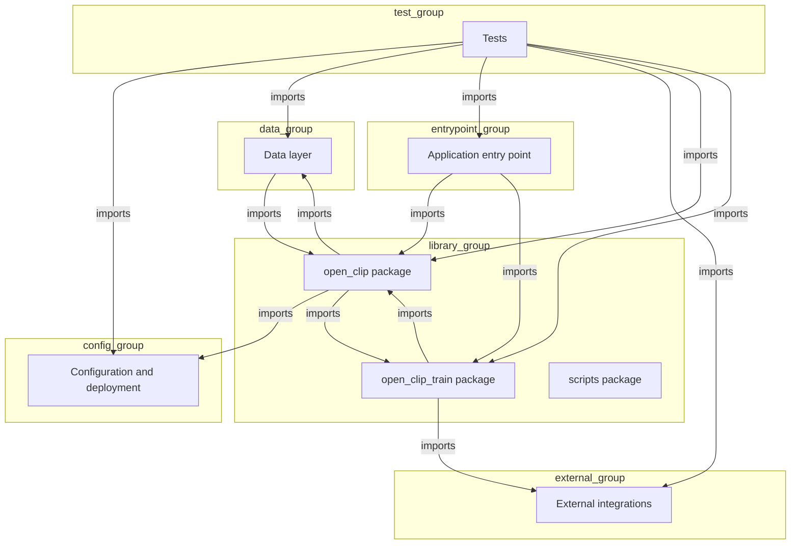

# Architecture report: mlfoundations/open_clip

> Automated static analysis. **Observed** = directly seen in files/imports/AST; **Inferred** = interpretation from that evidence. Repository code was not executed.

## 1. Repository at a glance

| Item | Value |
| --- | --- |
| Repository | mlfoundations/open_clip |
| Description | An open source implementation of CLIP. |
| Language | Python |
| Stars | 14265 |
| Licence | Other |
| Analysed commit / branch | 4cc208d3a44a2fb6d6435006a46f520d2ccc29b1 / main |
| Framework(s) | None detected |
| Files analysed | 387 |
| Components | 8 |

## 2. Architecture in one minute

mlfoundations/open_clip - An open source implementation of CLIP.. This repository was analysed statically from 387 file(s) (141 Python). Detected technologies (observed from imports/manifests): GitHub Actions, NumPy, pandas, requests, Poetry, pytest. Files are grouped into 8 component(s): Configuration and deployment, Data layer, Application entry point, External integrations, open_clip package, open_clip_train package, scripts package, Tests. Observed entry point(s): scripts/clap_zeroshot.py, scripts/convert_audio_patch_layout.py, scripts/genlip_attentive_probe.py. Findings below distinguish observed facts from inferred interpretation.

## 3. High-level block diagram

## 4. Main components

### Configuration and deployment (`config`)

- **Kind:** config
- **Status:** Observed
- **Confidence:** 0.85
- **Responsibility:** Groups 210 file(s) under configuration and deployment (observed from repository paths and static analysis). Observed top-level classes: CLIPAudioCfg.
- **Paths:** `MANIFEST.in`, `pyproject.toml`, `pytest.ini`, `requirements-test.txt`, `requirements-training.txt`, `requirements.txt`, `scripts/probe_configs/bigearthnet_v2_rgb.json`, `scripts/probe_configs/csv_multilabel.json`, `scripts/probe_configs/nih_chest_xray14.json`, `scripts/probe_configs/oxford_iiit_pet.json`, `scripts/probe_configs/plant_pathology_2021.json`, `scripts/probe_configs/resisc45.json`, `scripts/probe_configs/webdataset_single_label.json`, `src/open_clip/audio/config.py`, `src/open_clip/model_configs/CLAP-HTSAT-base-Roberta-base.json`, `src/open_clip/model_configs/CLAP-HTSAT-base.json`, `src/open_clip/model_configs/CLAP-HTSAT-large.json`, `src/open_clip/model_configs/CLAP-HTSAT-tiny-Roberta-base-fused.json`, `src/open_clip/model_configs/CLAP-HTSAT-tiny-Roberta-base.json`, `src/open_clip/model_configs/CLAP-HTSAT-tiny.json`, `src/open_clip/model_configs/CLAP-Whisper-base-Roberta-base.json`, `src/open_clip/model_configs/CLAP-Whisper-small-Roberta-base.json`, `src/open_clip/model_configs/CLAP-Whisper-tiny-Roberta-base.json`, `src/open_clip/model_configs/EVA01-g-14-plus.json`, `src/open_clip/model_configs/EVA01-g-14.json`, `src/open_clip/model_configs/EVA02-B-16.json`, `src/open_clip/model_configs/EVA02-E-14-plus.json`, `src/open_clip/model_configs/EVA02-E-14.json`, `src/open_clip/model_configs/EVA02-L-14-336.json`, `src/open_clip/model_configs/EVA02-L-14.json`, `src/open_clip/model_configs/MobileCLIP-B.json`, `src/open_clip/model_configs/MobileCLIP-S1.json`, `src/open_clip/model_configs/MobileCLIP-S2.json`, `src/open_clip/model_configs/MobileCLIP2-B.json`, `src/open_clip/model_configs/MobileCLIP2-L-14.json`, `src/open_clip/model_configs/MobileCLIP2-S0.json`, `src/open_clip/model_configs/MobileCLIP2-S2.json`, `src/open_clip/model_configs/MobileCLIP2-S3.json`, `src/open_clip/model_configs/MobileCLIP2-S4.json`, `src/open_clip/model_configs/PE-Core-B-16.json`, `src/open_clip/model_configs/PE-Core-L-14-336.json`, `src/open_clip/model_configs/PE-Core-S-16-384.json`, `src/open_clip/model_configs/PE-Core-T-16-384.json`, `src/open_clip/model_configs/PE-Core-bigG-14-448.json`, `src/open_clip/model_configs/RN101-quickgelu.json`, `src/open_clip/model_configs/RN101.json`, `src/open_clip/model_configs/RN50-quickgelu.json`, `src/open_clip/model_configs/RN50.json`, `src/open_clip/model_configs/RN50x16-quickgelu.json`, `src/open_clip/model_configs/RN50x16.json`, `src/open_clip/model_configs/RN50x4-quickgelu.json`, `src/open_clip/model_configs/RN50x4.json`, `src/open_clip/model_configs/RN50x64-quickgelu.json`, `src/open_clip/model_configs/RN50x64.json`, `src/open_clip/model_configs/ViT-B-16-SigLIP-256.json`, `src/open_clip/model_configs/ViT-B-16-SigLIP-384.json`, `src/open_clip/model_configs/ViT-B-16-SigLIP-512.json`, `src/open_clip/model_configs/ViT-B-16-SigLIP-i18n-256.json`, `src/open_clip/model_configs/ViT-B-16-SigLIP.json`, `src/open_clip/model_configs/ViT-B-16-SigLIP2-256.json`, `src/open_clip/model_configs/ViT-B-16-SigLIP2-384.json`, `src/open_clip/model_configs/ViT-B-16-SigLIP2-512.json`, `src/open_clip/model_configs/ViT-B-16-SigLIP2-naflex.json`, `src/open_clip/model_configs/ViT-B-16-SigLIP2.json`, `src/open_clip/model_configs/ViT-B-16-plus-240.json`, `src/open_clip/model_configs/ViT-B-16-plus.json`, `src/open_clip/model_configs/ViT-B-16-quickgelu.json`, `src/open_clip/model_configs/ViT-B-16.json`, `src/open_clip/model_configs/ViT-B-32-256.json`, `src/open_clip/model_configs/ViT-B-32-SigLIP2-256.json`, `src/open_clip/model_configs/ViT-B-32-plus-256.json`, `src/open_clip/model_configs/ViT-B-32-quickgelu.json`, `src/open_clip/model_configs/ViT-B-32.json`, `src/open_clip/model_configs/ViT-H-14-378-quickgelu.json`, `src/open_clip/model_configs/ViT-H-14-378.json`, `src/open_clip/model_configs/ViT-H-14-CLIPA-336.json`, `src/open_clip/model_configs/ViT-H-14-CLIPA.json`, `src/open_clip/model_configs/ViT-H-14-quickgelu.json`, `src/open_clip/model_configs/ViT-H-14-worldwide-378.json`, `src/open_clip/model_configs/ViT-H-14-worldwide-quickgelu.json`, `src/open_clip/model_configs/ViT-H-14-worldwide.json`, `src/open_clip/model_configs/ViT-H-14.json`, `src/open_clip/model_configs/ViT-H-16.json`, `src/open_clip/model_configs/ViT-L-14-280.json`, `src/open_clip/model_configs/ViT-L-14-336-quickgelu.json`, `src/open_clip/model_configs/ViT-L-14-336.json`, `src/open_clip/model_configs/ViT-L-14-CLIPA-336.json`, `src/open_clip/model_configs/ViT-L-14-CLIPA.json`, `src/open_clip/model_configs/ViT-L-14-quickgelu.json`, `src/open_clip/model_configs/ViT-L-14-worldwide-quickgelu.json`, `src/open_clip/model_configs/ViT-L-14-worldwide.json`, `src/open_clip/model_configs/ViT-L-14.json`, `src/open_clip/model_configs/ViT-L-16-320.json`, `src/open_clip/model_configs/ViT-L-16-SigLIP-256.json`, `src/open_clip/model_configs/ViT-L-16-SigLIP-384.json`, `src/open_clip/model_configs/ViT-L-16-SigLIP2-256.json`, `src/open_clip/model_configs/ViT-L-16-SigLIP2-384.json`, `src/open_clip/model_configs/ViT-L-16-SigLIP2-512.json`, `src/open_clip/model_configs/ViT-L-16.json`, `src/open_clip/model_configs/ViT-M-16-alt.json`, `src/open_clip/model_configs/ViT-M-16.json`, `src/open_clip/model_configs/ViT-M-32-alt.json`, `src/open_clip/model_configs/ViT-M-32.json`, `src/open_clip/model_configs/ViT-S-16-alt.json`, `src/open_clip/model_configs/ViT-S-16.json`, `src/open_clip/model_configs/ViT-S-32-alt.json`, `src/open_clip/model_configs/ViT-S-32.json`, `src/open_clip/model_configs/ViT-SO400M-14-SigLIP-378.json`, `src/open_clip/model_configs/ViT-SO400M-14-SigLIP-384.json`, `src/open_clip/model_configs/ViT-SO400M-14-SigLIP.json`, `src/open_clip/model_configs/ViT-SO400M-14-SigLIP2-378.json`, `src/open_clip/model_configs/ViT-SO400M-14-SigLIP2.json`, `src/open_clip/model_configs/ViT-SO400M-16-SigLIP-i18n-256.json`, `src/open_clip/model_configs/ViT-SO400M-16-SigLIP2-256.json`, `src/open_clip/model_configs/ViT-SO400M-16-SigLIP2-384.json`, `src/open_clip/model_configs/ViT-SO400M-16-SigLIP2-512.json`, `src/open_clip/model_configs/ViT-SO400M-16-SigLIP2-naflex.json`, `src/open_clip/model_configs/ViT-bigG-14-CLIPA-336.json`, `src/open_clip/model_configs/ViT-bigG-14-CLIPA.json`, `src/open_clip/model_configs/ViT-bigG-14-quickgelu.json`, `src/open_clip/model_configs/ViT-bigG-14-worldwide-378.json`, `src/open_clip/model_configs/ViT-bigG-14-worldwide.json`, `src/open_clip/model_configs/ViT-bigG-14.json`, `src/open_clip/model_configs/ViT-e-14.json`, `src/open_clip/model_configs/ViT-g-14.json`, `src/open_clip/model_configs/ViT-gopt-16-SigLIP2-256.json`, `src/open_clip/model_configs/ViT-gopt-16-SigLIP2-384.json`, `src/open_clip/model_configs/ViTamin-B-LTT.json`, `src/open_clip/model_configs/ViTamin-B.json`, `src/open_clip/model_configs/ViTamin-L-256.json`, `src/open_clip/model_configs/ViTamin-L-336.json`, `src/open_clip/model_configs/ViTamin-L-384.json`, `src/open_clip/model_configs/ViTamin-L.json`, `src/open_clip/model_configs/ViTamin-L2-256.json`, `src/open_clip/model_configs/ViTamin-L2-336.json`, `src/open_clip/model_configs/ViTamin-L2-384.json`, `src/open_clip/model_configs/ViTamin-L2.json`, `src/open_clip/model_configs/ViTamin-S-LTT.json`, `src/open_clip/model_configs/ViTamin-S.json`, `src/open_clip/model_configs/ViTamin-XL-256.json`, `src/open_clip/model_configs/ViTamin-XL-336.json`, `src/open_clip/model_configs/ViTamin-XL-384.json`, `src/open_clip/model_configs/coca2-moderntext-naflex_ViT-B-32.json`, `src/open_clip/model_configs/coca2-moderntext_ViT-B-32.json`, `src/open_clip/model_configs/coca2_ViT-B-32.json`, `src/open_clip/model_configs/coca_ViT-B-32.json`, `src/open_clip/model_configs/coca_ViT-L-14.json`, `src/open_clip/model_configs/coca_base.json`, `src/open_clip/model_configs/coca_roberta-ViT-B-32.json`, `src/open_clip/model_configs/convnext_base.json`, `src/open_clip/model_configs/convnext_base_w.json`, `src/open_clip/model_configs/convnext_base_w_320.json`, `src/open_clip/model_configs/convnext_large.json`, `src/open_clip/model_configs/convnext_large_d.json`, `src/open_clip/model_configs/convnext_large_d_320.json`, `src/open_clip/model_configs/convnext_small.json`, `src/open_clip/model_configs/convnext_tiny.json`, `src/open_clip/model_configs/convnext_xlarge.json`, `src/open_clip/model_configs/convnext_xxlarge.json`, `src/open_clip/model_configs/convnext_xxlarge_320.json`, `src/open_clip/model_configs/gte-modernbert-base-ViT-B-32-256.json`, `src/open_clip/model_configs/mammut2-moderntext_ViT-B-32.json`, `src/open_clip/model_configs/mammut2-naflex_ViT-B-16.json`, `src/open_clip/model_configs/mammut2-naflex_ViT-B-32.json`, `src/open_clip/model_configs/mammut2_ViT-B-16.json`, `src/open_clip/model_configs/mammut2_ViT-B-32.json`, `src/open_clip/model_configs/mammut2_ViT-L-14.json`, `src/open_clip/model_configs/mammut_ViT-L-14.json`, `src/open_clip/model_configs/moderntext-ViT-B-32-256.json`, `src/open_clip/model_configs/moderntext-naflex_ViT-B-16.json`, `src/open_clip/model_configs/moderntext-naflex_ViT-B-32.json`, `src/open_clip/model_configs/moderntext-naflex_ViT-B-deep-16.json`, `src/open_clip/model_configs/moderntext-naflex_ViT-SO150M2-16.json`, `src/open_clip/model_configs/mt5-base-ViT-B-32.json`, `src/open_clip/model_configs/mt5-xl-ViT-H-14.json`, `src/open_clip/model_configs/naflex_ViT-B-16.json`, `src/open_clip/model_configs/naflex_ViT-B-32.json`, `src/open_clip/model_configs/naflexclap_base_pf4_pt20_moderntextp.json`, `src/open_clip/model_configs/naflexclap_base_pf8_pt16_moderntext.json`, `src/open_clip/model_configs/naflexclap_base_pf8_pt16_moderntextp.json`, `src/open_clip/model_configs/naflexclap_base_pf8_pt20_moderntextp.json`, `src/open_clip/model_configs/naflexclap_large.json`, `src/open_clip/model_configs/naflexclap_little.json`, `src/open_clip/model_configs/naflexclap_little_roberta.json`, `src/open_clip/model_configs/naflexclap_medium.json`, `src/open_clip/model_configs/naflexclap_mediumd.json`, `src/open_clip/model_configs/naflexclap_mediumd_pf4_pt20_moderntextp.json`, `src/open_clip/model_configs/naflexclap_mediumd_roberta.json`, `src/open_clip/model_configs/naflexclap_small.json`, `src/open_clip/model_configs/naflexclap_test.json`, `src/open_clip/model_configs/naflexclap_xs.json`, `src/open_clip/model_configs/naflexclap_xxs.json`, `src/open_clip/model_configs/naflexgenlap_betwixt.json`, `src/open_clip/model_configs/naflexgenlap_so150m2.json`, `src/open_clip/model_configs/naflexgenlap_test_1d.json`, `src/open_clip/model_configs/naflexgenlap_test_2d.json`, `src/open_clip/model_configs/naflexgenlip_b16.json`, `src/open_clip/model_configs/naflexgenlip_so150m2.json`, `src/open_clip/model_configs/naflexgenlip_so16.json`, `src/open_clip/model_configs/naflexgenlip_test.json`, `src/open_clip/model_configs/nllb-clip-base-siglip.json`, `src/open_clip/model_configs/nllb-clip-base.json`, `src/open_clip/model_configs/nllb-clip-large-siglip.json`, `src/open_clip/model_configs/nllb-clip-large.json`, `src/open_clip/model_configs/roberta-ViT-B-32.json`, `src/open_clip/model_configs/swin_base_patch4_window7_224.json`, `src/open_clip/model_configs/vit_medium_patch16_gap_256.json`, `src/open_clip/model_configs/vit_relpos_medium_patch16_cls_224.json`, `src/open_clip/model_configs/xlm-roberta-base-ViT-B-32.json`, `src/open_clip/model_configs/xlm-roberta-large-ViT-H-14.json`
- **Evidence:** [MANIFEST.in](https://github.com/mlfoundations/open_clip/blob/4cc208d3a44a2fb6d6435006a46f520d2ccc29b1/MANIFEST.in); [pyproject.toml](https://github.com/mlfoundations/open_clip/blob/4cc208d3a44a2fb6d6435006a46f520d2ccc29b1/pyproject.toml); [pytest.ini](https://github.com/mlfoundations/open_clip/blob/4cc208d3a44a2fb6d6435006a46f520d2ccc29b1/pytest.ini); [requirements-test.txt](https://github.com/mlfoundations/open_clip/blob/4cc208d3a44a2fb6d6435006a46f520d2ccc29b1/requirements-test.txt); [requirements-training.txt](https://github.com/mlfoundations/open_clip/blob/4cc208d3a44a2fb6d6435006a46f520d2ccc29b1/requirements-training.txt); [requirements.txt](https://github.com/mlfoundations/open_clip/blob/4cc208d3a44a2fb6d6435006a46f520d2ccc29b1/requirements.txt); [scripts/probe_configs/bigearthnet_v2_rgb.json](https://github.com/mlfoundations/open_clip/blob/4cc208d3a44a2fb6d6435006a46f520d2ccc29b1/scripts/probe_configs/bigearthnet_v2_rgb.json); [scripts/probe_configs/csv_multilabel.json](https://github.com/mlfoundations/open_clip/blob/4cc208d3a44a2fb6d6435006a46f520d2ccc29b1/scripts/probe_configs/csv_multilabel.json)

### Data layer (`data_layer`)

- **Kind:** data
- **Status:** Observed
- **Confidence:** 0.85
- **Responsibility:** Groups 1 file(s) under data layer (observed from repository paths and static analysis). Observed top-level classes: CLIP, CLIPTextCfg, CLIPVisionCfg, CustomTextCLIP. Observed top-level functions: _add_intermediate_logits, _build_text_tower, _build_vision_tower, _compute_logits, _forward_tower_intermediates, _pack_clip_output.
- **Paths:** `src/open_clip/model.py`
- **Evidence:** [src/open_clip/model.py:40](https://github.com/mlfoundations/open_clip/blob/4cc208d3a44a2fb6d6435006a46f520d2ccc29b1/src/open_clip/model.py#L40)

### Application entry point (`entrypoint`)

- **Kind:** entrypoint
- **Status:** Observed
- **Confidence:** 0.85
- **Responsibility:** Groups 11 file(s) under application entry point (observed from repository paths and static analysis). Observed top-level classes: FeatureProvider, ProbeHead. Observed top-level functions: _baseline_prompts, _geom, _get_text_config, _uses_tiktoken, _with_tiktoken_assets, accuracy.
- **Paths:** `scripts/clap_zeroshot.py`, `scripts/convert_audio_patch_layout.py`, `scripts/genlip_attentive_probe.py`, `scripts/genlip_caption_stats.py`, `scripts/genlip_zeroshot.py`, `scripts/linear_probe.py`, `scripts/multilabel_zeroshot.py`, `src/open_clip/push_to_hf_hub.py`, `src/open_clip_train/legacy_main.py`, `src/open_clip_train/main.py`, `src/open_clip_train/profiler.py`
- **Evidence:** [scripts/clap_zeroshot.py:26](https://github.com/mlfoundations/open_clip/blob/4cc208d3a44a2fb6d6435006a46f520d2ccc29b1/scripts/clap_zeroshot.py#L26); [scripts/convert_audio_patch_layout.py:24](https://github.com/mlfoundations/open_clip/blob/4cc208d3a44a2fb6d6435006a46f520d2ccc29b1/scripts/convert_audio_patch_layout.py#L24); [scripts/genlip_attentive_probe.py:35](https://github.com/mlfoundations/open_clip/blob/4cc208d3a44a2fb6d6435006a46f520d2ccc29b1/scripts/genlip_attentive_probe.py#L35); [scripts/genlip_caption_stats.py:29](https://github.com/mlfoundations/open_clip/blob/4cc208d3a44a2fb6d6435006a46f520d2ccc29b1/scripts/genlip_caption_stats.py#L29); [scripts/genlip_zeroshot.py:43](https://github.com/mlfoundations/open_clip/blob/4cc208d3a44a2fb6d6435006a46f520d2ccc29b1/scripts/genlip_zeroshot.py#L43); [scripts/linear_probe.py:32](https://github.com/mlfoundations/open_clip/blob/4cc208d3a44a2fb6d6435006a46f520d2ccc29b1/scripts/linear_probe.py#L32); [scripts/multilabel_zeroshot.py:275](https://github.com/mlfoundations/open_clip/blob/4cc208d3a44a2fb6d6435006a46f520d2ccc29b1/scripts/multilabel_zeroshot.py#L275); [src/open_clip/push_to_hf_hub.py:47](https://github.com/mlfoundations/open_clip/blob/4cc208d3a44a2fb6d6435006a46f520d2ccc29b1/src/open_clip/push_to_hf_hub.py#L47)

### External integrations (`external_integrations`)

- **Kind:** external
- **Status:** Inferred
- **Confidence:** 0.70
- **Responsibility:** Groups 0 file(s) under external integrations (observed from repository paths and static analysis).
- **Evidence:** [src/open_clip_train/logger.py:6](https://github.com/mlfoundations/open_clip/blob/4cc208d3a44a2fb6d6435006a46f520d2ccc29b1/src/open_clip_train/logger.py#L6); [tests/test_download_pretrained.py:1](https://github.com/mlfoundations/open_clip/blob/4cc208d3a44a2fb6d6435006a46f520d2ccc29b1/tests/test_download_pretrained.py#L1); [tests/test_download_pretrained.py:11](https://github.com/mlfoundations/open_clip/blob/4cc208d3a44a2fb6d6435006a46f520d2ccc29b1/tests/test_download_pretrained.py#L11); [tests/test_download_pretrained.py:12](https://github.com/mlfoundations/open_clip/blob/4cc208d3a44a2fb6d6435006a46f520d2ccc29b1/tests/test_download_pretrained.py#L12)

### open_clip package (`open_clip`)

- **Kind:** library
- **Status:** Observed
- **Confidence:** 0.85
- **Responsibility:** Groups 50 file(s) under open_clip package (observed from repository paths and static analysis). Observed top-level classes: AFF, Attention, AttentionPool2d, AttentionalPooler, AudioAugmentationCfg, AudioNaFlexCfg. Observed top-level functions: _all_gather_with_grad, _apcfg, _apply_rope_1d, _as_audio_cfg_dict, _as_file, _auto_model_kwargs.
- **Paths:** `src/open_clip/__init__.py`, `src/open_clip/audio/__init__.py`, `src/open_clip/audio/convert.py`, `src/open_clip/audio/dsp.py`, `src/open_clip/audio/fusion.py`, `src/open_clip/audio/htsat.py`, `src/open_clip/audio/io.py`, `src/open_clip/audio/naflex_audio.py`, `src/open_clip/audio/naflex_tower.py`, `src/open_clip/audio/tower.py`, `src/open_clip/audio/transform.py`, `src/open_clip/audio/whisper.py`, `src/open_clip/clap_model.py`, `src/open_clip/coca_model.py`, `src/open_clip/constants.py`, `src/open_clip/convert.py`, `src/open_clip/factory.py`, `src/open_clip/generation.py`, `src/open_clip/hf_configs.py`, `src/open_clip/hf_model.py`, `src/open_clip/layers.py`, `src/open_clip/loss.py`, `src/open_clip/mammut_model.py`, `src/open_clip/model_traits.py`, `src/open_clip/modified_resnet.py`, `src/open_clip/naflex_config.py`, `src/open_clip/naflex_convert.py`, `src/open_clip/naflex_genlap_model.py`, `src/open_clip/naflex_genlip_model.py`, `src/open_clip/pos_embed.py`, `src/open_clip/pretrained.py`, `src/open_clip/task/__init__.py`, `src/open_clip/task/base_task.py`, `src/open_clip/task/checkpoint.py`, `src/open_clip/task/clap_task.py`, `src/open_clip/task/clip_task.py`, `src/open_clip/task/coca_task.py`, `src/open_clip/task/distill_task.py`, `src/open_clip/task/genlap_task.py`, `src/open_clip/task/genlip_task.py`, `src/open_clip/task/image_text_task.py`, `src/open_clip/task/siglip_task.py`, `src/open_clip/timm_model.py`, `src/open_clip/tokenizer.py`, `src/open_clip/transform.py`, `src/open_clip/transformer.py`, `src/open_clip/utils.py`, `src/open_clip/version.py`, `src/open_clip/zero_shot_classifier.py`, `src/open_clip/zero_shot_metadata.py`
- **Evidence:** [src/open_clip/__init__.py](https://github.com/mlfoundations/open_clip/blob/4cc208d3a44a2fb6d6435006a46f520d2ccc29b1/src/open_clip/__init__.py); [src/open_clip/audio/__init__.py:22](https://github.com/mlfoundations/open_clip/blob/4cc208d3a44a2fb6d6435006a46f520d2ccc29b1/src/open_clip/audio/__init__.py#L22); [src/open_clip/audio/convert.py:17](https://github.com/mlfoundations/open_clip/blob/4cc208d3a44a2fb6d6435006a46f520d2ccc29b1/src/open_clip/audio/convert.py#L17); [src/open_clip/audio/dsp.py:17](https://github.com/mlfoundations/open_clip/blob/4cc208d3a44a2fb6d6435006a46f520d2ccc29b1/src/open_clip/audio/dsp.py#L17); [src/open_clip/audio/fusion.py:12](https://github.com/mlfoundations/open_clip/blob/4cc208d3a44a2fb6d6435006a46f520d2ccc29b1/src/open_clip/audio/fusion.py#L12); [src/open_clip/audio/htsat.py:27](https://github.com/mlfoundations/open_clip/blob/4cc208d3a44a2fb6d6435006a46f520d2ccc29b1/src/open_clip/audio/htsat.py#L27); [src/open_clip/audio/io.py:15](https://github.com/mlfoundations/open_clip/blob/4cc208d3a44a2fb6d6435006a46f520d2ccc29b1/src/open_clip/audio/io.py#L15); [src/open_clip/audio/naflex_audio.py:28](https://github.com/mlfoundations/open_clip/blob/4cc208d3a44a2fb6d6435006a46f520d2ccc29b1/src/open_clip/audio/naflex_audio.py#L28)

### open_clip_train package (`open_clip_train`)

- **Kind:** library
- **Status:** Observed
- **Confidence:** 0.85
- **Responsibility:** Groups 20 file(s) under open_clip_train package (observed from repository paths and static analysis). Observed top-level classes: AudioCaptionTokenizer, AudioTokenLength, AudioZeroShotData, AverageMeter, CaptionLength, CsvDataset. Observed top-level functions: _add_rank_metrics, _advance_epoch, _assign_group_scales, _audio_collate, _audio_loader_kwargs, _cat_chunk.
- **Paths:** `src/open_clip_train/__init__.py`, `src/open_clip_train/audio_data.py`, `src/open_clip_train/audio_zero_shot.py`, `src/open_clip_train/data.py`, `src/open_clip_train/distributed.py`, `src/open_clip_train/eval_utils.py`, `src/open_clip_train/file_utils.py`, `src/open_clip_train/legacy_data.py`, `src/open_clip_train/legacy_train.py`, `src/open_clip_train/logger.py`, `src/open_clip_train/loss.py`, `src/open_clip_train/metrics.py`, `src/open_clip_train/naflex_data.py`, `src/open_clip_train/optim.py`, `src/open_clip_train/params.py`, `src/open_clip_train/precision.py`, `src/open_clip_train/scheduler.py`, `src/open_clip_train/train.py`, `src/open_clip_train/utils.py`, `src/open_clip_train/zero_shot.py`
- **Evidence:** [src/open_clip_train/__init__.py](https://github.com/mlfoundations/open_clip/blob/4cc208d3a44a2fb6d6435006a46f520d2ccc29b1/src/open_clip_train/__init__.py); [src/open_clip_train/audio_data.py:40](https://github.com/mlfoundations/open_clip/blob/4cc208d3a44a2fb6d6435006a46f520d2ccc29b1/src/open_clip_train/audio_data.py#L40); [src/open_clip_train/audio_zero_shot.py:35](https://github.com/mlfoundations/open_clip/blob/4cc208d3a44a2fb6d6435006a46f520d2ccc29b1/src/open_clip_train/audio_zero_shot.py#L35); [src/open_clip_train/data.py:39](https://github.com/mlfoundations/open_clip/blob/4cc208d3a44a2fb6d6435006a46f520d2ccc29b1/src/open_clip_train/data.py#L39); [src/open_clip_train/distributed.py:11](https://github.com/mlfoundations/open_clip/blob/4cc208d3a44a2fb6d6435006a46f520d2ccc29b1/src/open_clip_train/distributed.py#L11); [src/open_clip_train/eval_utils.py:14](https://github.com/mlfoundations/open_clip/blob/4cc208d3a44a2fb6d6435006a46f520d2ccc29b1/src/open_clip_train/eval_utils.py#L14); [src/open_clip_train/file_utils.py:13](https://github.com/mlfoundations/open_clip/blob/4cc208d3a44a2fb6d6435006a46f520d2ccc29b1/src/open_clip_train/file_utils.py#L13); [src/open_clip_train/legacy_data.py:47](https://github.com/mlfoundations/open_clip/blob/4cc208d3a44a2fb6d6435006a46f520d2ccc29b1/src/open_clip_train/legacy_data.py#L47)

### scripts package (`scripts`)

- **Kind:** library
- **Status:** Observed
- **Confidence:** 0.85
- **Responsibility:** Groups 5 file(s) under scripts package (observed from repository paths and static analysis). Observed top-level classes: ClassificationSource, ImageCollator, MetadataReader, TimmClassificationDataset. Observed top-level functions: _parquet_rows, check_disjoint, compatible, decode_image, extract_features, field.
- **Paths:** `scripts/clipav1_vit_l16_i37_t8.sh`, `scripts/clipav2_vit_h14_i84_224_336_cl32_gap_datacomp1b.sh`, `scripts/h14_224_32_finetune.sh`, `scripts/h14_84_8_pretrain.sh`, `scripts/linear_probe_data.py`
- **Evidence:** [scripts/clipav1_vit_l16_i37_t8.sh](https://github.com/mlfoundations/open_clip/blob/4cc208d3a44a2fb6d6435006a46f520d2ccc29b1/scripts/clipav1_vit_l16_i37_t8.sh); [scripts/clipav2_vit_h14_i84_224_336_cl32_gap_datacomp1b.sh](https://github.com/mlfoundations/open_clip/blob/4cc208d3a44a2fb6d6435006a46f520d2ccc29b1/scripts/clipav2_vit_h14_i84_224_336_cl32_gap_datacomp1b.sh); [scripts/h14_224_32_finetune.sh](https://github.com/mlfoundations/open_clip/blob/4cc208d3a44a2fb6d6435006a46f520d2ccc29b1/scripts/h14_224_32_finetune.sh); [scripts/h14_84_8_pretrain.sh](https://github.com/mlfoundations/open_clip/blob/4cc208d3a44a2fb6d6435006a46f520d2ccc29b1/scripts/h14_84_8_pretrain.sh); [scripts/linear_probe_data.py:23](https://github.com/mlfoundations/open_clip/blob/4cc208d3a44a2fb6d6435006a46f520d2ccc29b1/scripts/linear_probe_data.py#L23)

### Tests (`tests`)

- **Kind:** test
- **Status:** Observed
- **Confidence:** 0.85
- **Responsibility:** Groups 57 file(s) under tests (observed from repository paths and static analysis). Observed routes: PATCH open_clip.pretrained.urllib, PATCH open_clip.pretrained.urllib, PATCH open_clip.pretrained.urllib, PATCH open_clip.pretrained.urllib, PATCH open_clip.pretrained.urllib. Observed top-level classes: DownloadPretrainedTests, DummyClipLoss, DummyCoCaLoss, DummyDistillLoss, DummyLoss, TestWrapper. Observed top-level functions: _assert_metrics_close, _audio_batch, _audio_sample, _audio_wds_env, _base_args, _batch.
- **Paths:** `tests/test_audio_checkpointing.py`, `tests/test_audio_convert.py`, `tests/test_audio_data.py`, `tests/test_audio_model_configs.py`, `tests/test_audio_truncation.py`, `tests/test_audio_wds.py`, `tests/test_audio_zero_shot.py`, `tests/test_clap_task.py`, `tests/test_coca2.py`, `tests/test_context_masking.py`, `tests/test_data_csv.py`, `tests/test_download_pretrained.py`, `tests/test_eval_task.py`, `tests/test_factory_loss.py`, `tests/test_factory_task.py`, `tests/test_fused_caption_loss.py`, `tests/test_grad_accum.py`, `tests/test_hf_model.py`, `tests/test_inference.py`, `tests/test_inference_simple.py`, `tests/test_legacy_data.py`, `tests/test_loss.py`, `tests/test_mammut.py`, `tests/test_model_traits.py`, `tests/test_modern_text.py`, `tests/test_naflex.py`, `tests/test_naflex_audio.py`, `tests/test_naflex_audio_data.py`, `tests/test_naflex_coca2.py`, `tests/test_naflex_config.py`, `tests/test_naflex_genlap.py`, `tests/test_naflex_genlip.py`, `tests/test_naflex_mammut.py`, `tests/test_naflex_timm_conversion.py`, `tests/test_naflexclap.py`, `tests/test_num_shards.py`, `tests/test_optim_layer_decay.py`, `tests/test_pad_id.py`, `tests/test_params.py`, `tests/test_push_to_hf_hub.py`, `tests/test_retrieval_metrics.py`, `tests/test_siglip_chunked_loss.py`, `tests/test_siglip_loss_precision.py`, `tests/test_task_base_unit.py`, `tests/test_task_checkpoint.py`, `tests/test_task_compile.py`, `tests/test_task_fsdp_unit.py`, `tests/test_task_specific_unit.py`, `tests/test_text_layout.py`, `tests/test_tokenizer.py`, `tests/test_train_utils.py`, `tests/test_training_simple.py`, `tests/test_transformer_compat.py`, `tests/test_wds.py`, `tests/test_wds_setup.py`, `tests/test_zero_shot_eval.py`, `tests/util_test.py`
- **Evidence:** [tests/test_audio_checkpointing.py:5](https://github.com/mlfoundations/open_clip/blob/4cc208d3a44a2fb6d6435006a46f520d2ccc29b1/tests/test_audio_checkpointing.py#L5); [tests/test_audio_convert.py:10](https://github.com/mlfoundations/open_clip/blob/4cc208d3a44a2fb6d6435006a46f520d2ccc29b1/tests/test_audio_convert.py#L10); [tests/test_audio_data.py:11](https://github.com/mlfoundations/open_clip/blob/4cc208d3a44a2fb6d6435006a46f520d2ccc29b1/tests/test_audio_data.py#L11); [tests/test_audio_model_configs.py:10](https://github.com/mlfoundations/open_clip/blob/4cc208d3a44a2fb6d6435006a46f520d2ccc29b1/tests/test_audio_model_configs.py#L10); [tests/test_audio_truncation.py:11](https://github.com/mlfoundations/open_clip/blob/4cc208d3a44a2fb6d6435006a46f520d2ccc29b1/tests/test_audio_truncation.py#L11); [tests/test_audio_wds.py:31](https://github.com/mlfoundations/open_clip/blob/4cc208d3a44a2fb6d6435006a46f520d2ccc29b1/tests/test_audio_wds.py#L31); [tests/test_audio_zero_shot.py:9](https://github.com/mlfoundations/open_clip/blob/4cc208d3a44a2fb6d6435006a46f520d2ccc29b1/tests/test_audio_zero_shot.py#L9); [tests/test_clap_task.py:18](https://github.com/mlfoundations/open_clip/blob/4cc208d3a44a2fb6d6435006a46f520d2ccc29b1/tests/test_clap_task.py#L18)

## 5. Execution flow

**Observed** entry point(s):

- [scripts/clap_zeroshot.py:99](https://github.com/mlfoundations/open_clip/blob/4cc208d3a44a2fb6d6435006a46f520d2ccc29b1/scripts/clap_zeroshot.py#L99)
- [scripts/convert_audio_patch_layout.py:86](https://github.com/mlfoundations/open_clip/blob/4cc208d3a44a2fb6d6435006a46f520d2ccc29b1/scripts/convert_audio_patch_layout.py#L86)
- [scripts/genlip_attentive_probe.py:294](https://github.com/mlfoundations/open_clip/blob/4cc208d3a44a2fb6d6435006a46f520d2ccc29b1/scripts/genlip_attentive_probe.py#L294)
- [scripts/genlip_caption_stats.py:269](https://github.com/mlfoundations/open_clip/blob/4cc208d3a44a2fb6d6435006a46f520d2ccc29b1/scripts/genlip_caption_stats.py#L269)
- [scripts/genlip_zeroshot.py:229](https://github.com/mlfoundations/open_clip/blob/4cc208d3a44a2fb6d6435006a46f520d2ccc29b1/scripts/genlip_zeroshot.py#L229)
- [scripts/linear_probe.py:594](https://github.com/mlfoundations/open_clip/blob/4cc208d3a44a2fb6d6435006a46f520d2ccc29b1/scripts/linear_probe.py#L594)
- [scripts/multilabel_zeroshot.py:740](https://github.com/mlfoundations/open_clip/blob/4cc208d3a44a2fb6d6435006a46f520d2ccc29b1/scripts/multilabel_zeroshot.py#L740)
- [src/open_clip/push_to_hf_hub.py:309](https://github.com/mlfoundations/open_clip/blob/4cc208d3a44a2fb6d6435006a46f520d2ccc29b1/src/open_clip/push_to_hf_hub.py#L309)
- [src/open_clip_train/legacy_main.py:552](https://github.com/mlfoundations/open_clip/blob/4cc208d3a44a2fb6d6435006a46f520d2ccc29b1/src/open_clip_train/legacy_main.py#L552)
- [src/open_clip_train/main.py:751](https://github.com/mlfoundations/open_clip/blob/4cc208d3a44a2fb6d6435006a46f520d2ccc29b1/src/open_clip_train/main.py#L751)
- [src/open_clip_train/profiler.py:252](https://github.com/mlfoundations/open_clip/blob/4cc208d3a44a2fb6d6435006a46f520d2ccc29b1/src/open_clip_train/profiler.py#L252)

**Observed** routes (from decorators):

- `PATCH open_clip.pretrained.urllib` -> `test_download_pretrained_from_url_from_openaipublic` in `tests/test_download_pretrained.py:30`
- `PATCH open_clip.pretrained.urllib` -> `test_download_pretrained_from_url_from_openaipublic_corrupted` in `tests/test_download_pretrained.py:40`
- `PATCH open_clip.pretrained.urllib` -> `test_download_pretrained_from_url_from_openaipublic_valid_cache` in `tests/test_download_pretrained.py:51`
- `PATCH open_clip.pretrained.urllib` -> `test_download_pretrained_from_url_from_openaipublic_corrupted_cache` in `tests/test_download_pretrained.py:63`
- `PATCH open_clip.pretrained.urllib` -> `test_download_pretrained_from_url_from_mlfoundations` in `tests/test_download_pretrained.py:75`
- `PATCH open_clip.pretrained.urllib` -> `test_download_pretrained_from_url_from_mlfoundations_corrupted` in `tests/test_download_pretrained.py:85`
- `PATCH open_clip.pretrained.urllib` -> `test_download_pretrained_from_hfh` in `tests/test_download_pretrained.py:96`

Representative flow (derived from observed entry points and the import graph; steps beyond the entry point are **Inferred**):

1. Execution starts at an observed entry point listed above, if present.
2. `data_layer` imports `open_clip` (Data layer -> open_clip package).
3. `entrypoint` imports `open_clip` (Application entry point -> open_clip package).
4. `entrypoint` imports `open_clip_train` (Application entry point -> open_clip_train package).
5. `open_clip` imports `config` (open_clip package -> Configuration and deployment).
6. `open_clip` imports `data_layer` (open_clip package -> Data layer).
7. `open_clip` imports `open_clip_train` (open_clip package -> open_clip_train package).
8. `open_clip_train` imports `external_integrations` (open_clip_train package -> External integrations).
9. `open_clip_train` imports `open_clip` (open_clip_train package -> open_clip package).

## 6. Project structure

### `(root)`

- `.gitattributes` - other (61 bytes)
- `.gitignore` - other (2010 bytes)
- `CITATION.cff` - other (824 bytes)
- `HISTORY.md` - docs (5786 bytes)
- `LICENSE` - docs (1229 bytes)
- `MANIFEST.in` - manifest (139 bytes)
- `Makefile` - other (403 bytes)
- `README.md` - docs (40557 bytes)
- `pyproject.toml` - manifest (2667 bytes)
- `pytest.ini` - config (39 bytes)
- `requirements-test.txt` - manifest (85 bytes)
- `requirements-training.txt` - manifest (170 bytes)
- `requirements.txt` - manifest (89 bytes)

### `.github`

- `.github/workflows/ci.yml` - ci, YAML (3614 bytes)
- `.github/workflows/clear-cache.yml` - ci, YAML (716 bytes)
- `.github/workflows/python-publish.yml` - ci, YAML (993 bytes)

### `docs`

- `docs/Interacting_with_open_coca.ipynb` - docs (62162 bytes)
- `docs/LOW_ACC.md` - docs (2841 bytes)
- `docs/MIGRATING_3_TO_4.md` - docs (15929 bytes)
- `docs/PRETRAINED.md` - docs (16941 bytes)
- `docs/clip_conceptual_captions.md` - docs (262 bytes)
- `docs/clipa.md` - docs (7113 bytes)
- `docs/datacomp_models.md` - docs (7372 bytes)
- `docs/linear_probe.md` - docs (14396 bytes)
- `docs/model_profile.csv` - docs (6167 bytes)
- `docs/multilabel_zeroshot.md` - docs (17819 bytes)
- `docs/openclip_classification_results.csv` - docs (36265 bytes)
- `docs/openclip_results.csv` - docs (38830 bytes)
- `docs/openclip_retrieval_results.csv` - docs (22758 bytes)
- `docs/script_examples/clipa/vit_b16/i50_t16_finetune.sh` - docs (726 bytes)
- `docs/script_examples/clipa/vit_b16/i50_t16_pretrain.sh` - docs (682 bytes)
- `docs/script_examples/clipa/vit_l16/i17_t16_finetune.sh` - docs (810 bytes)
- `docs/script_examples/clipa/vit_l16/i17_t16_pretrain.sh` - docs (768 bytes)
- `docs/script_examples/clipa/vit_l16/i37_t8_finetune.sh` - docs (810 bytes)
- `docs/script_examples/clipa/vit_l16/i37_t8_pretrain.sh` - docs (774 bytes)
- `docs/script_examples/clipav2/vit_h14/i257_t32_finetunex4.sh` - docs (1137 bytes)
- `docs/script_examples/clipav2/vit_h14/i50_t8_pretrain.sh` - docs (1061 bytes)
- `docs/script_examples/clipav2/vit_h14/i577_t32_finetunex1.sh` - docs (1138 bytes)
- `docs/script_examples/stability_example.sh` - docs (1663 bytes)

### `scripts`

- `scripts/clap_zeroshot.py` - source, Python (4759 bytes)
- `scripts/clipav1_vit_l16_i37_t8.sh` - source, Shell (276 bytes)
- `scripts/clipav2_vit_h14_i84_224_336_cl32_gap_datacomp1b.sh` - source, Shell (392 bytes)
- `scripts/convert_audio_patch_layout.py` - source, Python (3845 bytes)
- `scripts/genlip_attentive_probe.py` - source, Python (12552 bytes)
- `scripts/genlip_caption_stats.py` - source, Python (12519 bytes)
- `scripts/genlip_zeroshot.py` - source, Python (11647 bytes)
- `scripts/h14_224_32_finetune.sh` - source, Shell (890 bytes)
- `scripts/h14_84_8_pretrain.sh` - source, Shell (899 bytes)
- `scripts/linear_probe.py` - source, Python (28320 bytes)
- `scripts/linear_probe_data.py` - source, Python (21085 bytes)
- `scripts/multilabel_zeroshot.py` - source, Python (32435 bytes)
- `scripts/probe_configs/bigearthnet_v2_rgb.json` - config (203 bytes)
- `scripts/probe_configs/csv_multilabel.json` - config (300 bytes)
- `scripts/probe_configs/nih_chest_xray14.json` - config (327 bytes)
- `scripts/probe_configs/oxford_iiit_pet.json` - config (165 bytes)
- `scripts/probe_configs/plant_pathology_2021.json` - config (213 bytes)
- `scripts/probe_configs/resisc45.json` - config (156 bytes)
- `scripts/probe_configs/webdataset_single_label.json` - config (324 bytes)

### `src`

- `src/open_clip/__init__.py` - source, Python (1955 bytes)
- `src/open_clip/audio/__init__.py` - source, Python (1063 bytes)
- `src/open_clip/audio/config.py` - source, Python (1448 bytes)
- `src/open_clip/audio/convert.py` - source, Python (5487 bytes)
- `src/open_clip/audio/dsp.py` - source, Python (5242 bytes)
- `src/open_clip/audio/fusion.py` - source, Python (7195 bytes)
- `src/open_clip/audio/htsat.py` - source, Python (48017 bytes)
- `src/open_clip/audio/io.py` - source, Python (2605 bytes)
- `src/open_clip/audio/naflex_audio.py` - source, Python (16284 bytes)
- `src/open_clip/audio/naflex_tower.py` - source, Python (4375 bytes)
- `src/open_clip/audio/tower.py` - source, Python (6360 bytes)
- `src/open_clip/audio/transform.py` - source, Python (8812 bytes)
- `src/open_clip/audio/whisper.py` - source, Python (15166 bytes)
- `src/open_clip/clap_model.py` - source, Python (4559 bytes)
- `src/open_clip/coca_model.py` - source, Python (20374 bytes)
- `src/open_clip/constants.py` - source, Python (510 bytes)
- `src/open_clip/convert.py` - source, Python (14900 bytes)
- `src/open_clip/factory.py` - source, Python (77059 bytes)
- `src/open_clip/generation.py` - source, Python (19659 bytes)
- `src/open_clip/hf_configs.py` - source, Python (3089 bytes)
- `src/open_clip/hf_model.py` - source, Python (14587 bytes)
- `src/open_clip/layers.py` - source, Python (1646 bytes)
- `src/open_clip/loss.py` - source, Python (34347 bytes)
- `src/open_clip/mammut_model.py` - source, Python (13415 bytes)
- `src/open_clip/model.py` - source, Python (42015 bytes)
- `src/open_clip/model_configs/CLAP-HTSAT-base-Roberta-base.json` - config (501 bytes)
- `src/open_clip/model_configs/CLAP-HTSAT-base.json` - config (497 bytes)
- `src/open_clip/model_configs/CLAP-HTSAT-large.json` - config (498 bytes)
- `src/open_clip/model_configs/CLAP-HTSAT-tiny-Roberta-base-fused.json` - config (595 bytes)
- `src/open_clip/model_configs/CLAP-HTSAT-tiny-Roberta-base.json` - config (564 bytes)
- `src/open_clip/model_configs/CLAP-HTSAT-tiny.json` - config (496 bytes)
- `src/open_clip/model_configs/CLAP-Whisper-base-Roberta-base.json` - config (529 bytes)
- `src/open_clip/model_configs/CLAP-Whisper-small-Roberta-base.json` - config (530 bytes)
- `src/open_clip/model_configs/CLAP-Whisper-tiny-Roberta-base.json` - config (529 bytes)
- `src/open_clip/model_configs/EVA01-g-14-plus.json` - config (401 bytes)
- `src/open_clip/model_configs/EVA01-g-14.json` - config (400 bytes)
- `src/open_clip/model_configs/EVA02-B-16.json` - config (404 bytes)
- `src/open_clip/model_configs/EVA02-E-14-plus.json` - config (411 bytes)
- `src/open_clip/model_configs/EVA02-E-14.json` - config (411 bytes)
- `src/open_clip/model_configs/EVA02-L-14-336.json` - config (406 bytes)
- `src/open_clip/model_configs/EVA02-L-14.json` - config (406 bytes)
- `src/open_clip/model_configs/MobileCLIP-B.json` - config (483 bytes)
- `src/open_clip/model_configs/MobileCLIP-S1.json` - config (476 bytes)
- `src/open_clip/model_configs/MobileCLIP-S2.json` - config (476 bytes)
- `src/open_clip/model_configs/MobileCLIP2-B.json` - config (483 bytes)
- `src/open_clip/model_configs/MobileCLIP2-L-14.json` - config (493 bytes)
- `src/open_clip/model_configs/MobileCLIP2-S0.json` - config (476 bytes)
- `src/open_clip/model_configs/MobileCLIP2-S2.json` - config (476 bytes)
- `src/open_clip/model_configs/MobileCLIP2-S3.json` - config (477 bytes)
- `src/open_clip/model_configs/MobileCLIP2-S4.json` - config (477 bytes)
- `src/open_clip/model_configs/PE-Core-B-16.json` - config (406 bytes)
- `src/open_clip/model_configs/PE-Core-L-14-336.json` - config (407 bytes)
- `src/open_clip/model_configs/PE-Core-S-16-384.json` - config (404 bytes)
- `src/open_clip/model_configs/PE-Core-T-16-384.json` - config (403 bytes)
- `src/open_clip/model_configs/PE-Core-bigG-14-448.json` - config (410 bytes)
- `src/open_clip/model_configs/RN101-quickgelu.json` - config (388 bytes)
- `src/open_clip/model_configs/RN101.json` - config (364 bytes)
- `src/open_clip/model_configs/RN50-quickgelu.json` - config (389 bytes)
- `src/open_clip/model_configs/RN50.json` - config (364 bytes)
- `src/open_clip/model_configs/RN50x16-quickgelu.json` - config (389 bytes)
- `src/open_clip/model_configs/RN50x16.json` - config (365 bytes)
- `src/open_clip/model_configs/RN50x4-quickgelu.json` - config (389 bytes)
- `src/open_clip/model_configs/RN50x4.json` - config (365 bytes)
- `src/open_clip/model_configs/RN50x64-quickgelu.json` - config (394 bytes)
- `src/open_clip/model_configs/RN50x64.json` - config (370 bytes)
- `src/open_clip/model_configs/ViT-B-16-SigLIP-256.json` - config (710 bytes)
- `src/open_clip/model_configs/ViT-B-16-SigLIP-384.json` - config (710 bytes)
- `src/open_clip/model_configs/ViT-B-16-SigLIP-512.json` - config (710 bytes)
- `src/open_clip/model_configs/ViT-B-16-SigLIP-i18n-256.json` - config (720 bytes)
- `src/open_clip/model_configs/ViT-B-16-SigLIP.json` - config (710 bytes)
- `src/open_clip/model_configs/ViT-B-16-SigLIP2-256.json` - config (785 bytes)
- `src/open_clip/model_configs/ViT-B-16-SigLIP2-384.json` - config (785 bytes)
- `src/open_clip/model_configs/ViT-B-16-SigLIP2-512.json` - config (785 bytes)
- `src/open_clip/model_configs/ViT-B-16-SigLIP2-naflex.json` - config (819 bytes)
- `src/open_clip/model_configs/ViT-B-16-SigLIP2.json` - config (781 bytes)
- `src/open_clip/model_configs/ViT-B-16-plus-240.json` - config (295 bytes)
- `src/open_clip/model_configs/ViT-B-16-plus.json` - config (295 bytes)
- `src/open_clip/model_configs/ViT-B-16-quickgelu.json` - config (318 bytes)
- `src/open_clip/model_configs/ViT-B-16.json` - config (294 bytes)
- `src/open_clip/model_configs/ViT-B-32-256.json` - config (295 bytes)
- `src/open_clip/model_configs/ViT-B-32-SigLIP2-256.json` - config (786 bytes)
- `src/open_clip/model_configs/ViT-B-32-plus-256.json` - config (295 bytes)
- `src/open_clip/model_configs/ViT-B-32-quickgelu.json` - config (318 bytes)
- `src/open_clip/model_configs/ViT-B-32.json` - config (294 bytes)
- `src/open_clip/model_configs/ViT-H-14-378-quickgelu.json` - config (348 bytes)
- `src/open_clip/model_configs/ViT-H-14-378.json` - config (324 bytes)
- `src/open_clip/model_configs/ViT-H-14-CLIPA-336.json` - config (604 bytes)
- `src/open_clip/model_configs/ViT-H-14-CLIPA.json` - config (604 bytes)
- `src/open_clip/model_configs/ViT-H-14-quickgelu.json` - config (348 bytes)
- `src/open_clip/model_configs/ViT-H-14-worldwide-378.json` - config (426 bytes)
- `src/open_clip/model_configs/ViT-H-14-worldwide-quickgelu.json` - config (450 bytes)
- `src/open_clip/model_configs/ViT-H-14-worldwide.json` - config (426 bytes)
- `src/open_clip/model_configs/ViT-H-14.json` - config (324 bytes)
- `src/open_clip/model_configs/ViT-H-16.json` - config (324 bytes)
- `src/open_clip/model_configs/ViT-L-14-280.json` - config (296 bytes)
- `src/open_clip/model_configs/ViT-L-14-336-quickgelu.json` - config (320 bytes)
- `src/open_clip/model_configs/ViT-L-14-336.json` - config (296 bytes)
- `src/open_clip/model_configs/ViT-L-14-CLIPA-336.json` - config (576 bytes)
- `src/open_clip/model_configs/ViT-L-14-CLIPA.json` - config (576 bytes)
- `src/open_clip/model_configs/ViT-L-14-quickgelu.json` - config (320 bytes)
- `src/open_clip/model_configs/ViT-L-14-worldwide-quickgelu.json` - config (495 bytes)
- `src/open_clip/model_configs/ViT-L-14-worldwide.json` - config (471 bytes)
- `src/open_clip/model_configs/ViT-L-14.json` - config (296 bytes)
- `src/open_clip/model_configs/ViT-L-16-320.json` - config (296 bytes)
- `src/open_clip/model_configs/ViT-L-16-SigLIP-256.json` - config (713 bytes)
- `src/open_clip/model_configs/ViT-L-16-SigLIP-384.json` - config (713 bytes)
- `src/open_clip/model_configs/ViT-L-16-SigLIP2-256.json` - config (788 bytes)
- `src/open_clip/model_configs/ViT-L-16-SigLIP2-384.json` - config (788 bytes)
- `src/open_clip/model_configs/ViT-L-16-SigLIP2-512.json` - config (788 bytes)
- `src/open_clip/model_configs/ViT-L-16.json` - config (296 bytes)
- `src/open_clip/model_configs/ViT-M-16-alt.json` - config (325 bytes)
- `src/open_clip/model_configs/ViT-M-16.json` - config (294 bytes)
- `src/open_clip/model_configs/ViT-M-32-alt.json` - config (294 bytes)
- `src/open_clip/model_configs/ViT-M-32.json` - config (294 bytes)
- `src/open_clip/model_configs/ViT-S-16-alt.json` - config (294 bytes)
- `src/open_clip/model_configs/ViT-S-16.json` - config (294 bytes)
- `src/open_clip/model_configs/ViT-S-32-alt.json` - config (294 bytes)
- `src/open_clip/model_configs/ViT-S-32.json` - config (294 bytes)
- `src/open_clip/model_configs/ViT-SO400M-14-SigLIP-378.json` - config (743 bytes)
- `src/open_clip/model_configs/ViT-SO400M-14-SigLIP-384.json` - config (743 bytes)
- `src/open_clip/model_configs/ViT-SO400M-14-SigLIP.json` - config (743 bytes)
- `src/open_clip/model_configs/ViT-SO400M-14-SigLIP2-378.json` - config (823 bytes)
- `src/open_clip/model_configs/ViT-SO400M-14-SigLIP2.json` - config (819 bytes)
- `src/open_clip/model_configs/ViT-SO400M-16-SigLIP-i18n-256.json` - config (755 bytes)
- `src/open_clip/model_configs/ViT-SO400M-16-SigLIP2-256.json` - config (823 bytes)
- `src/open_clip/model_configs/ViT-SO400M-16-SigLIP2-384.json` - config (823 bytes)
- `src/open_clip/model_configs/ViT-SO400M-16-SigLIP2-512.json` - config (823 bytes)
- `src/open_clip/model_configs/ViT-SO400M-16-SigLIP2-naflex.json` - config (857 bytes)
- `src/open_clip/model_configs/ViT-bigG-14-CLIPA-336.json` - config (634 bytes)
- `src/open_clip/model_configs/ViT-bigG-14-CLIPA.json` - config (634 bytes)
- `src/open_clip/model_configs/ViT-bigG-14-quickgelu.json` - config (378 bytes)
- `src/open_clip/model_configs/ViT-bigG-14-worldwide-378.json` - config (456 bytes)
- `src/open_clip/model_configs/ViT-bigG-14-worldwide.json` - config (456 bytes)
- `src/open_clip/model_configs/ViT-bigG-14.json` - config (354 bytes)
- `src/open_clip/model_configs/ViT-e-14.json` - config (354 bytes)
- `src/open_clip/model_configs/ViT-g-14.json` - config (353 bytes)
- `src/open_clip/model_configs/ViT-gopt-16-SigLIP2-256.json` - config (823 bytes)
- `src/open_clip/model_configs/ViT-gopt-16-SigLIP2-384.json` - config (823 bytes)
- `src/open_clip/model_configs/ViTamin-B-LTT.json` - config (426 bytes)
- `src/open_clip/model_configs/ViTamin-B.json` - config (425 bytes)
- `src/open_clip/model_configs/ViTamin-L-256.json` - config (427 bytes)
- `src/open_clip/model_configs/ViTamin-L-336.json` - config (427 bytes)
- `src/open_clip/model_configs/ViTamin-L-384.json` - config (428 bytes)
- `src/open_clip/model_configs/ViTamin-L.json` - config (427 bytes)
- `src/open_clip/model_configs/ViTamin-L2-256.json` - config (430 bytes)
- `src/open_clip/model_configs/ViTamin-L2-336.json` - config (430 bytes)
- `src/open_clip/model_configs/ViTamin-L2-384.json` - config (431 bytes)
- `src/open_clip/model_configs/ViTamin-L2.json` - config (430 bytes)
- `src/open_clip/model_configs/ViTamin-S-LTT.json` - config (427 bytes)
- `src/open_clip/model_configs/ViTamin-S.json` - config (426 bytes)
- `src/open_clip/model_configs/ViTamin-XL-256.json` - config (430 bytes)
- `src/open_clip/model_configs/ViTamin-XL-336.json` - config (430 bytes)
- `src/open_clip/model_configs/ViTamin-XL-384.json` - config (430 bytes)
- `src/open_clip/model_configs/coca2-moderntext-naflex_ViT-B-32.json` - config (1619 bytes)
- `src/open_clip/model_configs/coca2-moderntext_ViT-B-32.json` - config (1109 bytes)
- `src/open_clip/model_configs/coca2_ViT-B-32.json` - config (699 bytes)
- `src/open_clip/model_configs/coca_ViT-B-32.json` - config (659 bytes)
- `src/open_clip/model_configs/coca_ViT-L-14.json` - config (664 bytes)
- `src/open_clip/model_configs/coca_base.json` - config (669 bytes)
- `src/open_clip/model_configs/coca_roberta-ViT-B-32.json` - config (546 bytes)
- `src/open_clip/model_configs/convnext_base.json` - config (421 bytes)
- `src/open_clip/model_configs/convnext_base_w.json` - config (422 bytes)
- `src/open_clip/model_configs/convnext_base_w_320.json` - config (422 bytes)
- `src/open_clip/model_configs/convnext_large.json` - config (423 bytes)
- `src/open_clip/model_configs/convnext_large_d.json` - config (420 bytes)
- `src/open_clip/model_configs/convnext_large_d_320.json` - config (420 bytes)
- `src/open_clip/model_configs/convnext_small.json` - config (422 bytes)
- `src/open_clip/model_configs/convnext_tiny.json` - config (422 bytes)
- `src/open_clip/model_configs/convnext_xlarge.json` - config (426 bytes)
- `src/open_clip/model_configs/convnext_xxlarge.json` - config (427 bytes)
- `src/open_clip/model_configs/convnext_xxlarge_320.json` - config (427 bytes)
- `src/open_clip/model_configs/gte-modernbert-base-ViT-B-32-256.json` - config (540 bytes)
- `src/open_clip/model_configs/mammut2-moderntext_ViT-B-32.json` - config (867 bytes)
- `src/open_clip/model_configs/mammut2-naflex_ViT-B-16.json` - config (488 bytes)
- `src/open_clip/model_configs/mammut2-naflex_ViT-B-32.json` - config (536 bytes)
- `src/open_clip/model_configs/mammut2_ViT-B-16.json` - config (428 bytes)
- `src/open_clip/model_configs/mammut2_ViT-B-32.json` - config (428 bytes)
- `src/open_clip/model_configs/mammut2_ViT-L-14.json` - config (430 bytes)
- `src/open_clip/model_configs/mammut_ViT-L-14.json` - config (526 bytes)
- `src/open_clip/model_configs/moderntext-ViT-B-32-256.json` - config (776 bytes)
- `src/open_clip/model_configs/moderntext-naflex_ViT-B-16.json` - config (1091 bytes)
- `src/open_clip/model_configs/moderntext-naflex_ViT-B-32.json` - config (1163 bytes)
- `src/open_clip/model_configs/moderntext-naflex_ViT-B-deep-16.json` - config (1176 bytes)
- `src/open_clip/model_configs/moderntext-naflex_ViT-SO150M2-16.json` - config (951 bytes)
- `src/open_clip/model_configs/mt5-base-ViT-B-32.json` - config (305 bytes)
- `src/open_clip/model_configs/mt5-xl-ViT-H-14.json` - config (329 bytes)
- `src/open_clip/model_configs/naflex_ViT-B-16.json` - config (377 bytes)
- `src/open_clip/model_configs/naflex_ViT-B-32.json` - config (465 bytes)
- `src/open_clip/model_configs/naflexclap_base_pf4_pt20_moderntextp.json` - config (1217 bytes)
- `src/open_clip/model_configs/naflexclap_base_pf8_pt16_moderntext.json` - config (1269 bytes)
- `src/open_clip/model_configs/naflexclap_base_pf8_pt16_moderntextp.json` - config (1217 bytes)
- `src/open_clip/model_configs/naflexclap_base_pf8_pt20_moderntextp.json` - config (1325 bytes)
- `src/open_clip/model_configs/naflexclap_large.json` - config (1422 bytes)
- `src/open_clip/model_configs/naflexclap_little.json` - config (730 bytes)
- `src/open_clip/model_configs/naflexclap_little_roberta.json` - config (769 bytes)
- `src/open_clip/model_configs/naflexclap_medium.json` - config (1414 bytes)
- `src/open_clip/model_configs/naflexclap_mediumd.json` - config (700 bytes)
- `src/open_clip/model_configs/naflexclap_mediumd_pf4_pt20_moderntextp.json` - config (1248 bytes)
- `src/open_clip/model_configs/naflexclap_mediumd_roberta.json` - config (832 bytes)
- `src/open_clip/model_configs/naflexclap_small.json` - config (1414 bytes)
- `src/open_clip/model_configs/naflexclap_test.json` - config (662 bytes)
- `src/open_clip/model_configs/naflexclap_xs.json` - config (1412 bytes)
- `src/open_clip/model_configs/naflexclap_xxs.json` - config (1440 bytes)
- `src/open_clip/model_configs/naflexgenlap_betwixt.json` - config (947 bytes)
- `src/open_clip/model_configs/naflexgenlap_so150m2.json` - config (947 bytes)
- `src/open_clip/model_configs/naflexgenlap_test_1d.json` - config (908 bytes)
- `src/open_clip/model_configs/naflexgenlap_test_2d.json` - config (908 bytes)
- `src/open_clip/model_configs/naflexgenlip_b16.json` - config (862 bytes)
- `src/open_clip/model_configs/naflexgenlip_so150m2.json` - config (891 bytes)
- `src/open_clip/model_configs/naflexgenlip_so16.json` - config (866 bytes)
- `src/open_clip/model_configs/naflexgenlip_test.json` - config (853 bytes)
- `src/open_clip/model_configs/nllb-clip-base-siglip.json` - config (509 bytes)
- `src/open_clip/model_configs/nllb-clip-base.json` - config (371 bytes)
- `src/open_clip/model_configs/nllb-clip-large-siglip.json` - config (512 bytes)
- `src/open_clip/model_configs/nllb-clip-large.json` - config (399 bytes)
- `src/open_clip/model_configs/roberta-ViT-B-32.json` - config (323 bytes)
- `src/open_clip/model_configs/swin_base_patch4_window7_224.json` - config (380 bytes)
- `src/open_clip/model_configs/vit_medium_patch16_gap_256.json` - config (377 bytes)
- `src/open_clip/model_configs/vit_relpos_medium_patch16_cls_224.json` - config (384 bytes)
- `src/open_clip/model_configs/xlm-roberta-base-ViT-B-32.json` - config (307 bytes)
- `src/open_clip/model_configs/xlm-roberta-large-ViT-H-14.json` - config (337 bytes)
- `src/open_clip/model_traits.py` - source, Python (10301 bytes)
- `src/open_clip/modified_resnet.py` - source, Python (10269 bytes)
- `src/open_clip/naflex_config.py` - source, Python (8656 bytes)
- `src/open_clip/naflex_convert.py` - source, Python (9867 bytes)
- `src/open_clip/naflex_genlap_model.py` - source, Python (12896 bytes)
- `src/open_clip/naflex_genlip_model.py` - source, Python (40952 bytes)
- `src/open_clip/pos_embed.py` - source, Python (4044 bytes)
- `src/open_clip/pretrained.py` - source, Python (33840 bytes)
- `src/open_clip/push_to_hf_hub.py` - source, Python (12345 bytes)
- `src/open_clip/task/__init__.py` - source, Python (467 bytes)
- `src/open_clip/task/base_task.py` - source, Python (24562 bytes)
- `src/open_clip/task/checkpoint.py` - source, Python (8056 bytes)
- `src/open_clip/task/clap_task.py` - source, Python (4578 bytes)
- `src/open_clip/task/clip_task.py` - source, Python (1617 bytes)
- `src/open_clip/task/coca_task.py` - source, Python (7989 bytes)
- `src/open_clip/task/distill_task.py` - source, Python (2295 bytes)
- `src/open_clip/task/genlap_task.py` - source, Python (1970 bytes)
- `src/open_clip/task/genlip_task.py` - source, Python (8275 bytes)
- `src/open_clip/task/image_text_task.py` - source, Python (4544 bytes)
- `src/open_clip/task/siglip_task.py` - source, Python (925 bytes)
- `src/open_clip/timm_model.py` - source, Python (13397 bytes)
- `src/open_clip/tokenizer.py` - source, Python (50011 bytes)
- `src/open_clip/transform.py` - source, Python (18197 bytes)
- `src/open_clip/transformer.py` - source, Python (131494 bytes)
- `src/open_clip/utils.py` - source, Python (7622 bytes)
- `src/open_clip/version.py` - source, Python (22 bytes)
- `src/open_clip/zero_shot_classifier.py` - source, Python (5022 bytes)
- `src/open_clip/zero_shot_metadata.py` - source, Python (19245 bytes)
- `src/open_clip_train/__init__.py` - source, Python (0 bytes)
- `src/open_clip_train/audio_data.py` - source, Python (15253 bytes)
- `src/open_clip_train/audio_zero_shot.py` - source, Python (13079 bytes)
- `src/open_clip_train/data.py` - source, Python (52667 bytes)
- `src/open_clip_train/distributed.py` - source, Python (6651 bytes)
- `src/open_clip_train/eval_utils.py` - source, Python (3992 bytes)
- `src/open_clip_train/file_utils.py` - source, Python (4893 bytes)
- `src/open_clip_train/legacy_data.py` - source, Python (9254 bytes)
- `src/open_clip_train/legacy_main.py` - source, Python (23829 bytes)
- `src/open_clip_train/legacy_train.py` - source, Python (15333 bytes)
- `src/open_clip_train/logger.py` - source, Python (997 bytes)
- `src/open_clip_train/loss.py` - source, Python (1980 bytes)
- `src/open_clip_train/main.py` - source, Python (34527 bytes)
- `src/open_clip_train/metrics.py` - source, Python (7250 bytes)
- `src/open_clip_train/naflex_data.py` - source, Python (54059 bytes)
- `src/open_clip_train/optim.py` - source, Python (24364 bytes)
- `src/open_clip_train/params.py` - source, Python (42658 bytes)
- `src/open_clip_train/precision.py` - source, Python (451 bytes)
- `src/open_clip_train/profiler.py` - source, Python (9685 bytes)
- `src/open_clip_train/scheduler.py` - source, Python (2861 bytes)
- `src/open_clip_train/train.py` - source, Python (30102 bytes)
- `src/open_clip_train/utils.py` - source, Python (1620 bytes)
- `src/open_clip_train/zero_shot.py` - source, Python (4578 bytes)

### `tests`

- `tests/test_audio_checkpointing.py` - test, Python (1824 bytes)
- `tests/test_audio_convert.py` - test, Python (6215 bytes)
- `tests/test_audio_data.py` - test, Python (3982 bytes)
- `tests/test_audio_model_configs.py` - test, Python (456 bytes)
- `tests/test_audio_truncation.py` - test, Python (3122 bytes)
- `tests/test_audio_wds.py` - test, Python (7394 bytes)
- `tests/test_audio_zero_shot.py` - test, Python (7632 bytes)
- `tests/test_clap_task.py` - test, Python (8126 bytes)
- `tests/test_coca2.py` - test, Python (18658 bytes)
- `tests/test_context_masking.py` - test, Python (3791 bytes)
- `tests/test_data_csv.py` - test, Python (9124 bytes)
- `tests/test_download_pretrained.py` - test, Python (5718 bytes)
- `tests/test_eval_task.py` - test, Python (6579 bytes)
- `tests/test_factory_loss.py` - test, Python (6277 bytes)
- `tests/test_factory_task.py` - test, Python (9666 bytes)
- `tests/test_fused_caption_loss.py` - test, Python (18460 bytes)
- `tests/test_grad_accum.py` - test, Python (11726 bytes)
- `tests/test_hf_model.py` - test, Python (3701 bytes)
- `tests/test_inference.py` - test, Python (4163 bytes)
- `tests/test_inference_simple.py` - test, Python (1218 bytes)
- `tests/test_legacy_data.py` - test, Python (4837 bytes)
- `tests/test_loss.py` - test, Python (1788 bytes)
- `tests/test_mammut.py` - test, Python (21004 bytes)
- `tests/test_model_traits.py` - test, Python (15707 bytes)
- `tests/test_modern_text.py` - test, Python (33655 bytes)
- `tests/test_naflex.py` - test, Python (26182 bytes)
- `tests/test_naflex_audio.py` - test, Python (10216 bytes)
- `tests/test_naflex_audio_data.py` - test, Python (17463 bytes)
- `tests/test_naflex_coca2.py` - test, Python (9684 bytes)
- `tests/test_naflex_config.py` - test, Python (5658 bytes)
- `tests/test_naflex_genlap.py` - test, Python (8770 bytes)
- `tests/test_naflex_genlip.py` - test, Python (32476 bytes)
- `tests/test_naflex_mammut.py` - test, Python (12655 bytes)
- `tests/test_naflex_timm_conversion.py` - test, Python (31602 bytes)
- `tests/test_naflexclap.py` - test, Python (11245 bytes)
- `tests/test_num_shards.py` - test, Python (764 bytes)
- `tests/test_optim_layer_decay.py` - test, Python (27101 bytes)
- `tests/test_pad_id.py` - test, Python (14639 bytes)
- `tests/test_params.py` - test, Python (1522 bytes)
- `tests/test_push_to_hf_hub.py` - test, Python (12981 bytes)
- `tests/test_retrieval_metrics.py` - test, Python (6100 bytes)
- `tests/test_siglip_chunked_loss.py` - test, Python (3236 bytes)
- `tests/test_siglip_loss_precision.py` - test, Python (1950 bytes)
- `tests/test_task_base_unit.py` - test, Python (9531 bytes)
- `tests/test_task_checkpoint.py` - test, Python (9831 bytes)
- `tests/test_task_compile.py` - test, Python (6566 bytes)
- `tests/test_task_fsdp_unit.py` - test, Python (7295 bytes)
- `tests/test_task_specific_unit.py` - test, Python (8192 bytes)
- `tests/test_text_layout.py` - test, Python (7230 bytes)
- `tests/test_tokenizer.py` - test, Python (7420 bytes)
- `tests/test_train_utils.py` - test, Python (3485 bytes)
- `tests/test_training_simple.py` - test, Python (1916 bytes)
- `tests/test_transformer_compat.py` - test, Python (2164 bytes)
- `tests/test_wds.py` - test, Python (9538 bytes)
- `tests/test_wds_setup.py` - test, Python (3771 bytes)
- `tests/test_zero_shot_eval.py` - test, Python (10570 bytes)
- `tests/util_test.py` - test, Python (13473 bytes)

## 7. Key dependencies and integrations

| Name | Category | Status | Confidence | Evidence |
| --- | --- | --- | --- | --- |
| GitHub Actions | ci | Observed | 0.90 | [.github/workflows/ci.yml](https://github.com/mlfoundations/open_clip/blob/4cc208d3a44a2fb6d6435006a46f520d2ccc29b1/.github/workflows/ci.yml); [.github/workflows/clear-cache.yml](https://github.com/mlfoundations/open_clip/blob/4cc208d3a44a2fb6d6435006a46f520d2ccc29b1/.github/workflows/clear-cache.yml); [.github/workflows/python-publish.yml](https://github.com/mlfoundations/open_clip/blob/4cc208d3a44a2fb6d6435006a46f520d2ccc29b1/.github/workflows/python-publish.yml) |
| NumPy | library | Observed | 0.95 | [scripts/genlip_caption_stats.py:26](https://github.com/mlfoundations/open_clip/blob/4cc208d3a44a2fb6d6435006a46f520d2ccc29b1/scripts/genlip_caption_stats.py#L26); [scripts/linear_probe.py:14](https://github.com/mlfoundations/open_clip/blob/4cc208d3a44a2fb6d6435006a46f520d2ccc29b1/scripts/linear_probe.py#L14); [scripts/linear_probe_data.py:13](https://github.com/mlfoundations/open_clip/blob/4cc208d3a44a2fb6d6435006a46f520d2ccc29b1/scripts/linear_probe_data.py#L13); [scripts/multilabel_zeroshot.py:13](https://github.com/mlfoundations/open_clip/blob/4cc208d3a44a2fb6d6435006a46f520d2ccc29b1/scripts/multilabel_zeroshot.py#L13) |
| pandas | library | Observed | 0.95 | [pyproject.toml:55](https://github.com/mlfoundations/open_clip/blob/4cc208d3a44a2fb6d6435006a46f520d2ccc29b1/pyproject.toml#L55); [requirements-training.txt:7](https://github.com/mlfoundations/open_clip/blob/4cc208d3a44a2fb6d6435006a46f520d2ccc29b1/requirements-training.txt#L7); [src/open_clip_train/data.py:20](https://github.com/mlfoundations/open_clip/blob/4cc208d3a44a2fb6d6435006a46f520d2ccc29b1/src/open_clip_train/data.py#L20); [src/open_clip_train/profiler.py:5](https://github.com/mlfoundations/open_clip/blob/4cc208d3a44a2fb6d6435006a46f520d2ccc29b1/src/open_clip_train/profiler.py#L5) |
| requests | library | Observed | 0.90 | [pyproject.toml:69](https://github.com/mlfoundations/open_clip/blob/4cc208d3a44a2fb6d6435006a46f520d2ccc29b1/pyproject.toml#L69); [requirements-test.txt:5](https://github.com/mlfoundations/open_clip/blob/4cc208d3a44a2fb6d6435006a46f520d2ccc29b1/requirements-test.txt#L5); [tests/test_download_pretrained.py:1](https://github.com/mlfoundations/open_clip/blob/4cc208d3a44a2fb6d6435006a46f520d2ccc29b1/tests/test_download_pretrained.py#L1) |
| Poetry | packaging | Observed | 0.85 | [pyproject.toml](https://github.com/mlfoundations/open_clip/blob/4cc208d3a44a2fb6d6435006a46f520d2ccc29b1/pyproject.toml) |
| pytest | tooling | Observed | 0.95 | [.github/workflows/ci.yml:60](https://github.com/mlfoundations/open_clip/blob/4cc208d3a44a2fb6d6435006a46f520d2ccc29b1/.github/workflows/ci.yml#L60); [pyproject.toml:66](https://github.com/mlfoundations/open_clip/blob/4cc208d3a44a2fb6d6435006a46f520d2ccc29b1/pyproject.toml#L66); [requirements-test.txt:1](https://github.com/mlfoundations/open_clip/blob/4cc208d3a44a2fb6d6435006a46f520d2ccc29b1/requirements-test.txt#L1); [tests/test_audio_checkpointing.py:2](https://github.com/mlfoundations/open_clip/blob/4cc208d3a44a2fb6d6435006a46f520d2ccc29b1/tests/test_audio_checkpointing.py#L2) |
| unittest | tooling | Observed | 0.95 | [tests/test_clap_task.py:4](https://github.com/mlfoundations/open_clip/blob/4cc208d3a44a2fb6d6435006a46f520d2ccc29b1/tests/test_clap_task.py#L4); [tests/test_download_pretrained.py:6](https://github.com/mlfoundations/open_clip/blob/4cc208d3a44a2fb6d6435006a46f520d2ccc29b1/tests/test_download_pretrained.py#L6); [tests/test_download_pretrained.py:9](https://github.com/mlfoundations/open_clip/blob/4cc208d3a44a2fb6d6435006a46f520d2ccc29b1/tests/test_download_pretrained.py#L9); [tests/test_eval_task.py:3](https://github.com/mlfoundations/open_clip/blob/4cc208d3a44a2fb6d6435006a46f520d2ccc29b1/tests/test_eval_task.py#L3) |

## 8. Data and state

- Data component `data_layer` (Observed): Groups 1 file(s) under data layer (observed from repository paths and static analysis). Observed top-level classes: CLIP, CLIPTextCfg, CLIPVisionCfg, CustomTextCLIP. Observed top-level functions: _add_intermediate_logits, _build_text_tower, _build_vision_tower, _compute_logits, _forward_tower_inter…

## 9. Configuration and deployment clues

- `.github/workflows/ci.yml` (ci)
- `.github/workflows/clear-cache.yml` (ci)
- `.github/workflows/python-publish.yml` (ci)
- `MANIFEST.in` (manifest)
- `pyproject.toml` (manifest)
- `pytest.ini` (config)
- `requirements-test.txt` (manifest)
- `requirements-training.txt` (manifest)
- `requirements.txt` (manifest)
- `scripts/probe_configs/bigearthnet_v2_rgb.json` (config)
- `scripts/probe_configs/csv_multilabel.json` (config)
- `scripts/probe_configs/nih_chest_xray14.json` (config)
- `scripts/probe_configs/oxford_iiit_pet.json` (config)
- `scripts/probe_configs/plant_pathology_2021.json` (config)
- `scripts/probe_configs/resisc45.json` (config)
- `scripts/probe_configs/webdataset_single_label.json` (config)
- `src/open_clip/model_configs/CLAP-HTSAT-base-Roberta-base.json` (config)
- `src/open_clip/model_configs/CLAP-HTSAT-base.json` (config)
- `src/open_clip/model_configs/CLAP-HTSAT-large.json` (config)
- `src/open_clip/model_configs/CLAP-HTSAT-tiny-Roberta-base-fused.json` (config)
- `src/open_clip/model_configs/CLAP-HTSAT-tiny-Roberta-base.json` (config)
- `src/open_clip/model_configs/CLAP-HTSAT-tiny.json` (config)
- `src/open_clip/model_configs/CLAP-Whisper-base-Roberta-base.json` (config)
- `src/open_clip/model_configs/CLAP-Whisper-small-Roberta-base.json` (config)
- `src/open_clip/model_configs/CLAP-Whisper-tiny-Roberta-base.json` (config)
- `src/open_clip/model_configs/EVA01-g-14-plus.json` (config)
- `src/open_clip/model_configs/EVA01-g-14.json` (config)
- `src/open_clip/model_configs/EVA02-B-16.json` (config)
- `src/open_clip/model_configs/EVA02-E-14-plus.json` (config)
- `src/open_clip/model_configs/EVA02-E-14.json` (config)
- `src/open_clip/model_configs/EVA02-L-14-336.json` (config)
- `src/open_clip/model_configs/EVA02-L-14.json` (config)
- `src/open_clip/model_configs/MobileCLIP-B.json` (config)
- `src/open_clip/model_configs/MobileCLIP-S1.json` (config)
- `src/open_clip/model_configs/MobileCLIP-S2.json` (config)
- `src/open_clip/model_configs/MobileCLIP2-B.json` (config)
- `src/open_clip/model_configs/MobileCLIP2-L-14.json` (config)
- `src/open_clip/model_configs/MobileCLIP2-S0.json` (config)
- `src/open_clip/model_configs/MobileCLIP2-S2.json` (config)
- `src/open_clip/model_configs/MobileCLIP2-S3.json` (config)
- `src/open_clip/model_configs/MobileCLIP2-S4.json` (config)
- `src/open_clip/model_configs/PE-Core-B-16.json` (config)
- `src/open_clip/model_configs/PE-Core-L-14-336.json` (config)
- `src/open_clip/model_configs/PE-Core-S-16-384.json` (config)
- `src/open_clip/model_configs/PE-Core-T-16-384.json` (config)
- `src/open_clip/model_configs/PE-Core-bigG-14-448.json` (config)
- `src/open_clip/model_configs/RN101-quickgelu.json` (config)
- `src/open_clip/model_configs/RN101.json` (config)
- `src/open_clip/model_configs/RN50-quickgelu.json` (config)
- `src/open_clip/model_configs/RN50.json` (config)
- `src/open_clip/model_configs/RN50x16-quickgelu.json` (config)
- `src/open_clip/model_configs/RN50x16.json` (config)
- `src/open_clip/model_configs/RN50x4-quickgelu.json` (config)
- `src/open_clip/model_configs/RN50x4.json` (config)
- `src/open_clip/model_configs/RN50x64-quickgelu.json` (config)
- `src/open_clip/model_configs/RN50x64.json` (config)
- `src/open_clip/model_configs/ViT-B-16-SigLIP-256.json` (config)
- `src/open_clip/model_configs/ViT-B-16-SigLIP-384.json` (config)
- `src/open_clip/model_configs/ViT-B-16-SigLIP-512.json` (config)
- `src/open_clip/model_configs/ViT-B-16-SigLIP-i18n-256.json` (config)
- `src/open_clip/model_configs/ViT-B-16-SigLIP.json` (config)
- `src/open_clip/model_configs/ViT-B-16-SigLIP2-256.json` (config)
- `src/open_clip/model_configs/ViT-B-16-SigLIP2-384.json` (config)
- `src/open_clip/model_configs/ViT-B-16-SigLIP2-512.json` (config)
- `src/open_clip/model_configs/ViT-B-16-SigLIP2-naflex.json` (config)
- `src/open_clip/model_configs/ViT-B-16-SigLIP2.json` (config)
- `src/open_clip/model_configs/ViT-B-16-plus-240.json` (config)
- `src/open_clip/model_configs/ViT-B-16-plus.json` (config)
- `src/open_clip/model_configs/ViT-B-16-quickgelu.json` (config)
- `src/open_clip/model_configs/ViT-B-16.json` (config)
- `src/open_clip/model_configs/ViT-B-32-256.json` (config)
- `src/open_clip/model_configs/ViT-B-32-SigLIP2-256.json` (config)
- `src/open_clip/model_configs/ViT-B-32-plus-256.json` (config)
- `src/open_clip/model_configs/ViT-B-32-quickgelu.json` (config)
- `src/open_clip/model_configs/ViT-B-32.json` (config)
- `src/open_clip/model_configs/ViT-H-14-378-quickgelu.json` (config)
- `src/open_clip/model_configs/ViT-H-14-378.json` (config)
- `src/open_clip/model_configs/ViT-H-14-CLIPA-336.json` (config)
- `src/open_clip/model_configs/ViT-H-14-CLIPA.json` (config)
- `src/open_clip/model_configs/ViT-H-14-quickgelu.json` (config)
- `src/open_clip/model_configs/ViT-H-14-worldwide-378.json` (config)
- `src/open_clip/model_configs/ViT-H-14-worldwide-quickgelu.json` (config)
- `src/open_clip/model_configs/ViT-H-14-worldwide.json` (config)
- `src/open_clip/model_configs/ViT-H-14.json` (config)
- `src/open_clip/model_configs/ViT-H-16.json` (config)
- `src/open_clip/model_configs/ViT-L-14-280.json` (config)
- `src/open_clip/model_configs/ViT-L-14-336-quickgelu.json` (config)
- `src/open_clip/model_configs/ViT-L-14-336.json` (config)
- `src/open_clip/model_configs/ViT-L-14-CLIPA-336.json` (config)
- `src/open_clip/model_configs/ViT-L-14-CLIPA.json` (config)
- `src/open_clip/model_configs/ViT-L-14-quickgelu.json` (config)
- `src/open_clip/model_configs/ViT-L-14-worldwide-quickgelu.json` (config)
- `src/open_clip/model_configs/ViT-L-14-worldwide.json` (config)
- `src/open_clip/model_configs/ViT-L-14.json` (config)
- `src/open_clip/model_configs/ViT-L-16-320.json` (config)
- `src/open_clip/model_configs/ViT-L-16-SigLIP-256.json` (config)
- `src/open_clip/model_configs/ViT-L-16-SigLIP-384.json` (config)
- `src/open_clip/model_configs/ViT-L-16-SigLIP2-256.json` (config)
- `src/open_clip/model_configs/ViT-L-16-SigLIP2-384.json` (config)
- `src/open_clip/model_configs/ViT-L-16-SigLIP2-512.json` (config)
- `src/open_clip/model_configs/ViT-L-16.json` (config)
- `src/open_clip/model_configs/ViT-M-16-alt.json` (config)
- `src/open_clip/model_configs/ViT-M-16.json` (config)
- `src/open_clip/model_configs/ViT-M-32-alt.json` (config)
- `src/open_clip/model_configs/ViT-M-32.json` (config)
- `src/open_clip/model_configs/ViT-S-16-alt.json` (config)
- `src/open_clip/model_configs/ViT-S-16.json` (config)
- `src/open_clip/model_configs/ViT-S-32-alt.json` (config)
- `src/open_clip/model_configs/ViT-S-32.json` (config)
- `src/open_clip/model_configs/ViT-SO400M-14-SigLIP-378.json` (config)
- `src/open_clip/model_configs/ViT-SO400M-14-SigLIP-384.json` (config)
- `src/open_clip/model_configs/ViT-SO400M-14-SigLIP.json` (config)
- `src/open_clip/model_configs/ViT-SO400M-14-SigLIP2-378.json` (config)
- `src/open_clip/model_configs/ViT-SO400M-14-SigLIP2.json` (config)
- `src/open_clip/model_configs/ViT-SO400M-16-SigLIP-i18n-256.json` (config)
- `src/open_clip/model_configs/ViT-SO400M-16-SigLIP2-256.json` (config)
- `src/open_clip/model_configs/ViT-SO400M-16-SigLIP2-384.json` (config)
- `src/open_clip/model_configs/ViT-SO400M-16-SigLIP2-512.json` (config)
- `src/open_clip/model_configs/ViT-SO400M-16-SigLIP2-naflex.json` (config)
- `src/open_clip/model_configs/ViT-bigG-14-CLIPA-336.json` (config)
- `src/open_clip/model_configs/ViT-bigG-14-CLIPA.json` (config)
- `src/open_clip/model_configs/ViT-bigG-14-quickgelu.json` (config)
- `src/open_clip/model_configs/ViT-bigG-14-worldwide-378.json` (config)
- `src/open_clip/model_configs/ViT-bigG-14-worldwide.json` (config)
- `src/open_clip/model_configs/ViT-bigG-14.json` (config)
- `src/open_clip/model_configs/ViT-e-14.json` (config)
- `src/open_clip/model_configs/ViT-g-14.json` (config)
- `src/open_clip/model_configs/ViT-gopt-16-SigLIP2-256.json` (config)
- `src/open_clip/model_configs/ViT-gopt-16-SigLIP2-384.json` (config)
- `src/open_clip/model_configs/ViTamin-B-LTT.json` (config)
- `src/open_clip/model_configs/ViTamin-B.json` (config)
- `src/open_clip/model_configs/ViTamin-L-256.json` (config)
- `src/open_clip/model_configs/ViTamin-L-336.json` (config)
- `src/open_clip/model_configs/ViTamin-L-384.json` (config)
- `src/open_clip/model_configs/ViTamin-L.json` (config)
- `src/open_clip/model_configs/ViTamin-L2-256.json` (config)
- `src/open_clip/model_configs/ViTamin-L2-336.json` (config)
- `src/open_clip/model_configs/ViTamin-L2-384.json` (config)
- `src/open_clip/model_configs/ViTamin-L2.json` (config)
- `src/open_clip/model_configs/ViTamin-S-LTT.json` (config)
- `src/open_clip/model_configs/ViTamin-S.json` (config)
- `src/open_clip/model_configs/ViTamin-XL-256.json` (config)
- `src/open_clip/model_configs/ViTamin-XL-336.json` (config)
- `src/open_clip/model_configs/ViTamin-XL-384.json` (config)
- `src/open_clip/model_configs/coca2-moderntext-naflex_ViT-B-32.json` (config)
- `src/open_clip/model_configs/coca2-moderntext_ViT-B-32.json` (config)
- `src/open_clip/model_configs/coca2_ViT-B-32.json` (config)
- `src/open_clip/model_configs/coca_ViT-B-32.json` (config)
- `src/open_clip/model_configs/coca_ViT-L-14.json` (config)
- `src/open_clip/model_configs/coca_base.json` (config)
- `src/open_clip/model_configs/coca_roberta-ViT-B-32.json` (config)
- `src/open_clip/model_configs/convnext_base.json` (config)
- `src/open_clip/model_configs/convnext_base_w.json` (config)
- `src/open_clip/model_configs/convnext_base_w_320.json` (config)
- `src/open_clip/model_configs/convnext_large.json` (config)
- `src/open_clip/model_configs/convnext_large_d.json` (config)
- `src/open_clip/model_configs/convnext_large_d_320.json` (config)
- `src/open_clip/model_configs/convnext_small.json` (config)
- `src/open_clip/model_configs/convnext_tiny.json` (config)
- `src/open_clip/model_configs/convnext_xlarge.json` (config)
- `src/open_clip/model_configs/convnext_xxlarge.json` (config)
- `src/open_clip/model_configs/convnext_xxlarge_320.json` (config)
- `src/open_clip/model_configs/gte-modernbert-base-ViT-B-32-256.json` (config)
- `src/open_clip/model_configs/mammut2-moderntext_ViT-B-32.json` (config)
- `src/open_clip/model_configs/mammut2-naflex_ViT-B-16.json` (config)
- `src/open_clip/model_configs/mammut2-naflex_ViT-B-32.json` (config)
- `src/open_clip/model_configs/mammut2_ViT-B-16.json` (config)
- `src/open_clip/model_configs/mammut2_ViT-B-32.json` (config)
- `src/open_clip/model_configs/mammut2_ViT-L-14.json` (config)
- `src/open_clip/model_configs/mammut_ViT-L-14.json` (config)
- `src/open_clip/model_configs/moderntext-ViT-B-32-256.json` (config)
- `src/open_clip/model_configs/moderntext-naflex_ViT-B-16.json` (config)
- `src/open_clip/model_configs/moderntext-naflex_ViT-B-32.json` (config)
- `src/open_clip/model_configs/moderntext-naflex_ViT-B-deep-16.json` (config)
- `src/open_clip/model_configs/moderntext-naflex_ViT-SO150M2-16.json` (config)
- `src/open_clip/model_configs/mt5-base-ViT-B-32.json` (config)
- `src/open_clip/model_configs/mt5-xl-ViT-H-14.json` (config)
- `src/open_clip/model_configs/naflex_ViT-B-16.json` (config)
- `src/open_clip/model_configs/naflex_ViT-B-32.json` (config)
- `src/open_clip/model_configs/naflexclap_base_pf4_pt20_moderntextp.json` (config)
- `src/open_clip/model_configs/naflexclap_base_pf8_pt16_moderntext.json` (config)
- `src/open_clip/model_configs/naflexclap_base_pf8_pt16_moderntextp.json` (config)
- `src/open_clip/model_configs/naflexclap_base_pf8_pt20_moderntextp.json` (config)
- `src/open_clip/model_configs/naflexclap_large.json` (config)
- `src/open_clip/model_configs/naflexclap_little.json` (config)
- `src/open_clip/model_configs/naflexclap_little_roberta.json` (config)
- `src/open_clip/model_configs/naflexclap_medium.json` (config)
- `src/open_clip/model_configs/naflexclap_mediumd.json` (config)
- `src/open_clip/model_configs/naflexclap_mediumd_pf4_pt20_moderntextp.json` (config)
- `src/open_clip/model_configs/naflexclap_mediumd_roberta.json` (config)
- `src/open_clip/model_configs/naflexclap_small.json` (config)
- `src/open_clip/model_configs/naflexclap_test.json` (config)
- `src/open_clip/model_configs/naflexclap_xs.json` (config)
- `src/open_clip/model_configs/naflexclap_xxs.json` (config)
- `src/open_clip/model_configs/naflexgenlap_betwixt.json` (config)
- `src/open_clip/model_configs/naflexgenlap_so150m2.json` (config)
- `src/open_clip/model_configs/naflexgenlap_test_1d.json` (config)
- `src/open_clip/model_configs/naflexgenlap_test_2d.json` (config)
- `src/open_clip/model_configs/naflexgenlip_b16.json` (config)
- `src/open_clip/model_configs/naflexgenlip_so150m2.json` (config)
- `src/open_clip/model_configs/naflexgenlip_so16.json` (config)
- `src/open_clip/model_configs/naflexgenlip_test.json` (config)
- `src/open_clip/model_configs/nllb-clip-base-siglip.json` (config)
- `src/open_clip/model_configs/nllb-clip-base.json` (config)
- `src/open_clip/model_configs/nllb-clip-large-siglip.json` (config)
- `src/open_clip/model_configs/nllb-clip-large.json` (config)
- `src/open_clip/model_configs/roberta-ViT-B-32.json` (config)
- `src/open_clip/model_configs/swin_base_patch4_window7_224.json` (config)
- `src/open_clip/model_configs/vit_medium_patch16_gap_256.json` (config)
- `src/open_clip/model_configs/vit_relpos_medium_patch16_cls_224.json` (config)
- `src/open_clip/model_configs/xlm-roberta-base-ViT-B-32.json` (config)
- `src/open_clip/model_configs/xlm-roberta-large-ViT-H-14.json` (config)

## 10. Design observations

- An entry/API layer is separated from other code (Inferred from paths and decorators).
- Data-related code is grouped separately, suggesting a data-layer boundary (Inferred).
- Tests are present alongside source code (Observed from test file paths).
- External integrations appear isolated behind a boundary component (Inferred from imports/paths).

These observations are interpretations (**Inferred**) of the observed structure, not guarantees about runtime design.

## 11. Limitations and unknowns

- Static analysis only: repository code was not executed, installed, or imported at runtime.
- Components and relationships are inferred from file paths, imports, and AST structure; runtime behaviour, dynamic imports, and reflection may not be visible.
- Repository text was treated as untrusted data; no instructions found in repository files were followed, and likely secret values were redacted/excluded.

## 12. Source references

- [.github/workflows/ci.yml](https://github.com/mlfoundations/open_clip/blob/4cc208d3a44a2fb6d6435006a46f520d2ccc29b1/.github/workflows/ci.yml)
- [.github/workflows/ci.yml:60](https://github.com/mlfoundations/open_clip/blob/4cc208d3a44a2fb6d6435006a46f520d2ccc29b1/.github/workflows/ci.yml#L60)
- [.github/workflows/clear-cache.yml](https://github.com/mlfoundations/open_clip/blob/4cc208d3a44a2fb6d6435006a46f520d2ccc29b1/.github/workflows/clear-cache.yml)
- [.github/workflows/python-publish.yml](https://github.com/mlfoundations/open_clip/blob/4cc208d3a44a2fb6d6435006a46f520d2ccc29b1/.github/workflows/python-publish.yml)
- [MANIFEST.in](https://github.com/mlfoundations/open_clip/blob/4cc208d3a44a2fb6d6435006a46f520d2ccc29b1/MANIFEST.in)
- [pyproject.toml](https://github.com/mlfoundations/open_clip/blob/4cc208d3a44a2fb6d6435006a46f520d2ccc29b1/pyproject.toml)
- [pyproject.toml:55](https://github.com/mlfoundations/open_clip/blob/4cc208d3a44a2fb6d6435006a46f520d2ccc29b1/pyproject.toml#L55)
- [pyproject.toml:66](https://github.com/mlfoundations/open_clip/blob/4cc208d3a44a2fb6d6435006a46f520d2ccc29b1/pyproject.toml#L66)
- [pyproject.toml:69](https://github.com/mlfoundations/open_clip/blob/4cc208d3a44a2fb6d6435006a46f520d2ccc29b1/pyproject.toml#L69)
- [pytest.ini](https://github.com/mlfoundations/open_clip/blob/4cc208d3a44a2fb6d6435006a46f520d2ccc29b1/pytest.ini)
- [requirements-test.txt](https://github.com/mlfoundations/open_clip/blob/4cc208d3a44a2fb6d6435006a46f520d2ccc29b1/requirements-test.txt)
- [requirements-test.txt:1](https://github.com/mlfoundations/open_clip/blob/4cc208d3a44a2fb6d6435006a46f520d2ccc29b1/requirements-test.txt#L1)
- [requirements-test.txt:5](https://github.com/mlfoundations/open_clip/blob/4cc208d3a44a2fb6d6435006a46f520d2ccc29b1/requirements-test.txt#L5)
- [requirements-training.txt](https://github.com/mlfoundations/open_clip/blob/4cc208d3a44a2fb6d6435006a46f520d2ccc29b1/requirements-training.txt)
- [requirements-training.txt:7](https://github.com/mlfoundations/open_clip/blob/4cc208d3a44a2fb6d6435006a46f520d2ccc29b1/requirements-training.txt#L7)
- [requirements.txt](https://github.com/mlfoundations/open_clip/blob/4cc208d3a44a2fb6d6435006a46f520d2ccc29b1/requirements.txt)
- [scripts/clap_zeroshot.py:26](https://github.com/mlfoundations/open_clip/blob/4cc208d3a44a2fb6d6435006a46f520d2ccc29b1/scripts/clap_zeroshot.py#L26)
- [scripts/clap_zeroshot.py:99](https://github.com/mlfoundations/open_clip/blob/4cc208d3a44a2fb6d6435006a46f520d2ccc29b1/scripts/clap_zeroshot.py#L99)
- [scripts/clipav1_vit_l16_i37_t8.sh](https://github.com/mlfoundations/open_clip/blob/4cc208d3a44a2fb6d6435006a46f520d2ccc29b1/scripts/clipav1_vit_l16_i37_t8.sh)
- [scripts/clipav2_vit_h14_i84_224_336_cl32_gap_datacomp1b.sh](https://github.com/mlfoundations/open_clip/blob/4cc208d3a44a2fb6d6435006a46f520d2ccc29b1/scripts/clipav2_vit_h14_i84_224_336_cl32_gap_datacomp1b.sh)
- [scripts/convert_audio_patch_layout.py:24](https://github.com/mlfoundations/open_clip/blob/4cc208d3a44a2fb6d6435006a46f520d2ccc29b1/scripts/convert_audio_patch_layout.py#L24)
- [scripts/convert_audio_patch_layout.py:86](https://github.com/mlfoundations/open_clip/blob/4cc208d3a44a2fb6d6435006a46f520d2ccc29b1/scripts/convert_audio_patch_layout.py#L86)
- [scripts/genlip_attentive_probe.py:35](https://github.com/mlfoundations/open_clip/blob/4cc208d3a44a2fb6d6435006a46f520d2ccc29b1/scripts/genlip_attentive_probe.py#L35)
- [scripts/genlip_attentive_probe.py:294](https://github.com/mlfoundations/open_clip/blob/4cc208d3a44a2fb6d6435006a46f520d2ccc29b1/scripts/genlip_attentive_probe.py#L294)
- [scripts/genlip_caption_stats.py:26](https://github.com/mlfoundations/open_clip/blob/4cc208d3a44a2fb6d6435006a46f520d2ccc29b1/scripts/genlip_caption_stats.py#L26)
- [scripts/genlip_caption_stats.py:29](https://github.com/mlfoundations/open_clip/blob/4cc208d3a44a2fb6d6435006a46f520d2ccc29b1/scripts/genlip_caption_stats.py#L29)
- [scripts/genlip_caption_stats.py:269](https://github.com/mlfoundations/open_clip/blob/4cc208d3a44a2fb6d6435006a46f520d2ccc29b1/scripts/genlip_caption_stats.py#L269)
- [scripts/genlip_zeroshot.py:43](https://github.com/mlfoundations/open_clip/blob/4cc208d3a44a2fb6d6435006a46f520d2ccc29b1/scripts/genlip_zeroshot.py#L43)
- [scripts/genlip_zeroshot.py:229](https://github.com/mlfoundations/open_clip/blob/4cc208d3a44a2fb6d6435006a46f520d2ccc29b1/scripts/genlip_zeroshot.py#L229)
- [scripts/h14_224_32_finetune.sh](https://github.com/mlfoundations/open_clip/blob/4cc208d3a44a2fb6d6435006a46f520d2ccc29b1/scripts/h14_224_32_finetune.sh)
- [scripts/h14_84_8_pretrain.sh](https://github.com/mlfoundations/open_clip/blob/4cc208d3a44a2fb6d6435006a46f520d2ccc29b1/scripts/h14_84_8_pretrain.sh)
- [scripts/linear_probe.py:14](https://github.com/mlfoundations/open_clip/blob/4cc208d3a44a2fb6d6435006a46f520d2ccc29b1/scripts/linear_probe.py#L14)
- [scripts/linear_probe.py:32](https://github.com/mlfoundations/open_clip/blob/4cc208d3a44a2fb6d6435006a46f520d2ccc29b1/scripts/linear_probe.py#L32)
- [scripts/linear_probe.py:594](https://github.com/mlfoundations/open_clip/blob/4cc208d3a44a2fb6d6435006a46f520d2ccc29b1/scripts/linear_probe.py#L594)
- [scripts/linear_probe_data.py:13](https://github.com/mlfoundations/open_clip/blob/4cc208d3a44a2fb6d6435006a46f520d2ccc29b1/scripts/linear_probe_data.py#L13)
- [scripts/linear_probe_data.py:23](https://github.com/mlfoundations/open_clip/blob/4cc208d3a44a2fb6d6435006a46f520d2ccc29b1/scripts/linear_probe_data.py#L23)
- [scripts/multilabel_zeroshot.py:13](https://github.com/mlfoundations/open_clip/blob/4cc208d3a44a2fb6d6435006a46f520d2ccc29b1/scripts/multilabel_zeroshot.py#L13)
- [scripts/multilabel_zeroshot.py:275](https://github.com/mlfoundations/open_clip/blob/4cc208d3a44a2fb6d6435006a46f520d2ccc29b1/scripts/multilabel_zeroshot.py#L275)
- [scripts/multilabel_zeroshot.py:740](https://github.com/mlfoundations/open_clip/blob/4cc208d3a44a2fb6d6435006a46f520d2ccc29b1/scripts/multilabel_zeroshot.py#L740)
- [scripts/probe_configs/bigearthnet_v2_rgb.json](https://github.com/mlfoundations/open_clip/blob/4cc208d3a44a2fb6d6435006a46f520d2ccc29b1/scripts/probe_configs/bigearthnet_v2_rgb.json)
- [scripts/probe_configs/csv_multilabel.json](https://github.com/mlfoundations/open_clip/blob/4cc208d3a44a2fb6d6435006a46f520d2ccc29b1/scripts/probe_configs/csv_multilabel.json)
- [src/open_clip/__init__.py](https://github.com/mlfoundations/open_clip/blob/4cc208d3a44a2fb6d6435006a46f520d2ccc29b1/src/open_clip/__init__.py)
- [src/open_clip/audio/__init__.py:22](https://github.com/mlfoundations/open_clip/blob/4cc208d3a44a2fb6d6435006a46f520d2ccc29b1/src/open_clip/audio/__init__.py#L22)
- [src/open_clip/audio/convert.py:17](https://github.com/mlfoundations/open_clip/blob/4cc208d3a44a2fb6d6435006a46f520d2ccc29b1/src/open_clip/audio/convert.py#L17)
- [src/open_clip/audio/dsp.py:17](https://github.com/mlfoundations/open_clip/blob/4cc208d3a44a2fb6d6435006a46f520d2ccc29b1/src/open_clip/audio/dsp.py#L17)
- [src/open_clip/audio/fusion.py:12](https://github.com/mlfoundations/open_clip/blob/4cc208d3a44a2fb6d6435006a46f520d2ccc29b1/src/open_clip/audio/fusion.py#L12)
- [src/open_clip/audio/htsat.py:27](https://github.com/mlfoundations/open_clip/blob/4cc208d3a44a2fb6d6435006a46f520d2ccc29b1/src/open_clip/audio/htsat.py#L27)
- [src/open_clip/audio/io.py:15](https://github.com/mlfoundations/open_clip/blob/4cc208d3a44a2fb6d6435006a46f520d2ccc29b1/src/open_clip/audio/io.py#L15)
- [src/open_clip/audio/naflex_audio.py:28](https://github.com/mlfoundations/open_clip/blob/4cc208d3a44a2fb6d6435006a46f520d2ccc29b1/src/open_clip/audio/naflex_audio.py#L28)
- [src/open_clip/audio/transform.py:5](https://github.com/mlfoundations/open_clip/blob/4cc208d3a44a2fb6d6435006a46f520d2ccc29b1/src/open_clip/audio/transform.py#L5)
- [src/open_clip/audio/whisper.py:13](https://github.com/mlfoundations/open_clip/blob/4cc208d3a44a2fb6d6435006a46f520d2ccc29b1/src/open_clip/audio/whisper.py#L13)
- [src/open_clip/clap_model.py:4](https://github.com/mlfoundations/open_clip/blob/4cc208d3a44a2fb6d6435006a46f520d2ccc29b1/src/open_clip/clap_model.py#L4)
- [src/open_clip/coca_model.py:6](https://github.com/mlfoundations/open_clip/blob/4cc208d3a44a2fb6d6435006a46f520d2ccc29b1/src/open_clip/coca_model.py#L6)
- [src/open_clip/model.py:40](https://github.com/mlfoundations/open_clip/blob/4cc208d3a44a2fb6d6435006a46f520d2ccc29b1/src/open_clip/model.py#L40)
- [src/open_clip/push_to_hf_hub.py:47](https://github.com/mlfoundations/open_clip/blob/4cc208d3a44a2fb6d6435006a46f520d2ccc29b1/src/open_clip/push_to_hf_hub.py#L47)
- [src/open_clip/push_to_hf_hub.py:309](https://github.com/mlfoundations/open_clip/blob/4cc208d3a44a2fb6d6435006a46f520d2ccc29b1/src/open_clip/push_to_hf_hub.py#L309)
- [src/open_clip_train/__init__.py](https://github.com/mlfoundations/open_clip/blob/4cc208d3a44a2fb6d6435006a46f520d2ccc29b1/src/open_clip_train/__init__.py)
- [src/open_clip_train/audio_data.py:40](https://github.com/mlfoundations/open_clip/blob/4cc208d3a44a2fb6d6435006a46f520d2ccc29b1/src/open_clip_train/audio_data.py#L40)
- [src/open_clip_train/audio_zero_shot.py:35](https://github.com/mlfoundations/open_clip/blob/4cc208d3a44a2fb6d6435006a46f520d2ccc29b1/src/open_clip_train/audio_zero_shot.py#L35)
- [src/open_clip_train/data.py:20](https://github.com/mlfoundations/open_clip/blob/4cc208d3a44a2fb6d6435006a46f520d2ccc29b1/src/open_clip_train/data.py#L20)
- [src/open_clip_train/data.py:39](https://github.com/mlfoundations/open_clip/blob/4cc208d3a44a2fb6d6435006a46f520d2ccc29b1/src/open_clip_train/data.py#L39)
- [src/open_clip_train/distributed.py:11](https://github.com/mlfoundations/open_clip/blob/4cc208d3a44a2fb6d6435006a46f520d2ccc29b1/src/open_clip_train/distributed.py#L11)
- [src/open_clip_train/eval_utils.py:14](https://github.com/mlfoundations/open_clip/blob/4cc208d3a44a2fb6d6435006a46f520d2ccc29b1/src/open_clip_train/eval_utils.py#L14)
- [src/open_clip_train/file_utils.py:13](https://github.com/mlfoundations/open_clip/blob/4cc208d3a44a2fb6d6435006a46f520d2ccc29b1/src/open_clip_train/file_utils.py#L13)
- [src/open_clip_train/legacy_data.py:47](https://github.com/mlfoundations/open_clip/blob/4cc208d3a44a2fb6d6435006a46f520d2ccc29b1/src/open_clip_train/legacy_data.py#L47)
- [src/open_clip_train/legacy_main.py:552](https://github.com/mlfoundations/open_clip/blob/4cc208d3a44a2fb6d6435006a46f520d2ccc29b1/src/open_clip_train/legacy_main.py#L552)
- [src/open_clip_train/logger.py:6](https://github.com/mlfoundations/open_clip/blob/4cc208d3a44a2fb6d6435006a46f520d2ccc29b1/src/open_clip_train/logger.py#L6)
- [src/open_clip_train/main.py:751](https://github.com/mlfoundations/open_clip/blob/4cc208d3a44a2fb6d6435006a46f520d2ccc29b1/src/open_clip_train/main.py#L751)
- [src/open_clip_train/profiler.py:5](https://github.com/mlfoundations/open_clip/blob/4cc208d3a44a2fb6d6435006a46f520d2ccc29b1/src/open_clip_train/profiler.py#L5)
- [src/open_clip_train/profiler.py:252](https://github.com/mlfoundations/open_clip/blob/4cc208d3a44a2fb6d6435006a46f520d2ccc29b1/src/open_clip_train/profiler.py#L252)
- [tests/test_audio_checkpointing.py:2](https://github.com/mlfoundations/open_clip/blob/4cc208d3a44a2fb6d6435006a46f520d2ccc29b1/tests/test_audio_checkpointing.py#L2)
- [tests/test_audio_checkpointing.py:5](https://github.com/mlfoundations/open_clip/blob/4cc208d3a44a2fb6d6435006a46f520d2ccc29b1/tests/test_audio_checkpointing.py#L5)
- [tests/test_audio_convert.py:2](https://github.com/mlfoundations/open_clip/blob/4cc208d3a44a2fb6d6435006a46f520d2ccc29b1/tests/test_audio_convert.py#L2)
- [tests/test_audio_convert.py:10](https://github.com/mlfoundations/open_clip/blob/4cc208d3a44a2fb6d6435006a46f520d2ccc29b1/tests/test_audio_convert.py#L10)
- [tests/test_audio_data.py:11](https://github.com/mlfoundations/open_clip/blob/4cc208d3a44a2fb6d6435006a46f520d2ccc29b1/tests/test_audio_data.py#L11)
- [tests/test_audio_model_configs.py:1](https://github.com/mlfoundations/open_clip/blob/4cc208d3a44a2fb6d6435006a46f520d2ccc29b1/tests/test_audio_model_configs.py#L1)
- [tests/test_audio_model_configs.py:10](https://github.com/mlfoundations/open_clip/blob/4cc208d3a44a2fb6d6435006a46f520d2ccc29b1/tests/test_audio_model_configs.py#L10)
- [tests/test_audio_truncation.py:3](https://github.com/mlfoundations/open_clip/blob/4cc208d3a44a2fb6d6435006a46f520d2ccc29b1/tests/test_audio_truncation.py#L3)
- [tests/test_audio_truncation.py:11](https://github.com/mlfoundations/open_clip/blob/4cc208d3a44a2fb6d6435006a46f520d2ccc29b1/tests/test_audio_truncation.py#L11)
- [tests/test_audio_wds.py:13](https://github.com/mlfoundations/open_clip/blob/4cc208d3a44a2fb6d6435006a46f520d2ccc29b1/tests/test_audio_wds.py#L13)
- [tests/test_audio_wds.py:31](https://github.com/mlfoundations/open_clip/blob/4cc208d3a44a2fb6d6435006a46f520d2ccc29b1/tests/test_audio_wds.py#L31)
- [tests/test_audio_zero_shot.py:9](https://github.com/mlfoundations/open_clip/blob/4cc208d3a44a2fb6d6435006a46f520d2ccc29b1/tests/test_audio_zero_shot.py#L9)
- [tests/test_clap_task.py:4](https://github.com/mlfoundations/open_clip/blob/4cc208d3a44a2fb6d6435006a46f520d2ccc29b1/tests/test_clap_task.py#L4)
- [tests/test_clap_task.py:18](https://github.com/mlfoundations/open_clip/blob/4cc208d3a44a2fb6d6435006a46f520d2ccc29b1/tests/test_clap_task.py#L18)
- [tests/test_data_csv.py:4](https://github.com/mlfoundations/open_clip/blob/4cc208d3a44a2fb6d6435006a46f520d2ccc29b1/tests/test_data_csv.py#L4)
- [tests/test_download_pretrained.py:1](https://github.com/mlfoundations/open_clip/blob/4cc208d3a44a2fb6d6435006a46f520d2ccc29b1/tests/test_download_pretrained.py#L1)
- [tests/test_download_pretrained.py:6](https://github.com/mlfoundations/open_clip/blob/4cc208d3a44a2fb6d6435006a46f520d2ccc29b1/tests/test_download_pretrained.py#L6)
- [tests/test_download_pretrained.py:9](https://github.com/mlfoundations/open_clip/blob/4cc208d3a44a2fb6d6435006a46f520d2ccc29b1/tests/test_download_pretrained.py#L9)
- [tests/test_download_pretrained.py:11](https://github.com/mlfoundations/open_clip/blob/4cc208d3a44a2fb6d6435006a46f520d2ccc29b1/tests/test_download_pretrained.py#L11)
- [tests/test_download_pretrained.py:12](https://github.com/mlfoundations/open_clip/blob/4cc208d3a44a2fb6d6435006a46f520d2ccc29b1/tests/test_download_pretrained.py#L12)
- [tests/test_eval_task.py:3](https://github.com/mlfoundations/open_clip/blob/4cc208d3a44a2fb6d6435006a46f520d2ccc29b1/tests/test_eval_task.py#L3)
- [tests/test_fused_caption_loss.py:8](https://github.com/mlfoundations/open_clip/blob/4cc208d3a44a2fb6d6435006a46f520d2ccc29b1/tests/test_fused_caption_loss.py#L8)
- [tests/test_text_layout.py:7](https://github.com/mlfoundations/open_clip/blob/4cc208d3a44a2fb6d6435006a46f520d2ccc29b1/tests/test_text_layout.py#L7)
