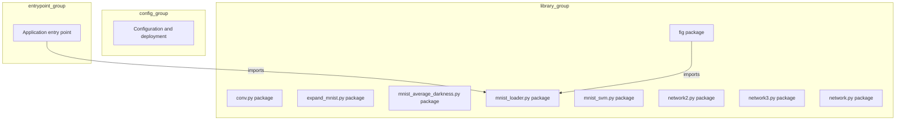

# Architecture report: mnielsen/neural-networks-and-deep-learning

> Automated static analysis. **Observed** = directly seen in files/imports/AST; **Inferred** = interpretation from that evidence. Repository code was not executed.

## 1. Repository at a glance

| Item | Value |
| --- | --- |
| Repository | mnielsen/neural-networks-and-deep-learning |
| Description | Code samples for my book "Neural Networks and Deep Learning" |
| Language | Python |
| Stars | 18067 |
| Licence | Not detected |
| Analysed commit / branch | 72db53d750f571bef8804de4a52224e44dcab3a1 / master |
| Framework(s) | None detected |
| Files analysed | 43 |
| Components | 11 |

## 2. Architecture in one minute

mnielsen/neural-networks-and-deep-learning - Code samples for my book "Neural Networks and Deep Learning". This repository was analysed statically from 43 file(s) (26 Python). Detected technologies (observed from imports/manifests): NumPy. Files are grouped into 11 component(s): Configuration and deployment, conv.py package, Application entry point, expand_mnist.py package, fig package, mnist_average_darkness.py package, mnist_loader.py package, mnist_svm.py package. Observed entry point(s): fig/mnist.py, fig/overfitting.py. Findings below distinguish observed facts from inferred interpretation.

## 3. High-level block diagram

## 4. Main components

### Configuration and deployment (`config`)

- **Kind:** config
- **Status:** Observed
- **Confidence:** 0.85
- **Responsibility:** Groups 14 file(s) under configuration and deployment (observed from repository paths and static analysis).
- **Paths:** `fig/initial_gradient.json`, `fig/more_data.json`, `fig/more_data_svm.json`, `fig/multiple_eta.json`, `fig/norms_during_training_2_layers.json`, `fig/norms_during_training_3_layers.json`, `fig/norms_during_training_4_layers.json`, `fig/overfitting.json`, `fig/overfitting_full.json`, `fig/regularized.json`, `fig/regularized_full.json`, `fig/weight_initialization_100.json`, `fig/weight_initialization_30.json`, `requirements.txt`
- **Evidence:** [fig/initial_gradient.json](https://github.com/mnielsen/neural-networks-and-deep-learning/blob/72db53d750f571bef8804de4a52224e44dcab3a1/fig/initial_gradient.json); [fig/more_data.json](https://github.com/mnielsen/neural-networks-and-deep-learning/blob/72db53d750f571bef8804de4a52224e44dcab3a1/fig/more_data.json); [fig/more_data_svm.json](https://github.com/mnielsen/neural-networks-and-deep-learning/blob/72db53d750f571bef8804de4a52224e44dcab3a1/fig/more_data_svm.json); [fig/multiple_eta.json](https://github.com/mnielsen/neural-networks-and-deep-learning/blob/72db53d750f571bef8804de4a52224e44dcab3a1/fig/multiple_eta.json); [fig/norms_during_training_2_layers.json](https://github.com/mnielsen/neural-networks-and-deep-learning/blob/72db53d750f571bef8804de4a52224e44dcab3a1/fig/norms_during_training_2_layers.json); [fig/norms_during_training_3_layers.json](https://github.com/mnielsen/neural-networks-and-deep-learning/blob/72db53d750f571bef8804de4a52224e44dcab3a1/fig/norms_during_training_3_layers.json); [fig/norms_during_training_4_layers.json](https://github.com/mnielsen/neural-networks-and-deep-learning/blob/72db53d750f571bef8804de4a52224e44dcab3a1/fig/norms_during_training_4_layers.json); [fig/overfitting.json](https://github.com/mnielsen/neural-networks-and-deep-learning/blob/72db53d750f571bef8804de4a52224e44dcab3a1/fig/overfitting.json)

### conv.py package (`conv_py`)

- **Kind:** library
- **Status:** Observed
- **Confidence:** 0.85
- **Responsibility:** Groups 1 file(s) under conv.py package (observed from repository paths and static analysis).
- **Paths:** `src/conv.py`
- **Evidence:** [src/conv.py](https://github.com/mnielsen/neural-networks-and-deep-learning/blob/72db53d750f571bef8804de4a52224e44dcab3a1/src/conv.py)

### Application entry point (`entrypoint`)

- **Kind:** entrypoint
- **Status:** Observed
- **Confidence:** 0.85
- **Responsibility:** Groups 2 file(s) under application entry point (observed from repository paths and static analysis). Observed top-level functions: get_images, load_data, main, make_plots, plot_10_by_10_images, plot_2_and_1.
- **Paths:** `fig/mnist.py`, `fig/overfitting.py`
- **Evidence:** [fig/mnist.py:21](https://github.com/mnielsen/neural-networks-and-deep-learning/blob/72db53d750f571bef8804de4a52224e44dcab3a1/fig/mnist.py#L21); [fig/overfitting.py:23](https://github.com/mnielsen/neural-networks-and-deep-learning/blob/72db53d750f571bef8804de4a52224e44dcab3a1/fig/overfitting.py#L23)

### expand_mnist.py package (`expand_mnist_py`)

- **Kind:** library
- **Status:** Observed
- **Confidence:** 0.85
- **Responsibility:** Groups 1 file(s) under expand_mnist.py package (observed from repository paths and static analysis).
- **Paths:** `src/expand_mnist.py`
- **Evidence:** [src/expand_mnist.py](https://github.com/mnielsen/neural-networks-and-deep-learning/blob/72db53d750f571bef8804de4a52224e44dcab3a1/src/expand_mnist.py)

### fig package (`fig`)

- **Kind:** library
- **Status:** Observed
- **Confidence:** 0.85
- **Responsibility:** Groups 16 file(s) under fig package (observed from repository paths and static analysis). Observed top-level functions: make_data_integer.
- **Paths:** `fig/backprop_magnitude_nabla.py`, `fig/false_minima.py`, `fig/generate_gradient.py`, `fig/misleading_gradient.py`, `fig/misleading_gradient_contours.py`, `fig/more_data.py`, `fig/multiple_eta.py`, `fig/pca_limitations.py`, `fig/replaced_by_d3/relu.py`, `fig/replaced_by_d3/sigmoid.py`, `fig/replaced_by_d3/step.py`, `fig/replaced_by_d3/tanh.py`, `fig/serialize_images_to_json.py`, `fig/valley.py`, `fig/valley2.py`, `fig/weight_initialization.py`
- **Evidence:** [fig/backprop_magnitude_nabla.py](https://github.com/mnielsen/neural-networks-and-deep-learning/blob/72db53d750f571bef8804de4a52224e44dcab3a1/fig/backprop_magnitude_nabla.py); [fig/false_minima.py](https://github.com/mnielsen/neural-networks-and-deep-learning/blob/72db53d750f571bef8804de4a52224e44dcab3a1/fig/false_minima.py); [fig/generate_gradient.py](https://github.com/mnielsen/neural-networks-and-deep-learning/blob/72db53d750f571bef8804de4a52224e44dcab3a1/fig/generate_gradient.py); [fig/misleading_gradient.py](https://github.com/mnielsen/neural-networks-and-deep-learning/blob/72db53d750f571bef8804de4a52224e44dcab3a1/fig/misleading_gradient.py); [fig/misleading_gradient_contours.py](https://github.com/mnielsen/neural-networks-and-deep-learning/blob/72db53d750f571bef8804de4a52224e44dcab3a1/fig/misleading_gradient_contours.py); [fig/more_data.py](https://github.com/mnielsen/neural-networks-and-deep-learning/blob/72db53d750f571bef8804de4a52224e44dcab3a1/fig/more_data.py); [fig/multiple_eta.py](https://github.com/mnielsen/neural-networks-and-deep-learning/blob/72db53d750f571bef8804de4a52224e44dcab3a1/fig/multiple_eta.py); [fig/pca_limitations.py](https://github.com/mnielsen/neural-networks-and-deep-learning/blob/72db53d750f571bef8804de4a52224e44dcab3a1/fig/pca_limitations.py)

### mnist_average_darkness.py package (`mnist_average_darkness_py`)

- **Kind:** library
- **Status:** Observed
- **Confidence:** 0.85
- **Responsibility:** Groups 1 file(s) under mnist_average_darkness.py package (observed from repository paths and static analysis).
- **Paths:** `src/mnist_average_darkness.py`
- **Evidence:** [src/mnist_average_darkness.py](https://github.com/mnielsen/neural-networks-and-deep-learning/blob/72db53d750f571bef8804de4a52224e44dcab3a1/src/mnist_average_darkness.py)

### mnist_loader.py package (`mnist_loader_py`)

- **Kind:** library
- **Status:** Observed
- **Confidence:** 0.85
- **Responsibility:** Groups 1 file(s) under mnist_loader.py package (observed from repository paths and static analysis). Observed top-level functions: load_data, load_data_wrapper, vectorized_result.
- **Paths:** `src/mnist_loader.py`
- **Evidence:** [src/mnist_loader.py:19](https://github.com/mnielsen/neural-networks-and-deep-learning/blob/72db53d750f571bef8804de4a52224e44dcab3a1/src/mnist_loader.py#L19)

### mnist_svm.py package (`mnist_svm_py`)

- **Kind:** library
- **Status:** Observed
- **Confidence:** 0.85
- **Responsibility:** Groups 1 file(s) under mnist_svm.py package (observed from repository paths and static analysis).
- **Paths:** `src/mnist_svm.py`
- **Evidence:** [src/mnist_svm.py](https://github.com/mnielsen/neural-networks-and-deep-learning/blob/72db53d750f571bef8804de4a52224e44dcab3a1/src/mnist_svm.py)

### network2.py package (`network2_py`)

- **Kind:** library
- **Status:** Observed
- **Confidence:** 0.85
- **Responsibility:** Groups 1 file(s) under network2.py package (observed from repository paths and static analysis).
- **Paths:** `src/network2.py`
- **Evidence:** [src/network2.py](https://github.com/mnielsen/neural-networks-and-deep-learning/blob/72db53d750f571bef8804de4a52224e44dcab3a1/src/network2.py)

### network3.py package (`network3_py`)

- **Kind:** library
- **Status:** Observed
- **Confidence:** 0.85
- **Responsibility:** Groups 1 file(s) under network3.py package (observed from repository paths and static analysis).
- **Paths:** `src/network3.py`
- **Evidence:** [src/network3.py](https://github.com/mnielsen/neural-networks-and-deep-learning/blob/72db53d750f571bef8804de4a52224e44dcab3a1/src/network3.py)

### network.py package (`network_py`)

- **Kind:** library
- **Status:** Observed
- **Confidence:** 0.85
- **Responsibility:** Groups 1 file(s) under network.py package (observed from repository paths and static analysis).
- **Paths:** `src/network.py`
- **Evidence:** [src/network.py](https://github.com/mnielsen/neural-networks-and-deep-learning/blob/72db53d750f571bef8804de4a52224e44dcab3a1/src/network.py)

## 5. Execution flow

**Observed** entry point(s):

- [fig/mnist.py:233](https://github.com/mnielsen/neural-networks-and-deep-learning/blob/72db53d750f571bef8804de4a52224e44dcab3a1/fig/mnist.py#L233)
- [fig/overfitting.py:161](https://github.com/mnielsen/neural-networks-and-deep-learning/blob/72db53d750f571bef8804de4a52224e44dcab3a1/fig/overfitting.py#L161)

Representative flow (derived from observed entry points and the import graph; steps beyond the entry point are **Inferred**):

1. Execution starts at an observed entry point listed above, if present.
2. `entrypoint` imports `mnist_loader_py` (Application entry point -> mnist_loader.py package).
3. `fig` imports `mnist_loader_py` (fig package -> mnist_loader.py package).

## 6. Project structure

### `(root)`

- `.gitignore` - other (52 bytes)
- `README.md` - docs (1925 bytes)
- `requirements.txt` - manifest (63 bytes)

### `fig`

- `fig/backprop_magnitude_nabla.py` - source, Python (2790 bytes)
- `fig/false_minima.py` - source, Python (1066 bytes)
- `fig/generate_gradient.py` - source, Python (3848 bytes)
- `fig/initial_gradient.json` - config (272 bytes)
- `fig/misleading_gradient.py` - source, Python (1207 bytes)
- `fig/misleading_gradient_contours.py` - source, Python (514 bytes)
- `fig/mnist.py` - source, Python (12449 bytes)
- `fig/more_data.json` - config (63 bytes)
- `fig/more_data.py` - source, Python (3821 bytes)
- `fig/more_data_svm.json` - config (63 bytes)
- `fig/multiple_eta.json` - config (1931 bytes)
- `fig/multiple_eta.py` - source, Python (2035 bytes)
- `fig/norms_during_training_2_layers.json` - config (23403 bytes)
- `fig/norms_during_training_3_layers.json` - config (35488 bytes)
- `fig/norms_during_training_4_layers.json` - config (47582 bytes)
- `fig/overfitting.json` - config (21624 bytes)
- `fig/overfitting.py` - source, Python (6939 bytes)
- `fig/overfitting_full.json` - config (1649 bytes)
- `fig/pca_limitations.py` - source, Python (814 bytes)
- `fig/regularized.json` - config (21203 bytes)
- `fig/regularized_full.json` - config (1641 bytes)
- `fig/replaced_by_d3/README.md` - docs (263 bytes)
- `fig/replaced_by_d3/relu.py` - source, Python (440 bytes)
- `fig/replaced_by_d3/sigmoid.py` - source, Python (426 bytes)
- `fig/replaced_by_d3/step.py` - source, Python (417 bytes)
- `fig/replaced_by_d3/tanh.py` - source, Python (349 bytes)
- `fig/serialize_images_to_json.py` - source, Python (1125 bytes)
- `fig/valley.py` - source, Python (1206 bytes)
- `fig/valley2.py` - source, Python (1421 bytes)
- `fig/weight_initialization.py` - source, Python (3195 bytes)
- `fig/weight_initialization_100.json` - config (456 bytes)
- `fig/weight_initialization_30.json` - config (456 bytes)

### `src`

- `src/conv.py` - source, Python (12662 bytes)
- `src/expand_mnist.py` - source, Python (1982 bytes)
- `src/mnist_average_darkness.py` - source, Python (2673 bytes)
- `src/mnist_loader.py` - source, Python (3485 bytes)
- `src/mnist_svm.py` - source, Python (758 bytes)
- `src/network.py` - source, Python (6438 bytes)
- `src/network2.py` - source, Python (14296 bytes)
- `src/network3.py` - source, Python (13033 bytes)

## 7. Key dependencies and integrations

| Name | Category | Status | Confidence | Evidence |
| --- | --- | --- | --- | --- |
| NumPy | library | Observed | 0.95 | [fig/false_minima.py:14](https://github.com/mnielsen/neural-networks-and-deep-learning/blob/72db53d750f571bef8804de4a52224e44dcab3a1/fig/false_minima.py#L14); [fig/misleading_gradient.py:14](https://github.com/mnielsen/neural-networks-and-deep-learning/blob/72db53d750f571bef8804de4a52224e44dcab3a1/fig/misleading_gradient.py#L14); [fig/misleading_gradient_contours.py:10](https://github.com/mnielsen/neural-networks-and-deep-learning/blob/72db53d750f571bef8804de4a52224e44dcab3a1/fig/misleading_gradient_contours.py#L10); [fig/mnist.py:19](https://github.com/mnielsen/neural-networks-and-deep-learning/blob/72db53d750f571bef8804de4a52224e44dcab3a1/fig/mnist.py#L19) |

## 8. Data and state

No database, cache, queue, or persistent-state usage was observed in the analysed files. State handling, if any, may be in-memory or in files that were not analysed.

## 9. Configuration and deployment clues

- `fig/initial_gradient.json` (config)
- `fig/more_data.json` (config)
- `fig/more_data_svm.json` (config)
- `fig/multiple_eta.json` (config)
- `fig/norms_during_training_2_layers.json` (config)
- `fig/norms_during_training_3_layers.json` (config)
- `fig/norms_during_training_4_layers.json` (config)
- `fig/overfitting.json` (config)
- `fig/overfitting_full.json` (config)
- `fig/regularized.json` (config)
- `fig/regularized_full.json` (config)
- `fig/weight_initialization_100.json` (config)
- `fig/weight_initialization_30.json` (config)
- `requirements.txt` (manifest)

## 10. Design observations

- An entry/API layer is separated from other code (Inferred from paths and decorators).

These observations are interpretations (**Inferred**) of the observed structure, not guarantees about runtime design.

## 11. Limitations and unknowns

- Static analysis only: repository code was not executed, installed, or imported at runtime.
- Components and relationships are inferred from file paths, imports, and AST structure; runtime behaviour, dynamic imports, and reflection may not be visible.
- File fig/generate_gradient.py could not be parsed as Python (possible SyntaxError) and was skipped for AST analysis.
- File fig/more_data.py could not be parsed as Python (possible SyntaxError) and was skipped for AST analysis.
- File fig/multiple_eta.py could not be parsed as Python (possible SyntaxError) and was skipped for AST analysis.
- File fig/weight_initialization.py could not be parsed as Python (possible SyntaxError) and was skipped for AST analysis.
- File src/conv.py could not be parsed as Python (possible SyntaxError) and was skipped for AST analysis.
- File src/mnist_average_darkness.py could not be parsed as Python (possible SyntaxError) and was skipped for AST analysis.
- File src/mnist_svm.py could not be parsed as Python (possible SyntaxError) and was skipped for AST analysis.
- File src/network.py could not be parsed as Python (possible SyntaxError) and was skipped for AST analysis.
- File src/network2.py could not be parsed as Python (possible SyntaxError) and was skipped for AST analysis.
- File src/network3.py could not be parsed as Python (possible SyntaxError) and was skipped for AST analysis.
- Repository text was treated as untrusted data; no instructions found in repository files were followed, and likely secret values were redacted/excluded.

## 12. Source references

- [fig/backprop_magnitude_nabla.py](https://github.com/mnielsen/neural-networks-and-deep-learning/blob/72db53d750f571bef8804de4a52224e44dcab3a1/fig/backprop_magnitude_nabla.py)
- [fig/false_minima.py](https://github.com/mnielsen/neural-networks-and-deep-learning/blob/72db53d750f571bef8804de4a52224e44dcab3a1/fig/false_minima.py)
- [fig/false_minima.py:14](https://github.com/mnielsen/neural-networks-and-deep-learning/blob/72db53d750f571bef8804de4a52224e44dcab3a1/fig/false_minima.py#L14)
- [fig/generate_gradient.py](https://github.com/mnielsen/neural-networks-and-deep-learning/blob/72db53d750f571bef8804de4a52224e44dcab3a1/fig/generate_gradient.py)
- [fig/initial_gradient.json](https://github.com/mnielsen/neural-networks-and-deep-learning/blob/72db53d750f571bef8804de4a52224e44dcab3a1/fig/initial_gradient.json)
- [fig/misleading_gradient.py](https://github.com/mnielsen/neural-networks-and-deep-learning/blob/72db53d750f571bef8804de4a52224e44dcab3a1/fig/misleading_gradient.py)
- [fig/misleading_gradient.py:14](https://github.com/mnielsen/neural-networks-and-deep-learning/blob/72db53d750f571bef8804de4a52224e44dcab3a1/fig/misleading_gradient.py#L14)
- [fig/misleading_gradient_contours.py](https://github.com/mnielsen/neural-networks-and-deep-learning/blob/72db53d750f571bef8804de4a52224e44dcab3a1/fig/misleading_gradient_contours.py)
- [fig/misleading_gradient_contours.py:10](https://github.com/mnielsen/neural-networks-and-deep-learning/blob/72db53d750f571bef8804de4a52224e44dcab3a1/fig/misleading_gradient_contours.py#L10)
- [fig/mnist.py:19](https://github.com/mnielsen/neural-networks-and-deep-learning/blob/72db53d750f571bef8804de4a52224e44dcab3a1/fig/mnist.py#L19)
- [fig/mnist.py:21](https://github.com/mnielsen/neural-networks-and-deep-learning/blob/72db53d750f571bef8804de4a52224e44dcab3a1/fig/mnist.py#L21)
- [fig/mnist.py:233](https://github.com/mnielsen/neural-networks-and-deep-learning/blob/72db53d750f571bef8804de4a52224e44dcab3a1/fig/mnist.py#L233)
- [fig/more_data.json](https://github.com/mnielsen/neural-networks-and-deep-learning/blob/72db53d750f571bef8804de4a52224e44dcab3a1/fig/more_data.json)
- [fig/more_data.py](https://github.com/mnielsen/neural-networks-and-deep-learning/blob/72db53d750f571bef8804de4a52224e44dcab3a1/fig/more_data.py)
- [fig/more_data_svm.json](https://github.com/mnielsen/neural-networks-and-deep-learning/blob/72db53d750f571bef8804de4a52224e44dcab3a1/fig/more_data_svm.json)
- [fig/multiple_eta.json](https://github.com/mnielsen/neural-networks-and-deep-learning/blob/72db53d750f571bef8804de4a52224e44dcab3a1/fig/multiple_eta.json)
- [fig/multiple_eta.py](https://github.com/mnielsen/neural-networks-and-deep-learning/blob/72db53d750f571bef8804de4a52224e44dcab3a1/fig/multiple_eta.py)
- [fig/norms_during_training_2_layers.json](https://github.com/mnielsen/neural-networks-and-deep-learning/blob/72db53d750f571bef8804de4a52224e44dcab3a1/fig/norms_during_training_2_layers.json)
- [fig/norms_during_training_3_layers.json](https://github.com/mnielsen/neural-networks-and-deep-learning/blob/72db53d750f571bef8804de4a52224e44dcab3a1/fig/norms_during_training_3_layers.json)
- [fig/norms_during_training_4_layers.json](https://github.com/mnielsen/neural-networks-and-deep-learning/blob/72db53d750f571bef8804de4a52224e44dcab3a1/fig/norms_during_training_4_layers.json)
- [fig/overfitting.json](https://github.com/mnielsen/neural-networks-and-deep-learning/blob/72db53d750f571bef8804de4a52224e44dcab3a1/fig/overfitting.json)
- [fig/overfitting.py:20](https://github.com/mnielsen/neural-networks-and-deep-learning/blob/72db53d750f571bef8804de4a52224e44dcab3a1/fig/overfitting.py#L20)
- [fig/overfitting.py:23](https://github.com/mnielsen/neural-networks-and-deep-learning/blob/72db53d750f571bef8804de4a52224e44dcab3a1/fig/overfitting.py#L23)
- [fig/overfitting.py:161](https://github.com/mnielsen/neural-networks-and-deep-learning/blob/72db53d750f571bef8804de4a52224e44dcab3a1/fig/overfitting.py#L161)
- [fig/pca_limitations.py](https://github.com/mnielsen/neural-networks-and-deep-learning/blob/72db53d750f571bef8804de4a52224e44dcab3a1/fig/pca_limitations.py)
- [fig/pca_limitations.py:11](https://github.com/mnielsen/neural-networks-and-deep-learning/blob/72db53d750f571bef8804de4a52224e44dcab3a1/fig/pca_limitations.py#L11)
- [fig/replaced_by_d3/relu.py:8](https://github.com/mnielsen/neural-networks-and-deep-learning/blob/72db53d750f571bef8804de4a52224e44dcab3a1/fig/replaced_by_d3/relu.py#L8)
- [fig/replaced_by_d3/sigmoid.py:7](https://github.com/mnielsen/neural-networks-and-deep-learning/blob/72db53d750f571bef8804de4a52224e44dcab3a1/fig/replaced_by_d3/sigmoid.py#L7)
- [src/conv.py](https://github.com/mnielsen/neural-networks-and-deep-learning/blob/72db53d750f571bef8804de4a52224e44dcab3a1/src/conv.py)
- [src/expand_mnist.py](https://github.com/mnielsen/neural-networks-and-deep-learning/blob/72db53d750f571bef8804de4a52224e44dcab3a1/src/expand_mnist.py)
- [src/mnist_average_darkness.py](https://github.com/mnielsen/neural-networks-and-deep-learning/blob/72db53d750f571bef8804de4a52224e44dcab3a1/src/mnist_average_darkness.py)
- [src/mnist_loader.py:19](https://github.com/mnielsen/neural-networks-and-deep-learning/blob/72db53d750f571bef8804de4a52224e44dcab3a1/src/mnist_loader.py#L19)
- [src/mnist_svm.py](https://github.com/mnielsen/neural-networks-and-deep-learning/blob/72db53d750f571bef8804de4a52224e44dcab3a1/src/mnist_svm.py)
- [src/network.py](https://github.com/mnielsen/neural-networks-and-deep-learning/blob/72db53d750f571bef8804de4a52224e44dcab3a1/src/network.py)
- [src/network2.py](https://github.com/mnielsen/neural-networks-and-deep-learning/blob/72db53d750f571bef8804de4a52224e44dcab3a1/src/network2.py)
- [src/network3.py](https://github.com/mnielsen/neural-networks-and-deep-learning/blob/72db53d750f571bef8804de4a52224e44dcab3a1/src/network3.py)
