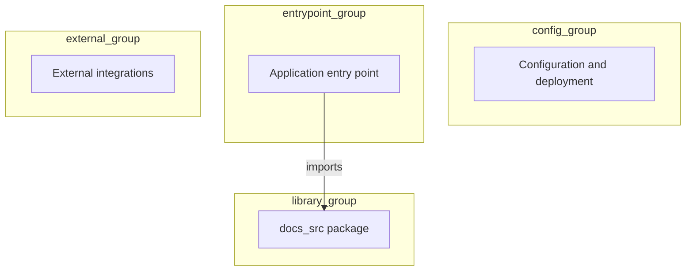

# Architecture report: modelcontextprotocol/python-sdk

> Automated static analysis. **Observed** = directly seen in files/imports/AST; **Inferred** = interpretation from that evidence. Repository code was not executed.

## 1. Repository at a glance

| Item | Value |
| --- | --- |
| Repository | modelcontextprotocol/python-sdk |
| Description | The official Python SDK for Model Context Protocol servers and clients |
| Language | Python |
| Stars | 24861 |
| Licence | MIT |
| Analysed commit / branch | 77001c96f9507be0f4d009b83210a384a5e08bda / main |
| Framework(s) | Starlette |
| Files analysed | 800 |
| Components | 4 |

## 2. Architecture in one minute

modelcontextprotocol/python-sdk - The official Python SDK for Model Context Protocol servers and clients. This repository was analysed statically from 800 file(s) (443 Python). Detected technologies (observed from imports/manifests): GitHub Actions, PostgreSQL, Starlette, Click, NumPy, Pydantic. Files are grouped into 4 component(s): Configuration and deployment, docs_src package, Application entry point, External integrations. Observed entry point(s): .github/actions/conformance/client.py, docs_src/apps/tutorial001_client.py, docs_src/caching/tutorial003.py. Findings below distinguish observed facts from inferred interpretation.

## 3. High-level block diagram

## 4. Main components

### Configuration and deployment (`config`)

- **Kind:** config
- **Status:** Observed
- **Confidence:** 0.85
- **Responsibility:** Groups 4 file(s) under configuration and deployment (observed from repository paths and static analysis).
- **Paths:** `i18n/de/glossary.json`, `i18n/es/glossary.json`, `i18n/fr/glossary.json`, `i18n/hi/glossary.json`
- **Evidence:** [i18n/de/glossary.json](https://github.com/modelcontextprotocol/python-sdk/blob/77001c96f9507be0f4d009b83210a384a5e08bda/i18n/de/glossary.json); [i18n/es/glossary.json](https://github.com/modelcontextprotocol/python-sdk/blob/77001c96f9507be0f4d009b83210a384a5e08bda/i18n/es/glossary.json); [i18n/fr/glossary.json](https://github.com/modelcontextprotocol/python-sdk/blob/77001c96f9507be0f4d009b83210a384a5e08bda/i18n/fr/glossary.json); [i18n/hi/glossary.json](https://github.com/modelcontextprotocol/python-sdk/blob/77001c96f9507be0f4d009b83210a384a5e08bda/i18n/hi/glossary.json)

### docs_src package (`docs_src`)

- **Kind:** library
- **Status:** Observed
- **Confidence:** 0.85
- **Responsibility:** Groups 185 file(s) under docs_src package (observed from repository paths and static analysis). Observed top-level classes: AlternativeDate, AppContext, AuditLog, Backorder, Book, CardHolder. Observed top-level functions: add, add_book, add_note, add_task, app_lifespan, ask_quantity.
- **Paths:** `docs_src/__init__.py`, `docs_src/apps/__init__.py`, `docs_src/apps/tutorial001.py`, `docs_src/apps/tutorial002.py`, `docs_src/apps/tutorial003.py`, `docs_src/asgi/__init__.py`, `docs_src/asgi/tutorial001.py`, `docs_src/asgi/tutorial002.py`, `docs_src/asgi/tutorial003.py`, `docs_src/asgi/tutorial004.py`, `docs_src/asgi/tutorial005.py`, `docs_src/asgi/tutorial006.py`, `docs_src/authorization/__init__.py`, `docs_src/authorization/tutorial001.py`, `docs_src/authorization/tutorial002.py`, `docs_src/caching/__init__.py`, `docs_src/caching/tutorial001.py`, `docs_src/caching/tutorial002.py`, `docs_src/cancellation/__init__.py`, `docs_src/cancellation/tutorial001.py`, `docs_src/cancellation/tutorial002.py`, `docs_src/client_callbacks/__init__.py`, `docs_src/client_callbacks/tutorial001.py`, `docs_src/client_callbacks/tutorial002.py`, `docs_src/client_callbacks/tutorial003.py`, `docs_src/client_callbacks/tutorial004.py`, `docs_src/client_transports/__init__.py`, `docs_src/client_transports/tutorial001.py`, `docs_src/client_transports/tutorial002.py`, `docs_src/client_transports/tutorial003.py`, `docs_src/client_transports/tutorial004.py`, `docs_src/client_transports/tutorial005.py`, `docs_src/completions/__init__.py`, `docs_src/completions/tutorial001.py`, `docs_src/completions/tutorial002.py`, `docs_src/completions/tutorial003.py`, `docs_src/context/__init__.py`, `docs_src/context/tutorial001.py`, `docs_src/context/tutorial002.py`, `docs_src/context/tutorial003.py`, `docs_src/dependencies/__init__.py`, `docs_src/dependencies/tutorial001.py`, `docs_src/dependencies/tutorial002.py`, `docs_src/dependencies/tutorial003.py`, `docs_src/dependencies/tutorial004.py`, `docs_src/deploy/__init__.py`, `docs_src/deploy/tutorial001.py`, `docs_src/deploy/tutorial002.py`, `docs_src/deploy/tutorial003.py`, `docs_src/deploy/tutorial004.py`, `docs_src/elicitation/__init__.py`, `docs_src/elicitation/tutorial001.py`, `docs_src/elicitation/tutorial002.py`, `docs_src/elicitation/tutorial003.py`, `docs_src/elicitation/tutorial004.py`, `docs_src/extensions/__init__.py`, `docs_src/extensions/tutorial001.py`, `docs_src/extensions/tutorial002.py`, `docs_src/extensions/tutorial003.py`, `docs_src/extensions/tutorial004.py`, `docs_src/extensions/tutorial005.py`, `docs_src/extensions/tutorial006.py`, `docs_src/extensions/tutorial007.py`, `docs_src/first_steps/__init__.py`, `docs_src/first_steps/tutorial001.py`, `docs_src/handling_errors/__init__.py`, `docs_src/handling_errors/tutorial001.py`, `docs_src/handling_errors/tutorial002.py`, `docs_src/handling_errors/tutorial003.py`, `docs_src/handling_errors/tutorial004.py`, `docs_src/header_parameters/__init__.py`, `docs_src/header_parameters/tutorial001.py`, `docs_src/header_parameters/tutorial002.py`, `docs_src/header_parameters/tutorial003.py`, `docs_src/identity_assertion/__init__.py`, `docs_src/identity_assertion/tutorial001.py`, `docs_src/identity_assertion/tutorial002.py`, `docs_src/index/__init__.py`, `docs_src/index/tutorial001.py`, `docs_src/legacy_clients/__init__.py`, `docs_src/legacy_clients/tutorial001.py`, `docs_src/legacy_clients/tutorial002.py`, `docs_src/legacy_clients/tutorial003.py`, `docs_src/lifespan/__init__.py`, `docs_src/lifespan/tutorial001.py`, `docs_src/lifespan/tutorial002.py`, `docs_src/logging/__init__.py`, `docs_src/logging/tutorial001.py`, `docs_src/lowlevel/__init__.py`, `docs_src/lowlevel/tutorial001.py`, `docs_src/lowlevel/tutorial002.py`, `docs_src/lowlevel/tutorial003.py`, `docs_src/lowlevel/tutorial004.py`, `docs_src/lowlevel/tutorial005.py`, `docs_src/lowlevel/tutorial006.py`, `docs_src/lowlevel/tutorial007.py`, `docs_src/media/__init__.py`, `docs_src/media/tutorial001.py`, `docs_src/media/tutorial002.py`, `docs_src/media/tutorial003.py`, `docs_src/media/tutorial004.py`, `docs_src/media/tutorial005.py`, `docs_src/middleware/__init__.py`, `docs_src/middleware/tutorial001.py`, `docs_src/middleware/tutorial002.py`, `docs_src/mrtr/__init__.py`, `docs_src/mrtr/tutorial001.py`, `docs_src/mrtr/tutorial002.py`, `docs_src/mrtr/tutorial003.py`, `docs_src/mrtr/tutorial004.py`, `docs_src/mrtr/tutorial005.py`, `docs_src/oauth_clients/__init__.py`, `docs_src/oauth_clients/tutorial001.py`, `docs_src/oauth_clients/tutorial002.py`, `docs_src/opentelemetry/__init__.py`, `docs_src/opentelemetry/tutorial001.py`, `docs_src/pagination/__init__.py`, `docs_src/pagination/tutorial001.py`, `docs_src/progress/__init__.py`, `docs_src/progress/tutorial001.py`, `docs_src/progress/tutorial002.py`, `docs_src/prompts/__init__.py`, `docs_src/prompts/tutorial001.py`, `docs_src/prompts/tutorial002.py`, `docs_src/prompts/tutorial003.py`, `docs_src/prompts/tutorial004.py`, `docs_src/prompts/tutorial005.py`, `docs_src/prompts/tutorial006.py`, `docs_src/protocol_versions/__init__.py`, `docs_src/real_host/__init__.py`, `docs_src/resources/__init__.py`, `docs_src/resources/tutorial001.py`, `docs_src/resources/tutorial002.py`, `docs_src/resources/tutorial003.py`, `docs_src/run/__init__.py`, `docs_src/sampling_and_roots/__init__.py`, `docs_src/sampling_and_roots/tutorial001.py`, `docs_src/sampling_and_roots/tutorial002.py`, `docs_src/session_groups/__init__.py`, `docs_src/session_groups/tutorial001.py`, `docs_src/session_groups/tutorial002.py`, `docs_src/skills/__init__.py`, `docs_src/skills/tutorial001.py`, `docs_src/structured_output/__init__.py`, `docs_src/structured_output/tutorial001.py`, `docs_src/structured_output/tutorial002.py`, `docs_src/structured_output/tutorial003.py`, `docs_src/structured_output/tutorial004.py`, `docs_src/structured_output/tutorial005.py`, `docs_src/structured_output/tutorial006.py`, `docs_src/structured_output/tutorial007.py`, `docs_src/structured_output/tutorial008.py`, `docs_src/structured_output/tutorial009.py`, `docs_src/subscriptions/__init__.py`, `docs_src/subscriptions/tutorial001.py`, `docs_src/subscriptions/tutorial002.py`, `docs_src/subscriptions/tutorial003.py`, `docs_src/subscriptions/tutorial005.py`, `docs_src/subscriptions/tutorial006.py`, `docs_src/subscriptions/tutorial007.py`, `docs_src/testing/__init__.py`, `docs_src/testing/tutorial001.py`, `docs_src/tools/__init__.py`, `docs_src/tools/tutorial001.py`, `docs_src/tools/tutorial002.py`, `docs_src/tools/tutorial003.py`, `docs_src/tools/tutorial004.py`, `docs_src/tools/tutorial005.py`, `docs_src/troubleshooting/__init__.py`, `docs_src/troubleshooting/tutorial001.py`, `docs_src/troubleshooting/tutorial002.py`, `docs_src/troubleshooting/tutorial003.py`, `docs_src/troubleshooting/tutorial004.py`, `docs_src/troubleshooting/tutorial005.py`, `docs_src/troubleshooting/tutorial006.py`, `docs_src/troubleshooting/tutorial007.py`, `docs_src/troubleshooting/tutorial008.py`, `docs_src/uri_templates/__init__.py`, `docs_src/uri_templates/tutorial001.py`, `docs_src/uri_templates/tutorial002.py`, `docs_src/uri_templates/tutorial003.py`, `docs_src/uri_templates/tutorial004.py`, `docs_src/uri_templates/tutorial005.py`, `docs_src/whats_new/__init__.py`, `docs_src/whats_new/tutorial001.py`
- **Evidence:** [docs_src/__init__.py](https://github.com/modelcontextprotocol/python-sdk/blob/77001c96f9507be0f4d009b83210a384a5e08bda/docs_src/__init__.py); [docs_src/apps/__init__.py](https://github.com/modelcontextprotocol/python-sdk/blob/77001c96f9507be0f4d009b83210a384a5e08bda/docs_src/apps/__init__.py); [docs_src/apps/tutorial001.py:40](https://github.com/modelcontextprotocol/python-sdk/blob/77001c96f9507be0f4d009b83210a384a5e08bda/docs_src/apps/tutorial001.py#L40); [docs_src/apps/tutorial002.py:10](https://github.com/modelcontextprotocol/python-sdk/blob/77001c96f9507be0f4d009b83210a384a5e08bda/docs_src/apps/tutorial002.py#L10); [docs_src/apps/tutorial003.py:13](https://github.com/modelcontextprotocol/python-sdk/blob/77001c96f9507be0f4d009b83210a384a5e08bda/docs_src/apps/tutorial003.py#L13); [docs_src/asgi/__init__.py](https://github.com/modelcontextprotocol/python-sdk/blob/77001c96f9507be0f4d009b83210a384a5e08bda/docs_src/asgi/__init__.py); [docs_src/asgi/tutorial001.py:7](https://github.com/modelcontextprotocol/python-sdk/blob/77001c96f9507be0f4d009b83210a384a5e08bda/docs_src/asgi/tutorial001.py#L7); [docs_src/asgi/tutorial002.py:13](https://github.com/modelcontextprotocol/python-sdk/blob/77001c96f9507be0f4d009b83210a384a5e08bda/docs_src/asgi/tutorial002.py#L13)

### Application entry point (`entrypoint`)

- **Kind:** entrypoint
- **Status:** Observed
- **Confidence:** 0.85
- **Responsibility:** Groups 30 file(s) under application entry point (observed from repository paths and static analysis). Observed top-level classes: Clock, JobParams, JobStatus, JobStatusRequest, ReceiptResult, Receipts. Observed top-level functions: answer, by_server, get_author, list_all_resources, list_all_tools, main.
- **Paths:** `docs_src/apps/tutorial001_client.py`, `docs_src/caching/tutorial003.py`, `docs_src/client/tutorial001_client.py`, `docs_src/client/tutorial002.py`, `docs_src/client/tutorial003.py`, `docs_src/client/tutorial004.py`, `docs_src/client/tutorial005.py`, `docs_src/client/tutorial006.py`, `docs_src/client/tutorial007.py`, `docs_src/extensions/tutorial003_client.py`, `docs_src/extensions/tutorial004_client.py`, `docs_src/extensions/tutorial006_client.py`, `docs_src/extensions/tutorial007_client.py`, `docs_src/first_steps/tutorial001_client.py`, `docs_src/legacy_clients/tutorial001_client.py`, `docs_src/pagination/tutorial002.py`, `docs_src/protocol_versions/tutorial001.py`, `docs_src/protocol_versions/tutorial002.py`, `docs_src/protocol_versions/tutorial003.py`, `docs_src/protocol_versions/tutorial004.py`, `docs_src/real_host/tutorial001.py`, `docs_src/run/tutorial001.py`, `docs_src/run/tutorial002.py`, `docs_src/run/tutorial003.py`, `docs_src/session_groups/tutorial003.py`, `docs_src/session_groups/tutorial004.py`, `docs_src/skills/tutorial001_client.py`, `docs_src/subscriptions/tutorial004_anyio.py`, `docs_src/subscriptions/tutorial004_asyncio.py`, `docs_src/subscriptions/tutorial004_trio.py`
- **Evidence:** [docs_src/apps/tutorial001_client.py:11](https://github.com/modelcontextprotocol/python-sdk/blob/77001c96f9507be0f4d009b83210a384a5e08bda/docs_src/apps/tutorial001_client.py#L11); [docs_src/caching/tutorial003.py:11](https://github.com/modelcontextprotocol/python-sdk/blob/77001c96f9507be0f4d009b83210a384a5e08bda/docs_src/caching/tutorial003.py#L11); [docs_src/client/tutorial001_client.py:6](https://github.com/modelcontextprotocol/python-sdk/blob/77001c96f9507be0f4d009b83210a384a5e08bda/docs_src/client/tutorial001_client.py#L6); [docs_src/client/tutorial002.py:6](https://github.com/modelcontextprotocol/python-sdk/blob/77001c96f9507be0f4d009b83210a384a5e08bda/docs_src/client/tutorial002.py#L6); [docs_src/client/tutorial003.py:7](https://github.com/modelcontextprotocol/python-sdk/blob/77001c96f9507be0f4d009b83210a384a5e08bda/docs_src/client/tutorial003.py#L7); [docs_src/client/tutorial004.py:7](https://github.com/modelcontextprotocol/python-sdk/blob/77001c96f9507be0f4d009b83210a384a5e08bda/docs_src/client/tutorial004.py#L7); [docs_src/client/tutorial005.py:6](https://github.com/modelcontextprotocol/python-sdk/blob/77001c96f9507be0f4d009b83210a384a5e08bda/docs_src/client/tutorial005.py#L6); [docs_src/client/tutorial006.py:7](https://github.com/modelcontextprotocol/python-sdk/blob/77001c96f9507be0f4d009b83210a384a5e08bda/docs_src/client/tutorial006.py#L7)

### External integrations (`external_integrations`)

- **Kind:** external
- **Status:** Observed
- **Confidence:** 0.85
- **Responsibility:** Groups 2 file(s) under external integrations (observed from repository paths and static analysis). Observed top-level classes: Book. Observed top-level functions: books_in_genre, complete_genre, genres, lookup_book, recommend, search_books.
- **Paths:** `docs_src/client/__init__.py`, `docs_src/client/tutorial001.py`
- **Evidence:** [docs_src/client/__init__.py](https://github.com/modelcontextprotocol/python-sdk/blob/77001c96f9507be0f4d009b83210a384a5e08bda/docs_src/client/__init__.py); [docs_src/client/tutorial001.py:12](https://github.com/modelcontextprotocol/python-sdk/blob/77001c96f9507be0f4d009b83210a384a5e08bda/docs_src/client/tutorial001.py#L12)

## 5. Execution flow

**Observed** entry point(s):

- [.github/actions/conformance/client.py:643](https://github.com/modelcontextprotocol/python-sdk/blob/77001c96f9507be0f4d009b83210a384a5e08bda/.github/actions/conformance/client.py#L643)
- [docs_src/apps/tutorial001_client.py:19](https://github.com/modelcontextprotocol/python-sdk/blob/77001c96f9507be0f4d009b83210a384a5e08bda/docs_src/apps/tutorial001_client.py#L19)
- [docs_src/caching/tutorial003.py:33](https://github.com/modelcontextprotocol/python-sdk/blob/77001c96f9507be0f4d009b83210a384a5e08bda/docs_src/caching/tutorial003.py#L33)
- [docs_src/client/tutorial001_client.py:14](https://github.com/modelcontextprotocol/python-sdk/blob/77001c96f9507be0f4d009b83210a384a5e08bda/docs_src/client/tutorial001_client.py#L14)
- [docs_src/client/tutorial002.py:16](https://github.com/modelcontextprotocol/python-sdk/blob/77001c96f9507be0f4d009b83210a384a5e08bda/docs_src/client/tutorial002.py#L16)
- [docs_src/client/tutorial003.py:19](https://github.com/modelcontextprotocol/python-sdk/blob/77001c96f9507be0f4d009b83210a384a5e08bda/docs_src/client/tutorial003.py#L19)
- [docs_src/client/tutorial004.py:21](https://github.com/modelcontextprotocol/python-sdk/blob/77001c96f9507be0f4d009b83210a384a5e08bda/docs_src/client/tutorial004.py#L21)
- [docs_src/client/tutorial005.py:16](https://github.com/modelcontextprotocol/python-sdk/blob/77001c96f9507be0f4d009b83210a384a5e08bda/docs_src/client/tutorial005.py#L16)
- [docs_src/client/tutorial006.py:16](https://github.com/modelcontextprotocol/python-sdk/blob/77001c96f9507be0f4d009b83210a384a5e08bda/docs_src/client/tutorial006.py#L16)
- [docs_src/client/tutorial007.py:24](https://github.com/modelcontextprotocol/python-sdk/blob/77001c96f9507be0f4d009b83210a384a5e08bda/docs_src/client/tutorial007.py#L24)
- [docs_src/extensions/tutorial003_client.py:15](https://github.com/modelcontextprotocol/python-sdk/blob/77001c96f9507be0f4d009b83210a384a5e08bda/docs_src/extensions/tutorial003_client.py#L15)
- [docs_src/extensions/tutorial004_client.py:34](https://github.com/modelcontextprotocol/python-sdk/blob/77001c96f9507be0f4d009b83210a384a5e08bda/docs_src/extensions/tutorial004_client.py#L34)

Representative flow (derived from observed entry points and the import graph; steps beyond the entry point are **Inferred**):

1. Execution starts at an observed entry point listed above, if present.
2. `entrypoint` imports `docs_src` (Application entry point -> docs_src package).

## 6. Project structure

### `(root)`

- `.git-blame-ignore-revs` - other (307 bytes)
- `.gitattributes` - other (45 bytes)
- `.gitignore` - other (3534 bytes)
- `.pre-commit-config.yaml` - config (1672 bytes)
- `AGENTS.md` - docs (8714 bytes)
- `CLAUDE.md` - docs (11 bytes)
- `CODE_OF_CONDUCT.md` - docs (5231 bytes)
- `CONTRIBUTING.md` - docs (12054 bytes)
- `DEPENDENCY_POLICY.md` - docs (1888 bytes)
- `LICENSE` - docs (1071 bytes)
- `README.md` - docs (4561 bytes)
- `RELEASE.md` - docs (7860 bytes)
- `ROADMAP.md` - docs (2178 bytes)
- `SECURITY.md` - docs (1691 bytes)
- `VERSIONING.md` - docs (3993 bytes)

### `.claude`

- `.claude/commands/review-pr.md` - docs (3760 bytes)
- `.claude/skills/test-quality/SKILL.md` - docs (10314 bytes)

### `.github`

- `.github/ISSUE_TEMPLATE/bug.yaml` - config (2062 bytes)
- `.github/ISSUE_TEMPLATE/config.yaml` - config (28 bytes)
- `.github/ISSUE_TEMPLATE/feature-request.yaml` - config (887 bytes)
- `.github/ISSUE_TEMPLATE/question.yaml` - config (1037 bytes)
- `.github/ISSUE_TEMPLATE/v2-feedback.yaml` - config (1457 bytes)
- `.github/actions/conformance/client.py` - source, Python (27993 bytes)
- `.github/actions/conformance/expected-failures.2025-11-25.yml` - config (1359 bytes)
- `.github/actions/conformance/expected-failures.2026-07-28.yml` - config (1454 bytes)
- `.github/actions/conformance/expected-failures.yml` - config (2609 bytes)
- `.github/actions/conformance/run-client.sh` - source, Shell (3887 bytes)
- `.github/actions/conformance/run-server.sh` - source, Shell (1701 bytes)
- `.github/dependabot.yml` - config (507 bytes)
- `.github/pull_request_template.md` - docs (1594 bytes)
- `.github/scripts/docs_preview.js` - source, JavaScript (4968 bytes)
- `.github/scripts/docs_preview.test.js` - source, JavaScript (11796 bytes)
- `.github/scripts/pr_intake_gate.js` - source, JavaScript (17609 bytes)
- `.github/scripts/pr_intake_gate.test.js` - source, JavaScript (20978 bytes)
- `.github/workflows/claude.yml` - ci, YAML (1578 bytes)
- `.github/workflows/conformance.yml` - ci, YAML (6541 bytes)
- `.github/workflows/deploy-docs.yml` - ci, YAML (2330 bytes)
- `.github/workflows/docs-preview-cleanup.yml` - ci, YAML (1957 bytes)
- `.github/workflows/docs-preview.yml` - ci, YAML (7885 bytes)
- `.github/workflows/main.yml` - ci, YAML (404 bytes)
- `.github/workflows/publish-pypi.yml` - ci, YAML (1716 bytes)
- `.github/workflows/require-linked-issue.yml` - ci, YAML (4004 bytes)
- `.github/workflows/shared.yml` - ci, YAML (5403 bytes)
- `.github/workflows/zizmor.yml` - ci, YAML (593 bytes)

### `docs`

- `docs/.overrides/.icons/mcp.svg` - docs (848 bytes)
- `docs/advanced/apps.md` - docs (7194 bytes)
- `docs/advanced/extensions.md` - docs (13335 bytes)
- `docs/advanced/header-parameters.md` - docs (2814 bytes)
- `docs/advanced/index.md` - docs (1604 bytes)
- `docs/advanced/low-level-server.md` - docs (14161 bytes)
- `docs/advanced/middleware.md` - docs (7418 bytes)
- `docs/advanced/pagination.md` - docs (5084 bytes)
- `docs/advanced/skills.md` - docs (6912 bytes)
- `docs/client/caching.md` - docs (14754 bytes)
- `docs/client/callbacks.md` - docs (9013 bytes)
- `docs/client/identity-assertion.md` - docs (16464 bytes)
- `docs/client/index.md` - docs (12462 bytes)
- `docs/client/oauth-clients.md` - docs (11944 bytes)
- `docs/client/session-groups.md` - docs (4654 bytes)
- `docs/client/subscriptions.md` - docs (6369 bytes)
- `docs/client/transports.md` - docs (9782 bytes)
- `docs/deprecated.md` - docs (11096 bytes)
- `docs/extra.css` - docs (4628 bytes)
- `docs/favicon.svg` - docs (1095 bytes)
- `docs/get-started/first-steps.md` - docs (7745 bytes)
- `docs/get-started/index.md` - docs (2289 bytes)
- `docs/get-started/installation.md` - docs (2822 bytes)
- `docs/get-started/real-host.md` - docs (9712 bytes)
- `docs/get-started/testing.md` - docs (4208 bytes)
- `docs/handlers/cancellation.md` - docs (2768 bytes)
- `docs/handlers/context.md` - docs (6428 bytes)
- `docs/handlers/dependencies.md` - docs (10624 bytes)
- `docs/handlers/elicitation.md` - docs (11257 bytes)
- `docs/handlers/index.md` - docs (1445 bytes)
- `docs/handlers/lifespan.md` - docs (3958 bytes)
- `docs/handlers/logging.md` - docs (4585 bytes)
- `docs/handlers/multi-round-trip.md` - docs (17886 bytes)
- `docs/handlers/progress.md` - docs (4533 bytes)
- `docs/handlers/sampling-and-roots.md` - docs (4028 bytes)
- `docs/handlers/subscriptions.md` - docs (10940 bytes)
- `docs/index.md` - docs (3462 bytes)
- `docs/js/language-switch.js` - docs (1091 bytes)
- `docs/migration.md` - docs (194510 bytes)
- `docs/protocol-versions.md` - docs (6928 bytes)
- `docs/run/asgi.md` - docs (8091 bytes)
- `docs/run/authorization.md` - docs (8232 bytes)
- `docs/run/deploy.md` - docs (15673 bytes)
- `docs/run/index.md` - docs (8337 bytes)
- `docs/run/legacy-clients.md` - docs (12498 bytes)
- `docs/run/opentelemetry.md` - docs (4749 bytes)
- `docs/servers/completions.md` - docs (5523 bytes)
- `docs/servers/handling-errors.md` - docs (8922 bytes)
- `docs/servers/index.md` - docs (1515 bytes)
- `docs/servers/media.md` - docs (7281 bytes)
- `docs/servers/prompts.md` - docs (9009 bytes)
- `docs/servers/resources.md` - docs (6144 bytes)
- `docs/servers/structured-output.md` - docs (10691 bytes)
- `docs/servers/tools.md` - docs (7065 bytes)
- `docs/servers/uri-templates.md` - docs (12158 bytes)
- `docs/translations.md` - docs (2643 bytes)
- `docs/troubleshooting.md` - docs (28582 bytes)
- `docs/whats-new.md` - docs (26256 bytes)

### `docs_src`

- `docs_src/__init__.py` - source, Python (335 bytes)
- `docs_src/apps/__init__.py` - source, Python (0 bytes)
- `docs_src/apps/report.html` - other (76 bytes)
- `docs_src/apps/tutorial001.py` - source, Python (1470 bytes)
- `docs_src/apps/tutorial001_client.py` - source, Python (572 bytes)
- `docs_src/apps/tutorial002.py` - source, Python (714 bytes)
- `docs_src/apps/tutorial003.py` - source, Python (511 bytes)
- `docs_src/asgi/__init__.py` - source, Python (0 bytes)
- `docs_src/asgi/tutorial001.py` - source, Python (190 bytes)
- `docs_src/asgi/tutorial002.py` - source, Python (562 bytes)
- `docs_src/asgi/tutorial003.py` - source, Python (932 bytes)
- `docs_src/asgi/tutorial004.py` - source, Python (591 bytes)
- `docs_src/asgi/tutorial005.py` - source, Python (1414 bytes)
- `docs_src/asgi/tutorial006.py` - source, Python (423 bytes)
- `docs_src/authorization/__init__.py` - source, Python (0 bytes)
- `docs_src/authorization/tutorial001.py` - source, Python (930 bytes)
- `docs_src/authorization/tutorial002.py` - source, Python (1098 bytes)
- `docs_src/caching/__init__.py` - source, Python (0 bytes)
- `docs_src/caching/tutorial001.py` - source, Python (369 bytes)
- `docs_src/caching/tutorial002.py` - source, Python (595 bytes)
- `docs_src/caching/tutorial003.py` - source, Python (891 bytes)
- `docs_src/cancellation/__init__.py` - source, Python (0 bytes)
- `docs_src/cancellation/tutorial001.py` - source, Python (668 bytes)
- `docs_src/cancellation/tutorial002.py` - source, Python (587 bytes)
- `docs_src/client/__init__.py` - source, Python (0 bytes)
- `docs_src/client/tutorial001.py` - source, Python (1698 bytes)
- `docs_src/client/tutorial001_client.py` - source, Python (326 bytes)
- `docs_src/client/tutorial002.py` - source, Python (385 bytes)
- `docs_src/client/tutorial003.py` - source, Python (476 bytes)
- `docs_src/client/tutorial004.py` - source, Python (682 bytes)
- `docs_src/client/tutorial005.py` - source, Python (416 bytes)
- `docs_src/client/tutorial006.py` - source, Python (428 bytes)
- `docs_src/client/tutorial007.py` - source, Python (607 bytes)
- `docs_src/client_callbacks/__init__.py` - source, Python (0 bytes)
- `docs_src/client_callbacks/tutorial001.py` - source, Python (473 bytes)
- `docs_src/client_callbacks/tutorial002.py` - source, Python (578 bytes)
- `docs_src/client_callbacks/tutorial003.py` - source, Python (1047 bytes)
- `docs_src/client_callbacks/tutorial004.py` - source, Python (649 bytes)
- `docs_src/client_transports/__init__.py` - source, Python (0 bytes)
- `docs_src/client_transports/tutorial001.py` - source, Python (415 bytes)
- `docs_src/client_transports/tutorial002.py` - source, Python (208 bytes)
- `docs_src/client_transports/tutorial003.py` - source, Python (532 bytes)
- `docs_src/client_transports/tutorial004.py` - source, Python (334 bytes)
- `docs_src/client_transports/tutorial005.py` - source, Python (380 bytes)
- `docs_src/completions/__init__.py` - source, Python (0 bytes)
- `docs_src/completions/tutorial001.py` - source, Python (390 bytes)
- `docs_src/completions/tutorial002.py` - source, Python (959 bytes)
- `docs_src/completions/tutorial003.py` - source, Python (1441 bytes)
- `docs_src/context/__init__.py` - source, Python (0 bytes)
- `docs_src/context/tutorial001.py` - source, Python (292 bytes)
- `docs_src/context/tutorial002.py` - source, Python (491 bytes)
- `docs_src/context/tutorial003.py` - source, Python (471 bytes)
- `docs_src/dependencies/__init__.py` - source, Python (0 bytes)
- `docs_src/dependencies/tutorial001.py` - source, Python (651 bytes)
- `docs_src/dependencies/tutorial002.py` - source, Python (884 bytes)
- `docs_src/dependencies/tutorial003.py` - source, Python (1197 bytes)
- `docs_src/dependencies/tutorial004.py` - source, Python (789 bytes)
- `docs_src/deploy/__init__.py` - source, Python (0 bytes)
- `docs_src/deploy/tutorial001.py` - source, Python (434 bytes)
- `docs_src/deploy/tutorial002.py` - source, Python (1065 bytes)
- `docs_src/deploy/tutorial003.py` - source, Python (1148 bytes)
- `docs_src/deploy/tutorial004.py` - source, Python (699 bytes)
- `docs_src/elicitation/__init__.py` - source, Python (0 bytes)
- `docs_src/elicitation/tutorial001.py` - source, Python (878 bytes)
- `docs_src/elicitation/tutorial002.py` - source, Python (855 bytes)
- `docs_src/elicitation/tutorial003.py` - source, Python (839 bytes)
- `docs_src/elicitation/tutorial004.py` - source, Python (1404 bytes)
- `docs_src/extensions/__init__.py` - source, Python (0 bytes)
- `docs_src/extensions/tutorial001.py` - source, Python (122 bytes)
- `docs_src/extensions/tutorial002.py` - source, Python (108 bytes)
- `docs_src/extensions/tutorial003.py` - source, Python (624 bytes)
- `docs_src/extensions/tutorial003_client.py` - source, Python (468 bytes)
- `docs_src/extensions/tutorial004.py` - source, Python (1163 bytes)
- `docs_src/extensions/tutorial004_client.py` - source, Python (861 bytes)
- `docs_src/extensions/tutorial005.py` - source, Python (833 bytes)
- `docs_src/extensions/tutorial006.py` - source, Python (1152 bytes)
- `docs_src/extensions/tutorial006_client.py` - source, Python (1253 bytes)
- `docs_src/extensions/tutorial007.py` - source, Python (853 bytes)
- `docs_src/extensions/tutorial007_client.py` - source, Python (892 bytes)
- `docs_src/first_steps/__init__.py` - source, Python (0 bytes)
- `docs_src/first_steps/tutorial001.py` - source, Python (451 bytes)
- `docs_src/first_steps/tutorial001_client.py` - source, Python (248 bytes)
- `docs_src/handling_errors/__init__.py` - source, Python (0 bytes)
- `docs_src/handling_errors/tutorial001.py` - source, Python (414 bytes)
- `docs_src/handling_errors/tutorial002.py` - source, Python (450 bytes)
- `docs_src/handling_errors/tutorial003.py` - source, Python (456 bytes)
- `docs_src/handling_errors/tutorial004.py` - source, Python (262 bytes)
- `docs_src/header_parameters/__init__.py` - source, Python (0 bytes)
- `docs_src/header_parameters/tutorial001.py` - source, Python (368 bytes)
- `docs_src/header_parameters/tutorial002.py` - source, Python (1098 bytes)
- `docs_src/header_parameters/tutorial003.py` - source, Python (1365 bytes)
- `docs_src/identity_assertion/__init__.py` - source, Python (0 bytes)
- `docs_src/identity_assertion/tutorial001.py` - source, Python (2243 bytes)
- `docs_src/identity_assertion/tutorial002.py` - source, Python (4399 bytes)
- `docs_src/index/__init__.py` - source, Python (0 bytes)
- `docs_src/index/tutorial001.py` - source, Python (279 bytes)
- `docs_src/legacy_clients/__init__.py` - source, Python (0 bytes)
- `docs_src/legacy_clients/tutorial001.py` - source, Python (749 bytes)
- `docs_src/legacy_clients/tutorial001_client.py` - source, Python (765 bytes)
- `docs_src/legacy_clients/tutorial002.py` - source, Python (802 bytes)
- `docs_src/legacy_clients/tutorial003.py` - source, Python (620 bytes)
- `docs_src/lifespan/__init__.py` - source, Python (0 bytes)
- `docs_src/lifespan/tutorial001.py` - source, Python (907 bytes)
- `docs_src/lifespan/tutorial002.py` - source, Python (992 bytes)
- `docs_src/logging/__init__.py` - source, Python (0 bytes)
- `docs_src/logging/tutorial001.py` - source, Python (307 bytes)
- `docs_src/lowlevel/__init__.py` - source, Python (0 bytes)
- `docs_src/lowlevel/tutorial001.py` - source, Python (1050 bytes)
- `docs_src/lowlevel/tutorial002.py` - source, Python (1550 bytes)
- `docs_src/lowlevel/tutorial003.py` - source, Python (1262 bytes)
- `docs_src/lowlevel/tutorial004.py` - source, Python (1313 bytes)
- `docs_src/lowlevel/tutorial005.py` - source, Python (1495 bytes)
- `docs_src/lowlevel/tutorial006.py` - source, Python (1373 bytes)
- `docs_src/lowlevel/tutorial007.py` - source, Python (1200 bytes)
- `docs_src/media/__init__.py` - source, Python (0 bytes)
- `docs_src/media/tutorial001.py` - source, Python (315 bytes)
- `docs_src/media/tutorial002.py` - source, Python (448 bytes)
- `docs_src/media/tutorial003.py` - source, Python (386 bytes)
- `docs_src/media/tutorial004.py` - source, Python (618 bytes)
- `docs_src/media/tutorial005.py` - source, Python (592 bytes)
- `docs_src/middleware/__init__.py` - source, Python (0 bytes)
- `docs_src/middleware/tutorial001.py` - source, Python (1505 bytes)
- `docs_src/middleware/tutorial002.py` - source, Python (1874 bytes)
- `docs_src/mrtr/__init__.py` - source, Python (0 bytes)
- `docs_src/mrtr/tutorial001.py` - source, Python (1722 bytes)
- `docs_src/mrtr/tutorial002.py` - source, Python (983 bytes)
- `docs_src/mrtr/tutorial003.py` - source, Python (539 bytes)
- `docs_src/mrtr/tutorial004.py` - source, Python (949 bytes)
- `docs_src/mrtr/tutorial005.py` - source, Python (1517 bytes)
- `docs_src/oauth_clients/__init__.py` - source, Python (0 bytes)
- `docs_src/oauth_clients/tutorial001.py` - source, Python (2100 bytes)
- `docs_src/oauth_clients/tutorial002.py` - source, Python (1451 bytes)
- `docs_src/opentelemetry/__init__.py` - source, Python (0 bytes)
- `docs_src/opentelemetry/tutorial001.py` - source, Python (210 bytes)
- `docs_src/pagination/__init__.py` - source, Python (0 bytes)
- `docs_src/pagination/tutorial001.py` - source, Python (758 bytes)
- `docs_src/pagination/tutorial002.py` - source, Python (661 bytes)
- `docs_src/progress/__init__.py` - source, Python (0 bytes)
- `docs_src/progress/tutorial001.py` - source, Python (415 bytes)
- `docs_src/progress/tutorial002.py` - source, Python (631 bytes)
- `docs_src/prompts/__init__.py` - source, Python (0 bytes)
- `docs_src/prompts/tutorial001.py` - source, Python (199 bytes)
- `docs_src/prompts/tutorial002.py` - source, Python (561 bytes)
- `docs_src/prompts/tutorial003.py` - source, Python (447 bytes)
- `docs_src/prompts/tutorial004.py` - source, Python (870 bytes)
- `docs_src/prompts/tutorial005.py` - source, Python (549 bytes)
- `docs_src/prompts/tutorial006.py` - source, Python (898 bytes)
- `docs_src/protocol_versions/__init__.py` - source, Python (0 bytes)
- `docs_src/protocol_versions/tutorial001.py` - source, Python (215 bytes)
- `docs_src/protocol_versions/tutorial002.py` - source, Python (230 bytes)
- `docs_src/protocol_versions/tutorial003.py` - source, Python (234 bytes)
- `docs_src/protocol_versions/tutorial004.py` - source, Python (452 bytes)
- `docs_src/real_host/__init__.py` - source, Python (0 bytes)
- `docs_src/real_host/tutorial001.py` - source, Python (913 bytes)
- `docs_src/resources/__init__.py` - source, Python (0 bytes)
- `docs_src/resources/tutorial001.py` - source, Python (197 bytes)
- `docs_src/resources/tutorial002.py` - source, Python (369 bytes)
- `docs_src/resources/tutorial003.py` - source, Python (704 bytes)
- `docs_src/run/__init__.py` - source, Python (0 bytes)
- `docs_src/run/tutorial001.py` - source, Python (253 bytes)
- `docs_src/run/tutorial002.py` - source, Python (291 bytes)
- `docs_src/run/tutorial003.py` - source, Python (272 bytes)
- `docs_src/sampling_and_roots/__init__.py` - source, Python (0 bytes)
- `docs_src/sampling_and_roots/tutorial001.py` - source, Python (682 bytes)
- `docs_src/sampling_and_roots/tutorial002.py` - source, Python (515 bytes)
- `docs_src/session_groups/__init__.py` - source, Python (0 bytes)
- `docs_src/session_groups/tutorial001.py` - source, Python (307 bytes)
- `docs_src/session_groups/tutorial002.py` - source, Python (168 bytes)
- `docs_src/session_groups/tutorial003.py` - source, Python (610 bytes)
- `docs_src/session_groups/tutorial004.py` - source, Python (819 bytes)
- `docs_src/skills/__init__.py` - source, Python (0 bytes)
- `docs_src/skills/tutorial001.py` - source, Python (1731 bytes)
- `docs_src/skills/tutorial001_client.py` - source, Python (508 bytes)
- `docs_src/structured_output/__init__.py` - source, Python (0 bytes)
- `docs_src/structured_output/tutorial001.py` - source, Python (263 bytes)
- `docs_src/structured_output/tutorial002.py` - source, Python (459 bytes)
- `docs_src/structured_output/tutorial003.py` - source, Python (360 bytes)
- `docs_src/structured_output/tutorial004.py` - source, Python (365 bytes)
- `docs_src/structured_output/tutorial005.py` - source, Python (410 bytes)
- `docs_src/structured_output/tutorial006.py` - source, Python (316 bytes)
- `docs_src/structured_output/tutorial007.py` - source, Python (408 bytes)
- `docs_src/structured_output/tutorial008.py` - source, Python (264 bytes)
- `docs_src/structured_output/tutorial009.py` - source, Python (322 bytes)
- `docs_src/subscriptions/__init__.py` - source, Python (0 bytes)
- `docs_src/subscriptions/tutorial001.py` - source, Python (878 bytes)
- `docs_src/subscriptions/tutorial002.py` - source, Python (1610 bytes)
- `docs_src/subscriptions/tutorial003.py` - source, Python (1063 bytes)
- `docs_src/subscriptions/tutorial004_anyio.py` - source, Python (1035 bytes)
- `docs_src/subscriptions/tutorial004_asyncio.py` - source, Python (1071 bytes)
- `docs_src/subscriptions/tutorial004_trio.py` - source, Python (1037 bytes)
- `docs_src/subscriptions/tutorial005.py` - source, Python (694 bytes)
- `docs_src/subscriptions/tutorial006.py` - source, Python (1498 bytes)
- `docs_src/subscriptions/tutorial007.py` - source, Python (214 bytes)
- `docs_src/testing/__init__.py` - source, Python (0 bytes)
- `docs_src/testing/tutorial001.py` - source, Python (154 bytes)
- `docs_src/tools/__init__.py` - source, Python (0 bytes)
- `docs_src/tools/tutorial001.py` - source, Python (246 bytes)
- `docs_src/tools/tutorial002.py` - source, Python (251 bytes)
- `docs_src/tools/tutorial003.py` - source, Python (587 bytes)
- `docs_src/tools/tutorial004.py` - source, Python (381 bytes)
- `docs_src/tools/tutorial005.py` - source, Python (358 bytes)
- `docs_src/troubleshooting/__init__.py` - source, Python (0 bytes)
- `docs_src/troubleshooting/tutorial001.py` - source, Python (628 bytes)
- `docs_src/troubleshooting/tutorial002.py` - source, Python (405 bytes)
- `docs_src/troubleshooting/tutorial003.py` - source, Python (210 bytes)
- `docs_src/troubleshooting/tutorial004.py` - source, Python (452 bytes)
- `docs_src/troubleshooting/tutorial005.py` - source, Python (386 bytes)
- `docs_src/troubleshooting/tutorial006.py` - source, Python (495 bytes)
- `docs_src/troubleshooting/tutorial007.py` - source, Python (643 bytes)
- `docs_src/troubleshooting/tutorial008.py` - source, Python (629 bytes)
- `docs_src/uri_templates/__init__.py` - source, Python (0 bytes)
- `docs_src/uri_templates/tutorial001.py` - source, Python (1312 bytes)
- `docs_src/uri_templates/tutorial002.py` - source, Python (540 bytes)
- `docs_src/uri_templates/tutorial003.py` - source, Python (692 bytes)
- `docs_src/uri_templates/tutorial004.py` - source, Python (957 bytes)
- `docs_src/uri_templates/tutorial005.py` - source, Python (1859 bytes)
- `docs_src/whats_new/__init__.py` - source, Python (0 bytes)
- `docs_src/whats_new/tutorial001.py` - source, Python (1162 bytes)

### `examples`

- `examples/README.md` - docs (1339 bytes)
- `examples/clients/simple-auth-client/README.md` - docs (2759 bytes)
- `examples/clients/simple-auth-client/mcp_simple_auth_client/__init__.py` - source, Python (54 bytes)
- `examples/clients/simple-auth-client/mcp_simple_auth_client/main.py` - source, Python (14308 bytes)
- `examples/clients/simple-auth-client/pyproject.toml` - manifest (1050 bytes)
- `examples/clients/simple-chatbot/README.md` - docs (3489 bytes)
- `examples/clients/simple-chatbot/mcp_simple_chatbot/.env.example` - config (27 bytes)
- `examples/clients/simple-chatbot/mcp_simple_chatbot/main.py` - source, Python (14848 bytes)
- `examples/clients/simple-chatbot/mcp_simple_chatbot/requirements.txt` - manifest (65 bytes)
- `examples/clients/simple-chatbot/mcp_simple_chatbot/servers_config.json` - config (247 bytes)
- `examples/clients/simple-chatbot/pyproject.toml` - manifest (1078 bytes)
- `examples/clients/sse-polling-client/README.md` - docs (839 bytes)
- `examples/clients/sse-polling-client/mcp_sse_polling_client/__init__.py` - source, Python (84 bytes)
- `examples/clients/sse-polling-client/mcp_sse_polling_client/main.py` - source, Python (3049 bytes)
- `examples/clients/sse-polling-client/pyproject.toml` - manifest (863 bytes)
- `examples/mcpserver/complex_inputs.py` - source, Python (692 bytes)
- `examples/mcpserver/desktop.py` - source, Python (494 bytes)
- `examples/mcpserver/direct_call_tool_result_return.py` - source, Python (583 bytes)
- `examples/mcpserver/echo.py` - source, Python (493 bytes)
- `examples/mcpserver/icons_demo.py` - source, Python (1531 bytes)
- `examples/mcpserver/logging_and_progress.py` - source, Python (1022 bytes)
- `examples/mcpserver/memory.py` - source, Python (10433 bytes)
- `examples/mcpserver/parameter_descriptions.py` - source, Python (633 bytes)
- `examples/mcpserver/readme-quickstart.py` - source, Python (377 bytes)
- `examples/mcpserver/screenshot.py` - source, Python (751 bytes)
- `examples/mcpserver/simple_echo.py` - source, Python (208 bytes)
- `examples/mcpserver/text_me.py` - source, Python (2073 bytes)
- `examples/mcpserver/unicode_example.py` - source, Python (1858 bytes)
- `examples/mcpserver/weather_structured.py` - source, Python (7593 bytes)
- `examples/pyproject.toml` - manifest (340 bytes)
- `examples/servers/everything-server/README.md` - docs (1149 bytes)
- `examples/servers/everything-server/mcp_everything_server/__init__.py` - source, Python (92 bytes)
- `examples/servers/everything-server/mcp_everything_server/__main__.py` - source, Python (118 bytes)
- `examples/servers/everything-server/mcp_everything_server/server.py` - source, Python (30228 bytes)
- `examples/servers/everything-server/pyproject.toml` - manifest (970 bytes)
- `examples/servers/simple-auth/README.md` - docs (4133 bytes)
- `examples/servers/simple-auth/mcp_simple_auth/__init__.py` - source, Python (58 bytes)
- `examples/servers/simple-auth/mcp_simple_auth/__main__.py` - source, Python (176 bytes)
- `examples/servers/simple-auth/mcp_simple_auth/auth_server.py` - source, Python (6286 bytes)
- `examples/servers/simple-auth/mcp_simple_auth/legacy_as_server.py` - source, Python (4705 bytes)
- `examples/servers/simple-auth/mcp_simple_auth/py.typed` - other (0 bytes)
- `examples/servers/simple-auth/mcp_simple_auth/server.py` - source, Python (5449 bytes)
- `examples/servers/simple-auth/mcp_simple_auth/simple_auth_provider.py` - source, Python (10678 bytes)
- `examples/servers/simple-auth/mcp_simple_auth/token_verifier.py` - source, Python (4832 bytes)
- `examples/servers/simple-auth/pyproject.toml` - manifest (911 bytes)
- `examples/servers/simple-pagination/README.md` - docs (2485 bytes)
- `examples/servers/simple-pagination/mcp_simple_pagination/__init__.py` - source, Python (0 bytes)
- `examples/servers/simple-pagination/mcp_simple_pagination/__main__.py` - source, Python (81 bytes)
- `examples/servers/simple-pagination/mcp_simple_pagination/server.py` - source, Python (5793 bytes)
- `examples/servers/simple-pagination/pyproject.toml` - manifest (1123 bytes)
- `examples/servers/simple-prompt/README.md` - docs (1509 bytes)
- `examples/servers/simple-prompt/mcp_simple_prompt/__init__.py` - source, Python (0 bytes)
- `examples/servers/simple-prompt/mcp_simple_prompt/__main__.py` - source, Python (81 bytes)
- `examples/servers/simple-prompt/mcp_simple_prompt/server.py` - source, Python (3070 bytes)
- `examples/servers/simple-prompt/pyproject.toml` - manifest (1067 bytes)
- `examples/servers/simple-resource/README.md` - docs (1261 bytes)
- `examples/servers/simple-resource/mcp_simple_resource/__init__.py` - source, Python (0 bytes)
- `examples/servers/simple-resource/mcp_simple_resource/__main__.py` - source, Python (81 bytes)
- `examples/servers/simple-resource/mcp_simple_resource/server.py` - source, Python (2613 bytes)
- `examples/servers/simple-resource/pyproject.toml` - manifest (1077 bytes)
- `examples/servers/simple-streamablehttp-stateless/README.md` - docs (1401 bytes)
- `examples/servers/simple-streamablehttp-stateless/mcp_simple_streamablehttp_stateless/__init__.py` - source, Python (0 bytes)
- `examples/servers/simple-streamablehttp-stateless/mcp_simple_streamablehttp_stateless/__main__.py` - source, Python (154 bytes)
- `examples/servers/simple-streamablehttp-stateless/mcp_simple_streamablehttp_stateless/server.py` - source, Python (3847 bytes)
- `examples/servers/simple-streamablehttp-stateless/pyproject.toml` - manifest (1055 bytes)
- `examples/servers/simple-streamablehttp/README.md` - docs (1813 bytes)
- `examples/servers/simple-streamablehttp/mcp_simple_streamablehttp/__init__.py` - source, Python (0 bytes)
- `examples/servers/simple-streamablehttp/mcp_simple_streamablehttp/__main__.py` - source, Python (90 bytes)
- `examples/servers/simple-streamablehttp/mcp_simple_streamablehttp/event_store.py` - source, Python (3485 bytes)
- `examples/servers/simple-streamablehttp/mcp_simple_streamablehttp/server.py` - source, Python (5181 bytes)
- `examples/servers/simple-streamablehttp/pyproject.toml` - manifest (986 bytes)
- `examples/servers/simple-tool/README.md` - docs (1206 bytes)
- `examples/servers/simple-tool/mcp_simple_tool/__init__.py` - source, Python (0 bytes)
- `examples/servers/simple-tool/mcp_simple_tool/__main__.py` - source, Python (81 bytes)
- `examples/servers/simple-tool/mcp_simple_tool/server.py` - source, Python (2559 bytes)
- `examples/servers/simple-tool/pyproject.toml` - manifest (1059 bytes)
- `examples/servers/sse-polling-demo/README.md` - docs (956 bytes)
- `examples/servers/sse-polling-demo/mcp_sse_polling_demo/__init__.py` - source, Python (86 bytes)
- `examples/servers/sse-polling-demo/mcp_sse_polling_demo/__main__.py` - source, Python (116 bytes)
- `examples/servers/sse-polling-demo/mcp_sse_polling_demo/event_store.py` - source, Python (3682 bytes)
- `examples/servers/sse-polling-demo/mcp_sse_polling_demo/server.py` - source, Python (5449 bytes)
- `examples/servers/sse-polling-demo/pyproject.toml` - manifest (951 bytes)
- `examples/servers/structured-output-lowlevel/mcp_structured_output_lowlevel/__init__.py` - source, Python (62 bytes)
- `examples/servers/structured-output-lowlevel/mcp_structured_output_lowlevel/__main__.py` - source, Python (2981 bytes)
- `examples/servers/structured-output-lowlevel/pyproject.toml` - manifest (189 bytes)
- `examples/snippets/clients/__init__.py` - source, Python (0 bytes)
- `examples/snippets/clients/completion_client.py` - source, Python (3036 bytes)
- `examples/snippets/clients/display_utilities.py` - source, Python (2096 bytes)
- `examples/snippets/clients/identity_assertion_client.py` - source, Python (3388 bytes)
- `examples/snippets/clients/oauth_client.py` - source, Python (3032 bytes)
- `examples/snippets/clients/pagination_client.py` - source, Python (1259 bytes)
- `examples/snippets/clients/parsing_tool_results.py` - source, Python (2544 bytes)
- `examples/snippets/clients/stdio_client.py` - source, Python (3016 bytes)
- `examples/snippets/clients/streamable_basic.py` - source, Python (775 bytes)
- `examples/snippets/clients/url_elicitation_client.py` - source, Python (10603 bytes)
- `examples/snippets/pyproject.toml` - manifest (713 bytes)
- `examples/snippets/servers/__init__.py` - source, Python (1266 bytes)
- `examples/snippets/servers/basic_prompt.py` - source, Python (526 bytes)
- `examples/snippets/servers/basic_resource.py` - source, Python (450 bytes)
- `examples/snippets/servers/basic_tool.py` - source, Python (391 bytes)
- `examples/snippets/servers/completion.py` - source, Python (1688 bytes)
- `examples/snippets/servers/direct_call_tool_result.py` - source, Python (1245 bytes)
- `examples/snippets/servers/direct_execution.py` - source, Python (553 bytes)
- `examples/snippets/servers/elicitation.py` - source, Python (3605 bytes)
- `examples/snippets/servers/identity_assertion_server.py` - source, Python (4792 bytes)
- `examples/snippets/servers/images.py` - source, Python (395 bytes)
- `examples/snippets/servers/lifespan_example.py` - source, Python (1388 bytes)
- `examples/snippets/servers/lowlevel/__init__.py` - source, Python (52 bytes)
- `examples/snippets/servers/lowlevel/basic.py` - source, Python (1773 bytes)
- `examples/snippets/servers/lowlevel/direct_call_tool_result.py` - source, Python (1850 bytes)
- `examples/snippets/servers/lowlevel/lifespan.py` - source, Python (2785 bytes)
- `examples/snippets/servers/lowlevel/structured_output.py` - source, Python (2559 bytes)
- `examples/snippets/servers/mcpserver_quickstart.py` - source, Python (1052 bytes)
- `examples/snippets/servers/notifications.py` - source, Python (708 bytes)
- `examples/snippets/servers/oauth_server.py` - source, Python (1390 bytes)
- `examples/snippets/servers/pagination_example.py` - source, Python (1105 bytes)
- `examples/snippets/servers/sampling.py` - source, Python (773 bytes)
- `examples/snippets/servers/streamable_config.py` - source, Python (868 bytes)
- `examples/snippets/servers/streamable_http_basic_mounting.py` - source, Python (925 bytes)
- `examples/snippets/servers/streamable_http_host_mounting.py` - source, Python (953 bytes)
- `examples/snippets/servers/streamable_http_multiple_servers.py` - source, Python (1474 bytes)
- `examples/snippets/servers/streamable_http_path_config.py` - source, Python (860 bytes)
- `examples/snippets/servers/streamable_starlette_mount.py` - source, Python (1612 bytes)
- `examples/snippets/servers/structured_output.py` - source, Python (2534 bytes)
- `examples/snippets/servers/tool_progress.py` - source, Python (659 bytes)
- `examples/stories/README.md` - docs (9660 bytes)
- `examples/stories/__init__.py` - source, Python (279 bytes)
- `examples/stories/_harness.py` - source, Python (9402 bytes)
- `examples/stories/_hosting.py` - source, Python (3356 bytes)
- `examples/stories/_shared/__init__.py` - source, Python (81 bytes)
- `examples/stories/_shared/auth.py` - source, Python (6885 bytes)
- `examples/stories/apps/README.md` - docs (1740 bytes)
- `examples/stories/apps/__init__.py` - source, Python (0 bytes)
- `examples/stories/apps/client.py` - source, Python (1727 bytes)
- `examples/stories/apps/server.py` - source, Python (2186 bytes)
- `examples/stories/bearer_auth/README.md` - docs (4653 bytes)
- `examples/stories/bearer_auth/__init__.py` - source, Python (0 bytes)
- `examples/stories/bearer_auth/client.py` - source, Python (1617 bytes)
- `examples/stories/bearer_auth/server.py` - source, Python (1987 bytes)
- `examples/stories/bearer_auth/server_lowlevel.py` - source, Python (2205 bytes)
- `examples/stories/caching/README.md` - docs (871 bytes)
- `examples/stories/custom_methods/README.md` - docs (2149 bytes)
- `examples/stories/custom_methods/__init__.py` - source, Python (0 bytes)
- `examples/stories/custom_methods/client.py` - source, Python (1174 bytes)
- `examples/stories/custom_methods/server.py` - source, Python (1088 bytes)
- `examples/stories/dual_era/README.md` - docs (2832 bytes)
- `examples/stories/dual_era/__init__.py` - source, Python (0 bytes)
- `examples/stories/dual_era/client.py` - source, Python (2319 bytes)
- `examples/stories/dual_era/server.py` - source, Python (957 bytes)
- `examples/stories/dual_era/server_lowlevel.py` - source, Python (1845 bytes)
- `examples/stories/error_handling/README.md` - docs (2240 bytes)
- `examples/stories/error_handling/__init__.py` - source, Python (0 bytes)
- `examples/stories/error_handling/client.py` - source, Python (1564 bytes)
- `examples/stories/error_handling/server.py` - source, Python (1273 bytes)
- `examples/stories/error_handling/server_lowlevel.py` - source, Python (1920 bytes)
- `examples/stories/events/README.md` - docs (843 bytes)
- `examples/stories/extensions/README.md` - docs (1786 bytes)
- `examples/stories/extensions/__init__.py` - source, Python (0 bytes)
- `examples/stories/extensions/client.py` - source, Python (2043 bytes)
- `examples/stories/extensions/server.py` - source, Python (1946 bytes)
- `examples/stories/identity_assertion/README.md` - docs (5225 bytes)
- `examples/stories/identity_assertion/__init__.py` - source, Python (0 bytes)
- `examples/stories/identity_assertion/client.py` - source, Python (3065 bytes)
- `examples/stories/identity_assertion/idp.py` - source, Python (1760 bytes)
- `examples/stories/identity_assertion/server.py` - source, Python (5218 bytes)
- `examples/stories/identity_assertion/server_lowlevel.py` - source, Python (2525 bytes)
- `examples/stories/json_response/README.md` - docs (3402 bytes)
- `examples/stories/json_response/__init__.py` - source, Python (0 bytes)
- `examples/stories/json_response/client.py` - source, Python (3089 bytes)
- `examples/stories/json_response/server.py` - source, Python (952 bytes)
- `examples/stories/json_response/server_lowlevel.py` - source, Python (1614 bytes)
- `examples/stories/legacy_elicitation/README.md` - docs (3567 bytes)
- `examples/stories/legacy_elicitation/__init__.py` - source, Python (0 bytes)
- `examples/stories/legacy_elicitation/client.py` - source, Python (1538 bytes)
- `examples/stories/legacy_elicitation/server.py` - source, Python (1954 bytes)
- `examples/stories/legacy_elicitation/server_lowlevel.py` - source, Python (3009 bytes)
- `examples/stories/legacy_routing/README.md` - docs (5234 bytes)
- `examples/stories/legacy_routing/__init__.py` - source, Python (0 bytes)
- `examples/stories/legacy_routing/client.py` - source, Python (2769 bytes)
- `examples/stories/legacy_routing/server.py` - source, Python (2748 bytes)
- `examples/stories/legacy_routing/server_lowlevel.py` - source, Python (1758 bytes)
- `examples/stories/lifespan/README.md` - docs (2272 bytes)
- `examples/stories/lifespan/__init__.py` - source, Python (0 bytes)
- `examples/stories/lifespan/client.py` - source, Python (794 bytes)
- `examples/stories/lifespan/server.py` - source, Python (1206 bytes)
- `examples/stories/lifespan/server_lowlevel.py` - source, Python (1857 bytes)
- `examples/stories/manifest.toml` - config (6087 bytes)
- `examples/stories/middleware/README.md` - docs (2532 bytes)
- `examples/stories/middleware/__init__.py` - source, Python (0 bytes)
- `examples/stories/middleware/client.py` - source, Python (1216 bytes)
- `examples/stories/middleware/server.py` - source, Python (1789 bytes)
- `examples/stories/mrtr/README.md` - docs (4268 bytes)
- `examples/stories/mrtr/__init__.py` - source, Python (0 bytes)
- `examples/stories/mrtr/client.py` - source, Python (3433 bytes)
- `examples/stories/mrtr/server.py` - source, Python (1792 bytes)
- `examples/stories/mrtr/server_lowlevel.py` - source, Python (2742 bytes)
- `examples/stories/oauth/README.md` - docs (4809 bytes)
- `examples/stories/oauth/__init__.py` - source, Python (0 bytes)
- `examples/stories/oauth/client.py` - source, Python (2964 bytes)
- `examples/stories/oauth/server.py` - source, Python (1463 bytes)
- `examples/stories/oauth/server_lowlevel.py` - source, Python (2333 bytes)
- `examples/stories/oauth_client_credentials/README.md` - docs (3773 bytes)
- `examples/stories/oauth_client_credentials/__init__.py` - source, Python (0 bytes)
- `examples/stories/oauth_client_credentials/client.py` - source, Python (1922 bytes)
- `examples/stories/oauth_client_credentials/server.py` - source, Python (3421 bytes)
- `examples/stories/oauth_client_credentials/server_lowlevel.py` - source, Python (3922 bytes)
- `examples/stories/pagination/README.md` - docs (2310 bytes)
- `examples/stories/pagination/__init__.py` - source, Python (0 bytes)
- `examples/stories/pagination/client.py` - source, Python (1073 bytes)
- `examples/stories/pagination/server.py` - source, Python (618 bytes)
- `examples/stories/pagination/server_lowlevel.py` - source, Python (1340 bytes)
- `examples/stories/parallel_calls/README.md` - docs (2712 bytes)
- `examples/stories/parallel_calls/__init__.py` - source, Python (0 bytes)
- `examples/stories/parallel_calls/client.py` - source, Python (1745 bytes)
- `examples/stories/parallel_calls/server.py` - source, Python (1122 bytes)
- `examples/stories/parallel_calls/server_lowlevel.py` - source, Python (1667 bytes)
- `examples/stories/prompts/README.md` - docs (2124 bytes)
- `examples/stories/prompts/__init__.py` - source, Python (0 bytes)
- `examples/stories/prompts/client.py` - source, Python (1643 bytes)
- `examples/stories/prompts/server.py` - source, Python (1640 bytes)
- `examples/stories/prompts/server_lowlevel.py` - source, Python (3267 bytes)
- `examples/stories/reconnect/README.md` - docs (2641 bytes)
- `examples/stories/reconnect/__init__.py` - source, Python (0 bytes)
- `examples/stories/reconnect/client.py` - source, Python (2609 bytes)
- `examples/stories/reconnect/server.py` - source, Python (551 bytes)
- `examples/stories/reconnect/server_lowlevel.py` - source, Python (1512 bytes)
- `examples/stories/refund_desk/README.md` - docs (4802 bytes)
- `examples/stories/refund_desk/__init__.py` - source, Python (0 bytes)
- `examples/stories/refund_desk/client.py` - source, Python (5519 bytes)
- `examples/stories/refund_desk/server.py` - source, Python (3868 bytes)
- `examples/stories/resources/README.md` - docs (2153 bytes)
- `examples/stories/resources/__init__.py` - source, Python (0 bytes)
- `examples/stories/resources/client.py` - source, Python (1093 bytes)
- `examples/stories/resources/server.py` - source, Python (667 bytes)
- `examples/stories/resources/server_lowlevel.py` - source, Python (2319 bytes)
- `examples/stories/roots/README.md` - docs (2480 bytes)
- `examples/stories/roots/__init__.py` - source, Python (0 bytes)
- `examples/stories/roots/client.py` - source, Python (1066 bytes)
- `examples/stories/roots/server.py` - source, Python (646 bytes)
- `examples/stories/roots/server_lowlevel.py` - source, Python (1339 bytes)
- `examples/stories/sampling/README.md` - docs (2775 bytes)
- `examples/stories/sampling/__init__.py` - source, Python (0 bytes)
- `examples/stories/sampling/client.py` - source, Python (1165 bytes)
- `examples/stories/sampling/server.py` - source, Python (886 bytes)
- `examples/stories/sampling/server_lowlevel.py` - source, Python (1761 bytes)
- `examples/stories/schema_validators/README.md` - docs (2326 bytes)
- `examples/stories/schema_validators/__init__.py` - source, Python (0 bytes)
- `examples/stories/schema_validators/client.py` - source, Python (1742 bytes)
- `examples/stories/schema_validators/server.py` - source, Python (1642 bytes)
- `examples/stories/schema_validators/server_lowlevel.py` - source, Python (1908 bytes)
- `examples/stories/serve_one/README.md` - docs (2712 bytes)
- `examples/stories/serve_one/__init__.py` - source, Python (0 bytes)
- `examples/stories/serve_one/client.py` - source, Python (1603 bytes)
- `examples/stories/serve_one/server.py` - source, Python (4671 bytes)
- `examples/stories/skills/README.md` - docs (675 bytes)
- `examples/stories/sse_polling/README.md` - docs (3712 bytes)
- `examples/stories/sse_polling/__init__.py` - source, Python (0 bytes)
- `examples/stories/sse_polling/client.py` - source, Python (1272 bytes)
- `examples/stories/sse_polling/event_store.py` - source, Python (1415 bytes)
- `examples/stories/sse_polling/server.py` - source, Python (1322 bytes)
- `examples/stories/sse_polling/server_lowlevel.py` - source, Python (1781 bytes)
- `examples/stories/standalone_get/README.md` - docs (3237 bytes)
- `examples/stories/standalone_get/__init__.py` - source, Python (0 bytes)
- `examples/stories/standalone_get/client.py` - source, Python (1516 bytes)
- `examples/stories/standalone_get/server.py` - source, Python (1131 bytes)
- `examples/stories/standalone_get/server_lowlevel.py` - source, Python (1844 bytes)
- `examples/stories/starlette_mount/README.md` - docs (2557 bytes)
- `examples/stories/starlette_mount/__init__.py` - source, Python (0 bytes)
- `examples/stories/starlette_mount/client.py` - source, Python (857 bytes)
- `examples/stories/starlette_mount/server.py` - source, Python (1575 bytes)
- `examples/stories/stateless_legacy/README.md` - docs (2855 bytes)
- `examples/stories/stateless_legacy/__init__.py` - source, Python (0 bytes)
- `examples/stories/stateless_legacy/client.py` - source, Python (1670 bytes)
- `examples/stories/stateless_legacy/server.py` - source, Python (796 bytes)
- `examples/stories/stateless_legacy/server_lowlevel.py` - source, Python (1408 bytes)
- `examples/stories/stickynotes/README.md` - docs (2953 bytes)
- `examples/stories/stickynotes/__init__.py` - source, Python (0 bytes)
- `examples/stories/stickynotes/client.py` - source, Python (3748 bytes)
- `examples/stories/stickynotes/server.py` - source, Python (3602 bytes)
- `examples/stories/stickynotes/server_lowlevel.py` - source, Python (4617 bytes)
- `examples/stories/streaming/README.md` - docs (3894 bytes)
- `examples/stories/streaming/__init__.py` - source, Python (0 bytes)
- `examples/stories/streaming/client.py` - source, Python (2663 bytes)
- `examples/stories/streaming/server.py` - source, Python (1749 bytes)
- `examples/stories/streaming/server_lowlevel.py` - source, Python (2516 bytes)
- `examples/stories/subscriptions/README.md` - docs (2902 bytes)
- `examples/stories/subscriptions/__init__.py` - source, Python (0 bytes)
- `examples/stories/subscriptions/client.py` - source, Python (2022 bytes)
- `examples/stories/subscriptions/server.py` - source, Python (1249 bytes)
- `examples/stories/subscriptions/server_lowlevel.py` - source, Python (2790 bytes)
- `examples/stories/tasks/README.md` - docs (1193 bytes)
- `examples/stories/tools/README.md` - docs (1485 bytes)
- `examples/stories/tools/__init__.py` - source, Python (0 bytes)
- `examples/stories/tools/client.py` - source, Python (1271 bytes)
- `examples/stories/tools/server.py` - source, Python (1032 bytes)
- `examples/stories/tools/server_lowlevel.py` - source, Python (2647 bytes)

### `i18n`

- `i18n/README.md` - docs (2900 bytes)
- `i18n/de/glossary.json` - config (18745 bytes)
- `i18n/de/instructions.md` - docs (11285 bytes)
- `i18n/de/notices.md` - docs (1102 bytes)
- `i18n/de/pages/advanced/apps.md` - docs (8258 bytes)
- `i18n/de/pages/advanced/extensions.md` - docs (14892 bytes)
- `i18n/de/pages/advanced/header-parameters.md` - docs (3454 bytes)
- `i18n/de/pages/advanced/index.md` - docs (1901 bytes)
- `i18n/de/pages/advanced/low-level-server.md` - docs (16658 bytes)
- `i18n/de/pages/advanced/middleware.md` - docs (8983 bytes)
- `i18n/de/pages/advanced/pagination.md` - docs (6075 bytes)
- `i18n/de/pages/client/caching.md` - docs (18099 bytes)
- `i18n/de/pages/client/callbacks.md` - docs (10704 bytes)
- `i18n/de/pages/client/identity-assertion.md` - docs (19290 bytes)
- `i18n/de/pages/client/index.md` - docs (14417 bytes)
- `i18n/de/pages/client/oauth-clients.md` - docs (14052 bytes)
- `i18n/de/pages/client/session-groups.md` - docs (5690 bytes)
- `i18n/de/pages/client/subscriptions.md` - docs (7739 bytes)
- `i18n/de/pages/client/transports.md` - docs (11363 bytes)
- `i18n/de/pages/deprecated.md` - docs (12993 bytes)
- `i18n/de/pages/get-started/first-steps.md` - docs (9132 bytes)
- `i18n/de/pages/get-started/index.md` - docs (2733 bytes)
- `i18n/de/pages/get-started/installation.md` - docs (3295 bytes)
- `i18n/de/pages/get-started/real-host.md` - docs (11377 bytes)
- `i18n/de/pages/get-started/testing.md` - docs (4953 bytes)
- `i18n/de/pages/handlers/cancellation.md` - docs (3619 bytes)
- `i18n/de/pages/handlers/context.md` - docs (7791 bytes)
- `i18n/de/pages/handlers/dependencies.md` - docs (12642 bytes)
- `i18n/de/pages/handlers/elicitation.md` - docs (13012 bytes)
- `i18n/de/pages/handlers/index.md` - docs (1786 bytes)
- `i18n/de/pages/handlers/lifespan.md` - docs (4843 bytes)
- `i18n/de/pages/handlers/logging.md` - docs (5448 bytes)
- `i18n/de/pages/handlers/multi-round-trip.md` - docs (21646 bytes)
- `i18n/de/pages/handlers/progress.md` - docs (5295 bytes)
- `i18n/de/pages/handlers/sampling-and-roots.md` - docs (4907 bytes)
- `i18n/de/pages/handlers/subscriptions.md` - docs (12983 bytes)
- `i18n/de/pages/index.md` - docs (4146 bytes)
- `i18n/de/pages/protocol-versions.md` - docs (8438 bytes)
- `i18n/de/pages/run/asgi.md` - docs (9513 bytes)
- `i18n/de/pages/run/authorization.md` - docs (9615 bytes)
- `i18n/de/pages/run/deploy.md` - docs (18582 bytes)
- `i18n/de/pages/run/index.md` - docs (9670 bytes)
- `i18n/de/pages/run/legacy-clients.md` - docs (15249 bytes)
- `i18n/de/pages/run/opentelemetry.md` - docs (5607 bytes)
- `i18n/de/pages/servers/completions.md` - docs (6581 bytes)
- `i18n/de/pages/servers/handling-errors.md` - docs (10788 bytes)
- `i18n/de/pages/servers/index.md` - docs (1884 bytes)
- `i18n/de/pages/servers/media.md` - docs (8454 bytes)
- `i18n/de/pages/servers/prompts.md` - docs (10393 bytes)
- `i18n/de/pages/servers/resources.md` - docs (7047 bytes)
- `i18n/de/pages/servers/structured-output.md` - docs (11650 bytes)
- `i18n/de/pages/servers/tools.md` - docs (8382 bytes)
- `i18n/de/pages/servers/uri-templates.md` - docs (14126 bytes)
- `i18n/de/pages/translations.md` - docs (3285 bytes)
- `i18n/de/pages/troubleshooting.md` - docs (33639 bytes)
- `i18n/de/pages/whats-new.md` - docs (30728 bytes)
- `i18n/es/glossary.json` - config (18078 bytes)
- `i18n/es/instructions.md` - docs (10667 bytes)
- `i18n/es/notices.md` - docs (1100 bytes)
- `i18n/es/pages/advanced/apps.md` - docs (8358 bytes)
- `i18n/es/pages/advanced/extensions.md` - docs (14449 bytes)
- `i18n/es/pages/advanced/header-parameters.md` - docs (3409 bytes)
- `i18n/es/pages/advanced/index.md` - docs (1900 bytes)
- `i18n/es/pages/advanced/low-level-server.md` - docs (15957 bytes)
- `i18n/es/pages/advanced/middleware.md` - docs (8577 bytes)
- `i18n/es/pages/advanced/pagination.md` - docs (5852 bytes)
- `i18n/es/pages/client/caching.md` - docs (17593 bytes)
- `i18n/es/pages/client/callbacks.md` - docs (10262 bytes)
- `i18n/es/pages/client/identity-assertion.md` - docs (18471 bytes)
- `i18n/es/pages/client/index.md` - docs (14138 bytes)
- `i18n/es/pages/client/oauth-clients.md` - docs (13433 bytes)
- `i18n/es/pages/client/session-groups.md` - docs (5430 bytes)
- `i18n/es/pages/client/subscriptions.md` - docs (7445 bytes)
- `i18n/es/pages/client/transports.md` - docs (11042 bytes)
- `i18n/es/pages/deprecated.md` - docs (12783 bytes)
- `i18n/es/pages/get-started/first-steps.md` - docs (8848 bytes)
- `i18n/es/pages/get-started/index.md` - docs (2716 bytes)
- `i18n/es/pages/get-started/installation.md` - docs (3254 bytes)
- `i18n/es/pages/get-started/real-host.md` - docs (10980 bytes)
- `i18n/es/pages/get-started/testing.md` - docs (4844 bytes)
- `i18n/es/pages/handlers/cancellation.md` - docs (3494 bytes)
- `i18n/es/pages/handlers/context.md` - docs (7534 bytes)
- `i18n/es/pages/handlers/dependencies.md` - docs (12790 bytes)
- `i18n/es/pages/handlers/elicitation.md` - docs (12780 bytes)
- `i18n/es/pages/handlers/index.md` - docs (1730 bytes)
- `i18n/es/pages/handlers/lifespan.md` - docs (4776 bytes)
- `i18n/es/pages/handlers/logging.md` - docs (5342 bytes)
- `i18n/es/pages/handlers/multi-round-trip.md` - docs (20722 bytes)
- `i18n/es/pages/handlers/progress.md` - docs (5187 bytes)
- `i18n/es/pages/handlers/sampling-and-roots.md` - docs (4897 bytes)
- `i18n/es/pages/handlers/subscriptions.md` - docs (12482 bytes)
- `i18n/es/pages/index.md` - docs (4034 bytes)
- `i18n/es/pages/protocol-versions.md` - docs (8179 bytes)
- `i18n/es/pages/run/asgi.md` - docs (9367 bytes)
- `i18n/es/pages/run/authorization.md` - docs (9390 bytes)
- `i18n/es/pages/run/deploy.md` - docs (17848 bytes)
- `i18n/es/pages/run/index.md` - docs (9364 bytes)
- `i18n/es/pages/run/legacy-clients.md` - docs (14632 bytes)
- `i18n/es/pages/run/opentelemetry.md` - docs (5442 bytes)
- `i18n/es/pages/servers/completions.md` - docs (6302 bytes)
- `i18n/es/pages/servers/handling-errors.md` - docs (10297 bytes)
- `i18n/es/pages/servers/index.md` - docs (1819 bytes)
- `i18n/es/pages/servers/media.md` - docs (8273 bytes)
- `i18n/es/pages/servers/prompts.md` - docs (10216 bytes)
- `i18n/es/pages/servers/resources.md` - docs (6789 bytes)
- `i18n/es/pages/servers/structured-output.md` - docs (11413 bytes)
- `i18n/es/pages/servers/tools.md` - docs (8288 bytes)
- `i18n/es/pages/servers/uri-templates.md` - docs (14285 bytes)
- `i18n/es/pages/translations.md` - docs (3231 bytes)
- `i18n/es/pages/troubleshooting.md` - docs (32718 bytes)
- `i18n/es/pages/whats-new.md` - docs (30287 bytes)
- `i18n/fr/glossary.json` - config (18517 bytes)
- `i18n/fr/instructions.md` - docs (11385 bytes)
- `i18n/fr/notices.md` - docs (1090 bytes)
- `i18n/fr/pages/advanced/apps.md` - docs (8776 bytes)
- `i18n/fr/pages/advanced/extensions.md` - docs (15322 bytes)
- `i18n/fr/pages/advanced/header-parameters.md` - docs (3590 bytes)
- `i18n/fr/pages/advanced/index.md` - docs (2103 bytes)
- `i18n/fr/pages/advanced/low-level-server.md` - docs (17299 bytes)
- `i18n/fr/pages/advanced/middleware.md` - docs (9261 bytes)
- `i18n/fr/pages/advanced/pagination.md` - docs (6250 bytes)
- `i18n/fr/pages/client/caching.md` - docs (18941 bytes)
- `i18n/fr/pages/client/callbacks.md` - docs (11104 bytes)
- `i18n/fr/pages/client/identity-assertion.md` - docs (19691 bytes)
- `i18n/fr/pages/client/index.md` - docs (14898 bytes)
- `i18n/fr/pages/client/oauth-clients.md` - docs (14767 bytes)
- `i18n/fr/pages/client/session-groups.md` - docs (5781 bytes)
- `i18n/fr/pages/client/subscriptions.md` - docs (8036 bytes)
- `i18n/fr/pages/client/transports.md` - docs (12220 bytes)
- `i18n/fr/pages/deprecated.md` - docs (13656 bytes)
- `i18n/fr/pages/get-started/first-steps.md` - docs (9533 bytes)
- `i18n/fr/pages/get-started/index.md` - docs (2885 bytes)
- `i18n/fr/pages/get-started/installation.md` - docs (3391 bytes)
- `i18n/fr/pages/get-started/real-host.md` - docs (11799 bytes)
- `i18n/fr/pages/get-started/testing.md` - docs (5191 bytes)
- `i18n/fr/pages/handlers/cancellation.md` - docs (3821 bytes)
- `i18n/fr/pages/handlers/context.md` - docs (7891 bytes)
- `i18n/fr/pages/handlers/dependencies.md` - docs (13594 bytes)
- `i18n/fr/pages/handlers/elicitation.md` - docs (13786 bytes)
- `i18n/fr/pages/handlers/index.md` - docs (2036 bytes)
- `i18n/fr/pages/handlers/lifespan.md` - docs (5081 bytes)
- `i18n/fr/pages/handlers/logging.md` - docs (5962 bytes)
- `i18n/fr/pages/handlers/multi-round-trip.md` - docs (22643 bytes)
- `i18n/fr/pages/handlers/progress.md` - docs (5566 bytes)
- `i18n/fr/pages/handlers/sampling-and-roots.md` - docs (5396 bytes)
- `i18n/fr/pages/handlers/subscriptions.md` - docs (13566 bytes)
- `i18n/fr/pages/index.md` - docs (4297 bytes)
- `i18n/fr/pages/protocol-versions.md` - docs (8658 bytes)
- `i18n/fr/pages/run/asgi.md` - docs (10634 bytes)
- `i18n/fr/pages/run/authorization.md` - docs (10157 bytes)
- `i18n/fr/pages/run/deploy.md` - docs (19532 bytes)
- `i18n/fr/pages/run/index.md` - docs (10196 bytes)
- `i18n/fr/pages/run/legacy-clients.md` - docs (15768 bytes)
- `i18n/fr/pages/run/opentelemetry.md` - docs (5740 bytes)
- `i18n/fr/pages/servers/completions.md` - docs (6813 bytes)
- `i18n/fr/pages/servers/handling-errors.md` - docs (11065 bytes)
- `i18n/fr/pages/servers/index.md` - docs (1970 bytes)
- `i18n/fr/pages/servers/media.md` - docs (8913 bytes)
- `i18n/fr/pages/servers/prompts.md` - docs (10690 bytes)
- `i18n/fr/pages/servers/resources.md` - docs (7401 bytes)
- `i18n/fr/pages/servers/structured-output.md` - docs (12040 bytes)
- `i18n/fr/pages/servers/tools.md` - docs (8896 bytes)
- `i18n/fr/pages/servers/uri-templates.md` - docs (15571 bytes)
- `i18n/fr/pages/translations.md` - docs (3390 bytes)
- `i18n/fr/pages/troubleshooting.md` - docs (34747 bytes)
- `i18n/fr/pages/whats-new.md` - docs (32772 bytes)
- `i18n/general-prompt.md` - docs (3805 bytes)
- `i18n/hi/glossary.json` - config (19364 bytes)
- `i18n/hi/instructions.md` - docs (12941 bytes)
- `i18n/hi/notices.md` - docs (1847 bytes)
- `i18n/hi/pages/advanced/apps.md` - docs (12185 bytes)
- `i18n/hi/pages/advanced/extensions.md` - docs (21307 bytes)
- `i18n/hi/pages/advanced/header-parameters.md` - docs (5479 bytes)
- `i18n/hi/pages/advanced/index.md` - docs (2943 bytes)
- `i18n/hi/pages/advanced/low-level-server.md` - docs (24234 bytes)
- `i18n/hi/pages/advanced/middleware.md` - docs (13632 bytes)
- `i18n/hi/pages/advanced/pagination.md` - docs (9200 bytes)
- `i18n/hi/pages/client/caching.md` - docs (27269 bytes)
- `i18n/hi/pages/client/callbacks.md` - docs (15804 bytes)
- `i18n/hi/pages/client/identity-assertion.md` - docs (28319 bytes)
- `i18n/hi/pages/client/index.md` - docs (20075 bytes)
- `i18n/hi/pages/client/oauth-clients.md` - docs (20980 bytes)
- `i18n/hi/pages/client/session-groups.md` - docs (8416 bytes)
- `i18n/hi/pages/client/subscriptions.md` - docs (12384 bytes)

## 7. Key dependencies and integrations

| Name | Category | Status | Confidence | Evidence |
| --- | --- | --- | --- | --- |
| GitHub Actions | ci | Observed | 0.90 | [.github/workflows/claude.yml](https://github.com/modelcontextprotocol/python-sdk/blob/77001c96f9507be0f4d009b83210a384a5e08bda/.github/workflows/claude.yml); [.github/workflows/conformance.yml](https://github.com/modelcontextprotocol/python-sdk/blob/77001c96f9507be0f4d009b83210a384a5e08bda/.github/workflows/conformance.yml); [.github/workflows/deploy-docs.yml](https://github.com/modelcontextprotocol/python-sdk/blob/77001c96f9507be0f4d009b83210a384a5e08bda/.github/workflows/deploy-docs.yml); [.github/workflows/docs-preview-cleanup.yml](https://github.com/modelcontextprotocol/python-sdk/blob/77001c96f9507be0f4d009b83210a384a5e08bda/.github/workflows/docs-preview-cleanup.yml) |
| PostgreSQL | database | Observed | 0.90 | [examples/mcpserver/memory.py:20](https://github.com/modelcontextprotocol/python-sdk/blob/77001c96f9507be0f4d009b83210a384a5e08bda/examples/mcpserver/memory.py#L20) |
| Starlette | framework | Observed | 0.95 | [docs_src/asgi/tutorial002.py:4](https://github.com/modelcontextprotocol/python-sdk/blob/77001c96f9507be0f4d009b83210a384a5e08bda/docs_src/asgi/tutorial002.py#L4); [docs_src/asgi/tutorial002.py:5](https://github.com/modelcontextprotocol/python-sdk/blob/77001c96f9507be0f4d009b83210a384a5e08bda/docs_src/asgi/tutorial002.py#L5); [docs_src/asgi/tutorial003.py:4](https://github.com/modelcontextprotocol/python-sdk/blob/77001c96f9507be0f4d009b83210a384a5e08bda/docs_src/asgi/tutorial003.py#L4); [docs_src/asgi/tutorial003.py:5](https://github.com/modelcontextprotocol/python-sdk/blob/77001c96f9507be0f4d009b83210a384a5e08bda/docs_src/asgi/tutorial003.py#L5) |
| Click | library | Observed | 0.95 | [examples/clients/simple-auth-client/pyproject.toml:16](https://github.com/modelcontextprotocol/python-sdk/blob/77001c96f9507be0f4d009b83210a384a5e08bda/examples/clients/simple-auth-client/pyproject.toml#L16); [examples/clients/sse-polling-client/mcp_sse_polling_client/main.py:20](https://github.com/modelcontextprotocol/python-sdk/blob/77001c96f9507be0f4d009b83210a384a5e08bda/examples/clients/sse-polling-client/mcp_sse_polling_client/main.py#L20); [examples/clients/sse-polling-client/pyproject.toml:10](https://github.com/modelcontextprotocol/python-sdk/blob/77001c96f9507be0f4d009b83210a384a5e08bda/examples/clients/sse-polling-client/pyproject.toml#L10); [examples/servers/everything-server/mcp_everything_server/server.py:13](https://github.com/modelcontextprotocol/python-sdk/blob/77001c96f9507be0f4d009b83210a384a5e08bda/examples/servers/everything-server/mcp_everything_server/server.py#L13) |
| NumPy | library | Observed | 0.90 | [examples/mcpserver/memory.py:21](https://github.com/modelcontextprotocol/python-sdk/blob/77001c96f9507be0f4d009b83210a384a5e08bda/examples/mcpserver/memory.py#L21) |
| Pydantic | library | Observed | 0.95 | [.github/actions/conformance/client.py:46](https://github.com/modelcontextprotocol/python-sdk/blob/77001c96f9507be0f4d009b83210a384a5e08bda/.github/actions/conformance/client.py#L46); [docs_src/authorization/tutorial001.py:1](https://github.com/modelcontextprotocol/python-sdk/blob/77001c96f9507be0f4d009b83210a384a5e08bda/docs_src/authorization/tutorial001.py#L1); [docs_src/authorization/tutorial002.py:1](https://github.com/modelcontextprotocol/python-sdk/blob/77001c96f9507be0f4d009b83210a384a5e08bda/docs_src/authorization/tutorial002.py#L1); [docs_src/client/tutorial001.py:1](https://github.com/modelcontextprotocol/python-sdk/blob/77001c96f9507be0f4d009b83210a384a5e08bda/docs_src/client/tutorial001.py#L1) |
| requests | library | Observed | 0.85 | [examples/clients/simple-chatbot/mcp_simple_chatbot/requirements.txt:2](https://github.com/modelcontextprotocol/python-sdk/blob/77001c96f9507be0f4d009b83210a384a5e08bda/examples/clients/simple-chatbot/mcp_simple_chatbot/requirements.txt#L2) |
| Uvicorn | library | Observed | 0.95 | [examples/clients/simple-chatbot/mcp_simple_chatbot/requirements.txt:4](https://github.com/modelcontextprotocol/python-sdk/blob/77001c96f9507be0f4d009b83210a384a5e08bda/examples/clients/simple-chatbot/mcp_simple_chatbot/requirements.txt#L4); [examples/clients/simple-chatbot/pyproject.toml:19](https://github.com/modelcontextprotocol/python-sdk/blob/77001c96f9507be0f4d009b83210a384a5e08bda/examples/clients/simple-chatbot/pyproject.toml#L19); [examples/servers/everything-server/pyproject.toml:10](https://github.com/modelcontextprotocol/python-sdk/blob/77001c96f9507be0f4d009b83210a384a5e08bda/examples/servers/everything-server/pyproject.toml#L10); [examples/servers/simple-auth/mcp_simple_auth/auth_server.py:22](https://github.com/modelcontextprotocol/python-sdk/blob/77001c96f9507be0f4d009b83210a384a5e08bda/examples/servers/simple-auth/mcp_simple_auth/auth_server.py#L22) |
| Poetry | packaging | Observed | 0.90 | [examples/clients/simple-auth-client/pyproject.toml](https://github.com/modelcontextprotocol/python-sdk/blob/77001c96f9507be0f4d009b83210a384a5e08bda/examples/clients/simple-auth-client/pyproject.toml); [examples/clients/simple-chatbot/pyproject.toml](https://github.com/modelcontextprotocol/python-sdk/blob/77001c96f9507be0f4d009b83210a384a5e08bda/examples/clients/simple-chatbot/pyproject.toml); [examples/clients/sse-polling-client/pyproject.toml](https://github.com/modelcontextprotocol/python-sdk/blob/77001c96f9507be0f4d009b83210a384a5e08bda/examples/clients/sse-polling-client/pyproject.toml); [examples/pyproject.toml](https://github.com/modelcontextprotocol/python-sdk/blob/77001c96f9507be0f4d009b83210a384a5e08bda/examples/pyproject.toml) |
| setuptools | packaging | Observed | 0.85 | [examples/snippets/pyproject.toml:11](https://github.com/modelcontextprotocol/python-sdk/blob/77001c96f9507be0f4d009b83210a384a5e08bda/examples/snippets/pyproject.toml#L11) |
| pytest | tooling | Observed | 0.75 | [.github/workflows/shared.yml:83](https://github.com/modelcontextprotocol/python-sdk/blob/77001c96f9507be0f4d009b83210a384a5e08bda/.github/workflows/shared.yml#L83) |

## 8. Data and state

- **PostgreSQL** (Observed, confidence 0.90) - evidence: [examples/mcpserver/memory.py:20](https://github.com/modelcontextprotocol/python-sdk/blob/77001c96f9507be0f4d009b83210a384a5e08bda/examples/mcpserver/memory.py#L20)

## 9. Configuration and deployment clues

- `.github/ISSUE_TEMPLATE/bug.yaml` (config)
- `.github/ISSUE_TEMPLATE/config.yaml` (config)
- `.github/ISSUE_TEMPLATE/feature-request.yaml` (config)
- `.github/ISSUE_TEMPLATE/question.yaml` (config)
- `.github/ISSUE_TEMPLATE/v2-feedback.yaml` (config)
- `.github/actions/conformance/expected-failures.2025-11-25.yml` (config)
- `.github/actions/conformance/expected-failures.2026-07-28.yml` (config)
- `.github/actions/conformance/expected-failures.yml` (config)
- `.github/dependabot.yml` (config)
- `.github/workflows/claude.yml` (ci)
- `.github/workflows/conformance.yml` (ci)
- `.github/workflows/deploy-docs.yml` (ci)
- `.github/workflows/docs-preview-cleanup.yml` (ci)
- `.github/workflows/docs-preview.yml` (ci)
- `.github/workflows/main.yml` (ci)
- `.github/workflows/publish-pypi.yml` (ci)
- `.github/workflows/require-linked-issue.yml` (ci)
- `.github/workflows/shared.yml` (ci)
- `.github/workflows/zizmor.yml` (ci)
- `.pre-commit-config.yaml` (config)
- `examples/clients/simple-auth-client/pyproject.toml` (manifest)
- `examples/clients/simple-chatbot/mcp_simple_chatbot/.env.example` (config)
- `examples/clients/simple-chatbot/mcp_simple_chatbot/requirements.txt` (manifest)
- `examples/clients/simple-chatbot/mcp_simple_chatbot/servers_config.json` (config)
- `examples/clients/simple-chatbot/pyproject.toml` (manifest)
- `examples/clients/sse-polling-client/pyproject.toml` (manifest)
- `examples/pyproject.toml` (manifest)
- `examples/servers/everything-server/pyproject.toml` (manifest)
- `examples/servers/simple-auth/pyproject.toml` (manifest)
- `examples/servers/simple-pagination/pyproject.toml` (manifest)
- `examples/servers/simple-prompt/pyproject.toml` (manifest)
- `examples/servers/simple-resource/pyproject.toml` (manifest)
- `examples/servers/simple-streamablehttp-stateless/pyproject.toml` (manifest)
- `examples/servers/simple-streamablehttp/pyproject.toml` (manifest)
- `examples/servers/simple-tool/pyproject.toml` (manifest)
- `examples/servers/sse-polling-demo/pyproject.toml` (manifest)
- `examples/servers/structured-output-lowlevel/pyproject.toml` (manifest)
- `examples/snippets/pyproject.toml` (manifest)
- `examples/stories/manifest.toml` (config)
- `i18n/de/glossary.json` (config)
- `i18n/es/glossary.json` (config)
- `i18n/fr/glossary.json` (config)
- `i18n/hi/glossary.json` (config)

Environment variable *names* seen in example env files (values never recorded):

- `examples/clients/simple-chatbot/mcp_simple_chatbot/.env.example`: `LLM_API_KEY`

Console scripts declared in packaging metadata (**Observed**):

- `client` -> `clients.stdio_client:main`
- `completion-client` -> `clients.completion_client:main`
- `direct-execution-server` -> `servers.direct_execution:main`
- `display-utilities-client` -> `clients.display_utilities:main`
- `elicitation-client` -> `clients.url_elicitation_client:run`
- `identity-assertion-client` -> `clients.identity_assertion_client:run`
- `mcp-everything-server` -> `mcp_everything_server.server:main`
- `mcp-simple-auth-as` -> `mcp_simple_auth.auth_server:main`
- `mcp-simple-auth-client` -> `mcp_simple_auth_client.main:cli`
- `mcp-simple-auth-legacy` -> `mcp_simple_auth.legacy_as_server:main`
- `mcp-simple-auth-rs` -> `mcp_simple_auth.server:main`
- `mcp-simple-chatbot` -> `mcp_simple_chatbot.main:main`
- `mcp-simple-pagination` -> `mcp_simple_pagination.server:main`
- `mcp-simple-prompt` -> `mcp_simple_prompt.server:main`
- `mcp-simple-resource` -> `mcp_simple_resource.server:main`
- `mcp-simple-streamablehttp` -> `mcp_simple_streamablehttp.server:main`
- `mcp-simple-streamablehttp-stateless` -> `mcp_simple_streamablehttp_stateless.server:main`
- `mcp-simple-tool` -> `mcp_simple_tool.server:main`
- `mcp-sse-polling-client` -> `mcp_sse_polling_client.main:main`
- `mcp-sse-polling-demo` -> `mcp_sse_polling_demo.server:main`
- `oauth-client` -> `clients.oauth_client:run`
- `server` -> `servers:run_server`

## 10. Design observations

- An entry/API layer is separated from other code (Inferred from paths and decorators).
- External integrations appear isolated behind a boundary component (Inferred from imports/paths).

These observations are interpretations (**Inferred**) of the observed structure, not guarantees about runtime design.

## 11. Limitations and unknowns

- Static analysis only: repository code was not executed, installed, or imported at runtime.
- Components and relationships are inferred from file paths, imports, and AST structure; runtime behaviour, dynamic imports, and reflection may not be visible.
- Repository text was treated as untrusted data; no instructions found in repository files were followed, and likely secret values were redacted/excluded.

## 12. Source references

- [.github/actions/conformance/client.py:46](https://github.com/modelcontextprotocol/python-sdk/blob/77001c96f9507be0f4d009b83210a384a5e08bda/.github/actions/conformance/client.py#L46)
- [.github/actions/conformance/client.py:643](https://github.com/modelcontextprotocol/python-sdk/blob/77001c96f9507be0f4d009b83210a384a5e08bda/.github/actions/conformance/client.py#L643)
- [.github/workflows/claude.yml](https://github.com/modelcontextprotocol/python-sdk/blob/77001c96f9507be0f4d009b83210a384a5e08bda/.github/workflows/claude.yml)
- [.github/workflows/conformance.yml](https://github.com/modelcontextprotocol/python-sdk/blob/77001c96f9507be0f4d009b83210a384a5e08bda/.github/workflows/conformance.yml)
- [.github/workflows/deploy-docs.yml](https://github.com/modelcontextprotocol/python-sdk/blob/77001c96f9507be0f4d009b83210a384a5e08bda/.github/workflows/deploy-docs.yml)
- [.github/workflows/docs-preview-cleanup.yml](https://github.com/modelcontextprotocol/python-sdk/blob/77001c96f9507be0f4d009b83210a384a5e08bda/.github/workflows/docs-preview-cleanup.yml)
- [.github/workflows/docs-preview.yml](https://github.com/modelcontextprotocol/python-sdk/blob/77001c96f9507be0f4d009b83210a384a5e08bda/.github/workflows/docs-preview.yml)
- [.github/workflows/main.yml](https://github.com/modelcontextprotocol/python-sdk/blob/77001c96f9507be0f4d009b83210a384a5e08bda/.github/workflows/main.yml)
- [.github/workflows/publish-pypi.yml](https://github.com/modelcontextprotocol/python-sdk/blob/77001c96f9507be0f4d009b83210a384a5e08bda/.github/workflows/publish-pypi.yml)
- [.github/workflows/require-linked-issue.yml](https://github.com/modelcontextprotocol/python-sdk/blob/77001c96f9507be0f4d009b83210a384a5e08bda/.github/workflows/require-linked-issue.yml)
- [.github/workflows/shared.yml:83](https://github.com/modelcontextprotocol/python-sdk/blob/77001c96f9507be0f4d009b83210a384a5e08bda/.github/workflows/shared.yml#L83)
- [docs_src/__init__.py](https://github.com/modelcontextprotocol/python-sdk/blob/77001c96f9507be0f4d009b83210a384a5e08bda/docs_src/__init__.py)
- [docs_src/apps/__init__.py](https://github.com/modelcontextprotocol/python-sdk/blob/77001c96f9507be0f4d009b83210a384a5e08bda/docs_src/apps/__init__.py)
- [docs_src/apps/tutorial001.py:40](https://github.com/modelcontextprotocol/python-sdk/blob/77001c96f9507be0f4d009b83210a384a5e08bda/docs_src/apps/tutorial001.py#L40)
- [docs_src/apps/tutorial001_client.py:11](https://github.com/modelcontextprotocol/python-sdk/blob/77001c96f9507be0f4d009b83210a384a5e08bda/docs_src/apps/tutorial001_client.py#L11)
- [docs_src/apps/tutorial001_client.py:19](https://github.com/modelcontextprotocol/python-sdk/blob/77001c96f9507be0f4d009b83210a384a5e08bda/docs_src/apps/tutorial001_client.py#L19)
- [docs_src/apps/tutorial002.py:10](https://github.com/modelcontextprotocol/python-sdk/blob/77001c96f9507be0f4d009b83210a384a5e08bda/docs_src/apps/tutorial002.py#L10)
- [docs_src/apps/tutorial003.py:13](https://github.com/modelcontextprotocol/python-sdk/blob/77001c96f9507be0f4d009b83210a384a5e08bda/docs_src/apps/tutorial003.py#L13)
- [docs_src/asgi/__init__.py](https://github.com/modelcontextprotocol/python-sdk/blob/77001c96f9507be0f4d009b83210a384a5e08bda/docs_src/asgi/__init__.py)
- [docs_src/asgi/tutorial001.py:7](https://github.com/modelcontextprotocol/python-sdk/blob/77001c96f9507be0f4d009b83210a384a5e08bda/docs_src/asgi/tutorial001.py#L7)
- [docs_src/asgi/tutorial002.py:4](https://github.com/modelcontextprotocol/python-sdk/blob/77001c96f9507be0f4d009b83210a384a5e08bda/docs_src/asgi/tutorial002.py#L4)
- [docs_src/asgi/tutorial002.py:5](https://github.com/modelcontextprotocol/python-sdk/blob/77001c96f9507be0f4d009b83210a384a5e08bda/docs_src/asgi/tutorial002.py#L5)
- [docs_src/asgi/tutorial002.py:13](https://github.com/modelcontextprotocol/python-sdk/blob/77001c96f9507be0f4d009b83210a384a5e08bda/docs_src/asgi/tutorial002.py#L13)
- [docs_src/asgi/tutorial003.py:4](https://github.com/modelcontextprotocol/python-sdk/blob/77001c96f9507be0f4d009b83210a384a5e08bda/docs_src/asgi/tutorial003.py#L4)
- [docs_src/asgi/tutorial003.py:5](https://github.com/modelcontextprotocol/python-sdk/blob/77001c96f9507be0f4d009b83210a384a5e08bda/docs_src/asgi/tutorial003.py#L5)
- [docs_src/asgi/tutorial004.py:4](https://github.com/modelcontextprotocol/python-sdk/blob/77001c96f9507be0f4d009b83210a384a5e08bda/docs_src/asgi/tutorial004.py#L4)
- [docs_src/asgi/tutorial004.py:5](https://github.com/modelcontextprotocol/python-sdk/blob/77001c96f9507be0f4d009b83210a384a5e08bda/docs_src/asgi/tutorial004.py#L5)
- [docs_src/asgi/tutorial005.py:4](https://github.com/modelcontextprotocol/python-sdk/blob/77001c96f9507be0f4d009b83210a384a5e08bda/docs_src/asgi/tutorial005.py#L4)
- [docs_src/asgi/tutorial005.py:5](https://github.com/modelcontextprotocol/python-sdk/blob/77001c96f9507be0f4d009b83210a384a5e08bda/docs_src/asgi/tutorial005.py#L5)
- [docs_src/authorization/tutorial001.py:1](https://github.com/modelcontextprotocol/python-sdk/blob/77001c96f9507be0f4d009b83210a384a5e08bda/docs_src/authorization/tutorial001.py#L1)
- [docs_src/authorization/tutorial002.py:1](https://github.com/modelcontextprotocol/python-sdk/blob/77001c96f9507be0f4d009b83210a384a5e08bda/docs_src/authorization/tutorial002.py#L1)
- [docs_src/caching/tutorial003.py:11](https://github.com/modelcontextprotocol/python-sdk/blob/77001c96f9507be0f4d009b83210a384a5e08bda/docs_src/caching/tutorial003.py#L11)
- [docs_src/caching/tutorial003.py:33](https://github.com/modelcontextprotocol/python-sdk/blob/77001c96f9507be0f4d009b83210a384a5e08bda/docs_src/caching/tutorial003.py#L33)
- [docs_src/client/__init__.py](https://github.com/modelcontextprotocol/python-sdk/blob/77001c96f9507be0f4d009b83210a384a5e08bda/docs_src/client/__init__.py)
- [docs_src/client/tutorial001.py:1](https://github.com/modelcontextprotocol/python-sdk/blob/77001c96f9507be0f4d009b83210a384a5e08bda/docs_src/client/tutorial001.py#L1)
- [docs_src/client/tutorial001.py:12](https://github.com/modelcontextprotocol/python-sdk/blob/77001c96f9507be0f4d009b83210a384a5e08bda/docs_src/client/tutorial001.py#L12)
- [docs_src/client/tutorial001_client.py:6](https://github.com/modelcontextprotocol/python-sdk/blob/77001c96f9507be0f4d009b83210a384a5e08bda/docs_src/client/tutorial001_client.py#L6)
- [docs_src/client/tutorial001_client.py:14](https://github.com/modelcontextprotocol/python-sdk/blob/77001c96f9507be0f4d009b83210a384a5e08bda/docs_src/client/tutorial001_client.py#L14)
- [docs_src/client/tutorial002.py:6](https://github.com/modelcontextprotocol/python-sdk/blob/77001c96f9507be0f4d009b83210a384a5e08bda/docs_src/client/tutorial002.py#L6)
- [docs_src/client/tutorial002.py:16](https://github.com/modelcontextprotocol/python-sdk/blob/77001c96f9507be0f4d009b83210a384a5e08bda/docs_src/client/tutorial002.py#L16)
- [docs_src/client/tutorial003.py:7](https://github.com/modelcontextprotocol/python-sdk/blob/77001c96f9507be0f4d009b83210a384a5e08bda/docs_src/client/tutorial003.py#L7)
- [docs_src/client/tutorial003.py:19](https://github.com/modelcontextprotocol/python-sdk/blob/77001c96f9507be0f4d009b83210a384a5e08bda/docs_src/client/tutorial003.py#L19)
- [docs_src/client/tutorial004.py:7](https://github.com/modelcontextprotocol/python-sdk/blob/77001c96f9507be0f4d009b83210a384a5e08bda/docs_src/client/tutorial004.py#L7)
- [docs_src/client/tutorial004.py:21](https://github.com/modelcontextprotocol/python-sdk/blob/77001c96f9507be0f4d009b83210a384a5e08bda/docs_src/client/tutorial004.py#L21)
- [docs_src/client/tutorial005.py:6](https://github.com/modelcontextprotocol/python-sdk/blob/77001c96f9507be0f4d009b83210a384a5e08bda/docs_src/client/tutorial005.py#L6)
- [docs_src/client/tutorial005.py:16](https://github.com/modelcontextprotocol/python-sdk/blob/77001c96f9507be0f4d009b83210a384a5e08bda/docs_src/client/tutorial005.py#L16)
- [docs_src/client/tutorial006.py:7](https://github.com/modelcontextprotocol/python-sdk/blob/77001c96f9507be0f4d009b83210a384a5e08bda/docs_src/client/tutorial006.py#L7)
- [docs_src/client/tutorial006.py:16](https://github.com/modelcontextprotocol/python-sdk/blob/77001c96f9507be0f4d009b83210a384a5e08bda/docs_src/client/tutorial006.py#L16)
- [docs_src/client/tutorial007.py:24](https://github.com/modelcontextprotocol/python-sdk/blob/77001c96f9507be0f4d009b83210a384a5e08bda/docs_src/client/tutorial007.py#L24)
- [docs_src/client_callbacks/tutorial001.py:1](https://github.com/modelcontextprotocol/python-sdk/blob/77001c96f9507be0f4d009b83210a384a5e08bda/docs_src/client_callbacks/tutorial001.py#L1)
- [docs_src/client_callbacks/tutorial003.py:1](https://github.com/modelcontextprotocol/python-sdk/blob/77001c96f9507be0f4d009b83210a384a5e08bda/docs_src/client_callbacks/tutorial003.py#L1)
- [docs_src/client_callbacks/tutorial004.py:1](https://github.com/modelcontextprotocol/python-sdk/blob/77001c96f9507be0f4d009b83210a384a5e08bda/docs_src/client_callbacks/tutorial004.py#L1)
- [docs_src/dependencies/tutorial001.py:3](https://github.com/modelcontextprotocol/python-sdk/blob/77001c96f9507be0f4d009b83210a384a5e08bda/docs_src/dependencies/tutorial001.py#L3)
- [docs_src/extensions/tutorial003_client.py:15](https://github.com/modelcontextprotocol/python-sdk/blob/77001c96f9507be0f4d009b83210a384a5e08bda/docs_src/extensions/tutorial003_client.py#L15)
- [docs_src/extensions/tutorial004_client.py:34](https://github.com/modelcontextprotocol/python-sdk/blob/77001c96f9507be0f4d009b83210a384a5e08bda/docs_src/extensions/tutorial004_client.py#L34)
- [examples/clients/simple-auth-client/pyproject.toml](https://github.com/modelcontextprotocol/python-sdk/blob/77001c96f9507be0f4d009b83210a384a5e08bda/examples/clients/simple-auth-client/pyproject.toml)
- [examples/clients/simple-auth-client/pyproject.toml:16](https://github.com/modelcontextprotocol/python-sdk/blob/77001c96f9507be0f4d009b83210a384a5e08bda/examples/clients/simple-auth-client/pyproject.toml#L16)
- [examples/clients/simple-chatbot/mcp_simple_chatbot/requirements.txt:2](https://github.com/modelcontextprotocol/python-sdk/blob/77001c96f9507be0f4d009b83210a384a5e08bda/examples/clients/simple-chatbot/mcp_simple_chatbot/requirements.txt#L2)
- [examples/clients/simple-chatbot/mcp_simple_chatbot/requirements.txt:4](https://github.com/modelcontextprotocol/python-sdk/blob/77001c96f9507be0f4d009b83210a384a5e08bda/examples/clients/simple-chatbot/mcp_simple_chatbot/requirements.txt#L4)
- [examples/clients/simple-chatbot/pyproject.toml](https://github.com/modelcontextprotocol/python-sdk/blob/77001c96f9507be0f4d009b83210a384a5e08bda/examples/clients/simple-chatbot/pyproject.toml)
- [examples/clients/simple-chatbot/pyproject.toml:19](https://github.com/modelcontextprotocol/python-sdk/blob/77001c96f9507be0f4d009b83210a384a5e08bda/examples/clients/simple-chatbot/pyproject.toml#L19)
- [examples/clients/sse-polling-client/mcp_sse_polling_client/main.py:20](https://github.com/modelcontextprotocol/python-sdk/blob/77001c96f9507be0f4d009b83210a384a5e08bda/examples/clients/sse-polling-client/mcp_sse_polling_client/main.py#L20)
- [examples/clients/sse-polling-client/pyproject.toml](https://github.com/modelcontextprotocol/python-sdk/blob/77001c96f9507be0f4d009b83210a384a5e08bda/examples/clients/sse-polling-client/pyproject.toml)
- [examples/clients/sse-polling-client/pyproject.toml:10](https://github.com/modelcontextprotocol/python-sdk/blob/77001c96f9507be0f4d009b83210a384a5e08bda/examples/clients/sse-polling-client/pyproject.toml#L10)
- [examples/mcpserver/memory.py:20](https://github.com/modelcontextprotocol/python-sdk/blob/77001c96f9507be0f4d009b83210a384a5e08bda/examples/mcpserver/memory.py#L20)
- [examples/mcpserver/memory.py:21](https://github.com/modelcontextprotocol/python-sdk/blob/77001c96f9507be0f4d009b83210a384a5e08bda/examples/mcpserver/memory.py#L21)
- [examples/pyproject.toml](https://github.com/modelcontextprotocol/python-sdk/blob/77001c96f9507be0f4d009b83210a384a5e08bda/examples/pyproject.toml)
- [examples/servers/everything-server/mcp_everything_server/server.py:13](https://github.com/modelcontextprotocol/python-sdk/blob/77001c96f9507be0f4d009b83210a384a5e08bda/examples/servers/everything-server/mcp_everything_server/server.py#L13)
- [examples/servers/everything-server/pyproject.toml](https://github.com/modelcontextprotocol/python-sdk/blob/77001c96f9507be0f4d009b83210a384a5e08bda/examples/servers/everything-server/pyproject.toml)
- [examples/servers/everything-server/pyproject.toml:10](https://github.com/modelcontextprotocol/python-sdk/blob/77001c96f9507be0f4d009b83210a384a5e08bda/examples/servers/everything-server/pyproject.toml#L10)
- [examples/servers/simple-auth/mcp_simple_auth/auth_server.py:15](https://github.com/modelcontextprotocol/python-sdk/blob/77001c96f9507be0f4d009b83210a384a5e08bda/examples/servers/simple-auth/mcp_simple_auth/auth_server.py#L15)
- [examples/servers/simple-auth/mcp_simple_auth/auth_server.py:22](https://github.com/modelcontextprotocol/python-sdk/blob/77001c96f9507be0f4d009b83210a384a5e08bda/examples/servers/simple-auth/mcp_simple_auth/auth_server.py#L22)
- [examples/servers/simple-auth/mcp_simple_auth/legacy_as_server.py:15](https://github.com/modelcontextprotocol/python-sdk/blob/77001c96f9507be0f4d009b83210a384a5e08bda/examples/servers/simple-auth/mcp_simple_auth/legacy_as_server.py#L15)
- [examples/servers/simple-auth/mcp_simple_auth/server.py:14](https://github.com/modelcontextprotocol/python-sdk/blob/77001c96f9507be0f4d009b83210a384a5e08bda/examples/servers/simple-auth/mcp_simple_auth/server.py#L14)
- [examples/servers/simple-auth/pyproject.toml](https://github.com/modelcontextprotocol/python-sdk/blob/77001c96f9507be0f4d009b83210a384a5e08bda/examples/servers/simple-auth/pyproject.toml)
- [examples/servers/simple-auth/pyproject.toml:17](https://github.com/modelcontextprotocol/python-sdk/blob/77001c96f9507be0f4d009b83210a384a5e08bda/examples/servers/simple-auth/pyproject.toml#L17)
- [examples/servers/simple-pagination/mcp_simple_pagination/server.py:164](https://github.com/modelcontextprotocol/python-sdk/blob/77001c96f9507be0f4d009b83210a384a5e08bda/examples/servers/simple-pagination/mcp_simple_pagination/server.py#L164)
- [examples/servers/simple-pagination/pyproject.toml](https://github.com/modelcontextprotocol/python-sdk/blob/77001c96f9507be0f4d009b83210a384a5e08bda/examples/servers/simple-pagination/pyproject.toml)
- [examples/servers/simple-prompt/mcp_simple_prompt/server.py:86](https://github.com/modelcontextprotocol/python-sdk/blob/77001c96f9507be0f4d009b83210a384a5e08bda/examples/servers/simple-prompt/mcp_simple_prompt/server.py#L86)
- [examples/servers/simple-prompt/pyproject.toml](https://github.com/modelcontextprotocol/python-sdk/blob/77001c96f9507be0f4d009b83210a384a5e08bda/examples/servers/simple-prompt/pyproject.toml)
- [examples/servers/simple-resource/mcp_simple_resource/server.py:79](https://github.com/modelcontextprotocol/python-sdk/blob/77001c96f9507be0f4d009b83210a384a5e08bda/examples/servers/simple-resource/mcp_simple_resource/server.py#L79)
- [examples/snippets/pyproject.toml:11](https://github.com/modelcontextprotocol/python-sdk/blob/77001c96f9507be0f4d009b83210a384a5e08bda/examples/snippets/pyproject.toml#L11)
- [i18n/de/glossary.json](https://github.com/modelcontextprotocol/python-sdk/blob/77001c96f9507be0f4d009b83210a384a5e08bda/i18n/de/glossary.json)
- [i18n/es/glossary.json](https://github.com/modelcontextprotocol/python-sdk/blob/77001c96f9507be0f4d009b83210a384a5e08bda/i18n/es/glossary.json)
- [i18n/fr/glossary.json](https://github.com/modelcontextprotocol/python-sdk/blob/77001c96f9507be0f4d009b83210a384a5e08bda/i18n/fr/glossary.json)
- [i18n/hi/glossary.json](https://github.com/modelcontextprotocol/python-sdk/blob/77001c96f9507be0f4d009b83210a384a5e08bda/i18n/hi/glossary.json)
