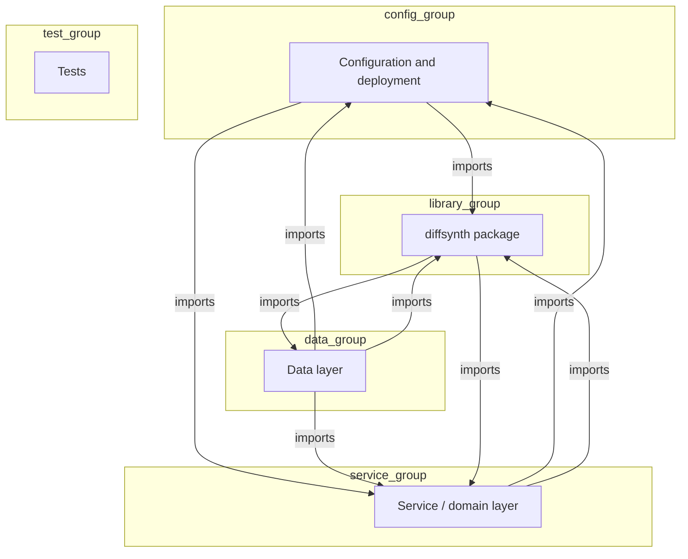

# Architecture report: modelscope/DiffSynth-Studio

> Automated static analysis. **Observed** = directly seen in files/imports/AST; **Inferred** = interpretation from that evidence. Repository code was not executed.

## 1. Repository at a glance

| Item | Value |
| --- | --- |
| Repository | modelscope/DiffSynth-Studio |
| Description | Enjoy the magic of Diffusion models! |
| Language | Python |
| Stars | 13367 |
| Licence | Apache-2.0 |
| Analysed commit / branch | 28638042df62d206486a8bcff3ef22973c84e414 / main |
| Framework(s) | None detected |
| Files analysed | 666 |
| Components | 5 |

## 2. Architecture in one minute

modelscope/DiffSynth-Studio - Enjoy the magic of Diffusion models!. This repository was analysed statically from 666 file(s) (415 Python). Detected technologies (observed from imports/manifests): GitHub Actions, Click, NumPy, pandas. Files are grouped into 5 component(s): Configuration and deployment, Data layer, diffsynth package, Service / domain layer, Tests. Observed entry point(s): .agents/skills/diffsynth-user-dataset/scripts/check_dataset.py, .agents/skills/diffsynth-user-inference/scripts/probe_environment.py, .agents/skills/diffsynth-user-inference/scripts/validate_outputs.py. Findings below distinguish observed facts from inferred interpretation.

## 3. High-level block diagram

## 4. Main components

### Configuration and deployment (`config`)

- **Kind:** config
- **Status:** Observed
- **Confidence:** 0.85
- **Responsibility:** Groups 5 file(s) under configuration and deployment (observed from repository paths and static analysis). Observed top-level classes: MixedQuantizeConfig, ModelConfig, QuantMethodSpec, QuantizeConfig. Observed top-level functions: QwenImageTextEncoder_Module_Map_Updater, _available_methods, _format_error_report, describe_quant_method, register_quant_method.
- **Paths:** `diffsynth/configs/__init__.py`, `diffsynth/configs/model_configs.py`, `diffsynth/configs/vram_management_module_maps.py`, `diffsynth/core/loader/config.py`, `diffsynth/core/quant/config.py`
- **Evidence:** [diffsynth/configs/__init__.py](https://github.com/modelscope/DiffSynth-Studio/blob/28638042df62d206486a8bcff3ef22973c84e414/diffsynth/configs/__init__.py); [diffsynth/configs/model_configs.py](https://github.com/modelscope/DiffSynth-Studio/blob/28638042df62d206486a8bcff3ef22973c84e414/diffsynth/configs/model_configs.py); [diffsynth/configs/vram_management_module_maps.py:642](https://github.com/modelscope/DiffSynth-Studio/blob/28638042df62d206486a8bcff3ef22973c84e414/diffsynth/configs/vram_management_module_maps.py#L642); [diffsynth/core/loader/config.py:42](https://github.com/modelscope/DiffSynth-Studio/blob/28638042df62d206486a8bcff3ef22973c84e414/diffsynth/core/loader/config.py#L42); [diffsynth/core/quant/config.py:11](https://github.com/modelscope/DiffSynth-Studio/blob/28638042df62d206486a8bcff3ef22973c84e414/diffsynth/core/quant/config.py#L11)

### Data layer (`data_layer`)

- **Kind:** data
- **Status:** Observed
- **Confidence:** 0.85
- **Responsibility:** Groups 136 file(s) under data layer (observed from repository paths and static analysis). Observed top-level classes: AMPBlock1, AbstractDistribution, AceStepAttention, AceStepAudioTokenizer, AceStepConditionEncoder, AceStepDiTLayer. Observed top-level functions: FeedForward, WNConv1d, WNConvTranspose1d, _abs_rope_at_t_op, _abs_rope_op, _absmax_kernel.
- **Paths:** `diffsynth/core/data/__init__.py`, `diffsynth/core/data/operators.py`, `diffsynth/core/data/unified_dataset.py`, `diffsynth/core/loader/model.py`, `diffsynth/models/ace_step_conditioner.py`, `diffsynth/models/ace_step_dit.py`, `diffsynth/models/ace_step_residual_fsq.py`, `diffsynth/models/ace_step_text_encoder.py`, `diffsynth/models/ace_step_tokenizer.py`, `diffsynth/models/ace_step_vae.py`, `diffsynth/models/aesthetic.py`, `diffsynth/models/anima_dit.py`, `diffsynth/models/bioclip.py`, `diffsynth/models/boogu_image_dit.py`, `diffsynth/models/clip.py`, `diffsynth/models/demucs.py`, `diffsynth/models/diffsynth_music_dit.py`, `diffsynth/models/dinov3_image_encoder.py`, `diffsynth/models/ernie_image_dit.py`, `diffsynth/models/ernie_image_text_encoder.py`, `diffsynth/models/fibo_dit.py`, `diffsynth/models/fid.py`, `diffsynth/models/flux2_dit.py`, `diffsynth/models/flux2_text_encoder.py`, `diffsynth/models/flux2_vae.py`, `diffsynth/models/flux3_dit.py`, `diffsynth/models/flux_controlnet.py`, `diffsynth/models/flux_dit.py`, `diffsynth/models/flux_infiniteyou.py`, `diffsynth/models/flux_ipadapter.py`, `diffsynth/models/flux_lora_encoder.py`, `diffsynth/models/flux_lora_patcher.py`, `diffsynth/models/flux_redux.py`, `diffsynth/models/flux_text_encoder_clip.py`, `diffsynth/models/flux_text_encoder_t5.py`, `diffsynth/models/flux_vae.py`, `diffsynth/models/flux_value_control.py`, `diffsynth/models/general_modules.py`, `diffsynth/models/hidream_common.py`, `diffsynth/models/hidream_o1_image_dit.py`, `diffsynth/models/hpsv2.py`, `diffsynth/models/hpsv3.py`, `diffsynth/models/ideogram4_dit.py`, `diffsynth/models/ideogram4_text_encoder.py`, `diffsynth/models/ideogram4_vae.py`, `diffsynth/models/image_reward.py`, `diffsynth/models/joyai_image_dit.py`, `diffsynth/models/krea2_dit.py`, `diffsynth/models/krea2_text_encoder.py`, `diffsynth/models/lingbot_video_dit.py`, `diffsynth/models/longcat_video_dit.py`, `diffsynth/models/lpips.py`, `diffsynth/models/ltx25_diffusion_video_vae.py`, `diffsynth/models/ltx25_duration_head.py`, `diffsynth/models/ltx25_text_encoder.py`, `diffsynth/models/ltx2_audio_vae.py`, `diffsynth/models/ltx2_common.py`, `diffsynth/models/ltx2_dit.py`, `diffsynth/models/ltx2_text_encoder.py`, `diffsynth/models/ltx2_upsampler.py`, `diffsynth/models/ltx2_video_vae.py`, `diffsynth/models/minimax_h3_audio_vae.py`, `diffsynth/models/minimax_h3_controlnet.py`, `diffsynth/models/minimax_h3_dit.py`, `diffsynth/models/minimax_h3_dit_comfy.py`, `diffsynth/models/minimax_h3_dit_vdn.py`, `diffsynth/models/minimax_h3_dit_vdn_fp8.py`, `diffsynth/models/minimax_h3_image_dit.py`, `diffsynth/models/minimax_h3_image_dit_comfy.py`, `diffsynth/models/minimax_h3_image_vae.py`, `diffsynth/models/minimax_h3_text_encoder.py`, `diffsynth/models/minimax_h3_video_vae.py`, `diffsynth/models/minimax_music3_condition_encoder.py`, `diffsynth/models/minimax_music3_dit.py`, `diffsynth/models/minimax_music3_rvq_depth_decoder.py`, `diffsynth/models/minimax_music3_text_encoder.py`, `diffsynth/models/minimax_music3_vocoder.py`, `diffsynth/models/model_loader.py`, `diffsynth/models/moss_image_dit.py`, `diffsynth/models/moss_image_text_encoder.py`, `diffsynth/models/mova_audio_dit.py`, `diffsynth/models/mova_audio_vae.py`, `diffsynth/models/mova_dual_tower_bridge.py`, `diffsynth/models/nexus_gen.py`, `diffsynth/models/nexus_gen_ar_model.py`, `diffsynth/models/nexus_gen_projector.py`, `diffsynth/models/pickscore.py`, `diffsynth/models/qwen_image_21_controlnet.py`, `diffsynth/models/qwen_image_21_dit.py`, `diffsynth/models/qwen_image_21_text_encoder.py`, `diffsynth/models/qwen_image_21_vae.py`, `diffsynth/models/qwen_image_bench.py`, `diffsynth/models/qwen_image_controlnet.py`, `diffsynth/models/qwen_image_dit.py`, `diffsynth/models/qwen_image_image2lora.py`, `diffsynth/models/qwen_image_text_encoder.py`, `diffsynth/models/qwen_image_vae.py`, `diffsynth/models/qwen_video_edit_dit.py`, `diffsynth/models/sd_text_encoder.py`, `diffsynth/models/sensenova_u1_common.py`, `diffsynth/models/sensenova_u1_dit.py`, `diffsynth/models/siglip2_image_encoder.py`, `diffsynth/models/stable_diffusion_text_encoder.py`, `diffsynth/models/stable_diffusion_unet.py`, `diffsynth/models/stable_diffusion_vae.py`, `diffsynth/models/stable_diffusion_xl_text_encoder.py`, `diffsynth/models/stable_diffusion_xl_unet.py`, `diffsynth/models/step1x_connector.py`, `diffsynth/models/step1x_text_encoder.py`, `diffsynth/models/unified_reward_2.py`, `diffsynth/models/unified_reward_edit.py`, `diffsynth/models/wan_animate_2_dit.py`, `diffsynth/models/wan_video_animate_adapter.py`, `diffsynth/models/wan_video_camera_controller.py`, `diffsynth/models/wan_video_dit.py`, `diffsynth/models/wan_video_dit_s2v.py`, `diffsynth/models/wan_video_image_encoder.py`, `diffsynth/models/wan_video_mot.py`, `diffsynth/models/wan_video_motion_controller.py`, `diffsynth/models/wan_video_text_encoder.py`, `diffsynth/models/wan_video_vace.py`, `diffsynth/models/wan_video_vae.py`, `diffsynth/models/wantodance.py`, `diffsynth/models/wav2vec.py`, `diffsynth/models/yue2_mot.py`, `diffsynth/models/yue2_tokenizer.py`, `diffsynth/models/yue2_vae.py`, `diffsynth/models/z_image_controlnet.py`, `diffsynth/models/z_image_dit.py`, `diffsynth/models/z_image_image2lora.py`, `diffsynth/models/z_image_text_encoder.py`, `diffsynth/utils/data/__init__.py`, `diffsynth/utils/data/audio.py`, `diffsynth/utils/data/audio_video.py`, `diffsynth/utils/data/media_io_ltx2.py`, `diffsynth/utils/data/minimax_h3.py`
- **Evidence:** [diffsynth/core/data/__init__.py](https://github.com/modelscope/DiffSynth-Studio/blob/28638042df62d206486a8bcff3ef22973c84e414/diffsynth/core/data/__init__.py); [diffsynth/core/data/operators.py:9](https://github.com/modelscope/DiffSynth-Studio/blob/28638042df62d206486a8bcff3ef22973c84e414/diffsynth/core/data/operators.py#L9); [diffsynth/core/data/unified_dataset.py:5](https://github.com/modelscope/DiffSynth-Studio/blob/28638042df62d206486a8bcff3ef22973c84e414/diffsynth/core/data/unified_dataset.py#L5); [diffsynth/core/loader/model.py:10](https://github.com/modelscope/DiffSynth-Studio/blob/28638042df62d206486a8bcff3ef22973c84e414/diffsynth/core/loader/model.py#L10); [diffsynth/models/ace_step_conditioner.py:39](https://github.com/modelscope/DiffSynth-Studio/blob/28638042df62d206486a8bcff3ef22973c84e414/diffsynth/models/ace_step_conditioner.py#L39); [diffsynth/models/ace_step_dit.py:38](https://github.com/modelscope/DiffSynth-Studio/blob/28638042df62d206486a8bcff3ef22973c84e414/diffsynth/models/ace_step_dit.py#L38); [diffsynth/models/ace_step_residual_fsq.py:21](https://github.com/modelscope/DiffSynth-Studio/blob/28638042df62d206486a8bcff3ef22973c84e414/diffsynth/models/ace_step_residual_fsq.py#L21); [diffsynth/models/ace_step_text_encoder.py:4](https://github.com/modelscope/DiffSynth-Studio/blob/28638042df62d206486a8bcff3ef22973c84e414/diffsynth/models/ace_step_text_encoder.py#L4)

### diffsynth package (`diffsynth`)

- **Kind:** library
- **Status:** Observed
- **Confidence:** 0.85
- **Responsibility:** Groups 140 file(s) under diffsynth package (observed from repository paths and static analysis). Observed top-level classes: AceStepPipeline, AceStepUnit_ConditionEmbedder, AceStepUnit_ContextLatentBuilder, AceStepUnit_InputAudioEmbedder, AceStepUnit_NoiseInitializer, AceStepUnit_PromptEmbedder. Observed top-level functions: AceStepConditionEncoderStateDictConverter, AceStepDiTModelStateDictConverter, AceStepTextEncoderStateDictConverter, AceStepTokenizerStateDictConverter, AnimaDiTStateDictConverter, DINOv3StateDictConverter.
- **Paths:** `diffsynth/__init__.py`, `diffsynth/diffusion/__init__.py`, `diffsynth/diffusion/base_pipeline.py`, `diffsynth/diffusion/ddim_scheduler.py`, `diffsynth/diffusion/dmd2.py`, `diffsynth/diffusion/flow_match.py`, `diffsynth/diffusion/logger.py`, `diffsynth/diffusion/loss.py`, `diffsynth/diffusion/parsers.py`, `diffsynth/diffusion/runner.py`, `diffsynth/diffusion/template.py`, `diffsynth/diffusion/training_module.py`, `diffsynth/metrics/__init__.py`, `diffsynth/metrics/aesthetic.py`, `diffsynth/metrics/base.py`, `diffsynth/metrics/bioclip.py`, `diffsynth/metrics/clip.py`, `diffsynth/metrics/fid.py`, `diffsynth/metrics/hpsv2.py`, `diffsynth/metrics/hpsv3.py`, `diffsynth/metrics/image_reward.py`, `diffsynth/metrics/lpips.py`, `diffsynth/metrics/pickscore.py`, `diffsynth/metrics/qwen_image_bench.py`, `diffsynth/metrics/unified_reward_2.py`, `diffsynth/metrics/unified_reward_edit.py`, `diffsynth/pipelines/ace_step.py`, `diffsynth/pipelines/anima_image.py`, `diffsynth/pipelines/boogu_image.py`, `diffsynth/pipelines/diffsynth_music.py`, `diffsynth/pipelines/ernie_image.py`, `diffsynth/pipelines/fibo.py`, `diffsynth/pipelines/flux2_image.py`, `diffsynth/pipelines/flux3_image.py`, `diffsynth/pipelines/flux_image.py`, `diffsynth/pipelines/hidream_o1_image.py`, `diffsynth/pipelines/ideogram4.py`, `diffsynth/pipelines/joyai_image.py`, `diffsynth/pipelines/krea2.py`, `diffsynth/pipelines/lingbot_video.py`, `diffsynth/pipelines/ltx2_audio_video.py`, `diffsynth/pipelines/minimax_h3_audio_video.py`, `diffsynth/pipelines/minimax_h3_image.py`, `diffsynth/pipelines/minimax_music3.py`, `diffsynth/pipelines/moss_image.py`, `diffsynth/pipelines/mova_audio_video.py`, `diffsynth/pipelines/qwen_image.py`, `diffsynth/pipelines/qwen_image_21.py`, `diffsynth/pipelines/qwen_video_edit.py`, `diffsynth/pipelines/sensenova_u1_image.py`, `diffsynth/pipelines/stable_diffusion.py`, `diffsynth/pipelines/stable_diffusion_xl.py`, `diffsynth/pipelines/wan_video.py`, `diffsynth/pipelines/yue2.py`, `diffsynth/pipelines/z_image.py`, `diffsynth/utils/controlnet/__init__.py`, `diffsynth/utils/controlnet/annotator.py`, `diffsynth/utils/controlnet/controlnet_input.py`, `diffsynth/utils/demucs/__init__.py`, `diffsynth/utils/dequantizer/__init__.py`, `diffsynth/utils/lora/__init__.py`, `diffsynth/utils/lora/flux.py`, `diffsynth/utils/lora/flux_timestep.py`, `diffsynth/utils/lora/general.py`, `diffsynth/utils/lora/krea2.py`, `diffsynth/utils/lora/merge.py`, `diffsynth/utils/lora/minimax_h3.py`, `diffsynth/utils/lora/reset_rank.py`, `diffsynth/utils/lora/sdxl.py`, `diffsynth/utils/music_tools/__init__.py`, `diffsynth/utils/music_tools/click.py`, `diffsynth/utils/music_tools/prosody.py`, `diffsynth/utils/quant/serialization.py`, `diffsynth/utils/ses/__init__.py`, `diffsynth/utils/ses/ses.py`, `diffsynth/utils/state_dict_converters/__init__.py`, `diffsynth/utils/state_dict_converters/ace_step_conditioner.py`, `diffsynth/utils/state_dict_converters/ace_step_dit.py`, `diffsynth/utils/state_dict_converters/ace_step_text_encoder.py`, `diffsynth/utils/state_dict_converters/ace_step_tokenizer.py`, `diffsynth/utils/state_dict_converters/anima_dit.py`, `diffsynth/utils/state_dict_converters/dino_v3.py`, `diffsynth/utils/state_dict_converters/ernie_image_text_encoder.py`, `diffsynth/utils/state_dict_converters/flux2_text_encoder.py`, `diffsynth/utils/state_dict_converters/flux3_dit.py`, `diffsynth/utils/state_dict_converters/flux_controlnet.py`, `diffsynth/utils/state_dict_converters/flux_dit.py`, `diffsynth/utils/state_dict_converters/flux_infiniteyou.py`, `diffsynth/utils/state_dict_converters/flux_ipadapter.py`, `diffsynth/utils/state_dict_converters/flux_text_encoder_clip.py`, `diffsynth/utils/state_dict_converters/flux_text_encoder_t5.py`, `diffsynth/utils/state_dict_converters/flux_vae.py`, `diffsynth/utils/state_dict_converters/ideogram4_text_encoder.py`, `diffsynth/utils/state_dict_converters/image_metrics.py`, `diffsynth/utils/state_dict_converters/krea2_dit.py`, `diffsynth/utils/state_dict_converters/krea2_text_encoder.py`, `diffsynth/utils/state_dict_converters/lingbot_video_dit.py`, `diffsynth/utils/state_dict_converters/ltx25_diffusion_video_vae.py`, `diffsynth/utils/state_dict_converters/ltx25_duration_head.py`, `diffsynth/utils/state_dict_converters/ltx25_text_encoder.py`, `diffsynth/utils/state_dict_converters/ltx2_audio_vae.py`, `diffsynth/utils/state_dict_converters/ltx2_dit.py`, `diffsynth/utils/state_dict_converters/ltx2_text_encoder.py`, `diffsynth/utils/state_dict_converters/ltx2_video_vae.py`, `diffsynth/utils/state_dict_converters/minimax_h3_audio_vae.py`, `diffsynth/utils/state_dict_converters/minimax_h3_controlnet.py`, `diffsynth/utils/state_dict_converters/minimax_h3_dit.py`, `diffsynth/utils/state_dict_converters/minimax_h3_dit_vdn.py`, `diffsynth/utils/state_dict_converters/minimax_h3_image_dit.py`, `diffsynth/utils/state_dict_converters/minimax_h3_image_vae.py`, `diffsynth/utils/state_dict_converters/minimax_h3_text_encoder.py`, `diffsynth/utils/state_dict_converters/minimax_h3_video_vae.py`, `diffsynth/utils/state_dict_converters/minimax_music3_text_encoder.py`, `diffsynth/utils/state_dict_converters/moss_image_text_encoder.py`, `diffsynth/utils/state_dict_converters/nexus_gen.py`, `diffsynth/utils/state_dict_converters/nexus_gen_projector.py`, `diffsynth/utils/state_dict_converters/qwen_image_21_text_encoder.py`, `diffsynth/utils/state_dict_converters/qwen_image_text_encoder.py`, `diffsynth/utils/state_dict_converters/qwen_video_edit.py`, `diffsynth/utils/state_dict_converters/sdxl_text_encoder.py`, `diffsynth/utils/state_dict_converters/sdxl_text_encoder_2.py`, `diffsynth/utils/state_dict_converters/sdxl_vae.py`, `diffsynth/utils/state_dict_converters/stable_diffusion_text_encoder.py`, `diffsynth/utils/state_dict_converters/stable_diffusion_vae.py`, `diffsynth/utils/state_dict_converters/stable_diffusion_xl_text_encoder.py`, `diffsynth/utils/state_dict_converters/step1x_connector.py`, `diffsynth/utils/state_dict_converters/wan_video_animate_adapter.py`, `diffsynth/utils/state_dict_converters/wan_video_dit.py`, `diffsynth/utils/state_dict_converters/wan_video_image_encoder.py`, `diffsynth/utils/state_dict_converters/wan_video_mot.py`, `diffsynth/utils/state_dict_converters/wan_video_vace.py`, `diffsynth/utils/state_dict_converters/wan_video_vae.py`, `diffsynth/utils/state_dict_converters/wans2v_audio_encoder.py`, `diffsynth/utils/state_dict_converters/z_image_dit.py`, `diffsynth/utils/state_dict_converters/z_image_text_encoder.py`, `diffsynth/utils/tile/__init__.py`, `diffsynth/utils/tile/tile_worker.py`, `diffsynth/utils/xfuser/__init__.py`, `diffsynth/utils/xfuser/xdit_context_parallel.py`, `diffsynth/version.py`
- **Evidence:** [diffsynth/__init__.py](https://github.com/modelscope/DiffSynth-Studio/blob/28638042df62d206486a8bcff3ef22973c84e414/diffsynth/__init__.py); [diffsynth/diffusion/__init__.py](https://github.com/modelscope/DiffSynth-Studio/blob/28638042df62d206486a8bcff3ef22973c84e414/diffsynth/diffusion/__init__.py); [diffsynth/diffusion/base_pipeline.py:15](https://github.com/modelscope/DiffSynth-Studio/blob/28638042df62d206486a8bcff3ef22973c84e414/diffsynth/diffusion/base_pipeline.py#L15); [diffsynth/diffusion/ddim_scheduler.py:4](https://github.com/modelscope/DiffSynth-Studio/blob/28638042df62d206486a8bcff3ef22973c84e414/diffsynth/diffusion/ddim_scheduler.py#L4); [diffsynth/diffusion/dmd2.py:10](https://github.com/modelscope/DiffSynth-Studio/blob/28638042df62d206486a8bcff3ef22973c84e414/diffsynth/diffusion/dmd2.py#L10); [diffsynth/diffusion/flow_match.py:6](https://github.com/modelscope/DiffSynth-Studio/blob/28638042df62d206486a8bcff3ef22973c84e414/diffsynth/diffusion/flow_match.py#L6); [diffsynth/diffusion/logger.py:5](https://github.com/modelscope/DiffSynth-Studio/blob/28638042df62d206486a8bcff3ef22973c84e414/diffsynth/diffusion/logger.py#L5); [diffsynth/diffusion/loss.py:5](https://github.com/modelscope/DiffSynth-Studio/blob/28638042df62d206486a8bcff3ef22973c84e414/diffsynth/diffusion/loss.py#L5)

### Service / domain layer (`service_layer`)

- **Kind:** service
- **Status:** Observed
- **Confidence:** 0.85
- **Responsibility:** Groups 33 file(s) under service / domain layer (observed from repository paths and static analysis). Observed top-level classes: AlwaysOnGPUParamOffloader, AttentionBackend, AutoTorchModule, AutoWrappedLinear, AutoWrappedModule, AutoWrappedNonRecurseModule. Observed top-level functions: _align, _align_up, _ceil_div, _dequantize_fp4_weight, _dequantize_weight, _df11_config.
- **Paths:** `diffsynth/core/__init__.py`, `diffsynth/core/attention/__init__.py`, `diffsynth/core/attention/attention.py`, `diffsynth/core/attention/common.py`, `diffsynth/core/attention/flash_attention.py`, `diffsynth/core/attention/flex_attention.py`, `diffsynth/core/attention/registry.py`, `diffsynth/core/attention/sage_attention.py`, `diffsynth/core/attention/torch_attention.py`, `diffsynth/core/attention/xformers_attention.py`, `diffsynth/core/device/__init__.py`, `diffsynth/core/device/npu_compatible_device.py`, `diffsynth/core/gradient/__init__.py`, `diffsynth/core/gradient/gradient_checkpoint.py`, `diffsynth/core/loader/__init__.py`, `diffsynth/core/loader/file.py`, `diffsynth/core/npu_patch/npu_fused_operator.py`, `diffsynth/core/offload_training/__init__.py`, `diffsynth/core/offload_training/manager.py`, `diffsynth/core/offload_training/memory_buffer.py`, `diffsynth/core/offload_training/offloader.py`, `diffsynth/core/quant/__init__.py`, `diffsynth/core/quant/backends/__init__.py`, `diffsynth/core/quant/backends/bitsandbytes.py`, `diffsynth/core/quant/backends/comfy_kitchen.py`, `diffsynth/core/quant/backends/deep_gemm.py`, `diffsynth/core/quant/backends/entropack.py`, `diffsynth/core/quant/backends/torchao.py`, `diffsynth/core/quant/base.py`, `diffsynth/core/vram/__init__.py`, `diffsynth/core/vram/disk_map.py`, `diffsynth/core/vram/initialization.py`, `diffsynth/core/vram/layers.py`
- **Evidence:** [diffsynth/core/__init__.py](https://github.com/modelscope/DiffSynth-Studio/blob/28638042df62d206486a8bcff3ef22973c84e414/diffsynth/core/__init__.py); [diffsynth/core/attention/__init__.py](https://github.com/modelscope/DiffSynth-Studio/blob/28638042df62d206486a8bcff3ef22973c84e414/diffsynth/core/attention/__init__.py); [diffsynth/core/attention/attention.py:14](https://github.com/modelscope/DiffSynth-Studio/blob/28638042df62d206486a8bcff3ef22973c84e414/diffsynth/core/attention/attention.py#L14); [diffsynth/core/attention/common.py:12](https://github.com/modelscope/DiffSynth-Studio/blob/28638042df62d206486a8bcff3ef22973c84e414/diffsynth/core/attention/common.py#L12); [diffsynth/core/attention/flash_attention.py:36](https://github.com/modelscope/DiffSynth-Studio/blob/28638042df62d206486a8bcff3ef22973c84e414/diffsynth/core/attention/flash_attention.py#L36); [diffsynth/core/attention/flex_attention.py:15](https://github.com/modelscope/DiffSynth-Studio/blob/28638042df62d206486a8bcff3ef22973c84e414/diffsynth/core/attention/flex_attention.py#L15); [diffsynth/core/attention/registry.py:6](https://github.com/modelscope/DiffSynth-Studio/blob/28638042df62d206486a8bcff3ef22973c84e414/diffsynth/core/attention/registry.py#L6); [diffsynth/core/attention/sage_attention.py:10](https://github.com/modelscope/DiffSynth-Studio/blob/28638042df62d206486a8bcff3ef22973c84e414/diffsynth/core/attention/sage_attention.py#L10)

### Tests (`tests`)

- **Kind:** test
- **Status:** Observed
- **Confidence:** 0.85
- **Responsibility:** Groups 1 file(s) under tests (observed from repository paths and static analysis). Observed top-level functions: filter_unprocessed_tasks, move_files, run_inference, run_tasks_on_single_GPU, run_train_multi_GPU, run_train_single_GPU.
- **Paths:** `examples/dev_tools/unit_test.py`
- **Evidence:** [examples/dev_tools/unit_test.py:5](https://github.com/modelscope/DiffSynth-Studio/blob/28638042df62d206486a8bcff3ef22973c84e414/examples/dev_tools/unit_test.py#L5)

## 5. Execution flow

**Observed** entry point(s):

- [.agents/skills/diffsynth-user-dataset/scripts/check_dataset.py:391](https://github.com/modelscope/DiffSynth-Studio/blob/28638042df62d206486a8bcff3ef22973c84e414/.agents/skills/diffsynth-user-dataset/scripts/check_dataset.py#L391)
- [.agents/skills/diffsynth-user-inference/scripts/probe_environment.py:652](https://github.com/modelscope/DiffSynth-Studio/blob/28638042df62d206486a8bcff3ef22973c84e414/.agents/skills/diffsynth-user-inference/scripts/probe_environment.py#L652)
- [.agents/skills/diffsynth-user-inference/scripts/validate_outputs.py:145](https://github.com/modelscope/DiffSynth-Studio/blob/28638042df62d206486a8bcff3ef22973c84e414/.agents/skills/diffsynth-user-inference/scripts/validate_outputs.py#L145)
- [.agents/skills/diffsynth-user-setup/scripts/probe_environment.py:652](https://github.com/modelscope/DiffSynth-Studio/blob/28638042df62d206486a8bcff3ef22973c84e414/.agents/skills/diffsynth-user-setup/scripts/probe_environment.py#L652)
- [.agents/skills/diffsynth-user-training/scripts/probe_environment.py:652](https://github.com/modelscope/DiffSynth-Studio/blob/28638042df62d206486a8bcff3ef22973c84e414/.agents/skills/diffsynth-user-training/scripts/probe_environment.py#L652)

Representative flow (derived from observed entry points and the import graph; steps beyond the entry point are **Inferred**):

1. Execution starts at an observed entry point listed above, if present.
2. `config` imports `diffsynth` (Configuration and deployment -> diffsynth package).
3. `config` imports `service_layer` (Configuration and deployment -> Service / domain layer).
4. `data_layer` imports `config` (Data layer -> Configuration and deployment).
5. `data_layer` imports `diffsynth` (Data layer -> diffsynth package).
6. `data_layer` imports `service_layer` (Data layer -> Service / domain layer).
7. `diffsynth` imports `data_layer` (diffsynth package -> Data layer).
8. `diffsynth` imports `service_layer` (diffsynth package -> Service / domain layer).
9. `service_layer` imports `config` (Service / domain layer -> Configuration and deployment).

## 6. Project structure

### `(root)`

- `.gitignore` - other (3225 bytes)
- `LICENSE` - docs (11347 bytes)
- `README.md` - docs (180033 bytes)
- `README_zh.md` - docs (175892 bytes)

### `.agents`

- `.agents/skills/diffsynth-analyze-target/SKILL.md` - docs (39093 bytes)
- `.agents/skills/diffsynth-analyze-target/references/blueprint-format.md` - docs (23421 bytes)
- `.agents/skills/diffsynth-analyze-target/references/code-report-template.md` - docs (3522 bytes)
- `.agents/skills/diffsynth-docs/SKILL.md` - docs (31414 bytes)
- `.agents/skills/diffsynth-docs/references/doc-templates.md` - docs (23437 bytes)
- `.agents/skills/diffsynth-environment/SKILL.md` - docs (43618 bytes)
- `.agents/skills/diffsynth-environment/references/dependency-examples.md` - docs (4468 bytes)
- `.agents/skills/diffsynth-integrator/SKILL.md` - docs (10581 bytes)
- `.agents/skills/diffsynth-integrator/config.yaml` - config (1937 bytes)
- `.agents/skills/diffsynth-integrator/example.md` - docs (23921 bytes)
- `.agents/skills/diffsynth-integrator/references/blueprint-contract.md` - docs (6557 bytes)
- `.agents/skills/diffsynth-integrator/references/exec-log-init.md` - docs (4753 bytes)
- `.agents/skills/diffsynth-integrator/references/execution-traceability.md` - docs (10004 bytes)
- `.agents/skills/diffsynth-integrator/references/step-report.md` - docs (11603 bytes)
- `.agents/skills/diffsynth-integrator/skill-workflows.md` - docs (32230 bytes)
- `.agents/skills/diffsynth-model-code/SKILL.md` - docs (87327 bytes)
- `.agents/skills/diffsynth-model-code/references/attention-replacement.md` - docs (11763 bytes)
- `.agents/skills/diffsynth-model-code/references/converter-template.md` - docs (11898 bytes)
- `.agents/skills/diffsynth-model-code/references/gradient-checkpointing.md` - docs (4588 bytes)
- `.agents/skills/diffsynth-model-code/references/model-file-diffusers-refactor.md` - docs (4208 bytes)
- `.agents/skills/diffsynth-model-code/references/model-file-own-source.md` - docs (4290 bytes)
- `.agents/skills/diffsynth-model-code/references/model-file-reuse.md` - docs (3437 bytes)
- `.agents/skills/diffsynth-model-code/references/model-file-template.md` - docs (3056 bytes)
- `.agents/skills/diffsynth-model-code/references/model-file-transformers-wrapper.md` - docs (4468 bytes)
- `.agents/skills/diffsynth-model-code/references/model-file-version-upgrade.md` - docs (4827 bytes)
- `.agents/skills/diffsynth-model-code/references/model-separation-design.md` - docs (13282 bytes)
- `.agents/skills/diffsynth-pipeline-lowvram/SKILL.md` - docs (39213 bytes)
- `.agents/skills/diffsynth-pipeline-training/SKILL.md` - docs (61987 bytes)
- `.agents/skills/diffsynth-pipeline-training/references/dataset-guidelines.md` - docs (11329 bytes)
- `.agents/skills/diffsynth-pipeline-training/references/split-training.md` - docs (9209 bytes)
- `.agents/skills/diffsynth-pipeline-training/references/training-code-templates.md` - docs (38662 bytes)
- `.agents/skills/diffsynth-pipeline-training/references/training-scripts.md` - docs (24302 bytes)
- `.agents/skills/diffsynth-pipeline/SKILL.md` - docs (66772 bytes)
- `.agents/skills/diffsynth-pipeline/references/e2e-test.md` - docs (12420 bytes)
- `.agents/skills/diffsynth-pipeline/references/inference-scripts.md` - docs (6959 bytes)
- `.agents/skills/diffsynth-pipeline/references/pipeline-template.md` - docs (13280 bytes)
- `.agents/skills/diffsynth-pipeline/references/scheduler-integration.md` - docs (10089 bytes)
- `.agents/skills/diffsynth-pr-review/SKILL.md` - docs (33423 bytes)
- `.agents/skills/diffsynth-pr/SKILL.md` - docs (15140 bytes)
- `.agents/skills/diffsynth-pr/references/pr-template.md` - docs (690 bytes)
- `.agents/skills/diffsynth-style/SKILL.md` - docs (51771 bytes)
- `.agents/skills/diffsynth-testing/SKILL.md` - docs (34043 bytes)
- `.agents/skills/diffsynth-testing/references/test-report-format.md` - docs (1512 bytes)
- `.agents/skills/diffsynth-user-dataset/SKILL.md` - docs (19930 bytes)
- `.agents/skills/diffsynth-user-dataset/scripts/check_dataset.py` - source, Python (19359 bytes)
- `.agents/skills/diffsynth-user-evaluation/SKILL.md` - docs (9163 bytes)
- `.agents/skills/diffsynth-user-inference/SKILL.md` - docs (31588 bytes)
- `.agents/skills/diffsynth-user-inference/references/memory-optimization.md` - docs (33809 bytes)
- `.agents/skills/diffsynth-user-inference/scripts/probe_environment.py` - source, Python (39189 bytes)
- `.agents/skills/diffsynth-user-inference/scripts/validate_outputs.py` - source, Python (7835 bytes)
- `.agents/skills/diffsynth-user-research/SKILL.md` - docs (20711 bytes)
- `.agents/skills/diffsynth-user-research/references/control-and-adapters.md` - docs (9064 bytes)
- `.agents/skills/diffsynth-user-research/references/data-and-architecture.md` - docs (6892 bytes)
- `.agents/skills/diffsynth-user-research/references/extension-points.md` - docs (6553 bytes)
- `.agents/skills/diffsynth-user-research/references/multimodal-and-efficiency.md` - docs (7976 bytes)
- `.agents/skills/diffsynth-user-research/references/objectives-and-distillation.md` - docs (7802 bytes)
- `.agents/skills/diffsynth-user-research/references/sampling-and-search.md` - docs (5291 bytes)
- `.agents/skills/diffsynth-user-setup/SKILL.md` - docs (17079 bytes)
- `.agents/skills/diffsynth-user-setup/scripts/probe_environment.py` - source, Python (39189 bytes)
- `.agents/skills/diffsynth-user-training/SKILL.md` - docs (20311 bytes)
- `.agents/skills/diffsynth-user-training/references/memory.md` - docs (18080 bytes)
- `.agents/skills/diffsynth-user-training/references/quantization.md` - docs (11755 bytes)
- `.agents/skills/diffsynth-user-training/scripts/probe_environment.py` - source, Python (39189 bytes)

### `.github`

- `.github/workflows/publish.yaml` - ci, YAML (750 bytes)

### `diffsynth`

- `diffsynth/__init__.py` - source, Python (20 bytes)
- `diffsynth/configs/__init__.py` - source, Python (132 bytes)
- `diffsynth/configs/model_configs.py` - source, Python (125656 bytes)
- `diffsynth/configs/vram_management_module_maps.py` - source, Python (48131 bytes)
- `diffsynth/core/__init__.py` - source, Python (186 bytes)
- `diffsynth/core/attention/__init__.py` - source, Python (121 bytes)
- `diffsynth/core/attention/attention.py` - source, Python (2674 bytes)
- `diffsynth/core/attention/common.py` - source, Python (1098 bytes)
- `diffsynth/core/attention/flash_attention.py` - source, Python (4999 bytes)
- `diffsynth/core/attention/flex_attention.py` - source, Python (1193 bytes)
- `diffsynth/core/attention/registry.py` - source, Python (1358 bytes)
- `diffsynth/core/attention/sage_attention.py` - source, Python (856 bytes)
- `diffsynth/core/attention/torch_attention.py` - source, Python (3549 bytes)
- `diffsynth/core/attention/xformers_attention.py` - source, Python (864 bytes)
- `diffsynth/core/data/__init__.py` - source, Python (44 bytes)
- `diffsynth/core/data/operators.py` - source, Python (15768 bytes)
- `diffsynth/core/data/unified_dataset.py` - source, Python (5224 bytes)
- `diffsynth/core/device/__init__.py` - source, Python (188 bytes)
- `diffsynth/core/device/npu_compatible_device.py` - source, Python (3051 bytes)
- `diffsynth/core/gradient/__init__.py` - source, Python (61 bytes)
- `diffsynth/core/gradient/gradient_checkpoint.py` - source, Python (2223 bytes)
- `diffsynth/core/loader/__init__.py` - source, Python (165 bytes)
- `diffsynth/core/loader/config.py` - source, Python (9636 bytes)
- `diffsynth/core/loader/file.py` - source, Python (5644 bytes)
- `diffsynth/core/loader/model.py` - source, Python (9371 bytes)
- `diffsynth/core/npu_patch/npu_fused_operator.py` - source, Python (1245 bytes)
- `diffsynth/core/offload_training/__init__.py` - source, Python (44 bytes)
- `diffsynth/core/offload_training/manager.py` - source, Python (8585 bytes)
- `diffsynth/core/offload_training/memory_buffer.py` - source, Python (6082 bytes)
- `diffsynth/core/offload_training/offloader.py` - source, Python (2588 bytes)
- `diffsynth/core/quant/__init__.py` - source, Python (289 bytes)
- `diffsynth/core/quant/backends/__init__.py` - source, Python (724 bytes)
- `diffsynth/core/quant/backends/bitsandbytes.py` - source, Python (6566 bytes)
- `diffsynth/core/quant/backends/comfy_kitchen.py` - source, Python (14071 bytes)
- `diffsynth/core/quant/backends/deep_gemm.py` - source, Python (26730 bytes)
- `diffsynth/core/quant/backends/entropack.py` - source, Python (6881 bytes)
- `diffsynth/core/quant/backends/torchao.py` - source, Python (7561 bytes)
- `diffsynth/core/quant/base.py` - source, Python (11038 bytes)
- `diffsynth/core/quant/config.py` - source, Python (26758 bytes)
- `diffsynth/core/vram/__init__.py` - source, Python (76 bytes)
- `diffsynth/core/vram/disk_map.py` - source, Python (3412 bytes)
- `diffsynth/core/vram/initialization.py` - source, Python (766 bytes)
- `diffsynth/core/vram/layers.py` - source, Python (27182 bytes)
- `diffsynth/diffusion/__init__.py` - source, Python (312 bytes)
- `diffsynth/diffusion/base_pipeline.py` - source, Python (26272 bytes)
- `diffsynth/diffusion/ddim_scheduler.py` - source, Python (5264 bytes)
- `diffsynth/diffusion/dmd2.py` - source, Python (19654 bytes)
- `diffsynth/diffusion/flow_match.py` - source, Python (26059 bytes)
- `diffsynth/diffusion/logger.py` - source, Python (5557 bytes)
- `diffsynth/diffusion/loss.py` - source, Python (12161 bytes)
- `diffsynth/diffusion/parsers.py` - source, Python (11643 bytes)
- `diffsynth/diffusion/runner.py` - source, Python (8146 bytes)
- `diffsynth/diffusion/template.py` - source, Python (9044 bytes)
- `diffsynth/diffusion/training_module.py` - source, Python (23733 bytes)
- `diffsynth/metrics/__init__.py` - source, Python (841 bytes)
- `diffsynth/metrics/aesthetic.py` - source, Python (1614 bytes)
- `diffsynth/metrics/base.py` - source, Python (1183 bytes)
- `diffsynth/metrics/bioclip.py` - source, Python (1778 bytes)
- `diffsynth/metrics/clip.py` - source, Python (2021 bytes)
- `diffsynth/metrics/fid.py` - source, Python (1598 bytes)
- `diffsynth/metrics/hpsv2.py` - source, Python (1664 bytes)
- `diffsynth/metrics/hpsv3.py` - source, Python (2685 bytes)
- `diffsynth/metrics/image_reward.py` - source, Python (2025 bytes)
- `diffsynth/metrics/lpips.py` - source, Python (2090 bytes)
- `diffsynth/metrics/pickscore.py` - source, Python (2163 bytes)
- `diffsynth/metrics/qwen_image_bench.py` - source, Python (2631 bytes)
- `diffsynth/metrics/unified_reward_2.py` - source, Python (2459 bytes)
- `diffsynth/metrics/unified_reward_edit.py` - source, Python (3818 bytes)
- `diffsynth/models/ace_step_conditioner.py` - source, Python (29724 bytes)
- `diffsynth/models/ace_step_dit.py` - source, Python (20245 bytes)
- `diffsynth/models/ace_step_residual_fsq.py` - source, Python (18925 bytes)
- `diffsynth/models/ace_step_text_encoder.py` - source, Python (1468 bytes)
- `diffsynth/models/ace_step_tokenizer.py` - source, Python (30372 bytes)
- `diffsynth/models/ace_step_vae.py` - source, Python (15466 bytes)
- `diffsynth/models/aesthetic.py` - source, Python (2916 bytes)
- `diffsynth/models/anima_dit.py` - source, Python (58767 bytes)
- `diffsynth/models/bioclip.py` - source, Python (4166 bytes)
- `diffsynth/models/boogu_image_dit.py` - source, Python (125909 bytes)
- `diffsynth/models/clip.py` - source, Python (5413 bytes)
- `diffsynth/models/demucs.py` - source, Python (19955 bytes)
- `diffsynth/models/diffsynth_music_dit.py` - source, Python (10988 bytes)
- `diffsynth/models/dinov3_image_encoder.py` - source, Python (3568 bytes)
- `diffsynth/models/ernie_image_dit.py` - source, Python (14399 bytes)
- `diffsynth/models/ernie_image_text_encoder.py` - source, Python (2385 bytes)
- `diffsynth/models/fibo_dit.py` - source, Python (18681 bytes)
- `diffsynth/models/fid.py` - source, Python (9602 bytes)
- `diffsynth/models/flux2_dit.py` - source, Python (39990 bytes)
- `diffsynth/models/flux2_text_encoder.py` - source, Python (2559 bytes)
- `diffsynth/models/flux2_vae.py` - source, Python (13487 bytes)
- `diffsynth/models/flux3_dit.py` - source, Python (10551 bytes)
- `diffsynth/models/flux_controlnet.py` - source, Python (19078 bytes)
- `diffsynth/models/flux_dit.py` - source, Python (17482 bytes)
- `diffsynth/models/flux_infiniteyou.py` - source, Python (3673 bytes)
- `diffsynth/models/flux_ipadapter.py` - source, Python (4230 bytes)
- `diffsynth/models/flux_lora_encoder.py` - source, Python (37187 bytes)
- `diffsynth/models/flux_lora_patcher.py` - source, Python (20412 bytes)
- `diffsynth/models/flux_redux.py` - source, Python (466 bytes)
- `diffsynth/models/flux_text_encoder_clip.py` - source, Python (4716 bytes)
- `diffsynth/models/flux_text_encoder_t5.py` - source, Python (1390 bytes)
- `diffsynth/models/flux_vae.py` - source, Python (18636 bytes)
- `diffsynth/models/flux_value_control.py` - source, Python (2007 bytes)
- `diffsynth/models/general_modules.py` - source, Python (5814 bytes)
- `diffsynth/models/hidream_common.py` - source, Python (14571 bytes)
- `diffsynth/models/hidream_o1_image_dit.py` - source, Python (80025 bytes)
- `diffsynth/models/hpsv2.py` - source, Python (3184 bytes)
- `diffsynth/models/hpsv3.py` - source, Python (15195 bytes)
- `diffsynth/models/ideogram4_dit.py` - source, Python (17097 bytes)
- `diffsynth/models/ideogram4_text_encoder.py` - source, Python (4899 bytes)
- `diffsynth/models/ideogram4_vae.py` - source, Python (4428 bytes)
- `diffsynth/models/image_reward.py` - source, Python (7572 bytes)
- `diffsynth/models/joyai_image_dit.py` - source, Python (25515 bytes)
- `diffsynth/models/krea2_dit.py` - source, Python (14353 bytes)
- `diffsynth/models/krea2_text_encoder.py` - source, Python (2772 bytes)
- `diffsynth/models/lingbot_video_dit.py` - source, Python (30514 bytes)
- `diffsynth/models/longcat_video_dit.py` - source, Python (34046 bytes)
- `diffsynth/models/lpips.py` - source, Python (13524 bytes)
- `diffsynth/models/ltx25_diffusion_video_vae.py` - source, Python (194332 bytes)
- `diffsynth/models/ltx25_duration_head.py` - source, Python (2563 bytes)
- `diffsynth/models/ltx25_text_encoder.py` - source, Python (19350 bytes)
- `diffsynth/models/ltx2_audio_vae.py` - source, Python (73276 bytes)
- `diffsynth/models/ltx2_common.py` - source, Python (13880 bytes)
- `diffsynth/models/ltx2_dit.py` - source, Python (70149 bytes)
- `diffsynth/models/ltx2_text_encoder.py` - source, Python (24502 bytes)
- `diffsynth/models/ltx2_upsampler.py` - source, Python (12732 bytes)
- `diffsynth/models/ltx2_video_vae.py` - source, Python (93210 bytes)
- `diffsynth/models/minimax_h3_audio_vae.py` - source, Python (19869 bytes)
- `diffsynth/models/minimax_h3_controlnet.py` - source, Python (4679 bytes)
- `diffsynth/models/minimax_h3_dit.py` - source, Python (18207 bytes)
- `diffsynth/models/minimax_h3_dit_comfy.py` - source, Python (3011 bytes)
- `diffsynth/models/minimax_h3_dit_vdn.py` - source, Python (37300 bytes)
- `diffsynth/models/minimax_h3_dit_vdn_fp8.py` - source, Python (7100 bytes)
- `diffsynth/models/minimax_h3_image_dit.py` - source, Python (23102 bytes)
- `diffsynth/models/minimax_h3_image_dit_comfy.py` - source, Python (4340 bytes)
- `diffsynth/models/minimax_h3_image_vae.py` - source, Python (20366 bytes)
- `diffsynth/models/minimax_h3_text_encoder.py` - source, Python (9391 bytes)
- `diffsynth/models/minimax_h3_video_vae.py` - source, Python (31730 bytes)
- `diffsynth/models/minimax_music3_condition_encoder.py` - source, Python (2030 bytes)
- `diffsynth/models/minimax_music3_dit.py` - source, Python (6936 bytes)
- `diffsynth/models/minimax_music3_rvq_depth_decoder.py` - source, Python (4039 bytes)
- `diffsynth/models/minimax_music3_text_encoder.py` - source, Python (1829 bytes)
- `diffsynth/models/minimax_music3_vocoder.py` - source, Python (5652 bytes)
- `diffsynth/models/model_loader.py` - source, Python (6687 bytes)
- `diffsynth/models/moss_image_dit.py` - source, Python (10617 bytes)
- `diffsynth/models/moss_image_text_encoder.py` - source, Python (3492 bytes)
- `diffsynth/models/mova_audio_dit.py` - source, Python (2247 bytes)
- `diffsynth/models/mova_audio_vae.py` - source, Python (26382 bytes)
- `diffsynth/models/mova_dual_tower_bridge.py` - source, Python (26286 bytes)
- `diffsynth/models/nexus_gen.py` - source, Python (6986 bytes)
- `diffsynth/models/nexus_gen_ar_model.py` - source, Python (59159 bytes)
- `diffsynth/models/nexus_gen_projector.py` - source, Python (17793 bytes)
- `diffsynth/models/pickscore.py` - source, Python (2894 bytes)
- `diffsynth/models/qwen_image_21_controlnet.py` - source, Python (3503 bytes)
- `diffsynth/models/qwen_image_21_dit.py` - source, Python (29705 bytes)
- `diffsynth/models/qwen_image_21_text_encoder.py` - source, Python (4010 bytes)
- `diffsynth/models/qwen_image_21_vae.py` - source, Python (49673 bytes)
- `diffsynth/models/qwen_image_bench.py` - source, Python (28271 bytes)
- `diffsynth/models/qwen_image_controlnet.py` - source, Python (1712 bytes)
- `diffsynth/models/qwen_image_dit.py` - source, Python (31303 bytes)
- `diffsynth/models/qwen_image_image2lora.py` - source, Python (5192 bytes)
- `diffsynth/models/qwen_image_text_encoder.py` - source, Python (6922 bytes)
- `diffsynth/models/qwen_image_vae.py` - source, Python (29889 bytes)
- `diffsynth/models/qwen_video_edit_dit.py` - source, Python (4266 bytes)
- `diffsynth/models/sd_text_encoder.py` - source, Python (32698 bytes)
- `diffsynth/models/sensenova_u1_common.py` - source, Python (9101 bytes)
- `diffsynth/models/sensenova_u1_dit.py` - source, Python (37716 bytes)
- `diffsynth/models/siglip2_image_encoder.py` - source, Python (5146 bytes)
- `diffsynth/models/stable_diffusion_text_encoder.py` - source, Python (9554 bytes)
- `diffsynth/models/stable_diffusion_unet.py` - source, Python (33683 bytes)
- `diffsynth/models/stable_diffusion_vae.py` - source, Python (23725 bytes)
- `diffsynth/models/stable_diffusion_xl_text_encoder.py` - source, Python (2786 bytes)
- `diffsynth/models/stable_diffusion_xl_unet.py` - source, Python (34755 bytes)
- `diffsynth/models/step1x_connector.py` - source, Python (20916 bytes)
- `diffsynth/models/step1x_text_encoder.py` - source, Python (7971 bytes)
- `diffsynth/models/unified_reward_2.py` - source, Python (9437 bytes)
- `diffsynth/models/unified_reward_edit.py` - source, Python (18908 bytes)
- `diffsynth/models/wan_animate_2_dit.py` - source, Python (31833 bytes)
- `diffsynth/models/wan_video_animate_adapter.py` - source, Python (18735 bytes)
- `diffsynth/models/wan_video_camera_controller.py` - source, Python (7576 bytes)
- `diffsynth/models/wan_video_dit.py` - source, Python (22433 bytes)
- `diffsynth/models/wan_video_dit_s2v.py` - source, Python (25071 bytes)
- `diffsynth/models/wan_video_image_encoder.py` - source, Python (27486 bytes)
- `diffsynth/models/wan_video_mot.py` - source, Python (7169 bytes)
- `diffsynth/models/wan_video_motion_controller.py` - source, Python (802 bytes)
- `diffsynth/models/wan_video_text_encoder.py` - source, Python (11121 bytes)
- `diffsynth/models/wan_video_vace.py` - source, Python (2577 bytes)
- `diffsynth/models/wan_video_vae.py` - source, Python (50487 bytes)
- `diffsynth/models/wantodance.py` - source, Python (6588 bytes)
- `diffsynth/models/wav2vec.py` - source, Python (8520 bytes)
- `diffsynth/models/yue2_mot.py` - source, Python (34874 bytes)
- `diffsynth/models/yue2_tokenizer.py` - source, Python (1871 bytes)
- `diffsynth/models/yue2_vae.py` - source, Python (25550 bytes)
- `diffsynth/models/z_image_controlnet.py` - source, Python (5969 bytes)
- `diffsynth/models/z_image_dit.py` - source, Python (45310 bytes)
- `diffsynth/models/z_image_image2lora.py` - source, Python (7636 bytes)
- `diffsynth/models/z_image_text_encoder.py` - source, Python (3875 bytes)
- `diffsynth/pipelines/ace_step.py` - source, Python (30455 bytes)
- `diffsynth/pipelines/anima_image.py` - source, Python (9736 bytes)
- `diffsynth/pipelines/boogu_image.py` - source, Python (12919 bytes)
- `diffsynth/pipelines/diffsynth_music.py` - source, Python (15093 bytes)
- `diffsynth/pipelines/ernie_image.py` - source, Python (9986 bytes)
- `diffsynth/pipelines/fibo.py` - source, Python (21397 bytes)
- `diffsynth/pipelines/flux2_image.py` - source, Python (25173 bytes)
- `diffsynth/pipelines/flux3_image.py` - source, Python (16048 bytes)
- `diffsynth/pipelines/flux_image.py` - source, Python (71734 bytes)
- `diffsynth/pipelines/hidream_o1_image.py` - source, Python (17852 bytes)
- `diffsynth/pipelines/ideogram4.py` - source, Python (11967 bytes)
- `diffsynth/pipelines/joyai_image.py` - source, Python (12384 bytes)
- `diffsynth/pipelines/krea2.py` - source, Python (11837 bytes)
- `diffsynth/pipelines/lingbot_video.py` - source, Python (20682 bytes)
- `diffsynth/pipelines/ltx2_audio_video.py` - source, Python (46744 bytes)
- `diffsynth/pipelines/minimax_h3_audio_video.py` - source, Python (57258 bytes)
- `diffsynth/pipelines/minimax_h3_image.py` - source, Python (29809 bytes)
- `diffsynth/pipelines/minimax_music3.py` - source, Python (18348 bytes)
- `diffsynth/pipelines/moss_image.py` - source, Python (8807 bytes)
- `diffsynth/pipelines/mova_audio_video.py` - source, Python (20345 bytes)
- `diffsynth/pipelines/qwen_image.py` - source, Python (42971 bytes)
- `diffsynth/pipelines/qwen_image_21.py` - source, Python (21898 bytes)
- `diffsynth/pipelines/qwen_video_edit.py` - source, Python (17258 bytes)
- `diffsynth/pipelines/sensenova_u1_image.py` - source, Python (13856 bytes)
- `diffsynth/pipelines/stable_diffusion.py` - source, Python (8444 bytes)
- `diffsynth/pipelines/stable_diffusion_xl.py` - source, Python (13678 bytes)
- `diffsynth/pipelines/wan_video.py` - source, Python (99254 bytes)
- `diffsynth/pipelines/yue2.py` - source, Python (27522 bytes)
- `diffsynth/pipelines/z_image.py` - source, Python (27683 bytes)
- `diffsynth/utils/controlnet/__init__.py` - source, Python (79 bytes)
- `diffsynth/utils/controlnet/annotator.py` - source, Python (3600 bytes)
- `diffsynth/utils/controlnet/controlnet_input.py` - source, Python (320 bytes)
- `diffsynth/utils/data/__init__.py` - source, Python (6913 bytes)
- `diffsynth/utils/data/audio.py` - source, Python (4388 bytes)
- `diffsynth/utils/data/audio_video.py` - source, Python (8947 bytes)
- `diffsynth/utils/data/media_io_ltx2.py` - source, Python (1557 bytes)
- `diffsynth/utils/data/minimax_h3.py` - source, Python (4508 bytes)
- `diffsynth/utils/demucs/__init__.py` - source, Python (1082 bytes)
- `diffsynth/utils/dequantizer/__init__.py` - source, Python (575 bytes)
- `diffsynth/utils/lora/__init__.py` - source, Python (108 bytes)
- `diffsynth/utils/lora/flux.py` - source, Python (21357 bytes)
- `diffsynth/utils/lora/flux_timestep.py` - source, Python (7025 bytes)
- `diffsynth/utils/lora/general.py` - source, Python (3962 bytes)
- `diffsynth/utils/lora/krea2.py` - source, Python (9802 bytes)
- `diffsynth/utils/lora/merge.py` - source, Python (698 bytes)
- `diffsynth/utils/lora/minimax_h3.py` - source, Python (7855 bytes)
- `diffsynth/utils/lora/reset_rank.py` - source, Python (786 bytes)
- `diffsynth/utils/lora/sdxl.py` - source, Python (128078 bytes)
- `diffsynth/utils/music_tools/__init__.py` - source, Python (71 bytes)
- `diffsynth/utils/music_tools/click.py` - source, Python (842 bytes)
- `diffsynth/utils/music_tools/prosody.py` - source, Python (1681 bytes)
- `diffsynth/utils/quant/serialization.py` - source, Python (2815 bytes)
- `diffsynth/utils/ses/README.md` - docs (140 bytes)
- `diffsynth/utils/ses/__init__.py` - source, Python (27 bytes)
- `diffsynth/utils/ses/ses.py` - source, Python (4177 bytes)
- `diffsynth/utils/state_dict_converters/__init__.py` - source, Python (0 bytes)
- `diffsynth/utils/state_dict_converters/ace_step_conditioner.py` - source, Python (415 bytes)
- `diffsynth/utils/state_dict_converters/ace_step_dit.py` - source, Python (283 bytes)
- `diffsynth/utils/state_dict_converters/ace_step_text_encoder.py` - source, Python (433 bytes)
- `diffsynth/utils/state_dict_converters/ace_step_tokenizer.py` - source, Python (256 bytes)
- `diffsynth/utils/state_dict_converters/anima_dit.py` - source, Python (209 bytes)
- `diffsynth/utils/state_dict_converters/dino_v3.py` - source, Python (292 bytes)
- `diffsynth/utils/state_dict_converters/ernie_image_text_encoder.py` - source, Python (758 bytes)
- `diffsynth/utils/state_dict_converters/flux2_text_encoder.py` - source, Python (870 bytes)
- `diffsynth/utils/state_dict_converters/flux3_dit.py` - source, Python (2084 bytes)
- `diffsynth/utils/state_dict_converters/flux_controlnet.py` - source, Python (4859 bytes)
- `diffsynth/utils/state_dict_converters/flux_dit.py` - source, Python (9533 bytes)
- `diffsynth/utils/state_dict_converters/flux_infiniteyou.py` - source, Python (100 bytes)
- `diffsynth/utils/state_dict_converters/flux_ipadapter.py` - source, Python (1335 bytes)
- `diffsynth/utils/state_dict_converters/flux_text_encoder_clip.py` - source, Python (1396 bytes)
- `diffsynth/utils/state_dict_converters/flux_text_encoder_t5.py` - source, Python (210 bytes)
- `diffsynth/utils/state_dict_converters/flux_vae.py` - source, Python (23589 bytes)
- `diffsynth/utils/state_dict_converters/ideogram4_text_encoder.py` - source, Python (201 bytes)
- `diffsynth/utils/state_dict_converters/image_metrics.py` - source, Python (5748 bytes)
- `diffsynth/utils/state_dict_converters/krea2_dit.py` - source, Python (7725 bytes)
- `diffsynth/utils/state_dict_converters/krea2_text_encoder.py` - source, Python (665 bytes)
- `diffsynth/utils/state_dict_converters/lingbot_video_dit.py` - source, Python (427 bytes)
- `diffsynth/utils/state_dict_converters/ltx25_diffusion_video_vae.py` - source, Python (956 bytes)
- `diffsynth/utils/state_dict_converters/ltx25_duration_head.py` - source, Python (210 bytes)
- `diffsynth/utils/state_dict_converters/ltx25_text_encoder.py` - source, Python (845 bytes)
- `diffsynth/utils/state_dict_converters/ltx2_audio_vae.py` - source, Python (1295 bytes)
- `diffsynth/utils/state_dict_converters/ltx2_dit.py` - source, Python (435 bytes)
- `diffsynth/utils/state_dict_converters/ltx2_text_encoder.py` - source, Python (1933 bytes)
- `diffsynth/utils/state_dict_converters/ltx2_video_vae.py` - source, Python (1630 bytes)
- `diffsynth/utils/state_dict_converters/minimax_h3_audio_vae.py` - source, Python (348 bytes)
- `diffsynth/utils/state_dict_converters/minimax_h3_controlnet.py` - source, Python (3709 bytes)
- `diffsynth/utils/state_dict_converters/minimax_h3_dit.py` - source, Python (304 bytes)
- `diffsynth/utils/state_dict_converters/minimax_h3_dit_vdn.py` - source, Python (309 bytes)
- `diffsynth/utils/state_dict_converters/minimax_h3_image_dit.py` - source, Python (161 bytes)
- `diffsynth/utils/state_dict_converters/minimax_h3_image_vae.py` - source, Python (884 bytes)
- `diffsynth/utils/state_dict_converters/minimax_h3_text_encoder.py` - source, Python (1742 bytes)
- `diffsynth/utils/state_dict_converters/minimax_h3_video_vae.py` - source, Python (413 bytes)
- `diffsynth/utils/state_dict_converters/minimax_music3_text_encoder.py` - source, Python (130 bytes)
- `diffsynth/utils/state_dict_converters/moss_image_text_encoder.py` - source, Python (299 bytes)
- `diffsynth/utils/state_dict_converters/nexus_gen.py` - source, Python (218 bytes)
- `diffsynth/utils/state_dict_converters/nexus_gen_projector.py` - source, Python (552 bytes)
- `diffsynth/utils/state_dict_converters/qwen_image_21_text_encoder.py` - source, Python (790 bytes)
- `diffsynth/utils/state_dict_converters/qwen_image_text_encoder.py` - source, Python (341 bytes)
- `diffsynth/utils/state_dict_converters/qwen_video_edit.py` - source, Python (301 bytes)
- `diffsynth/utils/state_dict_converters/sdxl_text_encoder.py` - source, Python (29336 bytes)
- `diffsynth/utils/state_dict_converters/sdxl_text_encoder_2.py` - source, Python (44007 bytes)
- `diffsynth/utils/state_dict_converters/sdxl_vae.py` - source, Python (26132 bytes)
- `diffsynth/utils/state_dict_converters/stable_diffusion_text_encoder.py` - source, Python (289 bytes)
- `diffsynth/utils/state_dict_converters/stable_diffusion_vae.py` - source, Python (748 bytes)
- `diffsynth/utils/state_dict_converters/stable_diffusion_xl_text_encoder.py` - source, Python (567 bytes)
- `diffsynth/utils/state_dict_converters/step1x_connector.py` - source, Python (258 bytes)
- `diffsynth/utils/state_dict_converters/wan_video_animate_adapter.py` - source, Python (333 bytes)
- `diffsynth/utils/state_dict_converters/wan_video_dit.py` - source, Python (4980 bytes)
- `diffsynth/utils/state_dict_converters/wan_video_image_encoder.py` - source, Python (261 bytes)
- `diffsynth/utils/state_dict_converters/wan_video_mot.py` - source, Python (4942 bytes)
- `diffsynth/utils/state_dict_converters/wan_video_vace.py` - source, Python (159 bytes)
- `diffsynth/utils/state_dict_converters/wan_video_vae.py` - source, Python (257 bytes)
- `diffsynth/utils/state_dict_converters/wans2v_audio_encoder.py` - source, Python (588 bytes)
- `diffsynth/utils/state_dict_converters/z_image_dit.py` - source, Python (172 bytes)
- `diffsynth/utils/state_dict_converters/z_image_text_encoder.py` - source, Python (210 bytes)
- `diffsynth/utils/tile/__init__.py` - source, Python (36 bytes)
- `diffsynth/utils/tile/tile_worker.py` - source, Python (2279 bytes)
- `diffsynth/utils/xfuser/__init__.py` - source, Python (253 bytes)
- `diffsynth/utils/xfuser/xdit_context_parallel.py` - source, Python (7818 bytes)
- `diffsynth/version.py` - source, Python (271 bytes)

### `docs`

- `docs/en/.readthedocs.yaml` - config (717 bytes)
- `docs/en/API_Reference/core/attention.md` - docs (8645 bytes)
- `docs/en/API_Reference/core/data.md` - docs (7157 bytes)
- `docs/en/API_Reference/core/gradient.md` - docs (4232 bytes)
- `docs/en/API_Reference/core/loader.md` - docs (10273 bytes)
- `docs/en/API_Reference/core/quant.md` - docs (17687 bytes)
- `docs/en/API_Reference/core/vram.md` - docs (3553 bytes)
- `docs/en/Developer_Guide/Building_a_Pipeline.md` - docs (12571 bytes)
- `docs/en/Developer_Guide/Enabling_VRAM_management.md` - docs (19108 bytes)
- `docs/en/Developer_Guide/Integrating_Quantization_Backend.md` - docs (28487 bytes)
- `docs/en/Developer_Guide/Integrating_Your_Model.md` - docs (11151 bytes)
- `docs/en/Developer_Guide/Training_Diffusion_Models.md` - docs (2849 bytes)
- `docs/en/Diffusion_Templates/Introducing_Diffusion_Templates.md` - docs (17456 bytes)
- `docs/en/Diffusion_Templates/Template_Model_Inference.md` - docs (14156 bytes)
- `docs/en/Diffusion_Templates/Template_Model_Training.md` - docs (13227 bytes)
- `docs/en/Diffusion_Templates/Understanding_Diffusion_Templates.md` - docs (3738 bytes)
- `docs/en/Makefile` - docs (633 bytes)
- `docs/en/Model_Details/ACE-Step.md` - docs (18911 bytes)
- `docs/en/Model_Details/Anima.md` - docs (8180 bytes)
- `docs/en/Model_Details/Boogu-Image.md` - docs (11111 bytes)
- `docs/en/Model_Details/DiffSynth-Music.md` - docs (8806 bytes)
- `docs/en/Model_Details/ERNIE-Image.md` - docs (8947 bytes)
- `docs/en/Model_Details/FLUX.3.md` - docs (13098 bytes)
- `docs/en/Model_Details/FLUX.md` - docs (26144 bytes)
- `docs/en/Model_Details/FLUX2.md` - docs (21987 bytes)
- `docs/en/Model_Details/Fibo.md` - docs (16624 bytes)
- `docs/en/Model_Details/HiDream-O1-Image.md` - docs (10995 bytes)
- `docs/en/Model_Details/Ideogram-4.md` - docs (12366 bytes)
- `docs/en/Model_Details/Image-Quality-Metrics.md` - docs (8076 bytes)
- `docs/en/Model_Details/JoyAI-Image.md` - docs (9111 bytes)
- `docs/en/Model_Details/Krea-2.md` - docs (9217 bytes)
- `docs/en/Model_Details/LTX-2.md` - docs (27128 bytes)
- `docs/en/Model_Details/LingBot-Video.md` - docs (19453 bytes)
- `docs/en/Model_Details/MOSS-Image.md` - docs (11072 bytes)
- `docs/en/Model_Details/MiniMax-H3-Image.md` - docs (23103 bytes)
- `docs/en/Model_Details/MiniMax-H3.md` - docs (33710 bytes)
- `docs/en/Model_Details/MiniMax-Music3.md` - docs (5301 bytes)
- `docs/en/Model_Details/Qwen-Image-2.1.md` - docs (15965 bytes)
- `docs/en/Model_Details/Qwen-Image.md` - docs (29328 bytes)
- `docs/en/Model_Details/Qwen-Video-Edit.md` - docs (10316 bytes)
- `docs/en/Model_Details/SenseNova-U1.md` - docs (16329 bytes)
- `docs/en/Model_Details/Stable-Diffusion-XL.md` - docs (8935 bytes)
- `docs/en/Model_Details/Stable-Diffusion.md` - docs (8311 bytes)
- `docs/en/Model_Details/Wan.md` - docs (50787 bytes)
- `docs/en/Model_Details/YuE2.md` - docs (5099 bytes)
- `docs/en/Model_Details/Z-Image.md` - docs (17394 bytes)
- `docs/en/Pipeline_Usage/Accelerated_Inference.md` - docs (7967 bytes)
- `docs/en/Pipeline_Usage/Environment_Variables.md` - docs (2267 bytes)
- `docs/en/Pipeline_Usage/GPU_support.md` - docs (4961 bytes)
- `docs/en/Pipeline_Usage/Inference_WebUI.md` - docs (2195 bytes)
- `docs/en/Pipeline_Usage/Model_Inference.md` - docs (7657 bytes)
- `docs/en/Pipeline_Usage/Model_Training.md` - docs (19819 bytes)
- `docs/en/Pipeline_Usage/Quantization.md` - docs (33159 bytes)
- `docs/en/Pipeline_Usage/Setup.md` - docs (3037 bytes)
- `docs/en/Pipeline_Usage/VRAM_management.md` - docs (11728 bytes)
- `docs/en/QA.md` - docs (3854 bytes)
- `docs/en/README.md` - docs (8576 bytes)
- `docs/en/Research_Tutorial/controllable_models.md` - docs (27049 bytes)
- `docs/en/Research_Tutorial/inference_time_scaling.ipynb` - docs (10626 bytes)
- `docs/en/Research_Tutorial/inference_time_scaling.md` - docs (8195 bytes)
- `docs/en/Research_Tutorial/train_from_scratch.md` - docs (20828 bytes)
- `docs/en/Research_Tutorial/train_from_scratch.py` - docs (13659 bytes)
- `docs/en/Training/DeepSpeed.md` - docs (5454 bytes)
- `docs/en/Training/Differential_LoRA.md` - docs (4175 bytes)
- `docs/en/Training/Direct_Distill.md` - docs (3648 bytes)
- `docs/en/Training/Distillation.md` - docs (17981 bytes)
- `docs/en/Training/FP8_Precision.md` - docs (2461 bytes)
- `docs/en/Training/Offload_Training.md` - docs (11130 bytes)
- `docs/en/Training/Split_Training.md` - docs (17743 bytes)
- `docs/en/Training/Supervised_Fine_Tuning.md` - docs (6605 bytes)
- `docs/en/Training/Understanding_Diffusion_models.md` - docs (9611 bytes)
- `docs/en/conf.py` - docs (4994 bytes)
- `docs/en/index.rst` - docs (2889 bytes)
- `docs/requirements.txt` - manifest (189 bytes)
- `docs/zh/.readthedocs.yaml` - config (717 bytes)
- `docs/zh/API_Reference/core/attention.md` - docs (7800 bytes)
- `docs/zh/API_Reference/core/data.md` - docs (6637 bytes)
- `docs/zh/API_Reference/core/gradient.md` - docs (3697 bytes)
- `docs/zh/API_Reference/core/loader.md` - docs (9673 bytes)
- `docs/zh/API_Reference/core/quant.md` - docs (16056 bytes)
- `docs/zh/API_Reference/core/vram.md` - docs (3328 bytes)
- `docs/zh/Developer_Guide/Building_a_Pipeline.md` - docs (11634 bytes)
- `docs/zh/Developer_Guide/Enabling_VRAM_management.md` - docs (9314 bytes)
- `docs/zh/Developer_Guide/Integrating_Quantization_Backend.md` - docs (26939 bytes)
- `docs/zh/Developer_Guide/Integrating_Your_Model.md` - docs (10346 bytes)
- `docs/zh/Developer_Guide/Training_Diffusion_Models.md` - docs (2658 bytes)
- `docs/zh/Diffusion_Templates/Introducing_Diffusion_Templates.md` - docs (17122 bytes)
- `docs/zh/Diffusion_Templates/Template_Model_Inference.md` - docs (13648 bytes)
- `docs/zh/Diffusion_Templates/Template_Model_Training.md` - docs (15599 bytes)
- `docs/zh/Diffusion_Templates/Understanding_Diffusion_Templates.md` - docs (4288 bytes)
- `docs/zh/Makefile` - docs (633 bytes)
- `docs/zh/Model_Details/ACE-Step.md` - docs (18528 bytes)
- `docs/zh/Model_Details/Anima.md` - docs (9786 bytes)
- `docs/zh/Model_Details/Boogu-Image.md` - docs (10631 bytes)
- `docs/zh/Model_Details/DiffSynth-Music.md` - docs (8292 bytes)
- `docs/zh/Model_Details/ERNIE-Image.md` - docs (8572 bytes)
- `docs/zh/Model_Details/FLUX.3.md` - docs (12653 bytes)
- `docs/zh/Model_Details/FLUX.md` - docs (25069 bytes)
- `docs/zh/Model_Details/FLUX2.md` - docs (21223 bytes)
- `docs/zh/Model_Details/Fibo.md` - docs (14806 bytes)
- `docs/zh/Model_Details/HiDream-O1-Image.md` - docs (10550 bytes)
- `docs/zh/Model_Details/Ideogram-4.md` - docs (11900 bytes)
- `docs/zh/Model_Details/Image-Quality-Metrics.md` - docs (7262 bytes)
- `docs/zh/Model_Details/JoyAI-Image.md` - docs (8607 bytes)
- `docs/zh/Model_Details/Krea-2.md` - docs (8787 bytes)
- `docs/zh/Model_Details/LTX-2.md` - docs (26234 bytes)
- `docs/zh/Model_Details/LingBot-Video.md` - docs (18872 bytes)
- `docs/zh/Model_Details/MOSS-Image.md` - docs (10564 bytes)
- `docs/zh/Model_Details/MiniMax-H3-Image.md` - docs (22489 bytes)
- `docs/zh/Model_Details/MiniMax-H3.md` - docs (32313 bytes)
- `docs/zh/Model_Details/MiniMax-Music3.md` - docs (4904 bytes)
- `docs/zh/Model_Details/Qwen-Image-2.1.md` - docs (15077 bytes)
- `docs/zh/Model_Details/Qwen-Image.md` - docs (28216 bytes)
- `docs/zh/Model_Details/Qwen-Video-Edit.md` - docs (9701 bytes)
- `docs/zh/Model_Details/SenseNova-U1.md` - docs (15359 bytes)
- `docs/zh/Model_Details/Stable-Diffusion-XL.md` - docs (8562 bytes)
- `docs/zh/Model_Details/Stable-Diffusion.md` - docs (7961 bytes)
- `docs/zh/Model_Details/Wan.md` - docs (49635 bytes)
- `docs/zh/Model_Details/YuE2.md` - docs (4808 bytes)
- `docs/zh/Model_Details/Z-Image.md` - docs (16391 bytes)
- `docs/zh/Pipeline_Usage/Accelerated_Inference.md` - docs (6527 bytes)
- `docs/zh/Pipeline_Usage/Environment_Variables.md` - docs (2107 bytes)
- `docs/zh/Pipeline_Usage/GPU_support.md` - docs (4488 bytes)
- `docs/zh/Pipeline_Usage/Inference_WebUI.md` - docs (1890 bytes)
- `docs/zh/Pipeline_Usage/Model_Inference.md` - docs (7227 bytes)
- `docs/zh/Pipeline_Usage/Model_Training.md` - docs (18516 bytes)
- `docs/zh/Pipeline_Usage/Quantization.md` - docs (30887 bytes)
- `docs/zh/Pipeline_Usage/Setup.md` - docs (2795 bytes)
- `docs/zh/Pipeline_Usage/VRAM_management.md` - docs (10884 bytes)
- `docs/zh/QA.md` - docs (3262 bytes)
- `docs/zh/README.md` - docs (7507 bytes)
- `docs/zh/Research_Tutorial/controllable_models.ipynb` - docs (35713 bytes)
- `docs/zh/Research_Tutorial/controllable_models.md` - docs (26466 bytes)
- `docs/zh/Research_Tutorial/inference_time_scaling.ipynb` - docs (10318 bytes)
- `docs/zh/Research_Tutorial/inference_time_scaling.md` - docs (7891 bytes)
- `docs/zh/Research_Tutorial/train_from_scratch.md` - docs (20461 bytes)
- `docs/zh/Research_Tutorial/train_from_scratch.py` - docs (13659 bytes)
- `docs/zh/Training/DeepSpeed.md` - docs (5241 bytes)
- `docs/zh/Training/Differential_LoRA.md` - docs (3608 bytes)
- `docs/zh/Training/Direct_Distill.md` - docs (3353 bytes)
- `docs/zh/Training/Distillation.md` - docs (16126 bytes)
- `docs/zh/Training/FP8_Precision.md` - docs (2088 bytes)
- `docs/zh/Training/Offload_Training.md` - docs (10595 bytes)
- `docs/zh/Training/Split_Training.md` - docs (15648 bytes)
- `docs/zh/Training/Supervised_Fine_Tuning.md` - docs (6157 bytes)
- `docs/zh/Training/Understanding_Diffusion_models.md` - docs (8638 bytes)
- `docs/zh/conf.py` - docs (4997 bytes)
- `docs/zh/index.rst` - docs (2839 bytes)

### `examples`

- `examples/ace_step/model_inference/Ace-Step1.5.py` - source, Python (3224 bytes)
- `examples/ace_step/model_inference/acestep-v15-base-CoverTask.py` - source, Python (3353 bytes)
- `examples/ace_step/model_inference/acestep-v15-base-RepaintTask.py` - source, Python (3628 bytes)
- `examples/ace_step/model_inference/acestep-v15-base.py` - source, Python (2508 bytes)
- `examples/ace_step/model_inference/acestep-v15-sft.py` - source, Python (2708 bytes)
- `examples/ace_step/model_inference/acestep-v15-turbo-continuous.py` - source, Python (2719 bytes)
- `examples/ace_step/model_inference/acestep-v15-turbo-shift1.py` - source, Python (2672 bytes)
- `examples/ace_step/model_inference/acestep-v15-turbo-shift3.py` - source, Python (2676 bytes)
- `examples/ace_step/model_inference/acestep-v15-xl-base.py` - source, Python (2738 bytes)
- `examples/ace_step/model_inference/acestep-v15-xl-sft.py` - source, Python (2677 bytes)
- `examples/ace_step/model_inference/acestep-v15-xl-turbo.py` - source, Python (2679 bytes)
- `examples/ace_step/model_inference/acestep15xlsft-vocals2music.py` - source, Python (3342 bytes)
- `examples/ace_step/model_inference_low_vram/Ace-Step1.5.py` - source, Python (3829 bytes)
- `examples/ace_step/model_inference_low_vram/acestep-v15-base-CoverTask.py` - source, Python (3938 bytes)
- `examples/ace_step/model_inference_low_vram/acestep-v15-base-RepaintTask.py` - source, Python (4213 bytes)
- `examples/ace_step/model_inference_low_vram/acestep-v15-base.py` - source, Python (3103 bytes)
- `examples/ace_step/model_inference_low_vram/acestep-v15-sft.py` - source, Python (3101 bytes)
- `examples/ace_step/model_inference_low_vram/acestep-v15-turbo-continuous.py` - source, Python (3080 bytes)
- `examples/ace_step/model_inference_low_vram/acestep-v15-turbo-shift1.py` - source, Python (3085 bytes)
- `examples/ace_step/model_inference_low_vram/acestep-v15-turbo-shift3.py` - source, Python (3085 bytes)
- `examples/ace_step/model_inference_low_vram/acestep-v15-xl-base.py` - source, Python (3154 bytes)
- `examples/ace_step/model_inference_low_vram/acestep-v15-xl-sft.py` - source, Python (3109 bytes)
- `examples/ace_step/model_inference_low_vram/acestep-v15-xl-turbo.py` - source, Python (3066 bytes)
- `examples/ace_step/model_inference_low_vram/acestep15xlsft-vocals2music.py` - source, Python (3949 bytes)
- `examples/ace_step/model_training/full/Ace-Step1.5.sh` - source, Shell (1128 bytes)
- `examples/ace_step/model_training/full/acestep-v15-base.sh` - source, Shell (1140 bytes)
- `examples/ace_step/model_training/full/acestep-v15-sft.sh` - source, Shell (1134 bytes)
- `examples/ace_step/model_training/full/acestep-v15-turbo-continuous.sh` - source, Shell (1212 bytes)
- `examples/ace_step/model_training/full/acestep-v15-turbo-shift1.sh` - source, Shell (1188 bytes)
- `examples/ace_step/model_training/full/acestep-v15-turbo-shift3.sh` - source, Shell (1188 bytes)
- `examples/ace_step/model_training/full/acestep-v15-xl-base.sh` - source, Shell (1160 bytes)
- `examples/ace_step/model_training/full/acestep-v15-xl-sft.sh` - source, Shell (1154 bytes)
- `examples/ace_step/model_training/full/acestep-v15-xl-turbo.sh` - source, Shell (1166 bytes)
- `examples/ace_step/model_training/full/acestep15xlsft-vocals2music.sh` - source, Shell (1342 bytes)
- `examples/ace_step/model_training/lora/Ace-Step1.5.sh` - source, Shell (1235 bytes)
- `examples/ace_step/model_training/lora/acestep-v15-base.sh` - source, Shell (1247 bytes)
- `examples/ace_step/model_training/lora/acestep-v15-sft.sh` - source, Shell (1241 bytes)
- `examples/ace_step/model_training/lora/acestep-v15-turbo-continuous.sh` - source, Shell (1319 bytes)
- `examples/ace_step/model_training/lora/acestep-v15-turbo-shift1.sh` - source, Shell (1295 bytes)
- `examples/ace_step/model_training/lora/acestep-v15-turbo-shift3.sh` - source, Shell (1295 bytes)
- `examples/ace_step/model_training/lora/acestep-v15-xl-base.sh` - source, Shell (1267 bytes)
- `examples/ace_step/model_training/lora/acestep-v15-xl-sft.sh` - source, Shell (1261 bytes)
- `examples/ace_step/model_training/lora/acestep-v15-xl-turbo.sh` - source, Shell (1273 bytes)
- `examples/ace_step/model_training/special/split_training/acestep-v15-xl-sft.sh` - source, Shell (2205 bytes)
- `examples/ace_step/model_training/special/split_training/validate.py` - source, Python (2756 bytes)
- `examples/ace_step/model_training/train.py` - source, Python (7941 bytes)
- `examples/ace_step/model_training/validate_full/Ace-Step1.5.py` - source, Python (2808 bytes)
- `examples/ace_step/model_training/validate_full/acestep-v15-base.py` - source, Python (2806 bytes)
- `examples/ace_step/model_training/validate_full/acestep-v15-sft.py` - source, Python (2802 bytes)
- `examples/ace_step/model_training/validate_full/acestep-v15-turbo-continuous.py` - source, Python (2841 bytes)
- `examples/ace_step/model_training/validate_full/acestep-v15-turbo-shift1.py` - source, Python (2842 bytes)
- `examples/ace_step/model_training/validate_full/acestep-v15-turbo-shift3.py` - source, Python (2829 bytes)
- `examples/ace_step/model_training/validate_full/acestep-v15-xl-base.py` - source, Python (2816 bytes)
- `examples/ace_step/model_training/validate_full/acestep-v15-xl-sft.py` - source, Python (2813 bytes)
- `examples/ace_step/model_training/validate_full/acestep-v15-xl-turbo.py` - source, Python (2819 bytes)
- `examples/ace_step/model_training/validate_full/acestep15xlsft-vocals2music.py` - source, Python (3501 bytes)
- `examples/ace_step/model_training/validate_lora/Ace-Step1.5.py` - source, Python (2738 bytes)
- `examples/ace_step/model_training/validate_lora/acestep-v15-base.py` - source, Python (2735 bytes)
- `examples/ace_step/model_training/validate_lora/acestep-v15-sft.py` - source, Python (2732 bytes)
- `examples/ace_step/model_training/validate_lora/acestep-v15-turbo-continuous.py` - source, Python (2771 bytes)
- `examples/ace_step/model_training/validate_lora/acestep-v15-turbo-shift1.py` - source, Python (2772 bytes)
- `examples/ace_step/model_training/validate_lora/acestep-v15-turbo-shift3.py` - source, Python (2759 bytes)
- `examples/ace_step/model_training/validate_lora/acestep-v15-xl-base.py` - source, Python (2746 bytes)
- `examples/ace_step/model_training/validate_lora/acestep-v15-xl-sft.py` - source, Python (2743 bytes)
- `examples/ace_step/model_training/validate_lora/acestep-v15-xl-turbo.py` - source, Python (2749 bytes)
- `examples/anima/README.md` - docs (195 bytes)
- `examples/anima/model_inference/anima-preview.py` - source, Python (1194 bytes)
- `examples/anima/model_inference_low_vram/anima-preview.py` - source, Python (1726 bytes)
- `examples/anima/model_training/full/anima-preview.sh` - source, Shell (1005 bytes)
- `examples/anima/model_training/lora/anima-preview.sh` - source, Shell (1052 bytes)
- `examples/anima/model_training/special/split_training/anima-preview.sh` - source, Shell (2246 bytes)
- `examples/anima/model_training/special/split_training/validate.py` - source, Python (999 bytes)
- `examples/anima/model_training/train.py` - source, Python (7716 bytes)
- `examples/anima/model_training/validate_full/anima-preview.py` - source, Python (1087 bytes)
- `examples/anima/model_training/validate_lora/anima-preview.py` - source, Python (975 bytes)
- `examples/boogu_image/model_inference/Boogu-Image-0.1-Base.py` - source, Python (829 bytes)
- `examples/boogu_image/model_inference/Boogu-Image-0.1-Edit.py` - source, Python (1220 bytes)
- `examples/boogu_image/model_inference/Boogu-Image-0.1-Turbo.py` - source, Python (895 bytes)
- `examples/boogu_image/model_inference_low_vram/Boogu-Image-0.1-Base.py` - source, Python (1361 bytes)
- `examples/boogu_image/model_inference_low_vram/Boogu-Image-0.1-Edit.py` - source, Python (1752 bytes)
- `examples/boogu_image/model_inference_low_vram/Boogu-Image-0.1-Turbo.py` - source, Python (1427 bytes)
- `examples/boogu_image/model_training/full/Boogu-Image-0.1-Base.sh` - source, Shell (1018 bytes)
- `examples/boogu_image/model_training/full/Boogu-Image-0.1-Edit.sh` - source, Shell (1061 bytes)
- `examples/boogu_image/model_training/full/Boogu-Image-0.1-Turbo.sh` - source, Shell (1025 bytes)
- `examples/boogu_image/model_training/lora/Boogu-Image-0.1-Base.sh` - source, Shell (1111 bytes)
- `examples/boogu_image/model_training/lora/Boogu-Image-0.1-Edit.sh` - source, Shell (1154 bytes)
- `examples/boogu_image/model_training/lora/Boogu-Image-0.1-Turbo.sh` - source, Shell (1118 bytes)
- `examples/boogu_image/model_training/special/split_training/Boogu-Image-0.1-Base.sh` - source, Shell (2251 bytes)
- `examples/boogu_image/model_training/special/split_training/validate.py` - source, Python (1000 bytes)
- `examples/boogu_image/model_training/train.py` - source, Python (6715 bytes)
- `examples/boogu_image/model_training/validate_full/Boogu-Image-0.1-Base.py` - source, Python (1086 bytes)
- `examples/boogu_image/model_training/validate_full/Boogu-Image-0.1-Edit.py` - source, Python (1242 bytes)
- `examples/boogu_image/model_training/validate_full/Boogu-Image-0.1-Turbo.py` - source, Python (1153 bytes)
- `examples/boogu_image/model_training/validate_lora/Boogu-Image-0.1-Base.py` - source, Python (993 bytes)
- `examples/boogu_image/model_training/validate_lora/Boogu-Image-0.1-Edit.py` - source, Python (1149 bytes)
- `examples/boogu_image/model_training/validate_lora/Boogu-Image-0.1-Turbo.py` - source, Python (1060 bytes)
- `examples/dev_tools/compute_dmd2_sigmas.py` - source, Python (919 bytes)
- `examples/dev_tools/unit_test.py` - test, Python (4861 bytes)
- `examples/dev_tools/webui.py` - source, Python (20963 bytes)
- `examples/dev_tools/webui_train.py` - source, Python (22672 bytes)
- `examples/diffsynth_music/model_inference/DiffSynth-Music.py` - source, Python (6556 bytes)
- `examples/diffsynth_music/model_inference_low_vram/DiffSynth-Music.py` - source, Python (7709 bytes)
- `examples/diffsynth_music/model_training/full/DiffSynth-Music.sh` - source, Shell (1241 bytes)
- `examples/diffsynth_music/model_training/train.py` - source, Python (7260 bytes)
- `examples/diffsynth_music/model_training/validate_full/DiffSynth-Music.py` - source, Python (3793 bytes)
- `examples/ernie_image/model_inference/ERNIE-Image-Turbo.py` - source, Python (923 bytes)
- `examples/ernie_image/model_inference/ERNIE-Image.py` - source, Python (891 bytes)
- `examples/ernie_image/model_inference_low_vram/ERNIE-Image-Turbo.py` - source, Python (1455 bytes)
- `examples/ernie_image/model_inference_low_vram/ERNIE-Image.py` - source, Python (1423 bytes)
- `examples/ernie_image/model_training/full/ERNIE-Image.sh` - source, Shell (944 bytes)
- `examples/ernie_image/model_training/full/accelerate_config_zero3.yaml` - config (517 bytes)
- `examples/ernie_image/model_training/lora/ERNIE-Image.sh` - source, Shell (1098 bytes)
- `examples/ernie_image/model_training/special/split_training/ERNIE-Image.sh` - source, Shell (2134 bytes)
- `examples/ernie_image/model_training/special/split_training/validate.py` - source, Python (1058 bytes)
- `examples/ernie_image/model_training/train.py` - source, Python (6578 bytes)
- `examples/ernie_image/model_training/validate_full/ERNIE-Image.py` - source, Python (954 bytes)
- `examples/ernie_image/model_training/validate_lora/ERNIE-Image.py` - source, Python (1041 bytes)
- `examples/fibo/README.md` - docs (1354 bytes)
- `examples/fibo/model_inference/Fibo-2.0-dev.py` - source, Python (3166 bytes)
- `examples/fibo/model_inference/Fibo-2.0-edit-turbo.py` - source, Python (1808 bytes)
- `examples/fibo/model_inference_low_vram/Fibo-2.0-dev.py` - source, Python (3696 bytes)
- `examples/fibo/model_inference_low_vram/Fibo-2.0-edit-turbo.py` - source, Python (2338 bytes)
- `examples/fibo/model_training/full/Fibo-2.0-dev-Edit.sh` - source, Shell (1296 bytes)
- `examples/fibo/model_training/full/Fibo-2.0-dev-T2I.sh` - source, Shell (1013 bytes)
- `examples/fibo/model_training/full/accelerate_config.yaml` - config (487 bytes)
- `examples/fibo/model_training/lora/Fibo-2.0-dev-Edit.sh` - source, Shell (1304 bytes)
- `examples/fibo/model_training/lora/Fibo-2.0-dev-T2I.sh` - source, Shell (1021 bytes)
- `examples/fibo/model_training/train.py` - source, Python (7513 bytes)
- `examples/fibo/model_training/validate_full/Fibo-2.0-dev-Edit.py` - source, Python (1447 bytes)
- `examples/fibo/model_training/validate_full/Fibo-2.0-dev-T2I.py` - source, Python (1100 bytes)
- `examples/fibo/model_training/validate_lora/Fibo-2.0-dev-Edit.py` - source, Python (1335 bytes)
- `examples/fibo/model_training/validate_lora/Fibo-2.0-dev-T2I.py` - source, Python (988 bytes)
- `examples/flux/README.md` - docs (193 bytes)
- `examples/flux/model_inference/FLEX.2-preview.py` - source, Python (1698 bytes)
- `examples/flux/model_inference/FLUX.1-Fill-dev.py` - source, Python (1269 bytes)

## 7. Key dependencies and integrations

| Name | Category | Status | Confidence | Evidence |
| --- | --- | --- | --- | --- |
| GitHub Actions | ci | Observed | 0.85 | [.github/workflows/publish.yaml](https://github.com/modelscope/DiffSynth-Studio/blob/28638042df62d206486a8bcff3ef22973c84e414/.github/workflows/publish.yaml) |
| Click | library | Observed | 0.90 | [diffsynth/utils/music_tools/__init__.py:1](https://github.com/modelscope/DiffSynth-Studio/blob/28638042df62d206486a8bcff3ef22973c84e414/diffsynth/utils/music_tools/__init__.py#L1) |
| NumPy | library | Observed | 0.95 | [diffsynth/diffusion/base_pipeline.py:3](https://github.com/modelscope/DiffSynth-Studio/blob/28638042df62d206486a8bcff3ef22973c84e414/diffsynth/diffusion/base_pipeline.py#L3); [diffsynth/diffusion/flow_match.py:2](https://github.com/modelscope/DiffSynth-Studio/blob/28638042df62d206486a8bcff3ef22973c84e414/diffsynth/diffusion/flow_match.py#L2); [diffsynth/models/boogu_image_dit.py:5](https://github.com/modelscope/DiffSynth-Studio/blob/28638042df62d206486a8bcff3ef22973c84e414/diffsynth/models/boogu_image_dit.py#L5); [diffsynth/models/flux2_dit.py:7](https://github.com/modelscope/DiffSynth-Studio/blob/28638042df62d206486a8bcff3ef22973c84e414/diffsynth/models/flux2_dit.py#L7) |
| pandas | library | Observed | 0.95 | [.agents/skills/diffsynth-user-dataset/scripts/check_dataset.py:104](https://github.com/modelscope/DiffSynth-Studio/blob/28638042df62d206486a8bcff3ef22973c84e414/.agents/skills/diffsynth-user-dataset/scripts/check_dataset.py#L104); [diffsynth/core/data/unified_dataset.py:87](https://github.com/modelscope/DiffSynth-Studio/blob/28638042df62d206486a8bcff3ef22973c84e414/diffsynth/core/data/unified_dataset.py#L87) |

## 8. Data and state

- Data component `data_layer` (Observed): Groups 136 file(s) under data layer (observed from repository paths and static analysis). Observed top-level classes: AMPBlock1, AbstractDistribution, AceStepAttention, AceStepAudioTokenizer, AceStepConditionEncoder, AceStepDiTLayer. Observed top-level functions: FeedForward, WNConv1d, WNConvTransp…

## 9. Configuration and deployment clues

- `.agents/skills/diffsynth-integrator/config.yaml` (config)
- `.github/workflows/publish.yaml` (ci)
- `docs/en/.readthedocs.yaml` (config)
- `docs/requirements.txt` (manifest)
- `docs/zh/.readthedocs.yaml` (config)
- `examples/ernie_image/model_training/full/accelerate_config_zero3.yaml` (config)
- `examples/fibo/model_training/full/accelerate_config.yaml` (config)

## 10. Design observations

- Data-related code is grouped separately, suggesting a data-layer boundary (Inferred).
- Service/domain code is distinct from entry and data code, suggesting layered separation (Inferred).
- Tests are present alongside source code (Observed from test file paths).

These observations are interpretations (**Inferred**) of the observed structure, not guarantees about runtime design.

## 11. Limitations and unknowns

- Static analysis only: repository code was not executed, installed, or imported at runtime.
- Components and relationships are inferred from file paths, imports, and AST structure; runtime behaviour, dynamic imports, and reflection may not be visible.
- Repository text was treated as untrusted data; no instructions found in repository files were followed, and likely secret values were redacted/excluded.

## 12. Source references

- [.agents/skills/diffsynth-user-dataset/scripts/check_dataset.py:104](https://github.com/modelscope/DiffSynth-Studio/blob/28638042df62d206486a8bcff3ef22973c84e414/.agents/skills/diffsynth-user-dataset/scripts/check_dataset.py#L104)
- [.agents/skills/diffsynth-user-dataset/scripts/check_dataset.py:391](https://github.com/modelscope/DiffSynth-Studio/blob/28638042df62d206486a8bcff3ef22973c84e414/.agents/skills/diffsynth-user-dataset/scripts/check_dataset.py#L391)
- [.agents/skills/diffsynth-user-inference/scripts/probe_environment.py:652](https://github.com/modelscope/DiffSynth-Studio/blob/28638042df62d206486a8bcff3ef22973c84e414/.agents/skills/diffsynth-user-inference/scripts/probe_environment.py#L652)
- [.agents/skills/diffsynth-user-inference/scripts/validate_outputs.py:145](https://github.com/modelscope/DiffSynth-Studio/blob/28638042df62d206486a8bcff3ef22973c84e414/.agents/skills/diffsynth-user-inference/scripts/validate_outputs.py#L145)
- [.agents/skills/diffsynth-user-setup/scripts/probe_environment.py:652](https://github.com/modelscope/DiffSynth-Studio/blob/28638042df62d206486a8bcff3ef22973c84e414/.agents/skills/diffsynth-user-setup/scripts/probe_environment.py#L652)
- [.agents/skills/diffsynth-user-training/scripts/probe_environment.py:652](https://github.com/modelscope/DiffSynth-Studio/blob/28638042df62d206486a8bcff3ef22973c84e414/.agents/skills/diffsynth-user-training/scripts/probe_environment.py#L652)
- [.github/workflows/publish.yaml](https://github.com/modelscope/DiffSynth-Studio/blob/28638042df62d206486a8bcff3ef22973c84e414/.github/workflows/publish.yaml)
- [diffsynth/__init__.py](https://github.com/modelscope/DiffSynth-Studio/blob/28638042df62d206486a8bcff3ef22973c84e414/diffsynth/__init__.py)
- [diffsynth/configs/__init__.py](https://github.com/modelscope/DiffSynth-Studio/blob/28638042df62d206486a8bcff3ef22973c84e414/diffsynth/configs/__init__.py)
- [diffsynth/configs/model_configs.py](https://github.com/modelscope/DiffSynth-Studio/blob/28638042df62d206486a8bcff3ef22973c84e414/diffsynth/configs/model_configs.py)
- [diffsynth/configs/vram_management_module_maps.py:642](https://github.com/modelscope/DiffSynth-Studio/blob/28638042df62d206486a8bcff3ef22973c84e414/diffsynth/configs/vram_management_module_maps.py#L642)
- [diffsynth/core/__init__.py](https://github.com/modelscope/DiffSynth-Studio/blob/28638042df62d206486a8bcff3ef22973c84e414/diffsynth/core/__init__.py)
- [diffsynth/core/attention/__init__.py](https://github.com/modelscope/DiffSynth-Studio/blob/28638042df62d206486a8bcff3ef22973c84e414/diffsynth/core/attention/__init__.py)
- [diffsynth/core/attention/attention.py:14](https://github.com/modelscope/DiffSynth-Studio/blob/28638042df62d206486a8bcff3ef22973c84e414/diffsynth/core/attention/attention.py#L14)
- [diffsynth/core/attention/common.py:12](https://github.com/modelscope/DiffSynth-Studio/blob/28638042df62d206486a8bcff3ef22973c84e414/diffsynth/core/attention/common.py#L12)
- [diffsynth/core/attention/flash_attention.py:36](https://github.com/modelscope/DiffSynth-Studio/blob/28638042df62d206486a8bcff3ef22973c84e414/diffsynth/core/attention/flash_attention.py#L36)
- [diffsynth/core/attention/flex_attention.py:15](https://github.com/modelscope/DiffSynth-Studio/blob/28638042df62d206486a8bcff3ef22973c84e414/diffsynth/core/attention/flex_attention.py#L15)
- [diffsynth/core/attention/registry.py:6](https://github.com/modelscope/DiffSynth-Studio/blob/28638042df62d206486a8bcff3ef22973c84e414/diffsynth/core/attention/registry.py#L6)
- [diffsynth/core/attention/sage_attention.py:10](https://github.com/modelscope/DiffSynth-Studio/blob/28638042df62d206486a8bcff3ef22973c84e414/diffsynth/core/attention/sage_attention.py#L10)
- [diffsynth/core/data/__init__.py](https://github.com/modelscope/DiffSynth-Studio/blob/28638042df62d206486a8bcff3ef22973c84e414/diffsynth/core/data/__init__.py)
- [diffsynth/core/data/operators.py:9](https://github.com/modelscope/DiffSynth-Studio/blob/28638042df62d206486a8bcff3ef22973c84e414/diffsynth/core/data/operators.py#L9)
- [diffsynth/core/data/unified_dataset.py:5](https://github.com/modelscope/DiffSynth-Studio/blob/28638042df62d206486a8bcff3ef22973c84e414/diffsynth/core/data/unified_dataset.py#L5)
- [diffsynth/core/data/unified_dataset.py:87](https://github.com/modelscope/DiffSynth-Studio/blob/28638042df62d206486a8bcff3ef22973c84e414/diffsynth/core/data/unified_dataset.py#L87)
- [diffsynth/core/loader/config.py:42](https://github.com/modelscope/DiffSynth-Studio/blob/28638042df62d206486a8bcff3ef22973c84e414/diffsynth/core/loader/config.py#L42)
- [diffsynth/core/loader/model.py:10](https://github.com/modelscope/DiffSynth-Studio/blob/28638042df62d206486a8bcff3ef22973c84e414/diffsynth/core/loader/model.py#L10)
- [diffsynth/core/quant/config.py:11](https://github.com/modelscope/DiffSynth-Studio/blob/28638042df62d206486a8bcff3ef22973c84e414/diffsynth/core/quant/config.py#L11)
- [diffsynth/diffusion/__init__.py](https://github.com/modelscope/DiffSynth-Studio/blob/28638042df62d206486a8bcff3ef22973c84e414/diffsynth/diffusion/__init__.py)
- [diffsynth/diffusion/base_pipeline.py:3](https://github.com/modelscope/DiffSynth-Studio/blob/28638042df62d206486a8bcff3ef22973c84e414/diffsynth/diffusion/base_pipeline.py#L3)
- [diffsynth/diffusion/base_pipeline.py:15](https://github.com/modelscope/DiffSynth-Studio/blob/28638042df62d206486a8bcff3ef22973c84e414/diffsynth/diffusion/base_pipeline.py#L15)
- [diffsynth/diffusion/ddim_scheduler.py:4](https://github.com/modelscope/DiffSynth-Studio/blob/28638042df62d206486a8bcff3ef22973c84e414/diffsynth/diffusion/ddim_scheduler.py#L4)
- [diffsynth/diffusion/dmd2.py:10](https://github.com/modelscope/DiffSynth-Studio/blob/28638042df62d206486a8bcff3ef22973c84e414/diffsynth/diffusion/dmd2.py#L10)
- [diffsynth/diffusion/flow_match.py:2](https://github.com/modelscope/DiffSynth-Studio/blob/28638042df62d206486a8bcff3ef22973c84e414/diffsynth/diffusion/flow_match.py#L2)
- [diffsynth/diffusion/flow_match.py:6](https://github.com/modelscope/DiffSynth-Studio/blob/28638042df62d206486a8bcff3ef22973c84e414/diffsynth/diffusion/flow_match.py#L6)
- [diffsynth/diffusion/logger.py:5](https://github.com/modelscope/DiffSynth-Studio/blob/28638042df62d206486a8bcff3ef22973c84e414/diffsynth/diffusion/logger.py#L5)
- [diffsynth/diffusion/loss.py:5](https://github.com/modelscope/DiffSynth-Studio/blob/28638042df62d206486a8bcff3ef22973c84e414/diffsynth/diffusion/loss.py#L5)
- [diffsynth/models/ace_step_conditioner.py:39](https://github.com/modelscope/DiffSynth-Studio/blob/28638042df62d206486a8bcff3ef22973c84e414/diffsynth/models/ace_step_conditioner.py#L39)
- [diffsynth/models/ace_step_dit.py:38](https://github.com/modelscope/DiffSynth-Studio/blob/28638042df62d206486a8bcff3ef22973c84e414/diffsynth/models/ace_step_dit.py#L38)
- [diffsynth/models/ace_step_residual_fsq.py:21](https://github.com/modelscope/DiffSynth-Studio/blob/28638042df62d206486a8bcff3ef22973c84e414/diffsynth/models/ace_step_residual_fsq.py#L21)
- [diffsynth/models/ace_step_text_encoder.py:4](https://github.com/modelscope/DiffSynth-Studio/blob/28638042df62d206486a8bcff3ef22973c84e414/diffsynth/models/ace_step_text_encoder.py#L4)
- [diffsynth/models/boogu_image_dit.py:5](https://github.com/modelscope/DiffSynth-Studio/blob/28638042df62d206486a8bcff3ef22973c84e414/diffsynth/models/boogu_image_dit.py#L5)
- [diffsynth/models/flux2_dit.py:7](https://github.com/modelscope/DiffSynth-Studio/blob/28638042df62d206486a8bcff3ef22973c84e414/diffsynth/models/flux2_dit.py#L7)
- [diffsynth/models/longcat_video_dit.py:8](https://github.com/modelscope/DiffSynth-Studio/blob/28638042df62d206486a8bcff3ef22973c84e414/diffsynth/models/longcat_video_dit.py#L8)
- [diffsynth/models/ltx25_diffusion_video_vae.py:16](https://github.com/modelscope/DiffSynth-Studio/blob/28638042df62d206486a8bcff3ef22973c84e414/diffsynth/models/ltx25_diffusion_video_vae.py#L16)
- [diffsynth/models/ltx2_dit.py:6](https://github.com/modelscope/DiffSynth-Studio/blob/28638042df62d206486a8bcff3ef22973c84e414/diffsynth/models/ltx2_dit.py#L6)
- [diffsynth/models/minimax_h3_audio_vae.py:5](https://github.com/modelscope/DiffSynth-Studio/blob/28638042df62d206486a8bcff3ef22973c84e414/diffsynth/models/minimax_h3_audio_vae.py#L5)
- [diffsynth/utils/music_tools/__init__.py:1](https://github.com/modelscope/DiffSynth-Studio/blob/28638042df62d206486a8bcff3ef22973c84e414/diffsynth/utils/music_tools/__init__.py#L1)
- [examples/dev_tools/unit_test.py:5](https://github.com/modelscope/DiffSynth-Studio/blob/28638042df62d206486a8bcff3ef22973c84e414/examples/dev_tools/unit_test.py#L5)
