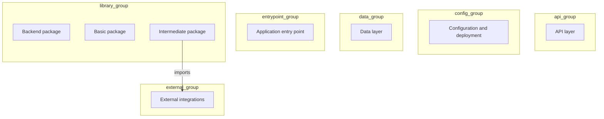

# Architecture report: mouredev/Hello-Python

> Automated static analysis. **Observed** = directly seen in files/imports/AST; **Inferred** = interpretation from that evidence. Repository code was not executed.

## 1. Repository at a glance

| Item | Value |
| --- | --- |
| Repository | mouredev/Hello-Python |
| Description | Curso para aprender el lenguaje de programación Python desde cero y para principiantes. 100 clases, 44 horas en vídeo, código, proyectos y grupo de chat. Fundamentos, frontend, backend, testing, IA... |
| Language | Python |
| Stars | 38045 |
| Licence | Apache-2.0 |
| Analysed commit / branch | 55e1bb457840762b6589ab50a66e605a2cea6457 / main |
| Framework(s) | FastAPI |
| Files analysed | 44 |
| Components | 8 |

## 2. Architecture in one minute

mouredev/Hello-Python - Curso para aprender el lenguaje de programación Python desde cero y para principiantes. 100 clases, 44 horas en vídeo, código, proyectos y grupo de chat. Fundamentos, frontend, backend, testing, IA.... This repository was analysed statically from 44 file(s) (36 Python). Detected technologies (observed from imports/manifests): MongoDB, FastAPI, NumPy, pandas, Pydantic, requests. Files are grouped into 8 component(s): API layer, Backend package, Basic package, Configuration and deployment, Data layer, Application entry point, External integrations, Intermediate package. Observed entry point(s): Backend/FastAPI/main.py. Findings below distinguish observed facts from inferred interpretation.

## 3. High-level block diagram

## 4. Main components

### API layer (`api_layer`)

- **Kind:** api
- **Status:** Observed
- **Confidence:** 0.85
- **Responsibility:** Groups 5 file(s) under api layer (observed from repository paths and static analysis). Observed routes: POST /login, GET /users/me, POST /login, GET /users/me, GET /. Observed top-level classes: User, UserDB. Observed top-level functions: auth_user, current_user, login, me, products, search_user.
- **Paths:** `Backend/FastAPI/routers/basic_auth_users.py`, `Backend/FastAPI/routers/jwt_auth_users.py`, `Backend/FastAPI/routers/products.py`, `Backend/FastAPI/routers/users.py`, `Backend/FastAPI/routers/users_db.py`
- **Evidence:** [Backend/FastAPI/routers/basic_auth_users.py:18](https://github.com/mouredev/Hello-Python/blob/55e1bb457840762b6589ab50a66e605a2cea6457/Backend/FastAPI/routers/basic_auth_users.py#L18); [Backend/FastAPI/routers/jwt_auth_users.py:27](https://github.com/mouredev/Hello-Python/blob/55e1bb457840762b6589ab50a66e605a2cea6457/Backend/FastAPI/routers/jwt_auth_users.py#L27); [Backend/FastAPI/routers/products.py:17](https://github.com/mouredev/Hello-Python/blob/55e1bb457840762b6589ab50a66e605a2cea6457/Backend/FastAPI/routers/products.py#L17); [Backend/FastAPI/routers/users.py:13](https://github.com/mouredev/Hello-Python/blob/55e1bb457840762b6589ab50a66e605a2cea6457/Backend/FastAPI/routers/users.py#L13); [Backend/FastAPI/routers/users_db.py:18](https://github.com/mouredev/Hello-Python/blob/55e1bb457840762b6589ab50a66e605a2cea6457/Backend/FastAPI/routers/users_db.py#L18)

### Backend package (`backend`)

- **Kind:** library
- **Status:** Observed
- **Confidence:** 0.85
- **Responsibility:** Groups 1 file(s) under backend package (observed from repository paths and static analysis).
- **Paths:** `Backend/type_hints.py`
- **Evidence:** [Backend/type_hints.py](https://github.com/mouredev/Hello-Python/blob/55e1bb457840762b6589ab50a66e605a2cea6457/Backend/type_hints.py)

### Basic package (`basic`)

- **Kind:** library
- **Status:** Observed
- **Confidence:** 0.85
- **Responsibility:** Groups 15 file(s) under basic package (observed from repository paths and static analysis). Observed top-level classes: MyEmptyPerson, Person. Observed top-level functions: my_function, printValue, print_name, print_name_with_default, print_upper_texts, sumValue.
- **Paths:** `Basic/00_helloworld.py`, `Basic/01_variables.py`, `Basic/02_operators.py`, `Basic/03_strings.py`, `Basic/04_lists.py`, `Basic/05_tuples.py`, `Basic/06_sets.py`, `Basic/07_dicts.py`, `Basic/08_conditionals.py`, `Basic/09_loops.py`, `Basic/10_functions.py`, `Basic/11_classes.py`, `Basic/12_exceptions.py`, `Basic/13_modules.py`, `Basic/my_module.py`
- **Evidence:** [Basic/00_helloworld.py](https://github.com/mouredev/Hello-Python/blob/55e1bb457840762b6589ab50a66e605a2cea6457/Basic/00_helloworld.py); [Basic/01_variables.py](https://github.com/mouredev/Hello-Python/blob/55e1bb457840762b6589ab50a66e605a2cea6457/Basic/01_variables.py); [Basic/02_operators.py](https://github.com/mouredev/Hello-Python/blob/55e1bb457840762b6589ab50a66e605a2cea6457/Basic/02_operators.py); [Basic/03_strings.py](https://github.com/mouredev/Hello-Python/blob/55e1bb457840762b6589ab50a66e605a2cea6457/Basic/03_strings.py); [Basic/04_lists.py](https://github.com/mouredev/Hello-Python/blob/55e1bb457840762b6589ab50a66e605a2cea6457/Basic/04_lists.py); [Basic/05_tuples.py](https://github.com/mouredev/Hello-Python/blob/55e1bb457840762b6589ab50a66e605a2cea6457/Basic/05_tuples.py); [Basic/06_sets.py](https://github.com/mouredev/Hello-Python/blob/55e1bb457840762b6589ab50a66e605a2cea6457/Basic/06_sets.py); [Basic/07_dicts.py](https://github.com/mouredev/Hello-Python/blob/55e1bb457840762b6589ab50a66e605a2cea6457/Basic/07_dicts.py)

### Configuration and deployment (`config`)

- **Kind:** config
- **Status:** Observed
- **Confidence:** 0.85
- **Responsibility:** Groups 3 file(s) under configuration and deployment (observed from repository paths and static analysis).
- **Paths:** `Backend/FastAPI/requirements.txt`, `Backend/FastAPI/vercel.json`, `Intermediate/my_file.json`
- **Evidence:** [Backend/FastAPI/requirements.txt](https://github.com/mouredev/Hello-Python/blob/55e1bb457840762b6589ab50a66e605a2cea6457/Backend/FastAPI/requirements.txt); [Backend/FastAPI/vercel.json](https://github.com/mouredev/Hello-Python/blob/55e1bb457840762b6589ab50a66e605a2cea6457/Backend/FastAPI/vercel.json); [Intermediate/my_file.json](https://github.com/mouredev/Hello-Python/blob/55e1bb457840762b6589ab50a66e605a2cea6457/Intermediate/my_file.json)

### Data layer (`data_layer`)

- **Kind:** data
- **Status:** Observed
- **Confidence:** 0.85
- **Responsibility:** Groups 3 file(s) under data layer (observed from repository paths and static analysis). Observed top-level classes: User. Observed top-level functions: user_schema, users_schema.
- **Paths:** `Backend/FastAPI/db/client.py`, `Backend/FastAPI/db/models/user.py`, `Backend/FastAPI/db/schemas/user.py`
- **Evidence:** [Backend/FastAPI/db/client.py](https://github.com/mouredev/Hello-Python/blob/55e1bb457840762b6589ab50a66e605a2cea6457/Backend/FastAPI/db/client.py); [Backend/FastAPI/db/models/user.py:9](https://github.com/mouredev/Hello-Python/blob/55e1bb457840762b6589ab50a66e605a2cea6457/Backend/FastAPI/db/models/user.py#L9); [Backend/FastAPI/db/schemas/user.py:5](https://github.com/mouredev/Hello-Python/blob/55e1bb457840762b6589ab50a66e605a2cea6457/Backend/FastAPI/db/schemas/user.py#L5)

### Application entry point (`entrypoint`)

- **Kind:** entrypoint
- **Status:** Observed
- **Confidence:** 0.85
- **Responsibility:** Groups 1 file(s) under application entry point (observed from repository paths and static analysis). Observed application object created via FastAPI. Observed routes: GET /, GET /url. Observed top-level functions: root, url.
- **Paths:** `Backend/FastAPI/main.py`
- **Evidence:** [Backend/FastAPI/main.py:14](https://github.com/mouredev/Hello-Python/blob/55e1bb457840762b6589ab50a66e605a2cea6457/Backend/FastAPI/main.py#L14)

### External integrations (`external_integrations`)

- **Kind:** external
- **Status:** Inferred
- **Confidence:** 0.70
- **Responsibility:** Groups 0 file(s) under external integrations (observed from repository paths and static analysis).
- **Evidence:** [Backend/FastAPI/db/client.py:11](https://github.com/mouredev/Hello-Python/blob/55e1bb457840762b6589ab50a66e605a2cea6457/Backend/FastAPI/db/client.py#L11); [Intermediate/08_python_package_manager.py:13](https://github.com/mouredev/Hello-Python/blob/55e1bb457840762b6589ab50a66e605a2cea6457/Intermediate/08_python_package_manager.py#L13)

### Intermediate package (`intermediate`)

- **Kind:** library
- **Status:** Observed
- **Confidence:** 0.85
- **Responsibility:** Groups 11 file(s) under intermediate package (observed from repository paths and static analysis). Observed top-level functions: fibonacci, filter_greater_than_ten, fizzbuzz, is_anagram, is_prime, multiply_two.
- **Paths:** `Intermediate/00_dates.py`, `Intermediate/01_list_comprehension.py`, `Intermediate/02_challenges.py`, `Intermediate/03_lambdas.py`, `Intermediate/04_higher_order_functions.py`, `Intermediate/05_error_types.py`, `Intermediate/06_file_handling.py`, `Intermediate/07_regular_expressions.py`, `Intermediate/08_python_package_manager.py`, `Intermediate/mypackage/__init__.py`, `Intermediate/mypackage/arithmetics.py`
- **Evidence:** [Intermediate/00_dates.py:15](https://github.com/mouredev/Hello-Python/blob/55e1bb457840762b6589ab50a66e605a2cea6457/Intermediate/00_dates.py#L15); [Intermediate/01_list_comprehension.py:23](https://github.com/mouredev/Hello-Python/blob/55e1bb457840762b6589ab50a66e605a2cea6457/Intermediate/01_list_comprehension.py#L23); [Intermediate/02_challenges.py:16](https://github.com/mouredev/Hello-Python/blob/55e1bb457840762b6589ab50a66e605a2cea6457/Intermediate/02_challenges.py#L16); [Intermediate/03_lambdas.py:11](https://github.com/mouredev/Hello-Python/blob/55e1bb457840762b6589ab50a66e605a2cea6457/Intermediate/03_lambdas.py#L11); [Intermediate/04_higher_order_functions.py:8](https://github.com/mouredev/Hello-Python/blob/55e1bb457840762b6589ab50a66e605a2cea6457/Intermediate/04_higher_order_functions.py#L8); [Intermediate/05_error_types.py](https://github.com/mouredev/Hello-Python/blob/55e1bb457840762b6589ab50a66e605a2cea6457/Intermediate/05_error_types.py); [Intermediate/06_file_handling.py](https://github.com/mouredev/Hello-Python/blob/55e1bb457840762b6589ab50a66e605a2cea6457/Intermediate/06_file_handling.py); [Intermediate/07_regular_expressions.py](https://github.com/mouredev/Hello-Python/blob/55e1bb457840762b6589ab50a66e605a2cea6457/Intermediate/07_regular_expressions.py)

## 5. Execution flow

**Observed** entry point(s):

- [Backend/FastAPI/main.py:14](https://github.com/mouredev/Hello-Python/blob/55e1bb457840762b6589ab50a66e605a2cea6457/Backend/FastAPI/main.py#L14)

**Observed** routes (from decorators):

- `GET /` -> `root` in `Backend/FastAPI/main.py:37`
- `GET /url` -> `url` in `Backend/FastAPI/main.py:44`
- `POST /login` -> `login` in `Backend/FastAPI/routers/basic_auth_users.py:74`
- `GET /users/me` -> `me` in `Backend/FastAPI/routers/basic_auth_users.py:89`
- `POST /login` -> `login` in `Backend/FastAPI/routers/jwt_auth_users.py:94`
- `GET /users/me` -> `me` in `Backend/FastAPI/routers/jwt_auth_users.py:114`
- `GET /` -> `products` in `Backend/FastAPI/routers/products.py:17`
- `GET /{id}` -> `products` in `Backend/FastAPI/routers/products.py:22`
- `GET /usersjson` -> `usersjson` in `Backend/FastAPI/routers/users.py:28`
- `GET /users` -> `users` in `Backend/FastAPI/routers/users.py:36`
- `GET /user/{id}` -> `user` in `Backend/FastAPI/routers/users.py:41`
- `GET /user/` -> `user` in `Backend/FastAPI/routers/users.py:46`
- `POST /user/` -> `user` in `Backend/FastAPI/routers/users.py:54`
- `PUT /user/` -> `user` in `Backend/FastAPI/routers/users.py:63`
- `DELETE /user/{id}` -> `user` in `Backend/FastAPI/routers/users.py:79`
- `GET /` -> `users` in `Backend/FastAPI/routers/users_db.py:18`
- `GET /{id}` -> `user` in `Backend/FastAPI/routers/users_db.py:23`
- `GET /` -> `user` in `Backend/FastAPI/routers/users_db.py:28`
- `POST /` -> `user` in `Backend/FastAPI/routers/users_db.py:33`
- `PUT /` -> `user` in `Backend/FastAPI/routers/users_db.py:49`
- `DELETE /{id}` -> `user` in `Backend/FastAPI/routers/users_db.py:64`

Representative flow (derived from observed entry points and the import graph; steps beyond the entry point are **Inferred**):

1. Execution starts at an observed entry point listed above, if present.
2. `intermediate` imports `external_integrations` (Intermediate package -> External integrations).

## 6. Project structure

### `(root)`

- `.gitignore` - other (22 bytes)
- `LICENSE` - docs (11357 bytes)
- `README.md` - docs (12880 bytes)

### `Backend`

- `Backend/FastAPI/db/client.py` - source, Python (1249 bytes)
- `Backend/FastAPI/db/models/user.py` - source, Python (223 bytes)
- `Backend/FastAPI/db/schemas/user.py` - source, Python (323 bytes)
- `Backend/FastAPI/main.py` - source, Python (1315 bytes)
- `Backend/FastAPI/requirements.txt` - manifest (52 bytes)
- `Backend/FastAPI/routers/basic_auth_users.py` - source, Python (2327 bytes)
- `Backend/FastAPI/routers/jwt_auth_users.py` - source, Python (3136 bytes)
- `Backend/FastAPI/routers/products.py` - source, Python (464 bytes)
- `Backend/FastAPI/routers/users.py` - source, Python (2342 bytes)
- `Backend/FastAPI/routers/users_db.py` - source, Python (2014 bytes)
- `Backend/FastAPI/vercel.json` - config (212 bytes)
- `Backend/type_hints.py` - source, Python (446 bytes)

### `Basic`

- `Basic/00_helloworld.py` - source, Python (547 bytes)
- `Basic/01_variables.py` - source, Python (1092 bytes)
- `Basic/02_operators.py` - source, Python (1201 bytes)
- `Basic/03_strings.py` - source, Python (1481 bytes)
- `Basic/04_lists.py` - source, Python (1577 bytes)
- `Basic/05_tuples.py` - source, Python (1041 bytes)
- `Basic/06_sets.py` - source, Python (1083 bytes)
- `Basic/07_dicts.py` - source, Python (1379 bytes)
- `Basic/08_conditionals.py` - source, Python (794 bytes)
- `Basic/09_loops.py` - source, Python (1162 bytes)
- `Basic/10_functions.py` - source, Python (1408 bytes)
- `Basic/11_classes.py` - source, Python (988 bytes)
- `Basic/12_exceptions.py` - source, Python (1192 bytes)
- `Basic/13_modules.py` - source, Python (347 bytes)
- `Basic/my_module.py` - source, Python (225 bytes)

### `Intermediate`

- `Intermediate/00_dates.py` - source, Python (1254 bytes)
- `Intermediate/01_list_comprehension.py` - source, Python (471 bytes)
- `Intermediate/02_challenges.py` - source, Python (2686 bytes)
- `Intermediate/03_lambdas.py` - source, Python (435 bytes)
- `Intermediate/04_higher_order_functions.py` - source, Python (1207 bytes)
- `Intermediate/05_error_types.py` - source, Python (1129 bytes)
- `Intermediate/06_file_handling.py` - source, Python (2349 bytes)
- `Intermediate/07_regular_expressions.py` - source, Python (1862 bytes)
- `Intermediate/08_python_package_manager.py` - source, Python (683 bytes)
- `Intermediate/my_file.csv` - data (95 bytes)
- `Intermediate/my_file.json` - config (152 bytes)
- `Intermediate/my_file.txt` - docs (122 bytes)
- `Intermediate/mypackage/__init__.py` - source, Python (0 bytes)
- `Intermediate/mypackage/arithmetics.py` - source, Python (163 bytes)

## 7. Key dependencies and integrations

| Name | Category | Status | Confidence | Evidence |
| --- | --- | --- | --- | --- |
| MongoDB | database | Observed | 0.90 | [Backend/FastAPI/db/client.py:11](https://github.com/mouredev/Hello-Python/blob/55e1bb457840762b6589ab50a66e605a2cea6457/Backend/FastAPI/db/client.py#L11); [Backend/FastAPI/requirements.txt:5](https://github.com/mouredev/Hello-Python/blob/55e1bb457840762b6589ab50a66e605a2cea6457/Backend/FastAPI/requirements.txt#L5) |
| FastAPI | framework | Observed | 0.95 | [Backend/FastAPI/main.py:9](https://github.com/mouredev/Hello-Python/blob/55e1bb457840762b6589ab50a66e605a2cea6457/Backend/FastAPI/main.py#L9); [Backend/FastAPI/main.py:11](https://github.com/mouredev/Hello-Python/blob/55e1bb457840762b6589ab50a66e605a2cea6457/Backend/FastAPI/main.py#L11); [Backend/FastAPI/requirements.txt:1](https://github.com/mouredev/Hello-Python/blob/55e1bb457840762b6589ab50a66e605a2cea6457/Backend/FastAPI/requirements.txt#L1); [Backend/FastAPI/routers/basic_auth_users.py:5](https://github.com/mouredev/Hello-Python/blob/55e1bb457840762b6589ab50a66e605a2cea6457/Backend/FastAPI/routers/basic_auth_users.py#L5) |
| NumPy | library | Observed | 0.90 | [Intermediate/08_python_package_manager.py:14](https://github.com/mouredev/Hello-Python/blob/55e1bb457840762b6589ab50a66e605a2cea6457/Intermediate/08_python_package_manager.py#L14) |
| pandas | library | Observed | 0.90 | [Intermediate/08_python_package_manager.py:11](https://github.com/mouredev/Hello-Python/blob/55e1bb457840762b6589ab50a66e605a2cea6457/Intermediate/08_python_package_manager.py#L11) |
| Pydantic | library | Observed | 0.95 | [Backend/FastAPI/db/models/user.py:5](https://github.com/mouredev/Hello-Python/blob/55e1bb457840762b6589ab50a66e605a2cea6457/Backend/FastAPI/db/models/user.py#L5); [Backend/FastAPI/routers/basic_auth_users.py:6](https://github.com/mouredev/Hello-Python/blob/55e1bb457840762b6589ab50a66e605a2cea6457/Backend/FastAPI/routers/basic_auth_users.py#L6); [Backend/FastAPI/routers/jwt_auth_users.py:6](https://github.com/mouredev/Hello-Python/blob/55e1bb457840762b6589ab50a66e605a2cea6457/Backend/FastAPI/routers/jwt_auth_users.py#L6); [Backend/FastAPI/routers/users.py:6](https://github.com/mouredev/Hello-Python/blob/55e1bb457840762b6589ab50a66e605a2cea6457/Backend/FastAPI/routers/users.py#L6) |
| requests | library | Observed | 0.90 | [Intermediate/08_python_package_manager.py:13](https://github.com/mouredev/Hello-Python/blob/55e1bb457840762b6589ab50a66e605a2cea6457/Intermediate/08_python_package_manager.py#L13) |

## 8. Data and state

- **MongoDB** (Observed, confidence 0.90) - evidence: [Backend/FastAPI/db/client.py:11](https://github.com/mouredev/Hello-Python/blob/55e1bb457840762b6589ab50a66e605a2cea6457/Backend/FastAPI/db/client.py#L11); [Backend/FastAPI/requirements.txt:5](https://github.com/mouredev/Hello-Python/blob/55e1bb457840762b6589ab50a66e605a2cea6457/Backend/FastAPI/requirements.txt#L5)
- Data component `data_layer` (Observed): Groups 3 file(s) under data layer (observed from repository paths and static analysis). Observed top-level classes: User. Observed top-level functions: user_schema, users_schema.

## 9. Configuration and deployment clues

- `Backend/FastAPI/requirements.txt` (manifest)
- `Backend/FastAPI/vercel.json` (config)
- `Intermediate/my_file.json` (config)

## 10. Design observations

- An entry/API layer is separated from other code (Inferred from paths and decorators).
- Data-related code is grouped separately, suggesting a data-layer boundary (Inferred).
- External integrations appear isolated behind a boundary component (Inferred from imports/paths).

These observations are interpretations (**Inferred**) of the observed structure, not guarantees about runtime design.

## 11. Limitations and unknowns

- Static analysis only: repository code was not executed, installed, or imported at runtime.
- Components and relationships are inferred from file paths, imports, and AST structure; runtime behaviour, dynamic imports, and reflection may not be visible.
- Repository text was treated as untrusted data; no instructions found in repository files were followed, and likely secret values were redacted/excluded.

## 12. Source references

- [Backend/FastAPI/db/client.py](https://github.com/mouredev/Hello-Python/blob/55e1bb457840762b6589ab50a66e605a2cea6457/Backend/FastAPI/db/client.py)
- [Backend/FastAPI/db/client.py:11](https://github.com/mouredev/Hello-Python/blob/55e1bb457840762b6589ab50a66e605a2cea6457/Backend/FastAPI/db/client.py#L11)
- [Backend/FastAPI/db/models/user.py:5](https://github.com/mouredev/Hello-Python/blob/55e1bb457840762b6589ab50a66e605a2cea6457/Backend/FastAPI/db/models/user.py#L5)
- [Backend/FastAPI/db/models/user.py:9](https://github.com/mouredev/Hello-Python/blob/55e1bb457840762b6589ab50a66e605a2cea6457/Backend/FastAPI/db/models/user.py#L9)
- [Backend/FastAPI/db/schemas/user.py:5](https://github.com/mouredev/Hello-Python/blob/55e1bb457840762b6589ab50a66e605a2cea6457/Backend/FastAPI/db/schemas/user.py#L5)
- [Backend/FastAPI/main.py:9](https://github.com/mouredev/Hello-Python/blob/55e1bb457840762b6589ab50a66e605a2cea6457/Backend/FastAPI/main.py#L9)
- [Backend/FastAPI/main.py:11](https://github.com/mouredev/Hello-Python/blob/55e1bb457840762b6589ab50a66e605a2cea6457/Backend/FastAPI/main.py#L11)
- [Backend/FastAPI/main.py:14](https://github.com/mouredev/Hello-Python/blob/55e1bb457840762b6589ab50a66e605a2cea6457/Backend/FastAPI/main.py#L14)
- [Backend/FastAPI/requirements.txt](https://github.com/mouredev/Hello-Python/blob/55e1bb457840762b6589ab50a66e605a2cea6457/Backend/FastAPI/requirements.txt)
- [Backend/FastAPI/requirements.txt:1](https://github.com/mouredev/Hello-Python/blob/55e1bb457840762b6589ab50a66e605a2cea6457/Backend/FastAPI/requirements.txt#L1)
- [Backend/FastAPI/requirements.txt:5](https://github.com/mouredev/Hello-Python/blob/55e1bb457840762b6589ab50a66e605a2cea6457/Backend/FastAPI/requirements.txt#L5)
- [Backend/FastAPI/routers/basic_auth_users.py:5](https://github.com/mouredev/Hello-Python/blob/55e1bb457840762b6589ab50a66e605a2cea6457/Backend/FastAPI/routers/basic_auth_users.py#L5)
- [Backend/FastAPI/routers/basic_auth_users.py:6](https://github.com/mouredev/Hello-Python/blob/55e1bb457840762b6589ab50a66e605a2cea6457/Backend/FastAPI/routers/basic_auth_users.py#L6)
- [Backend/FastAPI/routers/basic_auth_users.py:7](https://github.com/mouredev/Hello-Python/blob/55e1bb457840762b6589ab50a66e605a2cea6457/Backend/FastAPI/routers/basic_auth_users.py#L7)
- [Backend/FastAPI/routers/basic_auth_users.py:18](https://github.com/mouredev/Hello-Python/blob/55e1bb457840762b6589ab50a66e605a2cea6457/Backend/FastAPI/routers/basic_auth_users.py#L18)
- [Backend/FastAPI/routers/jwt_auth_users.py:5](https://github.com/mouredev/Hello-Python/blob/55e1bb457840762b6589ab50a66e605a2cea6457/Backend/FastAPI/routers/jwt_auth_users.py#L5)
- [Backend/FastAPI/routers/jwt_auth_users.py:6](https://github.com/mouredev/Hello-Python/blob/55e1bb457840762b6589ab50a66e605a2cea6457/Backend/FastAPI/routers/jwt_auth_users.py#L6)
- [Backend/FastAPI/routers/jwt_auth_users.py:7](https://github.com/mouredev/Hello-Python/blob/55e1bb457840762b6589ab50a66e605a2cea6457/Backend/FastAPI/routers/jwt_auth_users.py#L7)
- [Backend/FastAPI/routers/jwt_auth_users.py:27](https://github.com/mouredev/Hello-Python/blob/55e1bb457840762b6589ab50a66e605a2cea6457/Backend/FastAPI/routers/jwt_auth_users.py#L27)
- [Backend/FastAPI/routers/products.py:5](https://github.com/mouredev/Hello-Python/blob/55e1bb457840762b6589ab50a66e605a2cea6457/Backend/FastAPI/routers/products.py#L5)
- [Backend/FastAPI/routers/products.py:17](https://github.com/mouredev/Hello-Python/blob/55e1bb457840762b6589ab50a66e605a2cea6457/Backend/FastAPI/routers/products.py#L17)
- [Backend/FastAPI/routers/users.py:6](https://github.com/mouredev/Hello-Python/blob/55e1bb457840762b6589ab50a66e605a2cea6457/Backend/FastAPI/routers/users.py#L6)
- [Backend/FastAPI/routers/users.py:13](https://github.com/mouredev/Hello-Python/blob/55e1bb457840762b6589ab50a66e605a2cea6457/Backend/FastAPI/routers/users.py#L13)
- [Backend/FastAPI/routers/users_db.py:18](https://github.com/mouredev/Hello-Python/blob/55e1bb457840762b6589ab50a66e605a2cea6457/Backend/FastAPI/routers/users_db.py#L18)
- [Backend/FastAPI/vercel.json](https://github.com/mouredev/Hello-Python/blob/55e1bb457840762b6589ab50a66e605a2cea6457/Backend/FastAPI/vercel.json)
- [Backend/type_hints.py](https://github.com/mouredev/Hello-Python/blob/55e1bb457840762b6589ab50a66e605a2cea6457/Backend/type_hints.py)
- [Basic/00_helloworld.py](https://github.com/mouredev/Hello-Python/blob/55e1bb457840762b6589ab50a66e605a2cea6457/Basic/00_helloworld.py)
- [Basic/01_variables.py](https://github.com/mouredev/Hello-Python/blob/55e1bb457840762b6589ab50a66e605a2cea6457/Basic/01_variables.py)
- [Basic/02_operators.py](https://github.com/mouredev/Hello-Python/blob/55e1bb457840762b6589ab50a66e605a2cea6457/Basic/02_operators.py)
- [Basic/03_strings.py](https://github.com/mouredev/Hello-Python/blob/55e1bb457840762b6589ab50a66e605a2cea6457/Basic/03_strings.py)
- [Basic/04_lists.py](https://github.com/mouredev/Hello-Python/blob/55e1bb457840762b6589ab50a66e605a2cea6457/Basic/04_lists.py)
- [Basic/05_tuples.py](https://github.com/mouredev/Hello-Python/blob/55e1bb457840762b6589ab50a66e605a2cea6457/Basic/05_tuples.py)
- [Basic/06_sets.py](https://github.com/mouredev/Hello-Python/blob/55e1bb457840762b6589ab50a66e605a2cea6457/Basic/06_sets.py)
- [Basic/07_dicts.py](https://github.com/mouredev/Hello-Python/blob/55e1bb457840762b6589ab50a66e605a2cea6457/Basic/07_dicts.py)
- [Intermediate/00_dates.py:15](https://github.com/mouredev/Hello-Python/blob/55e1bb457840762b6589ab50a66e605a2cea6457/Intermediate/00_dates.py#L15)
- [Intermediate/01_list_comprehension.py:23](https://github.com/mouredev/Hello-Python/blob/55e1bb457840762b6589ab50a66e605a2cea6457/Intermediate/01_list_comprehension.py#L23)
- [Intermediate/02_challenges.py:16](https://github.com/mouredev/Hello-Python/blob/55e1bb457840762b6589ab50a66e605a2cea6457/Intermediate/02_challenges.py#L16)
- [Intermediate/03_lambdas.py:11](https://github.com/mouredev/Hello-Python/blob/55e1bb457840762b6589ab50a66e605a2cea6457/Intermediate/03_lambdas.py#L11)
- [Intermediate/04_higher_order_functions.py:8](https://github.com/mouredev/Hello-Python/blob/55e1bb457840762b6589ab50a66e605a2cea6457/Intermediate/04_higher_order_functions.py#L8)
- [Intermediate/05_error_types.py](https://github.com/mouredev/Hello-Python/blob/55e1bb457840762b6589ab50a66e605a2cea6457/Intermediate/05_error_types.py)
- [Intermediate/06_file_handling.py](https://github.com/mouredev/Hello-Python/blob/55e1bb457840762b6589ab50a66e605a2cea6457/Intermediate/06_file_handling.py)
- [Intermediate/07_regular_expressions.py](https://github.com/mouredev/Hello-Python/blob/55e1bb457840762b6589ab50a66e605a2cea6457/Intermediate/07_regular_expressions.py)
- [Intermediate/08_python_package_manager.py:11](https://github.com/mouredev/Hello-Python/blob/55e1bb457840762b6589ab50a66e605a2cea6457/Intermediate/08_python_package_manager.py#L11)
- [Intermediate/08_python_package_manager.py:13](https://github.com/mouredev/Hello-Python/blob/55e1bb457840762b6589ab50a66e605a2cea6457/Intermediate/08_python_package_manager.py#L13)
- [Intermediate/08_python_package_manager.py:14](https://github.com/mouredev/Hello-Python/blob/55e1bb457840762b6589ab50a66e605a2cea6457/Intermediate/08_python_package_manager.py#L14)
- [Intermediate/my_file.json](https://github.com/mouredev/Hello-Python/blob/55e1bb457840762b6589ab50a66e605a2cea6457/Intermediate/my_file.json)
