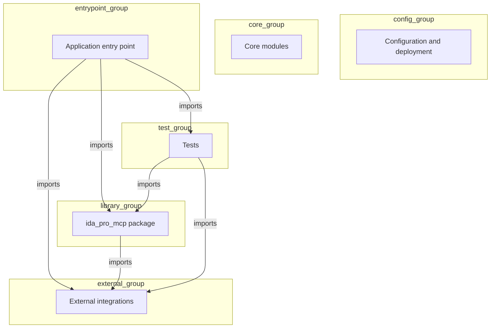

# Architecture report: mrexodia/ida-pro-mcp

> Automated static analysis. **Observed** = directly seen in files/imports/AST; **Inferred** = interpretation from that evidence. Repository code was not executed.

## 1. Repository at a glance

| Item | Value |
| --- | --- |
| Repository | mrexodia/ida-pro-mcp |
| Description | AI-powered reverse engineering assistant that bridges IDA Pro with language models through MCP. |
| Language | Python |
| Stars | 13476 |
| Licence | MIT |
| Analysed commit / branch | 13e480cb1198f923154b63669e8cb2faee5deaea / main |
| Framework(s) | None detected |
| Files analysed | 206 |
| Components | 6 |

## 2. Architecture in one minute

mrexodia/ida-pro-mcp - AI-powered reverse engineering assistant that bridges IDA Pro with language models through MCP.. This repository was analysed statically from 206 file(s) (85 Python). Detected technologies (observed from imports/manifests): GitHub Actions, Poetry, setuptools, Docker, pytest, unittest. Files are grouped into 6 component(s): Configuration and deployment, Core modules, Application entry point, External integrations, ida_pro_mcp package, Tests. Observed entry point(s): scripts/stress_search_cancellation.py, src/ida_pro_mcp/__main__.py, src/ida_pro_mcp/idalib_server.py. Findings below distinguish observed facts from inferred interpretation.

## 3. High-level block diagram

## 4. Main components

### Configuration and deployment (`config`)

- **Kind:** config
- **Status:** Observed
- **Confidence:** 0.85
- **Responsibility:** Groups 2 file(s) under configuration and deployment (observed from repository paths and static analysis).
- **Paths:** `ida-plugin.json`, `pyproject.toml`
- **Evidence:** [ida-plugin.json](https://github.com/mrexodia/ida-pro-mcp/blob/13e480cb1198f923154b63669e8cb2faee5deaea/ida-plugin.json); [pyproject.toml](https://github.com/mrexodia/ida-pro-mcp/blob/13e480cb1198f923154b63669e8cb2faee5deaea/pyproject.toml)

### Core modules (`core`)

- **Kind:** core
- **Status:** Observed
- **Confidence:** 0.85
- **Responsibility:** Groups 1 file(s) under core modules (observed from repository paths and static analysis).
- **Paths:** `uv-package.sh`
- **Evidence:** [uv-package.sh](https://github.com/mrexodia/ida-pro-mcp/blob/13e480cb1198f923154b63669e8cb2faee5deaea/uv-package.sh)

### Application entry point (`entrypoint`)

- **Kind:** entrypoint
- **Status:** Observed
- **Confidence:** 0.85
- **Responsibility:** Groups 7 file(s) under application entry point (observed from repository paths and static analysis). Observed top-level classes: Ctx, IdalibCloseResult, IdalibListResult, IdalibOpenResult, IdalibSessionInfo, IdalibSessionListInfo. Observed top-level functions: _call_tool_result, _deregister_from_discovery, _discovered_instance_backend, _env_float, _env_int, _free_port.
- **Paths:** `scripts/stress_search_cancellation.py`, `src/ida_pro_mcp/__main__.py`, `src/ida_pro_mcp/idalib_server.py`, `src/ida_pro_mcp/idalib_supervisor.py`, `src/ida_pro_mcp/server.py`, `src/ida_pro_mcp/test.py`, `src/ida_pro_mcp/trace_dump.py`
- **Evidence:** [scripts/stress_search_cancellation.py:48](https://github.com/mrexodia/ida-pro-mcp/blob/13e480cb1198f923154b63669e8cb2faee5deaea/scripts/stress_search_cancellation.py#L48); [src/ida_pro_mcp/__main__.py](https://github.com/mrexodia/ida-pro-mcp/blob/13e480cb1198f923154b63669e8cb2faee5deaea/src/ida_pro_mcp/__main__.py); [src/ida_pro_mcp/idalib_server.py:31](https://github.com/mrexodia/ida-pro-mcp/blob/13e480cb1198f923154b63669e8cb2faee5deaea/src/ida_pro_mcp/idalib_server.py#L31); [src/ida_pro_mcp/idalib_supervisor.py:58](https://github.com/mrexodia/ida-pro-mcp/blob/13e480cb1198f923154b63669e8cb2faee5deaea/src/ida_pro_mcp/idalib_supervisor.py#L58); [src/ida_pro_mcp/server.py:68](https://github.com/mrexodia/ida-pro-mcp/blob/13e480cb1198f923154b63669e8cb2faee5deaea/src/ida_pro_mcp/server.py#L68); [src/ida_pro_mcp/test.py:24](https://github.com/mrexodia/ida-pro-mcp/blob/13e480cb1198f923154b63669e8cb2faee5deaea/src/ida_pro_mcp/test.py#L24); [src/ida_pro_mcp/trace_dump.py:13](https://github.com/mrexodia/ida-pro-mcp/blob/13e480cb1198f923154b63669e8cb2faee5deaea/src/ida_pro_mcp/trace_dump.py#L13)

### External integrations (`external_integrations`)

- **Kind:** external
- **Status:** Inferred
- **Confidence:** 0.70
- **Responsibility:** Groups 0 file(s) under external integrations (observed from repository paths and static analysis).
- **Evidence:** [scripts/stress_search_cancellation.py:33](https://github.com/mrexodia/ida-pro-mcp/blob/13e480cb1198f923154b63669e8cb2faee5deaea/scripts/stress_search_cancellation.py#L33); [src/ida_pro_mcp/ida_mcp/discovery.py:13](https://github.com/mrexodia/ida-pro-mcp/blob/13e480cb1198f923154b63669e8cb2faee5deaea/src/ida_pro_mcp/ida_mcp/discovery.py#L13); [src/ida_pro_mcp/ida_mcp/tests/mcp_mode.py:11](https://github.com/mrexodia/ida-pro-mcp/blob/13e480cb1198f923154b63669e8cb2faee5deaea/src/ida_pro_mcp/ida_mcp/tests/mcp_mode.py#L11); [src/ida_pro_mcp/ida_mcp/zeromcp/mcp.py:3](https://github.com/mrexodia/ida-pro-mcp/blob/13e480cb1198f923154b63669e8cb2faee5deaea/src/ida_pro_mcp/ida_mcp/zeromcp/mcp.py#L3); [src/ida_pro_mcp/ida_mcp/zeromcp/mcp.py:864](https://github.com/mrexodia/ida-pro-mcp/blob/13e480cb1198f923154b63669e8cb2faee5deaea/src/ida_pro_mcp/ida_mcp/zeromcp/mcp.py#L864); [src/ida_pro_mcp/idalib_supervisor.py:18](https://github.com/mrexodia/ida-pro-mcp/blob/13e480cb1198f923154b63669e8cb2faee5deaea/src/ida_pro_mcp/idalib_supervisor.py#L18)

### ida_pro_mcp package (`ida_pro_mcp`)

- **Kind:** library
- **Status:** Observed
- **Confidence:** 0.85
- **Responsibility:** Groups 34 file(s) under ida_pro_mcp package (observed from repository paths and static analysis). Observed top-level classes: AnalyzeBatchDetails, AnalyzeBatchDisasm, AnalyzeBatchQuery, AnalyzeBatchResult, AnalyzeComponentResult, AnalyzeFunctionResult. Observed top-level functions: PLUGIN_ENTRY, _all_segments, _analyze_function_internal, _append_comment_text, _append_forwarded_port, _apply_client_install.
- **Paths:** `src/ida_pro_mcp/__init__.py`, `src/ida_pro_mcp/ida_mcp.py`, `src/ida_pro_mcp/ida_mcp/__init__.py`, `src/ida_pro_mcp/ida_mcp/_sigmaker.py`, `src/ida_pro_mcp/ida_mcp/api_analysis.py`, `src/ida_pro_mcp/ida_mcp/api_composite.py`, `src/ida_pro_mcp/ida_mcp/api_core.py`, `src/ida_pro_mcp/ida_mcp/api_debug.py`, `src/ida_pro_mcp/ida_mcp/api_memory.py`, `src/ida_pro_mcp/ida_mcp/api_modify.py`, `src/ida_pro_mcp/ida_mcp/api_python.py`, `src/ida_pro_mcp/ida_mcp/api_resources.py`, `src/ida_pro_mcp/ida_mcp/api_sigmaker.py`, `src/ida_pro_mcp/ida_mcp/api_stack.py`, `src/ida_pro_mcp/ida_mcp/api_survey.py`, `src/ida_pro_mcp/ida_mcp/api_types.py`, `src/ida_pro_mcp/ida_mcp/compat.py`, `src/ida_pro_mcp/ida_mcp/discovery.py`, `src/ida_pro_mcp/ida_mcp/framework.py`, `src/ida_pro_mcp/ida_mcp/http.py`, `src/ida_pro_mcp/ida_mcp/mainthread.py`, `src/ida_pro_mcp/ida_mcp/profile.py`, `src/ida_pro_mcp/ida_mcp/rpc.py`, `src/ida_pro_mcp/ida_mcp/sync.py`, `src/ida_pro_mcp/ida_mcp/trace.py`, `src/ida_pro_mcp/ida_mcp/utils.py`, `src/ida_pro_mcp/ida_mcp/zeromcp/__init__.py`, `src/ida_pro_mcp/ida_mcp/zeromcp/jsonrpc.py`, `src/ida_pro_mcp/ida_mcp/zeromcp/mcp.py`, `src/ida_pro_mcp/idalib_session_manager.py`, `src/ida_pro_mcp/installer.py`, `src/ida_pro_mcp/installer_data.py`, `src/ida_pro_mcp/installer_tui.py`, `src/ida_pro_mcp/worker_lifecycle.py`
- **Evidence:** [src/ida_pro_mcp/__init__.py](https://github.com/mrexodia/ida-pro-mcp/blob/13e480cb1198f923154b63669e8cb2faee5deaea/src/ida_pro_mcp/__init__.py); [src/ida_pro_mcp/ida_mcp.py:24](https://github.com/mrexodia/ida-pro-mcp/blob/13e480cb1198f923154b63669e8cb2faee5deaea/src/ida_pro_mcp/ida_mcp.py#L24); [src/ida_pro_mcp/ida_mcp/__init__.py](https://github.com/mrexodia/ida-pro-mcp/blob/13e480cb1198f923154b63669e8cb2faee5deaea/src/ida_pro_mcp/ida_mcp/__init__.py); [src/ida_pro_mcp/ida_mcp/_sigmaker.py:107](https://github.com/mrexodia/ida-pro-mcp/blob/13e480cb1198f923154b63669e8cb2faee5deaea/src/ida_pro_mcp/ida_mcp/_sigmaker.py#L107); [src/ida_pro_mcp/ida_mcp/api_analysis.py:53](https://github.com/mrexodia/ida-pro-mcp/blob/13e480cb1198f923154b63669e8cb2faee5deaea/src/ida_pro_mcp/ida_mcp/api_analysis.py#L53); [src/ida_pro_mcp/ida_mcp/api_composite.py:35](https://github.com/mrexodia/ida-pro-mcp/blob/13e480cb1198f923154b63669e8cb2faee5deaea/src/ida_pro_mcp/ida_mcp/api_composite.py#L35); [src/ida_pro_mcp/ida_mcp/api_core.py:49](https://github.com/mrexodia/ida-pro-mcp/blob/13e480cb1198f923154b63669e8cb2faee5deaea/src/ida_pro_mcp/ida_mcp/api_core.py#L49); [src/ida_pro_mcp/ida_mcp/api_debug.py:39](https://github.com/mrexodia/ida-pro-mcp/blob/13e480cb1198f923154b63669e8cb2faee5deaea/src/ida_pro_mcp/ida_mcp/api_debug.py#L39)

### Tests (`tests`)

- **Kind:** test
- **Status:** Observed
- **Confidence:** 0.85
- **Responsibility:** Groups 45 file(s) under tests (observed from repository paths and static analysis). Observed top-level classes: BrowserTransportGuardTests, ConnectableHostTests, DictOfInner, DiscoverWildcardInstanceTests, DispatchProxyTransportTests, DownloadBaseUrlFromEnvTests. Observed top-level functions: _call_and_get_structured, _call_through_registry, _contains_name, _find_address_without_xrefs, _find_bss_addr, _find_named_bss_symbol.
- **Paths:** `src/ida_pro_mcp/ida_mcp/tests/__init__.py`, `src/ida_pro_mcp/ida_mcp/tests/mcp_mode.py`, `src/ida_pro_mcp/ida_mcp/tests/test_api_analysis.py`, `src/ida_pro_mcp/ida_mcp/tests/test_api_analysis_internals.py`, `src/ida_pro_mcp/ida_mcp/tests/test_api_composite.py`, `src/ida_pro_mcp/ida_mcp/tests/test_api_core.py`, `src/ida_pro_mcp/ida_mcp/tests/test_api_debug.py`, `src/ida_pro_mcp/ida_mcp/tests/test_api_memory.py`, `src/ida_pro_mcp/ida_mcp/tests/test_api_modify.py`, `src/ida_pro_mcp/ida_mcp/tests/test_api_python.py`, `src/ida_pro_mcp/ida_mcp/tests/test_api_resources.py`, `src/ida_pro_mcp/ida_mcp/tests/test_api_sigmaker.py`, `src/ida_pro_mcp/ida_mcp/tests/test_api_stack.py`, `src/ida_pro_mcp/ida_mcp/tests/test_api_survey.py`, `src/ida_pro_mcp/ida_mcp/tests/test_api_types.py`, `src/ida_pro_mcp/ida_mcp/tests/test_discovery.py`, `src/ida_pro_mcp/ida_mcp/tests/test_framework_helpers.py`, `src/ida_pro_mcp/ida_mcp/tests/test_http.py`, `src/ida_pro_mcp/ida_mcp/tests/test_installer.py`, `src/ida_pro_mcp/ida_mcp/tests/test_profile.py`, `src/ida_pro_mcp/ida_mcp/tests/test_server.py`, `src/ida_pro_mcp/ida_mcp/tests/test_tool_metadata.py`, `src/ida_pro_mcp/ida_mcp/tests/test_trace.py`, `src/ida_pro_mcp/ida_mcp/tests/test_typed_fixture.py`, `src/ida_pro_mcp/ida_mcp/tests/test_utils.py`, `tests/_mcp_spec_support.py`, `tests/binary_info.py`, `tests/test_browser_transport_guards.py`, `tests/test_discovery_wildcard_host.py`, `tests/test_idalib_session_manager.py`, `tests/test_idalib_supervisor.py`, `tests/test_installer_scope_messages.py`, `tests/test_jsonrpc_union_params.py`, `tests/test_mainthread_pump.py`, `tests/test_mcp_spec_endpoints.py`, `tests/test_mcp_spec_envelope.py`, `tests/test_mcp_spec_http_e2e.py`, `tests/test_mcp_spec_schema_generation.py`, `tests/test_mcp_spec_tools_list.py`, `tests/test_mcp_spec_truncation.py`, `tests/test_no_protocol_stdout_prints.py`, `tests/test_output_schema.py`, `tests/test_server_transport.py`, `tests/test_worker_lifecycle.py`, `tests/typed_fixture.c`
- **Evidence:** [src/ida_pro_mcp/ida_mcp/tests/__init__.py](https://github.com/mrexodia/ida-pro-mcp/blob/13e480cb1198f923154b63669e8cb2faee5deaea/src/ida_pro_mcp/ida_mcp/tests/__init__.py); [src/ida_pro_mcp/ida_mcp/tests/mcp_mode.py:23](https://github.com/mrexodia/ida-pro-mcp/blob/13e480cb1198f923154b63669e8cb2faee5deaea/src/ida_pro_mcp/ida_mcp/tests/mcp_mode.py#L23); [src/ida_pro_mcp/ida_mcp/tests/test_api_analysis.py:44](https://github.com/mrexodia/ida-pro-mcp/blob/13e480cb1198f923154b63669e8cb2faee5deaea/src/ida_pro_mcp/ida_mcp/tests/test_api_analysis.py#L44); [src/ida_pro_mcp/ida_mcp/tests/test_api_analysis_internals.py:21](https://github.com/mrexodia/ida-pro-mcp/blob/13e480cb1198f923154b63669e8cb2faee5deaea/src/ida_pro_mcp/ida_mcp/tests/test_api_analysis_internals.py#L21); [src/ida_pro_mcp/ida_mcp/tests/test_api_composite.py:34](https://github.com/mrexodia/ida-pro-mcp/blob/13e480cb1198f923154b63669e8cb2faee5deaea/src/ida_pro_mcp/ida_mcp/tests/test_api_composite.py#L34); [src/ida_pro_mcp/ida_mcp/tests/test_api_core.py:45](https://github.com/mrexodia/ida-pro-mcp/blob/13e480cb1198f923154b63669e8cb2faee5deaea/src/ida_pro_mcp/ida_mcp/tests/test_api_core.py#L45); [src/ida_pro_mcp/ida_mcp/tests/test_api_debug.py:8](https://github.com/mrexodia/ida-pro-mcp/blob/13e480cb1198f923154b63669e8cb2faee5deaea/src/ida_pro_mcp/ida_mcp/tests/test_api_debug.py#L8); [src/ida_pro_mcp/ida_mcp/tests/test_api_memory.py:32](https://github.com/mrexodia/ida-pro-mcp/blob/13e480cb1198f923154b63669e8cb2faee5deaea/src/ida_pro_mcp/ida_mcp/tests/test_api_memory.py#L32)

## 5. Execution flow

**Observed** entry point(s):

- [scripts/stress_search_cancellation.py:530](https://github.com/mrexodia/ida-pro-mcp/blob/13e480cb1198f923154b63669e8cb2faee5deaea/scripts/stress_search_cancellation.py#L530)
- [src/ida_pro_mcp/__main__.py:4](https://github.com/mrexodia/ida-pro-mcp/blob/13e480cb1198f923154b63669e8cb2faee5deaea/src/ida_pro_mcp/__main__.py#L4)
- [src/ida_pro_mcp/idalib_server.py:352](https://github.com/mrexodia/ida-pro-mcp/blob/13e480cb1198f923154b63669e8cb2faee5deaea/src/ida_pro_mcp/idalib_server.py#L352)
- [src/ida_pro_mcp/idalib_supervisor.py](https://github.com/mrexodia/ida-pro-mcp/blob/13e480cb1198f923154b63669e8cb2faee5deaea/src/ida_pro_mcp/idalib_supervisor.py)
- [src/ida_pro_mcp/server.py](https://github.com/mrexodia/ida-pro-mcp/blob/13e480cb1198f923154b63669e8cb2faee5deaea/src/ida_pro_mcp/server.py)
- [src/ida_pro_mcp/test.py](https://github.com/mrexodia/ida-pro-mcp/blob/13e480cb1198f923154b63669e8cb2faee5deaea/src/ida_pro_mcp/test.py)
- [src/ida_pro_mcp/trace_dump.py](https://github.com/mrexodia/ida-pro-mcp/blob/13e480cb1198f923154b63669e8cb2faee5deaea/src/ida_pro_mcp/trace_dump.py)

Representative flow (derived from observed entry points and the import graph; steps beyond the entry point are **Inferred**):

1. Execution starts at an observed entry point listed above, if present.
2. `entrypoint` imports `external_integrations` (Application entry point -> External integrations).
3. `entrypoint` imports `ida_pro_mcp` (Application entry point -> ida_pro_mcp package).
4. `entrypoint` imports `tests` (Application entry point -> Tests).
5. `ida_pro_mcp` imports `external_integrations` (ida_pro_mcp package -> External integrations).
6. `tests` imports `external_integrations` (Tests -> External integrations).
7. `tests` imports `ida_pro_mcp` (Tests -> ida_pro_mcp package).

## 6. Project structure

### `(root)`

- `.editorconfig` - config (161 bytes)
- `.gitignore` - other (359 bytes)
- `.python-version` - other (5 bytes)
- `CLAUDE.md` - docs (4255 bytes)
- `LICENSE` - docs (1071 bytes)
- `README.md` - docs (20064 bytes)
- `ida-plugin.json` - config (446 bytes)
- `pyproject.toml` - manifest (1435 bytes)
- `uv-package.sh` - source, Shell (78 bytes)

### `.claude-plugin`

- `.claude-plugin/plugin.json` - config (367 bytes)

### `.codex-plugin`

- `.codex-plugin/mcp.json` - config (646 bytes)
- `.codex-plugin/plugin.json` - config (1021 bytes)

### `.github`

- `.github/FUNDING.yml` - config (599 bytes)
- `.github/workflows/idalib-tests.yml` - ci, YAML (1628 bytes)

### `.kimi-plugin`

- `.kimi-plugin/plugin.json` - config (1008 bytes)

### `devdocs`

- `devdocs/test-framework.md` - docs (16982 bytes)

### `profiles`

- `profiles/readonly.txt` - docs (851 bytes)
- `profiles/triage.txt` - docs (341 bytes)

### `scripts`

- `scripts/stress_search_cancellation.py` - source, Python (23860 bytes)

### `skills`

- `skills/idapython/SKILL.md` - docs (5007 bytes)
- `skills/idapython/docs/ida_auto.md` - docs (1722 bytes)
- `skills/idapython/docs/ida_auto.rst` - docs (10451 bytes)
- `skills/idapython/docs/ida_bitrange.md` - docs (652 bytes)
- `skills/idapython/docs/ida_bitrange.rst` - docs (2043 bytes)
- `skills/idapython/docs/ida_bytes.md` - docs (4094 bytes)
- `skills/idapython/docs/ida_bytes.rst` - docs (95367 bytes)
- `skills/idapython/docs/ida_dbg.md` - docs (3891 bytes)
- `skills/idapython/docs/ida_dbg.rst` - docs (76519 bytes)
- `skills/idapython/docs/ida_dirtree.md` - docs (1983 bytes)
- `skills/idapython/docs/ida_dirtree.rst` - docs (16884 bytes)
- `skills/idapython/docs/ida_diskio.md` - docs (2303 bytes)
- `skills/idapython/docs/ida_diskio.rst` - docs (7178 bytes)
- `skills/idapython/docs/ida_entry.md` - docs (1030 bytes)
- `skills/idapython/docs/ida_entry.rst` - docs (3867 bytes)
- `skills/idapython/docs/ida_expr.md` - docs (3573 bytes)
- `skills/idapython/docs/ida_expr.rst` - docs (19676 bytes)
- `skills/idapython/docs/ida_fixup.md` - docs (2859 bytes)
- `skills/idapython/docs/ida_fixup.rst` - docs (9765 bytes)
- `skills/idapython/docs/ida_fpro.md` - docs (1687 bytes)
- `skills/idapython/docs/ida_fpro.rst` - docs (3578 bytes)
- `skills/idapython/docs/ida_frame.md` - docs (4895 bytes)
- `skills/idapython/docs/ida_frame.rst` - docs (21758 bytes)
- `skills/idapython/docs/ida_funcs.md` - docs (7691 bytes)
- `skills/idapython/docs/ida_funcs.rst` - docs (33777 bytes)
- `skills/idapython/docs/ida_gdl.md` - docs (1556 bytes)
- `skills/idapython/docs/ida_gdl.rst` - docs (12043 bytes)
- `skills/idapython/docs/ida_graph.md` - docs (2078 bytes)
- `skills/idapython/docs/ida_graph.rst` - docs (41979 bytes)
- `skills/idapython/docs/ida_hexrays.md` - docs (5605 bytes)
- `skills/idapython/docs/ida_ida.md` - docs (2651 bytes)
- `skills/idapython/docs/ida_ida.rst` - docs (70118 bytes)
- `skills/idapython/docs/ida_idaapi.md` - docs (1284 bytes)
- `skills/idapython/docs/ida_idaapi.rst` - docs (14777 bytes)
- `skills/idapython/docs/ida_idc.md` - docs (381 bytes)
- `skills/idapython/docs/ida_idc.rst` - docs (439 bytes)
- `skills/idapython/docs/ida_idd.md` - docs (1485 bytes)
- `skills/idapython/docs/ida_idd.rst` - docs (66321 bytes)
- `skills/idapython/docs/ida_idp.md` - docs (1419 bytes)
- `skills/idapython/docs/ida_idp.rst` - docs (136247 bytes)
- `skills/idapython/docs/ida_ieee.md` - docs (1041 bytes)
- `skills/idapython/docs/ida_ieee.rst` - docs (5248 bytes)
- `skills/idapython/docs/ida_kernwin.md` - docs (2088 bytes)
- `skills/idapython/docs/ida_libfuncs.md` - docs (966 bytes)
- `skills/idapython/docs/ida_libfuncs.rst` - docs (3090 bytes)
- `skills/idapython/docs/ida_lines.md` - docs (1095 bytes)
- `skills/idapython/docs/ida_lines.rst` - docs (16344 bytes)
- `skills/idapython/docs/ida_loader.md` - docs (3635 bytes)
- `skills/idapython/docs/ida_loader.rst` - docs (21740 bytes)
- `skills/idapython/docs/ida_merge.md` - docs (1361 bytes)
- `skills/idapython/docs/ida_merge.rst` - docs (25877 bytes)
- `skills/idapython/docs/ida_mergemod.md` - docs (740 bytes)
- `skills/idapython/docs/ida_mergemod.rst` - docs (3873 bytes)
- `skills/idapython/docs/ida_moves.md` - docs (2770 bytes)
- `skills/idapython/docs/ida_moves.rst` - docs (7591 bytes)
- `skills/idapython/docs/ida_nalt.md` - docs (9519 bytes)
- `skills/idapython/docs/ida_nalt.rst` - docs (53610 bytes)
- `skills/idapython/docs/ida_name.md` - docs (7202 bytes)
- `skills/idapython/docs/ida_name.rst` - docs (28608 bytes)
- `skills/idapython/docs/ida_netnode.md` - docs (1158 bytes)
- `skills/idapython/docs/ida_netnode.rst` - docs (12385 bytes)
- `skills/idapython/docs/ida_offset.md` - docs (996 bytes)
- `skills/idapython/docs/ida_offset.rst` - docs (7895 bytes)
- `skills/idapython/docs/ida_pro.md` - docs (1341 bytes)
- `skills/idapython/docs/ida_pro.rst` - docs (32639 bytes)
- `skills/idapython/docs/ida_problems.md` - docs (1206 bytes)
- `skills/idapython/docs/ida_problems.rst` - docs (4171 bytes)
- `skills/idapython/docs/ida_range.md` - docs (1881 bytes)
- `skills/idapython/docs/ida_range.rst` - docs (10795 bytes)
- `skills/idapython/docs/ida_regfinder.md` - docs (2745 bytes)
- `skills/idapython/docs/ida_regfinder.rst` - docs (16527 bytes)
- `skills/idapython/docs/ida_registry.md` - docs (1740 bytes)
- `skills/idapython/docs/ida_registry.rst` - docs (6169 bytes)
- `skills/idapython/docs/ida_search.md` - docs (1421 bytes)
- `skills/idapython/docs/ida_search.rst` - docs (3201 bytes)
- `skills/idapython/docs/ida_segment.md` - docs (4998 bytes)
- `skills/idapython/docs/ida_segment.rst` - docs (38823 bytes)
- `skills/idapython/docs/ida_segregs.md` - docs (1862 bytes)
- `skills/idapython/docs/ida_segregs.rst` - docs (6432 bytes)
- `skills/idapython/docs/ida_srclang.md` - docs (1475 bytes)
- `skills/idapython/docs/ida_srclang.rst` - docs (4343 bytes)
- `skills/idapython/docs/ida_strlist.md` - docs (1049 bytes)
- `skills/idapython/docs/ida_strlist.rst` - docs (2036 bytes)
- `skills/idapython/docs/ida_tryblks.md` - docs (1457 bytes)
- `skills/idapython/docs/ida_tryblks.rst` - docs (7582 bytes)
- `skills/idapython/docs/ida_typeinf.md` - docs (7824 bytes)
- `skills/idapython/docs/ida_ua.md` - docs (2257 bytes)
- `skills/idapython/docs/ida_ua.rst` - docs (44630 bytes)
- `skills/idapython/docs/ida_undo.md` - docs (768 bytes)
- `skills/idapython/docs/ida_undo.rst` - docs (1179 bytes)
- `skills/idapython/docs/ida_xref.md` - docs (1900 bytes)
- `skills/idapython/docs/ida_xref.rst` - docs (15328 bytes)
- `skills/idapython/docs/idaapi.md` - docs (317 bytes)
- `skills/idapython/docs/idaapi.rst` - docs (270 bytes)
- `skills/idapython/docs/idadex.md` - docs (2062 bytes)
- `skills/idapython/docs/idadex.rst` - docs (4035 bytes)
- `skills/idapython/docs/idautils.md` - docs (3227 bytes)
- `skills/idapython/docs/idautils.rst` - docs (10017 bytes)
- `skills/idapython/docs/idc.md` - docs (11096 bytes)
- `skills/idapython/docs/idc.rst` - docs (121975 bytes)
- `skills/idapython/docs/init.md` - docs (752 bytes)
- `skills/idapython/docs/init.rst` - docs (1542 bytes)

### `src`

- `src/ida_pro_mcp/__init__.py` - source, Python (0 bytes)
- `src/ida_pro_mcp/__main__.py` - source, Python (124 bytes)
- `src/ida_pro_mcp/ida_mcp.py` - source, Python (11466 bytes)
- `src/ida_pro_mcp/ida_mcp/__init__.py` - source, Python (2185 bytes)
- `src/ida_pro_mcp/ida_mcp/_sigmaker.py` - source, Python (56249 bytes)
- `src/ida_pro_mcp/ida_mcp/api_analysis.py` - source, Python (84116 bytes)
- `src/ida_pro_mcp/ida_mcp/api_composite.py` - source, Python (20932 bytes)
- `src/ida_pro_mcp/ida_mcp/api_core.py` - source, Python (35494 bytes)
- `src/ida_pro_mcp/ida_mcp/api_debug.py` - source, Python (30120 bytes)
- `src/ida_pro_mcp/ida_mcp/api_memory.py` - source, Python (9583 bytes)
- `src/ida_pro_mcp/ida_mcp/api_modify.py` - source, Python (44398 bytes)
- `src/ida_pro_mcp/ida_mcp/api_python.py` - source, Python (9345 bytes)
- `src/ida_pro_mcp/ida_mcp/api_resources.py` - source, Python (8439 bytes)
- `src/ida_pro_mcp/ida_mcp/api_sigmaker.py` - source, Python (11005 bytes)
- `src/ida_pro_mcp/ida_mcp/api_stack.py` - source, Python (5502 bytes)
- `src/ida_pro_mcp/ida_mcp/api_survey.py` - source, Python (12545 bytes)
- `src/ida_pro_mcp/ida_mcp/api_types.py` - source, Python (37535 bytes)
- `src/ida_pro_mcp/ida_mcp/compat.py` - source, Python (10739 bytes)
- `src/ida_pro_mcp/ida_mcp/discovery.py` - source, Python (8498 bytes)
- `src/ida_pro_mcp/ida_mcp/framework.py` - source, Python (22159 bytes)
- `src/ida_pro_mcp/ida_mcp/http.py` - source, Python (14919 bytes)
- `src/ida_pro_mcp/ida_mcp/mainthread.py` - source, Python (4962 bytes)
- `src/ida_pro_mcp/ida_mcp/profile.py` - source, Python (1659 bytes)
- `src/ida_pro_mcp/ida_mcp/rpc.py` - source, Python (6677 bytes)
- `src/ida_pro_mcp/ida_mcp/sync.py` - source, Python (13285 bytes)
- `src/ida_pro_mcp/ida_mcp/tests/__init__.py` - test, Python (673 bytes)
- `src/ida_pro_mcp/ida_mcp/tests/mcp_mode.py` - test, Python (6884 bytes)
- `src/ida_pro_mcp/ida_mcp/tests/test_api_analysis.py` - test, Python (31258 bytes)
- `src/ida_pro_mcp/ida_mcp/tests/test_api_analysis_internals.py` - test, Python (5886 bytes)
- `src/ida_pro_mcp/ida_mcp/tests/test_api_composite.py` - test, Python (17341 bytes)
- `src/ida_pro_mcp/ida_mcp/tests/test_api_core.py` - test, Python (19034 bytes)
- `src/ida_pro_mcp/ida_mcp/tests/test_api_debug.py` - test, Python (22288 bytes)
- `src/ida_pro_mcp/ida_mcp/tests/test_api_memory.py` - test, Python (11727 bytes)
- `src/ida_pro_mcp/ida_mcp/tests/test_api_modify.py` - test, Python (25337 bytes)
- `src/ida_pro_mcp/ida_mcp/tests/test_api_python.py` - test, Python (4197 bytes)
- `src/ida_pro_mcp/ida_mcp/tests/test_api_resources.py` - test, Python (5657 bytes)
- `src/ida_pro_mcp/ida_mcp/tests/test_api_sigmaker.py` - test, Python (11066 bytes)
- `src/ida_pro_mcp/ida_mcp/tests/test_api_stack.py` - test, Python (5077 bytes)
- `src/ida_pro_mcp/ida_mcp/tests/test_api_survey.py` - test, Python (7075 bytes)
- `src/ida_pro_mcp/ida_mcp/tests/test_api_types.py` - test, Python (21810 bytes)
- `src/ida_pro_mcp/ida_mcp/tests/test_discovery.py` - test, Python (6939 bytes)
- `src/ida_pro_mcp/ida_mcp/tests/test_framework_helpers.py` - test, Python (3060 bytes)
- `src/ida_pro_mcp/ida_mcp/tests/test_http.py` - test, Python (4227 bytes)
- `src/ida_pro_mcp/ida_mcp/tests/test_installer.py` - test, Python (2646 bytes)
- `src/ida_pro_mcp/ida_mcp/tests/test_profile.py` - test, Python (5278 bytes)
- `src/ida_pro_mcp/ida_mcp/tests/test_server.py` - test, Python (8679 bytes)
- `src/ida_pro_mcp/ida_mcp/tests/test_tool_metadata.py` - test, Python (10815 bytes)
- `src/ida_pro_mcp/ida_mcp/tests/test_trace.py` - test, Python (10065 bytes)
- `src/ida_pro_mcp/ida_mcp/tests/test_typed_fixture.py` - test, Python (8618 bytes)
- `src/ida_pro_mcp/ida_mcp/tests/test_utils.py` - test, Python (6092 bytes)
- `src/ida_pro_mcp/ida_mcp/trace.py` - source, Python (9873 bytes)
- `src/ida_pro_mcp/ida_mcp/utils.py` - source, Python (43332 bytes)
- `src/ida_pro_mcp/ida_mcp/zeromcp/__init__.py` - source, Python (471 bytes)
- `src/ida_pro_mcp/ida_mcp/zeromcp/jsonrpc.py` - source, Python (14931 bytes)
- `src/ida_pro_mcp/ida_mcp/zeromcp/mcp.py` - source, Python (54147 bytes)
- `src/ida_pro_mcp/idalib_server.py` - source, Python (11186 bytes)
- `src/ida_pro_mcp/idalib_session_manager.py` - source, Python (7226 bytes)
- `src/ida_pro_mcp/idalib_supervisor.py` - source, Python (60057 bytes)
- `src/ida_pro_mcp/installer.py` - source, Python (22236 bytes)
- `src/ida_pro_mcp/installer_data.py` - source, Python (17405 bytes)
- `src/ida_pro_mcp/installer_tui.py` - source, Python (5441 bytes)
- `src/ida_pro_mcp/server.py` - source, Python (11693 bytes)
- `src/ida_pro_mcp/test.py` - source, Python (6478 bytes)
- `src/ida_pro_mcp/trace_dump.py` - source, Python (1508 bytes)
- `src/ida_pro_mcp/worker_lifecycle.py` - source, Python (3879 bytes)

### `tests`

- `tests/_mcp_spec_support.py` - test, Python (10547 bytes)
- `tests/binary_info.py` - test, Python (6032 bytes)
- `tests/test_browser_transport_guards.py` - test, Python (7516 bytes)
- `tests/test_discovery_wildcard_host.py` - test, Python (3268 bytes)
- `tests/test_idalib_session_manager.py` - test, Python (5063 bytes)
- `tests/test_idalib_supervisor.py` - test, Python (50013 bytes)
- `tests/test_installer_scope_messages.py` - test, Python (1154 bytes)
- `tests/test_jsonrpc_union_params.py` - test, Python (1700 bytes)
- `tests/test_mainthread_pump.py` - test, Python (4880 bytes)
- `tests/test_mcp_spec_endpoints.py` - test, Python (5016 bytes)
- `tests/test_mcp_spec_envelope.py` - test, Python (5975 bytes)
- `tests/test_mcp_spec_http_e2e.py` - test, Python (15749 bytes)
- `tests/test_mcp_spec_schema_generation.py` - test, Python (11424 bytes)
- `tests/test_mcp_spec_tools_list.py` - test, Python (6460 bytes)
- `tests/test_mcp_spec_truncation.py` - test, Python (10506 bytes)
- `tests/test_no_protocol_stdout_prints.py` - test, Python (895 bytes)
- `tests/test_output_schema.py` - test, Python (10983 bytes)
- `tests/test_server_transport.py` - test, Python (5620 bytes)
- `tests/test_worker_lifecycle.py` - test, Python (3544 bytes)
- `tests/typed_fixture.c` - test, C (745 bytes)

## 7. Key dependencies and integrations

| Name | Category | Status | Confidence | Evidence |
| --- | --- | --- | --- | --- |
| GitHub Actions | ci | Observed | 0.85 | [.github/workflows/idalib-tests.yml](https://github.com/mrexodia/ida-pro-mcp/blob/13e480cb1198f923154b63669e8cb2faee5deaea/.github/workflows/idalib-tests.yml) |
| Poetry | packaging | Observed | 0.85 | [pyproject.toml](https://github.com/mrexodia/ida-pro-mcp/blob/13e480cb1198f923154b63669e8cb2faee5deaea/pyproject.toml) |
| setuptools | packaging | Observed | 0.85 | [pyproject.toml:39](https://github.com/mrexodia/ida-pro-mcp/blob/13e480cb1198f923154b63669e8cb2faee5deaea/pyproject.toml#L39) |
| Docker | tooling | Observed | 0.70 | [.github/workflows/idalib-tests.yml:37](https://github.com/mrexodia/ida-pro-mcp/blob/13e480cb1198f923154b63669e8cb2faee5deaea/.github/workflows/idalib-tests.yml#L37) |
| pytest | tooling | Observed | 0.95 | [tests/test_idalib_session_manager.py:12](https://github.com/mrexodia/ida-pro-mcp/blob/13e480cb1198f923154b63669e8cb2faee5deaea/tests/test_idalib_session_manager.py#L12); [tests/test_idalib_supervisor.py:6](https://github.com/mrexodia/ida-pro-mcp/blob/13e480cb1198f923154b63669e8cb2faee5deaea/tests/test_idalib_supervisor.py#L6); [tests/test_mainthread_pump.py:8](https://github.com/mrexodia/ida-pro-mcp/blob/13e480cb1198f923154b63669e8cb2faee5deaea/tests/test_mainthread_pump.py#L8) |
| unittest | tooling | Observed | 0.95 | [tests/test_browser_transport_guards.py:3](https://github.com/mrexodia/ida-pro-mcp/blob/13e480cb1198f923154b63669e8cb2faee5deaea/tests/test_browser_transport_guards.py#L3); [tests/test_discovery_wildcard_host.py:14](https://github.com/mrexodia/ida-pro-mcp/blob/13e480cb1198f923154b63669e8cb2faee5deaea/tests/test_discovery_wildcard_host.py#L14); [tests/test_installer_scope_messages.py:2](https://github.com/mrexodia/ida-pro-mcp/blob/13e480cb1198f923154b63669e8cb2faee5deaea/tests/test_installer_scope_messages.py#L2); [tests/test_jsonrpc_union_params.py:5](https://github.com/mrexodia/ida-pro-mcp/blob/13e480cb1198f923154b63669e8cb2faee5deaea/tests/test_jsonrpc_union_params.py#L5) |

## 8. Data and state

No database, cache, queue, or persistent-state usage was observed in the analysed files. State handling, if any, may be in-memory or in files that were not analysed.

## 9. Configuration and deployment clues

- `.claude-plugin/plugin.json` (config)
- `.codex-plugin/mcp.json` (config)
- `.codex-plugin/plugin.json` (config)
- `.editorconfig` (config)
- `.github/FUNDING.yml` (config)
- `.github/workflows/idalib-tests.yml` (ci)
- `.kimi-plugin/plugin.json` (config)
- `ida-plugin.json` (config)
- `pyproject.toml` (manifest)

Console scripts declared in packaging metadata (**Observed**):

- `ida-mcp-test` -> `ida_pro_mcp.test:main`
- `ida-mcp-trace-dump` -> `ida_pro_mcp.trace_dump:main`
- `ida-pro-mcp` -> `ida_pro_mcp.server:main`
- `idalib-mcp` -> `ida_pro_mcp.idalib_supervisor:main`

## 10. Design observations

- An entry/API layer is separated from other code (Inferred from paths and decorators).
- Tests are present alongside source code (Observed from test file paths).
- External integrations appear isolated behind a boundary component (Inferred from imports/paths).

These observations are interpretations (**Inferred**) of the observed structure, not guarantees about runtime design.

## 11. Limitations and unknowns

- Static analysis only: repository code was not executed, installed, or imported at runtime.
- Components and relationships are inferred from file paths, imports, and AST structure; runtime behaviour, dynamic imports, and reflection may not be visible.
- 1 file(s) were skipped during inventory (1 x lockfile excluded).
- Repository text was treated as untrusted data; no instructions found in repository files were followed, and likely secret values were redacted/excluded.

## 12. Source references

- [.github/workflows/idalib-tests.yml](https://github.com/mrexodia/ida-pro-mcp/blob/13e480cb1198f923154b63669e8cb2faee5deaea/.github/workflows/idalib-tests.yml)
- [.github/workflows/idalib-tests.yml:37](https://github.com/mrexodia/ida-pro-mcp/blob/13e480cb1198f923154b63669e8cb2faee5deaea/.github/workflows/idalib-tests.yml#L37)
- [ida-plugin.json](https://github.com/mrexodia/ida-pro-mcp/blob/13e480cb1198f923154b63669e8cb2faee5deaea/ida-plugin.json)
- [pyproject.toml](https://github.com/mrexodia/ida-pro-mcp/blob/13e480cb1198f923154b63669e8cb2faee5deaea/pyproject.toml)
- [pyproject.toml:39](https://github.com/mrexodia/ida-pro-mcp/blob/13e480cb1198f923154b63669e8cb2faee5deaea/pyproject.toml#L39)
- [scripts/stress_search_cancellation.py:33](https://github.com/mrexodia/ida-pro-mcp/blob/13e480cb1198f923154b63669e8cb2faee5deaea/scripts/stress_search_cancellation.py#L33)
- [scripts/stress_search_cancellation.py:48](https://github.com/mrexodia/ida-pro-mcp/blob/13e480cb1198f923154b63669e8cb2faee5deaea/scripts/stress_search_cancellation.py#L48)
- [scripts/stress_search_cancellation.py:530](https://github.com/mrexodia/ida-pro-mcp/blob/13e480cb1198f923154b63669e8cb2faee5deaea/scripts/stress_search_cancellation.py#L530)
- [src/ida_pro_mcp/__init__.py](https://github.com/mrexodia/ida-pro-mcp/blob/13e480cb1198f923154b63669e8cb2faee5deaea/src/ida_pro_mcp/__init__.py)
- [src/ida_pro_mcp/__main__.py](https://github.com/mrexodia/ida-pro-mcp/blob/13e480cb1198f923154b63669e8cb2faee5deaea/src/ida_pro_mcp/__main__.py)
- [src/ida_pro_mcp/__main__.py:4](https://github.com/mrexodia/ida-pro-mcp/blob/13e480cb1198f923154b63669e8cb2faee5deaea/src/ida_pro_mcp/__main__.py#L4)
- [src/ida_pro_mcp/ida_mcp.py:24](https://github.com/mrexodia/ida-pro-mcp/blob/13e480cb1198f923154b63669e8cb2faee5deaea/src/ida_pro_mcp/ida_mcp.py#L24)
- [src/ida_pro_mcp/ida_mcp/__init__.py](https://github.com/mrexodia/ida-pro-mcp/blob/13e480cb1198f923154b63669e8cb2faee5deaea/src/ida_pro_mcp/ida_mcp/__init__.py)
- [src/ida_pro_mcp/ida_mcp/_sigmaker.py:107](https://github.com/mrexodia/ida-pro-mcp/blob/13e480cb1198f923154b63669e8cb2faee5deaea/src/ida_pro_mcp/ida_mcp/_sigmaker.py#L107)
- [src/ida_pro_mcp/ida_mcp/api_analysis.py:53](https://github.com/mrexodia/ida-pro-mcp/blob/13e480cb1198f923154b63669e8cb2faee5deaea/src/ida_pro_mcp/ida_mcp/api_analysis.py#L53)
- [src/ida_pro_mcp/ida_mcp/api_composite.py:35](https://github.com/mrexodia/ida-pro-mcp/blob/13e480cb1198f923154b63669e8cb2faee5deaea/src/ida_pro_mcp/ida_mcp/api_composite.py#L35)
- [src/ida_pro_mcp/ida_mcp/api_core.py:49](https://github.com/mrexodia/ida-pro-mcp/blob/13e480cb1198f923154b63669e8cb2faee5deaea/src/ida_pro_mcp/ida_mcp/api_core.py#L49)
- [src/ida_pro_mcp/ida_mcp/api_debug.py:39](https://github.com/mrexodia/ida-pro-mcp/blob/13e480cb1198f923154b63669e8cb2faee5deaea/src/ida_pro_mcp/ida_mcp/api_debug.py#L39)
- [src/ida_pro_mcp/ida_mcp/discovery.py:13](https://github.com/mrexodia/ida-pro-mcp/blob/13e480cb1198f923154b63669e8cb2faee5deaea/src/ida_pro_mcp/ida_mcp/discovery.py#L13)
- [src/ida_pro_mcp/ida_mcp/tests/__init__.py](https://github.com/mrexodia/ida-pro-mcp/blob/13e480cb1198f923154b63669e8cb2faee5deaea/src/ida_pro_mcp/ida_mcp/tests/__init__.py)
- [src/ida_pro_mcp/ida_mcp/tests/mcp_mode.py:11](https://github.com/mrexodia/ida-pro-mcp/blob/13e480cb1198f923154b63669e8cb2faee5deaea/src/ida_pro_mcp/ida_mcp/tests/mcp_mode.py#L11)
- [src/ida_pro_mcp/ida_mcp/tests/mcp_mode.py:23](https://github.com/mrexodia/ida-pro-mcp/blob/13e480cb1198f923154b63669e8cb2faee5deaea/src/ida_pro_mcp/ida_mcp/tests/mcp_mode.py#L23)
- [src/ida_pro_mcp/ida_mcp/tests/test_api_analysis.py:44](https://github.com/mrexodia/ida-pro-mcp/blob/13e480cb1198f923154b63669e8cb2faee5deaea/src/ida_pro_mcp/ida_mcp/tests/test_api_analysis.py#L44)
- [src/ida_pro_mcp/ida_mcp/tests/test_api_analysis_internals.py:21](https://github.com/mrexodia/ida-pro-mcp/blob/13e480cb1198f923154b63669e8cb2faee5deaea/src/ida_pro_mcp/ida_mcp/tests/test_api_analysis_internals.py#L21)
- [src/ida_pro_mcp/ida_mcp/tests/test_api_composite.py:34](https://github.com/mrexodia/ida-pro-mcp/blob/13e480cb1198f923154b63669e8cb2faee5deaea/src/ida_pro_mcp/ida_mcp/tests/test_api_composite.py#L34)
- [src/ida_pro_mcp/ida_mcp/tests/test_api_core.py:45](https://github.com/mrexodia/ida-pro-mcp/blob/13e480cb1198f923154b63669e8cb2faee5deaea/src/ida_pro_mcp/ida_mcp/tests/test_api_core.py#L45)
- [src/ida_pro_mcp/ida_mcp/tests/test_api_debug.py:8](https://github.com/mrexodia/ida-pro-mcp/blob/13e480cb1198f923154b63669e8cb2faee5deaea/src/ida_pro_mcp/ida_mcp/tests/test_api_debug.py#L8)
- [src/ida_pro_mcp/ida_mcp/tests/test_api_memory.py:32](https://github.com/mrexodia/ida-pro-mcp/blob/13e480cb1198f923154b63669e8cb2faee5deaea/src/ida_pro_mcp/ida_mcp/tests/test_api_memory.py#L32)
- [src/ida_pro_mcp/ida_mcp/zeromcp/mcp.py:3](https://github.com/mrexodia/ida-pro-mcp/blob/13e480cb1198f923154b63669e8cb2faee5deaea/src/ida_pro_mcp/ida_mcp/zeromcp/mcp.py#L3)
- [src/ida_pro_mcp/ida_mcp/zeromcp/mcp.py:864](https://github.com/mrexodia/ida-pro-mcp/blob/13e480cb1198f923154b63669e8cb2faee5deaea/src/ida_pro_mcp/ida_mcp/zeromcp/mcp.py#L864)
- [src/ida_pro_mcp/idalib_server.py:31](https://github.com/mrexodia/ida-pro-mcp/blob/13e480cb1198f923154b63669e8cb2faee5deaea/src/ida_pro_mcp/idalib_server.py#L31)
- [src/ida_pro_mcp/idalib_server.py:352](https://github.com/mrexodia/ida-pro-mcp/blob/13e480cb1198f923154b63669e8cb2faee5deaea/src/ida_pro_mcp/idalib_server.py#L352)
- [src/ida_pro_mcp/idalib_supervisor.py](https://github.com/mrexodia/ida-pro-mcp/blob/13e480cb1198f923154b63669e8cb2faee5deaea/src/ida_pro_mcp/idalib_supervisor.py)
- [src/ida_pro_mcp/idalib_supervisor.py:18](https://github.com/mrexodia/ida-pro-mcp/blob/13e480cb1198f923154b63669e8cb2faee5deaea/src/ida_pro_mcp/idalib_supervisor.py#L18)
- [src/ida_pro_mcp/idalib_supervisor.py:58](https://github.com/mrexodia/ida-pro-mcp/blob/13e480cb1198f923154b63669e8cb2faee5deaea/src/ida_pro_mcp/idalib_supervisor.py#L58)
- [src/ida_pro_mcp/server.py](https://github.com/mrexodia/ida-pro-mcp/blob/13e480cb1198f923154b63669e8cb2faee5deaea/src/ida_pro_mcp/server.py)
- [src/ida_pro_mcp/server.py:68](https://github.com/mrexodia/ida-pro-mcp/blob/13e480cb1198f923154b63669e8cb2faee5deaea/src/ida_pro_mcp/server.py#L68)
- [src/ida_pro_mcp/test.py](https://github.com/mrexodia/ida-pro-mcp/blob/13e480cb1198f923154b63669e8cb2faee5deaea/src/ida_pro_mcp/test.py)
- [src/ida_pro_mcp/test.py:24](https://github.com/mrexodia/ida-pro-mcp/blob/13e480cb1198f923154b63669e8cb2faee5deaea/src/ida_pro_mcp/test.py#L24)
- [src/ida_pro_mcp/trace_dump.py](https://github.com/mrexodia/ida-pro-mcp/blob/13e480cb1198f923154b63669e8cb2faee5deaea/src/ida_pro_mcp/trace_dump.py)
- [src/ida_pro_mcp/trace_dump.py:13](https://github.com/mrexodia/ida-pro-mcp/blob/13e480cb1198f923154b63669e8cb2faee5deaea/src/ida_pro_mcp/trace_dump.py#L13)
- [tests/test_browser_transport_guards.py:3](https://github.com/mrexodia/ida-pro-mcp/blob/13e480cb1198f923154b63669e8cb2faee5deaea/tests/test_browser_transport_guards.py#L3)
- [tests/test_discovery_wildcard_host.py:14](https://github.com/mrexodia/ida-pro-mcp/blob/13e480cb1198f923154b63669e8cb2faee5deaea/tests/test_discovery_wildcard_host.py#L14)
- [tests/test_idalib_session_manager.py:12](https://github.com/mrexodia/ida-pro-mcp/blob/13e480cb1198f923154b63669e8cb2faee5deaea/tests/test_idalib_session_manager.py#L12)
- [tests/test_idalib_supervisor.py:6](https://github.com/mrexodia/ida-pro-mcp/blob/13e480cb1198f923154b63669e8cb2faee5deaea/tests/test_idalib_supervisor.py#L6)
- [tests/test_installer_scope_messages.py:2](https://github.com/mrexodia/ida-pro-mcp/blob/13e480cb1198f923154b63669e8cb2faee5deaea/tests/test_installer_scope_messages.py#L2)
- [tests/test_jsonrpc_union_params.py:5](https://github.com/mrexodia/ida-pro-mcp/blob/13e480cb1198f923154b63669e8cb2faee5deaea/tests/test_jsonrpc_union_params.py#L5)
- [tests/test_mainthread_pump.py:8](https://github.com/mrexodia/ida-pro-mcp/blob/13e480cb1198f923154b63669e8cb2faee5deaea/tests/test_mainthread_pump.py#L8)
- [tests/test_mcp_spec_endpoints.py:5](https://github.com/mrexodia/ida-pro-mcp/blob/13e480cb1198f923154b63669e8cb2faee5deaea/tests/test_mcp_spec_endpoints.py#L5)
- [tests/test_mcp_spec_envelope.py:6](https://github.com/mrexodia/ida-pro-mcp/blob/13e480cb1198f923154b63669e8cb2faee5deaea/tests/test_mcp_spec_envelope.py#L6)
- [tests/test_mcp_spec_http_e2e.py:10](https://github.com/mrexodia/ida-pro-mcp/blob/13e480cb1198f923154b63669e8cb2faee5deaea/tests/test_mcp_spec_http_e2e.py#L10)
- [tests/test_mcp_spec_schema_generation.py:7](https://github.com/mrexodia/ida-pro-mcp/blob/13e480cb1198f923154b63669e8cb2faee5deaea/tests/test_mcp_spec_schema_generation.py#L7)
- [uv-package.sh](https://github.com/mrexodia/ida-pro-mcp/blob/13e480cb1198f923154b63669e8cb2faee5deaea/uv-package.sh)
