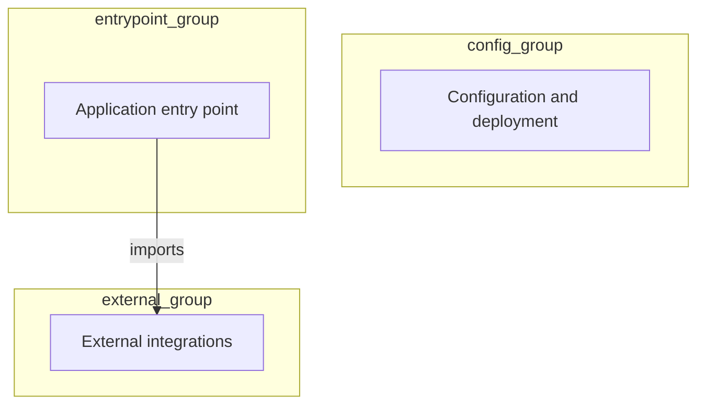

# Architecture report: mukul975/Anthropic-Cybersecurity-Skills

> Automated static analysis. **Observed** = directly seen in files/imports/AST; **Inferred** = interpretation from that evidence. Repository code was not executed.

## 1. Repository at a glance

| Item | Value |
| --- | --- |
| Repository | mukul975/Anthropic-Cybersecurity-Skills |
| Description | 817 structured cybersecurity skills for AI agents · Mapped to 6 frameworks: MITRE ATT&CK, NIST CSF 2.0, MITRE ATLAS, D3FEND, NIST AI RMF & MITRE F3 (Fight Fraud) · agentskills.io standard · Works with Claude Code, GitHub Copilot, Codex CLI, Cursor, Gemini CLI & 20+ platforms · 29 security domains ·… |
| Language | Python |
| Stars | 36139 |
| Licence | Apache-2.0 |
| Analysed commit / branch | 54a798831d2266a3ca61ce68a7acb80b81160d57 / main |
| Framework(s) | None detected |
| Files analysed | 800 |
| Components | 3 |

## 2. Architecture in one minute

mukul975/Anthropic-Cybersecurity-Skills - 817 structured cybersecurity skills for AI agents · Mapped to 6 frameworks: MITRE ATT&CK, NIST CSF 2.0, MITRE ATLAS, D3FEND, NIST AI RMF & MITRE F3 (Fight Fraud) · agentskills.io standard · Works wit…. This repository was analysed statically from 800 file(s) (184 Python). Detected technologies (observed from imports/manifests): GitHub Actions, SQLite, AWS (boto3), NumPy, pandas, requests. Files are grouped into 3 component(s): Configuration and deployment, Application entry point, External integrations. Observed entry point(s): skills/abusing-dpapi-for-credential-access/scripts/agent.py, skills/abusing-shadow-credentials-for-privesc/scripts/agent.py, skills/achieving-cmmc-level-2-compliance/scripts/process.py. Findings below distinguish observed facts from inferred interpretation.

## 3. High-level block diagram

## 4. Main components

### Configuration and deployment (`config`)

- **Kind:** config
- **Status:** Observed
- **Confidence:** 0.85
- **Responsibility:** Groups 1 file(s) under configuration and deployment (observed from repository paths and static analysis).
- **Paths:** `mappings/attack-navigator-layer.json`
- **Evidence:** [mappings/attack-navigator-layer.json](https://github.com/mukul975/Anthropic-Cybersecurity-Skills/blob/54a798831d2266a3ca61ce68a7acb80b81160d57/mappings/attack-navigator-layer.json)

### Application entry point (`entrypoint`)

- **Kind:** entrypoint
- **Status:** Observed
- **Confidence:** 0.85
- **Responsibility:** Groups 184 file(s) under application entry point (observed from repository paths and static analysis). Observed top-level classes: ATTACKAnalyzer, AttributionEngine, BeaconAnalyzer, DefectDojoClient, DetectionRuleLibrary, EngagementConfig. Observed top-level functions: _assess_cron_risk, _ensure, _get_json, _kubectl, _post, _require.
- **Paths:** `skills/abusing-dpapi-for-credential-access/scripts/agent.py`, `skills/abusing-shadow-credentials-for-privesc/scripts/agent.py`, `skills/achieving-cmmc-level-2-compliance/scripts/process.py`, `skills/acquiring-disk-image-with-dd-and-dcfldd/scripts/agent.py`, `skills/analyzing-active-directory-acl-abuse/scripts/agent.py`, `skills/analyzing-android-malware-with-apktool/scripts/agent.py`, `skills/analyzing-api-gateway-access-logs/scripts/agent.py`, `skills/analyzing-apt-group-with-mitre-navigator/scripts/agent.py`, `skills/analyzing-azure-activity-logs-for-threats/scripts/agent.py`, `skills/analyzing-bootkit-and-rootkit-samples/scripts/agent.py`, `skills/analyzing-browser-forensics-with-hindsight/scripts/agent.py`, `skills/analyzing-browser-forensics-with-hindsight/scripts/process.py`, `skills/analyzing-campaign-attribution-evidence/scripts/agent.py`, `skills/analyzing-campaign-attribution-evidence/scripts/process.py`, `skills/analyzing-certificate-transparency-for-phishing/scripts/agent.py`, `skills/analyzing-cloud-storage-access-patterns/scripts/agent.py`, `skills/analyzing-cobalt-strike-beacon-configuration/scripts/agent.py`, `skills/analyzing-cobalt-strike-beacon-configuration/scripts/process.py`, `skills/analyzing-cobaltstrike-malleable-c2-profiles/scripts/agent.py`, `skills/analyzing-command-and-control-communication/scripts/agent.py`, `skills/analyzing-cyber-kill-chain/scripts/agent.py`, `skills/analyzing-disk-image-with-autopsy/scripts/agent.py`, `skills/analyzing-dns-logs-for-exfiltration/scripts/agent.py`, `skills/analyzing-docker-container-forensics/scripts/agent.py`, `skills/analyzing-email-headers-for-phishing-investigation/scripts/agent.py`, `skills/analyzing-ethereum-smart-contract-vulnerabilities/scripts/agent.py`, `skills/analyzing-golang-malware-with-ghidra/scripts/agent.py`, `skills/analyzing-golang-malware-with-ghidra/scripts/process.py`, `skills/analyzing-heap-spray-exploitation/scripts/agent.py`, `skills/analyzing-indicators-of-compromise/scripts/agent.py`, `skills/analyzing-ios-app-security-with-objection/scripts/agent.py`, `skills/analyzing-ios-app-security-with-objection/scripts/process.py`, `skills/analyzing-kubernetes-audit-logs/scripts/agent.py`, `skills/analyzing-linux-audit-logs-for-intrusion/scripts/agent.py`, `skills/analyzing-linux-elf-malware/scripts/agent.py`, `skills/analyzing-linux-kernel-rootkits/scripts/agent.py`, `skills/analyzing-linux-system-artifacts/scripts/agent.py`, `skills/analyzing-lnk-file-and-jump-list-artifacts/scripts/agent.py`, `skills/analyzing-lnk-file-and-jump-list-artifacts/scripts/process.py`, `skills/analyzing-macro-malware-in-office-documents/scripts/agent.py`, `skills/analyzing-malicious-pdf-with-peepdf/scripts/agent.py`, `skills/analyzing-malicious-url-with-urlscan/scripts/agent.py`, `skills/analyzing-malicious-url-with-urlscan/scripts/process.py`, `skills/analyzing-malware-behavior-with-cuckoo-sandbox/scripts/agent.py`, `skills/analyzing-malware-family-relationships-with-malpedia/scripts/agent.py`, `skills/analyzing-malware-persistence-with-autoruns/scripts/agent.py`, `skills/analyzing-malware-sandbox-evasion-techniques/scripts/agent.py`, `skills/analyzing-memory-dumps-with-volatility/scripts/agent.py`, `skills/analyzing-memory-forensics-with-lime-and-volatility/scripts/agent.py`, `skills/analyzing-mft-for-deleted-file-recovery/scripts/agent.py`, `skills/analyzing-mft-for-deleted-file-recovery/scripts/process.py`, `skills/analyzing-network-covert-channels-in-malware/scripts/agent.py`, `skills/analyzing-network-flow-data-with-netflow/scripts/agent.py`, `skills/analyzing-network-packets-with-scapy/scripts/agent.py`, `skills/analyzing-network-traffic-for-incidents/scripts/agent.py`, `skills/analyzing-network-traffic-of-malware/scripts/agent.py`, `skills/analyzing-network-traffic-with-wireshark/scripts/agent.py`, `skills/analyzing-office365-audit-logs-for-compromise/scripts/agent.py`, `skills/analyzing-outlook-pst-for-email-forensics/scripts/agent.py`, `skills/analyzing-packed-malware-with-upx-unpacker/scripts/agent.py`, `skills/analyzing-pdf-malware-with-pdfid/scripts/agent.py`, `skills/analyzing-persistence-mechanisms-in-linux/scripts/agent.py`, `skills/analyzing-powershell-empire-artifacts/scripts/agent.py`, `skills/analyzing-powershell-script-block-logging/scripts/agent.py`, `skills/analyzing-prefetch-files-for-execution-history/scripts/agent.py`, `skills/analyzing-ransomware-encryption-mechanisms/scripts/agent.py`, `skills/analyzing-ransomware-leak-site-intelligence/scripts/agent.py`, `skills/analyzing-ransomware-network-indicators/scripts/agent.py`, `skills/analyzing-ransomware-payment-wallets/scripts/agent.py`, `skills/analyzing-sbom-for-supply-chain-vulnerabilities/scripts/agent.py`, `skills/analyzing-security-logs-with-splunk/scripts/agent.py`, `skills/analyzing-slack-space-and-file-system-artifacts/scripts/agent.py`, `skills/analyzing-supply-chain-malware-artifacts/scripts/agent.py`, `skills/analyzing-threat-actor-ttps-with-mitre-attack/scripts/agent.py`, `skills/analyzing-threat-actor-ttps-with-mitre-attack/scripts/process.py`, `skills/analyzing-threat-actor-ttps-with-mitre-navigator/scripts/agent.py`, `skills/analyzing-threat-intelligence-feeds/scripts/agent.py`, `skills/analyzing-threat-landscape-with-misp/scripts/agent.py`, `skills/analyzing-tls-certificate-transparency-logs/scripts/agent.py`, `skills/analyzing-typosquatting-domains-with-dnstwist/scripts/agent.py`, `skills/analyzing-uefi-bootkit-persistence/scripts/agent.py`, `skills/analyzing-usb-device-connection-history/scripts/agent.py`, `skills/analyzing-web-server-logs-for-intrusion/scripts/agent.py`, `skills/analyzing-windows-amcache-artifacts/scripts/agent.py`, `skills/analyzing-windows-event-logs-in-splunk/scripts/agent.py`, `skills/analyzing-windows-lnk-files-for-artifacts/scripts/agent.py`, `skills/analyzing-windows-prefetch-with-python/scripts/agent.py`, `skills/analyzing-windows-registry-for-artifacts/scripts/agent.py`, `skills/analyzing-windows-shellbag-artifacts/scripts/agent.py`, `skills/analyzing-windows-shellbag-artifacts/scripts/process.py`, `skills/assessing-vector-and-embedding-weaknesses/scripts/agent.py`, `skills/attacking-entra-id-with-roadtools/scripts/agent.py`, `skills/attacking-oauth-with-device-code-phishing/scripts/agent.py`, `skills/auditing-aws-s3-bucket-permissions/scripts/agent.py`, `skills/auditing-azure-active-directory-configuration/scripts/agent.py`, `skills/auditing-cloud-with-cis-benchmarks/scripts/agent.py`, `skills/auditing-entra-id-with-aadinternals/scripts/agent.py`, `skills/auditing-foundry-smart-contract-security/scripts/agent.py`, `skills/auditing-gcp-iam-permissions/scripts/agent.py`, `skills/auditing-kubernetes-cluster-rbac/scripts/agent.py`, `skills/auditing-kubernetes-rbac-privilege-escalation/scripts/agent.py`, `skills/auditing-mcp-servers-for-tool-poisoning/scripts/agent.py`, `skills/auditing-terraform-infrastructure-for-security/scripts/agent.py`, `skills/auditing-tls-certificate-transparency-logs/scripts/agent.py`, `skills/auditing-uefi-firmware-with-chipsec/scripts/agent.py`, `skills/automating-ioc-enrichment/scripts/agent.py`, `skills/benchmarking-kubernetes-with-kube-bench/scripts/agent.py`, `skills/building-adversary-infrastructure-tracking-system/scripts/agent.py`, `skills/building-attack-pattern-library-from-cti-reports/scripts/agent.py`, `skills/building-automated-malware-submission-pipeline/scripts/agent.py`, `skills/building-c2-infrastructure-with-sliver-framework/scripts/agent.py`, `skills/building-c2-infrastructure-with-sliver-framework/scripts/process.py`, `skills/building-c2-redirector-infrastructure/scripts/agent.py`, `skills/building-cloud-siem-with-sentinel/scripts/agent.py`, `skills/building-detection-rule-with-splunk-spl/scripts/agent.py`, `skills/building-detection-rule-with-splunk-spl/scripts/process.py`, `skills/building-detection-rules-with-sigma/scripts/agent.py`, `skills/building-devsecops-pipeline-with-gitlab-ci/scripts/agent.py`, `skills/building-devsecops-pipeline-with-gitlab-ci/scripts/process.py`, `skills/building-identity-federation-with-saml-azure-ad/scripts/agent.py`, `skills/building-identity-federation-with-saml-azure-ad/scripts/process.py`, `skills/building-identity-governance-lifecycle-process/scripts/agent.py`, `skills/building-incident-response-dashboard/scripts/agent.py`, `skills/building-incident-response-playbook/scripts/agent.py`, `skills/building-incident-timeline-with-timesketch/scripts/agent.py`, `skills/building-incident-timeline-with-timesketch/scripts/process.py`, `skills/building-ioc-defanging-and-sharing-pipeline/scripts/agent.py`, `skills/building-ioc-enrichment-pipeline-with-opencti/scripts/agent.py`, `skills/building-ioc-enrichment-pipeline-with-opencti/scripts/process.py`, `skills/building-malware-incident-communication-template/scripts/agent.py`, `skills/building-malware-incident-communication-template/scripts/process.py`, `skills/building-patch-tuesday-response-process/scripts/agent.py`, `skills/building-patch-tuesday-response-process/scripts/process.py`, `skills/building-phishing-reporting-button-workflow/scripts/agent.py`, `skills/building-phishing-reporting-button-workflow/scripts/process.py`, `skills/building-ransomware-playbook-with-cisa-framework/scripts/agent.py`, `skills/building-red-team-c2-infrastructure-with-havoc/scripts/agent.py`, `skills/building-red-team-c2-infrastructure-with-havoc/scripts/process.py`, `skills/building-role-mining-for-rbac-optimization/scripts/agent.py`, `skills/building-role-mining-for-rbac-optimization/scripts/process.py`, `skills/building-soc-escalation-matrix/scripts/agent.py`, `skills/building-soc-escalation-matrix/scripts/process.py`, `skills/building-soc-metrics-and-kpi-tracking/scripts/agent.py`, `skills/building-soc-playbook-for-ransomware/scripts/agent.py`, `skills/building-super-timelines-with-plaso/scripts/agent.py`, `skills/building-threat-actor-profile-from-osint/scripts/agent.py`, `skills/building-threat-feed-aggregation-with-misp/scripts/agent.py`, `skills/building-threat-hunt-hypothesis-framework/scripts/agent.py`, `skills/building-threat-hunt-hypothesis-framework/scripts/process.py`, `skills/building-threat-intelligence-enrichment-in-splunk/scripts/agent.py`, `skills/building-threat-intelligence-enrichment-in-splunk/scripts/process.py`, `skills/building-threat-intelligence-feed-integration/scripts/agent.py`, `skills/building-threat-intelligence-platform/scripts/agent.py`, `skills/building-threat-intelligence-platform/scripts/process.py`, `skills/building-vulnerability-aging-and-sla-tracking/scripts/agent.py`, `skills/building-vulnerability-aging-and-sla-tracking/scripts/process.py`, `skills/building-vulnerability-dashboard-with-defectdojo/scripts/agent.py`, `skills/building-vulnerability-dashboard-with-defectdojo/scripts/process.py`, `skills/building-vulnerability-exception-tracking-system/scripts/agent.py`, `skills/building-vulnerability-exception-tracking-system/scripts/process.py`, `skills/building-vulnerability-scanning-workflow/scripts/agent.py`, `skills/bypassing-authentication-with-forced-browsing/scripts/agent.py`, `skills/coercing-authentication-with-coercer-petitpotam/scripts/agent.py`, `skills/collecting-indicators-of-compromise/scripts/agent.py`, `skills/collecting-open-source-intelligence/scripts/agent.py`, `skills/collecting-threat-intelligence-with-misp/scripts/agent.py`, `skills/collecting-threat-intelligence-with-misp/scripts/process.py`, `skills/collecting-volatile-evidence-from-compromised-host/scripts/agent.py`, `skills/collecting-volatile-evidence-from-compromised-host/scripts/process.py`, `skills/conducting-api-security-testing/scripts/agent.py`, `skills/conducting-cloud-incident-response/scripts/agent.py`, `skills/conducting-cloud-penetration-testing/scripts/agent.py`, `skills/conducting-cyber-risk-assessment-with-nist-800-30/scripts/process.py`, `skills/conducting-domain-persistence-with-dcsync/scripts/agent.py`, `skills/conducting-domain-persistence-with-dcsync/scripts/process.py`, `skills/conducting-external-reconnaissance-with-osint/scripts/agent.py`, `skills/conducting-full-scope-red-team-engagement/scripts/agent.py`, `skills/conducting-full-scope-red-team-engagement/scripts/process.py`, `skills/conducting-gdpr-compliance-assessment/scripts/article30_parser.py`, `skills/conducting-gdpr-compliance-assessment/scripts/article30_validator.py`, `skills/conducting-gdpr-compliance-assessment/scripts/generate_ropa_report.py`, `skills/conducting-internal-network-penetration-test/scripts/agent.py`, `skills/conducting-internal-network-penetration-test/scripts/process.py`, `skills/conducting-internal-reconnaissance-with-bloodhound-ce/scripts/agent.py`
- **Evidence:** [skills/abusing-dpapi-for-credential-access/scripts/agent.py:30](https://github.com/mukul975/Anthropic-Cybersecurity-Skills/blob/54a798831d2266a3ca61ce68a7acb80b81160d57/skills/abusing-dpapi-for-credential-access/scripts/agent.py#L30); [skills/abusing-shadow-credentials-for-privesc/scripts/agent.py:33](https://github.com/mukul975/Anthropic-Cybersecurity-Skills/blob/54a798831d2266a3ca61ce68a7acb80b81160d57/skills/abusing-shadow-credentials-for-privesc/scripts/agent.py#L33); [skills/achieving-cmmc-level-2-compliance/scripts/process.py:47](https://github.com/mukul975/Anthropic-Cybersecurity-Skills/blob/54a798831d2266a3ca61ce68a7acb80b81160d57/skills/achieving-cmmc-level-2-compliance/scripts/process.py#L47); [skills/acquiring-disk-image-with-dd-and-dcfldd/scripts/agent.py:12](https://github.com/mukul975/Anthropic-Cybersecurity-Skills/blob/54a798831d2266a3ca61ce68a7acb80b81160d57/skills/acquiring-disk-image-with-dd-and-dcfldd/scripts/agent.py#L12); [skills/analyzing-active-directory-acl-abuse/scripts/agent.py:66](https://github.com/mukul975/Anthropic-Cybersecurity-Skills/blob/54a798831d2266a3ca61ce68a7acb80b81160d57/skills/analyzing-active-directory-acl-abuse/scripts/agent.py#L66); [skills/analyzing-android-malware-with-apktool/scripts/agent.py:48](https://github.com/mukul975/Anthropic-Cybersecurity-Skills/blob/54a798831d2266a3ca61ce68a7acb80b81160d57/skills/analyzing-android-malware-with-apktool/scripts/agent.py#L48); [skills/analyzing-api-gateway-access-logs/scripts/agent.py:12](https://github.com/mukul975/Anthropic-Cybersecurity-Skills/blob/54a798831d2266a3ca61ce68a7acb80b81160d57/skills/analyzing-api-gateway-access-logs/scripts/agent.py#L12); [skills/analyzing-apt-group-with-mitre-navigator/scripts/agent.py:44](https://github.com/mukul975/Anthropic-Cybersecurity-Skills/blob/54a798831d2266a3ca61ce68a7acb80b81160d57/skills/analyzing-apt-group-with-mitre-navigator/scripts/agent.py#L44)

### External integrations (`external_integrations`)

- **Kind:** external
- **Status:** Inferred
- **Confidence:** 0.70
- **Responsibility:** Groups 0 file(s) under external integrations (observed from repository paths and static analysis).
- **Evidence:** [skills/analyzing-apt-group-with-mitre-navigator/scripts/agent.py:14](https://github.com/mukul975/Anthropic-Cybersecurity-Skills/blob/54a798831d2266a3ca61ce68a7acb80b81160d57/skills/analyzing-apt-group-with-mitre-navigator/scripts/agent.py#L14); [skills/analyzing-browser-forensics-with-hindsight/scripts/agent.py:11](https://github.com/mukul975/Anthropic-Cybersecurity-Skills/blob/54a798831d2266a3ca61ce68a7acb80b81160d57/skills/analyzing-browser-forensics-with-hindsight/scripts/agent.py#L11); [skills/analyzing-browser-forensics-with-hindsight/scripts/process.py:3](https://github.com/mukul975/Anthropic-Cybersecurity-Skills/blob/54a798831d2266a3ca61ce68a7acb80b81160d57/skills/analyzing-browser-forensics-with-hindsight/scripts/process.py#L3); [skills/analyzing-certificate-transparency-for-phishing/scripts/agent.py:13](https://github.com/mukul975/Anthropic-Cybersecurity-Skills/blob/54a798831d2266a3ca61ce68a7acb80b81160d57/skills/analyzing-certificate-transparency-for-phishing/scripts/agent.py#L13); [skills/analyzing-indicators-of-compromise/scripts/agent.py:10](https://github.com/mukul975/Anthropic-Cybersecurity-Skills/blob/54a798831d2266a3ca61ce68a7acb80b81160d57/skills/analyzing-indicators-of-compromise/scripts/agent.py#L10); [skills/analyzing-malicious-url-with-urlscan/scripts/agent.py:10](https://github.com/mukul975/Anthropic-Cybersecurity-Skills/blob/54a798831d2266a3ca61ce68a7acb80b81160d57/skills/analyzing-malicious-url-with-urlscan/scripts/agent.py#L10)

## 5. Execution flow

**Observed** entry point(s):

- [skills/abusing-dpapi-for-credential-access/scripts/agent.py:153](https://github.com/mukul975/Anthropic-Cybersecurity-Skills/blob/54a798831d2266a3ca61ce68a7acb80b81160d57/skills/abusing-dpapi-for-credential-access/scripts/agent.py#L153)
- [skills/abusing-shadow-credentials-for-privesc/scripts/agent.py:144](https://github.com/mukul975/Anthropic-Cybersecurity-Skills/blob/54a798831d2266a3ca61ce68a7acb80b81160d57/skills/abusing-shadow-credentials-for-privesc/scripts/agent.py#L144)
- [skills/achieving-cmmc-level-2-compliance/scripts/process.py:197](https://github.com/mukul975/Anthropic-Cybersecurity-Skills/blob/54a798831d2266a3ca61ce68a7acb80b81160d57/skills/achieving-cmmc-level-2-compliance/scripts/process.py#L197)
- [skills/acquiring-disk-image-with-dd-and-dcfldd/scripts/agent.py:153](https://github.com/mukul975/Anthropic-Cybersecurity-Skills/blob/54a798831d2266a3ca61ce68a7acb80b81160d57/skills/acquiring-disk-image-with-dd-and-dcfldd/scripts/agent.py#L153)
- [skills/analyzing-active-directory-acl-abuse/scripts/agent.py:257](https://github.com/mukul975/Anthropic-Cybersecurity-Skills/blob/54a798831d2266a3ca61ce68a7acb80b81160d57/skills/analyzing-active-directory-acl-abuse/scripts/agent.py#L257)
- [skills/analyzing-android-malware-with-apktool/scripts/agent.py:227](https://github.com/mukul975/Anthropic-Cybersecurity-Skills/blob/54a798831d2266a3ca61ce68a7acb80b81160d57/skills/analyzing-android-malware-with-apktool/scripts/agent.py#L227)
- [skills/analyzing-api-gateway-access-logs/scripts/agent.py:175](https://github.com/mukul975/Anthropic-Cybersecurity-Skills/blob/54a798831d2266a3ca61ce68a7acb80b81160d57/skills/analyzing-api-gateway-access-logs/scripts/agent.py#L175)
- [skills/analyzing-apt-group-with-mitre-navigator/scripts/agent.py:184](https://github.com/mukul975/Anthropic-Cybersecurity-Skills/blob/54a798831d2266a3ca61ce68a7acb80b81160d57/skills/analyzing-apt-group-with-mitre-navigator/scripts/agent.py#L184)
- [skills/analyzing-azure-activity-logs-for-threats/scripts/agent.py:177](https://github.com/mukul975/Anthropic-Cybersecurity-Skills/blob/54a798831d2266a3ca61ce68a7acb80b81160d57/skills/analyzing-azure-activity-logs-for-threats/scripts/agent.py#L177)
- [skills/analyzing-bootkit-and-rootkit-samples/scripts/agent.py:156](https://github.com/mukul975/Anthropic-Cybersecurity-Skills/blob/54a798831d2266a3ca61ce68a7acb80b81160d57/skills/analyzing-bootkit-and-rootkit-samples/scripts/agent.py#L156)
- [skills/analyzing-browser-forensics-with-hindsight/scripts/agent.py:215](https://github.com/mukul975/Anthropic-Cybersecurity-Skills/blob/54a798831d2266a3ca61ce68a7acb80b81160d57/skills/analyzing-browser-forensics-with-hindsight/scripts/agent.py#L215)
- [skills/analyzing-browser-forensics-with-hindsight/scripts/process.py:29](https://github.com/mukul975/Anthropic-Cybersecurity-Skills/blob/54a798831d2266a3ca61ce68a7acb80b81160d57/skills/analyzing-browser-forensics-with-hindsight/scripts/process.py#L29)

Representative flow (derived from observed entry points and the import graph; steps beyond the entry point are **Inferred**):

1. Execution starts at an observed entry point listed above, if present.
2. `entrypoint` imports `external_integrations` (Application entry point -> External integrations).

## 6. Project structure

### `(root)`

- `.gitignore` - other (160 bytes)
- `AGENTS.md` - docs (2472 bytes)
- `ATTACK_COVERAGE.md` - docs (55138 bytes)
- `CITATION.cff` - other (1166 bytes)
- `CODE_OF_CONDUCT.md` - docs (5477 bytes)
- `CONTRIBUTING.md` - docs (13922 bytes)
- `LICENSE` - docs (11255 bytes)
- `README.fr.md` - docs (26464 bytes)
- `README.md` - docs (31179 bytes)
- `SCOPE.md` - docs (8848 bytes)
- `SECURITY.md` - docs (1644 bytes)
- `SUPPORT.md` - docs (2589 bytes)

### `.claude-plugin`

- `.claude-plugin/marketplace.json` - config (1186 bytes)
- `.claude-plugin/plugin.json` - config (210 bytes)

### `.github`

- `.github/FUNDING.yml` - config (61 bytes)
- `.github/ISSUE_TEMPLATE/bug-report.yml` - config (1319 bytes)
- `.github/ISSUE_TEMPLATE/config.yml` - config (373 bytes)
- `.github/ISSUE_TEMPLATE/improve-skill.md` - docs (437 bytes)
- `.github/ISSUE_TEMPLATE/new-skill-request.yml` - config (1647 bytes)
- `.github/ISSUE_TEMPLATE/new-skill.md` - docs (629 bytes)
- `.github/ISSUE_TEMPLATE/skill-improvement.yml` - config (1136 bytes)
- `.github/copilot-instructions.md` - docs (16809 bytes)
- `.github/workflows/sync-marketplace-version.yml` - ci, YAML (1458 bytes)
- `.github/workflows/update-contributors.yml` - ci, YAML (1266 bytes)
- `.github/workflows/update-index.yml` - ci, YAML (3471 bytes)
- `.github/workflows/validate-skills.yml` - ci, YAML (5106 bytes)

### `assets`

- `assets/.gitkeep` - other (0 bytes)

### `docs`

- `docs/mitre-f3-mapping.md` - docs (3664 bytes)

### `mappings`

- `mappings/README.md` - docs (2889 bytes)
- `mappings/attack-navigator-layer.json` - config (96887 bytes)
- `mappings/mitre-attack/README.md` - docs (6123 bytes)
- `mappings/mitre-attack/coverage-summary.md` - docs (10278 bytes)
- `mappings/nist-csf/README.md` - docs (6504 bytes)
- `mappings/nist-csf/csf-alignment.md` - docs (8223 bytes)
- `mappings/owasp/README.md` - docs (9779 bytes)

### `skills`

- `skills/abusing-dpapi-for-credential-access/LICENSE` - docs (11255 bytes)
- `skills/abusing-dpapi-for-credential-access/SKILL.md` - docs (10686 bytes)
- `skills/abusing-dpapi-for-credential-access/references/api-reference.md` - docs (3360 bytes)
- `skills/abusing-dpapi-for-credential-access/references/standards.md` - docs (1886 bytes)
- `skills/abusing-dpapi-for-credential-access/scripts/agent.py` - source, Python (6285 bytes)
- `skills/abusing-shadow-credentials-for-privesc/LICENSE` - docs (11255 bytes)
- `skills/abusing-shadow-credentials-for-privesc/SKILL.md` - docs (9533 bytes)
- `skills/abusing-shadow-credentials-for-privesc/references/api-reference.md` - docs (2509 bytes)
- `skills/abusing-shadow-credentials-for-privesc/references/standards.md` - docs (1240 bytes)
- `skills/abusing-shadow-credentials-for-privesc/scripts/agent.py` - source, Python (5418 bytes)
- `skills/achieving-cmmc-level-2-compliance/LICENSE` - docs (11255 bytes)
- `skills/achieving-cmmc-level-2-compliance/SKILL.md` - docs (8689 bytes)
- `skills/achieving-cmmc-level-2-compliance/assets/template.md` - docs (3801 bytes)
- `skills/achieving-cmmc-level-2-compliance/references/standards.md` - docs (4882 bytes)
- `skills/achieving-cmmc-level-2-compliance/scripts/process.py` - source, Python (7774 bytes)
- `skills/acquiring-disk-image-with-dd-and-dcfldd/LICENSE` - docs (11255 bytes)
- `skills/acquiring-disk-image-with-dd-and-dcfldd/SKILL.md` - docs (8799 bytes)
- `skills/acquiring-disk-image-with-dd-and-dcfldd/references/api-reference.md` - docs (2584 bytes)
- `skills/acquiring-disk-image-with-dd-and-dcfldd/scripts/agent.py` - source, Python (6879 bytes)
- `skills/analyzing-active-directory-acl-abuse/LICENSE` - docs (11255 bytes)
- `skills/analyzing-active-directory-acl-abuse/SKILL.md` - docs (4248 bytes)
- `skills/analyzing-active-directory-acl-abuse/references/api-reference.md` - docs (2951 bytes)
- `skills/analyzing-active-directory-acl-abuse/scripts/agent.py` - source, Python (9526 bytes)
- `skills/analyzing-android-malware-with-apktool/LICENSE` - docs (11255 bytes)
- `skills/analyzing-android-malware-with-apktool/SKILL.md` - docs (2477 bytes)
- `skills/analyzing-android-malware-with-apktool/references/api-reference.md` - docs (2758 bytes)
- `skills/analyzing-android-malware-with-apktool/scripts/agent.py` - source, Python (8930 bytes)
- `skills/analyzing-api-gateway-access-logs/LICENSE` - docs (11255 bytes)
- `skills/analyzing-api-gateway-access-logs/SKILL.md` - docs (2321 bytes)
- `skills/analyzing-api-gateway-access-logs/references/api-reference.md` - docs (1451 bytes)
- `skills/analyzing-api-gateway-access-logs/scripts/agent.py` - source, Python (6917 bytes)
- `skills/analyzing-apt-group-with-mitre-navigator/LICENSE` - docs (11255 bytes)
- `skills/analyzing-apt-group-with-mitre-navigator/SKILL.md` - docs (11451 bytes)
- `skills/analyzing-apt-group-with-mitre-navigator/references/api-reference.md` - docs (2573 bytes)
- `skills/analyzing-apt-group-with-mitre-navigator/scripts/agent.py` - source, Python (9099 bytes)
- `skills/analyzing-azure-activity-logs-for-threats/LICENSE` - docs (11255 bytes)
- `skills/analyzing-azure-activity-logs-for-threats/SKILL.md` - docs (2436 bytes)
- `skills/analyzing-azure-activity-logs-for-threats/references/api-reference.md` - docs (1641 bytes)
- `skills/analyzing-azure-activity-logs-for-threats/scripts/agent.py` - source, Python (7000 bytes)
- `skills/analyzing-bootkit-and-rootkit-samples/LICENSE` - docs (11255 bytes)
- `skills/analyzing-bootkit-and-rootkit-samples/SKILL.md` - docs (12989 bytes)
- `skills/analyzing-bootkit-and-rootkit-samples/references/api-reference.md` - docs (2798 bytes)
- `skills/analyzing-bootkit-and-rootkit-samples/scripts/agent.py` - source, Python (7136 bytes)
- `skills/analyzing-browser-forensics-with-hindsight/LICENSE` - docs (11255 bytes)
- `skills/analyzing-browser-forensics-with-hindsight/SKILL.md` - docs (11104 bytes)
- `skills/analyzing-browser-forensics-with-hindsight/assets/template.md` - docs (438 bytes)
- `skills/analyzing-browser-forensics-with-hindsight/references/api-reference.md` - docs (2761 bytes)
- `skills/analyzing-browser-forensics-with-hindsight/references/standards.md` - docs (594 bytes)
- `skills/analyzing-browser-forensics-with-hindsight/references/workflows.md` - docs (444 bytes)
- `skills/analyzing-browser-forensics-with-hindsight/scripts/agent.py` - source, Python (9964 bytes)
- `skills/analyzing-browser-forensics-with-hindsight/scripts/process.py` - source, Python (1597 bytes)
- `skills/analyzing-campaign-attribution-evidence/LICENSE` - docs (11255 bytes)
- `skills/analyzing-campaign-attribution-evidence/SKILL.md` - docs (9210 bytes)
- `skills/analyzing-campaign-attribution-evidence/assets/template.md` - docs (1003 bytes)
- `skills/analyzing-campaign-attribution-evidence/references/api-reference.md` - docs (3153 bytes)
- `skills/analyzing-campaign-attribution-evidence/references/standards.md` - docs (1156 bytes)
- `skills/analyzing-campaign-attribution-evidence/references/workflows.md` - docs (1408 bytes)
- `skills/analyzing-campaign-attribution-evidence/scripts/agent.py` - source, Python (10177 bytes)
- `skills/analyzing-campaign-attribution-evidence/scripts/process.py` - source, Python (6076 bytes)
- `skills/analyzing-certificate-transparency-for-phishing/LICENSE` - docs (11255 bytes)
- `skills/analyzing-certificate-transparency-for-phishing/SKILL.md` - docs (14088 bytes)
- `skills/analyzing-certificate-transparency-for-phishing/references/api-reference.md` - docs (2850 bytes)
- `skills/analyzing-certificate-transparency-for-phishing/scripts/agent.py` - source, Python (7465 bytes)
- `skills/analyzing-cloud-storage-access-patterns/LICENSE` - docs (11255 bytes)
- `skills/analyzing-cloud-storage-access-patterns/SKILL.md` - docs (2395 bytes)
- `skills/analyzing-cloud-storage-access-patterns/references/api-reference.md` - docs (1539 bytes)
- `skills/analyzing-cloud-storage-access-patterns/scripts/agent.py` - source, Python (8058 bytes)
- `skills/analyzing-cobalt-strike-beacon-configuration/LICENSE` - docs (11255 bytes)
- `skills/analyzing-cobalt-strike-beacon-configuration/SKILL.md` - docs (13065 bytes)
- `skills/analyzing-cobalt-strike-beacon-configuration/assets/template.md` - docs (2198 bytes)
- `skills/analyzing-cobalt-strike-beacon-configuration/references/api-reference.md` - docs (3015 bytes)
- `skills/analyzing-cobalt-strike-beacon-configuration/references/standards.md` - docs (3006 bytes)
- `skills/analyzing-cobalt-strike-beacon-configuration/references/workflows.md` - docs (3618 bytes)
- `skills/analyzing-cobalt-strike-beacon-configuration/scripts/agent.py` - source, Python (8405 bytes)
- `skills/analyzing-cobalt-strike-beacon-configuration/scripts/process.py` - source, Python (10620 bytes)
- `skills/analyzing-cobaltstrike-malleable-c2-profiles/LICENSE` - docs (11255 bytes)
- `skills/analyzing-cobaltstrike-malleable-c2-profiles/SKILL.md` - docs (3258 bytes)
- `skills/analyzing-cobaltstrike-malleable-c2-profiles/references/api-reference.md` - docs (2808 bytes)
- `skills/analyzing-cobaltstrike-malleable-c2-profiles/scripts/agent.py` - source, Python (8507 bytes)
- `skills/analyzing-command-and-control-communication/LICENSE` - docs (11255 bytes)
- `skills/analyzing-command-and-control-communication/SKILL.md` - docs (14467 bytes)
- `skills/analyzing-command-and-control-communication/references/api-reference.md` - docs (2756 bytes)
- `skills/analyzing-command-and-control-communication/scripts/agent.py` - source, Python (7849 bytes)
- `skills/analyzing-cyber-kill-chain/LICENSE` - docs (11255 bytes)
- `skills/analyzing-cyber-kill-chain/SKILL.md` - docs (7309 bytes)
- `skills/analyzing-cyber-kill-chain/references/api-reference.md` - docs (2749 bytes)
- `skills/analyzing-cyber-kill-chain/scripts/agent.py` - source, Python (10440 bytes)
- `skills/analyzing-disk-image-with-autopsy/LICENSE` - docs (11255 bytes)
- `skills/analyzing-disk-image-with-autopsy/SKILL.md` - docs (10759 bytes)
- `skills/analyzing-disk-image-with-autopsy/references/api-reference.md` - docs (2908 bytes)
- `skills/analyzing-disk-image-with-autopsy/scripts/agent.py` - source, Python (7729 bytes)
- `skills/analyzing-dns-logs-for-exfiltration/LICENSE` - docs (11255 bytes)
- `skills/analyzing-dns-logs-for-exfiltration/SKILL.md` - docs (11545 bytes)
- `skills/analyzing-dns-logs-for-exfiltration/references/api-reference.md` - docs (2708 bytes)
- `skills/analyzing-dns-logs-for-exfiltration/scripts/agent.py` - source, Python (8704 bytes)
- `skills/analyzing-docker-container-forensics/LICENSE` - docs (11255 bytes)
- `skills/analyzing-docker-container-forensics/SKILL.md` - docs (12886 bytes)
- `skills/analyzing-docker-container-forensics/references/api-reference.md` - docs (2915 bytes)
- `skills/analyzing-docker-container-forensics/scripts/agent.py` - source, Python (8844 bytes)
- `skills/analyzing-email-headers-for-phishing-investigation/LICENSE` - docs (11255 bytes)
- `skills/analyzing-email-headers-for-phishing-investigation/SKILL.md` - docs (12691 bytes)
- `skills/analyzing-email-headers-for-phishing-investigation/references/api-reference.md` - docs (2772 bytes)
- `skills/analyzing-email-headers-for-phishing-investigation/scripts/agent.py` - source, Python (8576 bytes)
- `skills/analyzing-ethereum-smart-contract-vulnerabilities/LICENSE` - docs (11255 bytes)
- `skills/analyzing-ethereum-smart-contract-vulnerabilities/SKILL.md` - docs (2950 bytes)
- `skills/analyzing-ethereum-smart-contract-vulnerabilities/references/api-reference.md` - docs (2643 bytes)
- `skills/analyzing-ethereum-smart-contract-vulnerabilities/scripts/agent.py` - source, Python (6896 bytes)
- `skills/analyzing-golang-malware-with-ghidra/LICENSE` - docs (11255 bytes)
- `skills/analyzing-golang-malware-with-ghidra/SKILL.md` - docs (11346 bytes)
- `skills/analyzing-golang-malware-with-ghidra/assets/template.md` - docs (752 bytes)
- `skills/analyzing-golang-malware-with-ghidra/references/api-reference.md` - docs (2602 bytes)
- `skills/analyzing-golang-malware-with-ghidra/references/standards.md` - docs (882 bytes)
- `skills/analyzing-golang-malware-with-ghidra/references/workflows.md` - docs (1606 bytes)
- `skills/analyzing-golang-malware-with-ghidra/scripts/agent.py` - source, Python (9117 bytes)
- `skills/analyzing-golang-malware-with-ghidra/scripts/process.py` - source, Python (4706 bytes)
- `skills/analyzing-heap-spray-exploitation/LICENSE` - docs (11255 bytes)
- `skills/analyzing-heap-spray-exploitation/SKILL.md` - docs (2396 bytes)
- `skills/analyzing-heap-spray-exploitation/references/api-reference.md` - docs (2220 bytes)
- `skills/analyzing-heap-spray-exploitation/scripts/agent.py` - source, Python (8294 bytes)
- `skills/analyzing-indicators-of-compromise/LICENSE` - docs (11255 bytes)
- `skills/analyzing-indicators-of-compromise/SKILL.md` - docs (7769 bytes)
- `skills/analyzing-indicators-of-compromise/references/api-reference.md` - docs (2926 bytes)
- `skills/analyzing-indicators-of-compromise/scripts/agent.py` - source, Python (8985 bytes)
- `skills/analyzing-ios-app-security-with-objection/LICENSE` - docs (11255 bytes)
- `skills/analyzing-ios-app-security-with-objection/SKILL.md` - docs (6512 bytes)
- `skills/analyzing-ios-app-security-with-objection/assets/template.md` - docs (2144 bytes)
- `skills/analyzing-ios-app-security-with-objection/references/api-reference.md` - docs (3514 bytes)
- `skills/analyzing-ios-app-security-with-objection/references/standards.md` - docs (2704 bytes)
- `skills/analyzing-ios-app-security-with-objection/references/workflows.md` - docs (4205 bytes)
- `skills/analyzing-ios-app-security-with-objection/scripts/agent.py` - source, Python (7320 bytes)
- `skills/analyzing-ios-app-security-with-objection/scripts/process.py` - source, Python (11067 bytes)
- `skills/analyzing-kubernetes-audit-logs/LICENSE` - docs (11255 bytes)
- `skills/analyzing-kubernetes-audit-logs/SKILL.md` - docs (2615 bytes)
- `skills/analyzing-kubernetes-audit-logs/references/api-reference.md` - docs (1620 bytes)
- `skills/analyzing-kubernetes-audit-logs/scripts/agent.py` - source, Python (7912 bytes)
- `skills/analyzing-linux-audit-logs-for-intrusion/LICENSE` - docs (11255 bytes)
- `skills/analyzing-linux-audit-logs-for-intrusion/SKILL.md` - docs (9790 bytes)
- `skills/analyzing-linux-audit-logs-for-intrusion/references/api-reference.md` - docs (1911 bytes)
- `skills/analyzing-linux-audit-logs-for-intrusion/scripts/agent.py` - source, Python (8103 bytes)
- `skills/analyzing-linux-elf-malware/LICENSE` - docs (11255 bytes)
- `skills/analyzing-linux-elf-malware/SKILL.md` - docs (12537 bytes)
- `skills/analyzing-linux-elf-malware/references/api-reference.md` - docs (3126 bytes)
- `skills/analyzing-linux-elf-malware/scripts/agent.py` - source, Python (8794 bytes)
- `skills/analyzing-linux-kernel-rootkits/LICENSE` - docs (11255 bytes)
- `skills/analyzing-linux-kernel-rootkits/SKILL.md` - docs (5941 bytes)
- `skills/analyzing-linux-kernel-rootkits/references/api-reference.md` - docs (2592 bytes)
- `skills/analyzing-linux-kernel-rootkits/scripts/agent.py` - source, Python (7024 bytes)
- `skills/analyzing-linux-system-artifacts/LICENSE` - docs (11255 bytes)
- `skills/analyzing-linux-system-artifacts/SKILL.md` - docs (14934 bytes)
- `skills/analyzing-linux-system-artifacts/references/api-reference.md` - docs (3491 bytes)
- `skills/analyzing-linux-system-artifacts/scripts/agent.py` - source, Python (9952 bytes)
- `skills/analyzing-lnk-file-and-jump-list-artifacts/LICENSE` - docs (11255 bytes)
- `skills/analyzing-lnk-file-and-jump-list-artifacts/SKILL.md` - docs (11299 bytes)
- `skills/analyzing-lnk-file-and-jump-list-artifacts/assets/template.md` - docs (759 bytes)
- `skills/analyzing-lnk-file-and-jump-list-artifacts/references/api-reference.md` - docs (3247 bytes)
- `skills/analyzing-lnk-file-and-jump-list-artifacts/references/standards.md` - docs (852 bytes)
- `skills/analyzing-lnk-file-and-jump-list-artifacts/references/workflows.md` - docs (952 bytes)
- `skills/analyzing-lnk-file-and-jump-list-artifacts/scripts/agent.py` - source, Python (11370 bytes)
- `skills/analyzing-lnk-file-and-jump-list-artifacts/scripts/process.py` - source, Python (3380 bytes)
- `skills/analyzing-macro-malware-in-office-documents/LICENSE` - docs (11255 bytes)
- `skills/analyzing-macro-malware-in-office-documents/SKILL.md` - docs (12181 bytes)
- `skills/analyzing-macro-malware-in-office-documents/references/api-reference.md` - docs (2985 bytes)
- `skills/analyzing-macro-malware-in-office-documents/scripts/agent.py` - source, Python (8780 bytes)
- `skills/analyzing-malicious-pdf-with-peepdf/LICENSE` - docs (11255 bytes)
- `skills/analyzing-malicious-pdf-with-peepdf/SKILL.md` - docs (3196 bytes)
- `skills/analyzing-malicious-pdf-with-peepdf/references/api-reference.md` - docs (3318 bytes)
- `skills/analyzing-malicious-pdf-with-peepdf/scripts/agent.py` - source, Python (8427 bytes)
- `skills/analyzing-malicious-url-with-urlscan/LICENSE` - docs (11255 bytes)
- `skills/analyzing-malicious-url-with-urlscan/SKILL.md` - docs (4054 bytes)
- `skills/analyzing-malicious-url-with-urlscan/assets/template.md` - docs (1628 bytes)
- `skills/analyzing-malicious-url-with-urlscan/references/api-reference.md` - docs (1514 bytes)
- `skills/analyzing-malicious-url-with-urlscan/references/standards.md` - docs (1822 bytes)
- `skills/analyzing-malicious-url-with-urlscan/references/workflows.md` - docs (2380 bytes)
- `skills/analyzing-malicious-url-with-urlscan/scripts/agent.py` - source, Python (6364 bytes)
- `skills/analyzing-malicious-url-with-urlscan/scripts/process.py` - source, Python (15638 bytes)
- `skills/analyzing-malware-behavior-with-cuckoo-sandbox/LICENSE` - docs (11255 bytes)
- `skills/analyzing-malware-behavior-with-cuckoo-sandbox/SKILL.md` - docs (11678 bytes)
- `skills/analyzing-malware-behavior-with-cuckoo-sandbox/references/api-reference.md` - docs (2664 bytes)
- `skills/analyzing-malware-behavior-with-cuckoo-sandbox/scripts/agent.py` - source, Python (9324 bytes)
- `skills/analyzing-malware-family-relationships-with-malpedia/LICENSE` - docs (11255 bytes)
- `skills/analyzing-malware-family-relationships-with-malpedia/SKILL.md` - docs (11863 bytes)
- `skills/analyzing-malware-family-relationships-with-malpedia/references/api-reference.md` - docs (1449 bytes)
- `skills/analyzing-malware-family-relationships-with-malpedia/scripts/agent.py` - source, Python (5489 bytes)
- `skills/analyzing-malware-persistence-with-autoruns/LICENSE` - docs (11255 bytes)
- `skills/analyzing-malware-persistence-with-autoruns/SKILL.md` - docs (4685 bytes)
- `skills/analyzing-malware-persistence-with-autoruns/assets/template.md` - docs (424 bytes)
- `skills/analyzing-malware-persistence-with-autoruns/references/api-reference.md` - docs (1835 bytes)
- `skills/analyzing-malware-persistence-with-autoruns/references/standards.md` - docs (312 bytes)
- `skills/analyzing-malware-persistence-with-autoruns/references/workflows.md` - docs (471 bytes)
- `skills/analyzing-malware-persistence-with-autoruns/scripts/agent.py` - source, Python (5841 bytes)
- `skills/analyzing-malware-sandbox-evasion-techniques/LICENSE` - docs (11255 bytes)
- `skills/analyzing-malware-sandbox-evasion-techniques/SKILL.md` - docs (2849 bytes)
- `skills/analyzing-malware-sandbox-evasion-techniques/references/api-reference.md` - docs (2066 bytes)
- `skills/analyzing-malware-sandbox-evasion-techniques/scripts/agent.py` - source, Python (8137 bytes)
- `skills/analyzing-memory-dumps-with-volatility/LICENSE` - docs (11255 bytes)
- `skills/analyzing-memory-dumps-with-volatility/SKILL.md` - docs (11755 bytes)
- `skills/analyzing-memory-dumps-with-volatility/references/api-reference.md` - docs (3085 bytes)
- `skills/analyzing-memory-dumps-with-volatility/scripts/agent.py` - source, Python (9024 bytes)
- `skills/analyzing-memory-forensics-with-lime-and-volatility/LICENSE` - docs (11255 bytes)
- `skills/analyzing-memory-forensics-with-lime-and-volatility/SKILL.md` - docs (2524 bytes)
- `skills/analyzing-memory-forensics-with-lime-and-volatility/references/api-reference.md` - docs (1626 bytes)
- `skills/analyzing-memory-forensics-with-lime-and-volatility/scripts/agent.py` - source, Python (7393 bytes)
- `skills/analyzing-mft-for-deleted-file-recovery/LICENSE` - docs (11255 bytes)
- `skills/analyzing-mft-for-deleted-file-recovery/SKILL.md` - docs (10634 bytes)
- `skills/analyzing-mft-for-deleted-file-recovery/assets/template.md` - docs (741 bytes)
- `skills/analyzing-mft-for-deleted-file-recovery/references/api-reference.md` - docs (1672 bytes)
- `skills/analyzing-mft-for-deleted-file-recovery/references/standards.md` - docs (1169 bytes)
- `skills/analyzing-mft-for-deleted-file-recovery/references/workflows.md` - docs (1038 bytes)
- `skills/analyzing-mft-for-deleted-file-recovery/scripts/agent.py` - source, Python (6088 bytes)
- `skills/analyzing-mft-for-deleted-file-recovery/scripts/process.py` - source, Python (4501 bytes)
- `skills/analyzing-network-covert-channels-in-malware/LICENSE` - docs (11255 bytes)
- `skills/analyzing-network-covert-channels-in-malware/SKILL.md` - docs (7983 bytes)
- `skills/analyzing-network-covert-channels-in-malware/assets/template.md` - docs (425 bytes)
- `skills/analyzing-network-covert-channels-in-malware/references/api-reference.md` - docs (2544 bytes)
- `skills/analyzing-network-covert-channels-in-malware/references/standards.md` - docs (313 bytes)
- `skills/analyzing-network-covert-channels-in-malware/references/workflows.md` - docs (472 bytes)
- `skills/analyzing-network-covert-channels-in-malware/scripts/agent.py` - source, Python (7739 bytes)
- `skills/analyzing-network-flow-data-with-netflow/LICENSE` - docs (11255 bytes)
- `skills/analyzing-network-flow-data-with-netflow/SKILL.md` - docs (2172 bytes)
- `skills/analyzing-network-flow-data-with-netflow/references/api-reference.md` - docs (1615 bytes)
- `skills/analyzing-network-flow-data-with-netflow/scripts/agent.py` - source, Python (7915 bytes)
- `skills/analyzing-network-packets-with-scapy/LICENSE` - docs (11255 bytes)
- `skills/analyzing-network-packets-with-scapy/SKILL.md` - docs (2501 bytes)
- `skills/analyzing-network-packets-with-scapy/references/api-reference.md` - docs (2171 bytes)
- `skills/analyzing-network-packets-with-scapy/scripts/agent.py` - source, Python (6881 bytes)
- `skills/analyzing-network-traffic-for-incidents/LICENSE` - docs (11255 bytes)
- `skills/analyzing-network-traffic-for-incidents/SKILL.md` - docs (10605 bytes)
- `skills/analyzing-network-traffic-for-incidents/references/api-reference.md` - docs (2825 bytes)
- `skills/analyzing-network-traffic-for-incidents/scripts/agent.py` - source, Python (7804 bytes)
- `skills/analyzing-network-traffic-of-malware/LICENSE` - docs (11255 bytes)
- `skills/analyzing-network-traffic-of-malware/SKILL.md` - docs (11843 bytes)
- `skills/analyzing-network-traffic-of-malware/references/api-reference.md` - docs (2928 bytes)
- `skills/analyzing-network-traffic-of-malware/scripts/agent.py` - source, Python (8826 bytes)
- `skills/analyzing-network-traffic-with-wireshark/LICENSE` - docs (11255 bytes)
- `skills/analyzing-network-traffic-with-wireshark/SKILL.md` - docs (10374 bytes)
- `skills/analyzing-network-traffic-with-wireshark/references/api-reference.md` - docs (2971 bytes)
- `skills/analyzing-network-traffic-with-wireshark/scripts/agent.py` - source, Python (7448 bytes)
- `skills/analyzing-office365-audit-logs-for-compromise/LICENSE` - docs (11255 bytes)
- `skills/analyzing-office365-audit-logs-for-compromise/SKILL.md` - docs (2336 bytes)
- `skills/analyzing-office365-audit-logs-for-compromise/references/api-reference.md` - docs (2823 bytes)
- `skills/analyzing-office365-audit-logs-for-compromise/scripts/agent.py` - source, Python (10029 bytes)
- `skills/analyzing-outlook-pst-for-email-forensics/LICENSE` - docs (11255 bytes)
- `skills/analyzing-outlook-pst-for-email-forensics/SKILL.md` - docs (12812 bytes)
- `skills/analyzing-outlook-pst-for-email-forensics/references/api-reference.md` - docs (2566 bytes)
- `skills/analyzing-outlook-pst-for-email-forensics/references/standards.md` - docs (634 bytes)
- `skills/analyzing-outlook-pst-for-email-forensics/references/workflows.md` - docs (397 bytes)
- `skills/analyzing-outlook-pst-for-email-forensics/scripts/agent.py` - source, Python (5996 bytes)
- `skills/analyzing-packed-malware-with-upx-unpacker/LICENSE` - docs (11255 bytes)
- `skills/analyzing-packed-malware-with-upx-unpacker/SKILL.md` - docs (11891 bytes)
- `skills/analyzing-packed-malware-with-upx-unpacker/references/api-reference.md` - docs (3143 bytes)
- `skills/analyzing-packed-malware-with-upx-unpacker/scripts/agent.py` - source, Python (8699 bytes)
- `skills/analyzing-pdf-malware-with-pdfid/LICENSE` - docs (11255 bytes)
- `skills/analyzing-pdf-malware-with-pdfid/SKILL.md` - docs (12805 bytes)
- `skills/analyzing-pdf-malware-with-pdfid/references/api-reference.md` - docs (3465 bytes)
- `skills/analyzing-pdf-malware-with-pdfid/scripts/agent.py` - source, Python (8303 bytes)
- `skills/analyzing-persistence-mechanisms-in-linux/LICENSE` - docs (11255 bytes)
- `skills/analyzing-persistence-mechanisms-in-linux/SKILL.md` - docs (3218 bytes)
- `skills/analyzing-persistence-mechanisms-in-linux/references/api-reference.md` - docs (2763 bytes)
- `skills/analyzing-persistence-mechanisms-in-linux/scripts/agent.py` - source, Python (10488 bytes)
- `skills/analyzing-powershell-empire-artifacts/LICENSE` - docs (11255 bytes)
- `skills/analyzing-powershell-empire-artifacts/SKILL.md` - docs (2883 bytes)
- `skills/analyzing-powershell-empire-artifacts/references/api-reference.md` - docs (3393 bytes)
- `skills/analyzing-powershell-empire-artifacts/scripts/agent.py` - source, Python (10886 bytes)
- `skills/analyzing-powershell-script-block-logging/LICENSE` - docs (11255 bytes)
- `skills/analyzing-powershell-script-block-logging/SKILL.md` - docs (2663 bytes)
- `skills/analyzing-powershell-script-block-logging/references/api-reference.md` - docs (1866 bytes)
- `skills/analyzing-powershell-script-block-logging/scripts/agent.py` - source, Python (8048 bytes)
- `skills/analyzing-prefetch-files-for-execution-history/LICENSE` - docs (11255 bytes)
- `skills/analyzing-prefetch-files-for-execution-history/SKILL.md` - docs (12152 bytes)
- `skills/analyzing-prefetch-files-for-execution-history/references/api-reference.md` - docs (3146 bytes)
- `skills/analyzing-prefetch-files-for-execution-history/scripts/agent.py` - source, Python (8231 bytes)
- `skills/analyzing-ransomware-encryption-mechanisms/LICENSE` - docs (11255 bytes)
- `skills/analyzing-ransomware-encryption-mechanisms/SKILL.md` - docs (14193 bytes)
- `skills/analyzing-ransomware-encryption-mechanisms/references/api-reference.md` - docs (4076 bytes)
- `skills/analyzing-ransomware-encryption-mechanisms/scripts/agent.py` - source, Python (13807 bytes)
- `skills/analyzing-ransomware-leak-site-intelligence/LICENSE` - docs (11255 bytes)
- `skills/analyzing-ransomware-leak-site-intelligence/SKILL.md` - docs (14245 bytes)
- `skills/analyzing-ransomware-leak-site-intelligence/references/api-reference.md` - docs (2344 bytes)
- `skills/analyzing-ransomware-leak-site-intelligence/scripts/agent.py` - source, Python (6881 bytes)
- `skills/analyzing-ransomware-network-indicators/LICENSE` - docs (11255 bytes)
- `skills/analyzing-ransomware-network-indicators/SKILL.md` - docs (3195 bytes)
- `skills/analyzing-ransomware-network-indicators/references/api-reference.md` - docs (2363 bytes)
- `skills/analyzing-ransomware-network-indicators/scripts/agent.py` - source, Python (8937 bytes)
- `skills/analyzing-ransomware-payment-wallets/LICENSE` - docs (11255 bytes)
- `skills/analyzing-ransomware-payment-wallets/SKILL.md` - docs (7787 bytes)
- `skills/analyzing-ransomware-payment-wallets/references/api-reference.md` - docs (3058 bytes)
- `skills/analyzing-ransomware-payment-wallets/scripts/agent.py` - source, Python (7968 bytes)
- `skills/analyzing-sbom-for-supply-chain-vulnerabilities/LICENSE` - docs (11255 bytes)
- `skills/analyzing-sbom-for-supply-chain-vulnerabilities/SKILL.md` - docs (11714 bytes)
- `skills/analyzing-sbom-for-supply-chain-vulnerabilities/references/api-reference.md` - docs (6060 bytes)
- `skills/analyzing-sbom-for-supply-chain-vulnerabilities/scripts/agent.py` - source, Python (28406 bytes)
- `skills/analyzing-security-logs-with-splunk/LICENSE` - docs (11255 bytes)
- `skills/analyzing-security-logs-with-splunk/SKILL.md` - docs (10048 bytes)
- `skills/analyzing-security-logs-with-splunk/references/api-reference.md` - docs (2610 bytes)
- `skills/analyzing-security-logs-with-splunk/scripts/agent.py` - source, Python (6590 bytes)
- `skills/analyzing-slack-space-and-file-system-artifacts/LICENSE` - docs (11255 bytes)
- `skills/analyzing-slack-space-and-file-system-artifacts/SKILL.md` - docs (14836 bytes)
- `skills/analyzing-slack-space-and-file-system-artifacts/references/api-reference.md` - docs (1933 bytes)
- `skills/analyzing-slack-space-and-file-system-artifacts/scripts/agent.py` - source, Python (6680 bytes)
- `skills/analyzing-supply-chain-malware-artifacts/LICENSE` - docs (11255 bytes)
- `skills/analyzing-supply-chain-malware-artifacts/SKILL.md` - docs (6211 bytes)
- `skills/analyzing-supply-chain-malware-artifacts/assets/template.md` - docs (421 bytes)
- `skills/analyzing-supply-chain-malware-artifacts/references/api-reference.md` - docs (2181 bytes)
- `skills/analyzing-supply-chain-malware-artifacts/references/standards.md` - docs (309 bytes)
- `skills/analyzing-supply-chain-malware-artifacts/references/workflows.md` - docs (468 bytes)
- `skills/analyzing-supply-chain-malware-artifacts/scripts/agent.py` - source, Python (5733 bytes)
- `skills/analyzing-threat-actor-ttps-with-mitre-attack/LICENSE` - docs (11255 bytes)
- `skills/analyzing-threat-actor-ttps-with-mitre-attack/SKILL.md` - docs (10067 bytes)
- `skills/analyzing-threat-actor-ttps-with-mitre-attack/assets/template.md` - docs (2234 bytes)
- `skills/analyzing-threat-actor-ttps-with-mitre-attack/references/api-reference.md` - docs (2102 bytes)
- `skills/analyzing-threat-actor-ttps-with-mitre-attack/references/standards.md` - docs (3299 bytes)
- `skills/analyzing-threat-actor-ttps-with-mitre-attack/references/workflows.md` - docs (4817 bytes)
- `skills/analyzing-threat-actor-ttps-with-mitre-attack/scripts/agent.py` - source, Python (5176 bytes)
- `skills/analyzing-threat-actor-ttps-with-mitre-attack/scripts/process.py` - source, Python (12390 bytes)
- `skills/analyzing-threat-actor-ttps-with-mitre-navigator/LICENSE` - docs (11255 bytes)
- `skills/analyzing-threat-actor-ttps-with-mitre-navigator/SKILL.md` - docs (2666 bytes)
- `skills/analyzing-threat-actor-ttps-with-mitre-navigator/references/api-reference.md` - docs (3540 bytes)
- `skills/analyzing-threat-actor-ttps-with-mitre-navigator/scripts/agent.py` - source, Python (7527 bytes)
- `skills/analyzing-threat-intelligence-feeds/LICENSE` - docs (11255 bytes)
- `skills/analyzing-threat-intelligence-feeds/SKILL.md` - docs (6274 bytes)
- `skills/analyzing-threat-intelligence-feeds/references/api-reference.md` - docs (2326 bytes)
- `skills/analyzing-threat-intelligence-feeds/scripts/agent.py` - source, Python (6967 bytes)
- `skills/analyzing-threat-landscape-with-misp/LICENSE` - docs (11255 bytes)
- `skills/analyzing-threat-landscape-with-misp/SKILL.md` - docs (2385 bytes)
- `skills/analyzing-threat-landscape-with-misp/references/api-reference.md` - docs (1748 bytes)
- `skills/analyzing-threat-landscape-with-misp/scripts/agent.py` - source, Python (6762 bytes)
- `skills/analyzing-tls-certificate-transparency-logs/LICENSE` - docs (11255 bytes)
- `skills/analyzing-tls-certificate-transparency-logs/SKILL.md` - docs (2979 bytes)
- `skills/analyzing-tls-certificate-transparency-logs/references/api-reference.md` - docs (1512 bytes)
- `skills/analyzing-tls-certificate-transparency-logs/scripts/agent.py` - source, Python (6460 bytes)
- `skills/analyzing-typosquatting-domains-with-dnstwist/LICENSE` - docs (11255 bytes)
- `skills/analyzing-typosquatting-domains-with-dnstwist/SKILL.md` - docs (13041 bytes)
- `skills/analyzing-typosquatting-domains-with-dnstwist/references/api-reference.md` - docs (2155 bytes)
- `skills/analyzing-typosquatting-domains-with-dnstwist/scripts/agent.py` - source, Python (3614 bytes)
- `skills/analyzing-uefi-bootkit-persistence/LICENSE` - docs (11255 bytes)
- `skills/analyzing-uefi-bootkit-persistence/SKILL.md` - docs (14760 bytes)
- `skills/analyzing-uefi-bootkit-persistence/references/api-reference.md` - docs (5768 bytes)
- `skills/analyzing-uefi-bootkit-persistence/scripts/agent.py` - source, Python (22332 bytes)
- `skills/analyzing-usb-device-connection-history/LICENSE` - docs (11255 bytes)
- `skills/analyzing-usb-device-connection-history/SKILL.md` - docs (13470 bytes)
- `skills/analyzing-usb-device-connection-history/references/api-reference.md` - docs (2194 bytes)
- `skills/analyzing-usb-device-connection-history/scripts/agent.py` - source, Python (6587 bytes)
- `skills/analyzing-web-server-logs-for-intrusion/LICENSE` - docs (11255 bytes)
- `skills/analyzing-web-server-logs-for-intrusion/SKILL.md` - docs (2574 bytes)
- `skills/analyzing-web-server-logs-for-intrusion/references/api-reference.md` - docs (1450 bytes)
- `skills/analyzing-web-server-logs-for-intrusion/scripts/agent.py` - source, Python (8481 bytes)
- `skills/analyzing-windows-amcache-artifacts/LICENSE` - docs (11255 bytes)
- `skills/analyzing-windows-amcache-artifacts/SKILL.md` - docs (11173 bytes)
- `skills/analyzing-windows-amcache-artifacts/references/api-reference.md` - docs (2076 bytes)
- `skills/analyzing-windows-amcache-artifacts/scripts/agent.py` - source, Python (6208 bytes)
- `skills/analyzing-windows-event-logs-in-splunk/LICENSE` - docs (11255 bytes)
- `skills/analyzing-windows-event-logs-in-splunk/SKILL.md` - docs (11385 bytes)
- `skills/analyzing-windows-event-logs-in-splunk/references/api-reference.md` - docs (2035 bytes)
- `skills/analyzing-windows-event-logs-in-splunk/scripts/agent.py` - source, Python (7017 bytes)
- `skills/analyzing-windows-lnk-files-for-artifacts/LICENSE` - docs (11255 bytes)
- `skills/analyzing-windows-lnk-files-for-artifacts/SKILL.md` - docs (12814 bytes)
- `skills/analyzing-windows-lnk-files-for-artifacts/references/api-reference.md` - docs (2301 bytes)
- `skills/analyzing-windows-lnk-files-for-artifacts/scripts/agent.py` - source, Python (6645 bytes)
- `skills/analyzing-windows-prefetch-with-python/LICENSE` - docs (11255 bytes)
- `skills/analyzing-windows-prefetch-with-python/SKILL.md` - docs (5030 bytes)
- `skills/analyzing-windows-prefetch-with-python/references/api-reference.md` - docs (1769 bytes)
- `skills/analyzing-windows-prefetch-with-python/scripts/agent.py` - source, Python (7169 bytes)
- `skills/analyzing-windows-registry-for-artifacts/LICENSE` - docs (11255 bytes)
- `skills/analyzing-windows-registry-for-artifacts/SKILL.md` - docs (11767 bytes)
- `skills/analyzing-windows-registry-for-artifacts/references/api-reference.md` - docs (2135 bytes)
- `skills/analyzing-windows-registry-for-artifacts/scripts/agent.py` - source, Python (8203 bytes)
- `skills/analyzing-windows-shellbag-artifacts/LICENSE` - docs (11255 bytes)
- `skills/analyzing-windows-shellbag-artifacts/SKILL.md` - docs (9163 bytes)
- `skills/analyzing-windows-shellbag-artifacts/assets/template.md` - docs (415 bytes)
- `skills/analyzing-windows-shellbag-artifacts/references/api-reference.md` - docs (2188 bytes)
- `skills/analyzing-windows-shellbag-artifacts/references/standards.md` - docs (589 bytes)
- `skills/analyzing-windows-shellbag-artifacts/references/workflows.md` - docs (342 bytes)
- `skills/analyzing-windows-shellbag-artifacts/scripts/agent.py` - source, Python (6177 bytes)
- `skills/analyzing-windows-shellbag-artifacts/scripts/process.py` - source, Python (1563 bytes)
- `skills/assessing-vector-and-embedding-weaknesses/LICENSE` - docs (11255 bytes)
- `skills/assessing-vector-and-embedding-weaknesses/SKILL.md` - docs (12074 bytes)
- `skills/assessing-vector-and-embedding-weaknesses/references/api-reference.md` - docs (2344 bytes)
- `skills/assessing-vector-and-embedding-weaknesses/references/standards.md` - docs (1958 bytes)
- `skills/assessing-vector-and-embedding-weaknesses/scripts/agent.py` - source, Python (5982 bytes)
- `skills/attacking-entra-id-with-roadtools/LICENSE` - docs (11255 bytes)
- `skills/attacking-entra-id-with-roadtools/SKILL.md` - docs (8641 bytes)
- `skills/attacking-entra-id-with-roadtools/references/api-reference.md` - docs (3118 bytes)
- `skills/attacking-entra-id-with-roadtools/references/standards.md` - docs (1480 bytes)
- `skills/attacking-entra-id-with-roadtools/scripts/agent.py` - source, Python (4881 bytes)
- `skills/attacking-oauth-with-device-code-phishing/LICENSE` - docs (11255 bytes)
- `skills/attacking-oauth-with-device-code-phishing/SKILL.md` - docs (15176 bytes)
- `skills/attacking-oauth-with-device-code-phishing/references/api-reference.md` - docs (3105 bytes)
- `skills/attacking-oauth-with-device-code-phishing/references/standards.md` - docs (1494 bytes)
- `skills/attacking-oauth-with-device-code-phishing/scripts/agent.py` - source, Python (6707 bytes)
- `skills/auditing-aws-s3-bucket-permissions/LICENSE` - docs (11255 bytes)
- `skills/auditing-aws-s3-bucket-permissions/SKILL.md` - docs (10960 bytes)
- `skills/auditing-aws-s3-bucket-permissions/references/api-reference.md` - docs (2394 bytes)
- `skills/auditing-aws-s3-bucket-permissions/scripts/agent.py` - source, Python (6686 bytes)
- `skills/auditing-azure-active-directory-configuration/LICENSE` - docs (11255 bytes)
- `skills/auditing-azure-active-directory-configuration/SKILL.md` - docs (11936 bytes)
- `skills/auditing-azure-active-directory-configuration/references/api-reference.md` - docs (2375 bytes)
- `skills/auditing-azure-active-directory-configuration/scripts/agent.py` - source, Python (6862 bytes)
- `skills/auditing-cloud-with-cis-benchmarks/LICENSE` - docs (11255 bytes)
- `skills/auditing-cloud-with-cis-benchmarks/SKILL.md` - docs (12103 bytes)
- `skills/auditing-cloud-with-cis-benchmarks/references/api-reference.md` - docs (1956 bytes)
- `skills/auditing-cloud-with-cis-benchmarks/scripts/agent.py` - source, Python (6392 bytes)
- `skills/auditing-entra-id-with-aadinternals/LICENSE` - docs (11255 bytes)
- `skills/auditing-entra-id-with-aadinternals/SKILL.md` - docs (10774 bytes)
- `skills/auditing-entra-id-with-aadinternals/references/api-reference.md` - docs (2532 bytes)
- `skills/auditing-entra-id-with-aadinternals/references/standards.md` - docs (1174 bytes)
- `skills/auditing-entra-id-with-aadinternals/scripts/agent.py` - source, Python (4670 bytes)
- `skills/auditing-foundry-smart-contract-security/LICENSE` - docs (11255 bytes)
- `skills/auditing-foundry-smart-contract-security/SKILL.md` - docs (7627 bytes)
- `skills/auditing-foundry-smart-contract-security/references/api-reference.md` - docs (6604 bytes)
- `skills/auditing-foundry-smart-contract-security/references/secure-deployment-and-keys.md` - docs (4171 bytes)
- `skills/auditing-foundry-smart-contract-security/references/vulnerability-checklist.md` - docs (4955 bytes)
- `skills/auditing-foundry-smart-contract-security/scripts/agent.py` - source, Python (13779 bytes)
- `skills/auditing-gcp-iam-permissions/LICENSE` - docs (11255 bytes)
- `skills/auditing-gcp-iam-permissions/SKILL.md` - docs (12701 bytes)
- `skills/auditing-gcp-iam-permissions/references/api-reference.md` - docs (2205 bytes)
- `skills/auditing-gcp-iam-permissions/scripts/agent.py` - source, Python (6137 bytes)
- `skills/auditing-kubernetes-cluster-rbac/LICENSE` - docs (11255 bytes)
- `skills/auditing-kubernetes-cluster-rbac/SKILL.md` - docs (13308 bytes)
- `skills/auditing-kubernetes-cluster-rbac/references/api-reference.md` - docs (2193 bytes)
- `skills/auditing-kubernetes-cluster-rbac/scripts/agent.py` - source, Python (7019 bytes)
- `skills/auditing-kubernetes-rbac-privilege-escalation/LICENSE` - docs (11255 bytes)
- `skills/auditing-kubernetes-rbac-privilege-escalation/SKILL.md` - docs (12107 bytes)
- `skills/auditing-kubernetes-rbac-privilege-escalation/references/api-reference.md` - docs (2803 bytes)
- `skills/auditing-kubernetes-rbac-privilege-escalation/references/standards.md` - docs (1881 bytes)
- `skills/auditing-kubernetes-rbac-privilege-escalation/scripts/agent.py` - source, Python (5831 bytes)
- `skills/auditing-mcp-servers-for-tool-poisoning/LICENSE` - docs (11255 bytes)
- `skills/auditing-mcp-servers-for-tool-poisoning/SKILL.md` - docs (10714 bytes)
- `skills/auditing-mcp-servers-for-tool-poisoning/references/api-reference.md` - docs (2283 bytes)
- `skills/auditing-mcp-servers-for-tool-poisoning/references/standards.md` - docs (1569 bytes)
- `skills/auditing-mcp-servers-for-tool-poisoning/scripts/agent.py` - source, Python (5763 bytes)
- `skills/auditing-terraform-infrastructure-for-security/LICENSE` - docs (11255 bytes)
- `skills/auditing-terraform-infrastructure-for-security/SKILL.md` - docs (11867 bytes)
- `skills/auditing-terraform-infrastructure-for-security/references/api-reference.md` - docs (1856 bytes)
- `skills/auditing-terraform-infrastructure-for-security/scripts/agent.py` - source, Python (7125 bytes)
- `skills/auditing-tls-certificate-transparency-logs/LICENSE` - docs (11255 bytes)
- `skills/auditing-tls-certificate-transparency-logs/SKILL.md` - docs (15799 bytes)
- `skills/auditing-tls-certificate-transparency-logs/references/api-reference.md` - docs (6514 bytes)
- `skills/auditing-tls-certificate-transparency-logs/scripts/agent.py` - source, Python (39201 bytes)
- `skills/auditing-uefi-firmware-with-chipsec/LICENSE` - docs (11255 bytes)
- `skills/auditing-uefi-firmware-with-chipsec/SKILL.md` - docs (9402 bytes)
- `skills/auditing-uefi-firmware-with-chipsec/references/api-reference.md` - docs (2324 bytes)
- `skills/auditing-uefi-firmware-with-chipsec/references/standards.md` - docs (1394 bytes)
- `skills/auditing-uefi-firmware-with-chipsec/scripts/agent.py` - source, Python (4422 bytes)
- `skills/automating-ioc-enrichment/LICENSE` - docs (11255 bytes)
- `skills/automating-ioc-enrichment/SKILL.md` - docs (8667 bytes)
- `skills/automating-ioc-enrichment/references/api-reference.md` - docs (1845 bytes)
- `skills/automating-ioc-enrichment/scripts/agent.py` - source, Python (7997 bytes)
- `skills/benchmarking-kubernetes-with-kube-bench/LICENSE` - docs (11255 bytes)
- `skills/benchmarking-kubernetes-with-kube-bench/SKILL.md` - docs (9322 bytes)
- `skills/benchmarking-kubernetes-with-kube-bench/references/api-reference.md` - docs (2969 bytes)
- `skills/benchmarking-kubernetes-with-kube-bench/references/standards.md` - docs (1650 bytes)
- `skills/benchmarking-kubernetes-with-kube-bench/scripts/agent.py` - source, Python (5717 bytes)
- `skills/building-adversary-infrastructure-tracking-system/LICENSE` - docs (11255 bytes)
- `skills/building-adversary-infrastructure-tracking-system/SKILL.md` - docs (14837 bytes)
- `skills/building-adversary-infrastructure-tracking-system/references/api-reference.md` - docs (1504 bytes)
- `skills/building-adversary-infrastructure-tracking-system/scripts/agent.py` - source, Python (4517 bytes)
- `skills/building-attack-pattern-library-from-cti-reports/LICENSE` - docs (11255 bytes)
- `skills/building-attack-pattern-library-from-cti-reports/SKILL.md` - docs (13772 bytes)
- `skills/building-attack-pattern-library-from-cti-reports/references/api-reference.md` - docs (1431 bytes)
- `skills/building-attack-pattern-library-from-cti-reports/scripts/agent.py` - source, Python (5175 bytes)
- `skills/building-automated-malware-submission-pipeline/LICENSE` - docs (11255 bytes)
- `skills/building-automated-malware-submission-pipeline/SKILL.md` - docs (19018 bytes)
- `skills/building-automated-malware-submission-pipeline/references/api-reference.md` - docs (1976 bytes)
- `skills/building-automated-malware-submission-pipeline/scripts/agent.py` - source, Python (7987 bytes)
- `skills/building-c2-infrastructure-with-sliver-framework/LICENSE` - docs (11255 bytes)
- `skills/building-c2-infrastructure-with-sliver-framework/SKILL.md` - docs (8196 bytes)
- `skills/building-c2-infrastructure-with-sliver-framework/assets/template.md` - docs (2028 bytes)
- `skills/building-c2-infrastructure-with-sliver-framework/references/api-reference.md` - docs (1633 bytes)
- `skills/building-c2-infrastructure-with-sliver-framework/references/standards.md` - docs (1322 bytes)
- `skills/building-c2-infrastructure-with-sliver-framework/references/workflows.md` - docs (2401 bytes)
- `skills/building-c2-infrastructure-with-sliver-framework/scripts/agent.py` - source, Python (4694 bytes)
- `skills/building-c2-infrastructure-with-sliver-framework/scripts/process.py` - source, Python (6319 bytes)
- `skills/building-c2-redirector-infrastructure/LICENSE` - docs (11255 bytes)
- `skills/building-c2-redirector-infrastructure/SKILL.md` - docs (11601 bytes)
- `skills/building-c2-redirector-infrastructure/references/api-reference.md` - docs (2195 bytes)
- `skills/building-c2-redirector-infrastructure/references/standards.md` - docs (1819 bytes)
- `skills/building-c2-redirector-infrastructure/scripts/agent.py` - source, Python (4818 bytes)
- `skills/building-cloud-siem-with-sentinel/LICENSE` - docs (11255 bytes)
- `skills/building-cloud-siem-with-sentinel/SKILL.md` - docs (13131 bytes)
- `skills/building-cloud-siem-with-sentinel/references/api-reference.md` - docs (1903 bytes)
- `skills/building-cloud-siem-with-sentinel/scripts/agent.py` - source, Python (6860 bytes)
- `skills/building-detection-rule-with-splunk-spl/LICENSE` - docs (11255 bytes)
- `skills/building-detection-rule-with-splunk-spl/SKILL.md` - docs (10691 bytes)
- `skills/building-detection-rule-with-splunk-spl/assets/template.md` - docs (1982 bytes)
- `skills/building-detection-rule-with-splunk-spl/references/api-reference.md` - docs (1554 bytes)
- `skills/building-detection-rule-with-splunk-spl/references/standards.md` - docs (2366 bytes)
- `skills/building-detection-rule-with-splunk-spl/references/workflows.md` - docs (2069 bytes)
- `skills/building-detection-rule-with-splunk-spl/scripts/agent.py` - source, Python (6128 bytes)
- `skills/building-detection-rule-with-splunk-spl/scripts/process.py` - source, Python (14541 bytes)
- `skills/building-detection-rules-with-sigma/LICENSE` - docs (11255 bytes)
- `skills/building-detection-rules-with-sigma/SKILL.md` - docs (10694 bytes)
- `skills/building-detection-rules-with-sigma/references/api-reference.md` - docs (2127 bytes)
- `skills/building-detection-rules-with-sigma/scripts/agent.py` - source, Python (6449 bytes)
- `skills/building-devsecops-pipeline-with-gitlab-ci/LICENSE` - docs (11255 bytes)
- `skills/building-devsecops-pipeline-with-gitlab-ci/SKILL.md` - docs (8864 bytes)
- `skills/building-devsecops-pipeline-with-gitlab-ci/assets/template.md` - docs (1423 bytes)
- `skills/building-devsecops-pipeline-with-gitlab-ci/references/api-reference.md` - docs (1544 bytes)
- `skills/building-devsecops-pipeline-with-gitlab-ci/references/standards.md` - docs (2662 bytes)
- `skills/building-devsecops-pipeline-with-gitlab-ci/references/workflows.md` - docs (2327 bytes)
- `skills/building-devsecops-pipeline-with-gitlab-ci/scripts/agent.py` - source, Python (4951 bytes)
- `skills/building-devsecops-pipeline-with-gitlab-ci/scripts/process.py` - source, Python (6111 bytes)
- `skills/building-identity-federation-with-saml-azure-ad/LICENSE` - docs (11255 bytes)
- `skills/building-identity-federation-with-saml-azure-ad/SKILL.md` - docs (10023 bytes)
- `skills/building-identity-federation-with-saml-azure-ad/assets/template.md` - docs (1576 bytes)
- `skills/building-identity-federation-with-saml-azure-ad/references/api-reference.md` - docs (1598 bytes)
- `skills/building-identity-federation-with-saml-azure-ad/references/standards.md` - docs (1761 bytes)
- `skills/building-identity-federation-with-saml-azure-ad/references/workflows.md` - docs (4439 bytes)
- `skills/building-identity-federation-with-saml-azure-ad/scripts/agent.py` - source, Python (4516 bytes)
- `skills/building-identity-federation-with-saml-azure-ad/scripts/process.py` - source, Python (8427 bytes)
- `skills/building-identity-governance-lifecycle-process/LICENSE` - docs (11255 bytes)
- `skills/building-identity-governance-lifecycle-process/SKILL.md` - docs (29043 bytes)
- `skills/building-identity-governance-lifecycle-process/references/api-reference.md` - docs (2172 bytes)
- `skills/building-identity-governance-lifecycle-process/scripts/agent.py` - source, Python (6997 bytes)
- `skills/building-incident-response-dashboard/LICENSE` - docs (11255 bytes)
- `skills/building-incident-response-dashboard/SKILL.es.md` - docs (12533 bytes)
- `skills/building-incident-response-dashboard/SKILL.md` - docs (11265 bytes)
- `skills/building-incident-response-dashboard/references/api-reference.md` - docs (2208 bytes)
- `skills/building-incident-response-dashboard/scripts/agent.py` - source, Python (7343 bytes)
- `skills/building-incident-response-playbook/LICENSE` - docs (11255 bytes)
- `skills/building-incident-response-playbook/SKILL.md` - docs (10358 bytes)
- `skills/building-incident-response-playbook/references/api-reference.md` - docs (2366 bytes)
- `skills/building-incident-response-playbook/scripts/agent.py` - source, Python (9695 bytes)
- `skills/building-incident-timeline-with-timesketch/LICENSE` - docs (11255 bytes)
- `skills/building-incident-timeline-with-timesketch/SKILL.md` - docs (9530 bytes)
- `skills/building-incident-timeline-with-timesketch/assets/template.md` - docs (1624 bytes)
- `skills/building-incident-timeline-with-timesketch/references/api-reference.md` - docs (2157 bytes)
- `skills/building-incident-timeline-with-timesketch/references/standards.md` - docs (1900 bytes)
- `skills/building-incident-timeline-with-timesketch/references/workflows.md` - docs (3652 bytes)
- `skills/building-incident-timeline-with-timesketch/scripts/agent.py` - source, Python (6627 bytes)
- `skills/building-incident-timeline-with-timesketch/scripts/process.py` - source, Python (13070 bytes)
- `skills/building-ioc-defanging-and-sharing-pipeline/LICENSE` - docs (11255 bytes)
- `skills/building-ioc-defanging-and-sharing-pipeline/SKILL.md` - docs (14553 bytes)
- `skills/building-ioc-defanging-and-sharing-pipeline/references/api-reference.md` - docs (1563 bytes)
- `skills/building-ioc-defanging-and-sharing-pipeline/scripts/agent.py` - source, Python (7028 bytes)
- `skills/building-ioc-enrichment-pipeline-with-opencti/LICENSE` - docs (11255 bytes)
- `skills/building-ioc-enrichment-pipeline-with-opencti/SKILL.md` - docs (9889 bytes)
- `skills/building-ioc-enrichment-pipeline-with-opencti/assets/template.md` - docs (2067 bytes)
- `skills/building-ioc-enrichment-pipeline-with-opencti/references/api-reference.md` - docs (1885 bytes)
- `skills/building-ioc-enrichment-pipeline-with-opencti/references/standards.md` - docs (3180 bytes)
- `skills/building-ioc-enrichment-pipeline-with-opencti/references/workflows.md` - docs (5085 bytes)
- `skills/building-ioc-enrichment-pipeline-with-opencti/scripts/agent.py` - source, Python (5856 bytes)
- `skills/building-ioc-enrichment-pipeline-with-opencti/scripts/process.py` - source, Python (17734 bytes)
- `skills/building-malware-incident-communication-template/LICENSE` - docs (11255 bytes)
- `skills/building-malware-incident-communication-template/SKILL.md` - docs (10179 bytes)
- `skills/building-malware-incident-communication-template/assets/template.md` - docs (1354 bytes)
- `skills/building-malware-incident-communication-template/references/api-reference.md` - docs (2204 bytes)
- `skills/building-malware-incident-communication-template/references/standards.md` - docs (1204 bytes)
- `skills/building-malware-incident-communication-template/references/workflows.md` - docs (2388 bytes)
- `skills/building-malware-incident-communication-template/scripts/agent.py` - source, Python (8774 bytes)
- `skills/building-malware-incident-communication-template/scripts/process.py` - source, Python (10488 bytes)
- `skills/building-patch-tuesday-response-process/LICENSE` - docs (11255 bytes)
- `skills/building-patch-tuesday-response-process/SKILL.md` - docs (9369 bytes)
- `skills/building-patch-tuesday-response-process/assets/template.md` - docs (1044 bytes)
- `skills/building-patch-tuesday-response-process/references/api-reference.md` - docs (1861 bytes)
- `skills/building-patch-tuesday-response-process/references/standards.md` - docs (1410 bytes)
- `skills/building-patch-tuesday-response-process/references/workflows.md` - docs (2905 bytes)
- `skills/building-patch-tuesday-response-process/scripts/agent.py` - source, Python (6492 bytes)
- `skills/building-patch-tuesday-response-process/scripts/process.py` - source, Python (7182 bytes)
- `skills/building-phishing-reporting-button-workflow/LICENSE` - docs (11255 bytes)
- `skills/building-phishing-reporting-button-workflow/SKILL.md` - docs (5231 bytes)
- `skills/building-phishing-reporting-button-workflow/assets/template.md` - docs (945 bytes)
- `skills/building-phishing-reporting-button-workflow/references/api-reference.md` - docs (1835 bytes)
- `skills/building-phishing-reporting-button-workflow/references/standards.md` - docs (1333 bytes)
- `skills/building-phishing-reporting-button-workflow/references/workflows.md` - docs (1878 bytes)
- `skills/building-phishing-reporting-button-workflow/scripts/agent.py` - source, Python (7320 bytes)
- `skills/building-phishing-reporting-button-workflow/scripts/process.py` - source, Python (10765 bytes)
- `skills/building-ransomware-playbook-with-cisa-framework/LICENSE` - docs (11255 bytes)
- `skills/building-ransomware-playbook-with-cisa-framework/SKILL.md` - docs (8751 bytes)
- `skills/building-ransomware-playbook-with-cisa-framework/references/api-reference.md` - docs (3167 bytes)
- `skills/building-ransomware-playbook-with-cisa-framework/scripts/agent.py` - source, Python (12045 bytes)
- `skills/building-red-team-c2-infrastructure-with-havoc/LICENSE` - docs (11255 bytes)
- `skills/building-red-team-c2-infrastructure-with-havoc/SKILL.md` - docs (10748 bytes)
- `skills/building-red-team-c2-infrastructure-with-havoc/assets/template.md` - docs (3873 bytes)
- `skills/building-red-team-c2-infrastructure-with-havoc/references/api-reference.md` - docs (1869 bytes)
- `skills/building-red-team-c2-infrastructure-with-havoc/references/standards.md` - docs (2491 bytes)
- `skills/building-red-team-c2-infrastructure-with-havoc/references/workflows.md` - docs (8168 bytes)
- `skills/building-red-team-c2-infrastructure-with-havoc/scripts/agent.py` - source, Python (6237 bytes)
- `skills/building-red-team-c2-infrastructure-with-havoc/scripts/process.py` - source, Python (12571 bytes)
- `skills/building-role-mining-for-rbac-optimization/LICENSE` - docs (11255 bytes)
- `skills/building-role-mining-for-rbac-optimization/SKILL.md` - docs (10323 bytes)
- `skills/building-role-mining-for-rbac-optimization/assets/template.md` - docs (1364 bytes)
- `skills/building-role-mining-for-rbac-optimization/references/api-reference.md` - docs (1745 bytes)
- `skills/building-role-mining-for-rbac-optimization/references/standards.md` - docs (1686 bytes)
- `skills/building-role-mining-for-rbac-optimization/references/workflows.md` - docs (3002 bytes)
- `skills/building-role-mining-for-rbac-optimization/scripts/agent.py` - source, Python (6539 bytes)
- `skills/building-role-mining-for-rbac-optimization/scripts/process.py` - source, Python (9486 bytes)
- `skills/building-soc-escalation-matrix/LICENSE` - docs (11255 bytes)
- `skills/building-soc-escalation-matrix/SKILL.md` - docs (7316 bytes)
- `skills/building-soc-escalation-matrix/assets/template.md` - docs (965 bytes)
- `skills/building-soc-escalation-matrix/references/api-reference.md` - docs (1872 bytes)
- `skills/building-soc-escalation-matrix/references/standards.md` - docs (1098 bytes)
- `skills/building-soc-escalation-matrix/references/workflows.md` - docs (901 bytes)
- `skills/building-soc-escalation-matrix/scripts/agent.py` - source, Python (7570 bytes)
- `skills/building-soc-escalation-matrix/scripts/process.py` - source, Python (8239 bytes)
- `skills/building-soc-metrics-and-kpi-tracking/LICENSE` - docs (11255 bytes)
- `skills/building-soc-metrics-and-kpi-tracking/SKILL.md` - docs (11631 bytes)
- `skills/building-soc-metrics-and-kpi-tracking/references/api-reference.md` - docs (2469 bytes)
- `skills/building-soc-metrics-and-kpi-tracking/scripts/agent.py` - source, Python (7384 bytes)
- `skills/building-soc-playbook-for-ransomware/LICENSE` - docs (11255 bytes)
- `skills/building-soc-playbook-for-ransomware/SKILL.md` - docs (11929 bytes)
- `skills/building-soc-playbook-for-ransomware/references/api-reference.md` - docs (2219 bytes)
- `skills/building-soc-playbook-for-ransomware/scripts/agent.py` - source, Python (6001 bytes)
- `skills/building-super-timelines-with-plaso/LICENSE` - docs (11255 bytes)
- `skills/building-super-timelines-with-plaso/SKILL.md` - docs (7679 bytes)
- `skills/building-super-timelines-with-plaso/references/api-reference.md` - docs (2277 bytes)
- `skills/building-super-timelines-with-plaso/references/standards.md` - docs (1027 bytes)
- `skills/building-super-timelines-with-plaso/scripts/agent.py` - source, Python (4584 bytes)
- `skills/building-threat-actor-profile-from-osint/LICENSE` - docs (11255 bytes)
- `skills/building-threat-actor-profile-from-osint/SKILL.md` - docs (15202 bytes)
- `skills/building-threat-actor-profile-from-osint/references/api-reference.md` - docs (1839 bytes)
- `skills/building-threat-actor-profile-from-osint/scripts/agent.py` - source, Python (6859 bytes)
- `skills/building-threat-feed-aggregation-with-misp/LICENSE` - docs (11255 bytes)
- `skills/building-threat-feed-aggregation-with-misp/SKILL.md` - docs (12728 bytes)
- `skills/building-threat-feed-aggregation-with-misp/references/api-reference.md` - docs (2135 bytes)
- `skills/building-threat-feed-aggregation-with-misp/scripts/agent.py` - source, Python (6731 bytes)
- `skills/building-threat-hunt-hypothesis-framework/LICENSE` - docs (11255 bytes)
- `skills/building-threat-hunt-hypothesis-framework/SKILL.md` - docs (3571 bytes)
- `skills/building-threat-hunt-hypothesis-framework/assets/template.md` - docs (2664 bytes)
- `skills/building-threat-hunt-hypothesis-framework/references/api-reference.md` - docs (2199 bytes)
- `skills/building-threat-hunt-hypothesis-framework/references/standards.md` - docs (1629 bytes)
- `skills/building-threat-hunt-hypothesis-framework/references/workflows.md` - docs (3158 bytes)
- `skills/building-threat-hunt-hypothesis-framework/scripts/agent.py` - source, Python (6743 bytes)
- `skills/building-threat-hunt-hypothesis-framework/scripts/process.py` - source, Python (3584 bytes)
- `skills/building-threat-intelligence-enrichment-in-splunk/LICENSE` - docs (11255 bytes)
- `skills/building-threat-intelligence-enrichment-in-splunk/SKILL.md` - docs (10802 bytes)
- `skills/building-threat-intelligence-enrichment-in-splunk/assets/template.md` - docs (1333 bytes)
- `skills/building-threat-intelligence-enrichment-in-splunk/references/api-reference.md` - docs (2008 bytes)
- `skills/building-threat-intelligence-enrichment-in-splunk/references/standards.md` - docs (1416 bytes)
- `skills/building-threat-intelligence-enrichment-in-splunk/references/workflows.md` - docs (1714 bytes)
- `skills/building-threat-intelligence-enrichment-in-splunk/scripts/agent.py` - source, Python (6688 bytes)
- `skills/building-threat-intelligence-enrichment-in-splunk/scripts/process.py` - source, Python (10310 bytes)
- `skills/building-threat-intelligence-feed-integration/LICENSE` - docs (11255 bytes)
- `skills/building-threat-intelligence-feed-integration/SKILL.md` - docs (11441 bytes)
- `skills/building-threat-intelligence-feed-integration/references/api-reference.md` - docs (2187 bytes)
- `skills/building-threat-intelligence-feed-integration/scripts/agent.py` - source, Python (6391 bytes)
- `skills/building-threat-intelligence-platform/LICENSE` - docs (11255 bytes)
- `skills/building-threat-intelligence-platform/SKILL.md` - docs (10193 bytes)
- `skills/building-threat-intelligence-platform/assets/template.md` - docs (987 bytes)
- `skills/building-threat-intelligence-platform/references/api-reference.md` - docs (1930 bytes)
- `skills/building-threat-intelligence-platform/references/standards.md` - docs (1183 bytes)
- `skills/building-threat-intelligence-platform/references/workflows.md` - docs (1486 bytes)
- `skills/building-threat-intelligence-platform/scripts/agent.py` - source, Python (5791 bytes)
- `skills/building-threat-intelligence-platform/scripts/process.py` - source, Python (6322 bytes)
- `skills/building-vulnerability-aging-and-sla-tracking/LICENSE` - docs (11255 bytes)
- `skills/building-vulnerability-aging-and-sla-tracking/SKILL.md` - docs (11075 bytes)
- `skills/building-vulnerability-aging-and-sla-tracking/assets/template.md` - docs (1158 bytes)
- `skills/building-vulnerability-aging-and-sla-tracking/references/api-reference.md` - docs (1400 bytes)
- `skills/building-vulnerability-aging-and-sla-tracking/references/standards.md` - docs (1379 bytes)
- `skills/building-vulnerability-aging-and-sla-tracking/references/workflows.md` - docs (1821 bytes)
- `skills/building-vulnerability-aging-and-sla-tracking/scripts/agent.py` - source, Python (7133 bytes)
- `skills/building-vulnerability-aging-and-sla-tracking/scripts/process.py` - source, Python (5810 bytes)
- `skills/building-vulnerability-dashboard-with-defectdojo/LICENSE` - docs (11255 bytes)
- `skills/building-vulnerability-dashboard-with-defectdojo/SKILL.md` - docs (7856 bytes)
- `skills/building-vulnerability-dashboard-with-defectdojo/assets/template.md` - docs (1878 bytes)
- `skills/building-vulnerability-dashboard-with-defectdojo/references/api-reference.md` - docs (2017 bytes)
- `skills/building-vulnerability-dashboard-with-defectdojo/references/standards.md` - docs (1428 bytes)
- `skills/building-vulnerability-dashboard-with-defectdojo/references/workflows.md` - docs (1729 bytes)
- `skills/building-vulnerability-dashboard-with-defectdojo/scripts/agent.py` - source, Python (6860 bytes)
- `skills/building-vulnerability-dashboard-with-defectdojo/scripts/process.py` - source, Python (7481 bytes)
- `skills/building-vulnerability-exception-tracking-system/LICENSE` - docs (11255 bytes)
- `skills/building-vulnerability-exception-tracking-system/SKILL.md` - docs (6934 bytes)
- `skills/building-vulnerability-exception-tracking-system/assets/template.md` - docs (1789 bytes)
- `skills/building-vulnerability-exception-tracking-system/references/api-reference.md` - docs (1625 bytes)
- `skills/building-vulnerability-exception-tracking-system/references/standards.md` - docs (1778 bytes)
- `skills/building-vulnerability-exception-tracking-system/references/workflows.md` - docs (2279 bytes)
- `skills/building-vulnerability-exception-tracking-system/scripts/agent.py` - source, Python (6106 bytes)
- `skills/building-vulnerability-exception-tracking-system/scripts/process.py` - source, Python (8491 bytes)
- `skills/building-vulnerability-scanning-workflow/LICENSE` - docs (11255 bytes)
- `skills/building-vulnerability-scanning-workflow/SKILL.md` - docs (12784 bytes)
- `skills/building-vulnerability-scanning-workflow/references/api-reference.md` - docs (1780 bytes)
- `skills/building-vulnerability-scanning-workflow/scripts/agent.py` - source, Python (6296 bytes)
- `skills/bypassing-authentication-with-forced-browsing/LICENSE` - docs (11255 bytes)
- `skills/bypassing-authentication-with-forced-browsing/SKILL.md` - docs (10923 bytes)
- `skills/bypassing-authentication-with-forced-browsing/references/api-reference.md` - docs (2244 bytes)
- `skills/bypassing-authentication-with-forced-browsing/scripts/agent.py` - source, Python (6826 bytes)
- `skills/coercing-authentication-with-coercer-petitpotam/LICENSE` - docs (11255 bytes)
- `skills/coercing-authentication-with-coercer-petitpotam/SKILL.md` - docs (8904 bytes)
- `skills/coercing-authentication-with-coercer-petitpotam/references/api-reference.md` - docs (2438 bytes)
- `skills/coercing-authentication-with-coercer-petitpotam/references/standards.md` - docs (1355 bytes)
- `skills/coercing-authentication-with-coercer-petitpotam/scripts/agent.py` - source, Python (4675 bytes)
- `skills/collecting-indicators-of-compromise/LICENSE` - docs (11255 bytes)
- `skills/collecting-indicators-of-compromise/SKILL.md` - docs (10744 bytes)
- `skills/collecting-indicators-of-compromise/references/api-reference.md` - docs (2231 bytes)
- `skills/collecting-indicators-of-compromise/scripts/agent.py` - source, Python (7461 bytes)
- `skills/collecting-open-source-intelligence/LICENSE` - docs (11255 bytes)
- `skills/collecting-open-source-intelligence/SKILL.md` - docs (7058 bytes)
- `skills/collecting-open-source-intelligence/references/api-reference.md` - docs (2050 bytes)
- `skills/collecting-open-source-intelligence/scripts/agent.py` - source, Python (6542 bytes)
- `skills/collecting-threat-intelligence-with-misp/LICENSE` - docs (11255 bytes)
- `skills/collecting-threat-intelligence-with-misp/SKILL.md` - docs (6236 bytes)
- `skills/collecting-threat-intelligence-with-misp/assets/template.md` - docs (3053 bytes)
- `skills/collecting-threat-intelligence-with-misp/references/api-reference.md` - docs (1851 bytes)
- `skills/collecting-threat-intelligence-with-misp/references/standards.md` - docs (2316 bytes)
- `skills/collecting-threat-intelligence-with-misp/references/workflows.md` - docs (4877 bytes)
- `skills/collecting-threat-intelligence-with-misp/scripts/agent.py` - source, Python (5732 bytes)
- `skills/collecting-threat-intelligence-with-misp/scripts/process.py` - source, Python (12206 bytes)
- `skills/collecting-volatile-evidence-from-compromised-host/LICENSE` - docs (11255 bytes)
- `skills/collecting-volatile-evidence-from-compromised-host/SKILL.md` - docs (9784 bytes)
- `skills/collecting-volatile-evidence-from-compromised-host/assets/template.md` - docs (2125 bytes)
- `skills/collecting-volatile-evidence-from-compromised-host/references/api-reference.md` - docs (2075 bytes)
- `skills/collecting-volatile-evidence-from-compromised-host/references/standards.md` - docs (3041 bytes)
- `skills/collecting-volatile-evidence-from-compromised-host/references/workflows.md` - docs (4004 bytes)
- `skills/collecting-volatile-evidence-from-compromised-host/scripts/agent.py` - source, Python (7167 bytes)
- `skills/collecting-volatile-evidence-from-compromised-host/scripts/process.py` - source, Python (17820 bytes)
- `skills/conducting-api-security-testing/LICENSE` - docs (11255 bytes)
- `skills/conducting-api-security-testing/SKILL.md` - docs (11829 bytes)
- `skills/conducting-api-security-testing/references/api-reference.md` - docs (2598 bytes)
- `skills/conducting-api-security-testing/scripts/agent.py` - source, Python (8394 bytes)
- `skills/conducting-cloud-incident-response/LICENSE` - docs (11255 bytes)
- `skills/conducting-cloud-incident-response/SKILL.md` - docs (11887 bytes)
- `skills/conducting-cloud-incident-response/references/api-reference.md` - docs (2464 bytes)
- `skills/conducting-cloud-incident-response/scripts/agent.py` - source, Python (7627 bytes)
- `skills/conducting-cloud-penetration-testing/LICENSE` - docs (11255 bytes)
- `skills/conducting-cloud-penetration-testing/SKILL.md` - docs (12974 bytes)
- `skills/conducting-cloud-penetration-testing/references/api-reference.md` - docs (2322 bytes)
- `skills/conducting-cloud-penetration-testing/scripts/agent.py` - source, Python (7078 bytes)
- `skills/conducting-cyber-risk-assessment-with-nist-800-30/LICENSE` - docs (11255 bytes)
- `skills/conducting-cyber-risk-assessment-with-nist-800-30/SKILL.md` - docs (10028 bytes)
- `skills/conducting-cyber-risk-assessment-with-nist-800-30/assets/template.md` - docs (4972 bytes)
- `skills/conducting-cyber-risk-assessment-with-nist-800-30/references/standards.md` - docs (3834 bytes)
- `skills/conducting-cyber-risk-assessment-with-nist-800-30/scripts/process.py` - source, Python (7964 bytes)
- `skills/conducting-domain-persistence-with-dcsync/LICENSE` - docs (11255 bytes)
- `skills/conducting-domain-persistence-with-dcsync/SKILL.md` - docs (8569 bytes)
- `skills/conducting-domain-persistence-with-dcsync/assets/template.md` - docs (964 bytes)
- `skills/conducting-domain-persistence-with-dcsync/references/api-reference.md` - docs (1742 bytes)
- `skills/conducting-domain-persistence-with-dcsync/references/standards.md` - docs (995 bytes)
- `skills/conducting-domain-persistence-with-dcsync/references/workflows.md` - docs (1411 bytes)
- `skills/conducting-domain-persistence-with-dcsync/scripts/agent.py` - source, Python (5967 bytes)
- `skills/conducting-domain-persistence-with-dcsync/scripts/process.py` - source, Python (5871 bytes)
- `skills/conducting-external-reconnaissance-with-osint/LICENSE` - docs (11255 bytes)
- `skills/conducting-external-reconnaissance-with-osint/SKILL.md` - docs (12385 bytes)
- `skills/conducting-external-reconnaissance-with-osint/references/api-reference.md` - docs (1852 bytes)
- `skills/conducting-external-reconnaissance-with-osint/scripts/agent.py` - source, Python (9268 bytes)
- `skills/conducting-full-scope-red-team-engagement/LICENSE` - docs (11255 bytes)
- `skills/conducting-full-scope-red-team-engagement/SKILL.md` - docs (7837 bytes)
- `skills/conducting-full-scope-red-team-engagement/assets/template.md` - docs (6997 bytes)
- `skills/conducting-full-scope-red-team-engagement/references/api-reference.md` - docs (1815 bytes)
- `skills/conducting-full-scope-red-team-engagement/references/standards.md` - docs (4411 bytes)
- `skills/conducting-full-scope-red-team-engagement/references/workflows.md` - docs (8612 bytes)
- `skills/conducting-full-scope-red-team-engagement/scripts/agent.py` - source, Python (6195 bytes)
- `skills/conducting-full-scope-red-team-engagement/scripts/process.py` - source, Python (21324 bytes)
- `skills/conducting-gdpr-compliance-assessment/LICENSE` - docs (741 bytes)
- `skills/conducting-gdpr-compliance-assessment/SKILL.md` - docs (13671 bytes)
- `skills/conducting-gdpr-compliance-assessment/assets/compliance-scorecard.md` - docs (10111 bytes)
- `skills/conducting-gdpr-compliance-assessment/references/api-reference.md` - docs (6640 bytes)
- `skills/conducting-gdpr-compliance-assessment/references/detailed-workflow.md` - docs (20170 bytes)
- `skills/conducting-gdpr-compliance-assessment/references/standards.md` - docs (6375 bytes)
- `skills/conducting-gdpr-compliance-assessment/scripts/article30_parser.py` - source, Python (7746 bytes)
- `skills/conducting-gdpr-compliance-assessment/scripts/article30_validator.py` - source, Python (6978 bytes)
- `skills/conducting-gdpr-compliance-assessment/scripts/generate_ropa_report.py` - source, Python (7559 bytes)
- `skills/conducting-internal-network-penetration-test/LICENSE` - docs (11255 bytes)
- `skills/conducting-internal-network-penetration-test/SKILL.md` - docs (10447 bytes)
- `skills/conducting-internal-network-penetration-test/assets/template.md` - docs (1582 bytes)
- `skills/conducting-internal-network-penetration-test/references/api-reference.md` - docs (1854 bytes)
- `skills/conducting-internal-network-penetration-test/references/standards.md` - docs (1177 bytes)
- `skills/conducting-internal-network-penetration-test/references/workflows.md` - docs (1390 bytes)
- `skills/conducting-internal-network-penetration-test/scripts/agent.py` - source, Python (6013 bytes)
- `skills/conducting-internal-network-penetration-test/scripts/process.py` - source, Python (8387 bytes)
- `skills/conducting-internal-reconnaissance-with-bloodhound-ce/LICENSE` - docs (11255 bytes)
- `skills/conducting-internal-reconnaissance-with-bloodhound-ce/SKILL.md` - docs (8158 bytes)
- `skills/conducting-internal-reconnaissance-with-bloodhound-ce/assets/template.md` - docs (1006 bytes)
- `skills/conducting-internal-reconnaissance-with-bloodhound-ce/references/api-reference.md` - docs (1817 bytes)
- `skills/conducting-internal-reconnaissance-with-bloodhound-ce/references/standards.md` - docs (1083 bytes)
- `skills/conducting-internal-reconnaissance-with-bloodhound-ce/references/workflows.md` - docs (1937 bytes)
- `skills/conducting-internal-reconnaissance-with-bloodhound-ce/scripts/agent.py` - source, Python (5444 bytes)

## 7. Key dependencies and integrations

| Name | Category | Status | Confidence | Evidence |
| --- | --- | --- | --- | --- |
| GitHub Actions | ci | Observed | 0.90 | [.github/workflows/sync-marketplace-version.yml](https://github.com/mukul975/Anthropic-Cybersecurity-Skills/blob/54a798831d2266a3ca61ce68a7acb80b81160d57/.github/workflows/sync-marketplace-version.yml); [.github/workflows/update-contributors.yml](https://github.com/mukul975/Anthropic-Cybersecurity-Skills/blob/54a798831d2266a3ca61ce68a7acb80b81160d57/.github/workflows/update-contributors.yml); [.github/workflows/update-index.yml](https://github.com/mukul975/Anthropic-Cybersecurity-Skills/blob/54a798831d2266a3ca61ce68a7acb80b81160d57/.github/workflows/update-index.yml); [.github/workflows/validate-skills.yml](https://github.com/mukul975/Anthropic-Cybersecurity-Skills/blob/54a798831d2266a3ca61ce68a7acb80b81160d57/.github/workflows/validate-skills.yml) |
| SQLite | database | Observed | 0.95 | [skills/analyzing-browser-forensics-with-hindsight/scripts/agent.py:11](https://github.com/mukul975/Anthropic-Cybersecurity-Skills/blob/54a798831d2266a3ca61ce68a7acb80b81160d57/skills/analyzing-browser-forensics-with-hindsight/scripts/agent.py#L11); [skills/analyzing-browser-forensics-with-hindsight/scripts/process.py:3](https://github.com/mukul975/Anthropic-Cybersecurity-Skills/blob/54a798831d2266a3ca61ce68a7acb80b81160d57/skills/analyzing-browser-forensics-with-hindsight/scripts/process.py#L3); [skills/auditing-tls-certificate-transparency-logs/scripts/agent.py:15](https://github.com/mukul975/Anthropic-Cybersecurity-Skills/blob/54a798831d2266a3ca61ce68a7acb80b81160d57/skills/auditing-tls-certificate-transparency-logs/scripts/agent.py#L15); [skills/building-vulnerability-exception-tracking-system/scripts/process.py:11](https://github.com/mukul975/Anthropic-Cybersecurity-Skills/blob/54a798831d2266a3ca61ce68a7acb80b81160d57/skills/building-vulnerability-exception-tracking-system/scripts/process.py#L11) |
| AWS (boto3) | library | Observed | 0.95 | [skills/auditing-aws-s3-bucket-permissions/scripts/agent.py:9](https://github.com/mukul975/Anthropic-Cybersecurity-Skills/blob/54a798831d2266a3ca61ce68a7acb80b81160d57/skills/auditing-aws-s3-bucket-permissions/scripts/agent.py#L9); [skills/auditing-cloud-with-cis-benchmarks/scripts/agent.py:9](https://github.com/mukul975/Anthropic-Cybersecurity-Skills/blob/54a798831d2266a3ca61ce68a7acb80b81160d57/skills/auditing-cloud-with-cis-benchmarks/scripts/agent.py#L9) |
| NumPy | library | Observed | 0.90 | [skills/building-role-mining-for-rbac-optimization/scripts/process.py:19](https://github.com/mukul975/Anthropic-Cybersecurity-Skills/blob/54a798831d2266a3ca61ce68a7acb80b81160d57/skills/building-role-mining-for-rbac-optimization/scripts/process.py#L19) |
| pandas | library | Observed | 0.95 | [skills/analyzing-api-gateway-access-logs/scripts/agent.py:9](https://github.com/mukul975/Anthropic-Cybersecurity-Skills/blob/54a798831d2266a3ca61ce68a7acb80b81160d57/skills/analyzing-api-gateway-access-logs/scripts/agent.py#L9); [skills/building-patch-tuesday-response-process/scripts/process.py:22](https://github.com/mukul975/Anthropic-Cybersecurity-Skills/blob/54a798831d2266a3ca61ce68a7acb80b81160d57/skills/building-patch-tuesday-response-process/scripts/process.py#L22); [skills/building-role-mining-for-rbac-optimization/scripts/process.py:20](https://github.com/mukul975/Anthropic-Cybersecurity-Skills/blob/54a798831d2266a3ca61ce68a7acb80b81160d57/skills/building-role-mining-for-rbac-optimization/scripts/process.py#L20); [skills/building-vulnerability-aging-and-sla-tracking/scripts/process.py:21](https://github.com/mukul975/Anthropic-Cybersecurity-Skills/blob/54a798831d2266a3ca61ce68a7acb80b81160d57/skills/building-vulnerability-aging-and-sla-tracking/scripts/process.py#L21) |
| requests | library | Observed | 0.95 | [skills/analyzing-apt-group-with-mitre-navigator/scripts/agent.py:14](https://github.com/mukul975/Anthropic-Cybersecurity-Skills/blob/54a798831d2266a3ca61ce68a7acb80b81160d57/skills/analyzing-apt-group-with-mitre-navigator/scripts/agent.py#L14); [skills/analyzing-certificate-transparency-for-phishing/scripts/agent.py:13](https://github.com/mukul975/Anthropic-Cybersecurity-Skills/blob/54a798831d2266a3ca61ce68a7acb80b81160d57/skills/analyzing-certificate-transparency-for-phishing/scripts/agent.py#L13); [skills/analyzing-indicators-of-compromise/scripts/agent.py:10](https://github.com/mukul975/Anthropic-Cybersecurity-Skills/blob/54a798831d2266a3ca61ce68a7acb80b81160d57/skills/analyzing-indicators-of-compromise/scripts/agent.py#L10); [skills/analyzing-malicious-url-with-urlscan/scripts/agent.py:10](https://github.com/mukul975/Anthropic-Cybersecurity-Skills/blob/54a798831d2266a3ca61ce68a7acb80b81160d57/skills/analyzing-malicious-url-with-urlscan/scripts/agent.py#L10) |

## 8. Data and state

- **SQLite** (Observed, confidence 0.95) - evidence: [skills/analyzing-browser-forensics-with-hindsight/scripts/agent.py:11](https://github.com/mukul975/Anthropic-Cybersecurity-Skills/blob/54a798831d2266a3ca61ce68a7acb80b81160d57/skills/analyzing-browser-forensics-with-hindsight/scripts/agent.py#L11); [skills/analyzing-browser-forensics-with-hindsight/scripts/process.py:3](https://github.com/mukul975/Anthropic-Cybersecurity-Skills/blob/54a798831d2266a3ca61ce68a7acb80b81160d57/skills/analyzing-browser-forensics-with-hindsight/scripts/process.py#L3); [skills/auditing-tls-certificate-transparency-logs/scripts/agent.py:15](https://github.com/mukul975/Anthropic-Cybersecurity-Skills/blob/54a798831d2266a3ca61ce68a7acb80b81160d57/skills/auditing-tls-certificate-transparency-logs/scripts/agent.py#L15); [skills/building-vulnerability-exception-tracking-system/scripts/process.py:11](https://github.com/mukul975/Anthropic-Cybersecurity-Skills/blob/54a798831d2266a3ca61ce68a7acb80b81160d57/skills/building-vulnerability-exception-tracking-system/scripts/process.py#L11)

## 9. Configuration and deployment clues

- `.claude-plugin/marketplace.json` (config)
- `.claude-plugin/plugin.json` (config)
- `.github/FUNDING.yml` (config)
- `.github/ISSUE_TEMPLATE/bug-report.yml` (config)
- `.github/ISSUE_TEMPLATE/config.yml` (config)
- `.github/ISSUE_TEMPLATE/new-skill-request.yml` (config)
- `.github/ISSUE_TEMPLATE/skill-improvement.yml` (config)
- `.github/workflows/sync-marketplace-version.yml` (ci)
- `.github/workflows/update-contributors.yml` (ci)
- `.github/workflows/update-index.yml` (ci)
- `.github/workflows/validate-skills.yml` (ci)
- `mappings/attack-navigator-layer.json` (config)

## 10. Design observations

- An entry/API layer is separated from other code (Inferred from paths and decorators).
- External integrations appear isolated behind a boundary component (Inferred from imports/paths).

These observations are interpretations (**Inferred**) of the observed structure, not guarantees about runtime design.

## 11. Limitations and unknowns

- Static analysis only: repository code was not executed, installed, or imported at runtime.
- Components and relationships are inferred from file paths, imports, and AST structure; runtime behaviour, dynamic imports, and reflection may not be visible.
- Repository text was treated as untrusted data; no instructions found in repository files were followed, and likely secret values were redacted/excluded.

## 12. Source references

- [.github/workflows/sync-marketplace-version.yml](https://github.com/mukul975/Anthropic-Cybersecurity-Skills/blob/54a798831d2266a3ca61ce68a7acb80b81160d57/.github/workflows/sync-marketplace-version.yml)
- [.github/workflows/update-contributors.yml](https://github.com/mukul975/Anthropic-Cybersecurity-Skills/blob/54a798831d2266a3ca61ce68a7acb80b81160d57/.github/workflows/update-contributors.yml)
- [.github/workflows/update-index.yml](https://github.com/mukul975/Anthropic-Cybersecurity-Skills/blob/54a798831d2266a3ca61ce68a7acb80b81160d57/.github/workflows/update-index.yml)
- [.github/workflows/validate-skills.yml](https://github.com/mukul975/Anthropic-Cybersecurity-Skills/blob/54a798831d2266a3ca61ce68a7acb80b81160d57/.github/workflows/validate-skills.yml)
- [mappings/attack-navigator-layer.json](https://github.com/mukul975/Anthropic-Cybersecurity-Skills/blob/54a798831d2266a3ca61ce68a7acb80b81160d57/mappings/attack-navigator-layer.json)
- [skills/abusing-dpapi-for-credential-access/scripts/agent.py:30](https://github.com/mukul975/Anthropic-Cybersecurity-Skills/blob/54a798831d2266a3ca61ce68a7acb80b81160d57/skills/abusing-dpapi-for-credential-access/scripts/agent.py#L30)
- [skills/abusing-dpapi-for-credential-access/scripts/agent.py:153](https://github.com/mukul975/Anthropic-Cybersecurity-Skills/blob/54a798831d2266a3ca61ce68a7acb80b81160d57/skills/abusing-dpapi-for-credential-access/scripts/agent.py#L153)
- [skills/abusing-shadow-credentials-for-privesc/scripts/agent.py:33](https://github.com/mukul975/Anthropic-Cybersecurity-Skills/blob/54a798831d2266a3ca61ce68a7acb80b81160d57/skills/abusing-shadow-credentials-for-privesc/scripts/agent.py#L33)
- [skills/abusing-shadow-credentials-for-privesc/scripts/agent.py:144](https://github.com/mukul975/Anthropic-Cybersecurity-Skills/blob/54a798831d2266a3ca61ce68a7acb80b81160d57/skills/abusing-shadow-credentials-for-privesc/scripts/agent.py#L144)
- [skills/achieving-cmmc-level-2-compliance/scripts/process.py:47](https://github.com/mukul975/Anthropic-Cybersecurity-Skills/blob/54a798831d2266a3ca61ce68a7acb80b81160d57/skills/achieving-cmmc-level-2-compliance/scripts/process.py#L47)
- [skills/achieving-cmmc-level-2-compliance/scripts/process.py:197](https://github.com/mukul975/Anthropic-Cybersecurity-Skills/blob/54a798831d2266a3ca61ce68a7acb80b81160d57/skills/achieving-cmmc-level-2-compliance/scripts/process.py#L197)
- [skills/acquiring-disk-image-with-dd-and-dcfldd/scripts/agent.py:12](https://github.com/mukul975/Anthropic-Cybersecurity-Skills/blob/54a798831d2266a3ca61ce68a7acb80b81160d57/skills/acquiring-disk-image-with-dd-and-dcfldd/scripts/agent.py#L12)
- [skills/acquiring-disk-image-with-dd-and-dcfldd/scripts/agent.py:153](https://github.com/mukul975/Anthropic-Cybersecurity-Skills/blob/54a798831d2266a3ca61ce68a7acb80b81160d57/skills/acquiring-disk-image-with-dd-and-dcfldd/scripts/agent.py#L153)
- [skills/analyzing-active-directory-acl-abuse/scripts/agent.py:66](https://github.com/mukul975/Anthropic-Cybersecurity-Skills/blob/54a798831d2266a3ca61ce68a7acb80b81160d57/skills/analyzing-active-directory-acl-abuse/scripts/agent.py#L66)
- [skills/analyzing-active-directory-acl-abuse/scripts/agent.py:257](https://github.com/mukul975/Anthropic-Cybersecurity-Skills/blob/54a798831d2266a3ca61ce68a7acb80b81160d57/skills/analyzing-active-directory-acl-abuse/scripts/agent.py#L257)
- [skills/analyzing-android-malware-with-apktool/scripts/agent.py:48](https://github.com/mukul975/Anthropic-Cybersecurity-Skills/blob/54a798831d2266a3ca61ce68a7acb80b81160d57/skills/analyzing-android-malware-with-apktool/scripts/agent.py#L48)
- [skills/analyzing-android-malware-with-apktool/scripts/agent.py:227](https://github.com/mukul975/Anthropic-Cybersecurity-Skills/blob/54a798831d2266a3ca61ce68a7acb80b81160d57/skills/analyzing-android-malware-with-apktool/scripts/agent.py#L227)
- [skills/analyzing-api-gateway-access-logs/scripts/agent.py:9](https://github.com/mukul975/Anthropic-Cybersecurity-Skills/blob/54a798831d2266a3ca61ce68a7acb80b81160d57/skills/analyzing-api-gateway-access-logs/scripts/agent.py#L9)
- [skills/analyzing-api-gateway-access-logs/scripts/agent.py:12](https://github.com/mukul975/Anthropic-Cybersecurity-Skills/blob/54a798831d2266a3ca61ce68a7acb80b81160d57/skills/analyzing-api-gateway-access-logs/scripts/agent.py#L12)
- [skills/analyzing-api-gateway-access-logs/scripts/agent.py:175](https://github.com/mukul975/Anthropic-Cybersecurity-Skills/blob/54a798831d2266a3ca61ce68a7acb80b81160d57/skills/analyzing-api-gateway-access-logs/scripts/agent.py#L175)
- [skills/analyzing-apt-group-with-mitre-navigator/scripts/agent.py:14](https://github.com/mukul975/Anthropic-Cybersecurity-Skills/blob/54a798831d2266a3ca61ce68a7acb80b81160d57/skills/analyzing-apt-group-with-mitre-navigator/scripts/agent.py#L14)
- [skills/analyzing-apt-group-with-mitre-navigator/scripts/agent.py:44](https://github.com/mukul975/Anthropic-Cybersecurity-Skills/blob/54a798831d2266a3ca61ce68a7acb80b81160d57/skills/analyzing-apt-group-with-mitre-navigator/scripts/agent.py#L44)
- [skills/analyzing-apt-group-with-mitre-navigator/scripts/agent.py:184](https://github.com/mukul975/Anthropic-Cybersecurity-Skills/blob/54a798831d2266a3ca61ce68a7acb80b81160d57/skills/analyzing-apt-group-with-mitre-navigator/scripts/agent.py#L184)
- [skills/analyzing-azure-activity-logs-for-threats/scripts/agent.py:177](https://github.com/mukul975/Anthropic-Cybersecurity-Skills/blob/54a798831d2266a3ca61ce68a7acb80b81160d57/skills/analyzing-azure-activity-logs-for-threats/scripts/agent.py#L177)
- [skills/analyzing-bootkit-and-rootkit-samples/scripts/agent.py:156](https://github.com/mukul975/Anthropic-Cybersecurity-Skills/blob/54a798831d2266a3ca61ce68a7acb80b81160d57/skills/analyzing-bootkit-and-rootkit-samples/scripts/agent.py#L156)
- [skills/analyzing-browser-forensics-with-hindsight/scripts/agent.py:11](https://github.com/mukul975/Anthropic-Cybersecurity-Skills/blob/54a798831d2266a3ca61ce68a7acb80b81160d57/skills/analyzing-browser-forensics-with-hindsight/scripts/agent.py#L11)
- [skills/analyzing-browser-forensics-with-hindsight/scripts/agent.py:215](https://github.com/mukul975/Anthropic-Cybersecurity-Skills/blob/54a798831d2266a3ca61ce68a7acb80b81160d57/skills/analyzing-browser-forensics-with-hindsight/scripts/agent.py#L215)
- [skills/analyzing-browser-forensics-with-hindsight/scripts/process.py:3](https://github.com/mukul975/Anthropic-Cybersecurity-Skills/blob/54a798831d2266a3ca61ce68a7acb80b81160d57/skills/analyzing-browser-forensics-with-hindsight/scripts/process.py#L3)
- [skills/analyzing-browser-forensics-with-hindsight/scripts/process.py:29](https://github.com/mukul975/Anthropic-Cybersecurity-Skills/blob/54a798831d2266a3ca61ce68a7acb80b81160d57/skills/analyzing-browser-forensics-with-hindsight/scripts/process.py#L29)
- [skills/analyzing-certificate-transparency-for-phishing/scripts/agent.py:13](https://github.com/mukul975/Anthropic-Cybersecurity-Skills/blob/54a798831d2266a3ca61ce68a7acb80b81160d57/skills/analyzing-certificate-transparency-for-phishing/scripts/agent.py#L13)
- [skills/analyzing-indicators-of-compromise/scripts/agent.py:10](https://github.com/mukul975/Anthropic-Cybersecurity-Skills/blob/54a798831d2266a3ca61ce68a7acb80b81160d57/skills/analyzing-indicators-of-compromise/scripts/agent.py#L10)
- [skills/analyzing-malicious-url-with-urlscan/scripts/agent.py:10](https://github.com/mukul975/Anthropic-Cybersecurity-Skills/blob/54a798831d2266a3ca61ce68a7acb80b81160d57/skills/analyzing-malicious-url-with-urlscan/scripts/agent.py#L10)
- [skills/analyzing-malicious-url-with-urlscan/scripts/process.py:27](https://github.com/mukul975/Anthropic-Cybersecurity-Skills/blob/54a798831d2266a3ca61ce68a7acb80b81160d57/skills/analyzing-malicious-url-with-urlscan/scripts/process.py#L27)
- [skills/analyzing-malware-behavior-with-cuckoo-sandbox/scripts/agent.py:10](https://github.com/mukul975/Anthropic-Cybersecurity-Skills/blob/54a798831d2266a3ca61ce68a7acb80b81160d57/skills/analyzing-malware-behavior-with-cuckoo-sandbox/scripts/agent.py#L10)
- [skills/analyzing-malware-family-relationships-with-malpedia/scripts/agent.py:10](https://github.com/mukul975/Anthropic-Cybersecurity-Skills/blob/54a798831d2266a3ca61ce68a7acb80b81160d57/skills/analyzing-malware-family-relationships-with-malpedia/scripts/agent.py#L10)
- [skills/analyzing-office365-audit-logs-for-compromise/scripts/agent.py:14](https://github.com/mukul975/Anthropic-Cybersecurity-Skills/blob/54a798831d2266a3ca61ce68a7acb80b81160d57/skills/analyzing-office365-audit-logs-for-compromise/scripts/agent.py#L14)
- [skills/auditing-aws-s3-bucket-permissions/scripts/agent.py:9](https://github.com/mukul975/Anthropic-Cybersecurity-Skills/blob/54a798831d2266a3ca61ce68a7acb80b81160d57/skills/auditing-aws-s3-bucket-permissions/scripts/agent.py#L9)
- [skills/auditing-cloud-with-cis-benchmarks/scripts/agent.py:9](https://github.com/mukul975/Anthropic-Cybersecurity-Skills/blob/54a798831d2266a3ca61ce68a7acb80b81160d57/skills/auditing-cloud-with-cis-benchmarks/scripts/agent.py#L9)
- [skills/auditing-tls-certificate-transparency-logs/scripts/agent.py:15](https://github.com/mukul975/Anthropic-Cybersecurity-Skills/blob/54a798831d2266a3ca61ce68a7acb80b81160d57/skills/auditing-tls-certificate-transparency-logs/scripts/agent.py#L15)
- [skills/building-patch-tuesday-response-process/scripts/process.py:22](https://github.com/mukul975/Anthropic-Cybersecurity-Skills/blob/54a798831d2266a3ca61ce68a7acb80b81160d57/skills/building-patch-tuesday-response-process/scripts/process.py#L22)
- [skills/building-role-mining-for-rbac-optimization/scripts/process.py:19](https://github.com/mukul975/Anthropic-Cybersecurity-Skills/blob/54a798831d2266a3ca61ce68a7acb80b81160d57/skills/building-role-mining-for-rbac-optimization/scripts/process.py#L19)
- [skills/building-role-mining-for-rbac-optimization/scripts/process.py:20](https://github.com/mukul975/Anthropic-Cybersecurity-Skills/blob/54a798831d2266a3ca61ce68a7acb80b81160d57/skills/building-role-mining-for-rbac-optimization/scripts/process.py#L20)
- [skills/building-vulnerability-aging-and-sla-tracking/scripts/process.py:21](https://github.com/mukul975/Anthropic-Cybersecurity-Skills/blob/54a798831d2266a3ca61ce68a7acb80b81160d57/skills/building-vulnerability-aging-and-sla-tracking/scripts/process.py#L21)
- [skills/building-vulnerability-exception-tracking-system/scripts/process.py:11](https://github.com/mukul975/Anthropic-Cybersecurity-Skills/blob/54a798831d2266a3ca61ce68a7acb80b81160d57/skills/building-vulnerability-exception-tracking-system/scripts/process.py#L11)
