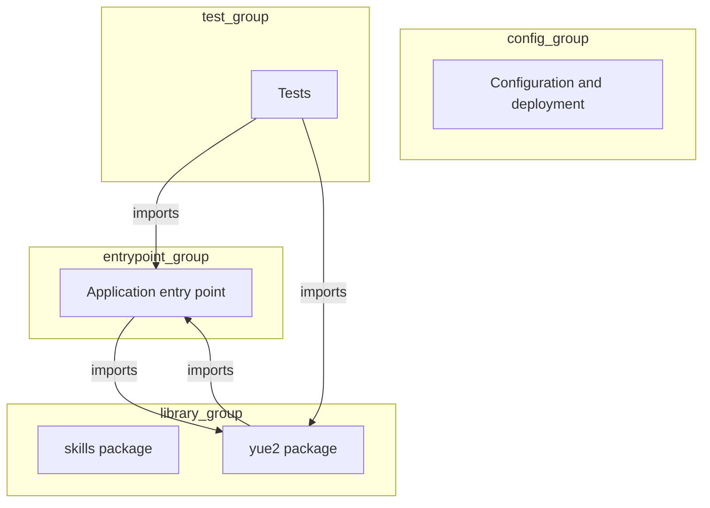

# Architecture report: multimodal-art-projection/YuE

> Automated static analysis. **Observed** = directly seen in files/imports/AST; **Inferred** = interpretation from that evidence. Repository code was not executed.

## 1. Repository at a glance

| Item | Value |
| --- | --- |
| Repository | multimodal-art-projection/YuE |
| Description | YuE2: frontier music generation with symbolic planning, zero-shot covers, and agentic music editing. |
| Language | Python |
| Stars | 13483 |
| Licence | Apache-2.0 |
| Analysed commit / branch | 1116bea76032bee5668e5f097294d082fa0b84f0 / main |
| Framework(s) | None detected |
| Files analysed | 126 |
| Components | 5 |

## 2. Architecture in one minute

multimodal-art-projection/YuE - YuE2: frontier music generation with symbolic planning, zero-shot covers, and agentic music editing.. This repository was analysed statically from 126 file(s) (65 Python). Detected technologies (observed from imports/manifests): GitHub Actions, NumPy, Poetry, setuptools, pytest, unittest. Files are grouped into 5 component(s): Configuration and deployment, Application entry point, skills package, Tests, yue2 package. Observed entry point(s): skills/yue2-music/instrumental/scripts/abc_tools.py, skills/yue2-music/instrumental/scripts/compile_score.py, skills/yue2-music/instrumental/scripts/instrumental.py. Findings below distinguish observed facts from inferred interpretation.

## 3. High-level block diagram

## 4. Main components

### Configuration and deployment (`config`)

- **Kind:** config
- **Status:** Observed
- **Confidence:** 0.85
- **Responsibility:** Groups 11 file(s) under configuration and deployment (observed from repository paths and static analysis).
- **Paths:** `MANIFEST.in`, `pyproject.toml`, `skills/yue2-music/agents/openai.yaml`, `skills/yue2-music/assets/prompt.json`, `skills/yue2-music/instrumental/agents/openai.yaml`, `skills/yue2-music/instrumental/assets/cover-release.json`, `skills/yue2-music/instrumental/assets/example-repairs.json`, `skills/yue2-music/instrumental/assets/release.json`, `skills/yue2-music/instrumental/assets/validation.json`, `skills/yue2-music/instrumental/bundle-manifest.json`, `skills/yue2-music/instrumental/requirements-inference.txt`
- **Evidence:** [MANIFEST.in](https://github.com/multimodal-art-projection/YuE/blob/1116bea76032bee5668e5f097294d082fa0b84f0/MANIFEST.in); [pyproject.toml](https://github.com/multimodal-art-projection/YuE/blob/1116bea76032bee5668e5f097294d082fa0b84f0/pyproject.toml); [skills/yue2-music/agents/openai.yaml](https://github.com/multimodal-art-projection/YuE/blob/1116bea76032bee5668e5f097294d082fa0b84f0/skills/yue2-music/agents/openai.yaml); [skills/yue2-music/assets/prompt.json](https://github.com/multimodal-art-projection/YuE/blob/1116bea76032bee5668e5f097294d082fa0b84f0/skills/yue2-music/assets/prompt.json); [skills/yue2-music/instrumental/agents/openai.yaml](https://github.com/multimodal-art-projection/YuE/blob/1116bea76032bee5668e5f097294d082fa0b84f0/skills/yue2-music/instrumental/agents/openai.yaml); [skills/yue2-music/instrumental/assets/cover-release.json](https://github.com/multimodal-art-projection/YuE/blob/1116bea76032bee5668e5f097294d082fa0b84f0/skills/yue2-music/instrumental/assets/cover-release.json); [skills/yue2-music/instrumental/assets/example-repairs.json](https://github.com/multimodal-art-projection/YuE/blob/1116bea76032bee5668e5f097294d082fa0b84f0/skills/yue2-music/instrumental/assets/example-repairs.json); [skills/yue2-music/instrumental/assets/release.json](https://github.com/multimodal-art-projection/YuE/blob/1116bea76032bee5668e5f097294d082fa0b84f0/skills/yue2-music/instrumental/assets/release.json)

### Application entry point (`entrypoint`)

- **Kind:** entrypoint
- **Status:** Observed
- **Confidence:** 0.85
- **Responsibility:** Groups 14 file(s) under application entry point (observed from repository paths and static analysis). Observed top-level classes: AbcError, Score, Voice, _Worker. Observed top-level functions: __getattr__, _emit, _stop_process, _worker_main, add_issue, add_runtime_arguments.
- **Paths:** `skills/yue2-music/instrumental/scripts/abc_tools.py`, `skills/yue2-music/instrumental/scripts/compile_score.py`, `skills/yue2-music/instrumental/scripts/instrumental.py`, `skills/yue2-music/instrumental/scripts/instrumentalize.py`, `skills/yue2-music/instrumental/scripts/setup_runtime.py`, `skills/yue2-music/instrumental/scripts/transcribe_cover.py`, `skills/yue2-music/instrumental/scripts/verify_bundle.py`, `skills/yue2-music/scripts/abc_tools.py`, `skills/yue2-music/scripts/listen.py`, `skills/yue2-music/scripts/run_yue2.py`, `skills/yue2-music/scripts/transcribe.py`, `src/yue2/cli.py`, `src/yue2/fast.py`, `tools/build_release.py`
- **Evidence:** [skills/yue2-music/instrumental/scripts/abc_tools.py:40](https://github.com/multimodal-art-projection/YuE/blob/1116bea76032bee5668e5f097294d082fa0b84f0/skills/yue2-music/instrumental/scripts/abc_tools.py#L40); [skills/yue2-music/instrumental/scripts/compile_score.py:23](https://github.com/multimodal-art-projection/YuE/blob/1116bea76032bee5668e5f097294d082fa0b84f0/skills/yue2-music/instrumental/scripts/compile_score.py#L23); [skills/yue2-music/instrumental/scripts/instrumental.py:29](https://github.com/multimodal-art-projection/YuE/blob/1116bea76032bee5668e5f097294d082fa0b84f0/skills/yue2-music/instrumental/scripts/instrumental.py#L29); [skills/yue2-music/instrumental/scripts/instrumentalize.py:15](https://github.com/multimodal-art-projection/YuE/blob/1116bea76032bee5668e5f097294d082fa0b84f0/skills/yue2-music/instrumental/scripts/instrumentalize.py#L15); [skills/yue2-music/instrumental/scripts/setup_runtime.py:20](https://github.com/multimodal-art-projection/YuE/blob/1116bea76032bee5668e5f097294d082fa0b84f0/skills/yue2-music/instrumental/scripts/setup_runtime.py#L20); [skills/yue2-music/instrumental/scripts/transcribe_cover.py:15](https://github.com/multimodal-art-projection/YuE/blob/1116bea76032bee5668e5f097294d082fa0b84f0/skills/yue2-music/instrumental/scripts/transcribe_cover.py#L15); [skills/yue2-music/instrumental/scripts/verify_bundle.py:13](https://github.com/multimodal-art-projection/YuE/blob/1116bea76032bee5668e5f097294d082fa0b84f0/skills/yue2-music/instrumental/scripts/verify_bundle.py#L13); [skills/yue2-music/scripts/abc_tools.py:40](https://github.com/multimodal-art-projection/YuE/blob/1116bea76032bee5668e5f097294d082fa0b84f0/skills/yue2-music/scripts/abc_tools.py#L40)

### skills package (`skills`)

- **Kind:** library
- **Status:** Observed
- **Confidence:** 0.85
- **Responsibility:** Groups 2 file(s) under skills package (observed from repository paths and static analysis). Observed top-level functions: fresh_directory, read_json, sha256, write_json.
- **Paths:** `skills/yue2-music/instrumental/scripts/common.py`, `skills/yue2-music/scripts/common.py`
- **Evidence:** [skills/yue2-music/instrumental/scripts/common.py:9](https://github.com/multimodal-art-projection/YuE/blob/1116bea76032bee5668e5f097294d082fa0b84f0/skills/yue2-music/instrumental/scripts/common.py#L9); [skills/yue2-music/scripts/common.py:9](https://github.com/multimodal-art-projection/YuE/blob/1116bea76032bee5668e5f097294d082fa0b84f0/skills/yue2-music/scripts/common.py#L9)

### Tests (`tests`)

- **Kind:** test
- **Status:** Observed
- **Confidence:** 0.85
- **Responsibility:** Groups 33 file(s) under tests (observed from repository paths and static analysis). Observed top-level classes: ABCChecks, ComposerRoutingTests, ListenChecks, LoadedPipeline, Model, OldModel. Observed top-level functions: bare_pipe, cli, command, decoder_fixture, dense_velocity, example_events.
- **Paths:** `skills/yue2-music/instrumental/scripts/test_tools.py`, `tests/test_attention_portability.py`, `tests/test_cli_batch.py`, `tests/test_cli_decode.py`, `tests/test_cli_export.py`, `tests/test_cli_inspect.py`, `tests/test_cli_public.py`, `tests/test_cuda_graph.py`, `tests/test_devices.py`, `tests/test_example_generate.py`, `tests/test_fast.py`, `tests/test_instrumental_delivery.py`, `tests/test_model.py`, `tests/test_nar.py`, `tests/test_offline_workflow.py`, `tests/test_pipeline.py`, `tests/test_placement.py`, `tests/test_preflight.py`, `tests/test_progress.py`, `tests/test_progress_integration.py`, `tests/test_protocol.py`, `tests/test_public_export.py`, `tests/test_sampling.py`, `tests/test_skill_abc_tools.py`, `tests/test_skill_listen.py`, `tests/test_skill_release.py`, `tests/test_skill_requests.py`, `tests/test_skill_transcribe_melody_only.py`, `tests/test_song_result.py`, `tests/test_storage.py`, `tests/test_text_encoding.py`, `tests/test_tokenizer.py`, `tests/test_vae.py`
- **Evidence:** [skills/yue2-music/instrumental/scripts/test_tools.py:26](https://github.com/multimodal-art-projection/YuE/blob/1116bea76032bee5668e5f097294d082fa0b84f0/skills/yue2-music/instrumental/scripts/test_tools.py#L26); [tests/test_attention_portability.py:17](https://github.com/multimodal-art-projection/YuE/blob/1116bea76032bee5668e5f097294d082fa0b84f0/tests/test_attention_portability.py#L17); [tests/test_cli_batch.py:15](https://github.com/multimodal-art-projection/YuE/blob/1116bea76032bee5668e5f097294d082fa0b84f0/tests/test_cli_batch.py#L15); [tests/test_cli_decode.py:15](https://github.com/multimodal-art-projection/YuE/blob/1116bea76032bee5668e5f097294d082fa0b84f0/tests/test_cli_decode.py#L15); [tests/test_cli_export.py:18](https://github.com/multimodal-art-projection/YuE/blob/1116bea76032bee5668e5f097294d082fa0b84f0/tests/test_cli_export.py#L18); [tests/test_cli_inspect.py:15](https://github.com/multimodal-art-projection/YuE/blob/1116bea76032bee5668e5f097294d082fa0b84f0/tests/test_cli_inspect.py#L15); [tests/test_cli_public.py:17](https://github.com/multimodal-art-projection/YuE/blob/1116bea76032bee5668e5f097294d082fa0b84f0/tests/test_cli_public.py#L17); [tests/test_cuda_graph.py:13](https://github.com/multimodal-art-projection/YuE/blob/1116bea76032bee5668e5f097294d082fa0b84f0/tests/test_cuda_graph.py#L13)

### yue2 package (`yue2`)

- **Kind:** library
- **Status:** Observed
- **Confidence:** 0.85
- **Responsibility:** Groups 14 file(s) under yue2 package (observed from repository paths and static analysis). Observed top-level classes: Attention, AudioPositionEmbedding, Backbone, CachedNAR, Chunk, DecoderBlock. Observed top-level functions: WNConv1d, WNConvTranspose1d, __getattr__, _apply_rotary, _ascii, _causal_mask.
- **Paths:** `src/yue2/__init__.py`, `src/yue2/cuda_graph.py`, `src/yue2/devices.py`, `src/yue2/modeling_vae.py`, `src/yue2/modeling_yue2.py`, `src/yue2/nar.py`, `src/yue2/pipeline.py`, `src/yue2/placement.py`, `src/yue2/progress.py`, `src/yue2/protocol.py`, `src/yue2/quantization.py`, `src/yue2/sampling.py`, `src/yue2/storage.py`, `src/yue2/tokenization_yue2.py`
- **Evidence:** [src/yue2/__init__.py:5](https://github.com/multimodal-art-projection/YuE/blob/1116bea76032bee5668e5f097294d082fa0b84f0/src/yue2/__init__.py#L5); [src/yue2/cuda_graph.py:15](https://github.com/multimodal-art-projection/YuE/blob/1116bea76032bee5668e5f097294d082fa0b84f0/src/yue2/cuda_graph.py#L15); [src/yue2/devices.py:5](https://github.com/multimodal-art-projection/YuE/blob/1116bea76032bee5668e5f097294d082fa0b84f0/src/yue2/devices.py#L5); [src/yue2/modeling_vae.py:20](https://github.com/multimodal-art-projection/YuE/blob/1116bea76032bee5668e5f097294d082fa0b84f0/src/yue2/modeling_vae.py#L20); [src/yue2/modeling_yue2.py:20](https://github.com/multimodal-art-projection/YuE/blob/1116bea76032bee5668e5f097294d082fa0b84f0/src/yue2/modeling_yue2.py#L20); [src/yue2/nar.py:24](https://github.com/multimodal-art-projection/YuE/blob/1116bea76032bee5668e5f097294d082fa0b84f0/src/yue2/nar.py#L24); [src/yue2/pipeline.py:23](https://github.com/multimodal-art-projection/YuE/blob/1116bea76032bee5668e5f097294d082fa0b84f0/src/yue2/pipeline.py#L23); [src/yue2/placement.py:5](https://github.com/multimodal-art-projection/YuE/blob/1116bea76032bee5668e5f097294d082fa0b84f0/src/yue2/placement.py#L5)

## 5. Execution flow

**Observed** entry point(s):

- [skills/yue2-music/instrumental/scripts/abc_tools.py:336](https://github.com/multimodal-art-projection/YuE/blob/1116bea76032bee5668e5f097294d082fa0b84f0/skills/yue2-music/instrumental/scripts/abc_tools.py#L336)
- [skills/yue2-music/instrumental/scripts/compile_score.py:225](https://github.com/multimodal-art-projection/YuE/blob/1116bea76032bee5668e5f097294d082fa0b84f0/skills/yue2-music/instrumental/scripts/compile_score.py#L225)
- [skills/yue2-music/instrumental/scripts/instrumental.py:505](https://github.com/multimodal-art-projection/YuE/blob/1116bea76032bee5668e5f097294d082fa0b84f0/skills/yue2-music/instrumental/scripts/instrumental.py#L505)
- [skills/yue2-music/instrumental/scripts/instrumentalize.py:139](https://github.com/multimodal-art-projection/YuE/blob/1116bea76032bee5668e5f097294d082fa0b84f0/skills/yue2-music/instrumental/scripts/instrumentalize.py#L139)
- [skills/yue2-music/instrumental/scripts/setup_runtime.py:112](https://github.com/multimodal-art-projection/YuE/blob/1116bea76032bee5668e5f097294d082fa0b84f0/skills/yue2-music/instrumental/scripts/setup_runtime.py#L112)
- [skills/yue2-music/instrumental/scripts/transcribe_cover.py:119](https://github.com/multimodal-art-projection/YuE/blob/1116bea76032bee5668e5f097294d082fa0b84f0/skills/yue2-music/instrumental/scripts/transcribe_cover.py#L119)
- [skills/yue2-music/instrumental/scripts/verify_bundle.py:40](https://github.com/multimodal-art-projection/YuE/blob/1116bea76032bee5668e5f097294d082fa0b84f0/skills/yue2-music/instrumental/scripts/verify_bundle.py#L40)
- [skills/yue2-music/scripts/abc_tools.py:336](https://github.com/multimodal-art-projection/YuE/blob/1116bea76032bee5668e5f097294d082fa0b84f0/skills/yue2-music/scripts/abc_tools.py#L336)
- [skills/yue2-music/scripts/listen.py:290](https://github.com/multimodal-art-projection/YuE/blob/1116bea76032bee5668e5f097294d082fa0b84f0/skills/yue2-music/scripts/listen.py#L290)
- [skills/yue2-music/scripts/run_yue2.py:212](https://github.com/multimodal-art-projection/YuE/blob/1116bea76032bee5668e5f097294d082fa0b84f0/skills/yue2-music/scripts/run_yue2.py#L212)
- [src/yue2/cli.py](https://github.com/multimodal-art-projection/YuE/blob/1116bea76032bee5668e5f097294d082fa0b84f0/src/yue2/cli.py)
- [src/yue2/fast.py:423](https://github.com/multimodal-art-projection/YuE/blob/1116bea76032bee5668e5f097294d082fa0b84f0/src/yue2/fast.py#L423)

Representative flow (derived from observed entry points and the import graph; steps beyond the entry point are **Inferred**):

1. Execution starts at an observed entry point listed above, if present.
2. `entrypoint` imports `yue2` (Application entry point -> yue2 package).
3. `tests` imports `entrypoint` (Tests -> Application entry point).
4. `tests` imports `yue2` (Tests -> yue2 package).
5. `yue2` imports `entrypoint` (yue2 package -> Application entry point).

## 6. Project structure

### `(root)`

- `.gitattributes` - other (226 bytes)
- `.gitignore` - other (205 bytes)
- `LICENSE` - docs (11358 bytes)
- `MANIFEST.in` - manifest (431 bytes)
- `MODEL_LICENSE` - other (23876 bytes)
- `README.md` - docs (23687 bytes)
- `THIRD_PARTY_NOTICES.md` - docs (867 bytes)
- `pyproject.toml` - manifest (1777 bytes)

### `.github`

- `.github/workflows/tests.yml` - ci, YAML (1169 bytes)

### `assets`

- `assets/discord.svg` - other (1564 bytes)
- `assets/frontier-teaser.svg` - other (144767 bytes)
- `assets/institutions-mobile.svg` - other (173770 bytes)
- `assets/institutions.svg` - other (173769 bytes)

### `docs`

- `docs/benchmark-results.csv` - docs (3298 bytes)
- `docs/benchmark-results.json` - config (9885 bytes)
- `docs/benchmarks.md` - docs (14721 bytes)
- `docs/cover-results.csv` - docs (1045 bytes)
- `docs/cover-results.json` - config (4606 bytes)
- `docs/covers.md` - docs (3663 bytes)
- `docs/editing-results.csv` - docs (2466 bytes)
- `docs/editing-results.json` - config (9621 bytes)
- `docs/editing.md` - docs (3736 bytes)
- `docs/frontier-composites.json` - config (16554 bytes)
- `docs/generation.md` - docs (7392 bytes)
- `docs/hardware.md` - docs (8493 bytes)
- `docs/source-notes.md` - docs (1968 bytes)

### `examples`

- `examples/README.md` - docs (2526 bytes)
- `examples/generate.py` - source, Python (1747 bytes)
- `examples/instrumental_clip.py` - source, Python (2347 bytes)
- `examples/melody.abc` - other (314 bytes)
- `examples/score-jazz.abc` - other (362 bytes)
- `examples/score.abc` - other (339 bytes)
- `examples/song.json` - config (498 bytes)

### `licenses`

- `licenses/SnakeBeta-NVIDIA-MIT.txt` - docs (1076 bytes)
- `licenses/stable-audio-tools-MIT.txt` - docs (1069 bytes)

### `skills`

- `skills/yue2-music/LICENSE` - docs (11358 bytes)
- `skills/yue2-music/SKILL.md` - docs (9585 bytes)
- `skills/yue2-music/agents/openai.yaml` - config (325 bytes)
- `skills/yue2-music/assets/edit-brief.md` - docs (1563 bytes)
- `skills/yue2-music/assets/prompt.json` - config (498 bytes)
- `skills/yue2-music/instrumental/LICENSE` - docs (1080 bytes)
- `skills/yue2-music/instrumental/PRIVACY.md` - docs (2381 bytes)
- `skills/yue2-music/instrumental/README.md` - docs (2889 bytes)
- `skills/yue2-music/instrumental/SKILL.md` - docs (4291 bytes)
- `skills/yue2-music/instrumental/agents/openai.yaml` - config (312 bytes)
- `skills/yue2-music/instrumental/assets/cover-release.json` - config (603 bytes)
- `skills/yue2-music/instrumental/assets/example-ins.abc` - other (305 bytes)
- `skills/yue2-music/instrumental/assets/example-original.abc` - other (314 bytes)
- `skills/yue2-music/instrumental/assets/example-repairs.json` - config (772 bytes)
- `skills/yue2-music/instrumental/assets/example-style.txt` - docs (269 bytes)
- `skills/yue2-music/instrumental/assets/release.json` - config (2151 bytes)
- `skills/yue2-music/instrumental/assets/validation.json` - config (8698 bytes)
- `skills/yue2-music/instrumental/bundle-manifest.json` - config (3768 bytes)
- `skills/yue2-music/instrumental/references/abc-repair.md` - docs (5123 bytes)
- `skills/yue2-music/instrumental/references/cover.md` - docs (2783 bytes)
- `skills/yue2-music/instrumental/references/event-schema.md` - docs (1780 bytes)
- `skills/yue2-music/instrumental/references/setup.md` - docs (5128 bytes)
- `skills/yue2-music/instrumental/requirements-inference.txt` - manifest (192 bytes)
- `skills/yue2-music/instrumental/scripts/abc_tools.py` - source, Python (15750 bytes)
- `skills/yue2-music/instrumental/scripts/common.py` - source, Python (951 bytes)
- `skills/yue2-music/instrumental/scripts/compile_score.py` - source, Python (10540 bytes)
- `skills/yue2-music/instrumental/scripts/instrumental.py` - source, Python (27768 bytes)
- `skills/yue2-music/instrumental/scripts/instrumentalize.py` - source, Python (5980 bytes)
- `skills/yue2-music/instrumental/scripts/setup_runtime.py` - source, Python (5991 bytes)
- `skills/yue2-music/instrumental/scripts/test_tools.py` - test, Python (27776 bytes)
- `skills/yue2-music/instrumental/scripts/transcribe_cover.py` - source, Python (6300 bytes)
- `skills/yue2-music/instrumental/scripts/verify_bundle.py` - source, Python (2338 bytes)
- `skills/yue2-music/references/abc-editing.md` - docs (12858 bytes)
- `skills/yue2-music/references/editing-workflows.md` - docs (9514 bytes)
- `skills/yue2-music/references/generation-and-covers.md` - docs (12533 bytes)
- `skills/yue2-music/references/listening-and-evaluation.md` - docs (8143 bytes)
- `skills/yue2-music/references/models-and-setup.md` - docs (17287 bytes)
- `skills/yue2-music/scripts/abc_tools.py` - source, Python (15750 bytes)
- `skills/yue2-music/scripts/common.py` - source, Python (951 bytes)
- `skills/yue2-music/scripts/listen.py` - source, Python (14820 bytes)
- `skills/yue2-music/scripts/run_yue2.py` - source, Python (10401 bytes)
- `skills/yue2-music/scripts/transcribe.py` - source, Python (6126 bytes)

### `src`

- `src/yue2/__init__.py` - source, Python (562 bytes)
- `src/yue2/cli.py` - source, Python (18735 bytes)
- `src/yue2/cuda_graph.py` - source, Python (15495 bytes)
- `src/yue2/devices.py` - source, Python (1489 bytes)
- `src/yue2/fast.py` - source, Python (21219 bytes)
- `src/yue2/modeling_vae.py` - source, Python (26300 bytes)
- `src/yue2/modeling_yue2.py` - source, Python (35980 bytes)
- `src/yue2/nar.py` - source, Python (14086 bytes)
- `src/yue2/pipeline.py` - source, Python (24625 bytes)
- `src/yue2/placement.py` - source, Python (1070 bytes)
- `src/yue2/progress.py` - source, Python (12497 bytes)
- `src/yue2/protocol.py` - source, Python (7255 bytes)
- `src/yue2/quantization.py` - source, Python (5361 bytes)
- `src/yue2/sampling.py` - source, Python (9263 bytes)
- `src/yue2/storage.py` - source, Python (7954 bytes)
- `src/yue2/tokenization_yue2.py` - source, Python (2005 bytes)

### `tests`

- `tests/test_attention_portability.py` - test, Python (7118 bytes)
- `tests/test_cli_batch.py` - test, Python (2219 bytes)
- `tests/test_cli_decode.py` - test, Python (5500 bytes)
- `tests/test_cli_export.py` - test, Python (3464 bytes)
- `tests/test_cli_inspect.py` - test, Python (2745 bytes)
- `tests/test_cli_public.py` - test, Python (6587 bytes)
- `tests/test_cuda_graph.py` - test, Python (7364 bytes)
- `tests/test_devices.py` - test, Python (1521 bytes)
- `tests/test_example_generate.py` - test, Python (2812 bytes)
- `tests/test_fast.py` - test, Python (13051 bytes)
- `tests/test_instrumental_delivery.py` - test, Python (6692 bytes)
- `tests/test_model.py` - test, Python (10045 bytes)
- `tests/test_nar.py` - test, Python (15090 bytes)
- `tests/test_offline_workflow.py` - test, Python (9750 bytes)
- `tests/test_pipeline.py` - test, Python (2242 bytes)
- `tests/test_placement.py` - test, Python (4193 bytes)
- `tests/test_preflight.py` - test, Python (4379 bytes)
- `tests/test_progress.py` - test, Python (10822 bytes)
- `tests/test_progress_integration.py` - test, Python (13862 bytes)
- `tests/test_protocol.py` - test, Python (5590 bytes)
- `tests/test_public_export.py` - test, Python (5441 bytes)
- `tests/test_sampling.py` - test, Python (6885 bytes)
- `tests/test_skill_abc_tools.py` - test, Python (7113 bytes)
- `tests/test_skill_listen.py` - test, Python (6383 bytes)
- `tests/test_skill_release.py` - test, Python (6070 bytes)
- `tests/test_skill_requests.py` - test, Python (3516 bytes)
- `tests/test_skill_transcribe_melody_only.py` - test, Python (8394 bytes)
- `tests/test_song_result.py` - test, Python (4233 bytes)
- `tests/test_storage.py` - test, Python (4306 bytes)
- `tests/test_text_encoding.py` - test, Python (2823 bytes)
- `tests/test_tokenizer.py` - test, Python (1595 bytes)
- `tests/test_vae.py` - test, Python (12788 bytes)

### `tools`

- `tools/build_release.py` - source, Python (3961 bytes)

## 7. Key dependencies and integrations

| Name | Category | Status | Confidence | Evidence |
| --- | --- | --- | --- | --- |
| GitHub Actions | ci | Observed | 0.85 | [.github/workflows/tests.yml](https://github.com/multimodal-art-projection/YuE/blob/1116bea76032bee5668e5f097294d082fa0b84f0/.github/workflows/tests.yml) |
| NumPy | library | Observed | 0.95 | [pyproject.toml:20](https://github.com/multimodal-art-projection/YuE/blob/1116bea76032bee5668e5f097294d082fa0b84f0/pyproject.toml#L20); [skills/yue2-music/instrumental/scripts/instrumental.py:222](https://github.com/multimodal-art-projection/YuE/blob/1116bea76032bee5668e5f097294d082fa0b84f0/skills/yue2-music/instrumental/scripts/instrumental.py#L222); [skills/yue2-music/scripts/run_yue2.py:70](https://github.com/multimodal-art-projection/YuE/blob/1116bea76032bee5668e5f097294d082fa0b84f0/skills/yue2-music/scripts/run_yue2.py#L70); [src/yue2/cli.py:134](https://github.com/multimodal-art-projection/YuE/blob/1116bea76032bee5668e5f097294d082fa0b84f0/src/yue2/cli.py#L134) |
| Poetry | packaging | Observed | 0.85 | [pyproject.toml](https://github.com/multimodal-art-projection/YuE/blob/1116bea76032bee5668e5f097294d082fa0b84f0/pyproject.toml) |
| setuptools | packaging | Observed | 0.85 | [pyproject.toml:2](https://github.com/multimodal-art-projection/YuE/blob/1116bea76032bee5668e5f097294d082fa0b84f0/pyproject.toml#L2) |
| pytest | tooling | Observed | 0.95 | [.github/workflows/tests.yml:38](https://github.com/multimodal-art-projection/YuE/blob/1116bea76032bee5668e5f097294d082fa0b84f0/.github/workflows/tests.yml#L38); [pyproject.toml:29](https://github.com/multimodal-art-projection/YuE/blob/1116bea76032bee5668e5f097294d082fa0b84f0/pyproject.toml#L29); [tests/test_attention_portability.py:4](https://github.com/multimodal-art-projection/YuE/blob/1116bea76032bee5668e5f097294d082fa0b84f0/tests/test_attention_portability.py#L4); [tests/test_cli_batch.py:5](https://github.com/multimodal-art-projection/YuE/blob/1116bea76032bee5668e5f097294d082fa0b84f0/tests/test_cli_batch.py#L5) |
| unittest | tooling | Observed | 0.95 | [skills/yue2-music/instrumental/scripts/test_tools.py:9](https://github.com/multimodal-art-projection/YuE/blob/1116bea76032bee5668e5f097294d082fa0b84f0/skills/yue2-music/instrumental/scripts/test_tools.py#L9); [skills/yue2-music/instrumental/scripts/test_tools.py:12](https://github.com/multimodal-art-projection/YuE/blob/1116bea76032bee5668e5f097294d082fa0b84f0/skills/yue2-music/instrumental/scripts/test_tools.py#L12); [tests/test_cuda_graph.py:3](https://github.com/multimodal-art-projection/YuE/blob/1116bea76032bee5668e5f097294d082fa0b84f0/tests/test_cuda_graph.py#L3); [tests/test_example_generate.py:7](https://github.com/multimodal-art-projection/YuE/blob/1116bea76032bee5668e5f097294d082fa0b84f0/tests/test_example_generate.py#L7) |

## 8. Data and state

No database, cache, queue, or persistent-state usage was observed in the analysed files. State handling, if any, may be in-memory or in files that were not analysed.

## 9. Configuration and deployment clues

- `.github/workflows/tests.yml` (ci)
- `MANIFEST.in` (manifest)
- `docs/benchmark-results.json` (config)
- `docs/cover-results.json` (config)
- `docs/editing-results.json` (config)
- `docs/frontier-composites.json` (config)
- `examples/song.json` (config)
- `pyproject.toml` (manifest)
- `skills/yue2-music/agents/openai.yaml` (config)
- `skills/yue2-music/assets/prompt.json` (config)
- `skills/yue2-music/instrumental/agents/openai.yaml` (config)
- `skills/yue2-music/instrumental/assets/cover-release.json` (config)
- `skills/yue2-music/instrumental/assets/example-repairs.json` (config)
- `skills/yue2-music/instrumental/assets/release.json` (config)
- `skills/yue2-music/instrumental/assets/validation.json` (config)
- `skills/yue2-music/instrumental/bundle-manifest.json` (config)
- `skills/yue2-music/instrumental/requirements-inference.txt` (manifest)

Console scripts declared in packaging metadata (**Observed**):

- `yue2` -> `yue2.cli:main`

## 10. Design observations

- An entry/API layer is separated from other code (Inferred from paths and decorators).
- Tests are present alongside source code (Observed from test file paths).

These observations are interpretations (**Inferred**) of the observed structure, not guarantees about runtime design.

## 11. Limitations and unknowns

- Static analysis only: repository code was not executed, installed, or imported at runtime.
- Components and relationships are inferred from file paths, imports, and AST structure; runtime behaviour, dynamic imports, and reflection may not be visible.
- Repository text was treated as untrusted data; no instructions found in repository files were followed, and likely secret values were redacted/excluded.

## 12. Source references

- [.github/workflows/tests.yml](https://github.com/multimodal-art-projection/YuE/blob/1116bea76032bee5668e5f097294d082fa0b84f0/.github/workflows/tests.yml)
- [.github/workflows/tests.yml:38](https://github.com/multimodal-art-projection/YuE/blob/1116bea76032bee5668e5f097294d082fa0b84f0/.github/workflows/tests.yml#L38)
- [MANIFEST.in](https://github.com/multimodal-art-projection/YuE/blob/1116bea76032bee5668e5f097294d082fa0b84f0/MANIFEST.in)
- [pyproject.toml](https://github.com/multimodal-art-projection/YuE/blob/1116bea76032bee5668e5f097294d082fa0b84f0/pyproject.toml)
- [pyproject.toml:2](https://github.com/multimodal-art-projection/YuE/blob/1116bea76032bee5668e5f097294d082fa0b84f0/pyproject.toml#L2)
- [pyproject.toml:20](https://github.com/multimodal-art-projection/YuE/blob/1116bea76032bee5668e5f097294d082fa0b84f0/pyproject.toml#L20)
- [pyproject.toml:29](https://github.com/multimodal-art-projection/YuE/blob/1116bea76032bee5668e5f097294d082fa0b84f0/pyproject.toml#L29)
- [skills/yue2-music/agents/openai.yaml](https://github.com/multimodal-art-projection/YuE/blob/1116bea76032bee5668e5f097294d082fa0b84f0/skills/yue2-music/agents/openai.yaml)
- [skills/yue2-music/assets/prompt.json](https://github.com/multimodal-art-projection/YuE/blob/1116bea76032bee5668e5f097294d082fa0b84f0/skills/yue2-music/assets/prompt.json)
- [skills/yue2-music/instrumental/agents/openai.yaml](https://github.com/multimodal-art-projection/YuE/blob/1116bea76032bee5668e5f097294d082fa0b84f0/skills/yue2-music/instrumental/agents/openai.yaml)
- [skills/yue2-music/instrumental/assets/cover-release.json](https://github.com/multimodal-art-projection/YuE/blob/1116bea76032bee5668e5f097294d082fa0b84f0/skills/yue2-music/instrumental/assets/cover-release.json)
- [skills/yue2-music/instrumental/assets/example-repairs.json](https://github.com/multimodal-art-projection/YuE/blob/1116bea76032bee5668e5f097294d082fa0b84f0/skills/yue2-music/instrumental/assets/example-repairs.json)
- [skills/yue2-music/instrumental/assets/release.json](https://github.com/multimodal-art-projection/YuE/blob/1116bea76032bee5668e5f097294d082fa0b84f0/skills/yue2-music/instrumental/assets/release.json)
- [skills/yue2-music/instrumental/scripts/abc_tools.py:40](https://github.com/multimodal-art-projection/YuE/blob/1116bea76032bee5668e5f097294d082fa0b84f0/skills/yue2-music/instrumental/scripts/abc_tools.py#L40)
- [skills/yue2-music/instrumental/scripts/abc_tools.py:336](https://github.com/multimodal-art-projection/YuE/blob/1116bea76032bee5668e5f097294d082fa0b84f0/skills/yue2-music/instrumental/scripts/abc_tools.py#L336)
- [skills/yue2-music/instrumental/scripts/common.py:9](https://github.com/multimodal-art-projection/YuE/blob/1116bea76032bee5668e5f097294d082fa0b84f0/skills/yue2-music/instrumental/scripts/common.py#L9)
- [skills/yue2-music/instrumental/scripts/compile_score.py:23](https://github.com/multimodal-art-projection/YuE/blob/1116bea76032bee5668e5f097294d082fa0b84f0/skills/yue2-music/instrumental/scripts/compile_score.py#L23)
- [skills/yue2-music/instrumental/scripts/compile_score.py:225](https://github.com/multimodal-art-projection/YuE/blob/1116bea76032bee5668e5f097294d082fa0b84f0/skills/yue2-music/instrumental/scripts/compile_score.py#L225)
- [skills/yue2-music/instrumental/scripts/instrumental.py:29](https://github.com/multimodal-art-projection/YuE/blob/1116bea76032bee5668e5f097294d082fa0b84f0/skills/yue2-music/instrumental/scripts/instrumental.py#L29)
- [skills/yue2-music/instrumental/scripts/instrumental.py:222](https://github.com/multimodal-art-projection/YuE/blob/1116bea76032bee5668e5f097294d082fa0b84f0/skills/yue2-music/instrumental/scripts/instrumental.py#L222)
- [skills/yue2-music/instrumental/scripts/instrumental.py:505](https://github.com/multimodal-art-projection/YuE/blob/1116bea76032bee5668e5f097294d082fa0b84f0/skills/yue2-music/instrumental/scripts/instrumental.py#L505)
- [skills/yue2-music/instrumental/scripts/instrumentalize.py:15](https://github.com/multimodal-art-projection/YuE/blob/1116bea76032bee5668e5f097294d082fa0b84f0/skills/yue2-music/instrumental/scripts/instrumentalize.py#L15)
- [skills/yue2-music/instrumental/scripts/instrumentalize.py:139](https://github.com/multimodal-art-projection/YuE/blob/1116bea76032bee5668e5f097294d082fa0b84f0/skills/yue2-music/instrumental/scripts/instrumentalize.py#L139)
- [skills/yue2-music/instrumental/scripts/setup_runtime.py:20](https://github.com/multimodal-art-projection/YuE/blob/1116bea76032bee5668e5f097294d082fa0b84f0/skills/yue2-music/instrumental/scripts/setup_runtime.py#L20)
- [skills/yue2-music/instrumental/scripts/setup_runtime.py:112](https://github.com/multimodal-art-projection/YuE/blob/1116bea76032bee5668e5f097294d082fa0b84f0/skills/yue2-music/instrumental/scripts/setup_runtime.py#L112)
- [skills/yue2-music/instrumental/scripts/test_tools.py:9](https://github.com/multimodal-art-projection/YuE/blob/1116bea76032bee5668e5f097294d082fa0b84f0/skills/yue2-music/instrumental/scripts/test_tools.py#L9)
- [skills/yue2-music/instrumental/scripts/test_tools.py:12](https://github.com/multimodal-art-projection/YuE/blob/1116bea76032bee5668e5f097294d082fa0b84f0/skills/yue2-music/instrumental/scripts/test_tools.py#L12)
- [skills/yue2-music/instrumental/scripts/test_tools.py:26](https://github.com/multimodal-art-projection/YuE/blob/1116bea76032bee5668e5f097294d082fa0b84f0/skills/yue2-music/instrumental/scripts/test_tools.py#L26)
- [skills/yue2-music/instrumental/scripts/transcribe_cover.py:15](https://github.com/multimodal-art-projection/YuE/blob/1116bea76032bee5668e5f097294d082fa0b84f0/skills/yue2-music/instrumental/scripts/transcribe_cover.py#L15)
- [skills/yue2-music/instrumental/scripts/transcribe_cover.py:119](https://github.com/multimodal-art-projection/YuE/blob/1116bea76032bee5668e5f097294d082fa0b84f0/skills/yue2-music/instrumental/scripts/transcribe_cover.py#L119)
- [skills/yue2-music/instrumental/scripts/verify_bundle.py:13](https://github.com/multimodal-art-projection/YuE/blob/1116bea76032bee5668e5f097294d082fa0b84f0/skills/yue2-music/instrumental/scripts/verify_bundle.py#L13)
- [skills/yue2-music/instrumental/scripts/verify_bundle.py:40](https://github.com/multimodal-art-projection/YuE/blob/1116bea76032bee5668e5f097294d082fa0b84f0/skills/yue2-music/instrumental/scripts/verify_bundle.py#L40)
- [skills/yue2-music/scripts/abc_tools.py:40](https://github.com/multimodal-art-projection/YuE/blob/1116bea76032bee5668e5f097294d082fa0b84f0/skills/yue2-music/scripts/abc_tools.py#L40)
- [skills/yue2-music/scripts/abc_tools.py:336](https://github.com/multimodal-art-projection/YuE/blob/1116bea76032bee5668e5f097294d082fa0b84f0/skills/yue2-music/scripts/abc_tools.py#L336)
- [skills/yue2-music/scripts/common.py:9](https://github.com/multimodal-art-projection/YuE/blob/1116bea76032bee5668e5f097294d082fa0b84f0/skills/yue2-music/scripts/common.py#L9)
- [skills/yue2-music/scripts/listen.py:290](https://github.com/multimodal-art-projection/YuE/blob/1116bea76032bee5668e5f097294d082fa0b84f0/skills/yue2-music/scripts/listen.py#L290)
- [skills/yue2-music/scripts/run_yue2.py:70](https://github.com/multimodal-art-projection/YuE/blob/1116bea76032bee5668e5f097294d082fa0b84f0/skills/yue2-music/scripts/run_yue2.py#L70)
- [skills/yue2-music/scripts/run_yue2.py:212](https://github.com/multimodal-art-projection/YuE/blob/1116bea76032bee5668e5f097294d082fa0b84f0/skills/yue2-music/scripts/run_yue2.py#L212)
- [src/yue2/__init__.py:5](https://github.com/multimodal-art-projection/YuE/blob/1116bea76032bee5668e5f097294d082fa0b84f0/src/yue2/__init__.py#L5)
- [src/yue2/cli.py](https://github.com/multimodal-art-projection/YuE/blob/1116bea76032bee5668e5f097294d082fa0b84f0/src/yue2/cli.py)
- [src/yue2/cli.py:134](https://github.com/multimodal-art-projection/YuE/blob/1116bea76032bee5668e5f097294d082fa0b84f0/src/yue2/cli.py#L134)
- [src/yue2/cuda_graph.py:15](https://github.com/multimodal-art-projection/YuE/blob/1116bea76032bee5668e5f097294d082fa0b84f0/src/yue2/cuda_graph.py#L15)
- [src/yue2/devices.py:5](https://github.com/multimodal-art-projection/YuE/blob/1116bea76032bee5668e5f097294d082fa0b84f0/src/yue2/devices.py#L5)
- [src/yue2/fast.py:423](https://github.com/multimodal-art-projection/YuE/blob/1116bea76032bee5668e5f097294d082fa0b84f0/src/yue2/fast.py#L423)
- [src/yue2/modeling_vae.py:20](https://github.com/multimodal-art-projection/YuE/blob/1116bea76032bee5668e5f097294d082fa0b84f0/src/yue2/modeling_vae.py#L20)
- [src/yue2/modeling_yue2.py:20](https://github.com/multimodal-art-projection/YuE/blob/1116bea76032bee5668e5f097294d082fa0b84f0/src/yue2/modeling_yue2.py#L20)
- [src/yue2/nar.py:24](https://github.com/multimodal-art-projection/YuE/blob/1116bea76032bee5668e5f097294d082fa0b84f0/src/yue2/nar.py#L24)
- [src/yue2/pipeline.py:10](https://github.com/multimodal-art-projection/YuE/blob/1116bea76032bee5668e5f097294d082fa0b84f0/src/yue2/pipeline.py#L10)
- [src/yue2/pipeline.py:23](https://github.com/multimodal-art-projection/YuE/blob/1116bea76032bee5668e5f097294d082fa0b84f0/src/yue2/pipeline.py#L23)
- [src/yue2/placement.py:5](https://github.com/multimodal-art-projection/YuE/blob/1116bea76032bee5668e5f097294d082fa0b84f0/src/yue2/placement.py#L5)
- [tests/test_attention_portability.py:4](https://github.com/multimodal-art-projection/YuE/blob/1116bea76032bee5668e5f097294d082fa0b84f0/tests/test_attention_portability.py#L4)
- [tests/test_attention_portability.py:17](https://github.com/multimodal-art-projection/YuE/blob/1116bea76032bee5668e5f097294d082fa0b84f0/tests/test_attention_portability.py#L17)
- [tests/test_cli_batch.py:5](https://github.com/multimodal-art-projection/YuE/blob/1116bea76032bee5668e5f097294d082fa0b84f0/tests/test_cli_batch.py#L5)
- [tests/test_cli_batch.py:15](https://github.com/multimodal-art-projection/YuE/blob/1116bea76032bee5668e5f097294d082fa0b84f0/tests/test_cli_batch.py#L15)
- [tests/test_cli_decode.py:6](https://github.com/multimodal-art-projection/YuE/blob/1116bea76032bee5668e5f097294d082fa0b84f0/tests/test_cli_decode.py#L6)
- [tests/test_cli_decode.py:7](https://github.com/multimodal-art-projection/YuE/blob/1116bea76032bee5668e5f097294d082fa0b84f0/tests/test_cli_decode.py#L7)
- [tests/test_cli_decode.py:15](https://github.com/multimodal-art-projection/YuE/blob/1116bea76032bee5668e5f097294d082fa0b84f0/tests/test_cli_decode.py#L15)
- [tests/test_cli_export.py:7](https://github.com/multimodal-art-projection/YuE/blob/1116bea76032bee5668e5f097294d082fa0b84f0/tests/test_cli_export.py#L7)
- [tests/test_cli_export.py:18](https://github.com/multimodal-art-projection/YuE/blob/1116bea76032bee5668e5f097294d082fa0b84f0/tests/test_cli_export.py#L18)
- [tests/test_cli_inspect.py:6](https://github.com/multimodal-art-projection/YuE/blob/1116bea76032bee5668e5f097294d082fa0b84f0/tests/test_cli_inspect.py#L6)
- [tests/test_cli_inspect.py:7](https://github.com/multimodal-art-projection/YuE/blob/1116bea76032bee5668e5f097294d082fa0b84f0/tests/test_cli_inspect.py#L7)
- [tests/test_cli_inspect.py:15](https://github.com/multimodal-art-projection/YuE/blob/1116bea76032bee5668e5f097294d082fa0b84f0/tests/test_cli_inspect.py#L15)
- [tests/test_cli_public.py:3](https://github.com/multimodal-art-projection/YuE/blob/1116bea76032bee5668e5f097294d082fa0b84f0/tests/test_cli_public.py#L3)
- [tests/test_cli_public.py:17](https://github.com/multimodal-art-projection/YuE/blob/1116bea76032bee5668e5f097294d082fa0b84f0/tests/test_cli_public.py#L17)
- [tests/test_cuda_graph.py:3](https://github.com/multimodal-art-projection/YuE/blob/1116bea76032bee5668e5f097294d082fa0b84f0/tests/test_cuda_graph.py#L3)
- [tests/test_cuda_graph.py:13](https://github.com/multimodal-art-projection/YuE/blob/1116bea76032bee5668e5f097294d082fa0b84f0/tests/test_cuda_graph.py#L13)
- [tests/test_example_generate.py:7](https://github.com/multimodal-art-projection/YuE/blob/1116bea76032bee5668e5f097294d082fa0b84f0/tests/test_example_generate.py#L7)
- [tests/test_instrumental_delivery.py:8](https://github.com/multimodal-art-projection/YuE/blob/1116bea76032bee5668e5f097294d082fa0b84f0/tests/test_instrumental_delivery.py#L8)
- [tests/test_nar.py:4](https://github.com/multimodal-art-projection/YuE/blob/1116bea76032bee5668e5f097294d082fa0b84f0/tests/test_nar.py#L4)
- [tests/test_skill_abc_tools.py:5](https://github.com/multimodal-art-projection/YuE/blob/1116bea76032bee5668e5f097294d082fa0b84f0/tests/test_skill_abc_tools.py#L5)
- [tests/test_skill_listen.py:6](https://github.com/multimodal-art-projection/YuE/blob/1116bea76032bee5668e5f097294d082fa0b84f0/tests/test_skill_listen.py#L6)
- [tests/test_skill_release.py:7](https://github.com/multimodal-art-projection/YuE/blob/1116bea76032bee5668e5f097294d082fa0b84f0/tests/test_skill_release.py#L7)
