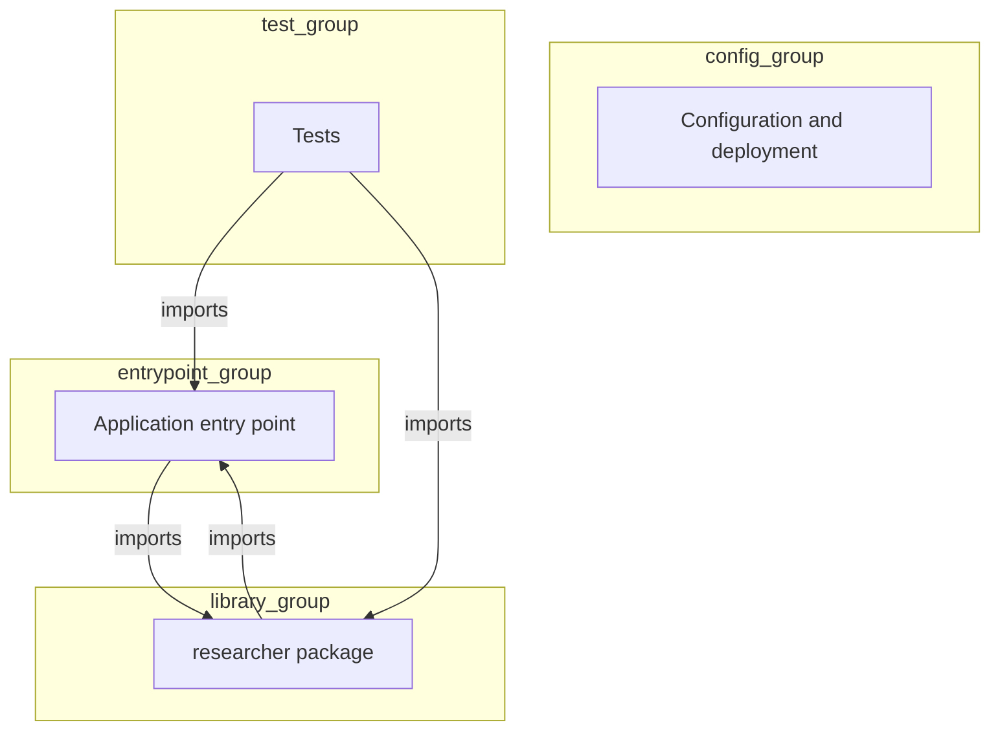

# Architecture report: muratcankoylan/Agent-Skills-for-Context-Engineering

> Automated static analysis. **Observed** = directly seen in files/imports/AST; **Inferred** = interpretation from that evidence. Repository code was not executed.

## 1. Repository at a glance

| Item | Value |
| --- | --- |
| Repository | muratcankoylan/Agent-Skills-for-Context-Engineering |
| Description | A comprehensive collection of Agent Skills for context engineering, multi-agent architectures, and production agent systems. Use when building, optimizing, or debugging agent systems that require effective context management. |
| Language | Python |
| Stars | 18345 |
| Licence | MIT |
| Analysed commit / branch | 9ff0c99108b36d3b886defd825d8ac1f47dba374 / main |
| Framework(s) | None detected |
| Files analysed | 486 |
| Components | 4 |

## 2. Architecture in one minute

muratcankoylan/Agent-Skills-for-Context-Engineering - A comprehensive collection of Agent Skills for context engineering, multi-agent architectures, and production agent systems. Use when building, optimizing, or debugging agent systems that require eff…. This repository was analysed statically from 486 file(s) (66 Python). Detected technologies (observed from imports/manifests): GitHub Actions, NumPy, Pydantic, Poetry, setuptools, pytest. Files are grouped into 4 component(s): Configuration and deployment, Application entry point, researcher package, Tests. Observed entry point(s): researcher/scripts/build_inventory.py, researcher/scripts/check_activation_cases.py, researcher/scripts/compare_skill_revisions.py. Findings below distinguish observed facts from inferred interpretation.

## 3. High-level block diagram

## 4. Main components

### Configuration and deployment (`config`)

- **Kind:** config
- **Status:** Observed
- **Confidence:** 0.85
- **Responsibility:** Groups 67 file(s) under configuration and deployment (observed from repository paths and static analysis).
- **Paths:** `governance/authority.schema.json`, `governance/constitution.yaml`, `governance/export-policy.schema.json`, `governance/export-policy.yaml`, `requirements-dev.txt`, `researcher/benchmarks/effectiveness/tasks/001-filesystem-context-offload/metadata.json`, `researcher/benchmarks/goldens/adversarial-goldens.json`, `researcher/benchmarks/sdk-runner/package.json`, `researcher/benchmarks/sdk-runner/tsconfig.json`, `researcher/corpus/index.json`, `researcher/corpus/inventory.json`, `researcher/corpus/inventory.schema.json`, `researcher/exports/examples/restricted-citation-v1/citation/restricted-fixture.json`, `researcher/exports/examples/restricted-citation-v1/export-manifest.json`, `researcher/exports/schemas/export-records.schema.json`, `researcher/fixtures/export/private-root/restricted-source.json`, `researcher/fixtures/export/restricted-request.json`, `researcher/fixtures/source-evaluations/approved-harness-source.json`, `researcher/fixtures/source-evaluations/rejected-generic-source.json`, `researcher/orchestration/config.json`, `researcher/runs/20260515-035228-executable-autonomous-research-frameworks/reports/closure.json`, `researcher/runs/20260515-035228-executable-autonomous-research-frameworks/reports/validation-report.json`, `researcher/runs/20260515-035228-executable-autonomous-research-frameworks/run-state.json`, `researcher/runs/20260515-035228-executable-autonomous-research-frameworks/sources/evaluations/source-evaluation-draft.json`, `researcher/schemas/fixtures/canonicalization-v1.json`, `researcher/schemas/fixtures/editable-surface-policy-v1.json`, `researcher/schemas/fixtures/records/artifact-envelope.json`, `researcher/schemas/fixtures/records/artifact-ref.json`, `researcher/schemas/fixtures/records/candidate-artifact.json`, `researcher/schemas/fixtures/records/capability-grant-spec.json`, `researcher/schemas/fixtures/records/credential-ref.json`, `researcher/schemas/fixtures/records/export-approval.json`, `researcher/schemas/fixtures/records/export-correction.json`, `researcher/schemas/fixtures/records/export-manifest.json`, `researcher/schemas/fixtures/records/export-plan.json`, `researcher/schemas/fixtures/records/export-receipt.json`, `researcher/schemas/fixtures/records/export-render-receipt.json`, `researcher/schemas/fixtures/records/export-request.json`, `researcher/schemas/fixtures/records/export-validation.json`, `researcher/schemas/fixtures/records/freeze-receipt-utf16.json`, `researcher/schemas/fixtures/records/freeze-receipt.json`, `researcher/schemas/fixtures/records/legacy-claim.json`, `researcher/schemas/fixtures/records/legacy-mechanism.json`, `researcher/schemas/fixtures/records/legacy-queue-record.json`, `researcher/schemas/fixtures/records/legacy-run-state.json`, `researcher/schemas/fixtures/records/schema-registry.json`, `researcher/schemas/fixtures/records/storage-binding.json`, `researcher/schemas/generated/conformance-report.json`, `researcher/schemas/generated/current-artifacts-report.json`, `researcher/schemas/generated/migration-dry-run.json`, `researcher/schemas/public-legacy-sources.json`, `researcher/schemas/registry.json`, `researcher/schemas/registry.schema.json`, `researcher/schemas/typescript/package.json`, `researcher/schemas/typescript/tsconfig.json`, `researcher/schemas/v1/artifact-envelope.schema.json`, `researcher/schemas/v1/artifact-ref.schema.json`, `researcher/schemas/v1/candidate-artifact.schema.json`, `researcher/schemas/v1/capability-grant-spec.schema.json`, `researcher/schemas/v1/credential-ref.schema.json`, `researcher/schemas/v1/freeze-receipt.schema.json`, `researcher/schemas/v1/legacy-claim.schema.json`, `researcher/schemas/v1/legacy-mechanism.schema.json`, `researcher/schemas/v1/legacy-queue-record.schema.json`, `researcher/schemas/v1/legacy-run-state.schema.json`, `researcher/schemas/v1/storage-binding.schema.json`, `researcher/templates/source-evaluation.json`
- **Evidence:** [governance/authority.schema.json](https://github.com/muratcankoylan/Agent-Skills-for-Context-Engineering/blob/9ff0c99108b36d3b886defd825d8ac1f47dba374/governance/authority.schema.json); [governance/constitution.yaml](https://github.com/muratcankoylan/Agent-Skills-for-Context-Engineering/blob/9ff0c99108b36d3b886defd825d8ac1f47dba374/governance/constitution.yaml); [governance/export-policy.schema.json](https://github.com/muratcankoylan/Agent-Skills-for-Context-Engineering/blob/9ff0c99108b36d3b886defd825d8ac1f47dba374/governance/export-policy.schema.json); [governance/export-policy.yaml](https://github.com/muratcankoylan/Agent-Skills-for-Context-Engineering/blob/9ff0c99108b36d3b886defd825d8ac1f47dba374/governance/export-policy.yaml); [requirements-dev.txt](https://github.com/muratcankoylan/Agent-Skills-for-Context-Engineering/blob/9ff0c99108b36d3b886defd825d8ac1f47dba374/requirements-dev.txt); [researcher/benchmarks/effectiveness/tasks/001-filesystem-context-offload/metadata.json](https://github.com/muratcankoylan/Agent-Skills-for-Context-Engineering/blob/9ff0c99108b36d3b886defd825d8ac1f47dba374/researcher/benchmarks/effectiveness/tasks/001-filesystem-context-offload/metadata.json); [researcher/benchmarks/goldens/adversarial-goldens.json](https://github.com/muratcankoylan/Agent-Skills-for-Context-Engineering/blob/9ff0c99108b36d3b886defd825d8ac1f47dba374/researcher/benchmarks/goldens/adversarial-goldens.json); [researcher/benchmarks/sdk-runner/package.json](https://github.com/muratcankoylan/Agent-Skills-for-Context-Engineering/blob/9ff0c99108b36d3b886defd825d8ac1f47dba374/researcher/benchmarks/sdk-runner/package.json)

### Application entry point (`entrypoint`)

- **Kind:** entrypoint
- **Status:** Observed
- **Confidence:** 0.85
- **Responsibility:** Groups 31 file(s) under application entry point (observed from repository paths and static analysis). Observed top-level classes: AgentCommunication, AgentEvaluator, AgentFailureHandler, AgentMessage, AgentPlan, AgentSession. Observed top-level functions: _atomic_write, _cleanup_demo, _created_at, _demo_plan_persistence, _demo_scratch_pad, _demo_tool_handler.
- **Paths:** `researcher/scripts/build_inventory.py`, `researcher/scripts/check_activation_cases.py`, `researcher/scripts/compare_skill_revisions.py`, `researcher/scripts/loop_daily.py`, `researcher/scripts/loop_discover.py`, `researcher/scripts/loop_status.py`, `researcher/scripts/loop_step.py`, `researcher/scripts/migrate_legacy.py`, `researcher/scripts/novelty_check.py`, `researcher/scripts/render_router_report.py`, `researcher/scripts/research_loop.py`, `researcher/scripts/run_benchmarks.py`, `researcher/scripts/skill_health.py`, `researcher/scripts/validate_export.py`, `researcher/scripts/validate_governance.py`, `researcher/scripts/validate_platform_compat.py`, `researcher/scripts/validate_repo.py`, `researcher/scripts/validate_run.py`, `researcher/scripts/validate_schemas.py`, `skills/advanced-evaluation/scripts/evaluation_example.py`, `skills/context-compression/scripts/compression_evaluator.py`, `skills/context-degradation/scripts/degradation_detector.py`, `skills/context-fundamentals/scripts/context_manager.py`, `skills/context-optimization/scripts/compaction.py`, `skills/evaluation/scripts/evaluator.py`, `skills/filesystem-context/scripts/filesystem_context.py`, `skills/hosted-agents/scripts/sandbox_manager.py`, `skills/memory-systems/scripts/memory_store.py`, `skills/multi-agent-patterns/scripts/coordination.py`, `skills/project-development/scripts/pipeline_template.py`, `skills/tool-design/scripts/description_generator.py`
- **Evidence:** [researcher/scripts/build_inventory.py:90](https://github.com/muratcankoylan/Agent-Skills-for-Context-Engineering/blob/9ff0c99108b36d3b886defd825d8ac1f47dba374/researcher/scripts/build_inventory.py#L90); [researcher/scripts/check_activation_cases.py:43](https://github.com/muratcankoylan/Agent-Skills-for-Context-Engineering/blob/9ff0c99108b36d3b886defd825d8ac1f47dba374/researcher/scripts/check_activation_cases.py#L43); [researcher/scripts/compare_skill_revisions.py:15](https://github.com/muratcankoylan/Agent-Skills-for-Context-Engineering/blob/9ff0c99108b36d3b886defd825d8ac1f47dba374/researcher/scripts/compare_skill_revisions.py#L15); [researcher/scripts/loop_daily.py:33](https://github.com/muratcankoylan/Agent-Skills-for-Context-Engineering/blob/9ff0c99108b36d3b886defd825d8ac1f47dba374/researcher/scripts/loop_daily.py#L33); [researcher/scripts/loop_discover.py:32](https://github.com/muratcankoylan/Agent-Skills-for-Context-Engineering/blob/9ff0c99108b36d3b886defd825d8ac1f47dba374/researcher/scripts/loop_discover.py#L32); [researcher/scripts/loop_status.py:29](https://github.com/muratcankoylan/Agent-Skills-for-Context-Engineering/blob/9ff0c99108b36d3b886defd825d8ac1f47dba374/researcher/scripts/loop_status.py#L29); [researcher/scripts/loop_step.py:60](https://github.com/muratcankoylan/Agent-Skills-for-Context-Engineering/blob/9ff0c99108b36d3b886defd825d8ac1f47dba374/researcher/scripts/loop_step.py#L60); [researcher/scripts/migrate_legacy.py:71](https://github.com/muratcankoylan/Agent-Skills-for-Context-Engineering/blob/9ff0c99108b36d3b886defd825d8ac1f47dba374/researcher/scripts/migrate_legacy.py#L71)

### researcher package (`researcher`)

- **Kind:** library
- **Status:** Observed
- **Confidence:** 0.85
- **Responsibility:** Groups 22 file(s) under researcher package (observed from repository paths and static analysis). Observed top-level classes: ArtifactAuthority, BlobRef, CandidateFreezer, Constitution, ConstitutionError, ContractError. Observed top-level functions: _atomic_write, _atomic_write_bytes, _classification_rank, _fsync_directory, _is_iso_date, _is_rfc3339_datetime.
- **Paths:** `researcher/benchmarks/effectiveness/tasks/001-filesystem-context-offload/verify.sh`, `researcher/benchmarks/sdk-runner/src/common.ts`, `researcher/benchmarks/sdk-runner/src/runEffectiveness.ts`, `researcher/benchmarks/sdk-runner/src/runRouter.ts`, `researcher/orchestration/launchd/install.sh`, `researcher/orchestration/launchd/run-loop-daily.sh`, `researcher/orchestration/launchd/run-loop-discover.sh`, `researcher/orchestration/launchd/run-loop-step.sh`, `researcher/orchestration/launchd/uninstall.sh`, `researcher/schemas/typescript/src/canonicalize.ts`, `researcher/schemas/typescript/src/conformance.ts`, `researcher/schemas/typescript/src/errors.ts`, `researcher/schemas/typescript/src/index.ts`, `researcher/schemas/typescript/src/json.ts`, `researcher/schemas/typescript/src/registry.ts`, `researcher/schemas/typescript/src/semantics.ts`, `researcher/scripts/artifact_store.py`, `researcher/scripts/export_policy.py`, `researcher/scripts/governance_policy.py`, `researcher/scripts/loop_common.py`, `researcher/scripts/schema_contract.py`, `researcher/scripts/skill_frontmatter.py`
- **Evidence:** [researcher/benchmarks/effectiveness/tasks/001-filesystem-context-offload/verify.sh](https://github.com/muratcankoylan/Agent-Skills-for-Context-Engineering/blob/9ff0c99108b36d3b886defd825d8ac1f47dba374/researcher/benchmarks/effectiveness/tasks/001-filesystem-context-offload/verify.sh); [researcher/benchmarks/sdk-runner/src/common.ts](https://github.com/muratcankoylan/Agent-Skills-for-Context-Engineering/blob/9ff0c99108b36d3b886defd825d8ac1f47dba374/researcher/benchmarks/sdk-runner/src/common.ts); [researcher/benchmarks/sdk-runner/src/runEffectiveness.ts](https://github.com/muratcankoylan/Agent-Skills-for-Context-Engineering/blob/9ff0c99108b36d3b886defd825d8ac1f47dba374/researcher/benchmarks/sdk-runner/src/runEffectiveness.ts); [researcher/benchmarks/sdk-runner/src/runRouter.ts](https://github.com/muratcankoylan/Agent-Skills-for-Context-Engineering/blob/9ff0c99108b36d3b886defd825d8ac1f47dba374/researcher/benchmarks/sdk-runner/src/runRouter.ts); [researcher/orchestration/launchd/install.sh](https://github.com/muratcankoylan/Agent-Skills-for-Context-Engineering/blob/9ff0c99108b36d3b886defd825d8ac1f47dba374/researcher/orchestration/launchd/install.sh); [researcher/orchestration/launchd/run-loop-daily.sh](https://github.com/muratcankoylan/Agent-Skills-for-Context-Engineering/blob/9ff0c99108b36d3b886defd825d8ac1f47dba374/researcher/orchestration/launchd/run-loop-daily.sh); [researcher/orchestration/launchd/run-loop-discover.sh](https://github.com/muratcankoylan/Agent-Skills-for-Context-Engineering/blob/9ff0c99108b36d3b886defd825d8ac1f47dba374/researcher/orchestration/launchd/run-loop-discover.sh); [researcher/orchestration/launchd/run-loop-step.sh](https://github.com/muratcankoylan/Agent-Skills-for-Context-Engineering/blob/9ff0c99108b36d3b886defd825d8ac1f47dba374/researcher/orchestration/launchd/run-loop-step.sh)

### Tests (`tests`)

- **Kind:** test
- **Status:** Observed
- **Confidence:** 0.85
- **Responsibility:** Groups 16 file(s) under tests (observed from repository paths and static analysis). Observed top-level classes: ArtifactStoreTests, CandidateFreezeTests, CanonicalizationTests, CapabilityTests, CompressionEvaluatorTests, ConstitutionTests. Observed top-level functions: citation_source, copy_fixture, export_request, finding_codes, test_analysis_result_creation, test_loop_result_creation.
- **Paths:** `examples/interleaved-thinking/tests/__init__.py`, `examples/interleaved-thinking/tests/test_models.py`, `examples/llm-as-judge-skills/tests/evaluation.test.ts`, `examples/llm-as-judge-skills/tests/setup.ts`, `examples/llm-as-judge-skills/tests/skills.test.ts`, `examples/long-horizon-prompt-lab/scripts/test_site.mjs`, `researcher/schemas/typescript/test/conformance.test.ts`, `researcher/schemas/typescript/test/runtime-registry.test.ts`, `researcher/scripts/tests/__init__.py`, `researcher/scripts/tests/test_artifact_store.py`, `researcher/scripts/tests/test_build_inventory.py`, `researcher/scripts/tests/test_export_policy.py`, `researcher/scripts/tests/test_governance_policy.py`, `researcher/scripts/tests/test_schema_contract.py`, `researcher/scripts/tests/test_skill_frontmatter.py`, `skills/context-compression/tests/test_compression_evaluator.py`
- **Evidence:** [examples/interleaved-thinking/tests/__init__.py](https://github.com/muratcankoylan/Agent-Skills-for-Context-Engineering/blob/9ff0c99108b36d3b886defd825d8ac1f47dba374/examples/interleaved-thinking/tests/__init__.py); [examples/interleaved-thinking/tests/test_models.py:19](https://github.com/muratcankoylan/Agent-Skills-for-Context-Engineering/blob/9ff0c99108b36d3b886defd825d8ac1f47dba374/examples/interleaved-thinking/tests/test_models.py#L19); [examples/llm-as-judge-skills/tests/evaluation.test.ts](https://github.com/muratcankoylan/Agent-Skills-for-Context-Engineering/blob/9ff0c99108b36d3b886defd825d8ac1f47dba374/examples/llm-as-judge-skills/tests/evaluation.test.ts); [examples/llm-as-judge-skills/tests/setup.ts](https://github.com/muratcankoylan/Agent-Skills-for-Context-Engineering/blob/9ff0c99108b36d3b886defd825d8ac1f47dba374/examples/llm-as-judge-skills/tests/setup.ts); [examples/llm-as-judge-skills/tests/skills.test.ts](https://github.com/muratcankoylan/Agent-Skills-for-Context-Engineering/blob/9ff0c99108b36d3b886defd825d8ac1f47dba374/examples/llm-as-judge-skills/tests/skills.test.ts); [examples/long-horizon-prompt-lab/scripts/test_site.mjs](https://github.com/muratcankoylan/Agent-Skills-for-Context-Engineering/blob/9ff0c99108b36d3b886defd825d8ac1f47dba374/examples/long-horizon-prompt-lab/scripts/test_site.mjs); [researcher/schemas/typescript/test/conformance.test.ts](https://github.com/muratcankoylan/Agent-Skills-for-Context-Engineering/blob/9ff0c99108b36d3b886defd825d8ac1f47dba374/researcher/schemas/typescript/test/conformance.test.ts); [researcher/schemas/typescript/test/runtime-registry.test.ts](https://github.com/muratcankoylan/Agent-Skills-for-Context-Engineering/blob/9ff0c99108b36d3b886defd825d8ac1f47dba374/researcher/schemas/typescript/test/runtime-registry.test.ts)

## 5. Execution flow

**Observed** entry point(s):

- [researcher/scripts/build_inventory.py:1224](https://github.com/muratcankoylan/Agent-Skills-for-Context-Engineering/blob/9ff0c99108b36d3b886defd825d8ac1f47dba374/researcher/scripts/build_inventory.py#L1224)
- [researcher/scripts/check_activation_cases.py:144](https://github.com/muratcankoylan/Agent-Skills-for-Context-Engineering/blob/9ff0c99108b36d3b886defd825d8ac1f47dba374/researcher/scripts/check_activation_cases.py#L144)
- [researcher/scripts/compare_skill_revisions.py:114](https://github.com/muratcankoylan/Agent-Skills-for-Context-Engineering/blob/9ff0c99108b36d3b886defd825d8ac1f47dba374/researcher/scripts/compare_skill_revisions.py#L114)
- [researcher/scripts/loop_daily.py:217](https://github.com/muratcankoylan/Agent-Skills-for-Context-Engineering/blob/9ff0c99108b36d3b886defd825d8ac1f47dba374/researcher/scripts/loop_daily.py#L217)
- [researcher/scripts/loop_discover.py:164](https://github.com/muratcankoylan/Agent-Skills-for-Context-Engineering/blob/9ff0c99108b36d3b886defd825d8ac1f47dba374/researcher/scripts/loop_discover.py#L164)
- [researcher/scripts/loop_status.py:166](https://github.com/muratcankoylan/Agent-Skills-for-Context-Engineering/blob/9ff0c99108b36d3b886defd825d8ac1f47dba374/researcher/scripts/loop_status.py#L166)
- [researcher/scripts/loop_step.py:423](https://github.com/muratcankoylan/Agent-Skills-for-Context-Engineering/blob/9ff0c99108b36d3b886defd825d8ac1f47dba374/researcher/scripts/loop_step.py#L423)
- [researcher/scripts/migrate_legacy.py:454](https://github.com/muratcankoylan/Agent-Skills-for-Context-Engineering/blob/9ff0c99108b36d3b886defd825d8ac1f47dba374/researcher/scripts/migrate_legacy.py#L454)
- [researcher/scripts/novelty_check.py:275](https://github.com/muratcankoylan/Agent-Skills-for-Context-Engineering/blob/9ff0c99108b36d3b886defd825d8ac1f47dba374/researcher/scripts/novelty_check.py#L275)
- [researcher/scripts/render_router_report.py:402](https://github.com/muratcankoylan/Agent-Skills-for-Context-Engineering/blob/9ff0c99108b36d3b886defd825d8ac1f47dba374/researcher/scripts/render_router_report.py#L402)
- [researcher/scripts/research_loop.py:696](https://github.com/muratcankoylan/Agent-Skills-for-Context-Engineering/blob/9ff0c99108b36d3b886defd825d8ac1f47dba374/researcher/scripts/research_loop.py#L696)
- [researcher/scripts/run_benchmarks.py:141](https://github.com/muratcankoylan/Agent-Skills-for-Context-Engineering/blob/9ff0c99108b36d3b886defd825d8ac1f47dba374/researcher/scripts/run_benchmarks.py#L141)

Representative flow (derived from observed entry points and the import graph; steps beyond the entry point are **Inferred**):

1. Execution starts at an observed entry point listed above, if present.
2. `entrypoint` imports `researcher` (Application entry point -> researcher package).
3. `researcher` imports `entrypoint` (researcher package -> Application entry point).
4. `tests` imports `entrypoint` (Tests -> Application entry point).
5. `tests` imports `researcher` (Tests -> researcher package).

## 6. Project structure

### `(root)`

- `.cursorindexingignore` - other (110 bytes)
- `.gitignore` - other (1716 bytes)
- `AGENTS.md` - docs (9434 bytes)
- `CHANGELOG.md` - docs (29434 bytes)
- `CLAUDE.md` - docs (8538 bytes)
- `CONTRIBUTING.md` - docs (6851 bytes)
- `LICENSE` - docs (1103 bytes)
- `README.md` - docs (24668 bytes)
- `SKILL.md` - docs (11210 bytes)
- `requirements-dev.txt` - manifest (57 bytes)

### `.claude-plugin`

- `.claude-plugin/marketplace.json` - config (2014 bytes)

### `.github`

- `.github/PULL_REQUEST_TEMPLATE/constitution-amendment.md` - docs (777 bytes)
- `.github/workflows/deploy-prompt-lab.yml` - ci, YAML (2859 bytes)
- `.github/workflows/validate.yml` - ci, YAML (5348 bytes)

### `.plugin`

- `.plugin/plugin.json` - config (829 bytes)

### `assets`

- `assets/release/v2.3.0/corpus-hardening-metrics-v2-3.svg` - other (4978 bytes)
- `assets/release/v2.3.0/researcher-os-pipeline-v2-3.svg` - other (7965 bytes)
- `assets/release/v2.3.0/router-leaderboard-2026-05-19.svg` - other (6450 bytes)
- `assets/release/v2.3.0/skill-routing-gains-v2-3.svg` - other (5121 bytes)

### `docs`

- `docs/agentskills.md` - docs (51608 bytes)
- `docs/blogs.md` - docs (132778 bytes)
- `docs/claude_research.md` - docs (15452 bytes)
- `docs/compression.md` - docs (20447 bytes)
- `docs/decisions/0001-machine-testable-constitution.md` - docs (2595 bytes)
- `docs/decisions/0002-derived-corpus-inventory.md` - docs (2914 bytes)
- `docs/decisions/0003-allowlisted-public-projections.md` - docs (3315 bytes)
- `docs/decisions/0004-runtime-neutral-artifact-contracts.md` - docs (5956 bytes)
- `docs/decisions/README.md` - docs (404 bytes)
- `docs/gemini_research.md` - docs (32317 bytes)
- `docs/hncapsule.md` - docs (7853 bytes)
- `docs/netflix_context.md` - docs (20579 bytes)
- `docs/skills-improvement-analysis.md` - docs (8244 bytes)
- `docs/specs/SPEC-000-program-constitution.md` - docs (2688 bytes)
- `docs/specs/SPEC-001-repository-reconciliation.md` - docs (2983 bytes)
- `docs/specs/SPEC-002-public-private-boundary.md` - docs (3475 bytes)
- `docs/specs/SPEC-003-schema-registry.md` - docs (7049 bytes)
- `docs/vercel_tool.md` - docs (7676 bytes)

### `examples`

- `examples/book-sft-pipeline/README.md` - docs (2795 bytes)
- `examples/book-sft-pipeline/SKILL.md` - docs (14242 bytes)
- `examples/book-sft-pipeline/examples/gertrude-stein/README.md` - docs (5460 bytes)
- `examples/book-sft-pipeline/examples/gertrude-stein/dataset_sample.jsonl` - data (3968 bytes)
- `examples/book-sft-pipeline/examples/gertrude-stein/sample_outputs.md` - docs (3564 bytes)
- `examples/book-sft-pipeline/examples/gertrude-stein/training_config.json` - config (2814 bytes)
- `examples/book-sft-pipeline/references/segmentation-strategies.md` - docs (10817 bytes)
- `examples/book-sft-pipeline/references/tinker-format.md` - docs (6068 bytes)
- `examples/book-sft-pipeline/references/tinker.txt` - docs (146022 bytes)
- `examples/book-sft-pipeline/scripts/pipeline_example.py` - source, Python (6695 bytes)
- `examples/digital-brain-skill/.gitignore` - other (442 bytes)
- `examples/digital-brain-skill/AGENT.md` - docs (1567 bytes)
- `examples/digital-brain-skill/HOW-SKILLS-BUILT-THIS.md` - docs (12982 bytes)
- `examples/digital-brain-skill/README.md` - docs (7416 bytes)
- `examples/digital-brain-skill/SKILL.md` - docs (7028 bytes)
- `examples/digital-brain-skill/SKILLS-MAPPING.md` - docs (8848 bytes)
- `examples/digital-brain-skill/agents/AGENTS.md` - docs (2599 bytes)
- `examples/digital-brain-skill/agents/scripts/content_ideas.py` - source, Python (4325 bytes)
- `examples/digital-brain-skill/agents/scripts/idea_to_draft.py` - source, Python (4164 bytes)
- `examples/digital-brain-skill/agents/scripts/stale_contacts.py` - source, Python (3942 bytes)
- `examples/digital-brain-skill/agents/scripts/weekly_review.py` - source, Python (3224 bytes)
- `examples/digital-brain-skill/content/CONTENT.md` - docs (2250 bytes)
- `examples/digital-brain-skill/content/calendar.md` - docs (2096 bytes)
- `examples/digital-brain-skill/content/engagement.jsonl` - data (663 bytes)
- `examples/digital-brain-skill/content/ideas.jsonl` - data (486 bytes)
- `examples/digital-brain-skill/content/posts.jsonl` - data (627 bytes)
- `examples/digital-brain-skill/content/templates/linkedin-post.md` - docs (1605 bytes)
- `examples/digital-brain-skill/content/templates/newsletter.md` - docs (1580 bytes)
- `examples/digital-brain-skill/content/templates/thread.md` - docs (1170 bytes)
- `examples/digital-brain-skill/examples/content-workflow.md` - docs (4540 bytes)
- `examples/digital-brain-skill/examples/meeting-prep.md` - docs (5763 bytes)
- `examples/digital-brain-skill/identity/IDENTITY.md` - docs (1457 bytes)
- `examples/digital-brain-skill/identity/bio-variants.md` - docs (1696 bytes)
- `examples/digital-brain-skill/identity/brand.md` - docs (3730 bytes)
- `examples/digital-brain-skill/identity/prompts/content-generation.xml` - other (1439 bytes)
- `examples/digital-brain-skill/identity/prompts/reply-generator.xml` - other (1318 bytes)
- `examples/digital-brain-skill/identity/values.yaml` - config (1960 bytes)
- `examples/digital-brain-skill/identity/voice.md` - docs (3397 bytes)
- `examples/digital-brain-skill/knowledge/KNOWLEDGE.md` - docs (2447 bytes)
- `examples/digital-brain-skill/knowledge/bookmarks.jsonl` - data (559 bytes)
- `examples/digital-brain-skill/knowledge/competitors.md` - docs (2285 bytes)
- `examples/digital-brain-skill/knowledge/learning.yaml` - config (2120 bytes)
- `examples/digital-brain-skill/knowledge/research/_template.md` - docs (1285 bytes)
- `examples/digital-brain-skill/network/NETWORK.md` - docs (3096 bytes)
- `examples/digital-brain-skill/network/circles.yaml` - config (2020 bytes)
- `examples/digital-brain-skill/network/contacts.jsonl` - data (897 bytes)
- `examples/digital-brain-skill/network/interactions.jsonl` - data (454 bytes)
- `examples/digital-brain-skill/network/intros.md` - docs (2177 bytes)
- `examples/digital-brain-skill/operations/OPERATIONS.md` - docs (2058 bytes)
- `examples/digital-brain-skill/operations/goals.yaml` - config (2132 bytes)
- `examples/digital-brain-skill/operations/meetings.jsonl` - data (635 bytes)
- `examples/digital-brain-skill/operations/metrics.jsonl` - data (707 bytes)
- `examples/digital-brain-skill/operations/reviews/_weekly_template.md` - docs (1720 bytes)
- `examples/digital-brain-skill/operations/todos.md` - docs (1293 bytes)
- `examples/digital-brain-skill/package.json` - manifest (1289 bytes)
- `examples/digital-brain-skill/references/file-formats.md` - docs (7478 bytes)
- `examples/digital-brain-skill/scripts/install.sh` - source, Shell (1993 bytes)
- `examples/interleaved-thinking/README.md` - docs (20169 bytes)
- `examples/interleaved-thinking/SKILL.md` - docs (6359 bytes)
- `examples/interleaved-thinking/docs/agentthinking.md` - docs (6518 bytes)
- `examples/interleaved-thinking/docs/interleavedthinking.md` - docs (30733 bytes)
- `examples/interleaved-thinking/docs/m2-1.md` - docs (9539 bytes)
- `examples/interleaved-thinking/examples/01_basic_capture.py` - source, Python (2293 bytes)
- `examples/interleaved-thinking/examples/02_tool_usage.py` - source, Python (5879 bytes)
- `examples/interleaved-thinking/examples/03_full_optimization.py` - source, Python (39972 bytes)
- `examples/interleaved-thinking/generated_skills/comprehensive-research-agent/SKILL.md` - docs (8532 bytes)
- `examples/interleaved-thinking/generated_skills/comprehensive-research-agent/references/optimization_summary.json` - config (899 bytes)
- `examples/interleaved-thinking/generated_skills/comprehensive-research-agent/references/optimized_prompt.txt` - docs (81 bytes)
- `examples/interleaved-thinking/generated_skills/comprehensive-research-agent/references/patterns_found.json` - config (12732 bytes)
- `examples/interleaved-thinking/optimization_artifacts/final_prompt.txt` - docs (3256 bytes)
- `examples/interleaved-thinking/optimization_artifacts/iteration_1/analysis.txt` - docs (2829 bytes)
- `examples/interleaved-thinking/optimization_artifacts/iteration_1/optimization.txt` - docs (485 bytes)
- `examples/interleaved-thinking/optimization_artifacts/iteration_1/optimized_prompt.txt` - docs (81 bytes)
- `examples/interleaved-thinking/optimization_artifacts/iteration_1/trace.txt` - docs (28468 bytes)
- `examples/interleaved-thinking/optimization_artifacts/iteration_10/analysis.txt` - docs (3764 bytes)
- `examples/interleaved-thinking/optimization_artifacts/iteration_10/trace.txt` - docs (28925 bytes)
- `examples/interleaved-thinking/optimization_artifacts/iteration_2/analysis.txt` - docs (3455 bytes)
- `examples/interleaved-thinking/optimization_artifacts/iteration_2/optimization.txt` - docs (6968 bytes)
- `examples/interleaved-thinking/optimization_artifacts/iteration_2/optimized_prompt.txt` - docs (3529 bytes)
- `examples/interleaved-thinking/optimization_artifacts/iteration_2/trace.txt` - docs (22300 bytes)
- `examples/interleaved-thinking/optimization_artifacts/iteration_3/analysis.txt` - docs (3221 bytes)
- `examples/interleaved-thinking/optimization_artifacts/iteration_3/optimization.txt` - docs (7888 bytes)
- `examples/interleaved-thinking/optimization_artifacts/iteration_3/optimized_prompt.txt` - docs (4408 bytes)
- `examples/interleaved-thinking/optimization_artifacts/iteration_3/trace.txt` - docs (28981 bytes)
- `examples/interleaved-thinking/optimization_artifacts/iteration_4/analysis.txt` - docs (3062 bytes)
- `examples/interleaved-thinking/optimization_artifacts/iteration_4/optimization.txt` - docs (6559 bytes)
- `examples/interleaved-thinking/optimization_artifacts/iteration_4/optimized_prompt.txt` - docs (3256 bytes)
- `examples/interleaved-thinking/optimization_artifacts/iteration_4/trace.txt` - docs (23901 bytes)
- `examples/interleaved-thinking/optimization_artifacts/iteration_5/analysis.txt` - docs (3646 bytes)
- `examples/interleaved-thinking/optimization_artifacts/iteration_5/optimization.txt` - docs (6426 bytes)
- `examples/interleaved-thinking/optimization_artifacts/iteration_5/optimized_prompt.txt` - docs (3061 bytes)
- `examples/interleaved-thinking/optimization_artifacts/iteration_5/trace.txt` - docs (31339 bytes)
- `examples/interleaved-thinking/optimization_artifacts/iteration_6/analysis.txt` - docs (460 bytes)
- `examples/interleaved-thinking/optimization_artifacts/iteration_6/optimization.txt` - docs (485 bytes)
- `examples/interleaved-thinking/optimization_artifacts/iteration_6/optimized_prompt.txt` - docs (81 bytes)
- `examples/interleaved-thinking/optimization_artifacts/iteration_6/trace.txt` - docs (19327 bytes)
- `examples/interleaved-thinking/optimization_artifacts/iteration_7/analysis.txt` - docs (2659 bytes)
- `examples/interleaved-thinking/optimization_artifacts/iteration_7/optimization.txt` - docs (5490 bytes)
- `examples/interleaved-thinking/optimization_artifacts/iteration_7/optimized_prompt.txt` - docs (2613 bytes)
- `examples/interleaved-thinking/optimization_artifacts/iteration_7/trace.txt` - docs (21242 bytes)
- `examples/interleaved-thinking/optimization_artifacts/iteration_8/analysis.txt` - docs (3188 bytes)
- `examples/interleaved-thinking/optimization_artifacts/iteration_8/optimization.txt` - docs (6468 bytes)
- `examples/interleaved-thinking/optimization_artifacts/iteration_8/optimized_prompt.txt` - docs (3385 bytes)
- `examples/interleaved-thinking/optimization_artifacts/iteration_8/trace.txt` - docs (22082 bytes)
- `examples/interleaved-thinking/optimization_artifacts/iteration_9/analysis.txt` - docs (2768 bytes)
- `examples/interleaved-thinking/optimization_artifacts/iteration_9/optimization.txt` - docs (5954 bytes)
- `examples/interleaved-thinking/optimization_artifacts/iteration_9/optimized_prompt.txt` - docs (2673 bytes)
- `examples/interleaved-thinking/optimization_artifacts/iteration_9/trace.txt` - docs (26158 bytes)
- `examples/interleaved-thinking/optimization_artifacts/summary.json` - config (1002 bytes)
- `examples/interleaved-thinking/pyproject.toml` - manifest (1931 bytes)
- `examples/interleaved-thinking/reasoning_trace_optimizer/__init__.py` - source, Python (1188 bytes)
- `examples/interleaved-thinking/reasoning_trace_optimizer/analyzer.py` - source, Python (16141 bytes)
- `examples/interleaved-thinking/reasoning_trace_optimizer/capture.py` - source, Python (14610 bytes)
- `examples/interleaved-thinking/reasoning_trace_optimizer/cli.py` - source, Python (8612 bytes)
- `examples/interleaved-thinking/reasoning_trace_optimizer/loop.py` - source, Python (18048 bytes)
- `examples/interleaved-thinking/reasoning_trace_optimizer/models.py` - source, Python (4955 bytes)
- `examples/interleaved-thinking/reasoning_trace_optimizer/optimizer.py` - source, Python (14558 bytes)
- `examples/interleaved-thinking/reasoning_trace_optimizer/skill_generator.py` - source, Python (16396 bytes)
- `examples/interleaved-thinking/tests/__init__.py` - test, Python (43 bytes)
- `examples/interleaved-thinking/tests/test_models.py` - test, Python (3936 bytes)
- `examples/llm-as-judge-skills/.gitignore` - other (239 bytes)
- `examples/llm-as-judge-skills/.prettierrc` - other (107 bytes)
- `examples/llm-as-judge-skills/CONTRIBUTING.md` - docs (1926 bytes)
- `examples/llm-as-judge-skills/LICENSE` - docs (1072 bytes)
- `examples/llm-as-judge-skills/README.md` - docs (23890 bytes)
- `examples/llm-as-judge-skills/agents/evaluator-agent/evaluator-agent.md` - docs (4360 bytes)
- `examples/llm-as-judge-skills/agents/index.md` - docs (2557 bytes)
- `examples/llm-as-judge-skills/agents/orchestrator-agent/orchestrator-agent.md` - docs (4856 bytes)
- `examples/llm-as-judge-skills/agents/research-agent/research-agent.md` - docs (4442 bytes)
- `examples/llm-as-judge-skills/env.example` - other (177 bytes)
- `examples/llm-as-judge-skills/eslint.config.js` - source, JavaScript (465 bytes)
- `examples/llm-as-judge-skills/examples/basic-evaluation.ts` - source, TypeScript (2752 bytes)
- `examples/llm-as-judge-skills/examples/full-evaluation-workflow.ts` - source, TypeScript (4616 bytes)
- `examples/llm-as-judge-skills/examples/generate-rubric.ts` - source, TypeScript (2041 bytes)
- `examples/llm-as-judge-skills/examples/pairwise-comparison.ts` - source, TypeScript (3103 bytes)
- `examples/llm-as-judge-skills/package.json` - manifest (2105 bytes)
- `examples/llm-as-judge-skills/prompts/agent-system/orchestrator-prompt.md` - docs (5600 bytes)
- `examples/llm-as-judge-skills/prompts/evaluation/direct-scoring-prompt.md` - docs (3812 bytes)
- `examples/llm-as-judge-skills/prompts/evaluation/pairwise-comparison-prompt.md` - docs (4858 bytes)
- `examples/llm-as-judge-skills/prompts/index.md` - docs (3064 bytes)
- `examples/llm-as-judge-skills/prompts/research/research-synthesis-prompt.md` - docs (4169 bytes)
- `examples/llm-as-judge-skills/skills/context-fundamentals/context-fundamentals.md` - docs (3012 bytes)
- `examples/llm-as-judge-skills/skills/index.md` - docs (2305 bytes)
- `examples/llm-as-judge-skills/skills/llm-evaluator/llm-evaluator.md` - docs (2537 bytes)
- `examples/llm-as-judge-skills/skills/tool-design/tool-design.md` - docs (4999 bytes)
- `examples/llm-as-judge-skills/src/agents/evaluator.ts` - source, TypeScript (2805 bytes)
- `examples/llm-as-judge-skills/src/agents/index.ts` - source, TypeScript (126 bytes)
- `examples/llm-as-judge-skills/src/config/index.ts` - source, TypeScript (409 bytes)
- `examples/llm-as-judge-skills/src/index.ts` - source, TypeScript (405 bytes)
- `examples/llm-as-judge-skills/src/tools/evaluation/direct-score.ts` - source, TypeScript (5311 bytes)
- `examples/llm-as-judge-skills/src/tools/evaluation/generate-rubric.ts` - source, TypeScript (4694 bytes)
- `examples/llm-as-judge-skills/src/tools/evaluation/index.ts` - source, TypeScript (659 bytes)
- `examples/llm-as-judge-skills/src/tools/evaluation/pairwise-compare.ts` - source, TypeScript (7623 bytes)
- `examples/llm-as-judge-skills/tests/evaluation.test.ts` - test, TypeScript (7548 bytes)
- `examples/llm-as-judge-skills/tests/setup.ts` - test, TypeScript (560 bytes)
- `examples/llm-as-judge-skills/tests/skills.test.ts` - test, TypeScript (7605 bytes)
- `examples/llm-as-judge-skills/tools/evaluation/direct-score.md` - docs (4227 bytes)
- `examples/llm-as-judge-skills/tools/evaluation/generate-rubric.md` - docs (5276 bytes)
- `examples/llm-as-judge-skills/tools/evaluation/pairwise-compare.md` - docs (4677 bytes)
- `examples/llm-as-judge-skills/tools/index.md` - docs (3575 bytes)
- `examples/llm-as-judge-skills/tools/orchestration/delegate-to-agent.md` - docs (4430 bytes)
- `examples/llm-as-judge-skills/tools/research/read-url.md` - docs (4060 bytes)
- `examples/llm-as-judge-skills/tools/research/web-search.md` - docs (3275 bytes)
- `examples/llm-as-judge-skills/tsconfig.json` - config (655 bytes)
- `examples/llm-as-judge-skills/vitest.config.ts` - source, TypeScript (541 bytes)
- `examples/long-horizon-prompt-lab/.gitignore` - other (14 bytes)
- `examples/long-horizon-prompt-lab/README.md` - docs (6611 bytes)
- `examples/long-horizon-prompt-lab/data/prompt-pairs.json` - config (47304 bytes)
- `examples/long-horizon-prompt-lab/package.json` - manifest (730 bytes)
- `examples/long-horizon-prompt-lab/report/PROVENANCE.md` - docs (2138 bytes)
- `examples/long-horizon-prompt-lab/report/cdc_prompt.txt` - docs (5011 bytes)
- `examples/long-horizon-prompt-lab/report/cdc_proof.txt` - docs (8246 bytes)
- `examples/long-horizon-prompt-lab/scripts/build_lab.py` - source, Python (50492 bytes)
- `examples/long-horizon-prompt-lab/scripts/capture.mjs` - source, JavaScript (4514 bytes)
- `examples/long-horizon-prompt-lab/scripts/fetch_report.sh` - source, Shell (1289 bytes)
- `examples/long-horizon-prompt-lab/scripts/install_skill.sh` - source, Shell (1342 bytes)
- `examples/long-horizon-prompt-lab/scripts/test_site.mjs` - test, JavaScript (6415 bytes)
- `examples/long-horizon-prompt-lab/scripts/validate_site.py` - source, Python (9138 bytes)
- `examples/long-horizon-prompt-lab/scripts/verify_report.py` - source, Python (3145 bytes)
- `examples/long-horizon-prompt-lab/ui/404.html` - other (1505 bytes)
- `examples/long-horizon-prompt-lab/ui/app.js` - source, JavaScript (10629 bytes)
- `examples/long-horizon-prompt-lab/ui/data.js` - source, JavaScript (47390 bytes)
- `examples/long-horizon-prompt-lab/ui/favicon.svg` - other (242 bytes)
- `examples/long-horizon-prompt-lab/ui/guide.html` - other (15085 bytes)
- `examples/long-horizon-prompt-lab/ui/index.html` - other (10112 bytes)
- `examples/long-horizon-prompt-lab/ui/lab.html` - other (6173 bytes)
- `examples/long-horizon-prompt-lab/ui/prompts/approx-proof-optimized.txt` - docs (7083 bytes)
- `examples/long-horizon-prompt-lab/ui/prompts/approx-proof-original.txt` - docs (840 bytes)
- `examples/long-horizon-prompt-lab/ui/prompts/ml-optimization-optimized.txt` - docs (5731 bytes)
- `examples/long-horizon-prompt-lab/ui/prompts/ml-optimization-original.txt` - docs (1149 bytes)
- `examples/long-horizon-prompt-lab/ui/prompts/security-audit-optimized.txt` - docs (8165 bytes)
- `examples/long-horizon-prompt-lab/ui/prompts/security-audit-original.txt` - docs (715 bytes)
- `examples/long-horizon-prompt-lab/ui/prompts/systems-debug-optimized.txt` - docs (7007 bytes)
- `examples/long-horizon-prompt-lab/ui/prompts/systems-debug-original.txt` - docs (872 bytes)
- `examples/long-horizon-prompt-lab/ui/references.html` - other (25254 bytes)
- `examples/long-horizon-prompt-lab/ui/robots.txt` - docs (115 bytes)
- `examples/long-horizon-prompt-lab/ui/site.js` - source, JavaScript (2453 bytes)
- `examples/long-horizon-prompt-lab/ui/sitemap.xml` - other (819 bytes)
- `examples/long-horizon-prompt-lab/ui/styles.css` - other (28149 bytes)
- `examples/x-to-book-system/PRD.md` - docs (24151 bytes)
- `examples/x-to-book-system/README.md` - docs (10108 bytes)
- `examples/x-to-book-system/SKILLS-MAPPING.md` - docs (10133 bytes)

### `governance`

- `governance/README.md` - docs (1285 bytes)
- `governance/authority.schema.json` - config (3314 bytes)
- `governance/constitution.yaml` - config (12799 bytes)
- `governance/export-policy.schema.json` - config (1982 bytes)
- `governance/export-policy.yaml` - config (3091 bytes)
- `governance/fixtures/authority-decisions.jsonl` - data (2359 bytes)
- `governance/generated/authority-table.md` - docs (7004 bytes)

### `researcher`

- `researcher/README.md` - docs (5936 bytes)
- `researcher/artifacts/README.md` - docs (1970 bytes)
- `researcher/benchmarks/PLAN.md` - docs (21338 bytes)
- `researcher/benchmarks/README.md` - docs (372 bytes)
- `researcher/benchmarks/effectiveness/README.md` - docs (3121 bytes)
- `researcher/benchmarks/effectiveness/tasks/001-filesystem-context-offload/README.md` - docs (1678 bytes)
- `researcher/benchmarks/effectiveness/tasks/001-filesystem-context-offload/metadata.json` - config (454 bytes)
- `researcher/benchmarks/effectiveness/tasks/001-filesystem-context-offload/starting/instructions.md` - docs (248 bytes)
- `researcher/benchmarks/effectiveness/tasks/001-filesystem-context-offload/task.md` - docs (501 bytes)
- `researcher/benchmarks/effectiveness/tasks/001-filesystem-context-offload/verify.sh` - source, Shell (1344 bytes)
- `researcher/benchmarks/goldens/adversarial-goldens.json` - config (591 bytes)
- `researcher/benchmarks/router/README.md` - docs (1372 bytes)
- `researcher/benchmarks/router/prompts.jsonl` - data (24542 bytes)
- `researcher/benchmarks/router/results-published/2026-05-15-v2.md` - docs (10930 bytes)
- `researcher/benchmarks/router/results-published/2026-05-15.md` - docs (7453 bytes)
- `researcher/benchmarks/router/results-published/2026-05-19.md` - docs (6536 bytes)
- `researcher/benchmarks/router/results-published/README.md` - docs (937 bytes)
- `researcher/benchmarks/router/routing-prompt.md` - docs (997 bytes)
- `researcher/benchmarks/scenarios/adversarial.jsonl` - data (1898 bytes)
- `researcher/benchmarks/sdk-runner/README.md` - docs (2897 bytes)
- `researcher/benchmarks/sdk-runner/package.json` - manifest (831 bytes)
- `researcher/benchmarks/sdk-runner/src/common.ts` - source, TypeScript (10638 bytes)
- `researcher/benchmarks/sdk-runner/src/runEffectiveness.ts` - source, TypeScript (4368 bytes)
- `researcher/benchmarks/sdk-runner/src/runRouter.ts` - source, TypeScript (12576 bytes)
- `researcher/benchmarks/sdk-runner/tsconfig.json` - config (611 bytes)
- `researcher/claims/README.md` - docs (834 bytes)
- `researcher/claims/index.jsonl` - data (26455 bytes)
- `researcher/corpus/index.json` - config (8790 bytes)
- `researcher/corpus/inventory.json` - config (137891 bytes)
- `researcher/corpus/inventory.schema.json` - config (2054 bytes)
- `researcher/corpus/reconciliation-report.md` - docs (2401 bytes)
- `researcher/discovery/manual-seed.jsonl` - data (3122 bytes)
- `researcher/example_output.md` - docs (8437 bytes)
- `researcher/exports/README.md` - docs (2365 bytes)
- `researcher/exports/examples/restricted-citation-v1.md` - docs (616 bytes)
- `researcher/exports/examples/restricted-citation-v1/citation/restricted-fixture.json` - config (453 bytes)
- `researcher/exports/examples/restricted-citation-v1/export-manifest.json` - config (860 bytes)
- `researcher/exports/schemas/export-records.schema.json` - config (7258 bytes)
- `researcher/fixtures/activation-cases.jsonl` - data (14447 bytes)
- `researcher/fixtures/export/README.md` - docs (485 bytes)
- `researcher/fixtures/export/private-root/restricted-source.json` - config (353 bytes)
- `researcher/fixtures/export/restricted-request.json` - config (553 bytes)
- `researcher/fixtures/skill-proposals/harness-engineering-proposal.md` - docs (3303 bytes)
- `researcher/fixtures/source-evaluations/approved-harness-source.json` - config (2801 bytes)
- `researcher/fixtures/source-evaluations/rejected-generic-source.json` - config (1856 bytes)
- `researcher/generated/corpus-summary.md` - docs (944 bytes)
- `researcher/insights/auto-research-experiment.md` - docs (21414 bytes)
- `researcher/insights/how-we-built-this.md` - docs (25027 bytes)
- `researcher/llm-as-a-judge.md` - docs (20867 bytes)
- `researcher/mechanisms/README.md` - docs (1351 bytes)
- `researcher/mechanisms/ledgers/accepted.jsonl` - data (16694 bytes)
- `researcher/mechanisms/ledgers/rejected.jsonl` - data (302 bytes)
- `researcher/mechanisms/registry.jsonl` - data (22688 bytes)
- `researcher/orchestration/config.json` - config (905 bytes)
- `researcher/orchestration/launchd/com.context-engineering.loop-daily.plist` - other (1069 bytes)
- `researcher/orchestration/launchd/com.context-engineering.loop-discover.plist` - other (1285 bytes)
- `researcher/orchestration/launchd/com.context-engineering.loop-step.plist` - other (952 bytes)
- `researcher/orchestration/launchd/install.sh` - source, Shell (1104 bytes)
- `researcher/orchestration/launchd/run-loop-daily.sh` - source, Shell (404 bytes)
- `researcher/orchestration/launchd/run-loop-discover.sh` - source, Shell (324 bytes)
- `researcher/orchestration/launchd/run-loop-step.sh` - source, Shell (689 bytes)
- `researcher/orchestration/launchd/uninstall.sh` - source, Shell (439 bytes)
- `researcher/queue/README.md` - docs (1363 bytes)
- `researcher/reports/benchmark-history.jsonl` - data (190 bytes)
- `researcher/rubrics/content-curation.md` - docs (3015 bytes)
- `researcher/rubrics/harness-change.md` - docs (3566 bytes)
- `researcher/rubrics/pairwise-skill-revision.md` - docs (1984 bytes)
- `researcher/rubrics/skill-change.md` - docs (3548 bytes)
- `researcher/runbooks/autonomous-research-loop.md` - docs (3873 bytes)
- `researcher/runbooks/continuous-operation.md` - docs (3941 bytes)
- `researcher/runbooks/governance-amendment.md` - docs (1640 bytes)
- `researcher/runbooks/pr-readiness.md` - docs (2860 bytes)
- `researcher/runbooks/public-export-correction.md` - docs (968 bytes)
- `researcher/runbooks/schema-migration.md` - docs (2622 bytes)
- `researcher/runs/20260515-035228-executable-autonomous-research-frameworks/THREAD.md` - docs (3044 bytes)
- `researcher/runs/20260515-035228-executable-autonomous-research-frameworks/proposals/mechanism-proposal.jsonl` - data (827 bytes)
- `researcher/runs/20260515-035228-executable-autonomous-research-frameworks/proposals/skill-proposal.md` - docs (2224 bytes)
- `researcher/runs/20260515-035228-executable-autonomous-research-frameworks/reports/closure.json` - config (468 bytes)
- `researcher/runs/20260515-035228-executable-autonomous-research-frameworks/reports/validation-report.json` - config (113 bytes)
- `researcher/runs/20260515-035228-executable-autonomous-research-frameworks/reports/validation-report.md` - docs (62 bytes)
- `researcher/runs/20260515-035228-executable-autonomous-research-frameworks/run-state.json` - config (2542 bytes)
- `researcher/runs/20260515-035228-executable-autonomous-research-frameworks/sources/evaluations/source-evaluation-draft.json` - config (1938 bytes)
- `researcher/runs/20260515-035228-executable-autonomous-research-frameworks/sources/evidence/deep-research-summary.md` - docs (2147 bytes)
- `researcher/runs/20260515-035228-executable-autonomous-research-frameworks/sources/queue.jsonl` - data (414 bytes)
- `researcher/runs/README.md` - docs (2696 bytes)
- `researcher/schemas/README.md` - docs (3918 bytes)
- `researcher/schemas/fixtures/canonicalization-v1.json` - config (2531 bytes)
- `researcher/schemas/fixtures/editable-surface-policy-v1.json` - config (200 bytes)
- `researcher/schemas/fixtures/records/artifact-envelope.json` - config (1462 bytes)
- `researcher/schemas/fixtures/records/artifact-ref.json` - config (654 bytes)
- `researcher/schemas/fixtures/records/candidate-artifact.json` - config (704 bytes)
- `researcher/schemas/fixtures/records/capability-grant-spec.json` - config (741 bytes)
- `researcher/schemas/fixtures/records/credential-ref.json` - config (366 bytes)
- `researcher/schemas/fixtures/records/export-approval.json` - config (378 bytes)
- `researcher/schemas/fixtures/records/export-correction.json` - config (395 bytes)
- `researcher/schemas/fixtures/records/export-manifest.json` - config (349 bytes)
- `researcher/schemas/fixtures/records/export-plan.json` - config (449 bytes)
- `researcher/schemas/fixtures/records/export-receipt.json` - config (357 bytes)
- `researcher/schemas/fixtures/records/export-render-receipt.json` - config (702 bytes)
- `researcher/schemas/fixtures/records/export-request.json` - config (221 bytes)
- `researcher/schemas/fixtures/records/export-validation.json` - config (468 bytes)
- `researcher/schemas/fixtures/records/freeze-receipt-utf16.json` - config (1272 bytes)
- `researcher/schemas/fixtures/records/freeze-receipt.json` - config (1106 bytes)
- `researcher/schemas/fixtures/records/legacy-claim.json` - config (345 bytes)
- `researcher/schemas/fixtures/records/legacy-mechanism.json` - config (355 bytes)
- `researcher/schemas/fixtures/records/legacy-queue-record.json` - config (284 bytes)
- `researcher/schemas/fixtures/records/legacy-run-state.json` - config (569 bytes)
- `researcher/schemas/fixtures/records/schema-registry.json` - config (998 bytes)
- `researcher/schemas/fixtures/records/storage-binding.json` - config (401 bytes)
- `researcher/schemas/generated/compatibility-matrix.md` - docs (2311 bytes)
- `researcher/schemas/generated/conformance-report.json` - config (2240 bytes)
- `researcher/schemas/generated/current-artifacts-report.json` - config (603 bytes)
- `researcher/schemas/generated/migration-dry-run.json` - config (40452 bytes)
- `researcher/schemas/public-legacy-sources.json` - config (675 bytes)
- `researcher/schemas/registry.json` - config (14454 bytes)
- `researcher/schemas/registry.schema.json` - config (3077 bytes)
- `researcher/schemas/typescript/.gitignore` - other (20 bytes)
- `researcher/schemas/typescript/package.json` - manifest (466 bytes)
- `researcher/schemas/typescript/src/canonicalize.ts` - source, TypeScript (3483 bytes)
- `researcher/schemas/typescript/src/conformance.ts` - source, TypeScript (4212 bytes)
- `researcher/schemas/typescript/src/errors.ts` - source, TypeScript (1261 bytes)
- `researcher/schemas/typescript/src/index.ts` - source, TypeScript (716 bytes)
- `researcher/schemas/typescript/src/json.ts` - source, TypeScript (9441 bytes)
- `researcher/schemas/typescript/src/registry.ts` - source, TypeScript (23069 bytes)
- `researcher/schemas/typescript/src/semantics.ts` - source, TypeScript (6719 bytes)
- `researcher/schemas/typescript/test/conformance.test.ts` - test, TypeScript (6393 bytes)
- `researcher/schemas/typescript/test/runtime-registry.test.ts` - test, TypeScript (11661 bytes)
- `researcher/schemas/typescript/tsconfig.json` - config (575 bytes)
- `researcher/schemas/v1/artifact-envelope.schema.json` - config (2432 bytes)
- `researcher/schemas/v1/artifact-ref.schema.json` - config (2207 bytes)
- `researcher/schemas/v1/candidate-artifact.schema.json` - config (2364 bytes)
- `researcher/schemas/v1/capability-grant-spec.schema.json` - config (1992 bytes)
- `researcher/schemas/v1/credential-ref.schema.json` - config (1189 bytes)
- `researcher/schemas/v1/freeze-receipt.schema.json` - config (2271 bytes)
- `researcher/schemas/v1/legacy-claim.schema.json` - config (1011 bytes)
- `researcher/schemas/v1/legacy-mechanism.schema.json` - config (973 bytes)
- `researcher/schemas/v1/legacy-queue-record.schema.json` - config (1007 bytes)
- `researcher/schemas/v1/legacy-run-state.schema.json` - config (1679 bytes)
- `researcher/schemas/v1/storage-binding.schema.json` - config (1129 bytes)
- `researcher/scripts/artifact_store.py` - source, Python (54898 bytes)
- `researcher/scripts/build_inventory.py` - source, Python (56436 bytes)
- `researcher/scripts/check_activation_cases.py` - source, Python (4529 bytes)
- `researcher/scripts/compare_skill_revisions.py` - source, Python (3851 bytes)
- `researcher/scripts/export_policy.py` - source, Python (40910 bytes)
- `researcher/scripts/governance_policy.py` - source, Python (13670 bytes)
- `researcher/scripts/loop_common.py` - source, Python (6835 bytes)
- `researcher/scripts/loop_daily.py` - source, Python (7065 bytes)
- `researcher/scripts/loop_discover.py` - source, Python (5907 bytes)
- `researcher/scripts/loop_status.py` - source, Python (5626 bytes)
- `researcher/scripts/loop_step.py` - source, Python (16210 bytes)
- `researcher/scripts/migrate_legacy.py` - source, Python (17446 bytes)
- `researcher/scripts/novelty_check.py` - source, Python (8993 bytes)
- `researcher/scripts/render_router_report.py` - source, Python (18175 bytes)
- `researcher/scripts/research_loop.py` - source, Python (24906 bytes)
- `researcher/scripts/run_benchmarks.py` - source, Python (4917 bytes)
- `researcher/scripts/schema_contract.py` - source, Python (30084 bytes)
- `researcher/scripts/skill_frontmatter.py` - source, Python (4728 bytes)
- `researcher/scripts/skill_health.py` - source, Python (13616 bytes)
- `researcher/scripts/tests/__init__.py` - test, Python (0 bytes)
- `researcher/scripts/tests/test_artifact_store.py` - test, Python (36042 bytes)
- `researcher/scripts/tests/test_build_inventory.py` - test, Python (14037 bytes)
- `researcher/scripts/tests/test_export_policy.py` - test, Python (18544 bytes)
- `researcher/scripts/tests/test_governance_policy.py` - test, Python (7925 bytes)
- `researcher/scripts/tests/test_schema_contract.py` - test, Python (24900 bytes)
- `researcher/scripts/tests/test_skill_frontmatter.py` - test, Python (8213 bytes)
- `researcher/scripts/validate_export.py` - source, Python (5382 bytes)
- `researcher/scripts/validate_governance.py` - source, Python (10034 bytes)
- `researcher/scripts/validate_platform_compat.py` - source, Python (8654 bytes)
- `researcher/scripts/validate_repo.py` - source, Python (33210 bytes)
- `researcher/scripts/validate_run.py` - source, Python (10178 bytes)
- `researcher/scripts/validate_schemas.py` - source, Python (9310 bytes)
- `researcher/source-registry.md` - docs (3454 bytes)
- `researcher/templates/mechanism-proposal.jsonl` - data (416 bytes)
- `researcher/templates/research-thread.md` - docs (1378 bytes)
- `researcher/templates/skill-proposal.md` - docs (1949 bytes)
- `researcher/templates/source-evaluation.json` - config (1842 bytes)

### `skills`

- `skills/advanced-evaluation/SKILL.md` - docs (16990 bytes)
- `skills/advanced-evaluation/references/bias-mitigation.md` - docs (9078 bytes)
- `skills/advanced-evaluation/references/evaluation-pipeline.md` - docs (2891 bytes)
- `skills/advanced-evaluation/references/implementation-patterns.md` - docs (9061 bytes)
- `skills/advanced-evaluation/references/metrics-guide.md` - docs (9333 bytes)
- `skills/advanced-evaluation/scripts/evaluation_example.py` - source, Python (13695 bytes)
- `skills/bdi-mental-states/SKILL.md` - docs (17738 bytes)
- `skills/bdi-mental-states/references/bdi-ontology-core.md` - docs (6482 bytes)
- `skills/bdi-mental-states/references/framework-integration.md` - docs (20983 bytes)
- `skills/bdi-mental-states/references/rdf-examples.md` - docs (11126 bytes)
- `skills/bdi-mental-states/references/sparql-competency.md` - docs (9382 bytes)
- `skills/context-compression/SKILL.md` - docs (18507 bytes)
- `skills/context-compression/references/evaluation-framework.md` - docs (8449 bytes)
- `skills/context-compression/scripts/compression_evaluator.py` - source, Python (30303 bytes)
- `skills/context-compression/tests/test_compression_evaluator.py` - test, Python (2095 bytes)
- `skills/context-degradation/SKILL.md` - docs (19180 bytes)
- `skills/context-degradation/references/patterns.md` - docs (9963 bytes)
- `skills/context-degradation/scripts/degradation_detector.py` - source, Python (22496 bytes)
- `skills/context-fundamentals/SKILL.md` - docs (17013 bytes)
- `skills/context-fundamentals/references/context-components.md` - docs (7970 bytes)
- `skills/context-fundamentals/scripts/context_manager.py` - source, Python (18349 bytes)
- `skills/context-optimization/SKILL.md` - docs (16052 bytes)
- `skills/context-optimization/references/optimization_techniques.md` - docs (9347 bytes)
- `skills/context-optimization/scripts/compaction.py` - source, Python (19723 bytes)
- `skills/evaluation/SKILL.md` - docs (16829 bytes)
- `skills/evaluation/references/metrics.md` - docs (10139 bytes)
- `skills/evaluation/scripts/evaluator.py` - source, Python (21487 bytes)
- `skills/filesystem-context/SKILL.md` - docs (16138 bytes)
- `skills/filesystem-context/references/implementation-patterns.md` - docs (18228 bytes)
- `skills/filesystem-context/scripts/filesystem_context.py` - source, Python (15086 bytes)
- `skills/harness-engineering/SKILL.md` - docs (11413 bytes)
- `skills/hosted-agents/SKILL.md` - docs (17717 bytes)
- `skills/hosted-agents/references/infrastructure-patterns.md` - docs (20449 bytes)
- `skills/hosted-agents/scripts/sandbox_manager.py` - source, Python (18982 bytes)
- `skills/latent-briefing/SKILL.md` - docs (13029 bytes)
- `skills/latent-briefing/references/attention-matching-formulation.md` - docs (2962 bytes)
- `skills/long-horizon-prompting/SKILL.md` - docs (33489 bytes)
- `skills/long-horizon-prompting/references/cdc-prompt-annotated.md` - docs (10680 bytes)
- `skills/long-horizon-prompting/references/mass-handoff-contracts.md` - docs (10802 bytes)
- `skills/long-horizon-prompting/references/research-evidence.md` - docs (12165 bytes)
- `skills/long-horizon-prompting/references/task-brief-template.md` - docs (11472 bytes)
- `skills/long-horizon-prompting/references/vendor-guidance.md` - docs (10737 bytes)
- `skills/memory-systems/SKILL.md` - docs (16554 bytes)
- `skills/memory-systems/references/implementation.md` - docs (18178 bytes)
- `skills/memory-systems/scripts/memory_store.py` - source, Python (21255 bytes)
- `skills/multi-agent-patterns/SKILL.md` - docs (18649 bytes)
- `skills/multi-agent-patterns/references/frameworks.md` - docs (12482 bytes)
- `skills/multi-agent-patterns/scripts/coordination.py` - source, Python (20972 bytes)
- `skills/project-development/SKILL.md` - docs (18960 bytes)
- `skills/project-development/references/case-studies.md` - docs (14830 bytes)
- `skills/project-development/references/pipeline-patterns.md` - docs (16921 bytes)
- `skills/project-development/scripts/pipeline_template.py` - source, Python (24138 bytes)
- `skills/self-improvement-loops/SKILL.md` - docs (22494 bytes)
- `skills/self-improvement-loops/references/loop-design-evidence.md` - docs (13672 bytes)
- `skills/self-managed-context/SKILL.md` - docs (24111 bytes)
- `skills/self-managed-context/references/evidence.md` - docs (10706 bytes)
- `skills/self-managed-context/references/harness-protocol.md` - docs (12599 bytes)
- `skills/tool-design/SKILL.md` - docs (20089 bytes)
- `skills/tool-design/references/architectural_reduction.md` - docs (8138 bytes)
- `skills/tool-design/references/best_practices.md` - docs (10510 bytes)
- `skills/tool-design/scripts/description_generator.py` - source, Python (18057 bytes)

### `template`

- `template/SKILL.md` - docs (5164 bytes)
- `template/references/reference-file.md` - docs (255 bytes)
- `template/references/topic-details.md` - docs (244 bytes)

## 7. Key dependencies and integrations

| Name | Category | Status | Confidence | Evidence |
| --- | --- | --- | --- | --- |
| GitHub Actions | ci | Observed | 0.90 | [.github/workflows/deploy-prompt-lab.yml](https://github.com/muratcankoylan/Agent-Skills-for-Context-Engineering/blob/9ff0c99108b36d3b886defd825d8ac1f47dba374/.github/workflows/deploy-prompt-lab.yml); [.github/workflows/validate.yml](https://github.com/muratcankoylan/Agent-Skills-for-Context-Engineering/blob/9ff0c99108b36d3b886defd825d8ac1f47dba374/.github/workflows/validate.yml) |
| NumPy | library | Observed | 0.90 | [skills/memory-systems/scripts/memory_store.py:29](https://github.com/muratcankoylan/Agent-Skills-for-Context-Engineering/blob/9ff0c99108b36d3b886defd825d8ac1f47dba374/skills/memory-systems/scripts/memory_store.py#L29) |
| Pydantic | library | Observed | 0.85 | [examples/interleaved-thinking/pyproject.toml:36](https://github.com/muratcankoylan/Agent-Skills-for-Context-Engineering/blob/9ff0c99108b36d3b886defd825d8ac1f47dba374/examples/interleaved-thinking/pyproject.toml#L36) |
| Poetry | packaging | Observed | 0.85 | [examples/interleaved-thinking/pyproject.toml](https://github.com/muratcankoylan/Agent-Skills-for-Context-Engineering/blob/9ff0c99108b36d3b886defd825d8ac1f47dba374/examples/interleaved-thinking/pyproject.toml) |
| setuptools | packaging | Observed | 0.85 | [examples/interleaved-thinking/pyproject.toml:2](https://github.com/muratcankoylan/Agent-Skills-for-Context-Engineering/blob/9ff0c99108b36d3b886defd825d8ac1f47dba374/examples/interleaved-thinking/pyproject.toml#L2) |
| pytest | tooling | Observed | 0.85 | [examples/interleaved-thinking/pyproject.toml:43](https://github.com/muratcankoylan/Agent-Skills-for-Context-Engineering/blob/9ff0c99108b36d3b886defd825d8ac1f47dba374/examples/interleaved-thinking/pyproject.toml#L43) |
| TypeScript | tooling | Observed | 0.90 | [examples/llm-as-judge-skills/package.json:66](https://github.com/muratcankoylan/Agent-Skills-for-Context-Engineering/blob/9ff0c99108b36d3b886defd825d8ac1f47dba374/examples/llm-as-judge-skills/package.json#L66); [researcher/benchmarks/sdk-runner/package.json:21](https://github.com/muratcankoylan/Agent-Skills-for-Context-Engineering/blob/9ff0c99108b36d3b886defd825d8ac1f47dba374/researcher/benchmarks/sdk-runner/package.json#L21); [researcher/schemas/typescript/package.json:19](https://github.com/muratcankoylan/Agent-Skills-for-Context-Engineering/blob/9ff0c99108b36d3b886defd825d8ac1f47dba374/researcher/schemas/typescript/package.json#L19) |
| unittest | tooling | Observed | 0.95 | [researcher/scripts/tests/test_artifact_store.py:6](https://github.com/muratcankoylan/Agent-Skills-for-Context-Engineering/blob/9ff0c99108b36d3b886defd825d8ac1f47dba374/researcher/scripts/tests/test_artifact_store.py#L6); [researcher/scripts/tests/test_artifact_store.py:10](https://github.com/muratcankoylan/Agent-Skills-for-Context-Engineering/blob/9ff0c99108b36d3b886defd825d8ac1f47dba374/researcher/scripts/tests/test_artifact_store.py#L10); [researcher/scripts/tests/test_build_inventory.py:9](https://github.com/muratcankoylan/Agent-Skills-for-Context-Engineering/blob/9ff0c99108b36d3b886defd825d8ac1f47dba374/researcher/scripts/tests/test_build_inventory.py#L9); [researcher/scripts/tests/test_build_inventory.py:11](https://github.com/muratcankoylan/Agent-Skills-for-Context-Engineering/blob/9ff0c99108b36d3b886defd825d8ac1f47dba374/researcher/scripts/tests/test_build_inventory.py#L11) |
| Vitest | tooling | Observed | 0.85 | [examples/llm-as-judge-skills/package.json:23](https://github.com/muratcankoylan/Agent-Skills-for-Context-Engineering/blob/9ff0c99108b36d3b886defd825d8ac1f47dba374/examples/llm-as-judge-skills/package.json#L23) |

## 8. Data and state

No database, cache, queue, or persistent-state usage was observed in the analysed files. State handling, if any, may be in-memory or in files that were not analysed.

## 9. Configuration and deployment clues

- `.claude-plugin/marketplace.json` (config)
- `.github/workflows/deploy-prompt-lab.yml` (ci)
- `.github/workflows/validate.yml` (ci)
- `.plugin/plugin.json` (config)
- `examples/book-sft-pipeline/examples/gertrude-stein/training_config.json` (config)
- `examples/digital-brain-skill/identity/values.yaml` (config)
- `examples/digital-brain-skill/knowledge/learning.yaml` (config)
- `examples/digital-brain-skill/network/circles.yaml` (config)
- `examples/digital-brain-skill/operations/goals.yaml` (config)
- `examples/digital-brain-skill/package.json` (manifest)
- `examples/interleaved-thinking/generated_skills/comprehensive-research-agent/references/optimization_summary.json` (config)
- `examples/interleaved-thinking/generated_skills/comprehensive-research-agent/references/patterns_found.json` (config)
- `examples/interleaved-thinking/optimization_artifacts/summary.json` (config)
- `examples/interleaved-thinking/pyproject.toml` (manifest)
- `examples/llm-as-judge-skills/package.json` (manifest)
- `examples/llm-as-judge-skills/tsconfig.json` (config)
- `examples/long-horizon-prompt-lab/data/prompt-pairs.json` (config)
- `examples/long-horizon-prompt-lab/package.json` (manifest)
- `governance/authority.schema.json` (config)
- `governance/constitution.yaml` (config)
- `governance/export-policy.schema.json` (config)
- `governance/export-policy.yaml` (config)
- `requirements-dev.txt` (manifest)
- `researcher/benchmarks/effectiveness/tasks/001-filesystem-context-offload/metadata.json` (config)
- `researcher/benchmarks/goldens/adversarial-goldens.json` (config)
- `researcher/benchmarks/sdk-runner/package.json` (manifest)
- `researcher/benchmarks/sdk-runner/tsconfig.json` (config)
- `researcher/corpus/index.json` (config)
- `researcher/corpus/inventory.json` (config)
- `researcher/corpus/inventory.schema.json` (config)
- `researcher/exports/examples/restricted-citation-v1/citation/restricted-fixture.json` (config)
- `researcher/exports/examples/restricted-citation-v1/export-manifest.json` (config)
- `researcher/exports/schemas/export-records.schema.json` (config)
- `researcher/fixtures/export/private-root/restricted-source.json` (config)
- `researcher/fixtures/export/restricted-request.json` (config)
- `researcher/fixtures/source-evaluations/approved-harness-source.json` (config)
- `researcher/fixtures/source-evaluations/rejected-generic-source.json` (config)
- `researcher/orchestration/config.json` (config)
- `researcher/runs/20260515-035228-executable-autonomous-research-frameworks/reports/closure.json` (config)
- `researcher/runs/20260515-035228-executable-autonomous-research-frameworks/reports/validation-report.json` (config)
- `researcher/runs/20260515-035228-executable-autonomous-research-frameworks/run-state.json` (config)
- `researcher/runs/20260515-035228-executable-autonomous-research-frameworks/sources/evaluations/source-evaluation-draft.json` (config)
- `researcher/schemas/fixtures/canonicalization-v1.json` (config)
- `researcher/schemas/fixtures/editable-surface-policy-v1.json` (config)
- `researcher/schemas/fixtures/records/artifact-envelope.json` (config)
- `researcher/schemas/fixtures/records/artifact-ref.json` (config)
- `researcher/schemas/fixtures/records/candidate-artifact.json` (config)
- `researcher/schemas/fixtures/records/capability-grant-spec.json` (config)
- `researcher/schemas/fixtures/records/credential-ref.json` (config)
- `researcher/schemas/fixtures/records/export-approval.json` (config)
- `researcher/schemas/fixtures/records/export-correction.json` (config)
- `researcher/schemas/fixtures/records/export-manifest.json` (config)
- `researcher/schemas/fixtures/records/export-plan.json` (config)
- `researcher/schemas/fixtures/records/export-receipt.json` (config)
- `researcher/schemas/fixtures/records/export-render-receipt.json` (config)
- `researcher/schemas/fixtures/records/export-request.json` (config)
- `researcher/schemas/fixtures/records/export-validation.json` (config)
- `researcher/schemas/fixtures/records/freeze-receipt-utf16.json` (config)
- `researcher/schemas/fixtures/records/freeze-receipt.json` (config)
- `researcher/schemas/fixtures/records/legacy-claim.json` (config)
- `researcher/schemas/fixtures/records/legacy-mechanism.json` (config)
- `researcher/schemas/fixtures/records/legacy-queue-record.json` (config)
- `researcher/schemas/fixtures/records/legacy-run-state.json` (config)
- `researcher/schemas/fixtures/records/schema-registry.json` (config)
- `researcher/schemas/fixtures/records/storage-binding.json` (config)
- `researcher/schemas/generated/conformance-report.json` (config)
- `researcher/schemas/generated/current-artifacts-report.json` (config)
- `researcher/schemas/generated/migration-dry-run.json` (config)
- `researcher/schemas/public-legacy-sources.json` (config)
- `researcher/schemas/registry.json` (config)
- `researcher/schemas/registry.schema.json` (config)
- `researcher/schemas/typescript/package.json` (manifest)
- `researcher/schemas/typescript/tsconfig.json` (config)
- `researcher/schemas/v1/artifact-envelope.schema.json` (config)
- `researcher/schemas/v1/artifact-ref.schema.json` (config)
- `researcher/schemas/v1/candidate-artifact.schema.json` (config)
- `researcher/schemas/v1/capability-grant-spec.schema.json` (config)
- `researcher/schemas/v1/credential-ref.schema.json` (config)
- `researcher/schemas/v1/freeze-receipt.schema.json` (config)
- `researcher/schemas/v1/legacy-claim.schema.json` (config)
- `researcher/schemas/v1/legacy-mechanism.schema.json` (config)
- `researcher/schemas/v1/legacy-queue-record.schema.json` (config)
- `researcher/schemas/v1/legacy-run-state.schema.json` (config)
- `researcher/schemas/v1/storage-binding.schema.json` (config)
- `researcher/templates/source-evaluation.json` (config)

Console scripts declared in packaging metadata (**Observed**):

- `rto` -> `reasoning_trace_optimizer.cli:main`

## 10. Design observations

- An entry/API layer is separated from other code (Inferred from paths and decorators).
- Tests are present alongside source code (Observed from test file paths).

These observations are interpretations (**Inferred**) of the observed structure, not guarantees about runtime design.

## 11. Limitations and unknowns

- Static analysis only: repository code was not executed, installed, or imported at runtime.
- Components and relationships are inferred from file paths, imports, and AST structure; runtime behaviour, dynamic imports, and reflection may not be visible.
- 3 file(s) were skipped during inventory (3 x lockfile excluded).
- Repository text was treated as untrusted data; no instructions found in repository files were followed, and likely secret values were redacted/excluded.

## 12. Source references

- [.github/workflows/deploy-prompt-lab.yml](https://github.com/muratcankoylan/Agent-Skills-for-Context-Engineering/blob/9ff0c99108b36d3b886defd825d8ac1f47dba374/.github/workflows/deploy-prompt-lab.yml)
- [.github/workflows/validate.yml](https://github.com/muratcankoylan/Agent-Skills-for-Context-Engineering/blob/9ff0c99108b36d3b886defd825d8ac1f47dba374/.github/workflows/validate.yml)
- [examples/interleaved-thinking/pyproject.toml](https://github.com/muratcankoylan/Agent-Skills-for-Context-Engineering/blob/9ff0c99108b36d3b886defd825d8ac1f47dba374/examples/interleaved-thinking/pyproject.toml)
- [examples/interleaved-thinking/pyproject.toml:2](https://github.com/muratcankoylan/Agent-Skills-for-Context-Engineering/blob/9ff0c99108b36d3b886defd825d8ac1f47dba374/examples/interleaved-thinking/pyproject.toml#L2)
- [examples/interleaved-thinking/pyproject.toml:36](https://github.com/muratcankoylan/Agent-Skills-for-Context-Engineering/blob/9ff0c99108b36d3b886defd825d8ac1f47dba374/examples/interleaved-thinking/pyproject.toml#L36)
- [examples/interleaved-thinking/pyproject.toml:43](https://github.com/muratcankoylan/Agent-Skills-for-Context-Engineering/blob/9ff0c99108b36d3b886defd825d8ac1f47dba374/examples/interleaved-thinking/pyproject.toml#L43)
- [examples/interleaved-thinking/tests/__init__.py](https://github.com/muratcankoylan/Agent-Skills-for-Context-Engineering/blob/9ff0c99108b36d3b886defd825d8ac1f47dba374/examples/interleaved-thinking/tests/__init__.py)
- [examples/interleaved-thinking/tests/test_models.py:19](https://github.com/muratcankoylan/Agent-Skills-for-Context-Engineering/blob/9ff0c99108b36d3b886defd825d8ac1f47dba374/examples/interleaved-thinking/tests/test_models.py#L19)
- [examples/llm-as-judge-skills/package.json:23](https://github.com/muratcankoylan/Agent-Skills-for-Context-Engineering/blob/9ff0c99108b36d3b886defd825d8ac1f47dba374/examples/llm-as-judge-skills/package.json#L23)
- [examples/llm-as-judge-skills/package.json:66](https://github.com/muratcankoylan/Agent-Skills-for-Context-Engineering/blob/9ff0c99108b36d3b886defd825d8ac1f47dba374/examples/llm-as-judge-skills/package.json#L66)
- [examples/llm-as-judge-skills/tests/evaluation.test.ts](https://github.com/muratcankoylan/Agent-Skills-for-Context-Engineering/blob/9ff0c99108b36d3b886defd825d8ac1f47dba374/examples/llm-as-judge-skills/tests/evaluation.test.ts)
- [examples/llm-as-judge-skills/tests/setup.ts](https://github.com/muratcankoylan/Agent-Skills-for-Context-Engineering/blob/9ff0c99108b36d3b886defd825d8ac1f47dba374/examples/llm-as-judge-skills/tests/setup.ts)
- [examples/llm-as-judge-skills/tests/skills.test.ts](https://github.com/muratcankoylan/Agent-Skills-for-Context-Engineering/blob/9ff0c99108b36d3b886defd825d8ac1f47dba374/examples/llm-as-judge-skills/tests/skills.test.ts)
- [examples/long-horizon-prompt-lab/scripts/test_site.mjs](https://github.com/muratcankoylan/Agent-Skills-for-Context-Engineering/blob/9ff0c99108b36d3b886defd825d8ac1f47dba374/examples/long-horizon-prompt-lab/scripts/test_site.mjs)
- [governance/authority.schema.json](https://github.com/muratcankoylan/Agent-Skills-for-Context-Engineering/blob/9ff0c99108b36d3b886defd825d8ac1f47dba374/governance/authority.schema.json)
- [governance/constitution.yaml](https://github.com/muratcankoylan/Agent-Skills-for-Context-Engineering/blob/9ff0c99108b36d3b886defd825d8ac1f47dba374/governance/constitution.yaml)
- [governance/export-policy.schema.json](https://github.com/muratcankoylan/Agent-Skills-for-Context-Engineering/blob/9ff0c99108b36d3b886defd825d8ac1f47dba374/governance/export-policy.schema.json)
- [governance/export-policy.yaml](https://github.com/muratcankoylan/Agent-Skills-for-Context-Engineering/blob/9ff0c99108b36d3b886defd825d8ac1f47dba374/governance/export-policy.yaml)
- [requirements-dev.txt](https://github.com/muratcankoylan/Agent-Skills-for-Context-Engineering/blob/9ff0c99108b36d3b886defd825d8ac1f47dba374/requirements-dev.txt)
- [researcher/benchmarks/effectiveness/tasks/001-filesystem-context-offload/metadata.json](https://github.com/muratcankoylan/Agent-Skills-for-Context-Engineering/blob/9ff0c99108b36d3b886defd825d8ac1f47dba374/researcher/benchmarks/effectiveness/tasks/001-filesystem-context-offload/metadata.json)
- [researcher/benchmarks/effectiveness/tasks/001-filesystem-context-offload/verify.sh](https://github.com/muratcankoylan/Agent-Skills-for-Context-Engineering/blob/9ff0c99108b36d3b886defd825d8ac1f47dba374/researcher/benchmarks/effectiveness/tasks/001-filesystem-context-offload/verify.sh)
- [researcher/benchmarks/goldens/adversarial-goldens.json](https://github.com/muratcankoylan/Agent-Skills-for-Context-Engineering/blob/9ff0c99108b36d3b886defd825d8ac1f47dba374/researcher/benchmarks/goldens/adversarial-goldens.json)
- [researcher/benchmarks/sdk-runner/package.json](https://github.com/muratcankoylan/Agent-Skills-for-Context-Engineering/blob/9ff0c99108b36d3b886defd825d8ac1f47dba374/researcher/benchmarks/sdk-runner/package.json)
- [researcher/benchmarks/sdk-runner/package.json:21](https://github.com/muratcankoylan/Agent-Skills-for-Context-Engineering/blob/9ff0c99108b36d3b886defd825d8ac1f47dba374/researcher/benchmarks/sdk-runner/package.json#L21)
- [researcher/benchmarks/sdk-runner/src/common.ts](https://github.com/muratcankoylan/Agent-Skills-for-Context-Engineering/blob/9ff0c99108b36d3b886defd825d8ac1f47dba374/researcher/benchmarks/sdk-runner/src/common.ts)
- [researcher/benchmarks/sdk-runner/src/runEffectiveness.ts](https://github.com/muratcankoylan/Agent-Skills-for-Context-Engineering/blob/9ff0c99108b36d3b886defd825d8ac1f47dba374/researcher/benchmarks/sdk-runner/src/runEffectiveness.ts)
- [researcher/benchmarks/sdk-runner/src/runRouter.ts](https://github.com/muratcankoylan/Agent-Skills-for-Context-Engineering/blob/9ff0c99108b36d3b886defd825d8ac1f47dba374/researcher/benchmarks/sdk-runner/src/runRouter.ts)
- [researcher/orchestration/launchd/install.sh](https://github.com/muratcankoylan/Agent-Skills-for-Context-Engineering/blob/9ff0c99108b36d3b886defd825d8ac1f47dba374/researcher/orchestration/launchd/install.sh)
- [researcher/orchestration/launchd/run-loop-daily.sh](https://github.com/muratcankoylan/Agent-Skills-for-Context-Engineering/blob/9ff0c99108b36d3b886defd825d8ac1f47dba374/researcher/orchestration/launchd/run-loop-daily.sh)
- [researcher/orchestration/launchd/run-loop-discover.sh](https://github.com/muratcankoylan/Agent-Skills-for-Context-Engineering/blob/9ff0c99108b36d3b886defd825d8ac1f47dba374/researcher/orchestration/launchd/run-loop-discover.sh)
- [researcher/orchestration/launchd/run-loop-step.sh](https://github.com/muratcankoylan/Agent-Skills-for-Context-Engineering/blob/9ff0c99108b36d3b886defd825d8ac1f47dba374/researcher/orchestration/launchd/run-loop-step.sh)
- [researcher/schemas/typescript/package.json:19](https://github.com/muratcankoylan/Agent-Skills-for-Context-Engineering/blob/9ff0c99108b36d3b886defd825d8ac1f47dba374/researcher/schemas/typescript/package.json#L19)
- [researcher/schemas/typescript/test/conformance.test.ts](https://github.com/muratcankoylan/Agent-Skills-for-Context-Engineering/blob/9ff0c99108b36d3b886defd825d8ac1f47dba374/researcher/schemas/typescript/test/conformance.test.ts)
- [researcher/schemas/typescript/test/runtime-registry.test.ts](https://github.com/muratcankoylan/Agent-Skills-for-Context-Engineering/blob/9ff0c99108b36d3b886defd825d8ac1f47dba374/researcher/schemas/typescript/test/runtime-registry.test.ts)
- [researcher/scripts/build_inventory.py:90](https://github.com/muratcankoylan/Agent-Skills-for-Context-Engineering/blob/9ff0c99108b36d3b886defd825d8ac1f47dba374/researcher/scripts/build_inventory.py#L90)
- [researcher/scripts/build_inventory.py:1224](https://github.com/muratcankoylan/Agent-Skills-for-Context-Engineering/blob/9ff0c99108b36d3b886defd825d8ac1f47dba374/researcher/scripts/build_inventory.py#L1224)
- [researcher/scripts/check_activation_cases.py:43](https://github.com/muratcankoylan/Agent-Skills-for-Context-Engineering/blob/9ff0c99108b36d3b886defd825d8ac1f47dba374/researcher/scripts/check_activation_cases.py#L43)
- [researcher/scripts/check_activation_cases.py:144](https://github.com/muratcankoylan/Agent-Skills-for-Context-Engineering/blob/9ff0c99108b36d3b886defd825d8ac1f47dba374/researcher/scripts/check_activation_cases.py#L144)
- [researcher/scripts/compare_skill_revisions.py:15](https://github.com/muratcankoylan/Agent-Skills-for-Context-Engineering/blob/9ff0c99108b36d3b886defd825d8ac1f47dba374/researcher/scripts/compare_skill_revisions.py#L15)
- [researcher/scripts/compare_skill_revisions.py:114](https://github.com/muratcankoylan/Agent-Skills-for-Context-Engineering/blob/9ff0c99108b36d3b886defd825d8ac1f47dba374/researcher/scripts/compare_skill_revisions.py#L114)
- [researcher/scripts/loop_daily.py:33](https://github.com/muratcankoylan/Agent-Skills-for-Context-Engineering/blob/9ff0c99108b36d3b886defd825d8ac1f47dba374/researcher/scripts/loop_daily.py#L33)
- [researcher/scripts/loop_daily.py:217](https://github.com/muratcankoylan/Agent-Skills-for-Context-Engineering/blob/9ff0c99108b36d3b886defd825d8ac1f47dba374/researcher/scripts/loop_daily.py#L217)
- [researcher/scripts/loop_discover.py:32](https://github.com/muratcankoylan/Agent-Skills-for-Context-Engineering/blob/9ff0c99108b36d3b886defd825d8ac1f47dba374/researcher/scripts/loop_discover.py#L32)
- [researcher/scripts/loop_discover.py:164](https://github.com/muratcankoylan/Agent-Skills-for-Context-Engineering/blob/9ff0c99108b36d3b886defd825d8ac1f47dba374/researcher/scripts/loop_discover.py#L164)
- [researcher/scripts/loop_status.py:29](https://github.com/muratcankoylan/Agent-Skills-for-Context-Engineering/blob/9ff0c99108b36d3b886defd825d8ac1f47dba374/researcher/scripts/loop_status.py#L29)
- [researcher/scripts/loop_status.py:166](https://github.com/muratcankoylan/Agent-Skills-for-Context-Engineering/blob/9ff0c99108b36d3b886defd825d8ac1f47dba374/researcher/scripts/loop_status.py#L166)
- [researcher/scripts/loop_step.py:60](https://github.com/muratcankoylan/Agent-Skills-for-Context-Engineering/blob/9ff0c99108b36d3b886defd825d8ac1f47dba374/researcher/scripts/loop_step.py#L60)
- [researcher/scripts/loop_step.py:423](https://github.com/muratcankoylan/Agent-Skills-for-Context-Engineering/blob/9ff0c99108b36d3b886defd825d8ac1f47dba374/researcher/scripts/loop_step.py#L423)
- [researcher/scripts/migrate_legacy.py:71](https://github.com/muratcankoylan/Agent-Skills-for-Context-Engineering/blob/9ff0c99108b36d3b886defd825d8ac1f47dba374/researcher/scripts/migrate_legacy.py#L71)
- [researcher/scripts/migrate_legacy.py:454](https://github.com/muratcankoylan/Agent-Skills-for-Context-Engineering/blob/9ff0c99108b36d3b886defd825d8ac1f47dba374/researcher/scripts/migrate_legacy.py#L454)
- [researcher/scripts/novelty_check.py:275](https://github.com/muratcankoylan/Agent-Skills-for-Context-Engineering/blob/9ff0c99108b36d3b886defd825d8ac1f47dba374/researcher/scripts/novelty_check.py#L275)
- [researcher/scripts/render_router_report.py:402](https://github.com/muratcankoylan/Agent-Skills-for-Context-Engineering/blob/9ff0c99108b36d3b886defd825d8ac1f47dba374/researcher/scripts/render_router_report.py#L402)
- [researcher/scripts/research_loop.py:696](https://github.com/muratcankoylan/Agent-Skills-for-Context-Engineering/blob/9ff0c99108b36d3b886defd825d8ac1f47dba374/researcher/scripts/research_loop.py#L696)
- [researcher/scripts/run_benchmarks.py:141](https://github.com/muratcankoylan/Agent-Skills-for-Context-Engineering/blob/9ff0c99108b36d3b886defd825d8ac1f47dba374/researcher/scripts/run_benchmarks.py#L141)
- [researcher/scripts/tests/test_artifact_store.py:6](https://github.com/muratcankoylan/Agent-Skills-for-Context-Engineering/blob/9ff0c99108b36d3b886defd825d8ac1f47dba374/researcher/scripts/tests/test_artifact_store.py#L6)
- [researcher/scripts/tests/test_artifact_store.py:10](https://github.com/muratcankoylan/Agent-Skills-for-Context-Engineering/blob/9ff0c99108b36d3b886defd825d8ac1f47dba374/researcher/scripts/tests/test_artifact_store.py#L10)
- [researcher/scripts/tests/test_build_inventory.py:9](https://github.com/muratcankoylan/Agent-Skills-for-Context-Engineering/blob/9ff0c99108b36d3b886defd825d8ac1f47dba374/researcher/scripts/tests/test_build_inventory.py#L9)
- [researcher/scripts/tests/test_build_inventory.py:11](https://github.com/muratcankoylan/Agent-Skills-for-Context-Engineering/blob/9ff0c99108b36d3b886defd825d8ac1f47dba374/researcher/scripts/tests/test_build_inventory.py#L11)
- [researcher/scripts/tests/test_export_policy.py:10](https://github.com/muratcankoylan/Agent-Skills-for-Context-Engineering/blob/9ff0c99108b36d3b886defd825d8ac1f47dba374/researcher/scripts/tests/test_export_policy.py#L10)
- [researcher/scripts/tests/test_governance_policy.py:6](https://github.com/muratcankoylan/Agent-Skills-for-Context-Engineering/blob/9ff0c99108b36d3b886defd825d8ac1f47dba374/researcher/scripts/tests/test_governance_policy.py#L6)
- [researcher/scripts/tests/test_schema_contract.py:5](https://github.com/muratcankoylan/Agent-Skills-for-Context-Engineering/blob/9ff0c99108b36d3b886defd825d8ac1f47dba374/researcher/scripts/tests/test_schema_contract.py#L5)
- [researcher/scripts/tests/test_schema_contract.py:8](https://github.com/muratcankoylan/Agent-Skills-for-Context-Engineering/blob/9ff0c99108b36d3b886defd825d8ac1f47dba374/researcher/scripts/tests/test_schema_contract.py#L8)
- [skills/memory-systems/scripts/memory_store.py:29](https://github.com/muratcankoylan/Agent-Skills-for-Context-Engineering/blob/9ff0c99108b36d3b886defd825d8ac1f47dba374/skills/memory-systems/scripts/memory_store.py#L29)
