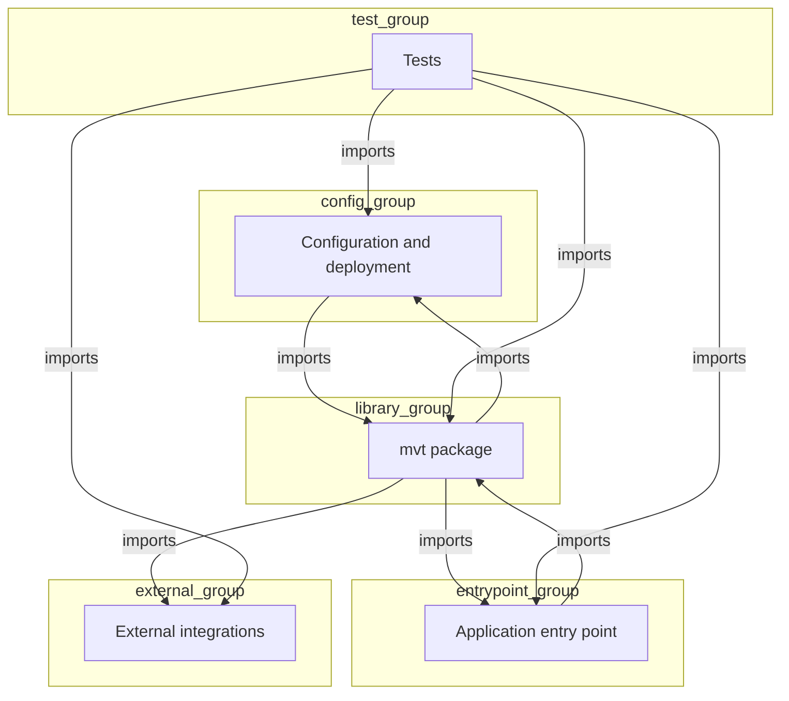

# Architecture report: mvt-project/mvt

> Automated static analysis. **Observed** = directly seen in files/imports/AST; **Inferred** = interpretation from that evidence. Repository code was not executed.

## 1. Repository at a glance

| Item | Value |
| --- | --- |
| Repository | mvt-project/mvt |
| Description | MVT (Mobile Verification Toolkit) helps with conducting forensics of mobile devices in order to find signs of a potential compromise. |
| Language | Python |
| Stars | 16039 |
| Licence | Other |
| Analysed commit / branch | c9190e05ef4c67df6407bc8b2adbd904954b9388 / main |
| Framework(s) | None detected |
| Files analysed | 326 |
| Components | 5 |

## 2. Architecture in one minute

mvt-project/mvt - MVT (Mobile Verification Toolkit) helps with conducting forensics of mobile devices in order to find signs of a potential compromise.. This repository was analysed statically from 326 file(s) (250 Python). Detected technologies (observed from imports/manifests): GitHub Actions, SQLite, Click, Pydantic, requests, Poetry. Files are grouped into 5 component(s): Configuration and deployment, Application entry point, External integrations, mvt package, Tests. Observed entry point(s): .github/workflows/scripts/update-ios-releases.py, src/mvt/android/__init__.py, src/mvt/android/cli.py. Findings below distinguish observed facts from inferred interpretation.

## 3. High-level block diagram

## 4. Main components

### Configuration and deployment (`config`)

- **Kind:** config
- **Status:** Observed
- **Confidence:** 0.85
- **Responsibility:** Groups 11 file(s) under configuration and deployment (observed from repository paths and static analysis). Observed top-level classes: MVTSettings, Settings.
- **Paths:** `Dockerfile`, `Dockerfile.android`, `Dockerfile.ios`, `MANIFEST.in`, `mkdocs.yml`, `pyproject.toml`, `src/mvt/android/artifacts/settings.py`, `src/mvt/android/modules/bugreport/settings.py`, `src/mvt/common/config.py`, `src/mvt/ios/data/ios_models.json`, `src/mvt/ios/data/ios_versions.json`
- **Evidence:** [Dockerfile](https://github.com/mvt-project/mvt/blob/c9190e05ef4c67df6407bc8b2adbd904954b9388/Dockerfile); [Dockerfile.android](https://github.com/mvt-project/mvt/blob/c9190e05ef4c67df6407bc8b2adbd904954b9388/Dockerfile.android); [Dockerfile.ios](https://github.com/mvt-project/mvt/blob/c9190e05ef4c67df6407bc8b2adbd904954b9388/Dockerfile.ios); [MANIFEST.in](https://github.com/mvt-project/mvt/blob/c9190e05ef4c67df6407bc8b2adbd904954b9388/MANIFEST.in); [mkdocs.yml](https://github.com/mvt-project/mvt/blob/c9190e05ef4c67df6407bc8b2adbd904954b9388/mkdocs.yml); [pyproject.toml](https://github.com/mvt-project/mvt/blob/c9190e05ef4c67df6407bc8b2adbd904954b9388/pyproject.toml); [src/mvt/android/artifacts/settings.py:91](https://github.com/mvt-project/mvt/blob/c9190e05ef4c67df6407bc8b2adbd904954b9388/src/mvt/android/artifacts/settings.py#L91); [src/mvt/android/modules/bugreport/settings.py:9](https://github.com/mvt-project/mvt/blob/c9190e05ef4c67df6407bc8b2adbd904954b9388/src/mvt/android/modules/bugreport/settings.py#L9)

### Application entry point (`entrypoint`)

- **Kind:** entrypoint
- **Status:** Observed
- **Confidence:** 0.85
- **Responsibility:** Groups 3 file(s) under application entry point (observed from repository paths and static analysis). Observed top-level functions: _get_disable_flags, _get_verbose, _load_custom_modules, check_adb, check_androidqf, check_backup.
- **Paths:** `src/mvt/android/cli.py`, `src/mvt/cli.py`, `src/mvt/ios/cli.py`
- **Evidence:** [src/mvt/android/cli.py:55](https://github.com/mvt-project/mvt/blob/c9190e05ef4c67df6407bc8b2adbd904954b9388/src/mvt/android/cli.py#L55); [src/mvt/cli.py:47](https://github.com/mvt-project/mvt/blob/c9190e05ef4c67df6407bc8b2adbd904954b9388/src/mvt/cli.py#L47); [src/mvt/ios/cli.py:67](https://github.com/mvt-project/mvt/blob/c9190e05ef4c67df6407bc8b2adbd904954b9388/src/mvt/ios/cli.py#L67)

### External integrations (`external_integrations`)

- **Kind:** external
- **Status:** Inferred
- **Confidence:** 0.70
- **Responsibility:** Groups 0 file(s) under external integrations (observed from repository paths and static analysis).
- **Evidence:** [src/mvt/common/logo.py:8](https://github.com/mvt-project/mvt/blob/c9190e05ef4c67df6407bc8b2adbd904954b9388/src/mvt/common/logo.py#L8); [src/mvt/common/updates.py:16](https://github.com/mvt-project/mvt/blob/c9190e05ef4c67df6407bc8b2adbd904954b9388/src/mvt/common/updates.py#L16); [src/mvt/common/url.py:10](https://github.com/mvt-project/mvt/blob/c9190e05ef4c67df6407bc8b2adbd904954b9388/src/mvt/common/url.py#L10); [src/mvt/common/virustotal.py:9](https://github.com/mvt-project/mvt/blob/c9190e05ef4c67df6407bc8b2adbd904954b9388/src/mvt/common/virustotal.py#L9); [src/mvt/ios/decrypt.py:13](https://github.com/mvt-project/mvt/blob/c9190e05ef4c67df6407bc8b2adbd904954b9388/src/mvt/ios/decrypt.py#L13); [src/mvt/ios/modules/backup/manifest.py:11](https://github.com/mvt-project/mvt/blob/c9190e05ef4c67df6407bc8b2adbd904954b9388/src/mvt/ios/modules/backup/manifest.py#L11)

### mvt package (`mvt`)

- **Kind:** library
- **Status:** Observed
- **Confidence:** 0.85
- **Responsibility:** Groups 148 file(s) under mvt package (observed from repository paths and static analysis). Observed top-level classes: AQFFiles, AQFGetProp, AQFLogTimestamps, AQFPackages, AQFProcesses, AQFSettings. Observed top-level functions: _batch_mode_ssh_command, _check_indicator_updates, _check_plugin_updates, _check_version_updates, _completion_script_path, _contributed_commands.
- **Paths:** `src/mvt/__init__.py`, `src/mvt/android/__init__.py`, `src/mvt/android/artifacts/__init__.py`, `src/mvt/android/artifacts/artifact.py`, `src/mvt/android/artifacts/dumpsys_accessibility.py`, `src/mvt/android/artifacts/dumpsys_adb.py`, `src/mvt/android/artifacts/dumpsys_appops.py`, `src/mvt/android/artifacts/dumpsys_battery_daily.py`, `src/mvt/android/artifacts/dumpsys_battery_history.py`, `src/mvt/android/artifacts/dumpsys_dbinfo.py`, `src/mvt/android/artifacts/dumpsys_package_activities.py`, `src/mvt/android/artifacts/dumpsys_packages.py`, `src/mvt/android/artifacts/dumpsys_platform_compat.py`, `src/mvt/android/artifacts/dumpsys_receivers.py`, `src/mvt/android/artifacts/file_timestamps.py`, `src/mvt/android/artifacts/getprop.py`, `src/mvt/android/artifacts/mounts.py`, `src/mvt/android/artifacts/package_resolvers.py`, `src/mvt/android/artifacts/processes.py`, `src/mvt/android/artifacts/tombstone_crashes.py`, `src/mvt/android/cmd_check_androidqf.py`, `src/mvt/android/cmd_check_backup.py`, `src/mvt/android/cmd_check_bugreport.py`, `src/mvt/android/cmd_check_intrusion_logs.py`, `src/mvt/android/command_modules.py`, `src/mvt/android/modules/__init__.py`, `src/mvt/android/modules/androidqf/__init__.py`, `src/mvt/android/modules/androidqf/aqf_files.py`, `src/mvt/android/modules/androidqf/aqf_getprop.py`, `src/mvt/android/modules/androidqf/aqf_log_timestamps.py`, `src/mvt/android/modules/androidqf/aqf_packages.py`, `src/mvt/android/modules/androidqf/aqf_processes.py`, `src/mvt/android/modules/androidqf/aqf_settings.py`, `src/mvt/android/modules/androidqf/base.py`, `src/mvt/android/modules/androidqf/mounts.py`, `src/mvt/android/modules/androidqf/root_binaries.py`, `src/mvt/android/modules/backup/__init__.py`, `src/mvt/android/modules/backup/base.py`, `src/mvt/android/modules/backup/helpers.py`, `src/mvt/android/modules/backup/sms.py`, `src/mvt/android/modules/bugreport/__init__.py`, `src/mvt/android/modules/bugreport/base.py`, `src/mvt/android/modules/bugreport/dumpsys_accessibility.py`, `src/mvt/android/modules/bugreport/dumpsys_activities.py`, `src/mvt/android/modules/bugreport/dumpsys_adb_state.py`, `src/mvt/android/modules/bugreport/dumpsys_appops.py`, `src/mvt/android/modules/bugreport/dumpsys_battery_daily.py`, `src/mvt/android/modules/bugreport/dumpsys_battery_history.py`, `src/mvt/android/modules/bugreport/dumpsys_dbinfo.py`, `src/mvt/android/modules/bugreport/dumpsys_getprop.py`, `src/mvt/android/modules/bugreport/dumpsys_packages.py`, `src/mvt/android/modules/bugreport/dumpsys_platform_compat.py`, `src/mvt/android/modules/bugreport/dumpsys_receivers.py`, `src/mvt/android/modules/bugreport/fs_timestamps.py`, `src/mvt/android/modules/bugreport/mounts.py`, `src/mvt/android/modules/bugreport/processes.py`, `src/mvt/android/modules/bugreport/tombstones.py`, `src/mvt/android/modules/intrusion_logs/__init__.py`, `src/mvt/android/modules/intrusion_logs/base.py`, `src/mvt/android/modules/intrusion_logs/connect_event.py`, `src/mvt/android/modules/intrusion_logs/dns_event.py`, `src/mvt/android/modules/intrusion_logs/security_event.py`, `src/mvt/android/parsers/__init__.py`, `src/mvt/android/parsers/backup.py`, `src/mvt/android/parsers/proto/__init__.py`, `src/mvt/android/parsers/proto/tombstone.py`, `src/mvt/android/utils.py`, `src/mvt/common/__init__.py`, `src/mvt/common/alerts.py`, `src/mvt/common/artifact.py`, `src/mvt/common/cli_plugins.py`, `src/mvt/common/cmd_check_iocs.py`, `src/mvt/common/cmd_plugins.py`, `src/mvt/common/command.py`, `src/mvt/common/completion.py`, `src/mvt/common/help.py`, `src/mvt/common/indicators.py`, `src/mvt/common/log.py`, `src/mvt/common/logo.py`, `src/mvt/common/module.py`, `src/mvt/common/module_loader.py`, `src/mvt/common/module_types.py`, `src/mvt/common/options.py`, `src/mvt/common/password.py`, `src/mvt/common/plugin_config.py`, `src/mvt/common/updates.py`, `src/mvt/common/url.py`, `src/mvt/common/utils.py`, `src/mvt/common/version.py`, `src/mvt/common/virustotal.py`, `src/mvt/ios/__init__.py`, `src/mvt/ios/cmd_check_backup.py`, `src/mvt/ios/cmd_check_fs.py`, `src/mvt/ios/cmd_check_sysdiagnose.py`, `src/mvt/ios/command_modules.py`, `src/mvt/ios/decrypt.py`, `src/mvt/ios/decrypt_config.py`, `src/mvt/ios/modules/__init__.py`, `src/mvt/ios/modules/backup/__init__.py`, `src/mvt/ios/modules/backup/backup_info.py`, `src/mvt/ios/modules/backup/configuration_profiles.py`, `src/mvt/ios/modules/backup/manifest.py`, `src/mvt/ios/modules/backup/profile_events.py`, `src/mvt/ios/modules/base.py`, `src/mvt/ios/modules/fs/__init__.py`, `src/mvt/ios/modules/fs/analytics.py`, `src/mvt/ios/modules/fs/analytics_ios_versions.py`, `src/mvt/ios/modules/fs/cache_files.py`, `src/mvt/ios/modules/fs/filesystem.py`, `src/mvt/ios/modules/fs/net_netusage.py`, `src/mvt/ios/modules/fs/safari_favicon.py`, `src/mvt/ios/modules/fs/shutdownlog.py`, `src/mvt/ios/modules/fs/version_history.py`, `src/mvt/ios/modules/fs/webkit_base.py`, `src/mvt/ios/modules/fs/webkit_indexeddb.py`, `src/mvt/ios/modules/fs/webkit_localstorage.py`, `src/mvt/ios/modules/fs/webkit_safariviewservice.py`, `src/mvt/ios/modules/mixed/__init__.py`, `src/mvt/ios/modules/mixed/applications.py`, `src/mvt/ios/modules/mixed/calendar.py`, `src/mvt/ios/modules/mixed/calls.py`, `src/mvt/ios/modules/mixed/chrome_favicon.py`, `src/mvt/ios/modules/mixed/chrome_history.py`, `src/mvt/ios/modules/mixed/contacts.py`, `src/mvt/ios/modules/mixed/firefox_favicon.py`, `src/mvt/ios/modules/mixed/firefox_history.py`, `src/mvt/ios/modules/mixed/global_preferences.py`, `src/mvt/ios/modules/mixed/idstatuscache.py`, `src/mvt/ios/modules/mixed/interactionc.py`, `src/mvt/ios/modules/mixed/locationd.py`, `src/mvt/ios/modules/mixed/net_datausage.py`, `src/mvt/ios/modules/mixed/osanalytics_addaily.py`, `src/mvt/ios/modules/mixed/safari_browserstate.py`, `src/mvt/ios/modules/mixed/safari_history.py`, `src/mvt/ios/modules/mixed/shortcuts.py`, `src/mvt/ios/modules/mixed/sms.py`, `src/mvt/ios/modules/mixed/sms_attachments.py`, `src/mvt/ios/modules/mixed/tcc.py`, `src/mvt/ios/modules/mixed/webkit_resource_load_statistics.py`, `src/mvt/ios/modules/mixed/webkit_session_resource_log.py`, `src/mvt/ios/modules/mixed/whatsapp.py`, `src/mvt/ios/modules/mixed/whatsapp_contacts.py`, `src/mvt/ios/modules/net_base.py`, `src/mvt/ios/modules/sysdiagnose/__init__.py`, `src/mvt/ios/modules/sysdiagnose/base.py`, `src/mvt/ios/modules/sysdiagnose/sysdiagnose_info.py`, `src/mvt/ios/versions.py`, `src/mvt/plugin.py`
- **Evidence:** [src/mvt/__init__.py](https://github.com/mvt-project/mvt/blob/c9190e05ef4c67df6407bc8b2adbd904954b9388/src/mvt/__init__.py); [src/mvt/android/__init__.py](https://github.com/mvt-project/mvt/blob/c9190e05ef4c67df6407bc8b2adbd904954b9388/src/mvt/android/__init__.py); [src/mvt/android/artifacts/__init__.py](https://github.com/mvt-project/mvt/blob/c9190e05ef4c67df6407bc8b2adbd904954b9388/src/mvt/android/artifacts/__init__.py); [src/mvt/android/artifacts/artifact.py:10](https://github.com/mvt-project/mvt/blob/c9190e05ef4c67df6407bc8b2adbd904954b9388/src/mvt/android/artifacts/artifact.py#L10); [src/mvt/android/artifacts/dumpsys_accessibility.py:12](https://github.com/mvt-project/mvt/blob/c9190e05ef4c67df6407bc8b2adbd904954b9388/src/mvt/android/artifacts/dumpsys_accessibility.py#L12); [src/mvt/android/artifacts/dumpsys_adb.py:14](https://github.com/mvt-project/mvt/blob/c9190e05ef4c67df6407bc8b2adbd904954b9388/src/mvt/android/artifacts/dumpsys_adb.py#L14); [src/mvt/android/artifacts/dumpsys_appops.py:19](https://github.com/mvt-project/mvt/blob/c9190e05ef4c67df6407bc8b2adbd904954b9388/src/mvt/android/artifacts/dumpsys_appops.py#L19); [src/mvt/android/artifacts/dumpsys_battery_daily.py:13](https://github.com/mvt-project/mvt/blob/c9190e05ef4c67df6407bc8b2adbd904954b9388/src/mvt/android/artifacts/dumpsys_battery_daily.py#L13)

### Tests (`tests`)

- **Kind:** test
- **Status:** Observed
- **Confidence:** 0.85
- **Responsibility:** Groups 120 file(s) under tests (observed from repository paths and static analysis). Observed application object created via Command, Group. Observed top-level classes: AnotherModule, BackupCheckerModule, BackupOnlyModule, BugReportCheckerModule, CustomDependsOnBuiltin, CustomIOSBackupModule. Observed top-level functions: _bugreport_zip, _console_level, _create_sysdiagnose_archive, _create_sysdiagnose_folder, _create_truncated_sysdiagnose_archive, _encrypted_file.
- **Paths:** `tests/__init__.py`, `tests/android/__init__.py`, `tests/android/test_artifact.py`, `tests/android/test_artifact_dumpsys_accessibility.py`, `tests/android/test_artifact_dumpsys_accessibility_count.py`, `tests/android/test_artifact_dumpsys_accessibility_state.py`, `tests/android/test_artifact_dumpsys_adb.py`, `tests/android/test_artifact_dumpsys_appops.py`, `tests/android/test_artifact_dumpsys_battery_daily.py`, `tests/android/test_artifact_dumpsys_battery_history.py`, `tests/android/test_artifact_dumpsys_dbinfo.py`, `tests/android/test_artifact_dumpsys_package_activities.py`, `tests/android/test_artifact_dumpsys_packages.py`, `tests/android/test_artifact_dumpsys_platform_compat.py`, `tests/android/test_artifact_dumpsys_receivers.py`, `tests/android/test_artifact_getprop.py`, `tests/android/test_artifact_mounts.py`, `tests/android/test_artifact_processes.py`, `tests/android/test_artifact_settings.py`, `tests/android/test_artifact_tombstone_caused_by.py`, `tests/android/test_artifact_tombstones.py`, `tests/android/test_backup_module.py`, `tests/android/test_backup_parser.py`, `tests/android/test_bugreport_section_extraction.py`, `tests/android/test_check_backup_optional_failure.py`, `tests/android/test_check_bugreport_wrapper.py`, `tests/android/test_intrusion_logs.py`, `tests/android_adb/__init__.py`, `tests/android_androidqf/__init__.py`, `tests/android_androidqf/test_files.py`, `tests/android_androidqf/test_getprop.py`, `tests/android_androidqf/test_mounts.py`, `tests/android_androidqf/test_packages.py`, `tests/android_androidqf/test_processes.py`, `tests/android_androidqf/test_root_binaries.py`, `tests/android_androidqf/test_settings.py`, `tests/android_androidqf/test_tcc.py`, `tests/android_bugreport/__init__.py`, `tests/android_bugreport/test_bugreport.py`, `tests/artifacts/.gitignore`, `tests/artifacts/android_backup/apps/com.android.providers.telephony/d_f/000000_sms_backup`, `tests/artifacts/android_data/bugreport/FS/data/tombstones/tombstone_00`, `tests/artifacts/android_data/bugreport/FS/data/tombstones/tombstone_01`, `tests/artifacts/android_data/bugreport/dumpstate.txt`, `tests/artifacts/android_data/bugreport/main_entry.txt`, `tests/artifacts/android_data/dumpsys_accessibility.txt`, `tests/artifacts/android_data/dumpsys_accessibility_v14_or_later.txt`, `tests/artifacts/android_data/dumpsys_adb_xml.txt`, `tests/artifacts/android_data/dumpsys_appops.txt`, `tests/artifacts/android_data/dumpsys_battery.txt`, `tests/artifacts/android_data/dumpsys_dbinfo.txt`, `tests/artifacts/android_data/dumpsys_packages.txt`, `tests/artifacts/android_data/dumpsys_platform_compat.txt`, `tests/artifacts/android_data/getprop.txt`, `tests/artifacts/android_data/ps.txt`, `tests/artifacts/android_data/tombstone_process.txt`, `tests/artifacts/androidqf/dumpsys.txt`, `tests/artifacts/androidqf/files.json`, `tests/artifacts/androidqf/getprop.txt`, `tests/artifacts/androidqf/packages.json`, `tests/artifacts/androidqf/ps.txt`, `tests/artifacts/androidqf/root_binaries.json`, `tests/artifacts/androidqf/settings_random.txt`, `tests/artifacts/generate_stix.py`, `tests/artifacts/stix2/638cd3ee5e5f019f84f9e0ea.json`, `tests/common/__init__.py`, `tests/common/test_alerts.py`, `tests/common/test_cli_plugins.py`, `tests/common/test_cmd_check_iocs.py`, `tests/common/test_cmd_plugins.py`, `tests/common/test_command.py`, `tests/common/test_command_modules.py`, `tests/common/test_config.py`, `tests/common/test_indicators.py`, `tests/common/test_module_loader.py`, `tests/common/test_password.py`, `tests/common/test_plugin.py`, `tests/common/test_plugin_config.py`, `tests/common/test_plugin_updates.py`, `tests/common/test_url.py`, `tests/common/test_utils.py`, `tests/conftest.py`, `tests/ios_backup/__init__.py`, `tests/ios_backup/test_backup_info.py`, `tests/ios_backup/test_calendar.py`, `tests/ios_backup/test_datausage.py`, `tests/ios_backup/test_decrypt.py`, `tests/ios_backup/test_global_preferences.py`, `tests/ios_backup/test_interactionc.py`, `tests/ios_backup/test_manifest.py`, `tests/ios_backup/test_safari_browserstate.py`, `tests/ios_backup/test_safari_history.py`, `tests/ios_backup/test_sms.py`, `tests/ios_backup/test_sqlite_handling.py`, `tests/ios_backup/test_tcc.py`, `tests/ios_backup/test_webkit_resource_load_statistics.py`, `tests/ios_backup/test_whatsapp.py`, `tests/ios_backup/test_whatsapp_contacts.py`, `tests/ios_fs/__init__.py`, `tests/ios_fs/test_cache_files.py`, `tests/ios_fs/test_filesystem.py`, `tests/ios_fs/test_shutdownlog.py`, `tests/ios_sysdiagnose/__init__.py`, `tests/ios_sysdiagnose/test_sysdiagnose_info.py`, `tests/plugin_fixtures.py`, `tests/test_check_android_adb_removed.py`, `tests/test_check_android_androidqf.py`, `tests/test_check_android_backup.py`, `tests/test_check_android_bugreport.py`, `tests/test_check_ios_backup.py`, `tests/test_check_ios_sysdiagnose.py`, `tests/test_cli.py`, `tests/test_cli_entry_points.py`, `tests/test_cli_startup.py`, `tests/test_cli_verbose.py`, `tests/test_cmd_check_sysdiagnose.py`, `tests/test_completion.py`, `tests/test_custom_modules.py`, `tests/test_ios_versions.py`, `tests/utils.py`
- **Evidence:** [tests/__init__.py](https://github.com/mvt-project/mvt/blob/c9190e05ef4c67df6407bc8b2adbd904954b9388/tests/__init__.py); [tests/android/__init__.py](https://github.com/mvt-project/mvt/blob/c9190e05ef4c67df6407bc8b2adbd904954b9388/tests/android/__init__.py); [tests/android/test_artifact.py:10](https://github.com/mvt-project/mvt/blob/c9190e05ef4c67df6407bc8b2adbd904954b9388/tests/android/test_artifact.py#L10); [tests/android/test_artifact_dumpsys_accessibility.py:14](https://github.com/mvt-project/mvt/blob/c9190e05ef4c67df6407bc8b2adbd904954b9388/tests/android/test_artifact_dumpsys_accessibility.py#L14); [tests/android/test_artifact_dumpsys_accessibility_count.py:63](https://github.com/mvt-project/mvt/blob/c9190e05ef4c67df6407bc8b2adbd904954b9388/tests/android/test_artifact_dumpsys_accessibility_count.py#L63); [tests/android/test_artifact_dumpsys_accessibility_state.py:58](https://github.com/mvt-project/mvt/blob/c9190e05ef4c67df6407bc8b2adbd904954b9388/tests/android/test_artifact_dumpsys_accessibility_state.py#L58); [tests/android/test_artifact_dumpsys_adb.py:15](https://github.com/mvt-project/mvt/blob/c9190e05ef4c67df6407bc8b2adbd904954b9388/tests/android/test_artifact_dumpsys_adb.py#L15); [tests/android/test_artifact_dumpsys_appops.py:13](https://github.com/mvt-project/mvt/blob/c9190e05ef4c67df6407bc8b2adbd904954b9388/tests/android/test_artifact_dumpsys_appops.py#L13)

## 5. Execution flow

**Observed** entry point(s):

- [.github/workflows/scripts/update-ios-releases.py:95](https://github.com/mvt-project/mvt/blob/c9190e05ef4c67df6407bc8b2adbd904954b9388/.github/workflows/scripts/update-ios-releases.py#L95)
- [src/mvt/android/__init__.py](https://github.com/mvt-project/mvt/blob/c9190e05ef4c67df6407bc8b2adbd904954b9388/src/mvt/android/__init__.py)
- [src/mvt/android/cli.py:94](https://github.com/mvt-project/mvt/blob/c9190e05ef4c67df6407bc8b2adbd904954b9388/src/mvt/android/cli.py#L94)
- [src/mvt/cli.py](https://github.com/mvt-project/mvt/blob/c9190e05ef4c67df6407bc8b2adbd904954b9388/src/mvt/cli.py)
- [src/mvt/common/cmd_plugins.py:138](https://github.com/mvt-project/mvt/blob/c9190e05ef4c67df6407bc8b2adbd904954b9388/src/mvt/common/cmd_plugins.py#L138)
- [src/mvt/common/completion.py:67](https://github.com/mvt-project/mvt/blob/c9190e05ef4c67df6407bc8b2adbd904954b9388/src/mvt/common/completion.py#L67)
- [src/mvt/ios/__init__.py](https://github.com/mvt-project/mvt/blob/c9190e05ef4c67df6407bc8b2adbd904954b9388/src/mvt/ios/__init__.py)
- [src/mvt/ios/cli.py:106](https://github.com/mvt-project/mvt/blob/c9190e05ef4c67df6407bc8b2adbd904954b9388/src/mvt/ios/cli.py#L106)

Representative flow (derived from observed entry points and the import graph; steps beyond the entry point are **Inferred**):

1. Execution starts at an observed entry point listed above, if present.
2. `config` imports `mvt` (Configuration and deployment -> mvt package).
3. `entrypoint` imports `mvt` (Application entry point -> mvt package).
4. `mvt` imports `config` (mvt package -> Configuration and deployment).
5. `mvt` imports `entrypoint` (mvt package -> Application entry point).
6. `mvt` imports `external_integrations` (mvt package -> External integrations).
7. `tests` imports `config` (Tests -> Configuration and deployment).
8. `tests` imports `entrypoint` (Tests -> Application entry point).
9. `tests` imports `external_integrations` (Tests -> External integrations).

## 6. Project structure

### `(root)`

- `.gitignore` - other (1974 bytes)
- `.python-version` - other (5 bytes)
- `.readthedocs.yaml` - config (334 bytes)
- `.safety-policy.yml` - config (864 bytes)
- `CONTRIBUTING.md` - docs (3671 bytes)
- `Dockerfile` - container (2778 bytes)
- `Dockerfile.android` - container (1516 bytes)
- `Dockerfile.ios` - container (1529 bytes)
- `LICENSE` - docs (17791 bytes)
- `MANIFEST.in` - manifest (149 bytes)
- `Makefile` - other (574 bytes)
- `README.md` - docs (5725 bytes)
- `SECURITY.md` - docs (3728 bytes)
- `mkdocs.yml` - config (2772 bytes)
- `pyproject.toml` - manifest (3331 bytes)

### `.github`

- `.github/dependabot.yml` - config (560 bytes)
- `.github/workflows/add-issue-to-project.yml` - ci, YAML (451 bytes)
- `.github/workflows/mypy.yml` - ci, YAML (573 bytes)
- `.github/workflows/publish-release-docker.yml` - ci, YAML (4275 bytes)
- `.github/workflows/release.yml` - ci, YAML (1302 bytes)
- `.github/workflows/ruff.yml` - ci, YAML (592 bytes)
- `.github/workflows/scripts/update-ios-releases.py` - ci, YAML (3036 bytes)
- `.github/workflows/tests.yml` - ci, YAML (1870 bytes)
- `.github/workflows/update-ios-data.yml` - ci, YAML (1137 bytes)

### `docs`

- `docs/android/adb.md` - docs (1259 bytes)
- `docs/android/backup.md` - docs (4142 bytes)
- `docs/android/intrusion_logs.md` - docs (6411 bytes)
- `docs/android/methodology.md` - docs (5827 bytes)
- `docs/command_completion.md` - docs (2101 bytes)
- `docs/development/custom_commands.md` - docs (7301 bytes)
- `docs/development/index.md` - docs (16549 bytes)
- `docs/development/plugin_configuration.md` - docs (5686 bytes)
- `docs/development/plugins.md` - docs (5141 bytes)
- `docs/docker.md` - docs (2588 bytes)
- `docs/index.md` - docs (1166 bytes)
- `docs/install.md` - docs (3774 bytes)
- `docs/introduction.md` - docs (2912 bytes)
- `docs/iocs.md` - docs (4608 bytes)
- `docs/ios/backup/check.md` - docs (4349 bytes)
- `docs/ios/backup/itunes.md` - docs (2531 bytes)
- `docs/ios/backup/libimobiledevice.md` - docs (166 bytes)
- `docs/ios/backup/pymobiledevice3.md` - docs (1825 bytes)
- `docs/ios/filesystem/check.md` - docs (1468 bytes)
- `docs/ios/filesystem/dump.md` - docs (2399 bytes)
- `docs/ios/install.md` - docs (1587 bytes)
- `docs/ios/methodology.md` - docs (1473 bytes)
- `docs/ios/records.md` - docs (24988 bytes)
- `docs/ios/sysdiagnose.md` - docs (2236 bytes)
- `docs/license.md` - docs (1523 bytes)

### `src`

- `src/mvt/__init__.py` - source, Python (190 bytes)
- `src/mvt/android/__init__.py` - source, Python (218 bytes)
- `src/mvt/android/artifacts/__init__.py` - source, Python (190 bytes)
- `src/mvt/android/artifacts/artifact.py` - source, Python (2177 bytes)
- `src/mvt/android/artifacts/dumpsys_accessibility.py` - source, Python (8691 bytes)
- `src/mvt/android/artifacts/dumpsys_adb.py` - source, Python (10543 bytes)
- `src/mvt/android/artifacts/dumpsys_appops.py` - source, Python (8636 bytes)
- `src/mvt/android/artifacts/dumpsys_battery_daily.py` - source, Python (5731 bytes)
- `src/mvt/android/artifacts/dumpsys_battery_history.py` - source, Python (6526 bytes)
- `src/mvt/android/artifacts/dumpsys_dbinfo.py` - source, Python (2815 bytes)
- `src/mvt/android/artifacts/dumpsys_package_activities.py` - source, Python (1037 bytes)
- `src/mvt/android/artifacts/dumpsys_packages.py` - source, Python (9660 bytes)
- `src/mvt/android/artifacts/dumpsys_platform_compat.py` - source, Python (2394 bytes)
- `src/mvt/android/artifacts/dumpsys_receivers.py` - source, Python (2451 bytes)
- `src/mvt/android/artifacts/file_timestamps.py` - source, Python (1338 bytes)
- `src/mvt/android/artifacts/getprop.py` - source, Python (2503 bytes)
- `src/mvt/android/artifacts/mounts.py` - source, Python (9523 bytes)
- `src/mvt/android/artifacts/package_resolvers.py` - source, Python (2022 bytes)
- `src/mvt/android/artifacts/processes.py` - source, Python (2696 bytes)
- `src/mvt/android/artifacts/settings.py` - source, Python (10760 bytes)
- `src/mvt/android/artifacts/tombstone_crashes.py` - source, Python (11579 bytes)
- `src/mvt/android/cli.py` - source, Python (15983 bytes)
- `src/mvt/android/cmd_check_androidqf.py` - source, Python (14040 bytes)
- `src/mvt/android/cmd_check_backup.py` - source, Python (6915 bytes)
- `src/mvt/android/cmd_check_bugreport.py` - source, Python (7831 bytes)
- `src/mvt/android/cmd_check_intrusion_logs.py` - source, Python (4057 bytes)
- `src/mvt/android/command_modules.py` - source, Python (939 bytes)
- `src/mvt/android/modules/__init__.py` - source, Python (190 bytes)
- `src/mvt/android/modules/androidqf/__init__.py` - source, Python (714 bytes)
- `src/mvt/android/modules/androidqf/aqf_files.py` - source, Python (5638 bytes)
- `src/mvt/android/modules/androidqf/aqf_getprop.py` - source, Python (1512 bytes)
- `src/mvt/android/modules/androidqf/aqf_log_timestamps.py` - source, Python (2439 bytes)
- `src/mvt/android/modules/androidqf/aqf_packages.py` - source, Python (7499 bytes)
- `src/mvt/android/modules/androidqf/aqf_processes.py` - source, Python (1349 bytes)
- `src/mvt/android/modules/androidqf/aqf_settings.py` - source, Python (1153 bytes)
- `src/mvt/android/modules/androidqf/base.py` - source, Python (3024 bytes)
- `src/mvt/android/modules/androidqf/mounts.py` - source, Python (2647 bytes)
- `src/mvt/android/modules/androidqf/root_binaries.py` - source, Python (4110 bytes)
- `src/mvt/android/modules/backup/__init__.py` - source, Python (300 bytes)
- `src/mvt/android/modules/backup/base.py` - source, Python (2384 bytes)
- `src/mvt/android/modules/backup/helpers.py` - source, Python (2056 bytes)
- `src/mvt/android/modules/backup/sms.py` - source, Python (2793 bytes)
- `src/mvt/android/modules/bugreport/__init__.py` - source, Python (1333 bytes)
- `src/mvt/android/modules/bugreport/base.py` - source, Python (6538 bytes)
- `src/mvt/android/modules/bugreport/dumpsys_accessibility.py` - source, Python (2351 bytes)
- `src/mvt/android/modules/bugreport/dumpsys_activities.py` - source, Python (1761 bytes)
- `src/mvt/android/modules/bugreport/dumpsys_adb_state.py` - source, Python (6486 bytes)
- `src/mvt/android/modules/bugreport/dumpsys_appops.py` - source, Python (1657 bytes)
- `src/mvt/android/modules/bugreport/dumpsys_battery_daily.py` - source, Python (1664 bytes)
- `src/mvt/android/modules/bugreport/dumpsys_battery_history.py` - source, Python (1698 bytes)
- `src/mvt/android/modules/bugreport/dumpsys_dbinfo.py` - source, Python (1676 bytes)
- `src/mvt/android/modules/bugreport/dumpsys_getprop.py` - source, Python (1654 bytes)
- `src/mvt/android/modules/bugreport/dumpsys_packages.py` - source, Python (2405 bytes)
- `src/mvt/android/modules/bugreport/dumpsys_platform_compat.py` - source, Python (1717 bytes)
- `src/mvt/android/modules/bugreport/dumpsys_receivers.py` - source, Python (1691 bytes)
- `src/mvt/android/modules/bugreport/fs_timestamps.py` - source, Python (2622 bytes)
- `src/mvt/android/modules/bugreport/mounts.py` - source, Python (1544 bytes)
- `src/mvt/android/modules/bugreport/processes.py` - source, Python (742 bytes)
- `src/mvt/android/modules/bugreport/settings.py` - source, Python (712 bytes)
- `src/mvt/android/modules/bugreport/tombstones.py` - source, Python (4668 bytes)
- `src/mvt/android/modules/intrusion_logs/__init__.py` - source, Python (549 bytes)
- `src/mvt/android/modules/intrusion_logs/base.py` - source, Python (15998 bytes)
- `src/mvt/android/modules/intrusion_logs/connect_event.py` - source, Python (4544 bytes)
- `src/mvt/android/modules/intrusion_logs/dns_event.py` - source, Python (5248 bytes)
- `src/mvt/android/modules/intrusion_logs/security_event.py` - source, Python (33096 bytes)
- `src/mvt/android/parsers/__init__.py` - source, Python (190 bytes)
- `src/mvt/android/parsers/backup.py` - source, Python (7810 bytes)
- `src/mvt/android/parsers/proto/__init__.py` - source, Python (0 bytes)
- `src/mvt/android/parsers/proto/tombstone.proto` - other (4679 bytes)
- `src/mvt/android/parsers/proto/tombstone.py` - source, Python (10230 bytes)
- `src/mvt/android/utils.py` - source, Python (3305 bytes)
- `src/mvt/cli.py` - source, Python (3843 bytes)
- `src/mvt/common/__init__.py` - source, Python (190 bytes)
- `src/mvt/common/alerts.py` - source, Python (7405 bytes)
- `src/mvt/common/artifact.py` - source, Python (420 bytes)
- `src/mvt/common/cli_plugins.py` - source, Python (10348 bytes)
- `src/mvt/common/cmd_check_iocs.py` - source, Python (3535 bytes)
- `src/mvt/common/cmd_plugins.py` - source, Python (5991 bytes)
- `src/mvt/common/command.py` - source, Python (30381 bytes)
- `src/mvt/common/completion.py` - source, Python (5111 bytes)
- `src/mvt/common/config.py` - source, Python (3980 bytes)
- `src/mvt/common/help.py` - source, Python (3535 bytes)
- `src/mvt/common/indicators.py` - source, Python (29648 bytes)
- `src/mvt/common/log.py` - source, Python (2464 bytes)
- `src/mvt/common/logo.py` - source, Python (5546 bytes)
- `src/mvt/common/module.py` - source, Python (10953 bytes)
- `src/mvt/common/module_loader.py` - source, Python (14346 bytes)
- `src/mvt/common/module_types.py` - source, Python (1319 bytes)
- `src/mvt/common/options.py` - source, Python (1256 bytes)
- `src/mvt/common/password.py` - source, Python (4052 bytes)
- `src/mvt/common/plugin_config.py` - source, Python (11292 bytes)
- `src/mvt/common/updates.py` - source, Python (23395 bytes)
- `src/mvt/common/url.py` - source, Python (7644 bytes)
- `src/mvt/common/utils.py` - source, Python (8920 bytes)
- `src/mvt/common/version.py` - source, Python (260 bytes)
- `src/mvt/common/virustotal.py` - source, Python (1432 bytes)
- `src/mvt/ios/__init__.py` - source, Python (218 bytes)
- `src/mvt/ios/cli.py` - source, Python (17115 bytes)
- `src/mvt/ios/cmd_check_backup.py` - source, Python (3486 bytes)
- `src/mvt/ios/cmd_check_fs.py` - source, Python (1857 bytes)
- `src/mvt/ios/cmd_check_sysdiagnose.py` - source, Python (8062 bytes)
- `src/mvt/ios/command_modules.py` - source, Python (889 bytes)
- `src/mvt/ios/data/ios_models.json` - config (5041 bytes)
- `src/mvt/ios/data/ios_versions.json` - config (21599 bytes)
- `src/mvt/ios/decrypt.py` - source, Python (17973 bytes)
- `src/mvt/ios/decrypt_config.py` - source, Python (320 bytes)
- `src/mvt/ios/modules/__init__.py` - source, Python (190 bytes)
- `src/mvt/ios/modules/backup/__init__.py` - source, Python (520 bytes)
- `src/mvt/ios/modules/backup/backup_info.py` - source, Python (2820 bytes)
- `src/mvt/ios/modules/backup/configuration_profiles.py` - source, Python (6017 bytes)
- `src/mvt/ios/modules/backup/manifest.py` - source, Python (8284 bytes)
- `src/mvt/ios/modules/backup/profile_events.py` - source, Python (4103 bytes)
- `src/mvt/ios/modules/base.py` - source, Python (12266 bytes)
- `src/mvt/ios/modules/fs/__init__.py` - source, Python (975 bytes)
- `src/mvt/ios/modules/fs/analytics.py` - source, Python (4878 bytes)
- `src/mvt/ios/modules/fs/analytics_ios_versions.py` - source, Python (2946 bytes)
- `src/mvt/ios/modules/fs/cache_files.py` - source, Python (3489 bytes)
- `src/mvt/ios/modules/fs/filesystem.py` - source, Python (3540 bytes)
- `src/mvt/ios/modules/fs/net_netusage.py` - source, Python (1806 bytes)
- `src/mvt/ios/modules/fs/safari_favicon.py` - source, Python (4136 bytes)
- `src/mvt/ios/modules/fs/shutdownlog.py` - source, Python (5390 bytes)
- `src/mvt/ios/modules/fs/version_history.py` - source, Python (2415 bytes)
- `src/mvt/ios/modules/fs/webkit_base.py` - source, Python (1503 bytes)
- `src/mvt/ios/modules/fs/webkit_indexeddb.py` - source, Python (1862 bytes)
- `src/mvt/ios/modules/fs/webkit_localstorage.py` - source, Python (1885 bytes)
- `src/mvt/ios/modules/fs/webkit_safariviewservice.py` - source, Python (1543 bytes)
- `src/mvt/ios/modules/mixed/__init__.py` - source, Python (1717 bytes)
- `src/mvt/ios/modules/mixed/applications.py` - source, Python (6083 bytes)
- `src/mvt/ios/modules/mixed/calendar.py` - source, Python (5362 bytes)
- `src/mvt/ios/modules/mixed/calls.py` - source, Python (2748 bytes)
- `src/mvt/ios/modules/mixed/chrome_favicon.py` - source, Python (3653 bytes)
- `src/mvt/ios/modules/mixed/chrome_history.py` - source, Python (3426 bytes)
- `src/mvt/ios/modules/mixed/contacts.py` - source, Python (2635 bytes)
- `src/mvt/ios/modules/mixed/firefox_favicon.py` - source, Python (3526 bytes)
- `src/mvt/ios/modules/mixed/firefox_history.py` - source, Python (3208 bytes)
- `src/mvt/ios/modules/mixed/global_preferences.py` - source, Python (2274 bytes)
- `src/mvt/ios/modules/mixed/idstatuscache.py` - source, Python (4560 bytes)
- `src/mvt/ios/modules/mixed/interactionc.py` - source, Python (23410 bytes)
- `src/mvt/ios/modules/mixed/locationd.py` - source, Python (6440 bytes)
- `src/mvt/ios/modules/mixed/net_datausage.py` - source, Python (1537 bytes)
- `src/mvt/ios/modules/mixed/osanalytics_addaily.py` - source, Python (3589 bytes)
- `src/mvt/ios/modules/mixed/safari_browserstate.py` - source, Python (7974 bytes)
- `src/mvt/ios/modules/mixed/safari_history.py` - source, Python (6903 bytes)
- `src/mvt/ios/modules/mixed/shortcuts.py` - source, Python (5874 bytes)
- `src/mvt/ios/modules/mixed/sms.py` - source, Python (6790 bytes)
- `src/mvt/ios/modules/mixed/sms_attachments.py` - source, Python (5351 bytes)
- `src/mvt/ios/modules/mixed/tcc.py` - source, Python (7901 bytes)
- `src/mvt/ios/modules/mixed/webkit_resource_load_statistics.py` - source, Python (6404 bytes)
- `src/mvt/ios/modules/mixed/webkit_session_resource_log.py` - source, Python (8047 bytes)
- `src/mvt/ios/modules/mixed/whatsapp.py` - source, Python (14019 bytes)
- `src/mvt/ios/modules/mixed/whatsapp_contacts.py` - source, Python (10422 bytes)
- `src/mvt/ios/modules/net_base.py` - source, Python (13038 bytes)
- `src/mvt/ios/modules/sysdiagnose/__init__.py` - source, Python (382 bytes)
- `src/mvt/ios/modules/sysdiagnose/base.py` - source, Python (3695 bytes)
- `src/mvt/ios/modules/sysdiagnose/sysdiagnose_info.py` - source, Python (8637 bytes)
- `src/mvt/ios/versions.py` - source, Python (1904 bytes)
- `src/mvt/plugin.py` - source, Python (2353 bytes)

### `tests`

- `tests/__init__.py` - test, Python (190 bytes)
- `tests/android/__init__.py` - test, Python (190 bytes)
- `tests/android/test_artifact.py` - test, Python (658 bytes)
- `tests/android/test_artifact_dumpsys_accessibility.py` - test, Python (4093 bytes)
- `tests/android/test_artifact_dumpsys_accessibility_count.py` - test, Python (5736 bytes)
- `tests/android/test_artifact_dumpsys_accessibility_state.py` - test, Python (6174 bytes)
- `tests/android/test_artifact_dumpsys_adb.py` - test, Python (14997 bytes)
- `tests/android/test_artifact_dumpsys_appops.py` - test, Python (3271 bytes)
- `tests/android/test_artifact_dumpsys_battery_daily.py` - test, Python (6014 bytes)
- `tests/android/test_artifact_dumpsys_battery_history.py` - test, Python (3324 bytes)
- `tests/android/test_artifact_dumpsys_dbinfo.py` - test, Python (3021 bytes)
- `tests/android/test_artifact_dumpsys_package_activities.py` - test, Python (1658 bytes)
- `tests/android/test_artifact_dumpsys_packages.py` - test, Python (3184 bytes)
- `tests/android/test_artifact_dumpsys_platform_compat.py` - test, Python (1697 bytes)
- `tests/android/test_artifact_dumpsys_receivers.py` - test, Python (2648 bytes)
- `tests/android/test_artifact_getprop.py` - test, Python (2116 bytes)
- `tests/android/test_artifact_mounts.py` - test, Python (1571 bytes)
- `tests/android/test_artifact_processes.py` - test, Python (1592 bytes)
- `tests/android/test_artifact_settings.py` - test, Python (7861 bytes)
- `tests/android/test_artifact_tombstone_caused_by.py` - test, Python (2174 bytes)
- `tests/android/test_artifact_tombstones.py` - test, Python (5007 bytes)
- `tests/android/test_backup_module.py` - test, Python (2714 bytes)
- `tests/android/test_backup_parser.py` - test, Python (2760 bytes)
- `tests/android/test_bugreport_section_extraction.py` - test, Python (1626 bytes)
- `tests/android/test_check_backup_optional_failure.py` - test, Python (1621 bytes)
- `tests/android/test_check_bugreport_wrapper.py` - test, Python (2303 bytes)
- `tests/android/test_intrusion_logs.py` - test, Python (10401 bytes)
- `tests/android_adb/__init__.py` - test, Python (0 bytes)
- `tests/android_androidqf/__init__.py` - test, Python (190 bytes)
- `tests/android_androidqf/test_files.py` - test, Python (844 bytes)
- `tests/android_androidqf/test_getprop.py` - test, Python (2223 bytes)
- `tests/android_androidqf/test_mounts.py` - test, Python (5489 bytes)
- `tests/android_androidqf/test_packages.py` - test, Python (6472 bytes)
- `tests/android_androidqf/test_processes.py` - test, Python (865 bytes)
- `tests/android_androidqf/test_root_binaries.py` - test, Python (3972 bytes)
- `tests/android_androidqf/test_settings.py` - test, Python (1098 bytes)
- `tests/android_androidqf/test_tcc.py` - test, Python (1310 bytes)
- `tests/android_bugreport/__init__.py` - test, Python (0 bytes)
- `tests/android_bugreport/test_bugreport.py` - test, Python (4614 bytes)
- `tests/artifacts/.gitignore` - test (11 bytes)
- `tests/artifacts/android_backup/apps/com.android.providers.telephony/d_f/000000_sms_backup` - test (251 bytes)
- `tests/artifacts/android_data/bugreport/FS/data/tombstones/tombstone_00` - test (2160 bytes)
- `tests/artifacts/android_data/bugreport/FS/data/tombstones/tombstone_01` - test (2241 bytes)
- `tests/artifacts/android_data/bugreport/dumpstate.txt` - test (16332 bytes)
- `tests/artifacts/android_data/bugreport/main_entry.txt` - test (14 bytes)
- `tests/artifacts/android_data/dumpsys_accessibility.txt` - test (1380 bytes)
- `tests/artifacts/android_data/dumpsys_accessibility_v14_or_later.txt` - test (3764 bytes)
- `tests/artifacts/android_data/dumpsys_adb_xml.txt` - test (573 bytes)
- `tests/artifacts/android_data/dumpsys_appops.txt` - test (4957 bytes)
- `tests/artifacts/android_data/dumpsys_battery.txt` - test (3658 bytes)
- `tests/artifacts/android_data/dumpsys_dbinfo.txt` - test (1637 bytes)
- `tests/artifacts/android_data/dumpsys_packages.txt` - test (9482 bytes)
- `tests/artifacts/android_data/dumpsys_platform_compat.txt` - test (1312 bytes)
- `tests/artifacts/android_data/getprop.txt` - test (487 bytes)
- `tests/artifacts/android_data/ps.txt` - test (1361 bytes)
- `tests/artifacts/android_data/tombstone_process.txt` - test (112680 bytes)
- `tests/artifacts/androidqf/dumpsys.txt` - test (21246 bytes)
- `tests/artifacts/androidqf/files.json` - test (935 bytes)
- `tests/artifacts/androidqf/getprop.txt` - test (377 bytes)
- `tests/artifacts/androidqf/packages.json` - test (11359 bytes)
- `tests/artifacts/androidqf/ps.txt` - test (1229 bytes)
- `tests/artifacts/androidqf/root_binaries.json` - test (113 bytes)
- `tests/artifacts/androidqf/settings_random.txt` - test (279 bytes)
- `tests/artifacts/generate_stix.py` - test, Python (3619 bytes)
- `tests/artifacts/stix2/638cd3ee5e5f019f84f9e0ea.json` - test (49759 bytes)
- `tests/common/__init__.py` - test, Python (190 bytes)
- `tests/common/test_alerts.py` - test, Python (1613 bytes)
- `tests/common/test_cli_plugins.py` - test, Python (17072 bytes)
- `tests/common/test_cmd_check_iocs.py` - test, Python (6818 bytes)
- `tests/common/test_cmd_plugins.py` - test, Python (7325 bytes)
- `tests/common/test_command.py` - test, Python (29673 bytes)
- `tests/common/test_command_modules.py` - test, Python (1336 bytes)
- `tests/common/test_config.py` - test, Python (1095 bytes)
- `tests/common/test_indicators.py` - test, Python (13346 bytes)
- `tests/common/test_module_loader.py` - test, Python (6730 bytes)
- `tests/common/test_password.py` - test, Python (788 bytes)
- `tests/common/test_plugin.py` - test, Python (1229 bytes)
- `tests/common/test_plugin_config.py` - test, Python (12666 bytes)
- `tests/common/test_plugin_updates.py` - test, Python (22127 bytes)
- `tests/common/test_url.py` - test, Python (1322 bytes)
- `tests/common/test_utils.py` - test, Python (5256 bytes)
- `tests/conftest.py` - test, Python (3775 bytes)
- `tests/ios_backup/__init__.py` - test, Python (190 bytes)
- `tests/ios_backup/test_backup_info.py` - test, Python (568 bytes)
- `tests/ios_backup/test_calendar.py` - test, Python (1555 bytes)
- `tests/ios_backup/test_datausage.py` - test, Python (1806 bytes)
- `tests/ios_backup/test_decrypt.py` - test, Python (7014 bytes)
- `tests/ios_backup/test_global_preferences.py` - test, Python (974 bytes)
- `tests/ios_backup/test_interactionc.py` - test, Python (4035 bytes)
- `tests/ios_backup/test_manifest.py` - test, Python (7859 bytes)
- `tests/ios_backup/test_safari_browserstate.py` - test, Python (2776 bytes)
- `tests/ios_backup/test_safari_history.py` - test, Python (6006 bytes)
- `tests/ios_backup/test_sms.py` - test, Python (2151 bytes)
- `tests/ios_backup/test_sqlite_handling.py` - test, Python (3117 bytes)
- `tests/ios_backup/test_tcc.py` - test, Python (1310 bytes)
- `tests/ios_backup/test_webkit_resource_load_statistics.py` - test, Python (2621 bytes)
- `tests/ios_backup/test_whatsapp.py` - test, Python (3997 bytes)
- `tests/ios_backup/test_whatsapp_contacts.py` - test, Python (3298 bytes)
- `tests/ios_fs/__init__.py` - test, Python (190 bytes)
- `tests/ios_fs/test_cache_files.py` - test, Python (1282 bytes)
- `tests/ios_fs/test_filesystem.py` - test, Python (2097 bytes)
- `tests/ios_fs/test_shutdownlog.py` - test, Python (2049 bytes)
- `tests/ios_sysdiagnose/__init__.py` - test, Python (190 bytes)
- `tests/ios_sysdiagnose/test_sysdiagnose_info.py` - test, Python (5877 bytes)
- `tests/plugin_fixtures.py` - test, Python (3082 bytes)
- `tests/test_check_android_adb_removed.py` - test, Python (462 bytes)
- `tests/test_check_android_androidqf.py` - test, Python (6853 bytes)
- `tests/test_check_android_backup.py` - test, Python (5248 bytes)
- `tests/test_check_android_bugreport.py` - test, Python (4437 bytes)
- `tests/test_check_ios_backup.py` - test, Python (1674 bytes)
- `tests/test_check_ios_sysdiagnose.py` - test, Python (2946 bytes)
- `tests/test_cli.py` - test, Python (1706 bytes)
- `tests/test_cli_entry_points.py` - test, Python (8789 bytes)
- `tests/test_cli_startup.py` - test, Python (1226 bytes)
- `tests/test_cli_verbose.py` - test, Python (3730 bytes)
- `tests/test_cmd_check_sysdiagnose.py` - test, Python (4215 bytes)
- `tests/test_completion.py` - test, Python (4294 bytes)
- `tests/test_custom_modules.py` - test, Python (10063 bytes)
- `tests/test_ios_versions.py` - test, Python (481 bytes)
- `tests/utils.py` - test, Python (2259 bytes)

## 7. Key dependencies and integrations

| Name | Category | Status | Confidence | Evidence |
| --- | --- | --- | --- | --- |
| GitHub Actions | ci | Observed | 0.90 | [.github/workflows/add-issue-to-project.yml](https://github.com/mvt-project/mvt/blob/c9190e05ef4c67df6407bc8b2adbd904954b9388/.github/workflows/add-issue-to-project.yml); [.github/workflows/mypy.yml](https://github.com/mvt-project/mvt/blob/c9190e05ef4c67df6407bc8b2adbd904954b9388/.github/workflows/mypy.yml); [.github/workflows/publish-release-docker.yml](https://github.com/mvt-project/mvt/blob/c9190e05ef4c67df6407bc8b2adbd904954b9388/.github/workflows/publish-release-docker.yml); [.github/workflows/release.yml](https://github.com/mvt-project/mvt/blob/c9190e05ef4c67df6407bc8b2adbd904954b9388/.github/workflows/release.yml) |
| SQLite | database | Observed | 0.95 | [src/mvt/ios/decrypt.py:13](https://github.com/mvt-project/mvt/blob/c9190e05ef4c67df6407bc8b2adbd904954b9388/src/mvt/ios/decrypt.py#L13); [src/mvt/ios/modules/backup/manifest.py:11](https://github.com/mvt-project/mvt/blob/c9190e05ef4c67df6407bc8b2adbd904954b9388/src/mvt/ios/modules/backup/manifest.py#L11); [src/mvt/ios/modules/base.py:10](https://github.com/mvt-project/mvt/blob/c9190e05ef4c67df6407bc8b2adbd904954b9388/src/mvt/ios/modules/base.py#L10); [src/mvt/ios/modules/fs/analytics.py:9](https://github.com/mvt-project/mvt/blob/c9190e05ef4c67df6407bc8b2adbd904954b9388/src/mvt/ios/modules/fs/analytics.py#L9) |
| Click | library | Observed | 0.95 | [pyproject.toml:20](https://github.com/mvt-project/mvt/blob/c9190e05ef4c67df6407bc8b2adbd904954b9388/pyproject.toml#L20); [src/mvt/android/cli.py:9](https://github.com/mvt-project/mvt/blob/c9190e05ef4c67df6407bc8b2adbd904954b9388/src/mvt/android/cli.py#L9); [src/mvt/cli.py:6](https://github.com/mvt-project/mvt/blob/c9190e05ef4c67df6407bc8b2adbd904954b9388/src/mvt/cli.py#L6); [src/mvt/common/cli_plugins.py:16](https://github.com/mvt-project/mvt/blob/c9190e05ef4c67df6407bc8b2adbd904954b9388/src/mvt/common/cli_plugins.py#L16) |
| Pydantic | library | Observed | 0.95 | [pyproject.toml:33](https://github.com/mvt-project/mvt/blob/c9190e05ef4c67df6407bc8b2adbd904954b9388/pyproject.toml#L33); [src/mvt/android/artifacts/tombstone_crashes.py:9](https://github.com/mvt-project/mvt/blob/c9190e05ef4c67df6407bc8b2adbd904954b9388/src/mvt/android/artifacts/tombstone_crashes.py#L9); [src/mvt/common/config.py:7](https://github.com/mvt-project/mvt/blob/c9190e05ef4c67df6407bc8b2adbd904954b9388/src/mvt/common/config.py#L7); [src/mvt/common/plugin_config.py:15](https://github.com/mvt-project/mvt/blob/c9190e05ef4c67df6407bc8b2adbd904954b9388/src/mvt/common/plugin_config.py#L15) |
| requests | library | Observed | 0.95 | [pyproject.toml:23](https://github.com/mvt-project/mvt/blob/c9190e05ef4c67df6407bc8b2adbd904954b9388/pyproject.toml#L23); [src/mvt/common/logo.py:8](https://github.com/mvt-project/mvt/blob/c9190e05ef4c67df6407bc8b2adbd904954b9388/src/mvt/common/logo.py#L8); [src/mvt/common/updates.py:16](https://github.com/mvt-project/mvt/blob/c9190e05ef4c67df6407bc8b2adbd904954b9388/src/mvt/common/updates.py#L16); [src/mvt/common/url.py:10](https://github.com/mvt-project/mvt/blob/c9190e05ef4c67df6407bc8b2adbd904954b9388/src/mvt/common/url.py#L10) |
| Poetry | packaging | Observed | 0.85 | [pyproject.toml](https://github.com/mvt-project/mvt/blob/c9190e05ef4c67df6407bc8b2adbd904954b9388/pyproject.toml) |
| setuptools | packaging | Observed | 0.85 | [pyproject.toml:74](https://github.com/mvt-project/mvt/blob/c9190e05ef4c67df6407bc8b2adbd904954b9388/pyproject.toml#L74) |
| Docker | tooling | Observed | 0.90 | [.github/workflows/publish-release-docker.yml:2](https://github.com/mvt-project/mvt/blob/c9190e05ef4c67df6407bc8b2adbd904954b9388/.github/workflows/publish-release-docker.yml#L2); [.github/workflows/release.yml:32](https://github.com/mvt-project/mvt/blob/c9190e05ef4c67df6407bc8b2adbd904954b9388/.github/workflows/release.yml#L32); [Dockerfile](https://github.com/mvt-project/mvt/blob/c9190e05ef4c67df6407bc8b2adbd904954b9388/Dockerfile); [Dockerfile.android](https://github.com/mvt-project/mvt/blob/c9190e05ef4c67df6407bc8b2adbd904954b9388/Dockerfile.android) |
| pytest | tooling | Observed | 0.95 | [.github/workflows/tests.yml:38](https://github.com/mvt-project/mvt/blob/c9190e05ef4c67df6407bc8b2adbd904954b9388/.github/workflows/tests.yml#L38); [tests/android/test_artifact_tombstones.py:8](https://github.com/mvt-project/mvt/blob/c9190e05ef4c67df6407bc8b2adbd904954b9388/tests/android/test_artifact_tombstones.py#L8); [tests/android/test_backup_parser.py:8](https://github.com/mvt-project/mvt/blob/c9190e05ef4c67df6407bc8b2adbd904954b9388/tests/android/test_backup_parser.py#L8); [tests/android/test_check_backup_optional_failure.py:15](https://github.com/mvt-project/mvt/blob/c9190e05ef4c67df6407bc8b2adbd904954b9388/tests/android/test_check_backup_optional_failure.py#L15) |
| unittest | tooling | Observed | 0.90 | [tests/common/test_command.py:8](https://github.com/mvt-project/mvt/blob/c9190e05ef4c67df6407bc8b2adbd904954b9388/tests/common/test_command.py#L8) |

## 8. Data and state

- **SQLite** (Observed, confidence 0.95) - evidence: [src/mvt/ios/decrypt.py:13](https://github.com/mvt-project/mvt/blob/c9190e05ef4c67df6407bc8b2adbd904954b9388/src/mvt/ios/decrypt.py#L13); [src/mvt/ios/modules/backup/manifest.py:11](https://github.com/mvt-project/mvt/blob/c9190e05ef4c67df6407bc8b2adbd904954b9388/src/mvt/ios/modules/backup/manifest.py#L11); [src/mvt/ios/modules/base.py:10](https://github.com/mvt-project/mvt/blob/c9190e05ef4c67df6407bc8b2adbd904954b9388/src/mvt/ios/modules/base.py#L10); [src/mvt/ios/modules/fs/analytics.py:9](https://github.com/mvt-project/mvt/blob/c9190e05ef4c67df6407bc8b2adbd904954b9388/src/mvt/ios/modules/fs/analytics.py#L9)

## 9. Configuration and deployment clues

- `.github/dependabot.yml` (config)
- `.github/workflows/add-issue-to-project.yml` (ci)
- `.github/workflows/mypy.yml` (ci)
- `.github/workflows/publish-release-docker.yml` (ci)
- `.github/workflows/release.yml` (ci)
- `.github/workflows/ruff.yml` (ci)
- `.github/workflows/scripts/update-ios-releases.py` (ci)
- `.github/workflows/tests.yml` (ci)
- `.github/workflows/update-ios-data.yml` (ci)
- `.readthedocs.yaml` (config)
- `.safety-policy.yml` (config)
- `Dockerfile` (container)
- `Dockerfile.android` (container)
- `Dockerfile.ios` (container)
- `MANIFEST.in` (manifest)
- `mkdocs.yml` (config)
- `pyproject.toml` (manifest)
- `src/mvt/ios/data/ios_models.json` (config)
- `src/mvt/ios/data/ios_versions.json` (config)

Console scripts declared in packaging metadata (**Observed**):

- `mvt` -> `mvt.cli:main`
- `mvt-android` -> `mvt.android:main`
- `mvt-ios` -> `mvt.ios:main`

## 10. Design observations

- An entry/API layer is separated from other code (Inferred from paths and decorators).
- Tests are present alongside source code (Observed from test file paths).
- External integrations appear isolated behind a boundary component (Inferred from imports/paths).

These observations are interpretations (**Inferred**) of the observed structure, not guarantees about runtime design.

## 11. Limitations and unknowns

- Static analysis only: repository code was not executed, installed, or imported at runtime.
- Components and relationships are inferred from file paths, imports, and AST structure; runtime behaviour, dynamic imports, and reflection may not be visible.
- Repository text was treated as untrusted data; no instructions found in repository files were followed, and likely secret values were redacted/excluded.

## 12. Source references

- [.github/workflows/add-issue-to-project.yml](https://github.com/mvt-project/mvt/blob/c9190e05ef4c67df6407bc8b2adbd904954b9388/.github/workflows/add-issue-to-project.yml)
- [.github/workflows/mypy.yml](https://github.com/mvt-project/mvt/blob/c9190e05ef4c67df6407bc8b2adbd904954b9388/.github/workflows/mypy.yml)
- [.github/workflows/publish-release-docker.yml](https://github.com/mvt-project/mvt/blob/c9190e05ef4c67df6407bc8b2adbd904954b9388/.github/workflows/publish-release-docker.yml)
- [.github/workflows/publish-release-docker.yml:2](https://github.com/mvt-project/mvt/blob/c9190e05ef4c67df6407bc8b2adbd904954b9388/.github/workflows/publish-release-docker.yml#L2)
- [.github/workflows/release.yml](https://github.com/mvt-project/mvt/blob/c9190e05ef4c67df6407bc8b2adbd904954b9388/.github/workflows/release.yml)
- [.github/workflows/release.yml:32](https://github.com/mvt-project/mvt/blob/c9190e05ef4c67df6407bc8b2adbd904954b9388/.github/workflows/release.yml#L32)
- [.github/workflows/ruff.yml](https://github.com/mvt-project/mvt/blob/c9190e05ef4c67df6407bc8b2adbd904954b9388/.github/workflows/ruff.yml)
- [.github/workflows/scripts/update-ios-releases.py](https://github.com/mvt-project/mvt/blob/c9190e05ef4c67df6407bc8b2adbd904954b9388/.github/workflows/scripts/update-ios-releases.py)
- [.github/workflows/scripts/update-ios-releases.py:95](https://github.com/mvt-project/mvt/blob/c9190e05ef4c67df6407bc8b2adbd904954b9388/.github/workflows/scripts/update-ios-releases.py#L95)
- [.github/workflows/tests.yml](https://github.com/mvt-project/mvt/blob/c9190e05ef4c67df6407bc8b2adbd904954b9388/.github/workflows/tests.yml)
- [.github/workflows/tests.yml:38](https://github.com/mvt-project/mvt/blob/c9190e05ef4c67df6407bc8b2adbd904954b9388/.github/workflows/tests.yml#L38)
- [.github/workflows/update-ios-data.yml](https://github.com/mvt-project/mvt/blob/c9190e05ef4c67df6407bc8b2adbd904954b9388/.github/workflows/update-ios-data.yml)
- [Dockerfile](https://github.com/mvt-project/mvt/blob/c9190e05ef4c67df6407bc8b2adbd904954b9388/Dockerfile)
- [Dockerfile.android](https://github.com/mvt-project/mvt/blob/c9190e05ef4c67df6407bc8b2adbd904954b9388/Dockerfile.android)
- [Dockerfile.ios](https://github.com/mvt-project/mvt/blob/c9190e05ef4c67df6407bc8b2adbd904954b9388/Dockerfile.ios)
- [MANIFEST.in](https://github.com/mvt-project/mvt/blob/c9190e05ef4c67df6407bc8b2adbd904954b9388/MANIFEST.in)
- [mkdocs.yml](https://github.com/mvt-project/mvt/blob/c9190e05ef4c67df6407bc8b2adbd904954b9388/mkdocs.yml)
- [pyproject.toml](https://github.com/mvt-project/mvt/blob/c9190e05ef4c67df6407bc8b2adbd904954b9388/pyproject.toml)
- [pyproject.toml:20](https://github.com/mvt-project/mvt/blob/c9190e05ef4c67df6407bc8b2adbd904954b9388/pyproject.toml#L20)
- [pyproject.toml:23](https://github.com/mvt-project/mvt/blob/c9190e05ef4c67df6407bc8b2adbd904954b9388/pyproject.toml#L23)
- [pyproject.toml:33](https://github.com/mvt-project/mvt/blob/c9190e05ef4c67df6407bc8b2adbd904954b9388/pyproject.toml#L33)
- [pyproject.toml:74](https://github.com/mvt-project/mvt/blob/c9190e05ef4c67df6407bc8b2adbd904954b9388/pyproject.toml#L74)
- [src/mvt/__init__.py](https://github.com/mvt-project/mvt/blob/c9190e05ef4c67df6407bc8b2adbd904954b9388/src/mvt/__init__.py)
- [src/mvt/android/__init__.py](https://github.com/mvt-project/mvt/blob/c9190e05ef4c67df6407bc8b2adbd904954b9388/src/mvt/android/__init__.py)
- [src/mvt/android/artifacts/__init__.py](https://github.com/mvt-project/mvt/blob/c9190e05ef4c67df6407bc8b2adbd904954b9388/src/mvt/android/artifacts/__init__.py)
- [src/mvt/android/artifacts/artifact.py:10](https://github.com/mvt-project/mvt/blob/c9190e05ef4c67df6407bc8b2adbd904954b9388/src/mvt/android/artifacts/artifact.py#L10)
- [src/mvt/android/artifacts/dumpsys_accessibility.py:12](https://github.com/mvt-project/mvt/blob/c9190e05ef4c67df6407bc8b2adbd904954b9388/src/mvt/android/artifacts/dumpsys_accessibility.py#L12)
- [src/mvt/android/artifacts/dumpsys_adb.py:14](https://github.com/mvt-project/mvt/blob/c9190e05ef4c67df6407bc8b2adbd904954b9388/src/mvt/android/artifacts/dumpsys_adb.py#L14)
- [src/mvt/android/artifacts/dumpsys_appops.py:19](https://github.com/mvt-project/mvt/blob/c9190e05ef4c67df6407bc8b2adbd904954b9388/src/mvt/android/artifacts/dumpsys_appops.py#L19)
- [src/mvt/android/artifacts/dumpsys_battery_daily.py:13](https://github.com/mvt-project/mvt/blob/c9190e05ef4c67df6407bc8b2adbd904954b9388/src/mvt/android/artifacts/dumpsys_battery_daily.py#L13)
- [src/mvt/android/artifacts/settings.py:91](https://github.com/mvt-project/mvt/blob/c9190e05ef4c67df6407bc8b2adbd904954b9388/src/mvt/android/artifacts/settings.py#L91)
- [src/mvt/android/artifacts/tombstone_crashes.py:9](https://github.com/mvt-project/mvt/blob/c9190e05ef4c67df6407bc8b2adbd904954b9388/src/mvt/android/artifacts/tombstone_crashes.py#L9)
- [src/mvt/android/cli.py:9](https://github.com/mvt-project/mvt/blob/c9190e05ef4c67df6407bc8b2adbd904954b9388/src/mvt/android/cli.py#L9)
- [src/mvt/android/cli.py:55](https://github.com/mvt-project/mvt/blob/c9190e05ef4c67df6407bc8b2adbd904954b9388/src/mvt/android/cli.py#L55)
- [src/mvt/android/cli.py:94](https://github.com/mvt-project/mvt/blob/c9190e05ef4c67df6407bc8b2adbd904954b9388/src/mvt/android/cli.py#L94)
- [src/mvt/android/modules/bugreport/settings.py:9](https://github.com/mvt-project/mvt/blob/c9190e05ef4c67df6407bc8b2adbd904954b9388/src/mvt/android/modules/bugreport/settings.py#L9)
- [src/mvt/cli.py](https://github.com/mvt-project/mvt/blob/c9190e05ef4c67df6407bc8b2adbd904954b9388/src/mvt/cli.py)
- [src/mvt/cli.py:6](https://github.com/mvt-project/mvt/blob/c9190e05ef4c67df6407bc8b2adbd904954b9388/src/mvt/cli.py#L6)
- [src/mvt/cli.py:47](https://github.com/mvt-project/mvt/blob/c9190e05ef4c67df6407bc8b2adbd904954b9388/src/mvt/cli.py#L47)
- [src/mvt/common/cli_plugins.py:16](https://github.com/mvt-project/mvt/blob/c9190e05ef4c67df6407bc8b2adbd904954b9388/src/mvt/common/cli_plugins.py#L16)
- [src/mvt/common/cmd_plugins.py:10](https://github.com/mvt-project/mvt/blob/c9190e05ef4c67df6407bc8b2adbd904954b9388/src/mvt/common/cmd_plugins.py#L10)
- [src/mvt/common/cmd_plugins.py:138](https://github.com/mvt-project/mvt/blob/c9190e05ef4c67df6407bc8b2adbd904954b9388/src/mvt/common/cmd_plugins.py#L138)
- [src/mvt/common/completion.py:9](https://github.com/mvt-project/mvt/blob/c9190e05ef4c67df6407bc8b2adbd904954b9388/src/mvt/common/completion.py#L9)
- [src/mvt/common/completion.py:10](https://github.com/mvt-project/mvt/blob/c9190e05ef4c67df6407bc8b2adbd904954b9388/src/mvt/common/completion.py#L10)
- [src/mvt/common/completion.py:67](https://github.com/mvt-project/mvt/blob/c9190e05ef4c67df6407bc8b2adbd904954b9388/src/mvt/common/completion.py#L67)
- [src/mvt/common/config.py:7](https://github.com/mvt-project/mvt/blob/c9190e05ef4c67df6407bc8b2adbd904954b9388/src/mvt/common/config.py#L7)
- [src/mvt/common/logo.py:8](https://github.com/mvt-project/mvt/blob/c9190e05ef4c67df6407bc8b2adbd904954b9388/src/mvt/common/logo.py#L8)
- [src/mvt/common/options.py:8](https://github.com/mvt-project/mvt/blob/c9190e05ef4c67df6407bc8b2adbd904954b9388/src/mvt/common/options.py#L8)
- [src/mvt/common/plugin_config.py:15](https://github.com/mvt-project/mvt/blob/c9190e05ef4c67df6407bc8b2adbd904954b9388/src/mvt/common/plugin_config.py#L15)
- [src/mvt/common/updates.py:16](https://github.com/mvt-project/mvt/blob/c9190e05ef4c67df6407bc8b2adbd904954b9388/src/mvt/common/updates.py#L16)
- [src/mvt/common/url.py:10](https://github.com/mvt-project/mvt/blob/c9190e05ef4c67df6407bc8b2adbd904954b9388/src/mvt/common/url.py#L10)
- [src/mvt/common/virustotal.py:9](https://github.com/mvt-project/mvt/blob/c9190e05ef4c67df6407bc8b2adbd904954b9388/src/mvt/common/virustotal.py#L9)
- [src/mvt/ios/__init__.py](https://github.com/mvt-project/mvt/blob/c9190e05ef4c67df6407bc8b2adbd904954b9388/src/mvt/ios/__init__.py)
- [src/mvt/ios/cli.py:67](https://github.com/mvt-project/mvt/blob/c9190e05ef4c67df6407bc8b2adbd904954b9388/src/mvt/ios/cli.py#L67)
- [src/mvt/ios/cli.py:106](https://github.com/mvt-project/mvt/blob/c9190e05ef4c67df6407bc8b2adbd904954b9388/src/mvt/ios/cli.py#L106)
- [src/mvt/ios/decrypt.py:13](https://github.com/mvt-project/mvt/blob/c9190e05ef4c67df6407bc8b2adbd904954b9388/src/mvt/ios/decrypt.py#L13)
- [src/mvt/ios/modules/backup/manifest.py:11](https://github.com/mvt-project/mvt/blob/c9190e05ef4c67df6407bc8b2adbd904954b9388/src/mvt/ios/modules/backup/manifest.py#L11)
- [src/mvt/ios/modules/base.py:10](https://github.com/mvt-project/mvt/blob/c9190e05ef4c67df6407bc8b2adbd904954b9388/src/mvt/ios/modules/base.py#L10)
- [src/mvt/ios/modules/fs/analytics.py:9](https://github.com/mvt-project/mvt/blob/c9190e05ef4c67df6407bc8b2adbd904954b9388/src/mvt/ios/modules/fs/analytics.py#L9)
- [src/mvt/ios/modules/fs/cache_files.py:8](https://github.com/mvt-project/mvt/blob/c9190e05ef4c67df6407bc8b2adbd904954b9388/src/mvt/ios/modules/fs/cache_files.py#L8)
- [src/mvt/ios/modules/fs/net_netusage.py:7](https://github.com/mvt-project/mvt/blob/c9190e05ef4c67df6407bc8b2adbd904954b9388/src/mvt/ios/modules/fs/net_netusage.py#L7)
- [src/mvt/ios/modules/mixed/contacts.py:7](https://github.com/mvt-project/mvt/blob/c9190e05ef4c67df6407bc8b2adbd904954b9388/src/mvt/ios/modules/mixed/contacts.py#L7)
- [src/mvt/ios/modules/mixed/interactionc.py:9](https://github.com/mvt-project/mvt/blob/c9190e05ef4c67df6407bc8b2adbd904954b9388/src/mvt/ios/modules/mixed/interactionc.py#L9)
- [tests/__init__.py](https://github.com/mvt-project/mvt/blob/c9190e05ef4c67df6407bc8b2adbd904954b9388/tests/__init__.py)
- [tests/android/__init__.py](https://github.com/mvt-project/mvt/blob/c9190e05ef4c67df6407bc8b2adbd904954b9388/tests/android/__init__.py)
- [tests/android/test_artifact.py:10](https://github.com/mvt-project/mvt/blob/c9190e05ef4c67df6407bc8b2adbd904954b9388/tests/android/test_artifact.py#L10)
- [tests/android/test_artifact_dumpsys_accessibility.py:14](https://github.com/mvt-project/mvt/blob/c9190e05ef4c67df6407bc8b2adbd904954b9388/tests/android/test_artifact_dumpsys_accessibility.py#L14)
- [tests/android/test_artifact_dumpsys_accessibility_count.py:63](https://github.com/mvt-project/mvt/blob/c9190e05ef4c67df6407bc8b2adbd904954b9388/tests/android/test_artifact_dumpsys_accessibility_count.py#L63)
- [tests/android/test_artifact_dumpsys_accessibility_state.py:58](https://github.com/mvt-project/mvt/blob/c9190e05ef4c67df6407bc8b2adbd904954b9388/tests/android/test_artifact_dumpsys_accessibility_state.py#L58)
- [tests/android/test_artifact_dumpsys_adb.py:15](https://github.com/mvt-project/mvt/blob/c9190e05ef4c67df6407bc8b2adbd904954b9388/tests/android/test_artifact_dumpsys_adb.py#L15)
- [tests/android/test_artifact_dumpsys_appops.py:13](https://github.com/mvt-project/mvt/blob/c9190e05ef4c67df6407bc8b2adbd904954b9388/tests/android/test_artifact_dumpsys_appops.py#L13)
- [tests/android/test_artifact_tombstones.py:8](https://github.com/mvt-project/mvt/blob/c9190e05ef4c67df6407bc8b2adbd904954b9388/tests/android/test_artifact_tombstones.py#L8)
- [tests/android/test_backup_parser.py:8](https://github.com/mvt-project/mvt/blob/c9190e05ef4c67df6407bc8b2adbd904954b9388/tests/android/test_backup_parser.py#L8)
- [tests/android/test_check_backup_optional_failure.py:15](https://github.com/mvt-project/mvt/blob/c9190e05ef4c67df6407bc8b2adbd904954b9388/tests/android/test_check_backup_optional_failure.py#L15)
- [tests/android/test_intrusion_logs.py:9](https://github.com/mvt-project/mvt/blob/c9190e05ef4c67df6407bc8b2adbd904954b9388/tests/android/test_intrusion_logs.py#L9)
- [tests/android_androidqf/test_packages.py:9](https://github.com/mvt-project/mvt/blob/c9190e05ef4c67df6407bc8b2adbd904954b9388/tests/android_androidqf/test_packages.py#L9)
- [tests/android_androidqf/test_root_binaries.py:9](https://github.com/mvt-project/mvt/blob/c9190e05ef4c67df6407bc8b2adbd904954b9388/tests/android_androidqf/test_root_binaries.py#L9)
- [tests/common/test_cmd_check_iocs.py:9](https://github.com/mvt-project/mvt/blob/c9190e05ef4c67df6407bc8b2adbd904954b9388/tests/common/test_cmd_check_iocs.py#L9)
- [tests/common/test_command.py:8](https://github.com/mvt-project/mvt/blob/c9190e05ef4c67df6407bc8b2adbd904954b9388/tests/common/test_command.py#L8)
- [tests/common/test_indicators.py:10](https://github.com/mvt-project/mvt/blob/c9190e05ef4c67df6407bc8b2adbd904954b9388/tests/common/test_indicators.py#L10)
