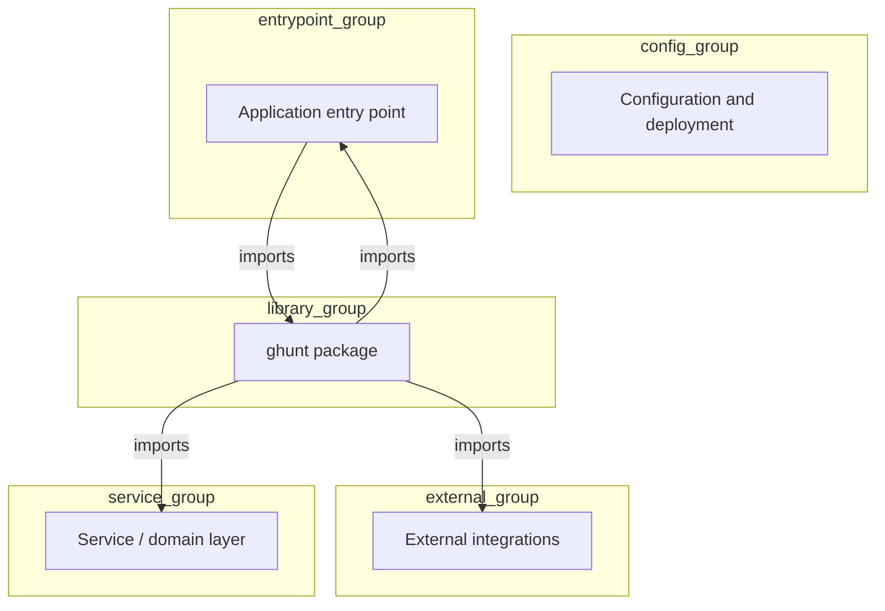

# Architecture report: mxrch/GHunt

> Automated static analysis. **Observed** = directly seen in files/imports/AST; **Inferred** = interpretation from that evidence. Repository code was not executed.

## 1. Repository at a glance

| Item | Value |
| --- | --- |
| Repository | mxrch/GHunt |
| Description | 🕵️‍♂️ Offensive Google framework. |
| Language | Python |
| Stars | 19849 |
| Licence | Other |
| Analysed commit / branch | 5ee893929c51c7a8a665b199bbae04ce85a662b4 / master |
| Framework(s) | None detected |
| Files analysed | 90 |
| Components | 5 |

## 2. Architecture in one minute

mxrch/GHunt - 🕵️‍♂️ Offensive Google framework.. This repository was analysed statically from 90 file(s) (79 Python). Detected technologies (observed from imports/manifests): GitHub Actions, httpx, Poetry. Files are grouped into 5 component(s): Configuration and deployment, Application entry point, External integrations, ghunt package, Service / domain layer. Observed entry point(s): main.py. Findings below distinguish observed facts from inferred interpretation.

## 3. High-level block diagram

## 4. Main components

### Configuration and deployment (`config`)

- **Kind:** config
- **Status:** Observed
- **Confidence:** 0.85
- **Responsibility:** Groups 2 file(s) under configuration and deployment (observed from repository paths and static analysis).
- **Paths:** `ghunt/config.py`, `pyproject.toml`
- **Evidence:** [ghunt/config.py](https://github.com/mxrch/GHunt/blob/5ee893929c51c7a8a665b199bbae04ce85a662b4/ghunt/config.py); [pyproject.toml](https://github.com/mxrch/GHunt/blob/5ee893929c51c7a8a665b199bbae04ce85a662b4/pyproject.toml)

### Application entry point (`entrypoint`)

- **Kind:** entrypoint
- **Status:** Observed
- **Confidence:** 0.85
- **Responsibility:** Groups 2 file(s) under application entry point (observed from repository paths and static analysis). Observed top-level functions: parse_and_run, process_args.
- **Paths:** `ghunt/cli.py`, `main.py`
- **Evidence:** [ghunt/cli.py:9](https://github.com/mxrch/GHunt/blob/5ee893929c51c7a8a665b199bbae04ce85a662b4/ghunt/cli.py#L9); [main.py](https://github.com/mxrch/GHunt/blob/5ee893929c51c7a8a665b199bbae04ce85a662b4/main.py)

### External integrations (`external_integrations`)

- **Kind:** external
- **Status:** Inferred
- **Confidence:** 0.70
- **Responsibility:** Groups 0 file(s) under external integrations (observed from repository paths and static analysis).
- **Evidence:** [examples/email_registered.py:3](https://github.com/mxrch/GHunt/blob/5ee893929c51c7a8a665b199bbae04ce85a662b4/examples/email_registered.py#L3); [examples/get_people_name.py:1](https://github.com/mxrch/GHunt/blob/5ee893929c51c7a8a665b199bbae04ce85a662b4/examples/get_people_name.py#L1); [ghunt/apis/accounts.py:6](https://github.com/mxrch/GHunt/blob/5ee893929c51c7a8a665b199bbae04ce85a662b4/ghunt/apis/accounts.py#L6); [ghunt/apis/calendar.py:7](https://github.com/mxrch/GHunt/blob/5ee893929c51c7a8a665b199bbae04ce85a662b4/ghunt/apis/calendar.py#L7); [ghunt/apis/clientauthconfig.py:7](https://github.com/mxrch/GHunt/blob/5ee893929c51c7a8a665b199bbae04ce85a662b4/ghunt/apis/clientauthconfig.py#L7); [ghunt/apis/digitalassetslinks.py:7](https://github.com/mxrch/GHunt/blob/5ee893929c51c7a8a665b199bbae04ce85a662b4/ghunt/apis/digitalassetslinks.py#L7)

### ghunt package (`ghunt`)

- **Kind:** library
- **Status:** Observed
- **Confidence:** 0.85
- **Responsibility:** Groups 73 file(s) under ghunt package (observed from repository paths and static analysis). Observed top-level classes: Accounts, AndroidCreds, Asset, AsyncClient, CacBrand, CacBrandState. Observed top-level functions: analyze_single, android_master_auth, android_oauth_app, app_exists, auth_dialog, avg_location.
- **Paths:** `ghunt/__init__.py`, `ghunt/apis/__init__.py`, `ghunt/apis/accounts.py`, `ghunt/apis/calendar.py`, `ghunt/apis/clientauthconfig.py`, `ghunt/apis/digitalassetslinks.py`, `ghunt/apis/drive.py`, `ghunt/apis/fireconsolepa.py`, `ghunt/apis/geolocation.py`, `ghunt/apis/identitytoolkit.py`, `ghunt/apis/mobilesdk.py`, `ghunt/apis/peoplepa.py`, `ghunt/apis/playgames.py`, `ghunt/apis/playgateway.py`, `ghunt/apis/vision.py`, `ghunt/errors.py`, `ghunt/ghunt.py`, `ghunt/globals.py`, `ghunt/helpers/__init__.py`, `ghunt/helpers/auth.py`, `ghunt/helpers/banner.py`, `ghunt/helpers/calendar.py`, `ghunt/helpers/drive.py`, `ghunt/helpers/gcp.py`, `ghunt/helpers/gmail.py`, `ghunt/helpers/gmaps.py`, `ghunt/helpers/ia.py`, `ghunt/helpers/iam.py`, `ghunt/helpers/knowledge.py`, `ghunt/helpers/listener.py`, `ghunt/helpers/playgames.py`, `ghunt/helpers/playstore.py`, `ghunt/helpers/utils.py`, `ghunt/knowledge/__init__.py`, `ghunt/knowledge/drive.py`, `ghunt/knowledge/keys.py`, `ghunt/knowledge/maps.py`, `ghunt/knowledge/people.py`, `ghunt/knowledge/sig.py`, `ghunt/lib/__init__.py`, `ghunt/lib/httpx.py`, `ghunt/modules/__init__.py`, `ghunt/modules/drive.py`, `ghunt/modules/email.py`, `ghunt/modules/gaia.py`, `ghunt/modules/geolocate.py`, `ghunt/modules/login.py`, `ghunt/modules/spiderdal.py`, `ghunt/objects/__init__.py`, `ghunt/objects/apis.py`, `ghunt/objects/base.py`, `ghunt/objects/encoders.py`, `ghunt/objects/session.py`, `ghunt/objects/utils.py`, `ghunt/parsers/__init__.py`, `ghunt/parsers/calendar.py`, `ghunt/parsers/clientauthconfig.py`, `ghunt/parsers/digitalassetslinks.py`, `ghunt/parsers/drive.py`, `ghunt/parsers/geolocate.py`, `ghunt/parsers/identitytoolkit.py`, `ghunt/parsers/mobilesdk.py`, `ghunt/parsers/people.py`, `ghunt/parsers/playgames.py`, `ghunt/parsers/playgateway.py`, `ghunt/parsers/vision.py`, `ghunt/protos/__init__.py`, `ghunt/protos/playgatewaypa/__init__.py`, `ghunt/protos/playgatewaypa/get_player_pb2.py`, `ghunt/protos/playgatewaypa/get_player_response_pb2.py`, `ghunt/protos/playgatewaypa/search_player_pb2.py`, `ghunt/protos/playgatewaypa/search_player_results_pb2.py`, `ghunt/version.py`
- **Evidence:** [ghunt/__init__.py](https://github.com/mxrch/GHunt/blob/5ee893929c51c7a8a665b199bbae04ce85a662b4/ghunt/__init__.py); [ghunt/apis/__init__.py](https://github.com/mxrch/GHunt/blob/5ee893929c51c7a8a665b199bbae04ce85a662b4/ghunt/apis/__init__.py); [ghunt/apis/accounts.py:12](https://github.com/mxrch/GHunt/blob/5ee893929c51c7a8a665b199bbae04ce85a662b4/ghunt/apis/accounts.py#L12); [ghunt/apis/calendar.py:15](https://github.com/mxrch/GHunt/blob/5ee893929c51c7a8a665b199bbae04ce85a662b4/ghunt/apis/calendar.py#L15); [ghunt/apis/clientauthconfig.py:14](https://github.com/mxrch/GHunt/blob/5ee893929c51c7a8a665b199bbae04ce85a662b4/ghunt/apis/clientauthconfig.py#L14); [ghunt/apis/digitalassetslinks.py:14](https://github.com/mxrch/GHunt/blob/5ee893929c51c7a8a665b199bbae04ce85a662b4/ghunt/apis/digitalassetslinks.py#L14); [ghunt/apis/drive.py:15](https://github.com/mxrch/GHunt/blob/5ee893929c51c7a8a665b199bbae04ce85a662b4/ghunt/apis/drive.py#L15); [ghunt/apis/fireconsolepa.py:14](https://github.com/mxrch/GHunt/blob/5ee893929c51c7a8a665b199bbae04ce85a662b4/ghunt/apis/fireconsolepa.py#L14)

### Service / domain layer (`service_layer`)

- **Kind:** service
- **Status:** Observed
- **Confidence:** 0.85
- **Responsibility:** Groups 1 file(s) under service / domain layer (observed from repository paths and static analysis).
- **Paths:** `ghunt/knowledge/services.py`
- **Evidence:** [ghunt/knowledge/services.py](https://github.com/mxrch/GHunt/blob/5ee893929c51c7a8a665b199bbae04ce85a662b4/ghunt/knowledge/services.py)

## 5. Execution flow

**Observed** entry point(s):

- [main.py:1](https://github.com/mxrch/GHunt/blob/5ee893929c51c7a8a665b199bbae04ce85a662b4/main.py#L1)

Representative flow (derived from observed entry points and the import graph; steps beyond the entry point are **Inferred**):

1. Execution starts at an observed entry point listed above, if present.
2. `entrypoint` imports `ghunt` (Application entry point -> ghunt package).
3. `ghunt` imports `entrypoint` (ghunt package -> Application entry point).
4. `ghunt` imports `external_integrations` (ghunt package -> External integrations).
5. `ghunt` imports `service_layer` (ghunt package -> Service / domain layer).

## 6. Project structure

### `(root)`

- `.gitignore` - other (51 bytes)
- `LICENSE.md` - docs (34428 bytes)
- `README.md` - docs (3944 bytes)
- `main.py` - source, Python (68 bytes)
- `pyproject.toml` - manifest (1523 bytes)

### `.github`

- `.github/FUNDING.yml` - config (14 bytes)
- `.github/ISSUE_TEMPLATE/bug_report.md` - docs (616 bytes)
- `.github/workflows/sponsors.yml` - ci, YAML (708 bytes)

### `examples`

- `examples/email_registered.py` - source, Python (469 bytes)
- `examples/get_people_name.py` - source, Python (1676 bytes)

### `ghunt`

- `ghunt/__init__.py` - source, Python (50 bytes)
- `ghunt/apis/__init__.py` - source, Python (0 bytes)
- `ghunt/apis/accounts.py` - source, Python (1687 bytes)
- `ghunt/apis/calendar.py` - source, Python (3548 bytes)
- `ghunt/apis/clientauthconfig.py` - source, Python (1595 bytes)
- `ghunt/apis/digitalassetslinks.py` - source, Python (2782 bytes)
- `ghunt/apis/drive.py` - source, Python (4195 bytes)
- `ghunt/apis/fireconsolepa.py` - source, Python (1691 bytes)
- `ghunt/apis/geolocation.py` - source, Python (2022 bytes)
- `ghunt/apis/identitytoolkit.py` - source, Python (1603 bytes)
- `ghunt/apis/mobilesdk.py` - source, Python (3322 bytes)
- `ghunt/apis/peoplepa.py` - source, Python (7332 bytes)
- `ghunt/apis/playgames.py` - source, Python (4216 bytes)
- `ghunt/apis/playgateway.py` - source, Python (4517 bytes)
- `ghunt/apis/vision.py` - source, Python (3793 bytes)
- `ghunt/cli.py` - source, Python (4783 bytes)
- `ghunt/config.py` - source, Python (2926 bytes)
- `ghunt/errors.py` - source, Python (871 bytes)
- `ghunt/ghunt.py` - source, Python (488 bytes)
- `ghunt/globals.py` - source, Python (329 bytes)
- `ghunt/helpers/__init__.py` - source, Python (0 bytes)
- `ghunt/helpers/auth.py` - source, Python (9198 bytes)
- `ghunt/helpers/banner.py` - source, Python (1123 bytes)
- `ghunt/helpers/calendar.py` - source, Python (3632 bytes)
- `ghunt/helpers/drive.py` - source, Python (2299 bytes)
- `ghunt/helpers/gcp.py` - source, Python (1132 bytes)
- `ghunt/helpers/gmail.py` - source, Python (364 bytes)
- `ghunt/helpers/gmaps.py` - source, Python (16756 bytes)
- `ghunt/helpers/ia.py` - source, Python (1107 bytes)
- `ghunt/helpers/iam.py` - source, Python (1140 bytes)
- `ghunt/helpers/knowledge.py` - source, Python (1858 bytes)
- `ghunt/helpers/listener.py` - source, Python (1679 bytes)
- `ghunt/helpers/playgames.py` - source, Python (3610 bytes)
- `ghunt/helpers/playstore.py` - source, Python (259 bytes)
- `ghunt/helpers/utils.py` - source, Python (5224 bytes)
- `ghunt/knowledge/__init__.py` - source, Python (0 bytes)
- `ghunt/knowledge/drive.py` - source, Python (3960 bytes)
- `ghunt/knowledge/keys.py` - source, Python (861 bytes)
- `ghunt/knowledge/maps.py` - source, Python (1035 bytes)
- `ghunt/knowledge/people.py` - source, Python (1001 bytes)
- `ghunt/knowledge/services.py` - source, Python (103 bytes)
- `ghunt/knowledge/sig.py` - source, Python (546 bytes)
- `ghunt/lib/__init__.py` - source, Python (0 bytes)
- `ghunt/lib/httpx.py` - source, Python (255 bytes)
- `ghunt/modules/__init__.py` - source, Python (0 bytes)
- `ghunt/modules/drive.py` - source, Python (8474 bytes)
- `ghunt/modules/email.py` - source, Python (6350 bytes)
- `ghunt/modules/gaia.py` - source, Python (4505 bytes)
- `ghunt/modules/geolocate.py` - source, Python (2466 bytes)
- `ghunt/modules/login.py` - source, Python (3328 bytes)
- `ghunt/modules/spiderdal.py` - source, Python (7951 bytes)
- `ghunt/objects/__init__.py` - source, Python (0 bytes)
- `ghunt/objects/apis.py` - source, Python (7255 bytes)
- `ghunt/objects/base.py` - source, Python (3979 bytes)
- `ghunt/objects/encoders.py` - source, Python (574 bytes)
- `ghunt/objects/session.py` - source, Python (627 bytes)
- `ghunt/objects/utils.py` - source, Python (662 bytes)
- `ghunt/parsers/__init__.py` - source, Python (0 bytes)
- `ghunt/parsers/calendar.py` - source, Python (6593 bytes)
- `ghunt/parsers/clientauthconfig.py` - source, Python (8326 bytes)
- `ghunt/parsers/digitalassetslinks.py` - source, Python (2748 bytes)
- `ghunt/parsers/drive.py` - source, Python (32616 bytes)
- `ghunt/parsers/geolocate.py` - source, Python (508 bytes)
- `ghunt/parsers/identitytoolkit.py` - source, Python (3259 bytes)
- `ghunt/parsers/mobilesdk.py` - source, Python (717 bytes)
- `ghunt/parsers/people.py` - source, Python (7510 bytes)
- `ghunt/parsers/playgames.py` - source, Python (15797 bytes)
- `ghunt/parsers/playgateway.py` - source, Python (1671 bytes)
- `ghunt/parsers/vision.py` - source, Python (3724 bytes)
- `ghunt/protos/__init__.py` - source, Python (0 bytes)
- `ghunt/protos/playgatewaypa/__init__.py` - source, Python (0 bytes)
- `ghunt/protos/playgatewaypa/definitions/get_player.proto` - other (193 bytes)
- `ghunt/protos/playgatewaypa/definitions/get_player_response.proto` - other (3837 bytes)
- `ghunt/protos/playgatewaypa/definitions/search_player.proto` - other (217 bytes)
- `ghunt/protos/playgatewaypa/definitions/search_player_results.proto` - other (652 bytes)
- `ghunt/protos/playgatewaypa/get_player_pb2.py` - source, Python (2384 bytes)
- `ghunt/protos/playgatewaypa/get_player_response_pb2.py` - source, Python (40124 bytes)
- `ghunt/protos/playgatewaypa/search_player_pb2.py` - source, Python (2590 bytes)
- `ghunt/protos/playgatewaypa/search_player_results_pb2.py` - source, Python (8118 bytes)
- `ghunt/version.py` - source, Python (76 bytes)

## 7. Key dependencies and integrations

| Name | Category | Status | Confidence | Evidence |
| --- | --- | --- | --- | --- |
| GitHub Actions | ci | Observed | 0.85 | [.github/workflows/sponsors.yml](https://github.com/mxrch/GHunt/blob/5ee893929c51c7a8a665b199bbae04ce85a662b4/.github/workflows/sponsors.yml) |
| httpx | library | Observed | 0.95 | [examples/email_registered.py:3](https://github.com/mxrch/GHunt/blob/5ee893929c51c7a8a665b199bbae04ce85a662b4/examples/email_registered.py#L3); [examples/get_people_name.py:1](https://github.com/mxrch/GHunt/blob/5ee893929c51c7a8a665b199bbae04ce85a662b4/examples/get_people_name.py#L1); [ghunt/apis/accounts.py:6](https://github.com/mxrch/GHunt/blob/5ee893929c51c7a8a665b199bbae04ce85a662b4/ghunt/apis/accounts.py#L6); [ghunt/apis/calendar.py:7](https://github.com/mxrch/GHunt/blob/5ee893929c51c7a8a665b199bbae04ce85a662b4/ghunt/apis/calendar.py#L7) |
| Poetry | packaging | Observed | 0.85 | [pyproject.toml:20](https://github.com/mxrch/GHunt/blob/5ee893929c51c7a8a665b199bbae04ce85a662b4/pyproject.toml#L20) |

## 8. Data and state

No database, cache, queue, or persistent-state usage was observed in the analysed files. State handling, if any, may be in-memory or in files that were not analysed.

## 9. Configuration and deployment clues

- `.github/FUNDING.yml` (config)
- `.github/workflows/sponsors.yml` (ci)
- `pyproject.toml` (manifest)

## 10. Design observations

- An entry/API layer is separated from other code (Inferred from paths and decorators).
- Service/domain code is distinct from entry and data code, suggesting layered separation (Inferred).
- External integrations appear isolated behind a boundary component (Inferred from imports/paths).

These observations are interpretations (**Inferred**) of the observed structure, not guarantees about runtime design.

## 11. Limitations and unknowns

- Static analysis only: repository code was not executed, installed, or imported at runtime.
- Components and relationships are inferred from file paths, imports, and AST structure; runtime behaviour, dynamic imports, and reflection may not be visible.
- 1 file(s) were skipped during inventory (1 x lockfile excluded).
- Repository text was treated as untrusted data; no instructions found in repository files were followed, and likely secret values were redacted/excluded.

## 12. Source references

- [.github/workflows/sponsors.yml](https://github.com/mxrch/GHunt/blob/5ee893929c51c7a8a665b199bbae04ce85a662b4/.github/workflows/sponsors.yml)
- [examples/email_registered.py:3](https://github.com/mxrch/GHunt/blob/5ee893929c51c7a8a665b199bbae04ce85a662b4/examples/email_registered.py#L3)
- [examples/get_people_name.py:1](https://github.com/mxrch/GHunt/blob/5ee893929c51c7a8a665b199bbae04ce85a662b4/examples/get_people_name.py#L1)
- [ghunt/__init__.py](https://github.com/mxrch/GHunt/blob/5ee893929c51c7a8a665b199bbae04ce85a662b4/ghunt/__init__.py)
- [ghunt/apis/__init__.py](https://github.com/mxrch/GHunt/blob/5ee893929c51c7a8a665b199bbae04ce85a662b4/ghunt/apis/__init__.py)
- [ghunt/apis/accounts.py:6](https://github.com/mxrch/GHunt/blob/5ee893929c51c7a8a665b199bbae04ce85a662b4/ghunt/apis/accounts.py#L6)
- [ghunt/apis/accounts.py:12](https://github.com/mxrch/GHunt/blob/5ee893929c51c7a8a665b199bbae04ce85a662b4/ghunt/apis/accounts.py#L12)
- [ghunt/apis/calendar.py:7](https://github.com/mxrch/GHunt/blob/5ee893929c51c7a8a665b199bbae04ce85a662b4/ghunt/apis/calendar.py#L7)
- [ghunt/apis/calendar.py:15](https://github.com/mxrch/GHunt/blob/5ee893929c51c7a8a665b199bbae04ce85a662b4/ghunt/apis/calendar.py#L15)
- [ghunt/apis/clientauthconfig.py:7](https://github.com/mxrch/GHunt/blob/5ee893929c51c7a8a665b199bbae04ce85a662b4/ghunt/apis/clientauthconfig.py#L7)
- [ghunt/apis/clientauthconfig.py:14](https://github.com/mxrch/GHunt/blob/5ee893929c51c7a8a665b199bbae04ce85a662b4/ghunt/apis/clientauthconfig.py#L14)
- [ghunt/apis/digitalassetslinks.py:7](https://github.com/mxrch/GHunt/blob/5ee893929c51c7a8a665b199bbae04ce85a662b4/ghunt/apis/digitalassetslinks.py#L7)
- [ghunt/apis/digitalassetslinks.py:14](https://github.com/mxrch/GHunt/blob/5ee893929c51c7a8a665b199bbae04ce85a662b4/ghunt/apis/digitalassetslinks.py#L14)
- [ghunt/apis/drive.py:8](https://github.com/mxrch/GHunt/blob/5ee893929c51c7a8a665b199bbae04ce85a662b4/ghunt/apis/drive.py#L8)
- [ghunt/apis/drive.py:15](https://github.com/mxrch/GHunt/blob/5ee893929c51c7a8a665b199bbae04ce85a662b4/ghunt/apis/drive.py#L15)
- [ghunt/apis/fireconsolepa.py:7](https://github.com/mxrch/GHunt/blob/5ee893929c51c7a8a665b199bbae04ce85a662b4/ghunt/apis/fireconsolepa.py#L7)
- [ghunt/apis/fireconsolepa.py:14](https://github.com/mxrch/GHunt/blob/5ee893929c51c7a8a665b199bbae04ce85a662b4/ghunt/apis/fireconsolepa.py#L14)
- [ghunt/cli.py:9](https://github.com/mxrch/GHunt/blob/5ee893929c51c7a8a665b199bbae04ce85a662b4/ghunt/cli.py#L9)
- [ghunt/config.py](https://github.com/mxrch/GHunt/blob/5ee893929c51c7a8a665b199bbae04ce85a662b4/ghunt/config.py)
- [ghunt/knowledge/services.py](https://github.com/mxrch/GHunt/blob/5ee893929c51c7a8a665b199bbae04ce85a662b4/ghunt/knowledge/services.py)
- [main.py](https://github.com/mxrch/GHunt/blob/5ee893929c51c7a8a665b199bbae04ce85a662b4/main.py)
- [main.py:1](https://github.com/mxrch/GHunt/blob/5ee893929c51c7a8a665b199bbae04ce85a662b4/main.py#L1)
- [pyproject.toml](https://github.com/mxrch/GHunt/blob/5ee893929c51c7a8a665b199bbae04ce85a662b4/pyproject.toml)
- [pyproject.toml:20](https://github.com/mxrch/GHunt/blob/5ee893929c51c7a8a665b199bbae04ce85a662b4/pyproject.toml#L20)
