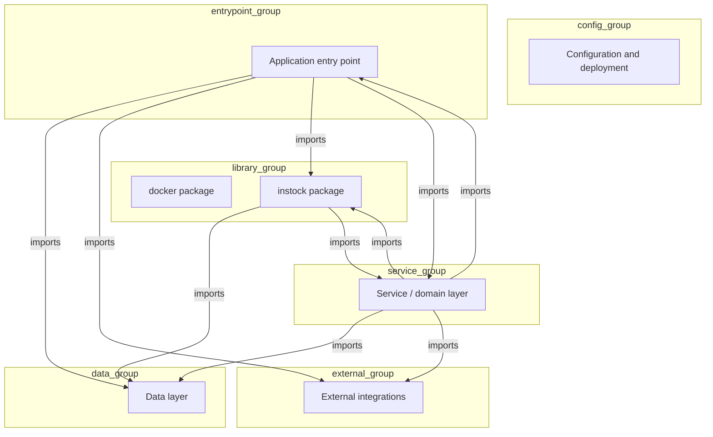

# Architecture report: myhhub/stock

> Automated static analysis. **Observed** = directly seen in files/imports/AST; **Inferred** = interpretation from that evidence. Repository code was not executed.

## 1. Repository at a glance

| Item | Value |
| --- | --- |
| Repository | myhhub/stock |
| Description | stock股票.获取股票数据,计算股票指标,筹码分布,识别股票形态,综合选股,选股策略,股票验证回测,股票自动交易,支持PC及移动设备。 |
| Language | Python |
| Stars | 15208 |
| Licence | Apache-2.0 |
| Analysed commit / branch | b6e0ca2268cfbadd02f5ed052159c187b6670231 / master |
| Framework(s) | None detected |
| Files analysed | 141 |
| Components | 7 |

## 2. Architecture in one minute

myhhub/stock - stock股票.获取股票数据,计算股票指标,筹码分布,识别股票形态,综合选股,选股策略,股票验证回测,股票自动交易,支持PC及移动设备。. This repository was analysed statically from 141 file(s) (82 Python). Detected technologies (observed from imports/manifests): GitHub Actions, MySQL, NumPy, pandas, requests, SQLAlchemy. Files are grouped into 7 component(s): Configuration and deployment, Data layer, docker package, Application entry point, External integrations, instock package, Service / domain layer. Observed entry point(s): instock/core/crawling/fund_etf_em.py, instock/core/crawling/stock_chip_race.py, instock/core/crawling/stock_cpbd.py. Findings below distinguish observed facts from inferred interpretation.

## 3. High-level block diagram

## 4. Main components

### Configuration and deployment (`config`)

- **Kind:** config
- **Status:** Observed
- **Confidence:** 0.85
- **Responsibility:** Groups 5 file(s) under configuration and deployment (observed from repository paths and static analysis).
- **Paths:** `docker/.dockerignore`, `docker/Dockerfile`, `docker/docker-compose.yml`, `instock/config/trade_client.json`, `requirements.txt`
- **Evidence:** [docker/.dockerignore](https://github.com/myhhub/stock/blob/b6e0ca2268cfbadd02f5ed052159c187b6670231/docker/.dockerignore); [docker/Dockerfile](https://github.com/myhhub/stock/blob/b6e0ca2268cfbadd02f5ed052159c187b6670231/docker/Dockerfile); [docker/docker-compose.yml](https://github.com/myhhub/stock/blob/b6e0ca2268cfbadd02f5ed052159c187b6670231/docker/docker-compose.yml); [instock/config/trade_client.json](https://github.com/myhhub/stock/blob/b6e0ca2268cfbadd02f5ed052159c187b6670231/instock/config/trade_client.json); [requirements.txt](https://github.com/myhhub/stock/blob/b6e0ca2268cfbadd02f5ed052159c187b6670231/requirements.txt)

### Data layer (`data_layer`)

- **Kind:** data
- **Status:** Observed
- **Confidence:** 0.85
- **Responsibility:** Groups 1 file(s) under data layer (observed from repository paths and static analysis). Observed top-level functions: checkTableIsExist, engine, engine_to_db, executeSql, executeSqlCount, executeSqlFetch.
- **Paths:** `instock/lib/database.py`
- **Evidence:** [instock/lib/database.py:50](https://github.com/myhhub/stock/blob/b6e0ca2268cfbadd02f5ed052159c187b6670231/instock/lib/database.py#L50)

### docker package (`docker`)

- **Kind:** library
- **Status:** Observed
- **Confidence:** 0.85
- **Responsibility:** Groups 1 file(s) under docker package (observed from repository paths and static analysis).
- **Paths:** `docker/build.sh`
- **Evidence:** [docker/build.sh](https://github.com/myhhub/stock/blob/b6e0ca2268cfbadd02f5ed052159c187b6670231/docker/build.sh)

### Application entry point (`entrypoint`)

- **Kind:** entrypoint
- **Status:** Observed
- **Confidence:** 0.85
- **Responsibility:** Groups 25 file(s) under application entry point (observed from repository paths and static analysis). Observed top-level classes: AEScryptor, Application, HomeHandler, MData. Observed top-level functions: _find_last_page, _fund_etf_code_id_map_em, check_database, code_id_map_em, create_new_base_table, create_new_database.
- **Paths:** `instock/core/crawling/fund_etf_em.py`, `instock/core/crawling/stock_chip_race.py`, `instock/core/crawling/stock_cpbd.py`, `instock/core/crawling/stock_dzjy_em.py`, `instock/core/crawling/stock_fhps_em.py`, `instock/core/crawling/stock_fund_em.py`, `instock/core/crawling/stock_hist_em.py`, `instock/core/crawling/stock_lhb_em.py`, `instock/core/crawling/stock_lhb_sina.py`, `instock/core/crawling/stock_limitup_reason.py`, `instock/core/crawling/stock_selection.py`, `instock/core/crawling/trade_date_hist.py`, `instock/job/backtest_data_daily_job.py`, `instock/job/basic_data_after_close_daily_job.py`, `instock/job/basic_data_daily_job.py`, `instock/job/basic_data_other_daily_job.py`, `instock/job/execute_daily_job.py`, `instock/job/indicators_data_daily_job.py`, `instock/job/init_job.py`, `instock/job/klinepattern_data_daily_job.py`, `instock/job/selection_data_daily_job.py`, `instock/job/strategy_data_daily_job.py`, `instock/lib/crypto_aes.py`, `instock/trade/trade_service.py`, `instock/web/web_service.py`
- **Evidence:** [instock/core/crawling/fund_etf_em.py:21](https://github.com/myhhub/stock/blob/b6e0ca2268cfbadd02f5ed052159c187b6670231/instock/core/crawling/fund_etf_em.py#L21); [instock/core/crawling/stock_chip_race.py:16](https://github.com/myhhub/stock/blob/b6e0ca2268cfbadd02f5ed052159c187b6670231/instock/core/crawling/stock_chip_race.py#L16); [instock/core/crawling/stock_cpbd.py:14](https://github.com/myhhub/stock/blob/b6e0ca2268cfbadd02f5ed052159c187b6670231/instock/core/crawling/stock_cpbd.py#L14); [instock/core/crawling/stock_dzjy_em.py:20](https://github.com/myhhub/stock/blob/b6e0ca2268cfbadd02f5ed052159c187b6670231/instock/core/crawling/stock_dzjy_em.py#L20); [instock/core/crawling/stock_fhps_em.py:21](https://github.com/myhhub/stock/blob/b6e0ca2268cfbadd02f5ed052159c187b6670231/instock/core/crawling/stock_fhps_em.py#L21); [instock/core/crawling/stock_fund_em.py:21](https://github.com/myhhub/stock/blob/b6e0ca2268cfbadd02f5ed052159c187b6670231/instock/core/crawling/stock_fund_em.py#L21); [instock/core/crawling/stock_hist_em.py:21](https://github.com/myhhub/stock/blob/b6e0ca2268cfbadd02f5ed052159c187b6670231/instock/core/crawling/stock_hist_em.py#L21); [instock/core/crawling/stock_lhb_em.py:21](https://github.com/myhhub/stock/blob/b6e0ca2268cfbadd02f5ed052159c187b6670231/instock/core/crawling/stock_lhb_em.py#L21)

### External integrations (`external_integrations`)

- **Kind:** external
- **Status:** Inferred
- **Confidence:** 0.70
- **Responsibility:** Groups 0 file(s) under external integrations (observed from repository paths and static analysis).
- **Evidence:** [instock/core/crawling/stock_chip_race.py:10](https://github.com/myhhub/stock/blob/b6e0ca2268cfbadd02f5ed052159c187b6670231/instock/core/crawling/stock_chip_race.py#L10); [instock/core/crawling/stock_lhb_sina.py:11](https://github.com/myhhub/stock/blob/b6e0ca2268cfbadd02f5ed052159c187b6670231/instock/core/crawling/stock_lhb_sina.py#L11); [instock/core/crawling/stock_limitup_reason.py:10](https://github.com/myhhub/stock/blob/b6e0ca2268cfbadd02f5ed052159c187b6670231/instock/core/crawling/stock_limitup_reason.py#L10); [instock/core/crawling/trade_date_hist.py:11](https://github.com/myhhub/stock/blob/b6e0ca2268cfbadd02f5ed052159c187b6670231/instock/core/crawling/trade_date_hist.py#L11); [instock/core/eastmoney_fetcher.py:5](https://github.com/myhhub/stock/blob/b6e0ca2268cfbadd02f5ed052159c187b6670231/instock/core/eastmoney_fetcher.py#L5); [instock/core/eastmoney_fetcher.py:6](https://github.com/myhhub/stock/blob/b6e0ca2268cfbadd02f5ed052159c187b6670231/instock/core/eastmoney_fetcher.py#L6)

### instock package (`instock`)

- **Kind:** library
- **Status:** Observed
- **Confidence:** 0.85
- **Responsibility:** Groups 32 file(s) under instock package (observed from repository paths and static analysis). Observed top-level classes: BaseHandler, Clock, ClockEngine, ClockIntervalHandler, ClockMomentHandler, Connection. Observed top-level functions: GetLeftMenu, get_bonus_report_date, get_next_trade_date, get_one_previous_trade_date, get_previous_trade_date, get_quarterly_report_date.
- **Paths:** `instock/__init__.py`, `instock/bin/restart_web.sh`, `instock/bin/run_cron.sh`, `instock/bin/run_job.sh`, `instock/bin/run_web.sh`, `instock/job/__init__.py`, `instock/lib/__init__.py`, `instock/lib/run_template.py`, `instock/lib/singleton_type.py`, `instock/lib/torndb.py`, `instock/lib/trade_time.py`, `instock/lib/version.py`, `instock/trade/__init__.py`, `instock/trade/robot/__init__.py`, `instock/trade/robot/engine/__init__.py`, `instock/trade/robot/engine/clock_engine.py`, `instock/trade/robot/engine/event_engine.py`, `instock/trade/robot/engine/main_engine.py`, `instock/trade/robot/infrastructure/__init__.py`, `instock/trade/robot/infrastructure/default_handler.py`, `instock/trade/robot/infrastructure/strategy_template.py`, `instock/trade/robot/infrastructure/strategy_wrapper.py`, `instock/trade/strategies/__init__.py`, `instock/trade/strategies/stagging.py`, `instock/trade/strategies/stratey1.py`, `instock/web/__init__.py`, `instock/web/base.py`, `instock/web/dataIndicatorsHandler.py`, `instock/web/dataTableHandler.py`, `instock/web/static/js/FileSaver.js`, `instock/web/static/js/bootstrap.min-3.4.1.js`, `instock/web/static/js/jquery.min-3.7.1.js`
- **Evidence:** [instock/__init__.py](https://github.com/myhhub/stock/blob/b6e0ca2268cfbadd02f5ed052159c187b6670231/instock/__init__.py); [instock/bin/restart_web.sh](https://github.com/myhhub/stock/blob/b6e0ca2268cfbadd02f5ed052159c187b6670231/instock/bin/restart_web.sh); [instock/bin/run_cron.sh](https://github.com/myhhub/stock/blob/b6e0ca2268cfbadd02f5ed052159c187b6670231/instock/bin/run_cron.sh); [instock/bin/run_job.sh](https://github.com/myhhub/stock/blob/b6e0ca2268cfbadd02f5ed052159c187b6670231/instock/bin/run_job.sh); [instock/bin/run_web.sh](https://github.com/myhhub/stock/blob/b6e0ca2268cfbadd02f5ed052159c187b6670231/instock/bin/run_web.sh); [instock/job/__init__.py](https://github.com/myhhub/stock/blob/b6e0ca2268cfbadd02f5ed052159c187b6670231/instock/job/__init__.py); [instock/lib/__init__.py](https://github.com/myhhub/stock/blob/b6e0ca2268cfbadd02f5ed052159c187b6670231/instock/lib/__init__.py); [instock/lib/run_template.py:17](https://github.com/myhhub/stock/blob/b6e0ca2268cfbadd02f5ed052159c187b6670231/instock/lib/run_template.py#L17)

### Service / domain layer (`service_layer`)

- **Kind:** service
- **Status:** Observed
- **Confidence:** 0.85
- **Responsibility:** Groups 32 file(s) under service / domain layer (observed from repository paths and static analysis). Observed top-level classes: CYQCalculator, eastmoney_fetcher, proxys, stock_data, stock_hist_data, stock_trade_date. Observed top-level functions: check, check_enter, check_high_tight, check_internal, check_low_increase, check_volume.
- **Paths:** `instock/core/__init__.py`, `instock/core/backtest/__init__.py`, `instock/core/backtest/rate_stats.py`, `instock/core/crawling/__init__.py`, `instock/core/eastmoney_fetcher.py`, `instock/core/indicator/__init__.py`, `instock/core/indicator/calculate_indicator.py`, `instock/core/kline/__init__.py`, `instock/core/kline/cyq.js`, `instock/core/kline/cyq.py`, `instock/core/kline/indicator_web_dic.py`, `instock/core/kline/visualization.py`, `instock/core/pattern/__init__.py`, `instock/core/pattern/pattern_recognitions.py`, `instock/core/singleton_proxy.py`, `instock/core/singleton_stock.py`, `instock/core/singleton_stock_web_module_data.py`, `instock/core/singleton_trade_date.py`, `instock/core/stockfetch.py`, `instock/core/strategy/__init__.py`, `instock/core/strategy/backtrace_ma250.py`, `instock/core/strategy/breakthrough_platform.py`, `instock/core/strategy/climax_limitdown.py`, `instock/core/strategy/enter.py`, `instock/core/strategy/high_tight_flag.py`, `instock/core/strategy/keep_increasing.py`, `instock/core/strategy/low_atr.py`, `instock/core/strategy/low_backtrace_increase.py`, `instock/core/strategy/parking_apron.py`, `instock/core/strategy/turtle_trade.py`, `instock/core/tablestructure.py`, `instock/core/web_module_data.py`
- **Evidence:** [instock/core/__init__.py](https://github.com/myhhub/stock/blob/b6e0ca2268cfbadd02f5ed052159c187b6670231/instock/core/__init__.py); [instock/core/backtest/__init__.py](https://github.com/myhhub/stock/blob/b6e0ca2268cfbadd02f5ed052159c187b6670231/instock/core/backtest/__init__.py); [instock/core/backtest/rate_stats.py:12](https://github.com/myhhub/stock/blob/b6e0ca2268cfbadd02f5ed052159c187b6670231/instock/core/backtest/rate_stats.py#L12); [instock/core/crawling/__init__.py](https://github.com/myhhub/stock/blob/b6e0ca2268cfbadd02f5ed052159c187b6670231/instock/core/crawling/__init__.py); [instock/core/eastmoney_fetcher.py:16](https://github.com/myhhub/stock/blob/b6e0ca2268cfbadd02f5ed052159c187b6670231/instock/core/eastmoney_fetcher.py#L16); [instock/core/indicator/__init__.py](https://github.com/myhhub/stock/blob/b6e0ca2268cfbadd02f5ed052159c187b6670231/instock/core/indicator/__init__.py); [instock/core/indicator/calculate_indicator.py:13](https://github.com/myhhub/stock/blob/b6e0ca2268cfbadd02f5ed052159c187b6670231/instock/core/indicator/calculate_indicator.py#L13); [instock/core/kline/__init__.py](https://github.com/myhhub/stock/blob/b6e0ca2268cfbadd02f5ed052159c187b6670231/instock/core/kline/__init__.py)

## 5. Execution flow

**Observed** entry point(s):

- [instock/core/crawling/fund_etf_em.py:349](https://github.com/myhhub/stock/blob/b6e0ca2268cfbadd02f5ed052159c187b6670231/instock/core/crawling/fund_etf_em.py#L349)
- [instock/core/crawling/stock_chip_race.py:152](https://github.com/myhhub/stock/blob/b6e0ca2268cfbadd02f5ed052159c187b6670231/instock/core/crawling/stock_chip_race.py#L152)
- [instock/core/crawling/stock_cpbd.py:138](https://github.com/myhhub/stock/blob/b6e0ca2268cfbadd02f5ed052159c187b6670231/instock/core/crawling/stock_cpbd.py#L138)
- [instock/core/crawling/stock_dzjy_em.py:537](https://github.com/myhhub/stock/blob/b6e0ca2268cfbadd02f5ed052159c187b6670231/instock/core/crawling/stock_dzjy_em.py#L537)
- [instock/core/crawling/stock_fhps_em.py:149](https://github.com/myhhub/stock/blob/b6e0ca2268cfbadd02f5ed052159c187b6670231/instock/core/crawling/stock_fhps_em.py#L149)
- [instock/core/crawling/stock_fund_em.py:435](https://github.com/myhhub/stock/blob/b6e0ca2268cfbadd02f5ed052159c187b6670231/instock/core/crawling/stock_fund_em.py#L435)
- [instock/core/crawling/stock_hist_em.py:579](https://github.com/myhhub/stock/blob/b6e0ca2268cfbadd02f5ed052159c187b6670231/instock/core/crawling/stock_hist_em.py#L579)
- [instock/core/crawling/stock_lhb_em.py:862](https://github.com/myhhub/stock/blob/b6e0ca2268cfbadd02f5ed052159c187b6670231/instock/core/crawling/stock_lhb_em.py#L862)
- [instock/core/crawling/stock_lhb_sina.py:245](https://github.com/myhhub/stock/blob/b6e0ca2268cfbadd02f5ed052159c187b6670231/instock/core/crawling/stock_lhb_sina.py#L245)
- [instock/core/crawling/stock_limitup_reason.py:121](https://github.com/myhhub/stock/blob/b6e0ca2268cfbadd02f5ed052159c187b6670231/instock/core/crawling/stock_limitup_reason.py#L121)
- [instock/core/crawling/stock_selection.py:99](https://github.com/myhhub/stock/blob/b6e0ca2268cfbadd02f5ed052159c187b6670231/instock/core/crawling/stock_selection.py#L99)
- [instock/core/crawling/trade_date_hist.py:330](https://github.com/myhhub/stock/blob/b6e0ca2268cfbadd02f5ed052159c187b6670231/instock/core/crawling/trade_date_hist.py#L330)

Representative flow (derived from observed entry points and the import graph; steps beyond the entry point are **Inferred**):

1. Execution starts at an observed entry point listed above, if present.
2. `entrypoint` imports `data_layer` (Application entry point -> Data layer).
3. `entrypoint` imports `external_integrations` (Application entry point -> External integrations).
4. `entrypoint` imports `instock` (Application entry point -> instock package).
5. `entrypoint` imports `service_layer` (Application entry point -> Service / domain layer).
6. `instock` imports `data_layer` (instock package -> Data layer).
7. `instock` imports `service_layer` (instock package -> Service / domain layer).
8. `service_layer` imports `data_layer` (Service / domain layer -> Data layer).
9. `service_layer` imports `entrypoint` (Service / domain layer -> Application entry point).

## 6. Project structure

### `(root)`

- `.gitignore` - other (3083 bytes)
- `LICENSE` - docs (11357 bytes)
- `README.md` - docs (25846 bytes)
- `requirements.txt` - manifest (307 bytes)

### `.github`

- `.github/workflows/azure-container-webapp.yml` - ci, YAML (4225 bytes)
- `.github/workflows/docker-image.yml` - ci, YAML (439 bytes)

### `cron`

- `cron/cron.hourly/run_hourly` - other (173 bytes)
- `cron/cron.monthly/run_monthly` - other (442 bytes)
- `cron/cron.workdayly/run_workdayly` - other (174 bytes)

### `docker`

- `docker/.dockerignore` - container (38 bytes)
- `docker/.gitignore` - other (3087 bytes)
- `docker/Dockerfile` - container (3120 bytes)
- `docker/build.sh` - source, Shell (714 bytes)
- `docker/docker-compose.yml` - container (633 bytes)

### `instock`

- `instock/.gitignore` - other (3090 bytes)
- `instock/__init__.py` - source, Python (91 bytes)
- `instock/bin/restart_web.sh` - source, Shell (117 bytes)
- `instock/bin/run_cron.sh` - source, Shell (358 bytes)
- `instock/bin/run_job.bat` - other (1435 bytes)
- `instock/bin/run_job.sh` - source, Shell (1093 bytes)
- `instock/bin/run_trade.bat` - other (137 bytes)
- `instock/bin/run_web.bat` - other (173 bytes)
- `instock/bin/run_web.sh` - source, Shell (173 bytes)
- `instock/config/.gitignore` - other (3082 bytes)
- `instock/config/eastmoney_cookie.txt` - docs (0 bytes)
- `instock/config/proxy.txt` - docs (0 bytes)
- `instock/config/trade_client.json` - config (92 bytes)
- `instock/core/.gitignore` - other (3125 bytes)
- `instock/core/__init__.py` - source, Python (91 bytes)
- `instock/core/backtest/.gitignore` - other (3077 bytes)
- `instock/core/backtest/__init__.py` - source, Python (92 bytes)
- `instock/core/backtest/rate_stats.py` - source, Python (1456 bytes)
- `instock/core/crawling/__init__.py` - source, Python (0 bytes)
- `instock/core/crawling/fund_etf_em.py` - source, Python (12784 bytes)
- `instock/core/crawling/stock_chip_race.py` - source, Python (5045 bytes)
- `instock/core/crawling/stock_cpbd.py` - source, Python (5688 bytes)
- `instock/core/crawling/stock_dzjy_em.py` - source, Python (21167 bytes)
- `instock/core/crawling/stock_fhps_em.py` - source, Python (5045 bytes)
- `instock/core/crawling/stock_fund_em.py` - source, Python (15739 bytes)
- `instock/core/crawling/stock_hist_em.py` - source, Python (21480 bytes)
- `instock/core/crawling/stock_lhb_em.py` - source, Python (33833 bytes)
- `instock/core/crawling/stock_lhb_sina.py` - source, Python (9443 bytes)
- `instock/core/crawling/stock_limitup_reason.py` - source, Python (3497 bytes)
- `instock/core/crawling/stock_selection.py` - source, Python (3083 bytes)
- `instock/core/crawling/trade_date_hist.py` - source, Python (12178 bytes)
- `instock/core/eastmoney_fetcher.py` - source, Python (5226 bytes)
- `instock/core/indicator/.gitignore` - other (3077 bytes)
- `instock/core/indicator/__init__.py` - source, Python (92 bytes)
- `instock/core/indicator/calculate_indicator.py` - source, Python (26117 bytes)
- `instock/core/kline/.gitignore` - other (3077 bytes)
- `instock/core/kline/__init__.py` - source, Python (91 bytes)
- `instock/core/kline/cyq.js` - source, JavaScript (11912 bytes)
- `instock/core/kline/cyq.py` - source, Python (6417 bytes)
- `instock/core/kline/indicator_web_dic.py` - source, Python (7517 bytes)
- `instock/core/kline/visualization.py` - source, Python (14960 bytes)
- `instock/core/pattern/.gitignore` - other (3077 bytes)
- `instock/core/pattern/__init__.py` - source, Python (92 bytes)
- `instock/core/pattern/pattern_recognitions.py` - source, Python (1990 bytes)
- `instock/core/singleton_proxy.py` - source, Python (1876 bytes)
- `instock/core/singleton_stock.py` - source, Python (2193 bytes)
- `instock/core/singleton_stock_web_module_data.py` - source, Python (12270 bytes)
- `instock/core/singleton_trade_date.py` - source, Python (532 bytes)
- `instock/core/stockfetch.py` - source, Python (15355 bytes)
- `instock/core/strategy/.gitignore` - other (3077 bytes)
- `instock/core/strategy/__init__.py` - source, Python (92 bytes)
- `instock/core/strategy/backtrace_ma250.py` - source, Python (3083 bytes)
- `instock/core/strategy/breakthrough_platform.py` - source, Python (1630 bytes)
- `instock/core/strategy/climax_limitdown.py` - source, Python (1328 bytes)
- `instock/core/strategy/enter.py` - source, Python (1428 bytes)
- `instock/core/strategy/high_tight_flag.py` - source, Python (1346 bytes)
- `instock/core/strategy/keep_increasing.py` - source, Python (1119 bytes)
- `instock/core/strategy/low_atr.py` - source, Python (1783 bytes)
- `instock/core/strategy/low_backtrace_increase.py` - source, Python (1398 bytes)
- `instock/core/strategy/parking_apron.py` - source, Python (2265 bytes)
- `instock/core/strategy/turtle_trade.py` - source, Python (847 bytes)
- `instock/core/tablestructure.py` - source, Python (99693 bytes)
- `instock/core/web_module_data.py` - source, Python (737 bytes)
- `instock/job/.gitignore` - other (3077 bytes)
- `instock/job/__init__.py` - source, Python (91 bytes)
- `instock/job/backtest_data_daily_job.py` - source, Python (3433 bytes)
- `instock/job/basic_data_after_close_daily_job.py` - source, Python (2242 bytes)
- `instock/job/basic_data_daily_job.py` - source, Python (2272 bytes)
- `instock/job/basic_data_other_daily_job.py` - source, Python (10991 bytes)
- `instock/job/execute_daily_job.py` - source, Python (2038 bytes)
- `instock/job/indicators_data_daily_job.py` - source, Python (6327 bytes)
- `instock/job/init_job.py` - source, Python (2201 bytes)
- `instock/job/klinepattern_data_daily_job.py` - source, Python (2938 bytes)
- `instock/job/selection_data_daily_job.py` - source, Python (1394 bytes)
- `instock/job/strategy_data_daily_job.py` - source, Python (3477 bytes)
- `instock/lib/.gitignore` - other (3077 bytes)
- `instock/lib/__init__.py` - source, Python (91 bytes)
- `instock/lib/crypto_aes.py` - source, Python (6283 bytes)
- `instock/lib/database.py` - source, Python (8057 bytes)
- `instock/lib/run_template.py` - source, Python (2419 bytes)
- `instock/lib/singleton_type.py` - source, Python (478 bytes)
- `instock/lib/torndb.py` - source, Python (9976 bytes)
- `instock/lib/trade_time.py` - source, Python (4383 bytes)
- `instock/lib/version.py` - source, Python (145 bytes)
- `instock/trade/.gitignore` - other (3077 bytes)
- `instock/trade/__init__.py` - source, Python (0 bytes)
- `instock/trade/robot/.gitignore` - other (3077 bytes)
- `instock/trade/robot/__init__.py` - source, Python (92 bytes)
- `instock/trade/robot/engine/.gitignore` - other (3077 bytes)
- `instock/trade/robot/engine/__init__.py` - source, Python (0 bytes)
- `instock/trade/robot/engine/clock_engine.py` - source, Python (7234 bytes)
- `instock/trade/robot/engine/event_engine.py` - source, Python (2368 bytes)
- `instock/trade/robot/engine/main_engine.py` - source, Python (8224 bytes)
- `instock/trade/robot/infrastructure/.gitignore` - other (3077 bytes)
- `instock/trade/robot/infrastructure/__init__.py` - source, Python (0 bytes)
- `instock/trade/robot/infrastructure/default_handler.py` - source, Python (1256 bytes)
- `instock/trade/robot/infrastructure/strategy_template.py` - source, Python (960 bytes)
- `instock/trade/robot/infrastructure/strategy_wrapper.py` - source, Python (1054 bytes)
- `instock/trade/strategies/.gitignore` - other (3077 bytes)
- `instock/trade/strategies/__init__.py` - source, Python (0 bytes)
- `instock/trade/strategies/stagging.py` - source, Python (1926 bytes)
- `instock/trade/strategies/stratey1.py` - source, Python (2336 bytes)
- `instock/trade/trade_service.py` - source, Python (1005 bytes)
- `instock/trade/usage.md` - docs (10899 bytes)
- `instock/web/.gitignore` - other (3077 bytes)
- `instock/web/__init__.py` - source, Python (91 bytes)
- `instock/web/base.py` - source, Python (795 bytes)
- `instock/web/dataIndicatorsHandler.py` - source, Python (2394 bytes)
- `instock/web/dataTableHandler.py` - source, Python (2501 bytes)
- `instock/web/static/css/bootstrap.min-3.4.1.css` - other (121457 bytes)
- `instock/web/static/css/font-awesome.min-4.5.0.css` - other (27466 bytes)
- `instock/web/static/js/FileSaver.js` - source, JavaScript (5628 bytes)
- `instock/web/static/js/bootstrap.min-3.4.1.js` - source, JavaScript (39680 bytes)
- `instock/web/static/js/jquery.min-3.7.1.js` - source, JavaScript (87532 bytes)
- `instock/web/templates/common/footer.html` - other (28 bytes)
- `instock/web/templates/common/header.html` - other (28 bytes)
- `instock/web/templates/common/left_menu.html` - other (4593 bytes)
- `instock/web/templates/common/meta.html` - other (661 bytes)
- `instock/web/templates/index.html` - other (25207 bytes)
- `instock/web/templates/layout/default.html` - other (179 bytes)
- `instock/web/templates/layout/indicators-main.html` - other (664 bytes)
- `instock/web/templates/layout/indicators.html` - other (73 bytes)
- `instock/web/templates/layout/main.html` - other (908 bytes)
- `instock/web/templates/stock_indicators.html` - other (998 bytes)
- `instock/web/templates/stock_web.html` - other (10224 bytes)
- `instock/web/web_service.py` - source, Python (2914 bytes)

### `supervisor`

- `supervisor/supervisord.conf` - other (1523 bytes)

## 7. Key dependencies and integrations

| Name | Category | Status | Confidence | Evidence |
| --- | --- | --- | --- | --- |
| GitHub Actions | ci | Observed | 0.90 | [.github/workflows/azure-container-webapp.yml](https://github.com/myhhub/stock/blob/b6e0ca2268cfbadd02f5ed052159c187b6670231/.github/workflows/azure-container-webapp.yml); [.github/workflows/docker-image.yml](https://github.com/myhhub/stock/blob/b6e0ca2268cfbadd02f5ed052159c187b6670231/.github/workflows/docker-image.yml) |
| MySQL | database | Observed | 0.95 | [docker/docker-compose.yml:8](https://github.com/myhhub/stock/blob/b6e0ca2268cfbadd02f5ed052159c187b6670231/docker/docker-compose.yml#L8); [instock/job/init_job.py:6](https://github.com/myhhub/stock/blob/b6e0ca2268cfbadd02f5ed052159c187b6670231/instock/job/init_job.py#L6); [instock/lib/database.py:6](https://github.com/myhhub/stock/blob/b6e0ca2268cfbadd02f5ed052159c187b6670231/instock/lib/database.py#L6); [instock/lib/torndb.py:16](https://github.com/myhhub/stock/blob/b6e0ca2268cfbadd02f5ed052159c187b6670231/instock/lib/torndb.py#L16) |
| NumPy | library | Observed | 0.95 | [instock/core/backtest/rate_stats.py:5](https://github.com/myhhub/stock/blob/b6e0ca2268cfbadd02f5ed052159c187b6670231/instock/core/backtest/rate_stats.py#L5); [instock/core/crawling/stock_limitup_reason.py:12](https://github.com/myhhub/stock/blob/b6e0ca2268cfbadd02f5ed052159c187b6670231/instock/core/crawling/stock_limitup_reason.py#L12); [instock/core/indicator/calculate_indicator.py:6](https://github.com/myhhub/stock/blob/b6e0ca2268cfbadd02f5ed052159c187b6670231/instock/core/indicator/calculate_indicator.py#L6); [instock/core/kline/visualization.py:5](https://github.com/myhhub/stock/blob/b6e0ca2268cfbadd02f5ed052159c187b6670231/instock/core/kline/visualization.py#L5) |
| pandas | library | Observed | 0.95 | [instock/core/backtest/rate_stats.py:6](https://github.com/myhhub/stock/blob/b6e0ca2268cfbadd02f5ed052159c187b6670231/instock/core/backtest/rate_stats.py#L6); [instock/core/crawling/fund_etf_em.py:12](https://github.com/myhhub/stock/blob/b6e0ca2268cfbadd02f5ed052159c187b6670231/instock/core/crawling/fund_etf_em.py#L12); [instock/core/crawling/stock_chip_race.py:9](https://github.com/myhhub/stock/blob/b6e0ca2268cfbadd02f5ed052159c187b6670231/instock/core/crawling/stock_chip_race.py#L9); [instock/core/crawling/stock_cpbd.py:4](https://github.com/myhhub/stock/blob/b6e0ca2268cfbadd02f5ed052159c187b6670231/instock/core/crawling/stock_cpbd.py#L4) |
| requests | library | Observed | 0.95 | [instock/core/crawling/stock_chip_race.py:10](https://github.com/myhhub/stock/blob/b6e0ca2268cfbadd02f5ed052159c187b6670231/instock/core/crawling/stock_chip_race.py#L10); [instock/core/crawling/stock_lhb_sina.py:11](https://github.com/myhhub/stock/blob/b6e0ca2268cfbadd02f5ed052159c187b6670231/instock/core/crawling/stock_lhb_sina.py#L11); [instock/core/crawling/stock_limitup_reason.py:10](https://github.com/myhhub/stock/blob/b6e0ca2268cfbadd02f5ed052159c187b6670231/instock/core/crawling/stock_limitup_reason.py#L10); [instock/core/crawling/trade_date_hist.py:11](https://github.com/myhhub/stock/blob/b6e0ca2268cfbadd02f5ed052159c187b6670231/instock/core/crawling/trade_date_hist.py#L11) |
| SQLAlchemy | library | Observed | 0.95 | [instock/core/tablestructure.py:4](https://github.com/myhhub/stock/blob/b6e0ca2268cfbadd02f5ed052159c187b6670231/instock/core/tablestructure.py#L4); [instock/core/tablestructure.py:5](https://github.com/myhhub/stock/blob/b6e0ca2268cfbadd02f5ed052159c187b6670231/instock/core/tablestructure.py#L5); [instock/lib/database.py:7](https://github.com/myhhub/stock/blob/b6e0ca2268cfbadd02f5ed052159c187b6670231/instock/lib/database.py#L7); [instock/lib/database.py:8](https://github.com/myhhub/stock/blob/b6e0ca2268cfbadd02f5ed052159c187b6670231/instock/lib/database.py#L8) |
| Docker | tooling | Observed | 0.90 | [.github/workflows/azure-container-webapp.yml:1](https://github.com/myhhub/stock/blob/b6e0ca2268cfbadd02f5ed052159c187b6670231/.github/workflows/azure-container-webapp.yml#L1); [.github/workflows/docker-image.yml:1](https://github.com/myhhub/stock/blob/b6e0ca2268cfbadd02f5ed052159c187b6670231/.github/workflows/docker-image.yml#L1); [docker/Dockerfile](https://github.com/myhhub/stock/blob/b6e0ca2268cfbadd02f5ed052159c187b6670231/docker/Dockerfile) |
| Docker Compose | tooling | Observed | 0.85 | [docker/docker-compose.yml](https://github.com/myhhub/stock/blob/b6e0ca2268cfbadd02f5ed052159c187b6670231/docker/docker-compose.yml) |

## 8. Data and state

- **MySQL** (Observed, confidence 0.95) - evidence: [docker/docker-compose.yml:8](https://github.com/myhhub/stock/blob/b6e0ca2268cfbadd02f5ed052159c187b6670231/docker/docker-compose.yml#L8); [instock/job/init_job.py:6](https://github.com/myhhub/stock/blob/b6e0ca2268cfbadd02f5ed052159c187b6670231/instock/job/init_job.py#L6); [instock/lib/database.py:6](https://github.com/myhhub/stock/blob/b6e0ca2268cfbadd02f5ed052159c187b6670231/instock/lib/database.py#L6); [instock/lib/torndb.py:16](https://github.com/myhhub/stock/blob/b6e0ca2268cfbadd02f5ed052159c187b6670231/instock/lib/torndb.py#L16)
- Data component `data_layer` (Observed): Groups 1 file(s) under data layer (observed from repository paths and static analysis). Observed top-level functions: checkTableIsExist, engine, engine_to_db, executeSql, executeSqlCount, executeSqlFetch.

## 9. Configuration and deployment clues

- `.github/workflows/azure-container-webapp.yml` (ci)
- `.github/workflows/docker-image.yml` (ci)
- `docker/.dockerignore` (container)
- `docker/Dockerfile` (container)
- `docker/docker-compose.yml` (container)
- `instock/config/trade_client.json` (config)
- `requirements.txt` (manifest)

## 10. Design observations

- An entry/API layer is separated from other code (Inferred from paths and decorators).
- Data-related code is grouped separately, suggesting a data-layer boundary (Inferred).
- Service/domain code is distinct from entry and data code, suggesting layered separation (Inferred).
- External integrations appear isolated behind a boundary component (Inferred from imports/paths).

These observations are interpretations (**Inferred**) of the observed structure, not guarantees about runtime design.

## 11. Limitations and unknowns

- Static analysis only: repository code was not executed, installed, or imported at runtime.
- Components and relationships are inferred from file paths, imports, and AST structure; runtime behaviour, dynamic imports, and reflection may not be visible.
- 2 file(s) were skipped during inventory (2 x generated/minified file excluded).
- Repository text was treated as untrusted data; no instructions found in repository files were followed, and likely secret values were redacted/excluded.

## 12. Source references

- [.github/workflows/azure-container-webapp.yml](https://github.com/myhhub/stock/blob/b6e0ca2268cfbadd02f5ed052159c187b6670231/.github/workflows/azure-container-webapp.yml)
- [.github/workflows/azure-container-webapp.yml:1](https://github.com/myhhub/stock/blob/b6e0ca2268cfbadd02f5ed052159c187b6670231/.github/workflows/azure-container-webapp.yml#L1)
- [.github/workflows/docker-image.yml](https://github.com/myhhub/stock/blob/b6e0ca2268cfbadd02f5ed052159c187b6670231/.github/workflows/docker-image.yml)
- [.github/workflows/docker-image.yml:1](https://github.com/myhhub/stock/blob/b6e0ca2268cfbadd02f5ed052159c187b6670231/.github/workflows/docker-image.yml#L1)
- [docker/.dockerignore](https://github.com/myhhub/stock/blob/b6e0ca2268cfbadd02f5ed052159c187b6670231/docker/.dockerignore)
- [docker/Dockerfile](https://github.com/myhhub/stock/blob/b6e0ca2268cfbadd02f5ed052159c187b6670231/docker/Dockerfile)
- [docker/build.sh](https://github.com/myhhub/stock/blob/b6e0ca2268cfbadd02f5ed052159c187b6670231/docker/build.sh)
- [docker/docker-compose.yml](https://github.com/myhhub/stock/blob/b6e0ca2268cfbadd02f5ed052159c187b6670231/docker/docker-compose.yml)
- [docker/docker-compose.yml:8](https://github.com/myhhub/stock/blob/b6e0ca2268cfbadd02f5ed052159c187b6670231/docker/docker-compose.yml#L8)
- [instock/__init__.py](https://github.com/myhhub/stock/blob/b6e0ca2268cfbadd02f5ed052159c187b6670231/instock/__init__.py)
- [instock/bin/restart_web.sh](https://github.com/myhhub/stock/blob/b6e0ca2268cfbadd02f5ed052159c187b6670231/instock/bin/restart_web.sh)
- [instock/bin/run_cron.sh](https://github.com/myhhub/stock/blob/b6e0ca2268cfbadd02f5ed052159c187b6670231/instock/bin/run_cron.sh)
- [instock/bin/run_job.sh](https://github.com/myhhub/stock/blob/b6e0ca2268cfbadd02f5ed052159c187b6670231/instock/bin/run_job.sh)
- [instock/bin/run_web.sh](https://github.com/myhhub/stock/blob/b6e0ca2268cfbadd02f5ed052159c187b6670231/instock/bin/run_web.sh)
- [instock/config/trade_client.json](https://github.com/myhhub/stock/blob/b6e0ca2268cfbadd02f5ed052159c187b6670231/instock/config/trade_client.json)
- [instock/core/__init__.py](https://github.com/myhhub/stock/blob/b6e0ca2268cfbadd02f5ed052159c187b6670231/instock/core/__init__.py)
- [instock/core/backtest/__init__.py](https://github.com/myhhub/stock/blob/b6e0ca2268cfbadd02f5ed052159c187b6670231/instock/core/backtest/__init__.py)
- [instock/core/backtest/rate_stats.py:5](https://github.com/myhhub/stock/blob/b6e0ca2268cfbadd02f5ed052159c187b6670231/instock/core/backtest/rate_stats.py#L5)
- [instock/core/backtest/rate_stats.py:6](https://github.com/myhhub/stock/blob/b6e0ca2268cfbadd02f5ed052159c187b6670231/instock/core/backtest/rate_stats.py#L6)
- [instock/core/backtest/rate_stats.py:12](https://github.com/myhhub/stock/blob/b6e0ca2268cfbadd02f5ed052159c187b6670231/instock/core/backtest/rate_stats.py#L12)
- [instock/core/crawling/__init__.py](https://github.com/myhhub/stock/blob/b6e0ca2268cfbadd02f5ed052159c187b6670231/instock/core/crawling/__init__.py)
- [instock/core/crawling/fund_etf_em.py:12](https://github.com/myhhub/stock/blob/b6e0ca2268cfbadd02f5ed052159c187b6670231/instock/core/crawling/fund_etf_em.py#L12)
- [instock/core/crawling/fund_etf_em.py:21](https://github.com/myhhub/stock/blob/b6e0ca2268cfbadd02f5ed052159c187b6670231/instock/core/crawling/fund_etf_em.py#L21)
- [instock/core/crawling/fund_etf_em.py:349](https://github.com/myhhub/stock/blob/b6e0ca2268cfbadd02f5ed052159c187b6670231/instock/core/crawling/fund_etf_em.py#L349)
- [instock/core/crawling/stock_chip_race.py:9](https://github.com/myhhub/stock/blob/b6e0ca2268cfbadd02f5ed052159c187b6670231/instock/core/crawling/stock_chip_race.py#L9)
- [instock/core/crawling/stock_chip_race.py:10](https://github.com/myhhub/stock/blob/b6e0ca2268cfbadd02f5ed052159c187b6670231/instock/core/crawling/stock_chip_race.py#L10)
- [instock/core/crawling/stock_chip_race.py:16](https://github.com/myhhub/stock/blob/b6e0ca2268cfbadd02f5ed052159c187b6670231/instock/core/crawling/stock_chip_race.py#L16)
- [instock/core/crawling/stock_chip_race.py:152](https://github.com/myhhub/stock/blob/b6e0ca2268cfbadd02f5ed052159c187b6670231/instock/core/crawling/stock_chip_race.py#L152)
- [instock/core/crawling/stock_cpbd.py:4](https://github.com/myhhub/stock/blob/b6e0ca2268cfbadd02f5ed052159c187b6670231/instock/core/crawling/stock_cpbd.py#L4)
- [instock/core/crawling/stock_cpbd.py:14](https://github.com/myhhub/stock/blob/b6e0ca2268cfbadd02f5ed052159c187b6670231/instock/core/crawling/stock_cpbd.py#L14)
- [instock/core/crawling/stock_cpbd.py:138](https://github.com/myhhub/stock/blob/b6e0ca2268cfbadd02f5ed052159c187b6670231/instock/core/crawling/stock_cpbd.py#L138)
- [instock/core/crawling/stock_dzjy_em.py:11](https://github.com/myhhub/stock/blob/b6e0ca2268cfbadd02f5ed052159c187b6670231/instock/core/crawling/stock_dzjy_em.py#L11)
- [instock/core/crawling/stock_dzjy_em.py:20](https://github.com/myhhub/stock/blob/b6e0ca2268cfbadd02f5ed052159c187b6670231/instock/core/crawling/stock_dzjy_em.py#L20)
- [instock/core/crawling/stock_dzjy_em.py:537](https://github.com/myhhub/stock/blob/b6e0ca2268cfbadd02f5ed052159c187b6670231/instock/core/crawling/stock_dzjy_em.py#L537)
- [instock/core/crawling/stock_fhps_em.py:11](https://github.com/myhhub/stock/blob/b6e0ca2268cfbadd02f5ed052159c187b6670231/instock/core/crawling/stock_fhps_em.py#L11)
- [instock/core/crawling/stock_fhps_em.py:21](https://github.com/myhhub/stock/blob/b6e0ca2268cfbadd02f5ed052159c187b6670231/instock/core/crawling/stock_fhps_em.py#L21)
- [instock/core/crawling/stock_fhps_em.py:149](https://github.com/myhhub/stock/blob/b6e0ca2268cfbadd02f5ed052159c187b6670231/instock/core/crawling/stock_fhps_em.py#L149)
- [instock/core/crawling/stock_fund_em.py:12](https://github.com/myhhub/stock/blob/b6e0ca2268cfbadd02f5ed052159c187b6670231/instock/core/crawling/stock_fund_em.py#L12)
- [instock/core/crawling/stock_fund_em.py:21](https://github.com/myhhub/stock/blob/b6e0ca2268cfbadd02f5ed052159c187b6670231/instock/core/crawling/stock_fund_em.py#L21)
- [instock/core/crawling/stock_fund_em.py:435](https://github.com/myhhub/stock/blob/b6e0ca2268cfbadd02f5ed052159c187b6670231/instock/core/crawling/stock_fund_em.py#L435)
- [instock/core/crawling/stock_hist_em.py:10](https://github.com/myhhub/stock/blob/b6e0ca2268cfbadd02f5ed052159c187b6670231/instock/core/crawling/stock_hist_em.py#L10)
- [instock/core/crawling/stock_hist_em.py:21](https://github.com/myhhub/stock/blob/b6e0ca2268cfbadd02f5ed052159c187b6670231/instock/core/crawling/stock_hist_em.py#L21)
- [instock/core/crawling/stock_hist_em.py:579](https://github.com/myhhub/stock/blob/b6e0ca2268cfbadd02f5ed052159c187b6670231/instock/core/crawling/stock_hist_em.py#L579)
- [instock/core/crawling/stock_lhb_em.py:21](https://github.com/myhhub/stock/blob/b6e0ca2268cfbadd02f5ed052159c187b6670231/instock/core/crawling/stock_lhb_em.py#L21)
- [instock/core/crawling/stock_lhb_em.py:862](https://github.com/myhhub/stock/blob/b6e0ca2268cfbadd02f5ed052159c187b6670231/instock/core/crawling/stock_lhb_em.py#L862)
- [instock/core/crawling/stock_lhb_sina.py:11](https://github.com/myhhub/stock/blob/b6e0ca2268cfbadd02f5ed052159c187b6670231/instock/core/crawling/stock_lhb_sina.py#L11)
- [instock/core/crawling/stock_lhb_sina.py:245](https://github.com/myhhub/stock/blob/b6e0ca2268cfbadd02f5ed052159c187b6670231/instock/core/crawling/stock_lhb_sina.py#L245)
- [instock/core/crawling/stock_limitup_reason.py:10](https://github.com/myhhub/stock/blob/b6e0ca2268cfbadd02f5ed052159c187b6670231/instock/core/crawling/stock_limitup_reason.py#L10)
- [instock/core/crawling/stock_limitup_reason.py:12](https://github.com/myhhub/stock/blob/b6e0ca2268cfbadd02f5ed052159c187b6670231/instock/core/crawling/stock_limitup_reason.py#L12)
- [instock/core/crawling/stock_limitup_reason.py:121](https://github.com/myhhub/stock/blob/b6e0ca2268cfbadd02f5ed052159c187b6670231/instock/core/crawling/stock_limitup_reason.py#L121)
- [instock/core/crawling/stock_selection.py:99](https://github.com/myhhub/stock/blob/b6e0ca2268cfbadd02f5ed052159c187b6670231/instock/core/crawling/stock_selection.py#L99)
- [instock/core/crawling/trade_date_hist.py:11](https://github.com/myhhub/stock/blob/b6e0ca2268cfbadd02f5ed052159c187b6670231/instock/core/crawling/trade_date_hist.py#L11)
- [instock/core/crawling/trade_date_hist.py:330](https://github.com/myhhub/stock/blob/b6e0ca2268cfbadd02f5ed052159c187b6670231/instock/core/crawling/trade_date_hist.py#L330)
- [instock/core/eastmoney_fetcher.py:5](https://github.com/myhhub/stock/blob/b6e0ca2268cfbadd02f5ed052159c187b6670231/instock/core/eastmoney_fetcher.py#L5)
- [instock/core/eastmoney_fetcher.py:6](https://github.com/myhhub/stock/blob/b6e0ca2268cfbadd02f5ed052159c187b6670231/instock/core/eastmoney_fetcher.py#L6)
- [instock/core/eastmoney_fetcher.py:16](https://github.com/myhhub/stock/blob/b6e0ca2268cfbadd02f5ed052159c187b6670231/instock/core/eastmoney_fetcher.py#L16)
- [instock/core/indicator/__init__.py](https://github.com/myhhub/stock/blob/b6e0ca2268cfbadd02f5ed052159c187b6670231/instock/core/indicator/__init__.py)
- [instock/core/indicator/calculate_indicator.py:6](https://github.com/myhhub/stock/blob/b6e0ca2268cfbadd02f5ed052159c187b6670231/instock/core/indicator/calculate_indicator.py#L6)
- [instock/core/indicator/calculate_indicator.py:13](https://github.com/myhhub/stock/blob/b6e0ca2268cfbadd02f5ed052159c187b6670231/instock/core/indicator/calculate_indicator.py#L13)
- [instock/core/kline/__init__.py](https://github.com/myhhub/stock/blob/b6e0ca2268cfbadd02f5ed052159c187b6670231/instock/core/kline/__init__.py)
- [instock/core/kline/visualization.py:5](https://github.com/myhhub/stock/blob/b6e0ca2268cfbadd02f5ed052159c187b6670231/instock/core/kline/visualization.py#L5)
- [instock/core/stockfetch.py:7](https://github.com/myhhub/stock/blob/b6e0ca2268cfbadd02f5ed052159c187b6670231/instock/core/stockfetch.py#L7)
- [instock/core/strategy/backtrace_ma250.py:4](https://github.com/myhhub/stock/blob/b6e0ca2268cfbadd02f5ed052159c187b6670231/instock/core/strategy/backtrace_ma250.py#L4)
- [instock/core/strategy/breakthrough_platform.py:5](https://github.com/myhhub/stock/blob/b6e0ca2268cfbadd02f5ed052159c187b6670231/instock/core/strategy/breakthrough_platform.py#L5)
- [instock/core/strategy/climax_limitdown.py:5](https://github.com/myhhub/stock/blob/b6e0ca2268cfbadd02f5ed052159c187b6670231/instock/core/strategy/climax_limitdown.py#L5)
- [instock/core/tablestructure.py:4](https://github.com/myhhub/stock/blob/b6e0ca2268cfbadd02f5ed052159c187b6670231/instock/core/tablestructure.py#L4)
- [instock/core/tablestructure.py:5](https://github.com/myhhub/stock/blob/b6e0ca2268cfbadd02f5ed052159c187b6670231/instock/core/tablestructure.py#L5)
- [instock/job/__init__.py](https://github.com/myhhub/stock/blob/b6e0ca2268cfbadd02f5ed052159c187b6670231/instock/job/__init__.py)
- [instock/job/init_job.py:6](https://github.com/myhhub/stock/blob/b6e0ca2268cfbadd02f5ed052159c187b6670231/instock/job/init_job.py#L6)
- [instock/lib/__init__.py](https://github.com/myhhub/stock/blob/b6e0ca2268cfbadd02f5ed052159c187b6670231/instock/lib/__init__.py)
- [instock/lib/database.py:6](https://github.com/myhhub/stock/blob/b6e0ca2268cfbadd02f5ed052159c187b6670231/instock/lib/database.py#L6)
- [instock/lib/database.py:7](https://github.com/myhhub/stock/blob/b6e0ca2268cfbadd02f5ed052159c187b6670231/instock/lib/database.py#L7)
- [instock/lib/database.py:8](https://github.com/myhhub/stock/blob/b6e0ca2268cfbadd02f5ed052159c187b6670231/instock/lib/database.py#L8)
- [instock/lib/database.py:9](https://github.com/myhhub/stock/blob/b6e0ca2268cfbadd02f5ed052159c187b6670231/instock/lib/database.py#L9)
- [instock/lib/database.py:50](https://github.com/myhhub/stock/blob/b6e0ca2268cfbadd02f5ed052159c187b6670231/instock/lib/database.py#L50)
- [instock/lib/run_template.py:17](https://github.com/myhhub/stock/blob/b6e0ca2268cfbadd02f5ed052159c187b6670231/instock/lib/run_template.py#L17)
- [instock/lib/torndb.py:16](https://github.com/myhhub/stock/blob/b6e0ca2268cfbadd02f5ed052159c187b6670231/instock/lib/torndb.py#L16)
- [instock/lib/torndb.py:28](https://github.com/myhhub/stock/blob/b6e0ca2268cfbadd02f5ed052159c187b6670231/instock/lib/torndb.py#L28)
- [instock/lib/torndb.py:29](https://github.com/myhhub/stock/blob/b6e0ca2268cfbadd02f5ed052159c187b6670231/instock/lib/torndb.py#L29)
- [instock/lib/torndb.py:30](https://github.com/myhhub/stock/blob/b6e0ca2268cfbadd02f5ed052159c187b6670231/instock/lib/torndb.py#L30)
- [instock/lib/torndb.py:31](https://github.com/myhhub/stock/blob/b6e0ca2268cfbadd02f5ed052159c187b6670231/instock/lib/torndb.py#L31)
- [requirements.txt](https://github.com/myhhub/stock/blob/b6e0ca2268cfbadd02f5ed052159c187b6670231/requirements.txt)
- [requirements.txt:9](https://github.com/myhhub/stock/blob/b6e0ca2268cfbadd02f5ed052159c187b6670231/requirements.txt#L9)
- [requirements.txt:11](https://github.com/myhhub/stock/blob/b6e0ca2268cfbadd02f5ed052159c187b6670231/requirements.txt#L11)
