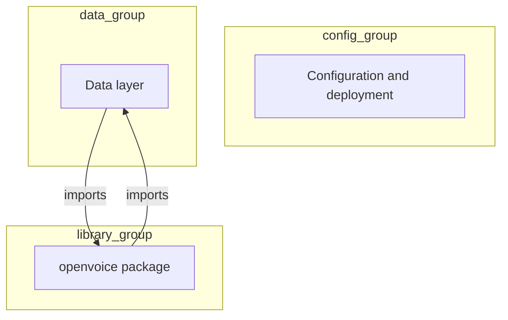

# Architecture report: myshell-ai/OpenVoice

> Automated static analysis. **Observed** = directly seen in files/imports/AST; **Inferred** = interpretation from that evidence. Repository code was not executed.

## 1. Repository at a glance

| Item | Value |
| --- | --- |
| Repository | myshell-ai/OpenVoice |
| Description | Instant voice cloning by MIT and MyShell. Audio foundation model. |
| Language | Python |
| Stars | 38245 |
| Licence | MIT |
| Analysed commit / branch | 74a1d147b17a8c3092dd5430504bd83ef6c7eb23 / main |
| Framework(s) | None detected |
| Files analysed | 26 |
| Components | 3 |

## 2. Architecture in one minute

myshell-ai/OpenVoice - Instant voice cloning by MIT and MyShell. Audio foundation model.. This repository was analysed statically from 26 file(s) (17 Python). Detected technologies (observed from imports/manifests): NumPy, setuptools. Files are grouped into 3 component(s): Configuration and deployment, Data layer, openvoice package. Findings below distinguish observed facts from inferred interpretation.

## 3. High-level block diagram

## 4. Main components

### Configuration and deployment (`config`)

- **Kind:** config
- **Status:** Observed
- **Confidence:** 0.85
- **Responsibility:** Groups 2 file(s) under configuration and deployment (observed from repository paths and static analysis).
- **Paths:** `requirements.txt`, `setup.py`
- **Evidence:** [requirements.txt](https://github.com/myshell-ai/OpenVoice/blob/74a1d147b17a8c3092dd5430504bd83ef6c7eb23/requirements.txt); [setup.py](https://github.com/myshell-ai/OpenVoice/blob/74a1d147b17a8c3092dd5430504bd83ef6c7eb23/setup.py)

### Data layer (`data_layer`)

- **Kind:** data
- **Status:** Observed
- **Confidence:** 0.85
- **Responsibility:** Groups 1 file(s) under data layer (observed from repository paths and static analysis). Observed top-level classes: DurationPredictor, Generator, PosteriorEncoder, ReferenceEncoder, ResidualCouplingBlock, StochasticDurationPredictor.
- **Paths:** `openvoice/models.py`
- **Evidence:** [openvoice/models.py:16](https://github.com/myshell-ai/OpenVoice/blob/74a1d147b17a8c3092dd5430504bd83ef6c7eb23/openvoice/models.py#L16)

### openvoice package (`openvoice`)

- **Kind:** library
- **Status:** Observed
- **Confidence:** 0.85
- **Responsibility:** Groups 15 file(s) under openvoice package (observed from repository paths and static analysis). Observed top-level classes: BaseSpeakerTTS, ConvFlow, ConvReluNorm, DDSConv, Decoder, ElementwiseAffine. Observed top-level functions: _clean_text, _expand_decimal_point, _expand_dollars, _expand_number, _expand_ordinal, _remove_commas.
- **Paths:** `openvoice/__init__.py`, `openvoice/api.py`, `openvoice/attentions.py`, `openvoice/commons.py`, `openvoice/mel_processing.py`, `openvoice/modules.py`, `openvoice/openvoice_app.py`, `openvoice/se_extractor.py`, `openvoice/text/__init__.py`, `openvoice/text/cleaners.py`, `openvoice/text/english.py`, `openvoice/text/mandarin.py`, `openvoice/text/symbols.py`, `openvoice/transforms.py`, `openvoice/utils.py`
- **Evidence:** [openvoice/__init__.py](https://github.com/myshell-ai/OpenVoice/blob/74a1d147b17a8c3092dd5430504bd83ef6c7eb23/openvoice/__init__.py); [openvoice/api.py:14](https://github.com/myshell-ai/OpenVoice/blob/74a1d147b17a8c3092dd5430504bd83ef6c7eb23/openvoice/api.py#L14); [openvoice/attentions.py:12](https://github.com/myshell-ai/OpenVoice/blob/74a1d147b17a8c3092dd5430504bd83ef6c7eb23/openvoice/attentions.py#L12); [openvoice/commons.py:6](https://github.com/myshell-ai/OpenVoice/blob/74a1d147b17a8c3092dd5430504bd83ef6c7eb23/openvoice/commons.py#L6); [openvoice/mel_processing.py:8](https://github.com/myshell-ai/OpenVoice/blob/74a1d147b17a8c3092dd5430504bd83ef6c7eb23/openvoice/mel_processing.py#L8); [openvoice/modules.py:17](https://github.com/myshell-ai/OpenVoice/blob/74a1d147b17a8c3092dd5430504bd83ef6c7eb23/openvoice/modules.py#L17); [openvoice/openvoice_app.py:37](https://github.com/myshell-ai/OpenVoice/blob/74a1d147b17a8c3092dd5430504bd83ef6c7eb23/openvoice/openvoice_app.py#L37); [openvoice/se_extractor.py:19](https://github.com/myshell-ai/OpenVoice/blob/74a1d147b17a8c3092dd5430504bd83ef6c7eb23/openvoice/se_extractor.py#L19)

## 5. Execution flow

No entry point was observed; the startup flow below is therefore limited.

Representative flow (derived from observed entry points and the import graph; steps beyond the entry point are **Inferred**):

1. Execution starts at an observed entry point listed above, if present.
2. `data_layer` imports `openvoice` (Data layer -> openvoice package).
3. `openvoice` imports `data_layer` (openvoice package -> Data layer).

## 6. Project structure

### `(root)`

- `.gitignore` - other (134 bytes)
- `LICENSE` - docs (1057 bytes)
- `README.md` - docs (3120 bytes)
- `demo_part1.ipynb` - other (7365 bytes)
- `demo_part2.ipynb` - other (6835 bytes)
- `demo_part3.ipynb` - other (4869 bytes)
- `requirements.txt` - manifest (253 bytes)
- `setup.py` - manifest, Python (1481 bytes)

### `docs`

- `docs/QA.md` - docs (3354 bytes)
- `docs/USAGE.md` - docs (3840 bytes)

### `openvoice`

- `openvoice/__init__.py` - source, Python (0 bytes)
- `openvoice/api.py` - source, Python (7823 bytes)
- `openvoice/attentions.py` - source, Python (16360 bytes)
- `openvoice/commons.py` - source, Python (4956 bytes)
- `openvoice/mel_processing.py` - source, Python (6098 bytes)
- `openvoice/models.py` - source, Python (16801 bytes)
- `openvoice/modules.py` - source, Python (19010 bytes)
- `openvoice/openvoice_app.py` - source, Python (11625 bytes)
- `openvoice/se_extractor.py` - source, Python (5145 bytes)
- `openvoice/text/__init__.py` - source, Python (2757 bytes)
- `openvoice/text/cleaners.py` - source, Python (846 bytes)
- `openvoice/text/english.py` - source, Python (5559 bytes)
- `openvoice/text/mandarin.py` - source, Python (7717 bytes)
- `openvoice/text/symbols.py` - source, Python (2588 bytes)
- `openvoice/transforms.py` - source, Python (7253 bytes)
- `openvoice/utils.py` - source, Python (5776 bytes)

## 7. Key dependencies and integrations

| Name | Category | Status | Confidence | Evidence |
| --- | --- | --- | --- | --- |
| NumPy | library | Observed | 0.95 | [openvoice/api.py:2](https://github.com/myshell-ai/OpenVoice/blob/74a1d147b17a8c3092dd5430504bd83ef6c7eb23/openvoice/api.py#L2); [openvoice/se_extractor.py:8](https://github.com/myshell-ai/OpenVoice/blob/74a1d147b17a8c3092dd5430504bd83ef6c7eb23/openvoice/se_extractor.py#L8); [openvoice/transforms.py:4](https://github.com/myshell-ai/OpenVoice/blob/74a1d147b17a8c3092dd5430504bd83ef6c7eb23/openvoice/transforms.py#L4); [openvoice/utils.py:3](https://github.com/myshell-ai/OpenVoice/blob/74a1d147b17a8c3092dd5430504bd83ef6c7eb23/openvoice/utils.py#L3) |
| setuptools | packaging | Observed | 0.90 | [setup.py:1](https://github.com/myshell-ai/OpenVoice/blob/74a1d147b17a8c3092dd5430504bd83ef6c7eb23/setup.py#L1) |

## 8. Data and state

- Data component `data_layer` (Observed): Groups 1 file(s) under data layer (observed from repository paths and static analysis). Observed top-level classes: DurationPredictor, Generator, PosteriorEncoder, ReferenceEncoder, ResidualCouplingBlock, StochasticDurationPredictor.

## 9. Configuration and deployment clues

- `requirements.txt` (manifest)
- `setup.py` (manifest)

## 10. Design observations

- Data-related code is grouped separately, suggesting a data-layer boundary (Inferred).

These observations are interpretations (**Inferred**) of the observed structure, not guarantees about runtime design.

## 11. Limitations and unknowns

- Static analysis only: repository code was not executed, installed, or imported at runtime.
- Components and relationships are inferred from file paths, imports, and AST structure; runtime behaviour, dynamic imports, and reflection may not be visible.
- No clear application entry point was observed in the analysed files.
- Repository text was treated as untrusted data; no instructions found in repository files were followed, and likely secret values were redacted/excluded.

## 12. Source references

- [openvoice/__init__.py](https://github.com/myshell-ai/OpenVoice/blob/74a1d147b17a8c3092dd5430504bd83ef6c7eb23/openvoice/__init__.py)
- [openvoice/api.py:2](https://github.com/myshell-ai/OpenVoice/blob/74a1d147b17a8c3092dd5430504bd83ef6c7eb23/openvoice/api.py#L2)
- [openvoice/api.py:14](https://github.com/myshell-ai/OpenVoice/blob/74a1d147b17a8c3092dd5430504bd83ef6c7eb23/openvoice/api.py#L14)
- [openvoice/attentions.py:12](https://github.com/myshell-ai/OpenVoice/blob/74a1d147b17a8c3092dd5430504bd83ef6c7eb23/openvoice/attentions.py#L12)
- [openvoice/commons.py:6](https://github.com/myshell-ai/OpenVoice/blob/74a1d147b17a8c3092dd5430504bd83ef6c7eb23/openvoice/commons.py#L6)
- [openvoice/mel_processing.py:8](https://github.com/myshell-ai/OpenVoice/blob/74a1d147b17a8c3092dd5430504bd83ef6c7eb23/openvoice/mel_processing.py#L8)
- [openvoice/models.py:16](https://github.com/myshell-ai/OpenVoice/blob/74a1d147b17a8c3092dd5430504bd83ef6c7eb23/openvoice/models.py#L16)
- [openvoice/modules.py:17](https://github.com/myshell-ai/OpenVoice/blob/74a1d147b17a8c3092dd5430504bd83ef6c7eb23/openvoice/modules.py#L17)
- [openvoice/openvoice_app.py:37](https://github.com/myshell-ai/OpenVoice/blob/74a1d147b17a8c3092dd5430504bd83ef6c7eb23/openvoice/openvoice_app.py#L37)
- [openvoice/se_extractor.py:8](https://github.com/myshell-ai/OpenVoice/blob/74a1d147b17a8c3092dd5430504bd83ef6c7eb23/openvoice/se_extractor.py#L8)
- [openvoice/se_extractor.py:19](https://github.com/myshell-ai/OpenVoice/blob/74a1d147b17a8c3092dd5430504bd83ef6c7eb23/openvoice/se_extractor.py#L19)
- [openvoice/transforms.py:4](https://github.com/myshell-ai/OpenVoice/blob/74a1d147b17a8c3092dd5430504bd83ef6c7eb23/openvoice/transforms.py#L4)
- [openvoice/utils.py:3](https://github.com/myshell-ai/OpenVoice/blob/74a1d147b17a8c3092dd5430504bd83ef6c7eb23/openvoice/utils.py#L3)
- [requirements.txt](https://github.com/myshell-ai/OpenVoice/blob/74a1d147b17a8c3092dd5430504bd83ef6c7eb23/requirements.txt)
- [requirements.txt:5](https://github.com/myshell-ai/OpenVoice/blob/74a1d147b17a8c3092dd5430504bd83ef6c7eb23/requirements.txt#L5)
- [setup.py](https://github.com/myshell-ai/OpenVoice/blob/74a1d147b17a8c3092dd5430504bd83ef6c7eb23/setup.py)
- [setup.py:1](https://github.com/myshell-ai/OpenVoice/blob/74a1d147b17a8c3092dd5430504bd83ef6c7eb23/setup.py#L1)
- [setup.py:33](https://github.com/myshell-ai/OpenVoice/blob/74a1d147b17a8c3092dd5430504bd83ef6c7eb23/setup.py#L33)
