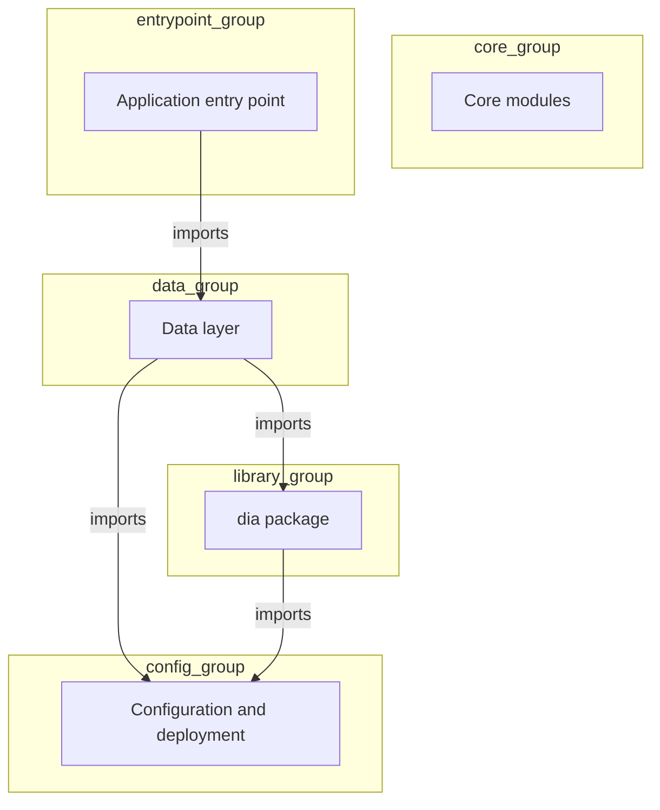

# Architecture report: nari-labs/dia

> Automated static analysis. **Observed** = directly seen in files/imports/AST; **Inferred** = interpretation from that evidence. Repository code was not executed.

## 1. Repository at a glance

| Item | Value |
| --- | --- |
| Repository | nari-labs/dia |
| Description | A TTS model capable of generating ultra-realistic dialogue in one pass. |
| Language | Python |
| Stars | 19409 |
| Licence | Apache-2.0 |
| Analysed commit / branch | 876125e461a03b157ec905b0fe8b57a0f8b9e7a0 / main |
| Framework(s) | None detected |
| Files analysed | 24 |
| Components | 5 |

## 2. Architecture in one minute

nari-labs/dia - A TTS model capable of generating ultra-realistic dialogue in one pass.. This repository was analysed statically from 24 file(s) (16 Python). Detected technologies (observed from imports/manifests): GitHub Actions, NumPy, Pydantic, Poetry, Docker. Files are grouped into 5 component(s): Configuration and deployment, Core modules, Data layer, dia package, Application entry point. Observed entry point(s): app.py, cli.py. Findings below distinguish observed facts from inferred interpretation.

## 3. High-level block diagram

## 4. Main components

### Configuration and deployment (`config`)

- **Kind:** config
- **Status:** Observed
- **Confidence:** 0.85
- **Responsibility:** Groups 4 file(s) under configuration and deployment (observed from repository paths and static analysis). Observed top-level classes: DecoderConfig, DiaConfig, EncoderConfig.
- **Paths:** `dia/config.py`, `docker/Dockerfile.cpu`, `docker/Dockerfile.gpu`, `pyproject.toml`
- **Evidence:** [dia/config.py:21](https://github.com/nari-labs/dia/blob/876125e461a03b157ec905b0fe8b57a0f8b9e7a0/dia/config.py#L21); [docker/Dockerfile.cpu](https://github.com/nari-labs/dia/blob/876125e461a03b157ec905b0fe8b57a0f8b9e7a0/docker/Dockerfile.cpu); [docker/Dockerfile.gpu](https://github.com/nari-labs/dia/blob/876125e461a03b157ec905b0fe8b57a0f8b9e7a0/docker/Dockerfile.gpu); [pyproject.toml](https://github.com/nari-labs/dia/blob/876125e461a03b157ec905b0fe8b57a0f8b9e7a0/pyproject.toml)

### Core modules (`core`)

- **Kind:** core
- **Status:** Observed
- **Confidence:** 0.85
- **Responsibility:** Groups 1 file(s) under core modules (observed from repository paths and static analysis).
- **Paths:** `hf.py`
- **Evidence:** [hf.py](https://github.com/nari-labs/dia/blob/876125e461a03b157ec905b0fe8b57a0f8b9e7a0/hf.py)

### Data layer (`data_layer`)

- **Kind:** data
- **Status:** Observed
- **Confidence:** 0.85
- **Responsibility:** Groups 1 file(s) under data layer (observed from repository paths and static analysis). Observed top-level classes: ComputeDtype, Dia. Observed top-level functions: _get_default_device, _sample_next_token.
- **Paths:** `dia/model.py`
- **Evidence:** [dia/model.py:20](https://github.com/nari-labs/dia/blob/876125e461a03b157ec905b0fe8b57a0f8b9e7a0/dia/model.py#L20)

### dia package (`dia`)

- **Kind:** library
- **Status:** Observed
- **Confidence:** 0.85
- **Responsibility:** Groups 4 file(s) under dia package (observed from repository paths and static analysis). Observed top-level classes: CrossAttention, Decoder, DecoderInferenceState, DecoderLayer, DecoderOutput, DenseGeneral. Observed top-level functions: _normalize_axes, apply_audio_delay, build_delay_indices, build_revert_indices, create_attn_mask, custom_scaled_dot_product_attention.
- **Paths:** `dia/__init__.py`, `dia/audio.py`, `dia/layers.py`, `dia/state.py`
- **Evidence:** [dia/__init__.py](https://github.com/nari-labs/dia/blob/876125e461a03b157ec905b0fe8b57a0f8b9e7a0/dia/__init__.py); [dia/audio.py:6](https://github.com/nari-labs/dia/blob/876125e461a03b157ec905b0fe8b57a0f8b9e7a0/dia/audio.py#L6); [dia/layers.py:12](https://github.com/nari-labs/dia/blob/876125e461a03b157ec905b0fe8b57a0f8b9e7a0/dia/layers.py#L12); [dia/state.py:9](https://github.com/nari-labs/dia/blob/876125e461a03b157ec905b0fe8b57a0f8b9e7a0/dia/state.py#L9)

### Application entry point (`entrypoint`)

- **Kind:** entrypoint
- **Status:** Observed
- **Confidence:** 0.85
- **Responsibility:** Groups 2 file(s) under application entry point (observed from repository paths and static analysis). Observed top-level functions: main, run_inference, set_seed.
- **Paths:** `app.py`, `cli.py`
- **Evidence:** [app.py:57](https://github.com/nari-labs/dia/blob/876125e461a03b157ec905b0fe8b57a0f8b9e7a0/app.py#L57); [cli.py:12](https://github.com/nari-labs/dia/blob/876125e461a03b157ec905b0fe8b57a0f8b9e7a0/cli.py#L12)

## 5. Execution flow

**Observed** entry point(s):

- [app.py:439](https://github.com/nari-labs/dia/blob/876125e461a03b157ec905b0fe8b57a0f8b9e7a0/app.py#L439)
- [cli.py:143](https://github.com/nari-labs/dia/blob/876125e461a03b157ec905b0fe8b57a0f8b9e7a0/cli.py#L143)

Representative flow (derived from observed entry points and the import graph; steps beyond the entry point are **Inferred**):

1. Execution starts at an observed entry point listed above, if present.
2. `data_layer` imports `config` (Data layer -> Configuration and deployment).
3. `data_layer` imports `dia` (Data layer -> dia package).
4. `dia` imports `config` (dia package -> Configuration and deployment).
5. `entrypoint` imports `data_layer` (Application entry point -> Data layer).

## 6. Project structure

### `(root)`

- `.gitignore` - other (232 bytes)
- `.python-version` - other (5 bytes)
- `LICENSE` - docs (11338 bytes)
- `README.md` - docs (9882 bytes)
- `app.py` - source, Python (18996 bytes)
- `cli.py` - source, Python (4934 bytes)
- `hf.py` - source, Python (763 bytes)
- `pyproject.toml` - manifest (1640 bytes)

### `.github`

- `.github/workflows/ci.yaml` - ci, YAML (420 bytes)

### `dia`

- `dia/__init__.py` - source, Python (50 bytes)
- `dia/audio.py` - source, Python (6142 bytes)
- `dia/config.py` - source, Python (8746 bytes)
- `dia/layers.py` - source, Python (31662 bytes)
- `dia/model.py` - source, Python (33337 bytes)
- `dia/state.py` - source, Python (7659 bytes)

### `docker`

- `docker/Dockerfile.cpu` - container (1261 bytes)
- `docker/Dockerfile.gpu` - container (1330 bytes)

### `example`

- `example/benchmark.py` - source, Python (1524 bytes)
- `example/simple-cpu.py` - source, Python (612 bytes)
- `example/simple-mac.py` - source, Python (571 bytes)
- `example/simple.py` - source, Python (499 bytes)
- `example/simple_batch.py` - source, Python (489 bytes)
- `example/voice_clone.py` - source, Python (1290 bytes)
- `example/voice_clone_batch.py` - source, Python (1336 bytes)

## 7. Key dependencies and integrations

| Name | Category | Status | Confidence | Evidence |
| --- | --- | --- | --- | --- |
| GitHub Actions | ci | Observed | 0.85 | [.github/workflows/ci.yaml](https://github.com/nari-labs/dia/blob/876125e461a03b157ec905b0fe8b57a0f8b9e7a0/.github/workflows/ci.yaml) |
| NumPy | library | Observed | 0.95 | [app.py:11](https://github.com/nari-labs/dia/blob/876125e461a03b157ec905b0fe8b57a0f8b9e7a0/app.py#L11); [cli.py:5](https://github.com/nari-labs/dia/blob/876125e461a03b157ec905b0fe8b57a0f8b9e7a0/cli.py#L5); [dia/model.py:5](https://github.com/nari-labs/dia/blob/876125e461a03b157ec905b0fe8b57a0f8b9e7a0/dia/model.py#L5); [pyproject.toml:15](https://github.com/nari-labs/dia/blob/876125e461a03b157ec905b0fe8b57a0f8b9e7a0/pyproject.toml#L15) |
| Pydantic | library | Observed | 0.90 | [dia/config.py:18](https://github.com/nari-labs/dia/blob/876125e461a03b157ec905b0fe8b57a0f8b9e7a0/dia/config.py#L18); [pyproject.toml:16](https://github.com/nari-labs/dia/blob/876125e461a03b157ec905b0fe8b57a0f8b9e7a0/pyproject.toml#L16) |
| Poetry | packaging | Observed | 0.85 | [pyproject.toml](https://github.com/nari-labs/dia/blob/876125e461a03b157ec905b0fe8b57a0f8b9e7a0/pyproject.toml) |
| Docker | tooling | Observed | 0.90 | [docker/Dockerfile.cpu](https://github.com/nari-labs/dia/blob/876125e461a03b157ec905b0fe8b57a0f8b9e7a0/docker/Dockerfile.cpu); [docker/Dockerfile.gpu](https://github.com/nari-labs/dia/blob/876125e461a03b157ec905b0fe8b57a0f8b9e7a0/docker/Dockerfile.gpu) |

## 8. Data and state

- Data component `data_layer` (Observed): Groups 1 file(s) under data layer (observed from repository paths and static analysis). Observed top-level classes: ComputeDtype, Dia. Observed top-level functions: _get_default_device, _sample_next_token.

## 9. Configuration and deployment clues

- `.github/workflows/ci.yaml` (ci)
- `docker/Dockerfile.cpu` (container)
- `docker/Dockerfile.gpu` (container)
- `pyproject.toml` (manifest)

## 10. Design observations

- An entry/API layer is separated from other code (Inferred from paths and decorators).
- Data-related code is grouped separately, suggesting a data-layer boundary (Inferred).

These observations are interpretations (**Inferred**) of the observed structure, not guarantees about runtime design.

## 11. Limitations and unknowns

- Static analysis only: repository code was not executed, installed, or imported at runtime.
- Components and relationships are inferred from file paths, imports, and AST structure; runtime behaviour, dynamic imports, and reflection may not be visible.
- Repository text was treated as untrusted data; no instructions found in repository files were followed, and likely secret values were redacted/excluded.

## 12. Source references

- [.github/workflows/ci.yaml](https://github.com/nari-labs/dia/blob/876125e461a03b157ec905b0fe8b57a0f8b9e7a0/.github/workflows/ci.yaml)
- [app.py:11](https://github.com/nari-labs/dia/blob/876125e461a03b157ec905b0fe8b57a0f8b9e7a0/app.py#L11)
- [app.py:57](https://github.com/nari-labs/dia/blob/876125e461a03b157ec905b0fe8b57a0f8b9e7a0/app.py#L57)
- [app.py:439](https://github.com/nari-labs/dia/blob/876125e461a03b157ec905b0fe8b57a0f8b9e7a0/app.py#L439)
- [cli.py:5](https://github.com/nari-labs/dia/blob/876125e461a03b157ec905b0fe8b57a0f8b9e7a0/cli.py#L5)
- [cli.py:12](https://github.com/nari-labs/dia/blob/876125e461a03b157ec905b0fe8b57a0f8b9e7a0/cli.py#L12)
- [cli.py:143](https://github.com/nari-labs/dia/blob/876125e461a03b157ec905b0fe8b57a0f8b9e7a0/cli.py#L143)
- [dia/__init__.py](https://github.com/nari-labs/dia/blob/876125e461a03b157ec905b0fe8b57a0f8b9e7a0/dia/__init__.py)
- [dia/audio.py:6](https://github.com/nari-labs/dia/blob/876125e461a03b157ec905b0fe8b57a0f8b9e7a0/dia/audio.py#L6)
- [dia/config.py:18](https://github.com/nari-labs/dia/blob/876125e461a03b157ec905b0fe8b57a0f8b9e7a0/dia/config.py#L18)
- [dia/config.py:21](https://github.com/nari-labs/dia/blob/876125e461a03b157ec905b0fe8b57a0f8b9e7a0/dia/config.py#L21)
- [dia/layers.py:12](https://github.com/nari-labs/dia/blob/876125e461a03b157ec905b0fe8b57a0f8b9e7a0/dia/layers.py#L12)
- [dia/model.py:5](https://github.com/nari-labs/dia/blob/876125e461a03b157ec905b0fe8b57a0f8b9e7a0/dia/model.py#L5)
- [dia/model.py:20](https://github.com/nari-labs/dia/blob/876125e461a03b157ec905b0fe8b57a0f8b9e7a0/dia/model.py#L20)
- [dia/state.py:9](https://github.com/nari-labs/dia/blob/876125e461a03b157ec905b0fe8b57a0f8b9e7a0/dia/state.py#L9)
- [docker/Dockerfile.cpu](https://github.com/nari-labs/dia/blob/876125e461a03b157ec905b0fe8b57a0f8b9e7a0/docker/Dockerfile.cpu)
- [docker/Dockerfile.gpu](https://github.com/nari-labs/dia/blob/876125e461a03b157ec905b0fe8b57a0f8b9e7a0/docker/Dockerfile.gpu)
- [hf.py](https://github.com/nari-labs/dia/blob/876125e461a03b157ec905b0fe8b57a0f8b9e7a0/hf.py)
- [pyproject.toml](https://github.com/nari-labs/dia/blob/876125e461a03b157ec905b0fe8b57a0f8b9e7a0/pyproject.toml)
- [pyproject.toml:15](https://github.com/nari-labs/dia/blob/876125e461a03b157ec905b0fe8b57a0f8b9e7a0/pyproject.toml#L15)
- [pyproject.toml:16](https://github.com/nari-labs/dia/blob/876125e461a03b157ec905b0fe8b57a0f8b9e7a0/pyproject.toml#L16)
