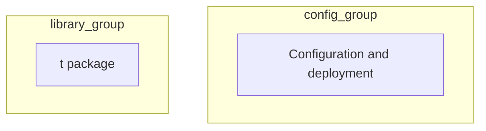

# Architecture report: newren/git-filter-repo

> Automated static analysis. **Observed** = directly seen in files/imports/AST; **Inferred** = interpretation from that evidence. Repository code was not executed.

## 1. Repository at a glance

| Item | Value |
| --- | --- |
| Repository | newren/git-filter-repo |
| Description | Quickly rewrite git repository history (filter-branch replacement) |
| Language | Python |
| Stars | 13521 |
| Licence | Other |
| Analysed commit / branch | d7b75aca907380f608892cc289e616f195427b99 / main |
| Framework(s) | None detected |
| Files analysed | 72 |
| Components | 2 |

## 2. Architecture in one minute

newren/git-filter-repo - Quickly rewrite git repository history (filter-branch replacement). This repository was analysed statically from 72 file(s) (9 Python). Detected technologies (observed from imports/manifests): GitHub Actions, Poetry, setuptools. Files are grouped into 2 component(s): Configuration and deployment, t package. Findings below distinguish observed facts from inferred interpretation.

## 3. High-level block diagram

## 4. Main components

### Configuration and deployment (`config`)

- **Kind:** config
- **Status:** Observed
- **Confidence:** 0.85
- **Responsibility:** Groups 1 file(s) under configuration and deployment (observed from repository paths and static analysis).
- **Paths:** `pyproject.toml`
- **Evidence:** [pyproject.toml](https://github.com/newren/git-filter-repo/blob/d7b75aca907380f608892cc289e616f195427b99/pyproject.toml)

### t package (`t`)

- **Kind:** library
- **Status:** Observed
- **Confidence:** 0.85
- **Responsibility:** Groups 16 file(s) under t package (observed from repository paths and static analysis). Observed top-level classes: InterleaveRepositories. Observed top-level functions: change_up_them_commits, drop_file_by_contents, drop_files_by_name, handle_checkpoint, handle_progress, handle_tag.
- **Paths:** `t/t9390-filter-repo-basics.sh`, `t/t9391-filter-repo-lib-usage.sh`, `t/t9391/commit_info.py`, `t/t9391/create_fast_export_output.py`, `t/t9391/erroneous.py`, `t/t9391/file_filter.py`, `t/t9391/print_progress.py`, `t/t9391/rename-master-to-develop.py`, `t/t9391/splice_repos.py`, `t/t9391/strip-cvs-keywords.py`, `t/t9391/unusual.py`, `t/t9392-filter-repo-python-callback.sh`, `t/t9393-filter-repo-rerun.sh`, `t/t9394-filter-repo-sanity-checks-and-bigger-repo-setup.sh`, `t/test-lib-functions.sh`, `t/test-lib.sh`
- **Evidence:** [t/t9390-filter-repo-basics.sh](https://github.com/newren/git-filter-repo/blob/d7b75aca907380f608892cc289e616f195427b99/t/t9390-filter-repo-basics.sh); [t/t9391-filter-repo-lib-usage.sh](https://github.com/newren/git-filter-repo/blob/d7b75aca907380f608892cc289e616f195427b99/t/t9391-filter-repo-lib-usage.sh); [t/t9391/commit_info.py:14](https://github.com/newren/git-filter-repo/blob/d7b75aca907380f608892cc289e616f195427b99/t/t9391/commit_info.py#L14); [t/t9391/create_fast_export_output.py](https://github.com/newren/git-filter-repo/blob/d7b75aca907380f608892cc289e616f195427b99/t/t9391/create_fast_export_output.py); [t/t9391/erroneous.py:11](https://github.com/newren/git-filter-repo/blob/d7b75aca907380f608892cc289e616f195427b99/t/t9391/erroneous.py#L11); [t/t9391/file_filter.py:12](https://github.com/newren/git-filter-repo/blob/d7b75aca907380f608892cc289e616f195427b99/t/t9391/file_filter.py#L12); [t/t9391/print_progress.py:22](https://github.com/newren/git-filter-repo/blob/d7b75aca907380f608892cc289e616f195427b99/t/t9391/print_progress.py#L22); [t/t9391/rename-master-to-develop.py:11](https://github.com/newren/git-filter-repo/blob/d7b75aca907380f608892cc289e616f195427b99/t/t9391/rename-master-to-develop.py#L11)

## 5. Execution flow

No entry point was observed; the startup flow below is therefore limited.

Representative flow (derived from observed entry points and the import graph; steps beyond the entry point are **Inferred**):

1. Execution starts at an observed entry point listed above, if present.
2. No internal import relationships between components were observed.

## 6. Project structure

### `(root)`

- `.gitattributes` - other (105 bytes)
- `.gitignore` - other (92 bytes)
- `COPYING` - other (1159 bytes)
- `COPYING.gpl` - other (18092 bytes)
- `COPYING.mit` - other (1054 bytes)
- `INSTALL.md` - docs (9172 bytes)
- `Makefile` - other (6649 bytes)
- `README.md` - docs (29651 bytes)
- `pyproject.toml` - manifest (1417 bytes)

### `.github`

- `.github/dependabot.yml` - config (122 bytes)
- `.github/workflows/test.yml` - ci, YAML (963 bytes)

### `Documentation`

- `Documentation/Contributing.md` - docs (4352 bytes)
- `Documentation/FAQ.md` - docs (18036 bytes)
- `Documentation/converting-from-bfg-repo-cleaner.md` - docs (6505 bytes)
- `Documentation/converting-from-filter-branch.md` - docs (11669 bytes)
- `Documentation/examples-from-user-filed-issues.md` - docs (17773 bytes)
- `Documentation/git-filter-repo.txt` - docs (84251 bytes)

### `contrib`

- `contrib/filter-repo-demos/README.md` - docs (2280 bytes)
- `contrib/filter-repo-demos/barebones-example` - other (801 bytes)
- `contrib/filter-repo-demos/bfg-ish` - other (23201 bytes)
- `contrib/filter-repo-demos/clean-ignore` - other (2602 bytes)
- `contrib/filter-repo-demos/convert-svnexternals` - other (21446 bytes)
- `contrib/filter-repo-demos/filter-lamely` - other (29156 bytes)
- `contrib/filter-repo-demos/insert-beginning` - other (2770 bytes)
- `contrib/filter-repo-demos/lint-history` - other (7317 bytes)
- `contrib/filter-repo-demos/signed-off-by` - other (2467 bytes)

### `t`

- `t/run_coverage` - other (558 bytes)
- `t/run_tests` - other (580 bytes)
- `t/t9390-filter-repo-basics.sh` - source, Shell (26355 bytes)
- `t/t9390/basic` - other (2082 bytes)
- `t/t9390/basic-filename` - other (570 bytes)
- `t/t9390/basic-mailmap` - other (1251 bytes)
- `t/t9390/basic-message` - other (1278 bytes)
- `t/t9390/basic-numbers` - other (1217 bytes)
- `t/t9390/basic-replace` - other (1294 bytes)
- `t/t9390/basic-ten` - other (758 bytes)
- `t/t9390/basic-twenty` - other (763 bytes)
- `t/t9390/degenerate` - other (9462 bytes)
- `t/t9390/degenerate-evil-merge` - other (1640 bytes)
- `t/t9390/degenerate-globme` - other (4806 bytes)
- `t/t9390/degenerate-keepme` - other (1837 bytes)
- `t/t9390/degenerate-keepme-noff` - other (2044 bytes)
- `t/t9390/degenerate-moduleA` - other (3474 bytes)
- `t/t9390/empty` - other (3104 bytes)
- `t/t9390/empty-keepme` - other (1051 bytes)
- `t/t9390/less-empty-keepme` - other (1968 bytes)
- `t/t9390/more-empty-keepme` - other (727 bytes)
- `t/t9390/sample-mailmap` - other (278 bytes)
- `t/t9390/sample-message` - other (83 bytes)
- `t/t9390/sample-replace` - other (27 bytes)
- `t/t9390/unusual` - other (764 bytes)
- `t/t9390/unusual-filtered` - other (382 bytes)
- `t/t9390/unusual-mailmap` - other (398 bytes)
- `t/t9391-filter-repo-lib-usage.sh` - source, Shell (6517 bytes)
- `t/t9391/commit_info.py` - source, Python (996 bytes)
- `t/t9391/create_fast_export_output.py` - source, Python (4284 bytes)
- `t/t9391/emoji-repo` - other (352 bytes)
- `t/t9391/erroneous.py` - source, Python (371 bytes)
- `t/t9391/file_filter.py` - source, Python (796 bytes)
- `t/t9391/print_progress.py` - source, Python (1122 bytes)
- `t/t9391/rename-master-to-develop.py` - source, Python (431 bytes)
- `t/t9391/splice_repos.py` - source, Python (2754 bytes)
- `t/t9391/strip-cvs-keywords.py` - source, Python (661 bytes)
- `t/t9391/unusual.py` - source, Python (4596 bytes)
- `t/t9392-filter-repo-python-callback.sh` - source, Shell (10757 bytes)
- `t/t9393-filter-repo-rerun.sh` - source, Shell (28087 bytes)
- `t/t9393/lfs` - other (4221 bytes)
- `t/t9393/simple` - other (2202 bytes)
- `t/t9394-filter-repo-sanity-checks-and-bigger-repo-setup.sh` - source, Shell (37969 bytes)
- `t/t9394/date-order` - other (1073 bytes)
- `t/test-lib-functions.sh` - source, Shell (30980 bytes)
- `t/test-lib.sh` - source, Shell (33968 bytes)

## 7. Key dependencies and integrations

| Name | Category | Status | Confidence | Evidence |
| --- | --- | --- | --- | --- |
| GitHub Actions | ci | Observed | 0.85 | [.github/workflows/test.yml](https://github.com/newren/git-filter-repo/blob/d7b75aca907380f608892cc289e616f195427b99/.github/workflows/test.yml) |
| Poetry | packaging | Observed | 0.85 | [pyproject.toml](https://github.com/newren/git-filter-repo/blob/d7b75aca907380f608892cc289e616f195427b99/pyproject.toml) |
| setuptools | packaging | Observed | 0.85 | [pyproject.toml:37](https://github.com/newren/git-filter-repo/blob/d7b75aca907380f608892cc289e616f195427b99/pyproject.toml#L37) |

## 8. Data and state

No database, cache, queue, or persistent-state usage was observed in the analysed files. State handling, if any, may be in-memory or in files that were not analysed.

## 9. Configuration and deployment clues

- `.github/dependabot.yml` (config)
- `.github/workflows/test.yml` (ci)
- `pyproject.toml` (manifest)

Console scripts declared in packaging metadata (**Observed**):

- `git-filter-repo` -> `git_filter_repo:main`

## 10. Design observations

- No strong design patterns could be established from the available evidence.

These observations are interpretations (**Inferred**) of the observed structure, not guarantees about runtime design.

## 11. Limitations and unknowns

- Static analysis only: repository code was not executed, installed, or imported at runtime.
- Components and relationships are inferred from file paths, imports, and AST structure; runtime behaviour, dynamic imports, and reflection may not be visible.
- No clear application entry point was observed in the analysed files.
- Repository text was treated as untrusted data; no instructions found in repository files were followed, and likely secret values were redacted/excluded.

## 12. Source references

- [.github/workflows/test.yml](https://github.com/newren/git-filter-repo/blob/d7b75aca907380f608892cc289e616f195427b99/.github/workflows/test.yml)
- [pyproject.toml](https://github.com/newren/git-filter-repo/blob/d7b75aca907380f608892cc289e616f195427b99/pyproject.toml)
- [pyproject.toml:37](https://github.com/newren/git-filter-repo/blob/d7b75aca907380f608892cc289e616f195427b99/pyproject.toml#L37)
- [t/t9390-filter-repo-basics.sh](https://github.com/newren/git-filter-repo/blob/d7b75aca907380f608892cc289e616f195427b99/t/t9390-filter-repo-basics.sh)
- [t/t9391-filter-repo-lib-usage.sh](https://github.com/newren/git-filter-repo/blob/d7b75aca907380f608892cc289e616f195427b99/t/t9391-filter-repo-lib-usage.sh)
- [t/t9391/commit_info.py:14](https://github.com/newren/git-filter-repo/blob/d7b75aca907380f608892cc289e616f195427b99/t/t9391/commit_info.py#L14)
- [t/t9391/create_fast_export_output.py](https://github.com/newren/git-filter-repo/blob/d7b75aca907380f608892cc289e616f195427b99/t/t9391/create_fast_export_output.py)
- [t/t9391/erroneous.py:11](https://github.com/newren/git-filter-repo/blob/d7b75aca907380f608892cc289e616f195427b99/t/t9391/erroneous.py#L11)
- [t/t9391/file_filter.py:12](https://github.com/newren/git-filter-repo/blob/d7b75aca907380f608892cc289e616f195427b99/t/t9391/file_filter.py#L12)
- [t/t9391/print_progress.py:22](https://github.com/newren/git-filter-repo/blob/d7b75aca907380f608892cc289e616f195427b99/t/t9391/print_progress.py#L22)
- [t/t9391/rename-master-to-develop.py:11](https://github.com/newren/git-filter-repo/blob/d7b75aca907380f608892cc289e616f195427b99/t/t9391/rename-master-to-develop.py#L11)
