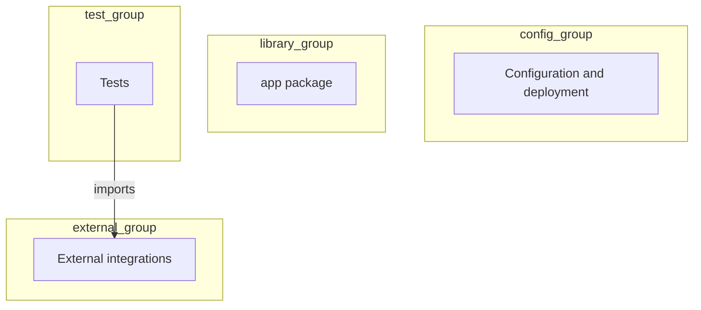

# Architecture report: nginx-proxy/nginx-proxy

> Automated static analysis. **Observed** = directly seen in files/imports/AST; **Inferred** = interpretation from that evidence. Repository code was not executed.

## 1. Repository at a glance

| Item | Value |
| --- | --- |
| Repository | nginx-proxy/nginx-proxy |
| Description | Automated Nginx Reverse Proxy for Docker |
| Language | Python |
| Stars | 19942 |
| Licence | MIT |
| Analysed commit / branch | bff2cddfece8e4f2c6d00b62ba45b8214c4727c5 / main |
| Framework(s) | None detected |
| Files analysed | 304 |
| Components | 4 |

## 2. Architecture in one minute

nginx-proxy/nginx-proxy - Automated Nginx Reverse Proxy for Docker. This repository was analysed statically from 304 file(s) (99 Python). Detected technologies (observed from imports/manifests): GitHub Actions, requests, Docker, Docker Compose, pytest. Files are grouped into 4 component(s): app package, Configuration and deployment, External integrations, Tests. Findings below distinguish observed facts from inferred interpretation.

## 3. High-level block diagram

## 4. Main components

### app package (`app`)

- **Kind:** library
- **Status:** Observed
- **Confidence:** 0.85
- **Responsibility:** Groups 1 file(s) under app package (observed from repository paths and static analysis).
- **Paths:** `app/docker-entrypoint.sh`
- **Evidence:** [app/docker-entrypoint.sh](https://github.com/nginx-proxy/nginx-proxy/blob/bff2cddfece8e4f2c6d00b62ba45b8214c4727c5/app/docker-entrypoint.sh)

### Configuration and deployment (`config`)

- **Kind:** config
- **Status:** Observed
- **Confidence:** 0.85
- **Responsibility:** Groups 7 file(s) under configuration and deployment (observed from repository paths and static analysis).
- **Paths:** `Dockerfile.alpine`, `Dockerfile.debian`, `Dockerfile.dockergen`, `docker-compose-separate-containers.yml`, `docker-compose.yml`, `test/requirements/Dockerfile-nginx-proxy-tester`, `test/requirements/web/Dockerfile`
- **Evidence:** [Dockerfile.alpine](https://github.com/nginx-proxy/nginx-proxy/blob/bff2cddfece8e4f2c6d00b62ba45b8214c4727c5/Dockerfile.alpine); [Dockerfile.debian](https://github.com/nginx-proxy/nginx-proxy/blob/bff2cddfece8e4f2c6d00b62ba45b8214c4727c5/Dockerfile.debian); [Dockerfile.dockergen](https://github.com/nginx-proxy/nginx-proxy/blob/bff2cddfece8e4f2c6d00b62ba45b8214c4727c5/Dockerfile.dockergen); [docker-compose-separate-containers.yml](https://github.com/nginx-proxy/nginx-proxy/blob/bff2cddfece8e4f2c6d00b62ba45b8214c4727c5/docker-compose-separate-containers.yml); [docker-compose.yml](https://github.com/nginx-proxy/nginx-proxy/blob/bff2cddfece8e4f2c6d00b62ba45b8214c4727c5/docker-compose.yml); [test/requirements/Dockerfile-nginx-proxy-tester](https://github.com/nginx-proxy/nginx-proxy/blob/bff2cddfece8e4f2c6d00b62ba45b8214c4727c5/test/requirements/Dockerfile-nginx-proxy-tester); [test/requirements/web/Dockerfile](https://github.com/nginx-proxy/nginx-proxy/blob/bff2cddfece8e4f2c6d00b62ba45b8214c4727c5/test/requirements/web/Dockerfile)

### External integrations (`external_integrations`)

- **Kind:** external
- **Status:** Inferred
- **Confidence:** 0.70
- **Responsibility:** Groups 0 file(s) under external integrations (observed from repository paths and static analysis).
- **Evidence:** [test/conftest.py:8](https://github.com/nginx-proxy/nginx-proxy/blob/bff2cddfece8e4f2c6d00b62ba45b8214c4727c5/test/conftest.py#L8); [test/conftest.py:18](https://github.com/nginx-proxy/nginx-proxy/blob/bff2cddfece8e4f2c6d00b62ba45b8214c4727c5/test/conftest.py#L18); [test/conftest.py:24](https://github.com/nginx-proxy/nginx-proxy/blob/bff2cddfece8e4f2c6d00b62ba45b8214c4727c5/test/conftest.py#L24); [test/conftest.py:25](https://github.com/nginx-proxy/nginx-proxy/blob/bff2cddfece8e4f2c6d00b62ba45b8214c4727c5/test/conftest.py#L25); [test/test_fallback/test_fallback.py:7](https://github.com/nginx-proxy/nginx-proxy/blob/bff2cddfece8e4f2c6d00b62ba45b8214c4727c5/test/test_fallback/test_fallback.py#L7); [test/test_fallback/test_fallback.py:8](https://github.com/nginx-proxy/nginx-proxy/blob/bff2cddfece8e4f2c6d00b62ba45b8214c4727c5/test/test_fallback/test_fallback.py#L8)

### Tests (`tests`)

- **Kind:** test
- **Status:** Observed
- **Confidence:** 0.85
- **Responsibility:** Groups 279 file(s) under tests (observed from repository paths and static analysis). Observed top-level classes: DockerComposer, Handler, NginxProxyAdapter, RequestsForDocker. Observed top-level functions: __prepare_and_execute_compose_cmd, _generated_config, _vhost_has_directive, acme_challenge_path, assert_log_contains, assert_ocsp_disabled.
- **Paths:** `test/README.md`, `test/certs/README.md`, `test/certs/ca-root.crt`, `test/certs/create_server_certificate.sh`, `test/compose.base.yml`, `test/conftest.py`, `test/pytest.ini`, `test/pytest.sh`, `test/requirements/README.md`, `test/requirements/python-requirements.txt`, `test/requirements/web/entrypoint.sh`, `test/requirements/web/webserver.py`, `test/test_acme-http-challenge-location/acme_root/.well-known/acme-challenge/test-filename`, `test/test_acme-http-challenge-location/certs/nginx-proxy.tld.crt`, `test/test_acme-http-challenge-location/compose.base.override.yml`, `test/test_acme-http-challenge-location/test_acme-http-challenge-location-accept-unknown-host.py`, `test/test_acme-http-challenge-location/test_acme-http-challenge-location-accept-unknown-host.yml`, `test/test_acme-http-challenge-location/test_acme-http-challenge-location-disabled.py`, `test/test_acme-http-challenge-location/test_acme-http-challenge-location-disabled.yml`, `test/test_acme-http-challenge-location/test_acme-http-challenge-location-enabled-is-default.py`, `test/test_acme-http-challenge-location/test_acme-http-challenge-location-enabled-is-default.yml`, `test/test_acme-http-challenge-location/test_acme-http-challenge-location-legacy.py`, `test/test_acme-http-challenge-location/test_acme-http-challenge-location-legacy.yml`, `test/test_build/test_build.py`, `test/test_custom-error-page/50x.html`, `test/test_custom-error-page/test_custom-error-page.py`, `test/test_custom-error-page/test_custom-error-page.yml`, `test/test_custom/my_custom_proxy_settings_bar.conf`, `test/test_custom/my_custom_proxy_settings_baz.conf`, `test/test_custom/my_custom_proxy_settings_f00.conf`, `test/test_custom/test_defaults.py`, `test/test_custom/test_defaults.yml`, `test/test_custom/test_location-defaults.py`, `test/test_custom/test_location-defaults.yml`, `test/test_custom/test_location-per-vhost.py`, `test/test_custom/test_location-per-vhost.yml`, `test/test_custom/test_per-vhost.py`, `test/test_custom/test_per-vhost.yml`, `test/test_custom/test_proxy-wide.py`, `test/test_custom/test_proxy-wide.yml`, `test/test_debug-endpoint/test_global.py`, `test/test_debug-endpoint/test_global.yml`, `test/test_debug-endpoint/test_per-container.py`, `test/test_debug-endpoint/test_per-container.yml`, `test/test_default-host/test_default-host.py`, `test/test_default-host/test_default-host.yml`, `test/test_docker-unix-socket/test_docker-unix-socket.py`, `test/test_docker-unix-socket/test_docker-unix-socket.yml`, `test/test_dockergen/test_dockergen.base.yml`, `test/test_dockergen/test_dockergen.py`, `test/test_dockergen/test_dockergen_network_segregation-custom-label.base.yml`, `test/test_dockergen/test_dockergen_network_segregation-custom-label.py`, `test/test_dockergen/test_dockergen_network_segregation.base.yml`, `test/test_dockergen/test_dockergen_network_segregation.py`, `test/test_enable-http-on-missing-cert/test_enable-http-on-missing-cert.py`, `test/test_enable-http-on-missing-cert/test_enable-http-on-missing-cert.yml`, `test/test_events/test_events.py`, `test/test_events/test_events.yml`, `test/test_external-ports/certs/nginx-proxy.tld.crt`, `test/test_external-ports/compose.base.override.yml`, `test/test_external-ports/test_multiports-priority.py`, `test/test_external-ports/test_multiports-priority.yml`, `test/test_external-ports/test_virtual-host-multiport.py`, `test/test_external-ports/test_virtual-host-multiport.yml`, `test/test_external-ports/test_virtual-host.py`, `test/test_external-ports/test_virtual-host.yml`, `test/test_fallback/test_fallback.data/compose.base.yml`, `test/test_fallback/test_fallback.data/custom-fallback.conf`, `test/test_fallback/test_fallback.data/custom-fallback.yml`, `test/test_fallback/test_fallback.data/nodefault.certs/http-only.nginx-proxy.test.crt`, `test/test_fallback/test_fallback.data/nodefault.certs/https-and-http.nginx-proxy.test.crt`, `test/test_fallback/test_fallback.data/nodefault.certs/https-only.nginx-proxy.test.crt`, `test/test_fallback/test_fallback.data/nodefault.yml`, `test/test_fallback/test_fallback.data/nohttp-on-app.yml`, `test/test_fallback/test_fallback.data/nohttp-with-missing-cert.yml`, `test/test_fallback/test_fallback.data/nohttp.yml`, `test/test_fallback/test_fallback.data/nohttps-on-app.yml`, `test/test_fallback/test_fallback.data/nohttps.yml`, `test/test_fallback/test_fallback.data/untrusteddefault.yml`, `test/test_fallback/test_fallback.data/withdefault.certs/default.crt`, `test/test_fallback/test_fallback.data/withdefault.certs/http-only.nginx-proxy.test.crt`, `test/test_fallback/test_fallback.data/withdefault.certs/https-and-http.nginx-proxy.test.crt`, `test/test_fallback/test_fallback.data/withdefault.certs/https-only.nginx-proxy.test.crt`, `test/test_fallback/test_fallback.data/withdefault.yml`, `test/test_fallback/test_fallback.py`, `test/test_headers/certs/default.crt`, `test/test_headers/certs/web-server-tokens-off.nginx-proxy.tld.crt`, `test/test_headers/certs/web.nginx-proxy.tld.crt`, `test/test_headers/test_http.py`, `test/test_headers/test_http.yml`, `test/test_headers/test_https.py`, `test/test_headers/test_https.yml`, `test/test_host-network-mode/test_host-network-mode.py`, `test/test_host-network-mode/test_host-network-mode.yml`, `test/test_host-network-mode/test_proxy-host-network-mode.base.yml`, `test/test_host-network-mode/test_proxy-host-network-mode.py`, `test/test_htpasswd/compose.base.override.yml`, `test/test_htpasswd/htpasswd/561032515ede3ab3a015edfb244608b72409c430`, `test/test_htpasswd/htpasswd/htpasswd.nginx-proxy.tld`, `test/test_htpasswd/htpasswd/htpasswd.nginx-proxy.tld_8d960560c82f4e6c8b1b0f03eb30a1afd00e5696`, `test/test_htpasswd/test_htpasswd-regex-virtual-host.py`, `test/test_htpasswd/test_htpasswd-regex-virtual-host.yml`, `test/test_htpasswd/test_htpasswd-virtual-host.py`, `test/test_htpasswd/test_htpasswd-virtual-host.yml`, `test/test_htpasswd/test_htpasswd-virtual-path.py`, `test/test_htpasswd/test_htpasswd-virtual-path.yml`, `test/test_http-port/test_http-port.py`, `test/test_http-port/test_http-port.yml`, `test/test_http2/test_http2-global-disabled.py`, `test/test_http2/test_http2-global-disabled.yml`, `test/test_http3/test_http3-global-disabled.py`, `test/test_http3/test_http3-global-disabled.yml`, `test/test_http3/test_http3-global-enabled.py`, `test/test_http3/test_http3-global-enabled.yml`, `test/test_http3/test_http3-vhost.py`, `test/test_http3/test_http3-vhost.yml`, `test/test_internal/compose.base.override.yml`, `test/test_internal/network_internal.conf`, `test/test_internal/test_internal-per-vhost.py`, `test/test_internal/test_internal-per-vhost.yml`, `test/test_internal/test_internal-per-vpath.py`, `test/test_internal/test_internal-per-vpath.yml`, `test/test_ipv6/test_ipv6-prefer-ipv4-network.py`, `test/test_ipv6/test_ipv6-prefer-ipv4-network.yml`, `test/test_ipv6/test_ipv6-prefer-ipv6-network.py`, `test/test_ipv6/test_ipv6-prefer-ipv6-network.yml`, `test/test_ipv6/test_ipv6.py`, `test/test_ipv6/test_ipv6.yml`, `test/test_keepalive/test_keepalive.py`, `test/test_keepalive/test_keepalive.yml`, `test/test_loadbalancing/test_loadbalancing.py`, `test/test_loadbalancing/test_loadbalancing.yml`, `test/test_location-override/test_location-override.py`, `test/test_location-override/test_location-override.yml`, `test/test_location-override/vhost.d/explicit-nonroot.nginx-proxy.test_8d960560c82f4e6c8b1b0f03eb30a1afd00e5696_location_override`, `test/test_location-override/vhost.d/explicit-root-hash-and-nohash.nginx-proxy.test_42099b4af021e53fd8fd4e056c2568d7c2e3ffa8_location_override`, `test/test_location-override/vhost.d/explicit-root-hash-and-nohash.nginx-proxy.test_location_override`, `test/test_location-override/vhost.d/explicit-root-hash.nginx-proxy.test_42099b4af021e53fd8fd4e056c2568d7c2e3ffa8_location_override`, `test/test_location-override/vhost.d/explicit-root-nohash.nginx-proxy.test_location_override`, `test/test_location-override/vhost.d/implicit-root-hash-and-nohash.nginx-proxy.test_42099b4af021e53fd8fd4e056c2568d7c2e3ffa8_location_override`, `test/test_location-override/vhost.d/implicit-root-hash-and-nohash.nginx-proxy.test_location_override`, `test/test_location-override/vhost.d/implicit-root-hash.nginx-proxy.test_42099b4af021e53fd8fd4e056c2568d7c2e3ffa8_location_override`, `test/test_location-override/vhost.d/implicit-root-nohash.nginx-proxy.test_location_override`, `test/test_logs/test_log-disabled.py`, `test/test_logs/test_log-disabled.yml`, `test/test_logs/test_log-format.py`, `test/test_logs/test_log-format.yml`, `test/test_logs/test_log-json-format.py`, `test/test_logs/test_log-json-format.yml`, `test/test_logs/test_log-json.py`, `test/test_logs/test_log-json.yml`, `test/test_multiple-hosts/test_multiple-hosts.py`, `test/test_multiple-hosts/test_multiple-hosts.yml`, `test/test_multiple-networks/test_multiple-networks.py`, `test/test_multiple-networks/test_multiple-networks.yml`, `test/test_multiports/test_multiports-base-json.py`, `test/test_multiports/test_multiports-base-json.yml`, `test/test_multiports/test_multiports-base-yaml.py`, `test/test_multiports/test_multiports-base-yaml.yml`, `test/test_multiports/test_multiports-invalid-syntax.py`, `test/test_multiports/test_multiports-invalid-syntax.yml`, `test/test_multiports/test_multiports-merge.py`, `test/test_multiports/test_multiports-merge.yml`, `test/test_nominal/test_nominal.py`, `test/test_nominal/test_nominal.yml`, `test/test_ocsp-stapling/certs/nginx-proxy.tld.crt`, `test/test_ocsp-stapling/compose.base.override.yml`, `test/test_ocsp-stapling/helpers.py`, `test/test_ocsp-stapling/test_ocsp-stapling-proxy-disabled.py`, `test/test_ocsp-stapling/test_ocsp-stapling-proxy-disabled.yml`, `test/test_ocsp-stapling/test_ocsp-stapling-proxy-enabled.py`, `test/test_ocsp-stapling/test_ocsp-stapling-proxy-enabled.yml`, `test/test_ports/test_default-80.py`, `test/test_ports/test_default-80.yml`, `test/test_ports/test_single-port-not-80.py`, `test/test_ports/test_single-port-not-80.yml`, `test/test_ports/test_virtual-port-single-different-from-single-port.py`, `test/test_ports/test_virtual-port-single-different-from-single-port.yml`, `test/test_ports/test_virtual-port.py`, `test/test_ports/test_virtual-port.yml`, `test/test_proxy_protocol/test_proxy-protocol-global-disabled.py`, `test/test_proxy_protocol/test_proxy-protocol-global-disabled.yml`, `test/test_proxy_protocol/test_proxy-protocol-global-enabled.py`, `test/test_proxy_protocol/test_proxy-protocol-global-enabled.yml`, `test/test_raw-ip-vhost/test_raw-ip-vhost.py`, `test/test_raw-ip-vhost/test_raw-ip-vhost.yml`, `test/test_resolvers/test_resolvers.base.yml`, `test/test_resolvers/test_resolvers.py`, `test/test_server-down/test_load-balancing.py`, `test/test_server-down/test_load-balancing.yml`, `test/test_server-down/test_no-server-down.py`, `test/test_server-down/test_no-server-down.yml`, `test/test_server-down/test_server-down.py`, `test/test_server-down/test_server-down.yml`, `test/test_ssl/acme_root/.well-known/acme-challenge/test-filename`, `test/test_ssl/cert_selection/nginx-proxy.tld.crt`, `test/test_ssl/cert_selection/web1.nginx-proxy.tld.crt`, `test/test_ssl/certs/nginx-proxy.tld.crt`, `test/test_ssl/certs/web2.nginx-proxy.tld.crt`, `test/test_ssl/certs/web3.nginx-proxy.tld.crt`, `test/test_ssl/certs_mtls/9ae5d1b655182b052fed458ec701f9ae1524e1c2.ca.crt`, `test/test_ssl/certs_mtls/ca.crt`, `test/test_ssl/certs_mtls/mtls-enabled.nginx-proxy.tld.ca.crt`, `test/test_ssl/certs_mtls/mtls-optional-foo-bar_location`, `test/test_ssl/certs_mtls/mtls-optional.nginx-proxy.tld.ca.crt`, `test/test_ssl/certs_mtls/nginx-proxy.tld.crt`, `test/test_ssl/certs_wildcard_nohttps/default.crt`, `test/test_ssl/certs_wildcard_nohttps/web.nginx-proxy.tld.crt`, `test/test_ssl/clientcerts/Revoked.crt`, `test/test_ssl/clientcerts/Valid.crt`, `test/test_ssl/compose.base.override.yml`, `test/test_ssl/test_cert-selection.py`, `test/test_ssl/test_cert-selection.yml`, `test/test_ssl/test_dhparam.base.yml`, `test/test_ssl/test_dhparam.py`, `test/test_ssl/test_hsts.py`, `test/test_ssl/test_hsts.yml`, `test/test_ssl/test_https-port.py`, `test/test_ssl/test_https-port.yml`, `test/test_ssl/test_mtls-client-certificate.py`, `test/test_ssl/test_mtls-client-certificate.yml`, `test/test_ssl/test_nohttp.py`, `test/test_ssl/test_nohttp.yml`, `test/test_ssl/test_nohttps.py`, `test/test_ssl/test_nohttps.yml`, `test/test_ssl/test_noredirect.py`, `test/test_ssl/test_noredirect.yml`, `test/test_ssl/test_redirect_custom.py`, `test/test_ssl/test_redirect_custom.yml`, `test/test_ssl/test_redirect_default.py`, `test/test_ssl/test_redirect_default.yml`, `test/test_ssl/test_virtual-path.py`, `test/test_ssl/test_virtual-path.yml`, `test/test_ssl/test_wildcard-cert-nohttps.py`, `test/test_ssl/test_wildcard-cert-nohttps.yml`, `test/test_ssl/test_wildcard.py`, `test/test_ssl/test_wildcard.yml`, `test/test_trust-downstream-proxy/certs/web.nginx-proxy.tld.crt`, `test/test_trust-downstream-proxy/compose.base.override.yml`, `test/test_trust-downstream-proxy/test_default.py`, `test/test_trust-downstream-proxy/test_default.yml`, `test/test_trust-downstream-proxy/test_disabled.py`, `test/test_trust-downstream-proxy/test_disabled.yml`, `test/test_trust-downstream-proxy/test_enabled.py`, `test/test_trust-downstream-proxy/test_enabled.yml`, `test/test_unreachable-network/README.md`, `test/test_unreachable-network/test_unreachable-network.py`, `test/test_unreachable-network/test_unreachable-network.yml`, `test/test_upstream-name/test_predictable-name.py`, `test/test_upstream-name/test_predictable-name.yml`, `test/test_upstream-name/test_sha1-name.py`, `test/test_upstream-name/test_sha1-name.yml`, `test/test_vhost-empty-string/test_vhost-empty-string.py`, `test/test_vhost-empty-string/test_vhost-empty-string.yml`, `test/test_vhost-in-multiple-networks/test_vhost-in-multiple-networks.py`, `test/test_vhost-in-multiple-networks/test_vhost-in-multiple-networks.yml`, `test/test_virtual-path/alternate.conf`, `test/test_virtual-path/bar.conf`, `test/test_virtual-path/default.conf`, `test/test_virtual-path/foo.conf`, `test/test_virtual-path/host.conf`, `test/test_virtual-path/path.conf`, `test/test_virtual-path/test_custom-conf.py`, `test/test_virtual-path/test_custom-conf.yml`, `test/test_virtual-path/test_default-root-none.py`, `test/test_virtual-path/test_default-root-none.yml`, `test/test_virtual-path/test_forwarding.py`, `test/test_virtual-path/test_forwarding.yml`, `test/test_virtual-path/test_location-precedence.py`, `test/test_virtual-path/test_location-precedence.yml`, `test/test_virtual-path/test_virtual-paths.py`, `test/test_virtual-path/test_virtual-paths.yml`, `test/test_virtual-proto/nginx-proxy.tld.crt`, `test/test_virtual-proto/ssl-app-multi-ports.conf`, `test/test_virtual-proto/ssl-app-single-port.conf`, `test/test_virtual-proto/test_virtual-proto.py`, `test/test_virtual-proto/test_virtual-proto.yml`, `test/test_wildcard-host/test_wildcard-host.py`, `test/test_wildcard-host/test_wildcard-host.yml`
- **Evidence:** [test/README.md](https://github.com/nginx-proxy/nginx-proxy/blob/bff2cddfece8e4f2c6d00b62ba45b8214c4727c5/test/README.md); [test/certs/README.md](https://github.com/nginx-proxy/nginx-proxy/blob/bff2cddfece8e4f2c6d00b62ba45b8214c4727c5/test/certs/README.md); [test/certs/ca-root.crt](https://github.com/nginx-proxy/nginx-proxy/blob/bff2cddfece8e4f2c6d00b62ba45b8214c4727c5/test/certs/ca-root.crt); [test/certs/create_server_certificate.sh](https://github.com/nginx-proxy/nginx-proxy/blob/bff2cddfece8e4f2c6d00b62ba45b8214c4727c5/test/certs/create_server_certificate.sh); [test/compose.base.yml](https://github.com/nginx-proxy/nginx-proxy/blob/bff2cddfece8e4f2c6d00b62ba45b8214c4727c5/test/compose.base.yml); [test/conftest.py:53](https://github.com/nginx-proxy/nginx-proxy/blob/bff2cddfece8e4f2c6d00b62ba45b8214c4727c5/test/conftest.py#L53); [test/pytest.ini](https://github.com/nginx-proxy/nginx-proxy/blob/bff2cddfece8e4f2c6d00b62ba45b8214c4727c5/test/pytest.ini); [test/pytest.sh](https://github.com/nginx-proxy/nginx-proxy/blob/bff2cddfece8e4f2c6d00b62ba45b8214c4727c5/test/pytest.sh)

## 5. Execution flow

No entry point was observed; the startup flow below is therefore limited.

Representative flow (derived from observed entry points and the import graph; steps beyond the entry point are **Inferred**):

1. Execution starts at an observed entry point listed above, if present.
2. `tests` imports `external_integrations` (Tests -> External integrations).

## 6. Project structure

### `(root)`

- `.dockerignore` - container (80 bytes)
- `.gitignore` - other (38 bytes)
- `Dockerfile.alpine` - container (1404 bytes)
- `Dockerfile.debian` - container (1327 bytes)
- `Dockerfile.dockergen` - container (1084 bytes)
- `LICENSE` - docs (1123 bytes)
- `Makefile` - other (820 bytes)
- `README.md` - docs (6201 bytes)
- `docker-compose-separate-containers.yml` - config (1375 bytes)
- `docker-compose.yml` - container (382 bytes)
- `network_internal.conf` - other (176 bytes)
- `nginx.tmpl` - other (59067 bytes)

### `.github`

- `.github/ISSUE_TEMPLATE.md` - docs (423 bytes)
- `.github/ISSUE_TEMPLATE/bug_report.md` - docs (2128 bytes)
- `.github/ISSUE_TEMPLATE/config.yml` - config (174 bytes)
- `.github/dependabot.yml` - config (664 bytes)
- `.github/workflows/build-publish-dispatch.yml` - ci, YAML (3020 bytes)
- `.github/workflows/build-publish.yml` - ci, YAML (3983 bytes)
- `.github/workflows/dockerhub-description.yml` - ci, YAML (733 bytes)
- `.github/workflows/test.yml` - ci, YAML (1227 bytes)

### `app`

- `app/Procfile` - other (209 bytes)
- `app/docker-entrypoint.sh` - source, Shell (4255 bytes)

### `docs`

- `docs/README.md` - docs (84319 bytes)

### `test`

- `test/README.md` - test (6636 bytes)
- `test/certs/README.md` - test (2401 bytes)
- `test/certs/ca-root.crt` - test (1237 bytes)
- `test/certs/create_server_certificate.sh` - test, Shell (5548 bytes)
- `test/compose.base.yml` - test (203 bytes)
- `test/conftest.py` - test, Python (27887 bytes)
- `test/pytest.ini` - test (193 bytes)
- `test/pytest.sh` - test, Shell (1369 bytes)
- `test/requirements/Dockerfile-nginx-proxy-tester` - container (1104 bytes)
- `test/requirements/README.md` - test (1678 bytes)
- `test/requirements/python-requirements.txt` - test (118 bytes)
- `test/requirements/web/Dockerfile` - container (298 bytes)
- `test/requirements/web/entrypoint.sh` - test, Shell (269 bytes)
- `test/requirements/web/webserver.py` - test, Python (1240 bytes)
- `test/test_acme-http-challenge-location/acme_root/.well-known/acme-challenge/test-filename` - test (21 bytes)
- `test/test_acme-http-challenge-location/certs/nginx-proxy.tld.crt` - test (3854 bytes)
- `test/test_acme-http-challenge-location/compose.base.override.yml` - test (208 bytes)
- `test/test_acme-http-challenge-location/test_acme-http-challenge-location-accept-unknown-host.py` - test, Python (1301 bytes)
- `test/test_acme-http-challenge-location/test_acme-http-challenge-location-accept-unknown-host.yml` - test (770 bytes)
- `test/test_acme-http-challenge-location/test_acme-http-challenge-location-disabled.py` - test, Python (1294 bytes)
- `test/test_acme-http-challenge-location/test_acme-http-challenge-location-disabled.yml` - test (758 bytes)
- `test/test_acme-http-challenge-location/test_acme-http-challenge-location-enabled-is-default.py` - test, Python (1301 bytes)
- `test/test_acme-http-challenge-location/test_acme-http-challenge-location-enabled-is-default.yml` - test (683 bytes)
- `test/test_acme-http-challenge-location/test_acme-http-challenge-location-legacy.py` - test, Python (776 bytes)
- `test/test_acme-http-challenge-location/test_acme-http-challenge-location-legacy.yml` - test (380 bytes)
- `test/test_build/test_build.py` - test, Python (1923 bytes)
- `test/test_custom-error-page/50x.html` - test (497 bytes)
- `test/test_custom-error-page/test_custom-error-page.py` - test, Python (234 bytes)
- `test/test_custom-error-page/test_custom-error-page.yml` - test (167 bytes)
- `test/test_custom/my_custom_proxy_settings_bar.conf` - test (25 bytes)
- `test/test_custom/my_custom_proxy_settings_baz.conf` - test (24 bytes)
- `test/test_custom/my_custom_proxy_settings_f00.conf` - test (24 bytes)
- `test/test_custom/test_defaults.py` - test, Python (1054 bytes)
- `test/test_custom/test_defaults.yml` - test (610 bytes)
- `test/test_custom/test_location-defaults.py` - test, Python (1383 bytes)
- `test/test_custom/test_location-defaults.yml` - test (877 bytes)
- `test/test_custom/test_location-per-vhost.py` - test, Python (1814 bytes)
- `test/test_custom/test_location-per-vhost.yml` - test (1109 bytes)
- `test/test_custom/test_per-vhost.py` - test, Python (1609 bytes)
- `test/test_custom/test_per-vhost.yml` - test (1080 bytes)
- `test/test_custom/test_proxy-wide.py` - test, Python (1054 bytes)
- `test/test_custom/test_proxy-wide.yml` - test (640 bytes)
- `test/test_debug-endpoint/test_global.py` - test, Python (2232 bytes)
- `test/test_debug-endpoint/test_global.yml` - test (1117 bytes)
- `test/test_debug-endpoint/test_per-container.py` - test, Python (1063 bytes)
- `test/test_debug-endpoint/test_per-container.yml` - test (549 bytes)
- `test/test_default-host/test_default-host.py` - test, Python (196 bytes)
- `test/test_default-host/test_default-host.yml` - test (188 bytes)
- `test/test_docker-unix-socket/test_docker-unix-socket.py` - test, Python (529 bytes)
- `test/test_docker-unix-socket/test_docker-unix-socket.yml` - test (391 bytes)
- `test/test_dockergen/test_dockergen.base.yml` - test (591 bytes)
- `test/test_dockergen/test_dockergen.py` - test, Python (424 bytes)
- `test/test_dockergen/test_dockergen_network_segregation-custom-label.base.yml` - test (828 bytes)
- `test/test_dockergen/test_dockergen_network_segregation-custom-label.py` - test, Python (480 bytes)
- `test/test_dockergen/test_dockergen_network_segregation.base.yml` - test (729 bytes)
- `test/test_dockergen/test_dockergen_network_segregation.py` - test, Python (480 bytes)
- `test/test_enable-http-on-missing-cert/test_enable-http-on-missing-cert.py` - test, Python (811 bytes)
- `test/test_enable-http-on-missing-cert/test_enable-http-on-missing-cert.yml` - test (935 bytes)
- `test/test_events/test_events.py` - test, Python (3104 bytes)
- `test/test_events/test_events.yml` - test (47 bytes)
- `test/test_external-ports/certs/nginx-proxy.tld.crt` - test (3854 bytes)
- `test/test_external-ports/compose.base.override.yml` - test (288 bytes)
- `test/test_external-ports/test_multiports-priority.py` - test, Python (856 bytes)
- `test/test_external-ports/test_multiports-priority.yml` - test (605 bytes)
- `test/test_external-ports/test_virtual-host-multiport.py` - test, Python (3476 bytes)
- `test/test_external-ports/test_virtual-host-multiport.yml` - test (920 bytes)
- `test/test_external-ports/test_virtual-host.py` - test, Python (1708 bytes)
- `test/test_external-ports/test_virtual-host.yml` - test (777 bytes)
- `test/test_fallback/test_fallback.data/compose.base.yml` - test (203 bytes)
- `test/test_fallback/test_fallback.data/custom-fallback.conf` - test (77 bytes)
- `test/test_fallback/test_fallback.data/custom-fallback.yml` - test (371 bytes)
- `test/test_fallback/test_fallback.data/nodefault.certs/http-only.nginx-proxy.test.crt` - test (3905 bytes)
- `test/test_fallback/test_fallback.data/nodefault.certs/https-and-http.nginx-proxy.test.crt` - test (3931 bytes)
- `test/test_fallback/test_fallback.data/nodefault.certs/https-only.nginx-proxy.test.crt` - test (3911 bytes)
- `test/test_fallback/test_fallback.data/nodefault.yml` - test (805 bytes)
- `test/test_fallback/test_fallback.data/nohttp-on-app.yml` - test (389 bytes)
- `test/test_fallback/test_fallback.data/nohttp-with-missing-cert.yml` - test (769 bytes)
- `test/test_fallback/test_fallback.data/nohttp.yml` - test (360 bytes)
- `test/test_fallback/test_fallback.data/nohttps-on-app.yml` - test (239 bytes)
- `test/test_fallback/test_fallback.data/nohttps.yml` - test (210 bytes)
- `test/test_fallback/test_fallback.data/untrusteddefault.yml` - test (858 bytes)
- `test/test_fallback/test_fallback.data/withdefault.certs/default.crt` - test (3868 bytes)
- `test/test_fallback/test_fallback.data/withdefault.certs/http-only.nginx-proxy.test.crt` - test (3905 bytes)
- `test/test_fallback/test_fallback.data/withdefault.certs/https-and-http.nginx-proxy.test.crt` - test (3931 bytes)
- `test/test_fallback/test_fallback.data/withdefault.certs/https-only.nginx-proxy.test.crt` - test (3911 bytes)
- `test/test_fallback/test_fallback.data/withdefault.yml` - test (1072 bytes)
- `test/test_fallback/test_fallback.py` - test, Python (6983 bytes)
- `test/test_headers/certs/default.crt` - test (3862 bytes)
- `test/test_headers/certs/web-server-tokens-off.nginx-proxy.tld.crt` - test (3954 bytes)
- `test/test_headers/certs/web.nginx-proxy.tld.crt` - test (3862 bytes)
- `test/test_headers/test_http.py` - test, Python (4276 bytes)
- `test/test_headers/test_http.yml` - test (326 bytes)
- `test/test_headers/test_https.py` - test, Python (4404 bytes)
- `test/test_headers/test_https.yml` - test (460 bytes)
- `test/test_host-network-mode/test_host-network-mode.py` - test, Python (446 bytes)
- `test/test_host-network-mode/test_host-network-mode.yml` - test (438 bytes)
- `test/test_host-network-mode/test_proxy-host-network-mode.base.yml` - test (576 bytes)
- `test/test_host-network-mode/test_proxy-host-network-mode.py` - test, Python (855 bytes)
- `test/test_htpasswd/compose.base.override.yml` - test (149 bytes)
- `test/test_htpasswd/htpasswd/561032515ede3ab3a015edfb244608b72409c430` - test (67 bytes)
- `test/test_htpasswd/htpasswd/htpasswd.nginx-proxy.tld` - test (67 bytes)
- `test/test_htpasswd/htpasswd/htpasswd.nginx-proxy.tld_8d960560c82f4e6c8b1b0f03eb30a1afd00e5696` - test (67 bytes)
- `test/test_htpasswd/test_htpasswd-regex-virtual-host.py` - test, Python (563 bytes)
- `test/test_htpasswd/test_htpasswd-regex-virtual-host.yml` - test (229 bytes)
- `test/test_htpasswd/test_htpasswd-virtual-host.py` - test, Python (549 bytes)
- `test/test_htpasswd/test_htpasswd-virtual-host.yml` - test (141 bytes)
- `test/test_htpasswd/test_htpasswd-virtual-path.py` - test, Python (561 bytes)
- `test/test_htpasswd/test_htpasswd-virtual-path.yml` - test (189 bytes)
- `test/test_http-port/test_http-port.py` - test, Python (534 bytes)
- `test/test_http-port/test_http-port.yml` - test (223 bytes)
- `test/test_http2/test_http2-global-disabled.py` - test, Python (320 bytes)
- `test/test_http2/test_http2-global-disabled.yml` - test (233 bytes)
- `test/test_http3/test_http3-global-disabled.py` - test, Python (828 bytes)
- `test/test_http3/test_http3-global-disabled.yml` - test (260 bytes)
- `test/test_http3/test_http3-global-enabled.py` - test, Python (1049 bytes)
- `test/test_http3/test_http3-global-enabled.yml` - test (230 bytes)
- `test/test_http3/test_http3-vhost.py` - test, Python (2992 bytes)
- `test/test_http3/test_http3-vhost.yml` - test (743 bytes)
- `test/test_internal/compose.base.override.yml` - test (175 bytes)
- `test/test_internal/network_internal.conf` - test (236 bytes)
- `test/test_internal/test_internal-per-vhost.py` - test, Python (513 bytes)
- `test/test_internal/test_internal-per-vhost.yml` - test (306 bytes)
- `test/test_internal/test_internal-per-vpath.py` - test, Python (513 bytes)
- `test/test_internal/test_internal-per-vpath.yml` - test (395 bytes)
- `test/test_ipv6/test_ipv6-prefer-ipv4-network.py` - test, Python (683 bytes)
- `test/test_ipv6/test_ipv6-prefer-ipv4-network.yml` - test (819 bytes)
- `test/test_ipv6/test_ipv6-prefer-ipv6-network.py` - test, Python (685 bytes)
- `test/test_ipv6/test_ipv6-prefer-ipv6-network.yml` - test (870 bytes)
- `test/test_ipv6/test_ipv6.py` - test, Python (1323 bytes)
- `test/test_ipv6/test_ipv6.yml` - test (503 bytes)
- `test/test_keepalive/test_keepalive.py` - test, Python (1769 bytes)
- `test/test_keepalive/test_keepalive.yml` - test (732 bytes)
- `test/test_loadbalancing/test_loadbalancing.py` - test, Python (638 bytes)
- `test/test_loadbalancing/test_loadbalancing.yml` - test (476 bytes)
- `test/test_location-override/test_location-override.py` - test, Python (1826 bytes)
- `test/test_location-override/test_location-override.yml` - test (1164 bytes)
- `test/test_location-override/vhost.d/explicit-nonroot.nginx-proxy.test_8d960560c82f4e6c8b1b0f03eb30a1afd00e5696_location_override` - test (35 bytes)
- `test/test_location-override/vhost.d/explicit-root-hash-and-nohash.nginx-proxy.test_42099b4af021e53fd8fd4e056c2568d7c2e3ffa8_location_override` - test (83 bytes)
- `test/test_location-override/vhost.d/explicit-root-hash-and-nohash.nginx-proxy.test_location_override` - test (80 bytes)
- `test/test_location-override/vhost.d/explicit-root-hash.nginx-proxy.test_42099b4af021e53fd8fd4e056c2568d7c2e3ffa8_location_override` - test (31 bytes)
- `test/test_location-override/vhost.d/explicit-root-nohash.nginx-proxy.test_location_override` - test (31 bytes)
- `test/test_location-override/vhost.d/implicit-root-hash-and-nohash.nginx-proxy.test_42099b4af021e53fd8fd4e056c2568d7c2e3ffa8_location_override` - test (83 bytes)
- `test/test_location-override/vhost.d/implicit-root-hash-and-nohash.nginx-proxy.test_location_override` - test (80 bytes)
- `test/test_location-override/vhost.d/implicit-root-hash.nginx-proxy.test_42099b4af021e53fd8fd4e056c2568d7c2e3ffa8_location_override` - test (31 bytes)
- `test/test_location-override/vhost.d/implicit-root-nohash.nginx-proxy.test_location_override` - test (31 bytes)
- `test/test_logs/test_log-disabled.py` - test, Python (503 bytes)
- `test/test_logs/test_log-disabled.yml` - test (201 bytes)
- `test/test_logs/test_log-format.py` - test, Python (513 bytes)
- `test/test_logs/test_log-format.yml` - test (361 bytes)
- `test/test_logs/test_log-json-format.py` - test, Python (708 bytes)
- `test/test_logs/test_log-json-format.yml` - test (305 bytes)
- `test/test_logs/test_log-json.py` - test, Python (701 bytes)
- `test/test_logs/test_log-json.yml` - test (185 bytes)
- `test/test_multiple-hosts/test_multiple-hosts.py` - test, Python (546 bytes)
- `test/test_multiple-hosts/test_multiple-hosts.yml` - test (158 bytes)
- `test/test_multiple-networks/test_multiple-networks.py` - test, Python (928 bytes)
- `test/test_multiple-networks/test_multiple-networks.yml` - test (630 bytes)
- `test/test_multiports/test_multiports-base-json.py` - test, Python (1569 bytes)
- `test/test_multiports/test_multiports-base-json.yml` - test (1405 bytes)
- `test/test_multiports/test_multiports-base-yaml.py` - test, Python (1569 bytes)
- `test/test_multiports/test_multiports-base-yaml.yml` - test (1125 bytes)
- `test/test_multiports/test_multiports-invalid-syntax.py` - test, Python (689 bytes)
- `test/test_multiports/test_multiports-invalid-syntax.yml` - test (754 bytes)
- `test/test_multiports/test_multiports-merge.py` - test, Python (594 bytes)
- `test/test_multiports/test_multiports-merge.yml` - test (678 bytes)
- `test/test_nominal/test_nominal.py` - test, Python (1078 bytes)
- `test/test_nominal/test_nominal.yml` - test (459 bytes)
- `test/test_ocsp-stapling/certs/nginx-proxy.tld.crt` - test (3853 bytes)
- `test/test_ocsp-stapling/compose.base.override.yml` - test (143 bytes)
- `test/test_ocsp-stapling/helpers.py` - test, Python (871 bytes)
- `test/test_ocsp-stapling/test_ocsp-stapling-proxy-disabled.py` - test, Python (667 bytes)
- `test/test_ocsp-stapling/test_ocsp-stapling-proxy-disabled.yml` - test (453 bytes)
- `test/test_ocsp-stapling/test_ocsp-stapling-proxy-enabled.py` - test, Python (665 bytes)
- `test/test_ocsp-stapling/test_ocsp-stapling-proxy-enabled.yml` - test (520 bytes)
- `test/test_ports/test_default-80.py` - test, Python (214 bytes)
- `test/test_ports/test_default-80.yml` - test (154 bytes)
- `test/test_ports/test_single-port-not-80.py` - test, Python (223 bytes)
- `test/test_ports/test_single-port-not-80.yml` - test (138 bytes)
- `test/test_ports/test_virtual-port-single-different-from-single-port.py` - test, Python (296 bytes)
- `test/test_ports/test_virtual-port-single-different-from-single-port.yml` - test (163 bytes)
- `test/test_ports/test_virtual-port.py` - test, Python (207 bytes)
- `test/test_ports/test_virtual-port.yml` - test (177 bytes)
- `test/test_proxy_protocol/test_proxy-protocol-global-disabled.py` - test, Python (1896 bytes)
- `test/test_proxy_protocol/test_proxy-protocol-global-disabled.yml` - test (287 bytes)
- `test/test_proxy_protocol/test_proxy-protocol-global-enabled.py` - test, Python (1063 bytes)
- `test/test_proxy_protocol/test_proxy-protocol-global-enabled.yml` - test (257 bytes)
- `test/test_raw-ip-vhost/test_raw-ip-vhost.py` - test, Python (521 bytes)
- `test/test_raw-ip-vhost/test_raw-ip-vhost.yml` - test (752 bytes)
- `test/test_resolvers/test_resolvers.base.yml` - test (596 bytes)
- `test/test_resolvers/test_resolvers.py` - test, Python (1045 bytes)
- `test/test_server-down/test_load-balancing.py` - test, Python (615 bytes)
- `test/test_server-down/test_load-balancing.yml` - test (418 bytes)
- `test/test_server-down/test_no-server-down.py` - test, Python (507 bytes)
- `test/test_server-down/test_no-server-down.yml` - test (136 bytes)
- `test/test_server-down/test_server-down.py` - test, Python (466 bytes)
- `test/test_server-down/test_server-down.yml` - test (161 bytes)
- `test/test_ssl/acme_root/.well-known/acme-challenge/test-filename` - test (21 bytes)
- `test/test_ssl/cert_selection/nginx-proxy.tld.crt` - test (4235 bytes)
- `test/test_ssl/cert_selection/web1.nginx-proxy.tld.crt` - test (4210 bytes)
- `test/test_ssl/certs/nginx-proxy.tld.crt` - test (3854 bytes)
- `test/test_ssl/certs/web2.nginx-proxy.tld.crt` - test (3869 bytes)
- `test/test_ssl/certs/web3.nginx-proxy.tld.crt` - test (3869 bytes)
- `test/test_ssl/certs_mtls/9ae5d1b655182b052fed458ec701f9ae1524e1c2.ca.crt` - test (1249 bytes)
- `test/test_ssl/certs_mtls/ca.crt` - test (1249 bytes)
- `test/test_ssl/certs_mtls/mtls-enabled.nginx-proxy.tld.ca.crt` - test (1249 bytes)
- `test/test_ssl/certs_mtls/mtls-optional-foo-bar_location` - test (125 bytes)
- `test/test_ssl/certs_mtls/mtls-optional.nginx-proxy.tld.ca.crt` - test (1249 bytes)
- `test/test_ssl/certs_mtls/nginx-proxy.tld.crt` - test (3854 bytes)
- `test/test_ssl/certs_wildcard_nohttps/default.crt` - test (3842 bytes)
- `test/test_ssl/certs_wildcard_nohttps/web.nginx-proxy.tld.crt` - test (3871 bytes)
- `test/test_ssl/clientcerts/Revoked.crt` - test (4549 bytes)
- `test/test_ssl/clientcerts/Valid.crt` - test (4543 bytes)
- `test/test_ssl/compose.base.override.yml` - test (208 bytes)
- `test/test_ssl/test_cert-selection.py` - test, Python (865 bytes)
- `test/test_ssl/test_cert-selection.yml` - test (724 bytes)
- `test/test_ssl/test_dhparam.base.yml` - test (1938 bytes)
- `test/test_ssl/test_dhparam.py` - test, Python (11380 bytes)
- `test/test_ssl/test_hsts.py` - test, Python (2076 bytes)
- `test/test_ssl/test_hsts.yml` - test (876 bytes)
- `test/test_ssl/test_https-port.py` - test, Python (1277 bytes)
- `test/test_ssl/test_https-port.yml` - test (266 bytes)
- `test/test_ssl/test_mtls-client-certificate.py` - test, Python (4604 bytes)
- `test/test_ssl/test_mtls-client-certificate.yml` - test (2022 bytes)
- `test/test_ssl/test_nohttp.py` - test, Python (901 bytes)
- `test/test_ssl/test_nohttp.yml` - test (167 bytes)
- `test/test_ssl/test_nohttps.py` - test, Python (692 bytes)
- `test/test_ssl/test_nohttps.yml` - test (166 bytes)
- `test/test_ssl/test_noredirect.py` - test, Python (942 bytes)
- `test/test_ssl/test_noredirect.yml` - test (171 bytes)
- `test/test_ssl/test_redirect_custom.py` - test, Python (1233 bytes)
- `test/test_ssl/test_redirect_custom.yml` - test (404 bytes)
- `test/test_ssl/test_redirect_default.py` - test, Python (664 bytes)
- `test/test_ssl/test_redirect_default.yml` - test (135 bytes)
- `test/test_ssl/test_virtual-path.py` - test, Python (1055 bytes)
- `test/test_ssl/test_virtual-path.yml` - test (375 bytes)
- `test/test_ssl/test_wildcard-cert-nohttps.py` - test, Python (2237 bytes)
- `test/test_ssl/test_wildcard-cert-nohttps.yml` - test (935 bytes)
- `test/test_ssl/test_wildcard.py` - test, Python (1346 bytes)
- `test/test_ssl/test_wildcard.yml` - test (137 bytes)
- `test/test_trust-downstream-proxy/certs/web.nginx-proxy.tld.crt` - test (3862 bytes)
- `test/test_trust-downstream-proxy/compose.base.override.yml` - test (143 bytes)
- `test/test_trust-downstream-proxy/test_default.py` - test, Python (1403 bytes)
- `test/test_trust-downstream-proxy/test_default.yml` - test (167 bytes)
- `test/test_trust-downstream-proxy/test_disabled.py` - test, Python (1419 bytes)
- `test/test_trust-downstream-proxy/test_disabled.yml` - test (238 bytes)
- `test/test_trust-downstream-proxy/test_enabled.py` - test, Python (1403 bytes)
- `test/test_trust-downstream-proxy/test_enabled.yml` - test (237 bytes)
- `test/test_unreachable-network/README.md` - test (3264 bytes)
- `test/test_unreachable-network/test_unreachable-network.py` - test, Python (1211 bytes)
- `test/test_unreachable-network/test_unreachable-network.yml` - test (412 bytes)
- `test/test_upstream-name/test_predictable-name.py` - test, Python (220 bytes)
- `test/test_upstream-name/test_predictable-name.yml` - test (136 bytes)
- `test/test_upstream-name/test_sha1-name.py` - test, Python (442 bytes)
- `test/test_upstream-name/test_sha1-name.yml` - test (202 bytes)
- `test/test_vhost-empty-string/test_vhost-empty-string.py` - test, Python (496 bytes)
- `test/test_vhost-empty-string/test_vhost-empty-string.yml` - test (766 bytes)
- `test/test_vhost-in-multiple-networks/test_vhost-in-multiple-networks.py` - test, Python (1195 bytes)
- `test/test_vhost-in-multiple-networks/test_vhost-in-multiple-networks.yml` - test (272 bytes)
- `test/test_virtual-path/alternate.conf` - test (37 bytes)
- `test/test_virtual-path/bar.conf` - test (25 bytes)
- `test/test_virtual-path/default.conf` - test (32 bytes)
- `test/test_virtual-path/foo.conf` - test (24 bytes)
- `test/test_virtual-path/host.conf` - test (29 bytes)
- `test/test_virtual-path/path.conf` - test (29 bytes)
- `test/test_virtual-path/test_custom-conf.py` - test, Python (1245 bytes)
- `test/test_virtual-path/test_custom-conf.yml` - test (1127 bytes)
- `test/test_virtual-path/test_default-root-none.py` - test, Python (227 bytes)
- `test/test_virtual-path/test_default-root-none.yml` - test (221 bytes)
- `test/test_virtual-path/test_forwarding.py` - test, Python (715 bytes)
- `test/test_virtual-path/test_forwarding.yml` - test (401 bytes)
- `test/test_virtual-path/test_location-precedence.py` - test, Python (1008 bytes)
- `test/test_virtual-path/test_location-precedence.yml` - test (946 bytes)
- `test/test_virtual-path/test_virtual-paths.py` - test, Python (1947 bytes)
- `test/test_virtual-path/test_virtual-paths.yml` - test (706 bytes)
- `test/test_virtual-proto/nginx-proxy.tld.crt` - test (3854 bytes)
- `test/test_virtual-proto/ssl-app-multi-ports.conf` - test (795 bytes)
- `test/test_virtual-proto/ssl-app-single-port.conf` - test (622 bytes)
- `test/test_virtual-proto/test_virtual-proto.py` - test, Python (317 bytes)
- `test/test_virtual-proto/test_virtual-proto.yml` - test (923 bytes)
- `test/test_wildcard-host/test_wildcard-host.py` - test, Python (1166 bytes)
- `test/test_wildcard-host/test_wildcard-host.yml` - test (626 bytes)

## 7. Key dependencies and integrations

| Name | Category | Status | Confidence | Evidence |
| --- | --- | --- | --- | --- |
| GitHub Actions | ci | Observed | 0.90 | [.github/workflows/build-publish-dispatch.yml](https://github.com/nginx-proxy/nginx-proxy/blob/bff2cddfece8e4f2c6d00b62ba45b8214c4727c5/.github/workflows/build-publish-dispatch.yml); [.github/workflows/build-publish.yml](https://github.com/nginx-proxy/nginx-proxy/blob/bff2cddfece8e4f2c6d00b62ba45b8214c4727c5/.github/workflows/build-publish.yml); [.github/workflows/dockerhub-description.yml](https://github.com/nginx-proxy/nginx-proxy/blob/bff2cddfece8e4f2c6d00b62ba45b8214c4727c5/.github/workflows/dockerhub-description.yml); [.github/workflows/test.yml](https://github.com/nginx-proxy/nginx-proxy/blob/bff2cddfece8e4f2c6d00b62ba45b8214c4727c5/.github/workflows/test.yml) |
| requests | library | Observed | 0.95 | [test/conftest.py:18](https://github.com/nginx-proxy/nginx-proxy/blob/bff2cddfece8e4f2c6d00b62ba45b8214c4727c5/test/conftest.py#L18); [test/conftest.py:24](https://github.com/nginx-proxy/nginx-proxy/blob/bff2cddfece8e4f2c6d00b62ba45b8214c4727c5/test/conftest.py#L24); [test/test_fallback/test_fallback.py:7](https://github.com/nginx-proxy/nginx-proxy/blob/bff2cddfece8e4f2c6d00b62ba45b8214c4727c5/test/test_fallback/test_fallback.py#L7); [test/test_fallback/test_fallback.py:8](https://github.com/nginx-proxy/nginx-proxy/blob/bff2cddfece8e4f2c6d00b62ba45b8214c4727c5/test/test_fallback/test_fallback.py#L8) |
| Docker | tooling | Observed | 0.90 | [.github/workflows/build-publish-dispatch.yml:1](https://github.com/nginx-proxy/nginx-proxy/blob/bff2cddfece8e4f2c6d00b62ba45b8214c4727c5/.github/workflows/build-publish-dispatch.yml#L1); [.github/workflows/build-publish.yml:1](https://github.com/nginx-proxy/nginx-proxy/blob/bff2cddfece8e4f2c6d00b62ba45b8214c4727c5/.github/workflows/build-publish.yml#L1); [.github/workflows/dockerhub-description.yml:1](https://github.com/nginx-proxy/nginx-proxy/blob/bff2cddfece8e4f2c6d00b62ba45b8214c4727c5/.github/workflows/dockerhub-description.yml#L1); [.github/workflows/test.yml:26](https://github.com/nginx-proxy/nginx-proxy/blob/bff2cddfece8e4f2c6d00b62ba45b8214c4727c5/.github/workflows/test.yml#L26) |
| Docker Compose | tooling | Observed | 0.85 | [docker-compose.yml](https://github.com/nginx-proxy/nginx-proxy/blob/bff2cddfece8e4f2c6d00b62ba45b8214c4727c5/docker-compose.yml) |
| pytest | tooling | Observed | 0.95 | [.github/workflows/test.yml:56](https://github.com/nginx-proxy/nginx-proxy/blob/bff2cddfece8e4f2c6d00b62ba45b8214c4727c5/.github/workflows/test.yml#L56); [test/conftest.py:17](https://github.com/nginx-proxy/nginx-proxy/blob/bff2cddfece8e4f2c6d00b62ba45b8214c4727c5/test/conftest.py#L17); [test/test_build/test_build.py:8](https://github.com/nginx-proxy/nginx-proxy/blob/bff2cddfece8e4f2c6d00b62ba45b8214c4727c5/test/test_build/test_build.py#L8); [test/test_debug-endpoint/test_global.py:3](https://github.com/nginx-proxy/nginx-proxy/blob/bff2cddfece8e4f2c6d00b62ba45b8214c4727c5/test/test_debug-endpoint/test_global.py#L3) |

## 8. Data and state

No database, cache, queue, or persistent-state usage was observed in the analysed files. State handling, if any, may be in-memory or in files that were not analysed.

## 9. Configuration and deployment clues

- `.dockerignore` (container)
- `.github/ISSUE_TEMPLATE/config.yml` (config)
- `.github/dependabot.yml` (config)
- `.github/workflows/build-publish-dispatch.yml` (ci)
- `.github/workflows/build-publish.yml` (ci)
- `.github/workflows/dockerhub-description.yml` (ci)
- `.github/workflows/test.yml` (ci)
- `Dockerfile.alpine` (container)
- `Dockerfile.debian` (container)
- `Dockerfile.dockergen` (container)
- `docker-compose-separate-containers.yml` (config)
- `docker-compose.yml` (container)
- `test/requirements/Dockerfile-nginx-proxy-tester` (container)
- `test/requirements/web/Dockerfile` (container)

## 10. Design observations

- Tests are present alongside source code (Observed from test file paths).
- External integrations appear isolated behind a boundary component (Inferred from imports/paths).

These observations are interpretations (**Inferred**) of the observed structure, not guarantees about runtime design.

## 11. Limitations and unknowns

- Static analysis only: repository code was not executed, installed, or imported at runtime.
- Components and relationships are inferred from file paths, imports, and AST structure; runtime behaviour, dynamic imports, and reflection may not be visible.
- 34 file(s) were skipped during inventory (34 x likely secret file excluded).
- No clear application entry point was observed in the analysed files.
- Repository text was treated as untrusted data; no instructions found in repository files were followed, and likely secret values were redacted/excluded.

## 12. Source references

- [.github/workflows/build-publish-dispatch.yml](https://github.com/nginx-proxy/nginx-proxy/blob/bff2cddfece8e4f2c6d00b62ba45b8214c4727c5/.github/workflows/build-publish-dispatch.yml)
- [.github/workflows/build-publish-dispatch.yml:1](https://github.com/nginx-proxy/nginx-proxy/blob/bff2cddfece8e4f2c6d00b62ba45b8214c4727c5/.github/workflows/build-publish-dispatch.yml#L1)
- [.github/workflows/build-publish.yml](https://github.com/nginx-proxy/nginx-proxy/blob/bff2cddfece8e4f2c6d00b62ba45b8214c4727c5/.github/workflows/build-publish.yml)
- [.github/workflows/build-publish.yml:1](https://github.com/nginx-proxy/nginx-proxy/blob/bff2cddfece8e4f2c6d00b62ba45b8214c4727c5/.github/workflows/build-publish.yml#L1)
- [.github/workflows/dockerhub-description.yml](https://github.com/nginx-proxy/nginx-proxy/blob/bff2cddfece8e4f2c6d00b62ba45b8214c4727c5/.github/workflows/dockerhub-description.yml)
- [.github/workflows/dockerhub-description.yml:1](https://github.com/nginx-proxy/nginx-proxy/blob/bff2cddfece8e4f2c6d00b62ba45b8214c4727c5/.github/workflows/dockerhub-description.yml#L1)
- [.github/workflows/test.yml](https://github.com/nginx-proxy/nginx-proxy/blob/bff2cddfece8e4f2c6d00b62ba45b8214c4727c5/.github/workflows/test.yml)
- [.github/workflows/test.yml:26](https://github.com/nginx-proxy/nginx-proxy/blob/bff2cddfece8e4f2c6d00b62ba45b8214c4727c5/.github/workflows/test.yml#L26)
- [.github/workflows/test.yml:56](https://github.com/nginx-proxy/nginx-proxy/blob/bff2cddfece8e4f2c6d00b62ba45b8214c4727c5/.github/workflows/test.yml#L56)
- [Dockerfile.alpine](https://github.com/nginx-proxy/nginx-proxy/blob/bff2cddfece8e4f2c6d00b62ba45b8214c4727c5/Dockerfile.alpine)
- [Dockerfile.debian](https://github.com/nginx-proxy/nginx-proxy/blob/bff2cddfece8e4f2c6d00b62ba45b8214c4727c5/Dockerfile.debian)
- [Dockerfile.dockergen](https://github.com/nginx-proxy/nginx-proxy/blob/bff2cddfece8e4f2c6d00b62ba45b8214c4727c5/Dockerfile.dockergen)
- [app/docker-entrypoint.sh](https://github.com/nginx-proxy/nginx-proxy/blob/bff2cddfece8e4f2c6d00b62ba45b8214c4727c5/app/docker-entrypoint.sh)
- [docker-compose-separate-containers.yml](https://github.com/nginx-proxy/nginx-proxy/blob/bff2cddfece8e4f2c6d00b62ba45b8214c4727c5/docker-compose-separate-containers.yml)
- [docker-compose.yml](https://github.com/nginx-proxy/nginx-proxy/blob/bff2cddfece8e4f2c6d00b62ba45b8214c4727c5/docker-compose.yml)
- [test/README.md](https://github.com/nginx-proxy/nginx-proxy/blob/bff2cddfece8e4f2c6d00b62ba45b8214c4727c5/test/README.md)
- [test/certs/README.md](https://github.com/nginx-proxy/nginx-proxy/blob/bff2cddfece8e4f2c6d00b62ba45b8214c4727c5/test/certs/README.md)
- [test/certs/ca-root.crt](https://github.com/nginx-proxy/nginx-proxy/blob/bff2cddfece8e4f2c6d00b62ba45b8214c4727c5/test/certs/ca-root.crt)
- [test/certs/create_server_certificate.sh](https://github.com/nginx-proxy/nginx-proxy/blob/bff2cddfece8e4f2c6d00b62ba45b8214c4727c5/test/certs/create_server_certificate.sh)
- [test/compose.base.yml](https://github.com/nginx-proxy/nginx-proxy/blob/bff2cddfece8e4f2c6d00b62ba45b8214c4727c5/test/compose.base.yml)
- [test/conftest.py:8](https://github.com/nginx-proxy/nginx-proxy/blob/bff2cddfece8e4f2c6d00b62ba45b8214c4727c5/test/conftest.py#L8)
- [test/conftest.py:17](https://github.com/nginx-proxy/nginx-proxy/blob/bff2cddfece8e4f2c6d00b62ba45b8214c4727c5/test/conftest.py#L17)
- [test/conftest.py:18](https://github.com/nginx-proxy/nginx-proxy/blob/bff2cddfece8e4f2c6d00b62ba45b8214c4727c5/test/conftest.py#L18)
- [test/conftest.py:24](https://github.com/nginx-proxy/nginx-proxy/blob/bff2cddfece8e4f2c6d00b62ba45b8214c4727c5/test/conftest.py#L24)
- [test/conftest.py:25](https://github.com/nginx-proxy/nginx-proxy/blob/bff2cddfece8e4f2c6d00b62ba45b8214c4727c5/test/conftest.py#L25)
- [test/conftest.py:53](https://github.com/nginx-proxy/nginx-proxy/blob/bff2cddfece8e4f2c6d00b62ba45b8214c4727c5/test/conftest.py#L53)
- [test/pytest.ini](https://github.com/nginx-proxy/nginx-proxy/blob/bff2cddfece8e4f2c6d00b62ba45b8214c4727c5/test/pytest.ini)
- [test/pytest.sh](https://github.com/nginx-proxy/nginx-proxy/blob/bff2cddfece8e4f2c6d00b62ba45b8214c4727c5/test/pytest.sh)
- [test/requirements/Dockerfile-nginx-proxy-tester](https://github.com/nginx-proxy/nginx-proxy/blob/bff2cddfece8e4f2c6d00b62ba45b8214c4727c5/test/requirements/Dockerfile-nginx-proxy-tester)
- [test/requirements/web/Dockerfile](https://github.com/nginx-proxy/nginx-proxy/blob/bff2cddfece8e4f2c6d00b62ba45b8214c4727c5/test/requirements/web/Dockerfile)
- [test/test_build/test_build.py:8](https://github.com/nginx-proxy/nginx-proxy/blob/bff2cddfece8e4f2c6d00b62ba45b8214c4727c5/test/test_build/test_build.py#L8)
- [test/test_debug-endpoint/test_global.py:3](https://github.com/nginx-proxy/nginx-proxy/blob/bff2cddfece8e4f2c6d00b62ba45b8214c4727c5/test/test_debug-endpoint/test_global.py#L3)
- [test/test_debug-endpoint/test_per-container.py:3](https://github.com/nginx-proxy/nginx-proxy/blob/bff2cddfece8e4f2c6d00b62ba45b8214c4727c5/test/test_debug-endpoint/test_per-container.py#L3)
- [test/test_dockergen/test_dockergen_network_segregation-custom-label.py:1](https://github.com/nginx-proxy/nginx-proxy/blob/bff2cddfece8e4f2c6d00b62ba45b8214c4727c5/test/test_dockergen/test_dockergen_network_segregation-custom-label.py#L1)
- [test/test_dockergen/test_dockergen_network_segregation.py:1](https://github.com/nginx-proxy/nginx-proxy/blob/bff2cddfece8e4f2c6d00b62ba45b8214c4727c5/test/test_dockergen/test_dockergen_network_segregation.py#L1)
- [test/test_events/test_events.py:6](https://github.com/nginx-proxy/nginx-proxy/blob/bff2cddfece8e4f2c6d00b62ba45b8214c4727c5/test/test_events/test_events.py#L6)
- [test/test_fallback/test_fallback.py:7](https://github.com/nginx-proxy/nginx-proxy/blob/bff2cddfece8e4f2c6d00b62ba45b8214c4727c5/test/test_fallback/test_fallback.py#L7)
- [test/test_fallback/test_fallback.py:8](https://github.com/nginx-proxy/nginx-proxy/blob/bff2cddfece8e4f2c6d00b62ba45b8214c4727c5/test/test_fallback/test_fallback.py#L8)
- [test/test_nominal/test_nominal.py:4](https://github.com/nginx-proxy/nginx-proxy/blob/bff2cddfece8e4f2c6d00b62ba45b8214c4727c5/test/test_nominal/test_nominal.py#L4)
- [test/test_ssl/test_mtls-client-certificate.py:4](https://github.com/nginx-proxy/nginx-proxy/blob/bff2cddfece8e4f2c6d00b62ba45b8214c4727c5/test/test_ssl/test_mtls-client-certificate.py#L4)
- [test/test_ssl/test_nohttps.py:2](https://github.com/nginx-proxy/nginx-proxy/blob/bff2cddfece8e4f2c6d00b62ba45b8214c4727c5/test/test_ssl/test_nohttps.py#L2)
- [test/test_ssl/test_virtual-path.py:2](https://github.com/nginx-proxy/nginx-proxy/blob/bff2cddfece8e4f2c6d00b62ba45b8214c4727c5/test/test_ssl/test_virtual-path.py#L2)
