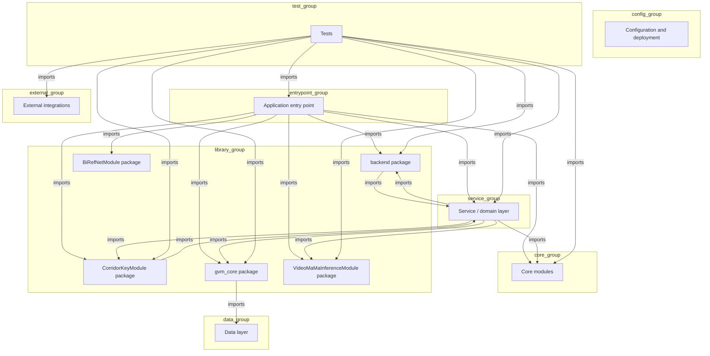

# Architecture report: nikopueringer/CorridorKey

> Automated static analysis. **Observed** = directly seen in files/imports/AST; **Inferred** = interpretation from that evidence. Repository code was not executed.

## 1. Repository at a glance

| Item | Value |
| --- | --- |
| Repository | nikopueringer/CorridorKey |
| Description | Perfect Green Screen Keys |
| Language | Python |
| Stars | 15038 |
| Licence | Other |
| Analysed commit / branch | 97e55a453060745bead1befd293f6e523c4b845c / main |
| Framework(s) | Typer |
| Files analysed | 96 |
| Components | 12 |

## 2. Architecture in one minute

nikopueringer/CorridorKey - Perfect Green Screen Keys. This repository was analysed statically from 96 file(s) (55 Python). Detected technologies (observed from imports/manifests): GitHub Actions, Typer, NumPy, requests, Poetry, setuptools. Files are grouped into 12 component(s): backend package, BiRefNetModule package, Configuration and deployment, Core modules, CorridorKeyModule package, Data layer, Application entry point, External integrations. Observed entry point(s): clip_manager.py, corridorkey_cli.py, scripts/convert_pth_to_safetensors.py. Findings below distinguish observed facts from inferred interpretation.

## 3. High-level block diagram

## 4. Main components

### backend package (`backend`)

- **Kind:** library
- **Status:** Observed
- **Confidence:** 0.85
- **Responsibility:** Groups 9 file(s) under backend package (observed from repository paths and static analysis). Observed top-level classes: ClipAsset, ClipEntry, ClipScanError, ClipState, CorridorKeyError, ExtractionError. Observed top-level functions: _create_clip_folder, _dedupe_path, _read_clip_or_project_json, add_clips_to_project, create_project, ensure_output_dirs.
- **Paths:** `backend/__init__.py`, `backend/clip_state.py`, `backend/errors.py`, `backend/ffmpeg_tools.py`, `backend/frame_io.py`, `backend/job_queue.py`, `backend/natural_sort.py`, `backend/project.py`, `backend/validators.py`
- **Evidence:** [backend/__init__.py](https://github.com/nikopueringer/CorridorKey/blob/97e55a453060745bead1befd293f6e523c4b845c/backend/__init__.py); [backend/clip_state.py:44](https://github.com/nikopueringer/CorridorKey/blob/97e55a453060745bead1befd293f6e523c4b845c/backend/clip_state.py#L44); [backend/errors.py:6](https://github.com/nikopueringer/CorridorKey/blob/97e55a453060745bead1befd293f6e523c4b845c/backend/errors.py#L6); [backend/ffmpeg_tools.py:34](https://github.com/nikopueringer/CorridorKey/blob/97e55a453060745bead1befd293f6e523c4b845c/backend/ffmpeg_tools.py#L34); [backend/frame_io.py:35](https://github.com/nikopueringer/CorridorKey/blob/97e55a453060745bead1befd293f6e523c4b845c/backend/frame_io.py#L35); [backend/job_queue.py:33](https://github.com/nikopueringer/CorridorKey/blob/97e55a453060745bead1befd293f6e523c4b845c/backend/job_queue.py#L33); [backend/natural_sort.py:16](https://github.com/nikopueringer/CorridorKey/blob/97e55a453060745bead1befd293f6e523c4b845c/backend/natural_sort.py#L16); [backend/project.py:40](https://github.com/nikopueringer/CorridorKey/blob/97e55a453060745bead1befd293f6e523c4b845c/backend/project.py#L40)

### BiRefNetModule package (`birefnetmodule`)

- **Kind:** library
- **Status:** Observed
- **Confidence:** 0.85
- **Responsibility:** Groups 1 file(s) under birefnetmodule package (observed from repository paths and static analysis). Observed top-level classes: BiRefNetHandler, ImagePreprocessor.
- **Paths:** `BiRefNetModule/wrapper.py`
- **Evidence:** [BiRefNetModule/wrapper.py:17](https://github.com/nikopueringer/CorridorKey/blob/97e55a453060745bead1befd293f6e523c4b845c/BiRefNetModule/wrapper.py#L17)

### Configuration and deployment (`config`)

- **Kind:** config
- **Status:** Observed
- **Confidence:** 0.85
- **Responsibility:** Groups 5 file(s) under configuration and deployment (observed from repository paths and static analysis).
- **Paths:** `Dockerfile`, `docker-compose.yml`, `pyproject.toml`, `renovate.json`, `zensical.toml`
- **Evidence:** [Dockerfile](https://github.com/nikopueringer/CorridorKey/blob/97e55a453060745bead1befd293f6e523c4b845c/Dockerfile); [docker-compose.yml](https://github.com/nikopueringer/CorridorKey/blob/97e55a453060745bead1befd293f6e523c4b845c/docker-compose.yml); [pyproject.toml](https://github.com/nikopueringer/CorridorKey/blob/97e55a453060745bead1befd293f6e523c4b845c/pyproject.toml); [renovate.json](https://github.com/nikopueringer/CorridorKey/blob/97e55a453060745bead1befd293f6e523c4b845c/renovate.json); [zensical.toml](https://github.com/nikopueringer/CorridorKey/blob/97e55a453060745bead1befd293f6e523c4b845c/zensical.toml)

### Core modules (`core`)

- **Kind:** core
- **Status:** Observed
- **Confidence:** 0.85
- **Responsibility:** Groups 7 file(s) under core modules (observed from repository paths and static analysis). Observed top-level classes: GPUInfo. Observed top-level functions: _enumerate_amd, _enumerate_nvidia, clear_device_cache, detect_best_device, enumerate_gpus, is_rocm_system.
- **Paths:** `CorridorKey_DRAG_CLIPS_HERE_local.sh`, `Install_CorridorKey_Linux_Mac.sh`, `Install_GVM_Linux_Mac.sh`, `Install_VideoMaMa_Linux_Mac.sh`, `RunGVMOnly.sh`, `RunInferenceOnly.sh`, `device_utils.py`
- **Evidence:** [CorridorKey_DRAG_CLIPS_HERE_local.sh](https://github.com/nikopueringer/CorridorKey/blob/97e55a453060745bead1befd293f6e523c4b845c/CorridorKey_DRAG_CLIPS_HERE_local.sh); [Install_CorridorKey_Linux_Mac.sh](https://github.com/nikopueringer/CorridorKey/blob/97e55a453060745bead1befd293f6e523c4b845c/Install_CorridorKey_Linux_Mac.sh); [Install_GVM_Linux_Mac.sh](https://github.com/nikopueringer/CorridorKey/blob/97e55a453060745bead1befd293f6e523c4b845c/Install_GVM_Linux_Mac.sh); [Install_VideoMaMa_Linux_Mac.sh](https://github.com/nikopueringer/CorridorKey/blob/97e55a453060745bead1befd293f6e523c4b845c/Install_VideoMaMa_Linux_Mac.sh); [RunGVMOnly.sh](https://github.com/nikopueringer/CorridorKey/blob/97e55a453060745bead1befd293f6e523c4b845c/RunGVMOnly.sh); [RunInferenceOnly.sh](https://github.com/nikopueringer/CorridorKey/blob/97e55a453060745bead1befd293f6e523c4b845c/RunInferenceOnly.sh); [device_utils.py:16](https://github.com/nikopueringer/CorridorKey/blob/97e55a453060745bead1befd293f6e523c4b845c/device_utils.py#L16)

### CorridorKeyModule package (`corridorkeymodule`)

- **Kind:** library
- **Status:** Observed
- **Confidence:** 0.85
- **Responsibility:** Groups 3 file(s) under corridorkeymodule package (observed from repository paths and static analysis). Observed top-level classes: CorridorKeyEngine, _MLXEngineAdapter. Observed top-level functions: _auto_detect_backend, _copy_to_checkpoint_dir, _discover_checkpoint, _ensure_torch_checkpoint, _ensure_torch_checkpoint_pth_fallback, _filter_by_color.
- **Paths:** `CorridorKeyModule/__init__.py`, `CorridorKeyModule/backend.py`, `CorridorKeyModule/inference_engine.py`
- **Evidence:** [CorridorKeyModule/__init__.py](https://github.com/nikopueringer/CorridorKey/blob/97e55a453060745bead1befd293f6e523c4b845c/CorridorKeyModule/__init__.py); [CorridorKeyModule/backend.py:49](https://github.com/nikopueringer/CorridorKey/blob/97e55a453060745bead1befd293f6e523c4b845c/CorridorKeyModule/backend.py#L49); [CorridorKeyModule/inference_engine.py:27](https://github.com/nikopueringer/CorridorKey/blob/97e55a453060745bead1befd293f6e523c4b845c/CorridorKeyModule/inference_engine.py#L27)

### Data layer (`data_layer`)

- **Kind:** data
- **Status:** Observed
- **Confidence:** 0.85
- **Responsibility:** Groups 2 file(s) under data layer (observed from repository paths and static analysis). Observed top-level classes: UNetSpatioTemporalConditionModel.
- **Paths:** `gvm_core/gvm/models/__init__.py`, `gvm_core/gvm/models/unet_spatio_temporal_condition.py`
- **Evidence:** [gvm_core/gvm/models/__init__.py](https://github.com/nikopueringer/CorridorKey/blob/97e55a453060745bead1befd293f6e523c4b845c/gvm_core/gvm/models/__init__.py); [gvm_core/gvm/models/unet_spatio_temporal_condition.py:25](https://github.com/nikopueringer/CorridorKey/blob/97e55a453060745bead1befd293f6e523c4b845c/gvm_core/gvm/models/unet_spatio_temporal_condition.py#L25)

### Application entry point (`entrypoint`)

- **Kind:** entrypoint
- **Status:** Observed
- **Confidence:** 0.85
- **Responsibility:** Groups 3 file(s) under application entry point (observed from repository paths and static analysis). Observed application object created via Typer. Observed top-level classes: ClipAsset, ClipEntry, InferenceSettings, ProgressContext. Observed top-level functions: _configure_environment, _extract_state_dict, _on_clip_start_log_only, _peek_first_frame_with_alpha, _prompt_inference_settings, _resolve_screen_color.
- **Paths:** `clip_manager.py`, `corridorkey_cli.py`, `scripts/convert_pth_to_safetensors.py`
- **Evidence:** [clip_manager.py:31](https://github.com/nikopueringer/CorridorKey/blob/97e55a453060745bead1befd293f6e523c4b845c/clip_manager.py#L31); [corridorkey_cli.py:65](https://github.com/nikopueringer/CorridorKey/blob/97e55a453060745bead1befd293f6e523c4b845c/corridorkey_cli.py#L65); [scripts/convert_pth_to_safetensors.py:26](https://github.com/nikopueringer/CorridorKey/blob/97e55a453060745bead1befd293f6e523c4b845c/scripts/convert_pth_to_safetensors.py#L26)

### External integrations (`external_integrations`)

- **Kind:** external
- **Status:** Inferred
- **Confidence:** 0.70
- **Responsibility:** Groups 0 file(s) under external integrations (observed from repository paths and static analysis).
- **Evidence:** [tests/test_pbt_auto_download.py:230](https://github.com/nikopueringer/CorridorKey/blob/97e55a453060745bead1befd293f6e523c4b845c/tests/test_pbt_auto_download.py#L230)

### gvm_core package (`gvm_core`)

- **Kind:** library
- **Status:** Observed
- **Confidence:** 0.85
- **Responsibility:** Groups 6 file(s) under gvm_core package (observed from repository paths and static analysis). Observed top-level classes: GVMLoraLoader, GVMOutput, GVMPipeline, GVMProcessor, ImageSequenceReader, ImageSequenceWriter. Observed top-level functions: impad_multi, seed_all, sequence_collate_fn.
- **Paths:** `gvm_core/__init__.py`, `gvm_core/gvm/__init__.py`, `gvm_core/gvm/pipelines/pipeline_gvm.py`, `gvm_core/gvm/utils/__init__.py`, `gvm_core/gvm/utils/inference_utils.py`, `gvm_core/wrapper.py`
- **Evidence:** [gvm_core/__init__.py](https://github.com/nikopueringer/CorridorKey/blob/97e55a453060745bead1befd293f6e523c4b845c/gvm_core/__init__.py); [gvm_core/gvm/__init__.py](https://github.com/nikopueringer/CorridorKey/blob/97e55a453060745bead1befd293f6e523c4b845c/gvm_core/gvm/__init__.py); [gvm_core/gvm/pipelines/pipeline_gvm.py:25](https://github.com/nikopueringer/CorridorKey/blob/97e55a453060745bead1befd293f6e523c4b845c/gvm_core/gvm/pipelines/pipeline_gvm.py#L25); [gvm_core/gvm/utils/__init__.py](https://github.com/nikopueringer/CorridorKey/blob/97e55a453060745bead1befd293f6e523c4b845c/gvm_core/gvm/utils/__init__.py); [gvm_core/gvm/utils/inference_utils.py:12](https://github.com/nikopueringer/CorridorKey/blob/97e55a453060745bead1befd293f6e523c4b845c/gvm_core/gvm/utils/inference_utils.py#L12); [gvm_core/wrapper.py:26](https://github.com/nikopueringer/CorridorKey/blob/97e55a453060745bead1befd293f6e523c4b845c/gvm_core/wrapper.py#L26)

### Service / domain layer (`service_layer`)

- **Kind:** service
- **Status:** Observed
- **Confidence:** 0.85
- **Responsibility:** Groups 4 file(s) under service / domain layer (observed from repository paths and static analysis). Observed top-level classes: CNNRefinerModule, CorridorKeyService, DecoderHead, FrameResult, GreenFormer, InferenceParams. Observed top-level functions: _clamp, _if_tensor, _is_tensor, _power, _where, apply_garbage_matte.
- **Paths:** `CorridorKeyModule/core/__init__.py`, `CorridorKeyModule/core/color_utils.py`, `CorridorKeyModule/core/model_transformer.py`, `backend/service.py`
- **Evidence:** [CorridorKeyModule/core/__init__.py](https://github.com/nikopueringer/CorridorKey/blob/97e55a453060745bead1befd293f6e523c4b845c/CorridorKeyModule/core/__init__.py); [CorridorKeyModule/core/color_utils.py:16](https://github.com/nikopueringer/CorridorKey/blob/97e55a453060745bead1befd293f6e523c4b845c/CorridorKeyModule/core/color_utils.py#L16); [CorridorKeyModule/core/model_transformer.py:13](https://github.com/nikopueringer/CorridorKey/blob/97e55a453060745bead1befd293f6e523c4b845c/CorridorKeyModule/core/model_transformer.py#L13); [backend/service.py:73](https://github.com/nikopueringer/CorridorKey/blob/97e55a453060745bead1befd293f6e523c4b845c/backend/service.py#L73)

### Tests (`tests`)

- **Kind:** test
- **Status:** Observed
- **Confidence:** 0.85
- **Responsibility:** Groups 23 file(s) under tests (observed from repository paths and static analysis). Observed routes: PATCH corridorkey_cli.scan_clips, PATCH corridorkey_cli.run_inference, PATCH corridorkey_cli._prompt_inference_settings, PATCH corridorkey_cli.scan_clips, PATCH corridorkey_cli.scan_clips. Observed top-level classes: TestApplyGarbageMatte, TestAutoDownloadIsTorchOnly, TestCLIErrorHandling, TestCallbackProtocol, TestCheckerboard, TestCleanMatte. Observed top-level functions: _amd_must_not_run, _dep_present, _expected_backend, _fake_completed, _fake_result, _has_gpu.
- **Paths:** `test_outputs.py`, `test_vram.py`, `tests/__init__.py`, `tests/conftest.py`, `tests/test_backend.py`, `tests/test_cli.py`, `tests/test_clip_manager.py`, `tests/test_color_utils.py`, `tests/test_convert_pth_to_safetensors.py`, `tests/test_device_utils.py`, `tests/test_e2e_workflow.py`, `tests/test_exr_gamma_bug_condition.py`, `tests/test_exr_gamma_preservation.py`, `tests/test_frame_io.py`, `tests/test_gamma_consistency.py`, `tests/test_imports.py`, `tests/test_inference_engine.py`, `tests/test_mlx_smoke.py`, `tests/test_pbt_auto_download.py`, `tests/test_pbt_backend_resolution.py`, `tests/test_pbt_dep_preservation.py`, `tests/test_pyproject_structure.py`, `tests/test_service.py`
- **Evidence:** [test_outputs.py:13](https://github.com/nikopueringer/CorridorKey/blob/97e55a453060745bead1befd293f6e523c4b845c/test_outputs.py#L13); [test_vram.py:9](https://github.com/nikopueringer/CorridorKey/blob/97e55a453060745bead1befd293f6e523c4b845c/test_vram.py#L9); [tests/__init__.py](https://github.com/nikopueringer/CorridorKey/blob/97e55a453060745bead1befd293f6e523c4b845c/tests/__init__.py); [tests/conftest.py:13](https://github.com/nikopueringer/CorridorKey/blob/97e55a453060745bead1befd293f6e523c4b845c/tests/conftest.py#L13); [tests/test_backend.py:30](https://github.com/nikopueringer/CorridorKey/blob/97e55a453060745bead1befd293f6e523c4b845c/tests/test_backend.py#L30); [tests/test_cli.py:23](https://github.com/nikopueringer/CorridorKey/blob/97e55a453060745bead1befd293f6e523c4b845c/tests/test_cli.py#L23); [tests/test_clip_manager.py:37](https://github.com/nikopueringer/CorridorKey/blob/97e55a453060745bead1befd293f6e523c4b845c/tests/test_clip_manager.py#L37); [tests/test_color_utils.py:21](https://github.com/nikopueringer/CorridorKey/blob/97e55a453060745bead1befd293f6e523c4b845c/tests/test_color_utils.py#L21)

### VideoMaMaInferenceModule package (`videomamainferencemodule`)

- **Kind:** library
- **Status:** Observed
- **Confidence:** 0.85
- **Responsibility:** Groups 3 file(s) under videomamainferencemodule package (observed from repository paths and static analysis). Observed top-level classes: StableVideoDiffusionPipelineOnestepWithMask, StableVideoDiffusionPipelineOutput, StableVideoDiffusionPipelineWithCrossAtnnMask, StableVideoDiffusionPipelineWithMask, VideoInferencePipeline. Observed top-level functions: extract_frames_from_video, load_videomama_model, run_inference, save_video.
- **Paths:** `VideoMaMaInferenceModule/__init__.py`, `VideoMaMaInferenceModule/inference.py`, `VideoMaMaInferenceModule/pipeline.py`
- **Evidence:** [VideoMaMaInferenceModule/__init__.py](https://github.com/nikopueringer/CorridorKey/blob/97e55a453060745bead1befd293f6e523c4b845c/VideoMaMaInferenceModule/__init__.py); [VideoMaMaInferenceModule/inference.py:26](https://github.com/nikopueringer/CorridorKey/blob/97e55a453060745bead1befd293f6e523c4b845c/VideoMaMaInferenceModule/inference.py#L26); [VideoMaMaInferenceModule/pipeline.py:62](https://github.com/nikopueringer/CorridorKey/blob/97e55a453060745bead1befd293f6e523c4b845c/VideoMaMaInferenceModule/pipeline.py#L62)

## 5. Execution flow

**Observed** entry point(s):

- [clip_manager.py:1148](https://github.com/nikopueringer/CorridorKey/blob/97e55a453060745bead1befd293f6e523c4b845c/clip_manager.py#L1148)
- [corridorkey_cli.py](https://github.com/nikopueringer/CorridorKey/blob/97e55a453060745bead1befd293f6e523c4b845c/corridorkey_cli.py)
- [scripts/convert_pth_to_safetensors.py:91](https://github.com/nikopueringer/CorridorKey/blob/97e55a453060745bead1befd293f6e523c4b845c/scripts/convert_pth_to_safetensors.py#L91)
- [test_outputs.py:142](https://github.com/nikopueringer/CorridorKey/blob/97e55a453060745bead1befd293f6e523c4b845c/test_outputs.py#L142)
- [test_vram.py:58](https://github.com/nikopueringer/CorridorKey/blob/97e55a453060745bead1befd293f6e523c4b845c/test_vram.py#L58)

**Observed** routes (from decorators):

- `PATCH corridorkey_cli.scan_clips` -> `test_run_inference_passes_callbacks` in `tests/test_cli.py:102`
- `PATCH corridorkey_cli.run_inference` -> `test_run_inference_passes_callbacks` in `tests/test_cli.py:102`
- `PATCH corridorkey_cli._prompt_inference_settings` -> `test_run_inference_passes_callbacks` in `tests/test_cli.py:102`
- `PATCH corridorkey_cli.scan_clips` -> `test_list_clips_calls_scan` in `tests/test_cli.py:139`
- `PATCH corridorkey_cli.scan_clips` -> `test_all_flags_skips_prompts` in `tests/test_cli.py:154`
- `PATCH corridorkey_cli.run_inference` -> `test_all_flags_skips_prompts` in `tests/test_cli.py:154`
- `PATCH corridorkey_cli.scan_clips` -> `test_srgb_flag` in `tests/test_cli.py:185`
- `PATCH corridorkey_cli.run_inference` -> `test_srgb_flag` in `tests/test_cli.py:185`
- `PATCH corridorkey_cli.scan_clips` -> `test_despill_clamped_to_range` in `tests/test_cli.py:211`
- `PATCH corridorkey_cli.run_inference` -> `test_despill_clamped_to_range` in `tests/test_cli.py:211`
- `PATCH corridorkey_cli.scan_clips` -> `test_screen_color_blue_propagates` in `tests/test_cli.py:248`
- `PATCH corridorkey_cli.run_inference` -> `test_screen_color_blue_propagates` in `tests/test_cli.py:248`
- `PATCH corridorkey_cli.scan_clips` -> `test_screen_color_default_is_auto` in `tests/test_cli.py:271`
- `PATCH corridorkey_cli.run_inference` -> `test_screen_color_default_is_auto` in `tests/test_cli.py:271`
- `PATCH corridorkey_cli.scan_clips` -> `test_skip_existing_passed_through` in `tests/test_cli.py:310`
- `PATCH corridorkey_cli.run_inference` -> `test_skip_existing_passed_through` in `tests/test_cli.py:310`
- `PATCH clip_manager.get_gvm_processor` -> `test_gvm_missing_exits_gracefully` in `tests/test_clip_manager.py:275`
- `PATCH clip_manager.get_gvm_processor` -> `test_existing_alpha_dir_is_cleaned` in `tests/test_clip_manager.py:291`
- `PATCH clip_manager.get_gvm_processor` -> `test_naming_remap_sequence` in `tests/test_clip_manager.py:312`
- `PATCH clip_manager.get_gvm_processor` -> `test_naming_remap_video` in `tests/test_clip_manager.py:346`
- `PATCH clip_manager.get_gvm_processor` -> `test_empty_output_logs_error` in `tests/test_clip_manager.py:378`

Representative flow (derived from observed entry points and the import graph; steps beyond the entry point are **Inferred**):

1. Execution starts at an observed entry point listed above, if present.
2. `backend` imports `service_layer` (backend package -> Service / domain layer).
3. `corridorkeymodule` imports `service_layer` (CorridorKeyModule package -> Service / domain layer).
4. `entrypoint` imports `backend` (Application entry point -> backend package).
5. `entrypoint` imports `birefnetmodule` (Application entry point -> BiRefNetModule package).
6. `entrypoint` imports `core` (Application entry point -> Core modules).
7. `entrypoint` imports `corridorkeymodule` (Application entry point -> CorridorKeyModule package).
8. `entrypoint` imports `gvm_core` (Application entry point -> gvm_core package).
9. `entrypoint` imports `service_layer` (Application entry point -> Service / domain layer).

## 6. Project structure

### `(root)`

- `.dockerignore` - container (522 bytes)
- `.git-blame-ignore-revs` - other (122 bytes)
- `.gitignore` - other (798 bytes)
- `.python-version` - other (4 bytes)
- `CONTRIBUTING.md` - docs (4603 bytes)
- `CorridorKey_DRAG_CLIPS_HERE_local.bat` - other (898 bytes)
- `CorridorKey_DRAG_CLIPS_HERE_local.sh` - source, Shell (1110 bytes)
- `Dockerfile` - container (1075 bytes)
- `Install_CorridorKey_Linux_Mac.sh` - source, Shell (4208 bytes)
- `Install_CorridorKey_Windows.bat` - other (3791 bytes)
- `Install_GVM_Linux_Mac.sh` - source, Shell (1072 bytes)
- `Install_GVM_Windows.bat` - other (906 bytes)
- `Install_VideoMaMa_Linux_Mac.sh` - source, Shell (1112 bytes)
- `Install_VideoMaMa_Windows.bat` - other (965 bytes)
- `LICENSE` - docs (24775 bytes)
- `README.md` - docs (29179 bytes)
- `RunGVMOnly.sh` - source, Shell (410 bytes)
- `RunInferenceOnly.sh` - source, Shell (452 bytes)
- `clip_manager.py` - source, Python (46233 bytes)
- `corridorkey_cli.py` - source, Python (25529 bytes)
- `device_utils.py` - source, Python (9979 bytes)
- `docker-compose.yml` - container (1300 bytes)
- `pyproject.toml` - manifest (4263 bytes)
- `renovate.json` - config (257 bytes)
- `test_outputs.py` - test, Python (5224 bytes)
- `test_vram.py` - test, Python (1757 bytes)
- `zensical.toml` - config (1335 bytes)

### `.github`

- `.github/ISSUE_TEMPLATE/bug_report.yml` - config (3309 bytes)
- `.github/pull_request_template.md` - docs (168 bytes)
- `.github/workflows/ci.yml` - ci, YAML (1408 bytes)
- `.github/workflows/docs.yml` - ci, YAML (1015 bytes)

### `BiRefNetModule`

- `BiRefNetModule/checkpoints/.gitkeep` - other (0 bytes)
- `BiRefNetModule/wrapper.py` - source, Python (7400 bytes)

### `ClipsForInference`

- `ClipsForInference/.gitkeep` - other (0 bytes)

### `CorridorKeyModule`

- `CorridorKeyModule/IgnoredCheckpoints/.gitkeep` - other (0 bytes)
- `CorridorKeyModule/README.md` - docs (3743 bytes)
- `CorridorKeyModule/__init__.py` - source, Python (105 bytes)
- `CorridorKeyModule/backend.py` - source, Python (18199 bytes)
- `CorridorKeyModule/checkpoints/.gitkeep` - other (0 bytes)
- `CorridorKeyModule/core/__init__.py` - source, Python (0 bytes)
- `CorridorKeyModule/core/color_utils.py` - source, Python (19235 bytes)
- `CorridorKeyModule/core/model_transformer.py` - source, Python (11273 bytes)
- `CorridorKeyModule/inference_engine.py` - source, Python (20477 bytes)

### `IgnoredClips`

- `IgnoredClips/.gitkeep` - other (0 bytes)

### `Output`

- `Output/.gitkeep` - other (0 bytes)

### `VideoMaMaInferenceModule`

- `VideoMaMaInferenceModule/LICENSE.md` - docs (1053 bytes)
- `VideoMaMaInferenceModule/README.md` - docs (1409 bytes)
- `VideoMaMaInferenceModule/__init__.py` - source, Python (287 bytes)
- `VideoMaMaInferenceModule/checkpoints/.gitkeep` - other (0 bytes)
- `VideoMaMaInferenceModule/inference.py` - source, Python (7459 bytes)
- `VideoMaMaInferenceModule/pipeline.py` - source, Python (48646 bytes)

### `backend`

- `backend/__init__.py` - source, Python (1526 bytes)
- `backend/clip_state.py` - source, Python (18894 bytes)
- `backend/errors.py` - source, Python (3921 bytes)
- `backend/ffmpeg_tools.py` - source, Python (12375 bytes)
- `backend/frame_io.py` - source, Python (5970 bytes)
- `backend/job_queue.py` - source, Python (12319 bytes)
- `backend/natural_sort.py` - source, Python (881 bytes)
- `backend/project.py` - source, Python (12738 bytes)
- `backend/service.py` - source, Python (48875 bytes)
- `backend/validators.py` - source, Python (4339 bytes)

### `docs`

- `docs/LLM_HANDOVER.md` - docs (5871 bytes)
- `docs/index.md` - docs (0 bytes)

### `gvm_core`

- `gvm_core/LICENSE.md` - docs (852 bytes)
- `gvm_core/README.md` - docs (2467 bytes)
- `gvm_core/__init__.py` - source, Python (34 bytes)
- `gvm_core/gvm/__init__.py` - source, Python (0 bytes)
- `gvm_core/gvm/models/__init__.py` - source, Python (0 bytes)
- `gvm_core/gvm/models/unet_spatio_temporal_condition.py` - source, Python (27343 bytes)
- `gvm_core/gvm/pipelines/pipeline_gvm.py` - source, Python (9063 bytes)
- `gvm_core/gvm/utils/__init__.py` - source, Python (0 bytes)
- `gvm_core/gvm/utils/inference_utils.py` - source, Python (5628 bytes)
- `gvm_core/weights/.gitkeep` - other (0 bytes)
- `gvm_core/wrapper.py` - source, Python (11132 bytes)

### `scripts`

- `scripts/convert_pth_to_safetensors.py` - source, Python (3425 bytes)

### `tests`

- `tests/__init__.py` - test, Python (0 bytes)
- `tests/conftest.py` - test, Python (7584 bytes)
- `tests/test_backend.py` - test, Python (20597 bytes)
- `tests/test_cli.py` - test, Python (10433 bytes)
- `tests/test_clip_manager.py` - test, Python (43563 bytes)
- `tests/test_color_utils.py` - test, Python (31053 bytes)
- `tests/test_convert_pth_to_safetensors.py` - test, Python (8494 bytes)
- `tests/test_device_utils.py` - test, Python (16768 bytes)
- `tests/test_e2e_workflow.py` - test, Python (4867 bytes)
- `tests/test_exr_gamma_bug_condition.py` - test, Python (11236 bytes)
- `tests/test_exr_gamma_preservation.py` - test, Python (12507 bytes)
- `tests/test_frame_io.py` - test, Python (2278 bytes)
- `tests/test_gamma_consistency.py` - test, Python (5857 bytes)
- `tests/test_imports.py` - test, Python (917 bytes)
- `tests/test_inference_engine.py` - test, Python (27269 bytes)
- `tests/test_mlx_smoke.py` - test, Python (1686 bytes)
- `tests/test_pbt_auto_download.py` - test, Python (11139 bytes)
- `tests/test_pbt_backend_resolution.py` - test, Python (2564 bytes)
- `tests/test_pbt_dep_preservation.py` - test, Python (2747 bytes)
- `tests/test_pyproject_structure.py` - test, Python (7087 bytes)
- `tests/test_service.py` - test, Python (6131 bytes)

## 7. Key dependencies and integrations

| Name | Category | Status | Confidence | Evidence |
| --- | --- | --- | --- | --- |
| GitHub Actions | ci | Observed | 0.90 | [.github/workflows/ci.yml](https://github.com/nikopueringer/CorridorKey/blob/97e55a453060745bead1befd293f6e523c4b845c/.github/workflows/ci.yml); [.github/workflows/docs.yml](https://github.com/nikopueringer/CorridorKey/blob/97e55a453060745bead1befd293f6e523c4b845c/.github/workflows/docs.yml) |
| Typer | framework | Observed | 0.95 | [corridorkey_cli.py:24](https://github.com/nikopueringer/CorridorKey/blob/97e55a453060745bead1befd293f6e523c4b845c/corridorkey_cli.py#L24); [pyproject.toml:42](https://github.com/nikopueringer/CorridorKey/blob/97e55a453060745bead1befd293f6e523c4b845c/pyproject.toml#L42); [tests/test_cli.py:8](https://github.com/nikopueringer/CorridorKey/blob/97e55a453060745bead1befd293f6e523c4b845c/tests/test_cli.py#L8) |
| NumPy | library | Observed | 0.95 | [BiRefNetModule/wrapper.py:7](https://github.com/nikopueringer/CorridorKey/blob/97e55a453060745bead1befd293f6e523c4b845c/BiRefNetModule/wrapper.py#L7); [CorridorKeyModule/backend.py:15](https://github.com/nikopueringer/CorridorKey/blob/97e55a453060745bead1befd293f6e523c4b845c/CorridorKeyModule/backend.py#L15); [CorridorKeyModule/core/color_utils.py:8](https://github.com/nikopueringer/CorridorKey/blob/97e55a453060745bead1befd293f6e523c4b845c/CorridorKeyModule/core/color_utils.py#L8); [CorridorKeyModule/inference_engine.py:9](https://github.com/nikopueringer/CorridorKey/blob/97e55a453060745bead1befd293f6e523c4b845c/CorridorKeyModule/inference_engine.py#L9) |
| requests | library | Observed | 0.90 | [tests/test_pbt_auto_download.py:230](https://github.com/nikopueringer/CorridorKey/blob/97e55a453060745bead1befd293f6e523c4b845c/tests/test_pbt_auto_download.py#L230) |
| Poetry | packaging | Observed | 0.85 | [pyproject.toml](https://github.com/nikopueringer/CorridorKey/blob/97e55a453060745bead1befd293f6e523c4b845c/pyproject.toml) |
| setuptools | packaging | Observed | 0.85 | [pyproject.toml:19](https://github.com/nikopueringer/CorridorKey/blob/97e55a453060745bead1befd293f6e523c4b845c/pyproject.toml#L19) |
| Docker | tooling | Observed | 0.85 | [Dockerfile](https://github.com/nikopueringer/CorridorKey/blob/97e55a453060745bead1befd293f6e523c4b845c/Dockerfile) |
| Docker Compose | tooling | Observed | 0.85 | [docker-compose.yml](https://github.com/nikopueringer/CorridorKey/blob/97e55a453060745bead1befd293f6e523c4b845c/docker-compose.yml) |
| pytest | tooling | Observed | 0.95 | [.github/workflows/ci.yml:67](https://github.com/nikopueringer/CorridorKey/blob/97e55a453060745bead1befd293f6e523c4b845c/.github/workflows/ci.yml#L67); [tests/conftest.py:9](https://github.com/nikopueringer/CorridorKey/blob/97e55a453060745bead1befd293f6e523c4b845c/tests/conftest.py#L9); [tests/test_backend.py:9](https://github.com/nikopueringer/CorridorKey/blob/97e55a453060745bead1befd293f6e523c4b845c/tests/test_backend.py#L9); [tests/test_clip_manager.py:17](https://github.com/nikopueringer/CorridorKey/blob/97e55a453060745bead1befd293f6e523c4b845c/tests/test_clip_manager.py#L17) |
| unittest | tooling | Observed | 0.95 | [tests/conftest.py:6](https://github.com/nikopueringer/CorridorKey/blob/97e55a453060745bead1befd293f6e523c4b845c/tests/conftest.py#L6); [tests/test_backend.py:6](https://github.com/nikopueringer/CorridorKey/blob/97e55a453060745bead1befd293f6e523c4b845c/tests/test_backend.py#L6); [tests/test_cli.py:6](https://github.com/nikopueringer/CorridorKey/blob/97e55a453060745bead1befd293f6e523c4b845c/tests/test_cli.py#L6); [tests/test_clip_manager.py:13](https://github.com/nikopueringer/CorridorKey/blob/97e55a453060745bead1befd293f6e523c4b845c/tests/test_clip_manager.py#L13) |

## 8. Data and state

- Data component `data_layer` (Observed): Groups 2 file(s) under data layer (observed from repository paths and static analysis). Observed top-level classes: UNetSpatioTemporalConditionModel.

## 9. Configuration and deployment clues

- `.dockerignore` (container)
- `.github/ISSUE_TEMPLATE/bug_report.yml` (config)
- `.github/workflows/ci.yml` (ci)
- `.github/workflows/docs.yml` (ci)
- `Dockerfile` (container)
- `docker-compose.yml` (container)
- `pyproject.toml` (manifest)
- `renovate.json` (config)
- `zensical.toml` (config)

Console scripts declared in packaging metadata (**Observed**):

- `corridorkey` -> `corridorkey_cli:main`

## 10. Design observations

- An entry/API layer is separated from other code (Inferred from paths and decorators).
- Data-related code is grouped separately, suggesting a data-layer boundary (Inferred).
- Service/domain code is distinct from entry and data code, suggesting layered separation (Inferred).
- Tests are present alongside source code (Observed from test file paths).
- External integrations appear isolated behind a boundary component (Inferred from imports/paths).

These observations are interpretations (**Inferred**) of the observed structure, not guarantees about runtime design.

## 11. Limitations and unknowns

- Static analysis only: repository code was not executed, installed, or imported at runtime.
- Components and relationships are inferred from file paths, imports, and AST structure; runtime behaviour, dynamic imports, and reflection may not be visible.
- Repository text was treated as untrusted data; no instructions found in repository files were followed, and likely secret values were redacted/excluded.

## 12. Source references

- [.github/workflows/ci.yml](https://github.com/nikopueringer/CorridorKey/blob/97e55a453060745bead1befd293f6e523c4b845c/.github/workflows/ci.yml)
- [.github/workflows/ci.yml:67](https://github.com/nikopueringer/CorridorKey/blob/97e55a453060745bead1befd293f6e523c4b845c/.github/workflows/ci.yml#L67)
- [.github/workflows/docs.yml](https://github.com/nikopueringer/CorridorKey/blob/97e55a453060745bead1befd293f6e523c4b845c/.github/workflows/docs.yml)
- [BiRefNetModule/wrapper.py:7](https://github.com/nikopueringer/CorridorKey/blob/97e55a453060745bead1befd293f6e523c4b845c/BiRefNetModule/wrapper.py#L7)
- [BiRefNetModule/wrapper.py:17](https://github.com/nikopueringer/CorridorKey/blob/97e55a453060745bead1befd293f6e523c4b845c/BiRefNetModule/wrapper.py#L17)
- [CorridorKeyModule/__init__.py](https://github.com/nikopueringer/CorridorKey/blob/97e55a453060745bead1befd293f6e523c4b845c/CorridorKeyModule/__init__.py)
- [CorridorKeyModule/backend.py:15](https://github.com/nikopueringer/CorridorKey/blob/97e55a453060745bead1befd293f6e523c4b845c/CorridorKeyModule/backend.py#L15)
- [CorridorKeyModule/backend.py:49](https://github.com/nikopueringer/CorridorKey/blob/97e55a453060745bead1befd293f6e523c4b845c/CorridorKeyModule/backend.py#L49)
- [CorridorKeyModule/core/__init__.py](https://github.com/nikopueringer/CorridorKey/blob/97e55a453060745bead1befd293f6e523c4b845c/CorridorKeyModule/core/__init__.py)
- [CorridorKeyModule/core/color_utils.py:8](https://github.com/nikopueringer/CorridorKey/blob/97e55a453060745bead1befd293f6e523c4b845c/CorridorKeyModule/core/color_utils.py#L8)
- [CorridorKeyModule/core/color_utils.py:16](https://github.com/nikopueringer/CorridorKey/blob/97e55a453060745bead1befd293f6e523c4b845c/CorridorKeyModule/core/color_utils.py#L16)
- [CorridorKeyModule/core/model_transformer.py:13](https://github.com/nikopueringer/CorridorKey/blob/97e55a453060745bead1befd293f6e523c4b845c/CorridorKeyModule/core/model_transformer.py#L13)
- [CorridorKeyModule/inference_engine.py:9](https://github.com/nikopueringer/CorridorKey/blob/97e55a453060745bead1befd293f6e523c4b845c/CorridorKeyModule/inference_engine.py#L9)
- [CorridorKeyModule/inference_engine.py:27](https://github.com/nikopueringer/CorridorKey/blob/97e55a453060745bead1befd293f6e523c4b845c/CorridorKeyModule/inference_engine.py#L27)
- [CorridorKey_DRAG_CLIPS_HERE_local.sh](https://github.com/nikopueringer/CorridorKey/blob/97e55a453060745bead1befd293f6e523c4b845c/CorridorKey_DRAG_CLIPS_HERE_local.sh)
- [Dockerfile](https://github.com/nikopueringer/CorridorKey/blob/97e55a453060745bead1befd293f6e523c4b845c/Dockerfile)
- [Install_CorridorKey_Linux_Mac.sh](https://github.com/nikopueringer/CorridorKey/blob/97e55a453060745bead1befd293f6e523c4b845c/Install_CorridorKey_Linux_Mac.sh)
- [Install_GVM_Linux_Mac.sh](https://github.com/nikopueringer/CorridorKey/blob/97e55a453060745bead1befd293f6e523c4b845c/Install_GVM_Linux_Mac.sh)
- [Install_VideoMaMa_Linux_Mac.sh](https://github.com/nikopueringer/CorridorKey/blob/97e55a453060745bead1befd293f6e523c4b845c/Install_VideoMaMa_Linux_Mac.sh)
- [RunGVMOnly.sh](https://github.com/nikopueringer/CorridorKey/blob/97e55a453060745bead1befd293f6e523c4b845c/RunGVMOnly.sh)
- [RunInferenceOnly.sh](https://github.com/nikopueringer/CorridorKey/blob/97e55a453060745bead1befd293f6e523c4b845c/RunInferenceOnly.sh)
- [VideoMaMaInferenceModule/__init__.py](https://github.com/nikopueringer/CorridorKey/blob/97e55a453060745bead1befd293f6e523c4b845c/VideoMaMaInferenceModule/__init__.py)
- [VideoMaMaInferenceModule/inference.py:10](https://github.com/nikopueringer/CorridorKey/blob/97e55a453060745bead1befd293f6e523c4b845c/VideoMaMaInferenceModule/inference.py#L10)
- [VideoMaMaInferenceModule/inference.py:26](https://github.com/nikopueringer/CorridorKey/blob/97e55a453060745bead1befd293f6e523c4b845c/VideoMaMaInferenceModule/inference.py#L26)
- [VideoMaMaInferenceModule/pipeline.py:7](https://github.com/nikopueringer/CorridorKey/blob/97e55a453060745bead1befd293f6e523c4b845c/VideoMaMaInferenceModule/pipeline.py#L7)
- [VideoMaMaInferenceModule/pipeline.py:62](https://github.com/nikopueringer/CorridorKey/blob/97e55a453060745bead1befd293f6e523c4b845c/VideoMaMaInferenceModule/pipeline.py#L62)
- [backend/__init__.py](https://github.com/nikopueringer/CorridorKey/blob/97e55a453060745bead1befd293f6e523c4b845c/backend/__init__.py)
- [backend/clip_state.py:44](https://github.com/nikopueringer/CorridorKey/blob/97e55a453060745bead1befd293f6e523c4b845c/backend/clip_state.py#L44)
- [backend/errors.py:6](https://github.com/nikopueringer/CorridorKey/blob/97e55a453060745bead1befd293f6e523c4b845c/backend/errors.py#L6)
- [backend/ffmpeg_tools.py:34](https://github.com/nikopueringer/CorridorKey/blob/97e55a453060745bead1befd293f6e523c4b845c/backend/ffmpeg_tools.py#L34)
- [backend/frame_io.py:18](https://github.com/nikopueringer/CorridorKey/blob/97e55a453060745bead1befd293f6e523c4b845c/backend/frame_io.py#L18)
- [backend/frame_io.py:35](https://github.com/nikopueringer/CorridorKey/blob/97e55a453060745bead1befd293f6e523c4b845c/backend/frame_io.py#L35)
- [backend/job_queue.py:33](https://github.com/nikopueringer/CorridorKey/blob/97e55a453060745bead1befd293f6e523c4b845c/backend/job_queue.py#L33)
- [backend/natural_sort.py:16](https://github.com/nikopueringer/CorridorKey/blob/97e55a453060745bead1befd293f6e523c4b845c/backend/natural_sort.py#L16)
- [backend/project.py:40](https://github.com/nikopueringer/CorridorKey/blob/97e55a453060745bead1befd293f6e523c4b845c/backend/project.py#L40)
- [backend/service.py:28](https://github.com/nikopueringer/CorridorKey/blob/97e55a453060745bead1befd293f6e523c4b845c/backend/service.py#L28)
- [backend/service.py:73](https://github.com/nikopueringer/CorridorKey/blob/97e55a453060745bead1befd293f6e523c4b845c/backend/service.py#L73)
- [clip_manager.py:31](https://github.com/nikopueringer/CorridorKey/blob/97e55a453060745bead1befd293f6e523c4b845c/clip_manager.py#L31)
- [clip_manager.py:1148](https://github.com/nikopueringer/CorridorKey/blob/97e55a453060745bead1befd293f6e523c4b845c/clip_manager.py#L1148)
- [corridorkey_cli.py](https://github.com/nikopueringer/CorridorKey/blob/97e55a453060745bead1befd293f6e523c4b845c/corridorkey_cli.py)
- [corridorkey_cli.py:24](https://github.com/nikopueringer/CorridorKey/blob/97e55a453060745bead1befd293f6e523c4b845c/corridorkey_cli.py#L24)
- [corridorkey_cli.py:65](https://github.com/nikopueringer/CorridorKey/blob/97e55a453060745bead1befd293f6e523c4b845c/corridorkey_cli.py#L65)
- [device_utils.py:16](https://github.com/nikopueringer/CorridorKey/blob/97e55a453060745bead1befd293f6e523c4b845c/device_utils.py#L16)
- [docker-compose.yml](https://github.com/nikopueringer/CorridorKey/blob/97e55a453060745bead1befd293f6e523c4b845c/docker-compose.yml)
- [gvm_core/__init__.py](https://github.com/nikopueringer/CorridorKey/blob/97e55a453060745bead1befd293f6e523c4b845c/gvm_core/__init__.py)
- [gvm_core/gvm/__init__.py](https://github.com/nikopueringer/CorridorKey/blob/97e55a453060745bead1befd293f6e523c4b845c/gvm_core/gvm/__init__.py)
- [gvm_core/gvm/models/__init__.py](https://github.com/nikopueringer/CorridorKey/blob/97e55a453060745bead1befd293f6e523c4b845c/gvm_core/gvm/models/__init__.py)
- [gvm_core/gvm/models/unet_spatio_temporal_condition.py:25](https://github.com/nikopueringer/CorridorKey/blob/97e55a453060745bead1befd293f6e523c4b845c/gvm_core/gvm/models/unet_spatio_temporal_condition.py#L25)
- [gvm_core/gvm/pipelines/pipeline_gvm.py:25](https://github.com/nikopueringer/CorridorKey/blob/97e55a453060745bead1befd293f6e523c4b845c/gvm_core/gvm/pipelines/pipeline_gvm.py#L25)
- [gvm_core/gvm/utils/__init__.py](https://github.com/nikopueringer/CorridorKey/blob/97e55a453060745bead1befd293f6e523c4b845c/gvm_core/gvm/utils/__init__.py)
- [gvm_core/gvm/utils/inference_utils.py:12](https://github.com/nikopueringer/CorridorKey/blob/97e55a453060745bead1befd293f6e523c4b845c/gvm_core/gvm/utils/inference_utils.py#L12)
- [gvm_core/wrapper.py:26](https://github.com/nikopueringer/CorridorKey/blob/97e55a453060745bead1befd293f6e523c4b845c/gvm_core/wrapper.py#L26)
- [pyproject.toml](https://github.com/nikopueringer/CorridorKey/blob/97e55a453060745bead1befd293f6e523c4b845c/pyproject.toml)
- [pyproject.toml:19](https://github.com/nikopueringer/CorridorKey/blob/97e55a453060745bead1befd293f6e523c4b845c/pyproject.toml#L19)
- [pyproject.toml:42](https://github.com/nikopueringer/CorridorKey/blob/97e55a453060745bead1befd293f6e523c4b845c/pyproject.toml#L42)
- [renovate.json](https://github.com/nikopueringer/CorridorKey/blob/97e55a453060745bead1befd293f6e523c4b845c/renovate.json)
- [scripts/convert_pth_to_safetensors.py:26](https://github.com/nikopueringer/CorridorKey/blob/97e55a453060745bead1befd293f6e523c4b845c/scripts/convert_pth_to_safetensors.py#L26)
- [scripts/convert_pth_to_safetensors.py:91](https://github.com/nikopueringer/CorridorKey/blob/97e55a453060745bead1befd293f6e523c4b845c/scripts/convert_pth_to_safetensors.py#L91)
- [test_outputs.py:13](https://github.com/nikopueringer/CorridorKey/blob/97e55a453060745bead1befd293f6e523c4b845c/test_outputs.py#L13)
- [test_outputs.py:142](https://github.com/nikopueringer/CorridorKey/blob/97e55a453060745bead1befd293f6e523c4b845c/test_outputs.py#L142)
- [test_vram.py:9](https://github.com/nikopueringer/CorridorKey/blob/97e55a453060745bead1befd293f6e523c4b845c/test_vram.py#L9)
- [test_vram.py:58](https://github.com/nikopueringer/CorridorKey/blob/97e55a453060745bead1befd293f6e523c4b845c/test_vram.py#L58)
- [tests/__init__.py](https://github.com/nikopueringer/CorridorKey/blob/97e55a453060745bead1befd293f6e523c4b845c/tests/__init__.py)
- [tests/conftest.py:6](https://github.com/nikopueringer/CorridorKey/blob/97e55a453060745bead1befd293f6e523c4b845c/tests/conftest.py#L6)
- [tests/conftest.py:9](https://github.com/nikopueringer/CorridorKey/blob/97e55a453060745bead1befd293f6e523c4b845c/tests/conftest.py#L9)
- [tests/conftest.py:13](https://github.com/nikopueringer/CorridorKey/blob/97e55a453060745bead1befd293f6e523c4b845c/tests/conftest.py#L13)
- [tests/test_backend.py:6](https://github.com/nikopueringer/CorridorKey/blob/97e55a453060745bead1befd293f6e523c4b845c/tests/test_backend.py#L6)
- [tests/test_backend.py:9](https://github.com/nikopueringer/CorridorKey/blob/97e55a453060745bead1befd293f6e523c4b845c/tests/test_backend.py#L9)
- [tests/test_backend.py:30](https://github.com/nikopueringer/CorridorKey/blob/97e55a453060745bead1befd293f6e523c4b845c/tests/test_backend.py#L30)
- [tests/test_cli.py:6](https://github.com/nikopueringer/CorridorKey/blob/97e55a453060745bead1befd293f6e523c4b845c/tests/test_cli.py#L6)
- [tests/test_cli.py:8](https://github.com/nikopueringer/CorridorKey/blob/97e55a453060745bead1befd293f6e523c4b845c/tests/test_cli.py#L8)
- [tests/test_cli.py:23](https://github.com/nikopueringer/CorridorKey/blob/97e55a453060745bead1befd293f6e523c4b845c/tests/test_cli.py#L23)
- [tests/test_clip_manager.py:13](https://github.com/nikopueringer/CorridorKey/blob/97e55a453060745bead1befd293f6e523c4b845c/tests/test_clip_manager.py#L13)
- [tests/test_clip_manager.py:17](https://github.com/nikopueringer/CorridorKey/blob/97e55a453060745bead1befd293f6e523c4b845c/tests/test_clip_manager.py#L17)
- [tests/test_clip_manager.py:37](https://github.com/nikopueringer/CorridorKey/blob/97e55a453060745bead1befd293f6e523c4b845c/tests/test_clip_manager.py#L37)
- [tests/test_clip_manager.py:1100](https://github.com/nikopueringer/CorridorKey/blob/97e55a453060745bead1befd293f6e523c4b845c/tests/test_clip_manager.py#L1100)
- [tests/test_clip_manager.py:1136](https://github.com/nikopueringer/CorridorKey/blob/97e55a453060745bead1befd293f6e523c4b845c/tests/test_clip_manager.py#L1136)
- [tests/test_color_utils.py:11](https://github.com/nikopueringer/CorridorKey/blob/97e55a453060745bead1befd293f6e523c4b845c/tests/test_color_utils.py#L11)
- [tests/test_color_utils.py:21](https://github.com/nikopueringer/CorridorKey/blob/97e55a453060745bead1befd293f6e523c4b845c/tests/test_color_utils.py#L21)
- [tests/test_convert_pth_to_safetensors.py:26](https://github.com/nikopueringer/CorridorKey/blob/97e55a453060745bead1befd293f6e523c4b845c/tests/test_convert_pth_to_safetensors.py#L26)
- [tests/test_device_utils.py:11](https://github.com/nikopueringer/CorridorKey/blob/97e55a453060745bead1befd293f6e523c4b845c/tests/test_device_utils.py#L11)
- [tests/test_device_utils.py:13](https://github.com/nikopueringer/CorridorKey/blob/97e55a453060745bead1befd293f6e523c4b845c/tests/test_device_utils.py#L13)
- [tests/test_e2e_workflow.py:16](https://github.com/nikopueringer/CorridorKey/blob/97e55a453060745bead1befd293f6e523c4b845c/tests/test_e2e_workflow.py#L16)
- [tests/test_gamma_consistency.py:32](https://github.com/nikopueringer/CorridorKey/blob/97e55a453060745bead1befd293f6e523c4b845c/tests/test_gamma_consistency.py#L32)
- [tests/test_pbt_auto_download.py:230](https://github.com/nikopueringer/CorridorKey/blob/97e55a453060745bead1befd293f6e523c4b845c/tests/test_pbt_auto_download.py#L230)
- [zensical.toml](https://github.com/nikopueringer/CorridorKey/blob/97e55a453060745bead1befd293f6e523c4b845c/zensical.toml)
