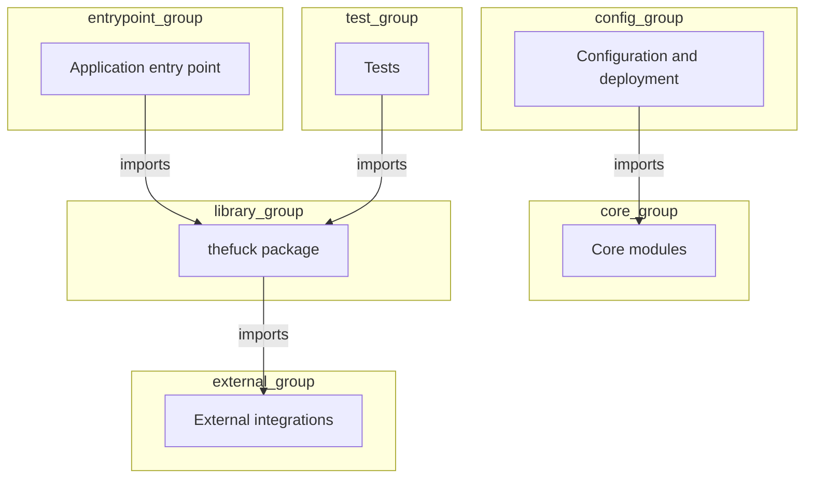

# Architecture report: nvbn/thefuck

> Automated static analysis. **Observed** = directly seen in files/imports/AST; **Inferred** = interpretation from that evidence. Repository code was not executed.

## 1. Repository at a glance

| Item | Value |
| --- | --- |
| Repository | nvbn/thefuck |
| Description | Magnificent app which corrects your previous console command. |
| Language | Python |
| Stars | 97954 |
| Licence | MIT |
| Analysed commit / branch | c7e7e1d884d3bb241ea6448f72a989434c2a35ec / master |
| Framework(s) | None detected |
| Files analysed | 434 |
| Components | 6 |

## 2. Architecture in one minute

nvbn/thefuck - Magnificent app which corrects your previous console command.. This repository was analysed statically from 434 file(s) (416 Python). Detected technologies (observed from imports/manifests): GitHub Actions, setuptools, Docker, pytest. Files are grouped into 6 component(s): Configuration and deployment, Core modules, Application entry point, External integrations, Tests, thefuck package. Observed entry point(s): thefuck/entrypoints/main.py, thefuck/entrypoints/not_configured.py. Findings below distinguish observed facts from inferred interpretation.

## 3. High-level block diagram

## 4. Main components

### Configuration and deployment (`config`)

- **Kind:** config
- **Status:** Observed
- **Confidence:** 0.85
- **Responsibility:** Groups 7 file(s) under configuration and deployment (observed from repository paths and static analysis).
- **Paths:** `MANIFEST.in`, `requirements.txt`, `setup.cfg`, `setup.py`, `snapcraft.yaml`, `tests/Dockerfile`, `tox.ini`
- **Evidence:** [MANIFEST.in](https://github.com/nvbn/thefuck/blob/c7e7e1d884d3bb241ea6448f72a989434c2a35ec/MANIFEST.in); [requirements.txt](https://github.com/nvbn/thefuck/blob/c7e7e1d884d3bb241ea6448f72a989434c2a35ec/requirements.txt); [setup.cfg](https://github.com/nvbn/thefuck/blob/c7e7e1d884d3bb241ea6448f72a989434c2a35ec/setup.cfg); [setup.py](https://github.com/nvbn/thefuck/blob/c7e7e1d884d3bb241ea6448f72a989434c2a35ec/setup.py); [snapcraft.yaml](https://github.com/nvbn/thefuck/blob/c7e7e1d884d3bb241ea6448f72a989434c2a35ec/snapcraft.yaml); [tests/Dockerfile](https://github.com/nvbn/thefuck/blob/c7e7e1d884d3bb241ea6448f72a989434c2a35ec/tests/Dockerfile); [tox.ini](https://github.com/nvbn/thefuck/blob/c7e7e1d884d3bb241ea6448f72a989434c2a35ec/tox.ini)

### Core modules (`core`)

- **Kind:** core
- **Status:** Observed
- **Confidence:** 0.85
- **Responsibility:** Groups 3 file(s) under core modules (observed from repository paths and static analysis). Observed top-level functions: get_args, get_new_setup_py_lines, main.
- **Paths:** `fastentrypoints.py`, `install.sh`, `release.py`
- **Evidence:** [fastentrypoints.py:55](https://github.com/nvbn/thefuck/blob/c7e7e1d884d3bb241ea6448f72a989434c2a35ec/fastentrypoints.py#L55); [install.sh](https://github.com/nvbn/thefuck/blob/c7e7e1d884d3bb241ea6448f72a989434c2a35ec/install.sh); [release.py:10](https://github.com/nvbn/thefuck/blob/c7e7e1d884d3bb241ea6448f72a989434c2a35ec/release.py#L10)

### Application entry point (`entrypoint`)

- **Kind:** entrypoint
- **Status:** Observed
- **Confidence:** 0.85
- **Responsibility:** Groups 1 file(s) under application entry point (observed from repository paths and static analysis). Observed top-level functions: main.
- **Paths:** `thefuck/entrypoints/main.py`
- **Evidence:** [thefuck/entrypoints/main.py:16](https://github.com/nvbn/thefuck/blob/c7e7e1d884d3bb241ea6448f72a989434c2a35ec/thefuck/entrypoints/main.py#L16)

### External integrations (`external_integrations`)

- **Kind:** external
- **Status:** Inferred
- **Confidence:** 0.70
- **Responsibility:** Groups 0 file(s) under external integrations (observed from repository paths and static analysis).
- **Evidence:** [thefuck/output_readers/shell_logger.py:3](https://github.com/nvbn/thefuck/blob/c7e7e1d884d3bb241ea6448f72a989434c2a35ec/thefuck/output_readers/shell_logger.py#L3)

### Tests (`tests`)

- **Kind:** test
- **Status:** Observed
- **Confidence:** 0.85
- **Responsibility:** Groups 203 file(s) under tests (observed from repository paths and static analysis). Observed application object created via Command. Observed routes: PATCH thefuck.output_readers.rerun._wait_output, PATCH thefuck.output_readers.rerun.Popen, PATCH thefuck.output_readers.rerun.Popen, PATCH thefuck.output_readers.rerun._wait_output, PATCH thefuck.output_readers.rerun._kill_process. Observed top-level classes: CorrectedCommand, Rule, TestBash, TestCache, TestCommand, TestCorrectedCommand. Observed top-level functions: Popen, _args, _assert_tracker_updated, _change_tracker, _set_confirmation, all…
- **Paths:** `tests/__init__.py`, `tests/conftest.py`, `tests/entrypoints/__init__.py`, `tests/entrypoints/test_alias.py`, `tests/entrypoints/test_fix_command.py`, `tests/entrypoints/test_not_configured.py`, `tests/functional/__init__.py`, `tests/functional/conftest.py`, `tests/functional/plots.py`, `tests/functional/test_bash.py`, `tests/functional/test_fish.py`, `tests/functional/test_tcsh.py`, `tests/functional/test_zsh.py`, `tests/output_readers/test_rerun.py`, `tests/rules/__init__.py`, `tests/rules/test_adb_unknown_command.py`, `tests/rules/test_ag_literal.py`, `tests/rules/test_apt_get.py`, `tests/rules/test_apt_get_search.py`, `tests/rules/test_apt_invalid_operation.py`, `tests/rules/test_apt_list_upgradable.py`, `tests/rules/test_apt_upgrade.py`, `tests/rules/test_aws_cli.py`, `tests/rules/test_az_cli.py`, `tests/rules/test_brew_cask_dependency.py`, `tests/rules/test_brew_install.py`, `tests/rules/test_brew_link.py`, `tests/rules/test_brew_reinstall.py`, `tests/rules/test_brew_uninstall.py`, `tests/rules/test_brew_unknown_command.py`, `tests/rules/test_brew_update_formula.py`, `tests/rules/test_cargo_no_command.py`, `tests/rules/test_cat_dir.py`, `tests/rules/test_cd_correction.py`, `tests/rules/test_cd_cs.py`, `tests/rules/test_cd_mkdir.py`, `tests/rules/test_cd_parent.py`, `tests/rules/test_chmod_x.py`, `tests/rules/test_choco_install.py`, `tests/rules/test_composer_not_command.py`, `tests/rules/test_conda_mistype.py`, `tests/rules/test_cp_create_destination.py`, `tests/rules/test_cp_omitting_directory.py`, `tests/rules/test_dirty_untar.py`, `tests/rules/test_dirty_unzip.py`, `tests/rules/test_django_south_ghost.py`, `tests/rules/test_django_south_merge.py`, `tests/rules/test_dnf_no_such_command.py`, `tests/rules/test_docker_image_being_used_by_container.py`, `tests/rules/test_docker_login.py`, `tests/rules/test_docker_not_command.py`, `tests/rules/test_dry.py`, `tests/rules/test_fab_command_not_found.py`, `tests/rules/test_fix_alt_space.py`, `tests/rules/test_fix_file.py`, `tests/rules/test_gem_unknown_command.py`, `tests/rules/test_git_add.py`, `tests/rules/test_git_add_force.py`, `tests/rules/test_git_bisect_usage.py`, `tests/rules/test_git_branch_0flag.py`, `tests/rules/test_git_branch_delete.py`, `tests/rules/test_git_branch_delete_checked_out.py`, `tests/rules/test_git_branch_exists.py`, `tests/rules/test_git_branch_list.py`, `tests/rules/test_git_checkout.py`, `tests/rules/test_git_clone_git_clone.py`, `tests/rules/test_git_clone_missing.py`, `tests/rules/test_git_commit_add.py`, `tests/rules/test_git_commit_amend.py`, `tests/rules/test_git_commit_reset.py`, `tests/rules/test_git_diff_no_index.py`, `tests/rules/test_git_diff_staged.py`, `tests/rules/test_git_fix_stash.py`, `tests/rules/test_git_flag_after_filename.py`, `tests/rules/test_git_help_aliased.py`, `tests/rules/test_git_hook_bypass.py`, `tests/rules/test_git_lfs_mistype.py`, `tests/rules/test_git_main_master.py`, `tests/rules/test_git_merge.py`, `tests/rules/test_git_merge_unrelated.py`, `tests/rules/test_git_not_command.py`, `tests/rules/test_git_pull.py`, `tests/rules/test_git_pull_clone.py`, `tests/rules/test_git_pull_uncommitted_changes.py`, `tests/rules/test_git_pull_unstaged_changes.py`, `tests/rules/test_git_push.py`, `tests/rules/test_git_push_different_branch_names.py`, `tests/rules/test_git_push_force.py`, `tests/rules/test_git_push_pull.py`, `tests/rules/test_git_push_without_commits.py`, `tests/rules/test_git_rebase_merge_dir.py`, `tests/rules/test_git_rebase_no_changes.py`, `tests/rules/test_git_remote_delete.py`, `tests/rules/test_git_remote_seturl_add.py`, `tests/rules/test_git_rm_local_modifications.py`, `tests/rules/test_git_rm_recursive.py`, `tests/rules/test_git_rm_staged.py`, `tests/rules/test_git_stash.py`, `tests/rules/test_git_stash_pop.py`, `tests/rules/test_git_tag_force.py`, `tests/rules/test_git_two_dashes.py`, `tests/rules/test_go_run.py`, `tests/rules/test_go_unknown_command.py`, `tests/rules/test_gradle_not_task.py`, `tests/rules/test_gradle_wrapper.py`, `tests/rules/test_grep_arguments_order.py`, `tests/rules/test_grep_recursive.py`, `tests/rules/test_grunt_task_not_found.py`, `tests/rules/test_gulp_not_task.py`, `tests/rules/test_has_exists_script.py`, `tests/rules/test_heroku_multiple_apps.py`, `tests/rules/test_heroku_not_command.py`, `tests/rules/test_history.py`, `tests/rules/test_hostscli.py`, `tests/rules/test_ifconfig_device_not_found.py`, `tests/rules/test_java.py`, `tests/rules/test_javac.py`, `tests/rules/test_lein_not_task.py`, `tests/rules/test_ln_no_hard_link.py`, `tests/rules/test_ln_s_order.py`, `tests/rules/test_long_form_help.py`, `tests/rules/test_ls_all.py`, `tests/rules/test_ls_lah.py`, `tests/rules/test_man.py`, `tests/rules/test_man_no_space.py`, `tests/rules/test_mercurial.py`, `tests/rules/test_missing_space_before_subcommand.py`, `tests/rules/test_mkdir_p.py`, `tests/rules/test_mvn_no_command.py`, `tests/rules/test_mvn_unknown_lifecycle_phase.py`, `tests/rules/test_nixos_cmd_not_found.py`, `tests/rules/test_no_command.py`, `tests/rules/test_no_such_file.py`, `tests/rules/test_npm_missing_script.py`, `tests/rules/test_npm_run_script.py`, `tests/rules/test_npm_wrong_command.py`, `tests/rules/test_omnienv_no_such_command.py`, `tests/rules/test_open.py`, `tests/rules/test_pacman.py`, `tests/rules/test_pacman_invalid_option.py`, `tests/rules/test_pacman_not_found.py`, `tests/rules/test_path_from_history.py`, `tests/rules/test_php_s.py`, `tests/rules/test_pip_install.py`, `tests/rules/test_pip_unknown_command.py`, `tests/rules/test_port_already_in_use.py`, `tests/rules/test_prove_recursively.py`, `tests/rules/test_python_command.py`, `tests/rules/test_python_execute.py`, `tests/rules/test_python_module_error.py`, `tests/rules/test_quotation_marks.py`, `tests/rules/test_rails_migrations_pending.py`, `tests/rules/test_react_native_command_unrecognized.py`, `tests/rules/test_remove_shell_prompt_literal.py`, `tests/rules/test_remove_trailing_cedilla.py`, `tests/rules/test_rm_dir.py`, `tests/rules/test_rm_root.py`, `tests/rules/test_scm_correction.py`, `tests/rules/test_sed_unterminated_s.py`, `tests/rules/test_sl_ls.py`, `tests/rules/test_ssh_known_host.py`, `tests/rules/test_sudo.py`, `tests/rules/test_sudo_command_from_user_path.py`, `tests/rules/test_switch_lang.py`, `tests/rules/test_systemctl.py`, `tests/rules/test_terraform_init.py`, `tests/rules/test_terraform_no_command.py`, `tests/rules/test_tmux.py`, `tests/rules/test_touch.py`, `tests/rules/test_tsuru_login.py`, `tests/rules/test_tsuru_not_command.py`, `tests/rules/test_unknown_command.py`, `tests/rules/test_unsudo.py`, `tests/rules/test_vagrant_up.py`, `tests/rules/test_whois.py`, `tests/rules/test_workon_doesnt_exists.py`, `tests/rules/test_wrong_hyphen_before_subcommand.py`, `tests/rules/test_yarn_alias.py`, `tests/rules/test_yarn_command_not_found.py`, `tests/rules/test_yarn_command_replaced.py`, `tests/rules/test_yarn_help.py`, `tests/rules/test_yum_invalid_operation.py`, `tests/shells/__init__.py`, `tests/shells/conftest.py`, `tests/shells/test_bash.py`, `tests/shells/test_fish.py`, `tests/shells/test_generic.py`, `tests/shells/test_powershell.py`, `tests/shells/test_tcsh.py`, `tests/shells/test_zsh.py`, `tests/specific/__init__.py`, `tests/specific/test_git.py`, `tests/specific/test_npm.py`, `tests/specific/test_sudo.py`, `tests/test_argument_parser.py`, `tests/test_conf.py`, `tests/test_corrector.py`, `tests/test_logs.py`, `tests/test_readme.py`, `tests/test_types.py`, `tests/test_ui.py`, `tests/test_utils.py`, `tests/utils.py`
- **Evidence:** [tests/__init__.py](https://github.com/nvbn/thefuck/blob/c7e7e1d884d3bb241ea6448f72a989434c2a35ec/tests/__init__.py); [tests/conftest.py:10](https://github.com/nvbn/thefuck/blob/c7e7e1d884d3bb241ea6448f72a989434c2a35ec/tests/conftest.py#L10); [tests/entrypoints/__init__.py](https://github.com/nvbn/thefuck/blob/c7e7e1d884d3bb241ea6448f72a989434c2a35ec/tests/entrypoints/__init__.py); [tests/entrypoints/test_alias.py:14](https://github.com/nvbn/thefuck/blob/c7e7e1d884d3bb241ea6448f72a989434c2a35ec/tests/entrypoints/test_alias.py#L14); [tests/entrypoints/test_fix_command.py:6](https://github.com/nvbn/thefuck/blob/c7e7e1d884d3bb241ea6448f72a989434c2a35ec/tests/entrypoints/test_fix_command.py#L6); [tests/entrypoints/test_not_configured.py:10](https://github.com/nvbn/thefuck/blob/c7e7e1d884d3bb241ea6448f72a989434c2a35ec/tests/entrypoints/test_not_configured.py#L10); [tests/functional/__init__.py](https://github.com/nvbn/thefuck/blob/c7e7e1d884d3bb241ea6448f72a989434c2a35ec/tests/functional/__init__.py); [tests/functional/conftest.py:8](https://github.com/nvbn/thefuck/blob/c7e7e1d884d3bb241ea6448f72a989434c2a35ec/tests/functional/conftest.py#L8)

### thefuck package (`thefuck`)

- **Kind:** library
- **Status:** Observed
- **Confidence:** 0.85
- **Responsibility:** Groups 209 file(s) under thefuck package (observed from repository paths and static analysis). Observed top-level classes: Bash, Cache, Command, CommandSelector, CorrectedCommand, EmptyCommand. Observed top-level functions: _brew_commands, _configure, _decompose_korean, _expanduser, _get_actual_file, _get_actual_scm.
- **Paths:** `thefuck/__init__.py`, `thefuck/argument_parser.py`, `thefuck/conf.py`, `thefuck/const.py`, `thefuck/corrector.py`, `thefuck/entrypoints/__init__.py`, `thefuck/entrypoints/alias.py`, `thefuck/entrypoints/fix_command.py`, `thefuck/entrypoints/not_configured.py`, `thefuck/entrypoints/shell_logger.py`, `thefuck/exceptions.py`, `thefuck/logs.py`, `thefuck/output_readers/__init__.py`, `thefuck/output_readers/read_log.py`, `thefuck/output_readers/rerun.py`, `thefuck/output_readers/shell_logger.py`, `thefuck/rules/__init__.py`, `thefuck/rules/adb_unknown_command.py`, `thefuck/rules/ag_literal.py`, `thefuck/rules/apt_get.py`, `thefuck/rules/apt_get_search.py`, `thefuck/rules/apt_invalid_operation.py`, `thefuck/rules/apt_list_upgradable.py`, `thefuck/rules/apt_upgrade.py`, `thefuck/rules/aws_cli.py`, `thefuck/rules/az_cli.py`, `thefuck/rules/brew_cask_dependency.py`, `thefuck/rules/brew_install.py`, `thefuck/rules/brew_link.py`, `thefuck/rules/brew_reinstall.py`, `thefuck/rules/brew_uninstall.py`, `thefuck/rules/brew_unknown_command.py`, `thefuck/rules/brew_update_formula.py`, `thefuck/rules/cargo.py`, `thefuck/rules/cargo_no_command.py`, `thefuck/rules/cat_dir.py`, `thefuck/rules/cd_correction.py`, `thefuck/rules/cd_cs.py`, `thefuck/rules/cd_mkdir.py`, `thefuck/rules/cd_parent.py`, `thefuck/rules/chmod_x.py`, `thefuck/rules/choco_install.py`, `thefuck/rules/composer_not_command.py`, `thefuck/rules/conda_mistype.py`, `thefuck/rules/cp_create_destination.py`, `thefuck/rules/cp_omitting_directory.py`, `thefuck/rules/cpp11.py`, `thefuck/rules/dirty_untar.py`, `thefuck/rules/dirty_unzip.py`, `thefuck/rules/django_south_ghost.py`, `thefuck/rules/django_south_merge.py`, `thefuck/rules/dnf_no_such_command.py`, `thefuck/rules/docker_image_being_used_by_container.py`, `thefuck/rules/docker_login.py`, `thefuck/rules/docker_not_command.py`, `thefuck/rules/dry.py`, `thefuck/rules/fab_command_not_found.py`, `thefuck/rules/fix_alt_space.py`, `thefuck/rules/fix_file.py`, `thefuck/rules/gem_unknown_command.py`, `thefuck/rules/git_add.py`, `thefuck/rules/git_add_force.py`, `thefuck/rules/git_bisect_usage.py`, `thefuck/rules/git_branch_0flag.py`, `thefuck/rules/git_branch_delete.py`, `thefuck/rules/git_branch_delete_checked_out.py`, `thefuck/rules/git_branch_exists.py`, `thefuck/rules/git_branch_list.py`, `thefuck/rules/git_checkout.py`, `thefuck/rules/git_clone_git_clone.py`, `thefuck/rules/git_clone_missing.py`, `thefuck/rules/git_commit_add.py`, `thefuck/rules/git_commit_amend.py`, `thefuck/rules/git_commit_reset.py`, `thefuck/rules/git_diff_no_index.py`, `thefuck/rules/git_diff_staged.py`, `thefuck/rules/git_fix_stash.py`, `thefuck/rules/git_flag_after_filename.py`, `thefuck/rules/git_help_aliased.py`, `thefuck/rules/git_hook_bypass.py`, `thefuck/rules/git_lfs_mistype.py`, `thefuck/rules/git_main_master.py`, `thefuck/rules/git_merge.py`, `thefuck/rules/git_merge_unrelated.py`, `thefuck/rules/git_not_command.py`, `thefuck/rules/git_pull.py`, `thefuck/rules/git_pull_clone.py`, `thefuck/rules/git_pull_uncommitted_changes.py`, `thefuck/rules/git_push.py`, `thefuck/rules/git_push_different_branch_names.py`, `thefuck/rules/git_push_force.py`, `thefuck/rules/git_push_pull.py`, `thefuck/rules/git_push_without_commits.py`, `thefuck/rules/git_rebase_merge_dir.py`, `thefuck/rules/git_rebase_no_changes.py`, `thefuck/rules/git_remote_delete.py`, `thefuck/rules/git_remote_seturl_add.py`, `thefuck/rules/git_rm_local_modifications.py`, `thefuck/rules/git_rm_recursive.py`, `thefuck/rules/git_rm_staged.py`, `thefuck/rules/git_stash.py`, `thefuck/rules/git_stash_pop.py`, `thefuck/rules/git_tag_force.py`, `thefuck/rules/git_two_dashes.py`, `thefuck/rules/go_run.py`, `thefuck/rules/go_unknown_command.py`, `thefuck/rules/gradle_no_task.py`, `thefuck/rules/gradle_wrapper.py`, `thefuck/rules/grep_arguments_order.py`, `thefuck/rules/grep_recursive.py`, `thefuck/rules/grunt_task_not_found.py`, `thefuck/rules/gulp_not_task.py`, `thefuck/rules/has_exists_script.py`, `thefuck/rules/heroku_multiple_apps.py`, `thefuck/rules/heroku_not_command.py`, `thefuck/rules/history.py`, `thefuck/rules/hostscli.py`, `thefuck/rules/ifconfig_device_not_found.py`, `thefuck/rules/java.py`, `thefuck/rules/javac.py`, `thefuck/rules/lein_not_task.py`, `thefuck/rules/ln_no_hard_link.py`, `thefuck/rules/ln_s_order.py`, `thefuck/rules/long_form_help.py`, `thefuck/rules/ls_all.py`, `thefuck/rules/ls_lah.py`, `thefuck/rules/man.py`, `thefuck/rules/man_no_space.py`, `thefuck/rules/mercurial.py`, `thefuck/rules/missing_space_before_subcommand.py`, `thefuck/rules/mkdir_p.py`, `thefuck/rules/mvn_no_command.py`, `thefuck/rules/mvn_unknown_lifecycle_phase.py`, `thefuck/rules/nixos_cmd_not_found.py`, `thefuck/rules/no_command.py`, `thefuck/rules/no_such_file.py`, `thefuck/rules/npm_missing_script.py`, `thefuck/rules/npm_run_script.py`, `thefuck/rules/npm_wrong_command.py`, `thefuck/rules/omnienv_no_such_command.py`, `thefuck/rules/open.py`, `thefuck/rules/pacman.py`, `thefuck/rules/pacman_invalid_option.py`, `thefuck/rules/pacman_not_found.py`, `thefuck/rules/path_from_history.py`, `thefuck/rules/php_s.py`, `thefuck/rules/pip_install.py`, `thefuck/rules/pip_unknown_command.py`, `thefuck/rules/port_already_in_use.py`, `thefuck/rules/prove_recursively.py`, `thefuck/rules/python_command.py`, `thefuck/rules/python_execute.py`, `thefuck/rules/python_module_error.py`, `thefuck/rules/quotation_marks.py`, `thefuck/rules/rails_migrations_pending.py`, `thefuck/rules/react_native_command_unrecognized.py`, `thefuck/rules/remove_shell_prompt_literal.py`, `thefuck/rules/remove_trailing_cedilla.py`, `thefuck/rules/rm_dir.py`, `thefuck/rules/rm_root.py`, `thefuck/rules/scm_correction.py`, `thefuck/rules/sed_unterminated_s.py`, `thefuck/rules/sl_ls.py`, `thefuck/rules/ssh_known_hosts.py`, `thefuck/rules/sudo.py`, `thefuck/rules/sudo_command_from_user_path.py`, `thefuck/rules/switch_lang.py`, `thefuck/rules/systemctl.py`, `thefuck/rules/terraform_init.py`, `thefuck/rules/terraform_no_command.py`, `thefuck/rules/test.py.py`, `thefuck/rules/tmux.py`, `thefuck/rules/touch.py`, `thefuck/rules/tsuru_login.py`, `thefuck/rules/tsuru_not_command.py`, `thefuck/rules/unknown_command.py`, `thefuck/rules/unsudo.py`, `thefuck/rules/vagrant_up.py`, `thefuck/rules/whois.py`, `thefuck/rules/workon_doesnt_exists.py`, `thefuck/rules/wrong_hyphen_before_subcommand.py`, `thefuck/rules/yarn_alias.py`, `thefuck/rules/yarn_command_not_found.py`, `thefuck/rules/yarn_command_replaced.py`, `thefuck/rules/yarn_help.py`, `thefuck/rules/yum_invalid_operation.py`, `thefuck/shells/__init__.py`, `thefuck/shells/bash.py`, `thefuck/shells/fish.py`, `thefuck/shells/generic.py`, `thefuck/shells/powershell.py`, `thefuck/shells/tcsh.py`, `thefuck/shells/zsh.py`, `thefuck/specific/__init__.py`, `thefuck/specific/apt.py`, `thefuck/specific/archlinux.py`, `thefuck/specific/brew.py`, `thefuck/specific/dnf.py`, `thefuck/specific/git.py`, `thefuck/specific/nix.py`, `thefuck/specific/npm.py`, `thefuck/specific/sudo.py`, `thefuck/specific/yum.py`, `thefuck/system/__init__.py`, `thefuck/system/unix.py`, `thefuck/system/win32.py`, `thefuck/types.py`, `thefuck/ui.py`, `thefuck/utils.py`
- **Evidence:** [thefuck/__init__.py](https://github.com/nvbn/thefuck/blob/c7e7e1d884d3bb241ea6448f72a989434c2a35ec/thefuck/__init__.py); [thefuck/argument_parser.py:7](https://github.com/nvbn/thefuck/blob/c7e7e1d884d3bb241ea6448f72a989434c2a35ec/thefuck/argument_parser.py#L7); [thefuck/conf.py:20](https://github.com/nvbn/thefuck/blob/c7e7e1d884d3bb241ea6448f72a989434c2a35ec/thefuck/conf.py#L20); [thefuck/const.py:4](https://github.com/nvbn/thefuck/blob/c7e7e1d884d3bb241ea6448f72a989434c2a35ec/thefuck/const.py#L4); [thefuck/corrector.py:8](https://github.com/nvbn/thefuck/blob/c7e7e1d884d3bb241ea6448f72a989434c2a35ec/thefuck/corrector.py#L8); [thefuck/entrypoints/__init__.py](https://github.com/nvbn/thefuck/blob/c7e7e1d884d3bb241ea6448f72a989434c2a35ec/thefuck/entrypoints/__init__.py); [thefuck/entrypoints/alias.py:8](https://github.com/nvbn/thefuck/blob/c7e7e1d884d3bb241ea6448f72a989434c2a35ec/thefuck/entrypoints/alias.py#L8); [thefuck/entrypoints/fix_command.py:13](https://github.com/nvbn/thefuck/blob/c7e7e1d884d3bb241ea6448f72a989434c2a35ec/thefuck/entrypoints/fix_command.py#L13)

## 5. Execution flow

**Observed** entry point(s):

- [thefuck/entrypoints/main.py](https://github.com/nvbn/thefuck/blob/c7e7e1d884d3bb241ea6448f72a989434c2a35ec/thefuck/entrypoints/main.py)
- [thefuck/entrypoints/not_configured.py](https://github.com/nvbn/thefuck/blob/c7e7e1d884d3bb241ea6448f72a989434c2a35ec/thefuck/entrypoints/not_configured.py)
- [thefuck/entrypoints/not_configured.py](https://github.com/nvbn/thefuck/blob/c7e7e1d884d3bb241ea6448f72a989434c2a35ec/thefuck/entrypoints/not_configured.py)

**Observed** routes (from decorators):

- `PATCH thefuck.output_readers.rerun._wait_output` -> `test_get_output` in `tests/output_readers/test_rerun.py:22`
- `PATCH thefuck.output_readers.rerun.Popen` -> `test_get_output` in `tests/output_readers/test_rerun.py:22`
- `PATCH thefuck.output_readers.rerun.Popen` -> `test_get_output_invalid_continuation_byte` in `tests/output_readers/test_rerun.py:28`
- `PATCH thefuck.output_readers.rerun._wait_output` -> `test_get_output_unicode_misspell` in `tests/output_readers/test_rerun.py:37`
- `PATCH thefuck.output_readers.rerun._kill_process` -> `test_wait_output_timeout` in `tests/output_readers/test_rerun.py:50`
- `PATCH thefuck.output_readers.rerun._kill_process` -> `test_wait_output_timeout_children` in `tests/output_readers/test_rerun.py:57`
- `PATCH thefuck.output_readers.rerun.logs` -> `test_kill_process_access_denied` in `tests/output_readers/test_rerun.py:69`
- `PATCH thefuck.specific.archlinux.subprocess` -> `test_match_mocked` in `tests/rules/test_pacman.py:34`
- `PATCH thefuck.specific.archlinux.subprocess` -> `test_get_new_command_mocked` in `tests/rules/test_pacman.py:80`
- `PATCH thefuck.specific.archlinux.subprocess` -> `test_match_mocked` in `tests/rules/test_pacman_not_found.py:30`
- `PATCH thefuck.specific.archlinux.subprocess` -> `test_get_new_command_mocked` in `tests/rules/test_pacman_not_found.py:54`
- `PATCH thefuck.utils.difflib_get_close_matches` -> `test_call_with_n` in `tests/test_utils.py:55`
- `PATCH thefuck.utils.difflib_get_close_matches` -> `test_call_without_n` in `tests/test_utils.py:60`

Representative flow (derived from observed entry points and the import graph; steps beyond the entry point are **Inferred**):

1. Execution starts at an observed entry point listed above, if present.
2. `config` imports `core` (Configuration and deployment -> Core modules).
3. `entrypoint` imports `thefuck` (Application entry point -> thefuck package).
4. `tests` imports `thefuck` (Tests -> thefuck package).
5. `thefuck` imports `external_integrations` (thefuck package -> External integrations).

## 6. Project structure

### `(root)`

- `.editorconfig` - config (145 bytes)
- `.gitignore` - other (744 bytes)
- `CONTRIBUTING.md` - docs (3193 bytes)
- `LICENSE.md` - docs (1111 bytes)
- `MANIFEST.in` - manifest (46 bytes)
- `README.md` - docs (26495 bytes)
- `fastentrypoints.py` - source, Python (3952 bytes)
- `install.sh` - source, Shell (134 bytes)
- `release.py` - source, Python (1024 bytes)
- `requirements.txt` - manifest (116 bytes)
- `setup.cfg` - manifest (28 bytes)
- `setup.py` - manifest, Python (2481 bytes)
- `snapcraft.yaml` - config (598 bytes)
- `tox.ini` - config (206 bytes)

### `.devcontainer`

- `.devcontainer/Dockerfile` - container (536 bytes)
- `.devcontainer/devcontainer.json` - config (1500 bytes)

### `.github`

- `.github/ISSUE_TEMPLATE.md` - docs (1081 bytes)
- `.github/workflows/test.yml` - ci, YAML (2547 bytes)

### `scripts`

- `scripts/fuck.bat` - other (130 bytes)
- `scripts/fuck.ps1` - other (622 bytes)

### `tests`

- `tests/Dockerfile` - container (218 bytes)
- `tests/__init__.py` - test, Python (0 bytes)
- `tests/conftest.py` - test, Python (1754 bytes)
- `tests/entrypoints/__init__.py` - test, Python (0 bytes)
- `tests/entrypoints/test_alias.py` - test, Python (1443 bytes)
- `tests/entrypoints/test_fix_command.py` - test, Python (975 bytes)
- `tests/entrypoints/test_not_configured.py` - test, Python (4398 bytes)
- `tests/functional/__init__.py` - test, Python (0 bytes)
- `tests/functional/conftest.py` - test, Python (558 bytes)
- `tests/functional/plots.py` - test, Python (2529 bytes)
- `tests/functional/test_bash.py` - test, Python (1813 bytes)
- `tests/functional/test_fish.py` - test, Python (967 bytes)
- `tests/functional/test_tcsh.py` - test, Python (996 bytes)
- `tests/functional/test_zsh.py` - test, Python (1847 bytes)
- `tests/output_readers/test_rerun.py` - test, Python (3055 bytes)
- `tests/rules/__init__.py` - test, Python (0 bytes)
- `tests/rules/test_adb_unknown_command.py` - test, Python (1541 bytes)
- `tests/rules/test_ag_literal.py` - test, Python (732 bytes)
- `tests/rules/test_apt_get.py` - test, Python (2245 bytes)
- `tests/rules/test_apt_get_search.py` - test, Python (732 bytes)
- `tests/rules/test_apt_invalid_operation.py` - test, Python (6388 bytes)
- `tests/rules/test_apt_list_upgradable.py` - test, Python (3942 bytes)
- `tests/rules/test_apt_upgrade.py` - test, Python (1189 bytes)
- `tests/rules/test_aws_cli.py` - test, Python (2674 bytes)
- `tests/rules/test_az_cli.py` - test, Python (1175 bytes)
- `tests/rules/test_brew_cask_dependency.py` - test, Python (943 bytes)
- `tests/rules/test_brew_install.py` - test, Python (2610 bytes)
- `tests/rules/test_brew_link.py` - test, Python (1220 bytes)
- `tests/rules/test_brew_reinstall.py` - test, Python (820 bytes)
- `tests/rules/test_brew_uninstall.py` - test, Python (1069 bytes)
- `tests/rules/test_brew_unknown_command.py` - test, Python (884 bytes)
- `tests/rules/test_brew_update_formula.py` - test, Python (807 bytes)
- `tests/rules/test_cargo_no_command.py` - test, Python (755 bytes)
- `tests/rules/test_cat_dir.py` - test, Python (1208 bytes)
- `tests/rules/test_cd_correction.py` - test, Python (756 bytes)
- `tests/rules/test_cd_cs.py` - test, Python (346 bytes)
- `tests/rules/test_cd_mkdir.py` - test, Python (911 bytes)
- `tests/rules/test_cd_parent.py` - test, Python (301 bytes)
- `tests/rules/test_chmod_x.py` - test, Python (1418 bytes)
- `tests/rules/test_choco_install.py` - test, Python (4174 bytes)
- `tests/rules/test_composer_not_command.py` - test, Python (2444 bytes)
- `tests/rules/test_conda_mistype.py` - test, Python (588 bytes)
- `tests/rules/test_cp_create_destination.py` - test, Python (1018 bytes)
- `tests/rules/test_cp_omitting_directory.py` - test, Python (672 bytes)
- `tests/rules/test_dirty_untar.py` - test, Python (2475 bytes)
- `tests/rules/test_dirty_unzip.py` - test, Python (2168 bytes)
- `tests/rules/test_django_south_ghost.py` - test, Python (2407 bytes)
- `tests/rules/test_django_south_merge.py` - test, Python (2060 bytes)
- `tests/rules/test_dnf_no_such_command.py` - test, Python (8968 bytes)
- `tests/rules/test_docker_image_being_used_by_container.py` - test, Python (1245 bytes)
- `tests/rules/test_docker_login.py` - test, Python (1480 bytes)
- `tests/rules/test_docker_not_command.py` - test, Python (13012 bytes)
- `tests/rules/test_dry.py` - test, Python (540 bytes)
- `tests/rules/test_fab_command_not_found.py` - test, Python (1410 bytes)
- `tests/rules/test_fix_alt_space.py` - test, Python (741 bytes)
- `tests/rules/test_fix_file.py` - test, Python (7117 bytes)
- `tests/rules/test_gem_unknown_command.py` - test, Python (3517 bytes)
- `tests/rules/test_git_add.py` - test, Python (1353 bytes)
- `tests/rules/test_git_add_force.py` - test, Python (657 bytes)
- `tests/rules/test_git_bisect_usage.py` - test, Python (993 bytes)
- `tests/rules/test_git_branch_0flag.py` - test, Python (1984 bytes)
- `tests/rules/test_git_branch_delete.py` - test, Python (606 bytes)
- `tests/rules/test_git_branch_delete_checked_out.py` - test, Python (913 bytes)
- `tests/rules/test_git_branch_exists.py` - test, Python (1463 bytes)
- `tests/rules/test_git_branch_list.py` - test, Python (570 bytes)
- `tests/rules/test_git_checkout.py` - test, Python (2639 bytes)
- `tests/rules/test_git_clone_git_clone.py` - test, Python (648 bytes)
- `tests/rules/test_git_clone_missing.py` - test, Python (1613 bytes)
- `tests/rules/test_git_commit_add.py` - test, Python (1039 bytes)
- `tests/rules/test_git_commit_amend.py` - test, Python (696 bytes)
- `tests/rules/test_git_commit_reset.py` - test, Python (693 bytes)
- `tests/rules/test_git_diff_no_index.py` - test, Python (689 bytes)
- `tests/rules/test_git_diff_staged.py` - test, Python (757 bytes)
- `tests/rules/test_git_fix_stash.py` - test, Python (1108 bytes)
- `tests/rules/test_git_flag_after_filename.py` - test, Python (1649 bytes)
- `tests/rules/test_git_help_aliased.py` - test, Python (959 bytes)
- `tests/rules/test_git_hook_bypass.py` - test, Python (1143 bytes)
- `tests/rules/test_git_lfs_mistype.py` - test, Python (732 bytes)
- `tests/rules/test_git_main_master.py` - test, Python (1284 bytes)
- `tests/rules/test_git_merge.py` - test, Python (808 bytes)
- `tests/rules/test_git_merge_unrelated.py` - test, Python (832 bytes)
- `tests/rules/test_git_not_command.py` - test, Python (1450 bytes)
- `tests/rules/test_git_pull.py` - test, Python (797 bytes)
- `tests/rules/test_git_pull_clone.py` - test, Python (693 bytes)
- `tests/rules/test_git_pull_uncommitted_changes.py` - test, Python (546 bytes)
- `tests/rules/test_git_pull_unstaged_changes.py` - test, Python (560 bytes)
- `tests/rules/test_git_push.py` - test, Python (2598 bytes)
- `tests/rules/test_git_push_different_branch_names.py` - test, Python (1029 bytes)
- `tests/rules/test_git_push_force.py` - test, Python (1757 bytes)
- `tests/rules/test_git_push_pull.py` - test, Python (2614 bytes)
- `tests/rules/test_git_push_without_commits.py` - test, Python (719 bytes)
- `tests/rules/test_git_rebase_merge_dir.py` - test, Python (1602 bytes)
- `tests/rules/test_git_rebase_no_changes.py` - test, Python (930 bytes)
- `tests/rules/test_git_remote_delete.py` - test, Python (702 bytes)
- `tests/rules/test_git_remote_seturl_add.py` - test, Python (920 bytes)
- `tests/rules/test_git_rm_local_modifications.py` - test, Python (1003 bytes)
- `tests/rules/test_git_rm_recursive.py` - test, Python (852 bytes)
- `tests/rules/test_git_rm_staged.py` - test, Python (998 bytes)
- `tests/rules/test_git_stash.py` - test, Python (1155 bytes)
- `tests/rules/test_git_stash_pop.py` - test, Python (529 bytes)
- `tests/rules/test_git_tag_force.py` - test, Python (460 bytes)
- `tests/rules/test_git_two_dashes.py` - test, Python (1559 bytes)
- `tests/rules/test_go_run.py` - test, Python (511 bytes)
- `tests/rules/test_go_unknown_command.py` - test, Python (2564 bytes)
- `tests/rules/test_gradle_not_task.py` - test, Python (6101 bytes)
- `tests/rules/test_gradle_wrapper.py` - test, Python (1318 bytes)
- `tests/rules/test_grep_arguments_order.py` - test, Python (1411 bytes)
- `tests/rules/test_grep_recursive.py` - test, Python (503 bytes)
- `tests/rules/test_grunt_task_not_found.py` - test, Python (5413 bytes)
- `tests/rules/test_gulp_not_task.py` - test, Python (875 bytes)
- `tests/rules/test_has_exists_script.py` - test, Python (637 bytes)
- `tests/rules/test_heroku_multiple_apps.py` - test, Python (1723 bytes)
- `tests/rules/test_heroku_not_command.py` - test, Python (859 bytes)
- `tests/rules/test_history.py` - test, Python (765 bytes)
- `tests/rules/test_hostscli.py` - test, Python (858 bytes)
- `tests/rules/test_ifconfig_device_not_found.py` - test, Python (1726 bytes)
- `tests/rules/test_java.py` - test, Python (511 bytes)
- `tests/rules/test_javac.py` - test, Python (508 bytes)
- `tests/rules/test_lein_not_task.py` - test, Python (548 bytes)
- `tests/rules/test_ln_no_hard_link.py` - test, Python (1189 bytes)
- `tests/rules/test_ln_s_order.py` - test, Python (1088 bytes)
- `tests/rules/test_long_form_help.py` - test, Python (613 bytes)
- `tests/rules/test_ls_all.py` - test, Python (359 bytes)
- `tests/rules/test_ls_lah.py` - test, Python (543 bytes)
- `tests/rules/test_man.py` - test, Python (1181 bytes)
- `tests/rules/test_man_no_space.py` - test, Python (316 bytes)
- `tests/rules/test_mercurial.py` - test, Python (4260 bytes)
- `tests/rules/test_missing_space_before_subcommand.py` - test, Python (929 bytes)
- `tests/rules/test_mkdir_p.py` - test, Python (1186 bytes)
- `tests/rules/test_mvn_no_command.py` - test, Python (3596 bytes)
- `tests/rules/test_mvn_unknown_lifecycle_phase.py` - test, Python (3547 bytes)
- `tests/rules/test_nixos_cmd_not_found.py` - test, Python (892 bytes)
- `tests/rules/test_no_command.py` - test, Python (1771 bytes)
- `tests/rules/test_no_such_file.py` - test, Python (990 bytes)
- `tests/rules/test_npm_missing_script.py` - test, Python (2120 bytes)
- `tests/rules/test_npm_run_script.py` - test, Python (2870 bytes)
- `tests/rules/test_npm_wrong_command.py` - test, Python (1919 bytes)
- `tests/rules/test_omnienv_no_such_command.py` - test, Python (2037 bytes)
- `tests/rules/test_open.py` - test, Python (1418 bytes)
- `tests/rules/test_pacman.py` - test, Python (3677 bytes)
- `tests/rules/test_pacman_invalid_option.py` - test, Python (1004 bytes)
- `tests/rules/test_pacman_not_found.py` - test, Python (3053 bytes)
- `tests/rules/test_path_from_history.py` - test, Python (1362 bytes)
- `tests/rules/test_php_s.py` - test, Python (761 bytes)
- `tests/rules/test_pip_install.py` - test, Python (1292 bytes)
- `tests/rules/test_pip_unknown_command.py` - test, Python (1085 bytes)
- `tests/rules/test_port_already_in_use.py` - test, Python (3441 bytes)
- `tests/rules/test_prove_recursively.py` - test, Python (1173 bytes)
- `tests/rules/test_python_command.py` - test, Python (343 bytes)
- `tests/rules/test_python_execute.py` - test, Python (519 bytes)
- `tests/rules/test_python_module_error.py` - test, Python (1629 bytes)
- `tests/rules/test_quotation_marks.py` - test, Python (763 bytes)
- `tests/rules/test_rails_migrations_pending.py` - test, Python (1169 bytes)
- `tests/rules/test_react_native_command_unrecognized.py` - test, Python (2567 bytes)
- `tests/rules/test_remove_shell_prompt_literal.py` - test, Python (1169 bytes)
- `tests/rules/test_remove_trailing_cedilla.py` - test, Python (571 bytes)
- `tests/rules/test_rm_dir.py` - test, Python (918 bytes)
- `tests/rules/test_rm_root.py` - test, Python (558 bytes)
- `tests/rules/test_scm_correction.py` - test, Python (1697 bytes)
- `tests/rules/test_sed_unterminated_s.py` - test, Python (1186 bytes)
- `tests/rules/test_sl_ls.py` - test, Python (270 bytes)
- `tests/rules/test_ssh_known_host.py` - test, Python (2383 bytes)
- `tests/rules/test_sudo.py` - test, Python (1225 bytes)
- `tests/rules/test_sudo_command_from_user_path.py` - test, Python (1388 bytes)
- `tests/rules/test_switch_lang.py` - test, Python (1517 bytes)
- `tests/rules/test_systemctl.py` - test, Python (938 bytes)
- `tests/rules/test_terraform_init.py` - test, Python (1455 bytes)
- `tests/rules/test_terraform_no_command.py` - test, Python (1218 bytes)
- `tests/rules/test_tmux.py` - test, Python (585 bytes)
- `tests/rules/test_touch.py` - test, Python (948 bytes)
- `tests/rules/test_tsuru_login.py` - test, Python (1078 bytes)
- `tests/rules/test_tsuru_not_command.py` - test, Python (2671 bytes)
- `tests/rules/test_unknown_command.py` - test, Python (1612 bytes)
- `tests/rules/test_unsudo.py` - test, Python (694 bytes)
- `tests/rules/test_vagrant_up.py` - test, Python (2165 bytes)
- `tests/rules/test_whois.py` - test, Python (953 bytes)
- `tests/rules/test_workon_doesnt_exists.py` - test, Python (922 bytes)
- `tests/rules/test_wrong_hyphen_before_subcommand.py` - test, Python (890 bytes)
- `tests/rules/test_yarn_alias.py` - test, Python (796 bytes)
- `tests/rules/test_yarn_command_not_found.py` - test, Python (3812 bytes)
- `tests/rules/test_yarn_command_replaced.py` - test, Python (1026 bytes)
- `tests/rules/test_yarn_help.py` - test, Python (2689 bytes)
- `tests/rules/test_yum_invalid_operation.py` - test, Python (7982 bytes)
- `tests/shells/__init__.py` - test, Python (0 bytes)
- `tests/shells/conftest.py` - test, Python (651 bytes)
- `tests/shells/test_bash.py` - test, Python (3189 bytes)
- `tests/shells/test_fish.py` - test, Python (5880 bytes)
- `tests/shells/test_generic.py` - test, Python (1941 bytes)
- `tests/shells/test_powershell.py` - test, Python (1762 bytes)
- `tests/shells/test_tcsh.py` - test, Python (2863 bytes)
- `tests/shells/test_zsh.py` - test, Python (2956 bytes)
- `tests/specific/__init__.py` - test, Python (0 bytes)
- `tests/specific/test_git.py` - test, Python (1314 bytes)
- `tests/specific/test_npm.py` - test, Python (742 bytes)
- `tests/specific/test_sudo.py` - test, Python (662 bytes)
- `tests/test_argument_parser.py` - test, Python (1631 bytes)
- `tests/test_conf.py` - test, Python (5392 bytes)
- `tests/test_corrector.py` - test, Python (3020 bytes)
- `tests/test_logs.py` - test, Python (478 bytes)
- `tests/test_readme.py` - test, Python (445 bytes)
- `tests/test_types.py` - test, Python (6530 bytes)
- `tests/test_ui.py` - test, Python (3896 bytes)
- `tests/test_utils.py` - test, Python (9218 bytes)
- `tests/utils.py` - test, Python (775 bytes)

### `thefuck`

- `thefuck/__init__.py` - source, Python (0 bytes)
- `thefuck/argument_parser.py` - source, Python (3082 bytes)
- `thefuck/conf.py` - source, Python (4816 bytes)
- `thefuck/const.py` - source, Python (2944 bytes)
- `thefuck/corrector.py` - source, Python (2509 bytes)
- `thefuck/entrypoints/__init__.py` - source, Python (0 bytes)
- `thefuck/entrypoints/alias.py` - source, Python (741 bytes)
- `thefuck/entrypoints/fix_command.py` - source, Python (1572 bytes)
- `thefuck/entrypoints/main.py` - source, Python (1406 bytes)
- `thefuck/entrypoints/not_configured.py` - source, Python (3354 bytes)
- `thefuck/entrypoints/shell_logger.py` - source, Python (2009 bytes)
- `thefuck/exceptions.py` - source, Python (248 bytes)
- `thefuck/logs.py` - source, Python (4841 bytes)
- `thefuck/output_readers/__init__.py` - source, Python (523 bytes)
- `thefuck/output_readers/read_log.py` - source, Python (3094 bytes)
- `thefuck/output_readers/rerun.py` - source, Python (2032 bytes)
- `thefuck/output_readers/shell_logger.py` - source, Python (1616 bytes)
- `thefuck/rules/__init__.py` - source, Python (0 bytes)
- `thefuck/rules/adb_unknown_command.py` - source, Python (1216 bytes)
- `thefuck/rules/ag_literal.py` - source, Python (210 bytes)
- `thefuck/rules/apt_get.py` - source, Python (1386 bytes)
- `thefuck/rules/apt_get_search.py` - source, Python (316 bytes)
- `thefuck/rules/apt_invalid_operation.py` - source, Python (1813 bytes)
- `thefuck/rules/apt_list_upgradable.py` - source, Python (350 bytes)
- `thefuck/rules/apt_upgrade.py` - source, Python (388 bytes)
- `thefuck/rules/aws_cli.py` - source, Python (520 bytes)
- `thefuck/rules/az_cli.py` - source, Python (560 bytes)
- `thefuck/rules/brew_cask_dependency.py` - source, Python (866 bytes)
- `thefuck/rules/brew_install.py` - source, Python (776 bytes)
- `thefuck/rules/brew_link.py` - source, Python (433 bytes)
- `thefuck/rules/brew_reinstall.py` - source, Python (571 bytes)
- `thefuck/rules/brew_uninstall.py` - source, Python (399 bytes)
- `thefuck/rules/brew_unknown_command.py` - source, Python (2850 bytes)
- `thefuck/rules/brew_update_formula.py` - source, Python (342 bytes)
- `thefuck/rules/cargo.py` - source, Python (114 bytes)
- `thefuck/rules/cargo_no_command.py` - source, Python (417 bytes)
- `thefuck/rules/cat_dir.py` - source, Python (289 bytes)
- `thefuck/rules/cd_correction.py` - source, Python (1843 bytes)
- `thefuck/rules/cd_cs.py` - source, Python (416 bytes)
- `thefuck/rules/cd_mkdir.py` - source, Python (578 bytes)
- `thefuck/rules/cd_parent.py` - source, Python (321 bytes)
- `thefuck/rules/chmod_x.py` - source, Python (430 bytes)
- `thefuck/rules/choco_install.py` - source, Python (926 bytes)
- `thefuck/rules/composer_not_command.py` - source, Python (928 bytes)
- `thefuck/rules/conda_mistype.py` - source, Python (404 bytes)
- `thefuck/rules/cp_create_destination.py` - source, Python (419 bytes)
- `thefuck/rules/cp_omitting_directory.py` - source, Python (347 bytes)
- `thefuck/rules/cpp11.py` - source, Python (338 bytes)
- `thefuck/rules/dirty_untar.py` - source, Python (1510 bytes)
- `thefuck/rules/dirty_unzip.py` - source, Python (1577 bytes)
- `thefuck/rules/django_south_ghost.py` - source, Python (275 bytes)
- `thefuck/rules/django_south_merge.py` - source, Python (264 bytes)
- `thefuck/rules/dnf_no_such_command.py` - source, Python (963 bytes)
- `thefuck/rules/docker_image_being_used_by_container.py` - source, Python (631 bytes)
- `thefuck/rules/docker_login.py` - source, Python (347 bytes)
- `thefuck/rules/docker_not_command.py` - source, Python (1854 bytes)
- `thefuck/rules/dry.py` - source, Python (431 bytes)
- `thefuck/rules/fab_command_not_found.py` - source, Python (1041 bytes)
- `thefuck/rules/fix_alt_space.py` - source, Python (311 bytes)
- `thefuck/rules/fix_file.py` - source, Python (2352 bytes)
- `thefuck/rules/gem_unknown_command.py` - source, Python (963 bytes)
- `thefuck/rules/git_add.py` - source, Python (739 bytes)
- `thefuck/rules/git_add_force.py` - source, Python (352 bytes)
- `thefuck/rules/git_bisect_usage.py` - source, Python (485 bytes)
- `thefuck/rules/git_branch_0flag.py` - source, Python (801 bytes)
- `thefuck/rules/git_branch_delete.py` - source, Python (341 bytes)
- `thefuck/rules/git_branch_delete_checked_out.py` - source, Python (524 bytes)
- `thefuck/rules/git_branch_exists.py` - source, Python (938 bytes)
- `thefuck/rules/git_branch_list.py` - source, Python (379 bytes)
- `thefuck/rules/git_checkout.py` - source, Python (1635 bytes)
- `thefuck/rules/git_clone_git_clone.py` - source, Python (290 bytes)
- `thefuck/rules/git_clone_missing.py` - source, Python (1140 bytes)
- `thefuck/rules/git_commit_add.py` - source, Python (412 bytes)
- `thefuck/rules/git_commit_amend.py` - source, Python (203 bytes)
- `thefuck/rules/git_commit_reset.py` - source, Python (200 bytes)
- `thefuck/rules/git_diff_no_index.py` - source, Python (454 bytes)
- `thefuck/rules/git_diff_staged.py` - source, Python (324 bytes)
- `thefuck/rules/git_fix_stash.py` - source, Python (901 bytes)
- `thefuck/rules/git_flag_after_filename.py` - source, Python (906 bytes)
- `thefuck/rules/git_help_aliased.py` - source, Python (322 bytes)
- `thefuck/rules/git_hook_bypass.py` - source, Python (620 bytes)
- `thefuck/rules/git_lfs_mistype.py` - source, Python (569 bytes)
- `thefuck/rules/git_main_master.py` - source, Python (358 bytes)
- `thefuck/rules/git_merge.py` - source, Python (596 bytes)
- `thefuck/rules/git_merge_unrelated.py` - source, Python (304 bytes)
- `thefuck/rules/git_not_command.py` - source, Python (666 bytes)
- `thefuck/rules/git_pull.py` - source, Python (473 bytes)
- `thefuck/rules/git_pull_clone.py` - source, Python (401 bytes)
- `thefuck/rules/git_pull_uncommitted_changes.py` - source, Python (393 bytes)
- `thefuck/rules/git_push.py` - source, Python (1735 bytes)
- `thefuck/rules/git_push_different_branch_names.py` - source, Python (340 bytes)
- `thefuck/rules/git_push_force.py` - source, Python (534 bytes)
- `thefuck/rules/git_push_pull.py` - source, Python (706 bytes)
- `thefuck/rules/git_push_without_commits.py` - source, Python (309 bytes)
- `thefuck/rules/git_rebase_merge_dir.py` - source, Python (627 bytes)
- `thefuck/rules/git_rebase_no_changes.py` - source, Python (306 bytes)
- `thefuck/rules/git_remote_delete.py` - source, Python (239 bytes)
- `thefuck/rules/git_remote_seturl_add.py` - source, Python (316 bytes)
- `thefuck/rules/git_rm_local_modifications.py` - source, Python (621 bytes)
- `thefuck/rules/git_rm_recursive.py` - source, Python (442 bytes)
- `thefuck/rules/git_rm_staged.py` - source, Python (629 bytes)
- `thefuck/rules/git_stash.py` - source, Python (421 bytes)
- `thefuck/rules/git_stash_pop.py` - source, Python (485 bytes)
- `thefuck/rules/git_tag_force.py` - source, Python (328 bytes)
- `thefuck/rules/git_two_dashes.py` - source, Python (375 bytes)
- `thefuck/rules/go_run.py` - source, Python (340 bytes)
- `thefuck/rules/go_unknown_command.py` - source, Python (921 bytes)
- `thefuck/rules/gradle_no_task.py` - source, Python (946 bytes)
- `thefuck/rules/gradle_wrapper.py` - source, Python (330 bytes)
- `thefuck/rules/grep_arguments_order.py` - source, Python (598 bytes)
- `thefuck/rules/grep_recursive.py` - source, Python (211 bytes)
- `thefuck/rules/grunt_task_not_found.py` - source, Python (962 bytes)
- `thefuck/rules/gulp_not_task.py` - source, Python (635 bytes)
- `thefuck/rules/has_exists_script.py` - source, Python (309 bytes)
- `thefuck/rules/heroku_multiple_apps.py` - source, Python (331 bytes)
- `thefuck/rules/heroku_not_command.py` - source, Python (240 bytes)
- `thefuck/rules/history.py` - source, Python (403 bytes)
- `thefuck/rules/hostscli.py` - source, Python (753 bytes)
- `thefuck/rules/ifconfig_device_not_found.py` - source, Python (704 bytes)
- `thefuck/rules/java.py` - source, Python (298 bytes)
- `thefuck/rules/javac.py` - source, Python (357 bytes)
- `thefuck/rules/lein_not_task.py` - source, Python (641 bytes)
- `thefuck/rules/ln_no_hard_link.py` - source, Python (518 bytes)
- `thefuck/rules/ln_s_order.py` - source, Python (783 bytes)
- `thefuck/rules/long_form_help.py` - source, Python (678 bytes)
- `thefuck/rules/ls_all.py` - source, Python (204 bytes)
- `thefuck/rules/ls_lah.py` - source, Python (262 bytes)
- `thefuck/rules/man.py` - source, Python (860 bytes)
- `thefuck/rules/man_no_space.py` - source, Python (228 bytes)
- `thefuck/rules/mercurial.py` - source, Python (807 bytes)
- `thefuck/rules/missing_space_before_subcommand.py` - source, Python (575 bytes)
- `thefuck/rules/mkdir_p.py` - source, Python (307 bytes)
- `thefuck/rules/mvn_no_command.py` - source, Python (273 bytes)
- `thefuck/rules/mvn_unknown_lifecycle_phase.py` - source, Python (1011 bytes)
- `thefuck/rules/nixos_cmd_not_found.py` - source, Python (378 bytes)
- `thefuck/rules/no_command.py` - source, Python (1254 bytes)
- `thefuck/rules/no_such_file.py` - source, Python (787 bytes)
- `thefuck/rules/npm_missing_script.py` - source, Python (524 bytes)
- `thefuck/rules/npm_run_script.py` - source, Python (488 bytes)
- `thefuck/rules/npm_wrong_command.py` - source, Python (1290 bytes)
- `thefuck/rules/omnienv_no_such_command.py` - source, Python (1061 bytes)
- `thefuck/rules/open.py` - source, Python (1302 bytes)
- `thefuck/rules/pacman.py` - source, Python (459 bytes)
- `thefuck/rules/pacman_invalid_option.py` - source, Python (541 bytes)
- `thefuck/rules/pacman_not_found.py` - source, Python (706 bytes)
- `thefuck/rules/path_from_history.py` - source, Python (1493 bytes)
- `thefuck/rules/php_s.py` - source, Python (281 bytes)
- `thefuck/rules/pip_install.py` - source, Python (518 bytes)
- `thefuck/rules/pip_unknown_command.py` - source, Python (602 bytes)
- `thefuck/rules/port_already_in_use.py` - source, Python (1064 bytes)
- `thefuck/rules/prove_recursively.py` - source, Python (653 bytes)
- `thefuck/rules/python_command.py` - source, Python (501 bytes)
- `thefuck/rules/python_execute.py` - source, Python (333 bytes)
- `thefuck/rules/python_module_error.py` - source, Python (381 bytes)
- `thefuck/rules/quotation_marks.py` - source, Python (236 bytes)
- `thefuck/rules/rails_migrations_pending.py` - source, Python (374 bytes)
- `thefuck/rules/react_native_command_unrecognized.py` - source, Python (883 bytes)
- `thefuck/rules/remove_shell_prompt_literal.py` - source, Python (534 bytes)
- `thefuck/rules/remove_trailing_cedilla.py` - source, Python (172 bytes)
- `thefuck/rules/rm_dir.py` - source, Python (390 bytes)
- `thefuck/rules/rm_root.py` - source, Python (423 bytes)
- `thefuck/rules/scm_correction.py` - source, Python (675 bytes)
- `thefuck/rules/sed_unterminated_s.py` - source, Python (419 bytes)
- `thefuck/rules/sl_ls.py` - source, Python (233 bytes)
- `thefuck/rules/ssh_known_hosts.py` - source, Python (1068 bytes)
- `thefuck/rules/sudo.py` - source, Python (1711 bytes)
- `thefuck/rules/sudo_command_from_user_path.py` - source, Python (593 bytes)
- `thefuck/rules/switch_lang.py` - source, Python (5622 bytes)
- `thefuck/rules/systemctl.py` - source, Python (595 bytes)
- `thefuck/rules/terraform_init.py` - source, Python (353 bytes)
- `thefuck/rules/terraform_no_command.py` - source, Python (466 bytes)
- `thefuck/rules/test.py.py` - source, Python (208 bytes)
- `thefuck/rules/tmux.py` - source, Python (478 bytes)
- `thefuck/rules/touch.py` - source, Python (364 bytes)
- `thefuck/rules/tsuru_login.py` - source, Python (299 bytes)
- `thefuck/rules/tsuru_not_command.py` - source, Python (527 bytes)
- `thefuck/rules/unknown_command.py` - source, Python (470 bytes)
- `thefuck/rules/unsudo.py` - source, Python (362 bytes)
- `thefuck/rules/vagrant_up.py` - source, Python (550 bytes)
- `thefuck/rules/whois.py` - source, Python (1290 bytes)
- `thefuck/rules/workon_doesnt_exists.py` - source, Python (811 bytes)
- `thefuck/rules/wrong_hyphen_before_subcommand.py` - source, Python (473 bytes)
- `thefuck/rules/yarn_alias.py` - source, Python (368 bytes)
- `thefuck/rules/yarn_command_not_found.py` - source, Python (1131 bytes)
- `thefuck/rules/yarn_command_replaced.py` - source, Python (255 bytes)
- `thefuck/rules/yarn_help.py` - source, Python (431 bytes)
- `thefuck/rules/yum_invalid_operation.py` - source, Python (1131 bytes)
- `thefuck/shells/__init__.py` - source, Python (1152 bytes)
- `thefuck/shells/bash.py` - source, Python (3434 bytes)
- `thefuck/shells/fish.py` - source, Python (4790 bytes)
- `thefuck/shells/generic.py` - source, Python (4917 bytes)
- `thefuck/shells/powershell.py` - source, Python (1699 bytes)
- `thefuck/shells/tcsh.py` - source, Python (1489 bytes)
- `thefuck/shells/zsh.py` - source, Python (3457 bytes)
- `thefuck/specific/__init__.py` - source, Python (0 bytes)
- `thefuck/specific/apt.py` - source, Python (72 bytes)
- `thefuck/specific/archlinux.py` - source, Python (1263 bytes)
- `thefuck/specific/brew.py` - source, Python (342 bytes)
- `thefuck/specific/dnf.py` - source, Python (68 bytes)
- `thefuck/specific/git.py` - source, Python (1165 bytes)
- `thefuck/specific/nix.py` - source, Python (68 bytes)
- `thefuck/specific/npm.py` - source, Python (558 bytes)
- `thefuck/specific/sudo.py` - source, Python (500 bytes)
- `thefuck/specific/yum.py` - source, Python (68 bytes)
- `thefuck/system/__init__.py` - source, Python (134 bytes)
- `thefuck/system/unix.py` - source, Python (1087 bytes)
- `thefuck/system/win32.py` - source, Python (860 bytes)
- `thefuck/types.py` - source, Python (8348 bytes)
- `thefuck/ui.py` - source, Python (2776 bytes)
- `thefuck/utils.py` - source, Python (9507 bytes)

## 7. Key dependencies and integrations

| Name | Category | Status | Confidence | Evidence |
| --- | --- | --- | --- | --- |
| GitHub Actions | ci | Observed | 0.85 | [.github/workflows/test.yml](https://github.com/nvbn/thefuck/blob/c7e7e1d884d3bb241ea6448f72a989434c2a35ec/.github/workflows/test.yml) |
| setuptools | packaging | Observed | 0.95 | [fastentrypoints.py:38](https://github.com/nvbn/thefuck/blob/c7e7e1d884d3bb241ea6448f72a989434c2a35ec/fastentrypoints.py#L38); [requirements.txt:6](https://github.com/nvbn/thefuck/blob/c7e7e1d884d3bb241ea6448f72a989434c2a35ec/requirements.txt#L6); [setup.py:2](https://github.com/nvbn/thefuck/blob/c7e7e1d884d3bb241ea6448f72a989434c2a35ec/setup.py#L2) |
| Docker | tooling | Observed | 0.90 | [.devcontainer/Dockerfile](https://github.com/nvbn/thefuck/blob/c7e7e1d884d3bb241ea6448f72a989434c2a35ec/.devcontainer/Dockerfile); [.github/workflows/test.yml:45](https://github.com/nvbn/thefuck/blob/c7e7e1d884d3bb241ea6448f72a989434c2a35ec/.github/workflows/test.yml#L45); [tests/Dockerfile](https://github.com/nvbn/thefuck/blob/c7e7e1d884d3bb241ea6448f72a989434c2a35ec/tests/Dockerfile) |
| pytest | tooling | Observed | 0.95 | [.github/workflows/test.yml:41](https://github.com/nvbn/thefuck/blob/c7e7e1d884d3bb241ea6448f72a989434c2a35ec/.github/workflows/test.yml#L41); [requirements.txt:2](https://github.com/nvbn/thefuck/blob/c7e7e1d884d3bb241ea6448f72a989434c2a35ec/requirements.txt#L2); [tests/conftest.py:2](https://github.com/nvbn/thefuck/blob/c7e7e1d884d3bb241ea6448f72a989434c2a35ec/tests/conftest.py#L2); [tests/entrypoints/test_alias.py:2](https://github.com/nvbn/thefuck/blob/c7e7e1d884d3bb241ea6448f72a989434c2a35ec/tests/entrypoints/test_alias.py#L2) |

## 8. Data and state

No database, cache, queue, or persistent-state usage was observed in the analysed files. State handling, if any, may be in-memory or in files that were not analysed.

## 9. Configuration and deployment clues

- `.devcontainer/Dockerfile` (container)
- `.devcontainer/devcontainer.json` (config)
- `.editorconfig` (config)
- `.github/workflows/test.yml` (ci)
- `MANIFEST.in` (manifest)
- `requirements.txt` (manifest)
- `setup.cfg` (manifest)
- `setup.py` (manifest)
- `snapcraft.yaml` (config)
- `tests/Dockerfile` (container)
- `tox.ini` (config)

Console scripts declared in packaging metadata (**Observed**):

- `fuck` -> `thefuck.entrypoints.not_configured:main`
- `thefuck` -> `thefuck.entrypoints.main:main`
- `thefuck_firstuse` -> `thefuck.entrypoints.not_configured:main`

## 10. Design observations

- An entry/API layer is separated from other code (Inferred from paths and decorators).
- Tests are present alongside source code (Observed from test file paths).
- External integrations appear isolated behind a boundary component (Inferred from imports/paths).

These observations are interpretations (**Inferred**) of the observed structure, not guarantees about runtime design.

## 11. Limitations and unknowns

- Static analysis only: repository code was not executed, installed, or imported at runtime.
- Components and relationships are inferred from file paths, imports, and AST structure; runtime behaviour, dynamic imports, and reflection may not be visible.
- Repository text was treated as untrusted data; no instructions found in repository files were followed, and likely secret values were redacted/excluded.

## 12. Source references

- [.devcontainer/Dockerfile](https://github.com/nvbn/thefuck/blob/c7e7e1d884d3bb241ea6448f72a989434c2a35ec/.devcontainer/Dockerfile)
- [.github/workflows/test.yml](https://github.com/nvbn/thefuck/blob/c7e7e1d884d3bb241ea6448f72a989434c2a35ec/.github/workflows/test.yml)
- [.github/workflows/test.yml:41](https://github.com/nvbn/thefuck/blob/c7e7e1d884d3bb241ea6448f72a989434c2a35ec/.github/workflows/test.yml#L41)
- [.github/workflows/test.yml:45](https://github.com/nvbn/thefuck/blob/c7e7e1d884d3bb241ea6448f72a989434c2a35ec/.github/workflows/test.yml#L45)
- [MANIFEST.in](https://github.com/nvbn/thefuck/blob/c7e7e1d884d3bb241ea6448f72a989434c2a35ec/MANIFEST.in)
- [fastentrypoints.py:38](https://github.com/nvbn/thefuck/blob/c7e7e1d884d3bb241ea6448f72a989434c2a35ec/fastentrypoints.py#L38)
- [fastentrypoints.py:55](https://github.com/nvbn/thefuck/blob/c7e7e1d884d3bb241ea6448f72a989434c2a35ec/fastentrypoints.py#L55)
- [install.sh](https://github.com/nvbn/thefuck/blob/c7e7e1d884d3bb241ea6448f72a989434c2a35ec/install.sh)
- [release.py:10](https://github.com/nvbn/thefuck/blob/c7e7e1d884d3bb241ea6448f72a989434c2a35ec/release.py#L10)
- [requirements.txt](https://github.com/nvbn/thefuck/blob/c7e7e1d884d3bb241ea6448f72a989434c2a35ec/requirements.txt)
- [requirements.txt:2](https://github.com/nvbn/thefuck/blob/c7e7e1d884d3bb241ea6448f72a989434c2a35ec/requirements.txt#L2)
- [requirements.txt:6](https://github.com/nvbn/thefuck/blob/c7e7e1d884d3bb241ea6448f72a989434c2a35ec/requirements.txt#L6)
- [setup.cfg](https://github.com/nvbn/thefuck/blob/c7e7e1d884d3bb241ea6448f72a989434c2a35ec/setup.cfg)
- [setup.py](https://github.com/nvbn/thefuck/blob/c7e7e1d884d3bb241ea6448f72a989434c2a35ec/setup.py)
- [setup.py:2](https://github.com/nvbn/thefuck/blob/c7e7e1d884d3bb241ea6448f72a989434c2a35ec/setup.py#L2)
- [snapcraft.yaml](https://github.com/nvbn/thefuck/blob/c7e7e1d884d3bb241ea6448f72a989434c2a35ec/snapcraft.yaml)
- [tests/Dockerfile](https://github.com/nvbn/thefuck/blob/c7e7e1d884d3bb241ea6448f72a989434c2a35ec/tests/Dockerfile)
- [tests/__init__.py](https://github.com/nvbn/thefuck/blob/c7e7e1d884d3bb241ea6448f72a989434c2a35ec/tests/__init__.py)
- [tests/conftest.py:2](https://github.com/nvbn/thefuck/blob/c7e7e1d884d3bb241ea6448f72a989434c2a35ec/tests/conftest.py#L2)
- [tests/conftest.py:10](https://github.com/nvbn/thefuck/blob/c7e7e1d884d3bb241ea6448f72a989434c2a35ec/tests/conftest.py#L10)
- [tests/entrypoints/__init__.py](https://github.com/nvbn/thefuck/blob/c7e7e1d884d3bb241ea6448f72a989434c2a35ec/tests/entrypoints/__init__.py)
- [tests/entrypoints/test_alias.py:2](https://github.com/nvbn/thefuck/blob/c7e7e1d884d3bb241ea6448f72a989434c2a35ec/tests/entrypoints/test_alias.py#L2)
- [tests/entrypoints/test_alias.py:14](https://github.com/nvbn/thefuck/blob/c7e7e1d884d3bb241ea6448f72a989434c2a35ec/tests/entrypoints/test_alias.py#L14)
- [tests/entrypoints/test_fix_command.py:1](https://github.com/nvbn/thefuck/blob/c7e7e1d884d3bb241ea6448f72a989434c2a35ec/tests/entrypoints/test_fix_command.py#L1)
- [tests/entrypoints/test_fix_command.py:6](https://github.com/nvbn/thefuck/blob/c7e7e1d884d3bb241ea6448f72a989434c2a35ec/tests/entrypoints/test_fix_command.py#L6)
- [tests/entrypoints/test_not_configured.py:1](https://github.com/nvbn/thefuck/blob/c7e7e1d884d3bb241ea6448f72a989434c2a35ec/tests/entrypoints/test_not_configured.py#L1)
- [tests/entrypoints/test_not_configured.py:10](https://github.com/nvbn/thefuck/blob/c7e7e1d884d3bb241ea6448f72a989434c2a35ec/tests/entrypoints/test_not_configured.py#L10)
- [tests/functional/__init__.py](https://github.com/nvbn/thefuck/blob/c7e7e1d884d3bb241ea6448f72a989434c2a35ec/tests/functional/__init__.py)
- [tests/functional/conftest.py:1](https://github.com/nvbn/thefuck/blob/c7e7e1d884d3bb241ea6448f72a989434c2a35ec/tests/functional/conftest.py#L1)
- [tests/functional/conftest.py:8](https://github.com/nvbn/thefuck/blob/c7e7e1d884d3bb241ea6448f72a989434c2a35ec/tests/functional/conftest.py#L8)
- [tests/functional/test_bash.py:1](https://github.com/nvbn/thefuck/blob/c7e7e1d884d3bb241ea6448f72a989434c2a35ec/tests/functional/test_bash.py#L1)
- [thefuck/__init__.py](https://github.com/nvbn/thefuck/blob/c7e7e1d884d3bb241ea6448f72a989434c2a35ec/thefuck/__init__.py)
- [thefuck/argument_parser.py:7](https://github.com/nvbn/thefuck/blob/c7e7e1d884d3bb241ea6448f72a989434c2a35ec/thefuck/argument_parser.py#L7)
- [thefuck/conf.py:20](https://github.com/nvbn/thefuck/blob/c7e7e1d884d3bb241ea6448f72a989434c2a35ec/thefuck/conf.py#L20)
- [thefuck/const.py:4](https://github.com/nvbn/thefuck/blob/c7e7e1d884d3bb241ea6448f72a989434c2a35ec/thefuck/const.py#L4)
- [thefuck/corrector.py:8](https://github.com/nvbn/thefuck/blob/c7e7e1d884d3bb241ea6448f72a989434c2a35ec/thefuck/corrector.py#L8)
- [thefuck/entrypoints/__init__.py](https://github.com/nvbn/thefuck/blob/c7e7e1d884d3bb241ea6448f72a989434c2a35ec/thefuck/entrypoints/__init__.py)
- [thefuck/entrypoints/alias.py:8](https://github.com/nvbn/thefuck/blob/c7e7e1d884d3bb241ea6448f72a989434c2a35ec/thefuck/entrypoints/alias.py#L8)
- [thefuck/entrypoints/fix_command.py:13](https://github.com/nvbn/thefuck/blob/c7e7e1d884d3bb241ea6448f72a989434c2a35ec/thefuck/entrypoints/fix_command.py#L13)
- [thefuck/entrypoints/main.py](https://github.com/nvbn/thefuck/blob/c7e7e1d884d3bb241ea6448f72a989434c2a35ec/thefuck/entrypoints/main.py)
- [thefuck/entrypoints/main.py:16](https://github.com/nvbn/thefuck/blob/c7e7e1d884d3bb241ea6448f72a989434c2a35ec/thefuck/entrypoints/main.py#L16)
- [thefuck/entrypoints/not_configured.py](https://github.com/nvbn/thefuck/blob/c7e7e1d884d3bb241ea6448f72a989434c2a35ec/thefuck/entrypoints/not_configured.py)
- [thefuck/output_readers/shell_logger.py:3](https://github.com/nvbn/thefuck/blob/c7e7e1d884d3bb241ea6448f72a989434c2a35ec/thefuck/output_readers/shell_logger.py#L3)
- [tox.ini](https://github.com/nvbn/thefuck/blob/c7e7e1d884d3bb241ea6448f72a989434c2a35ec/tox.ini)
