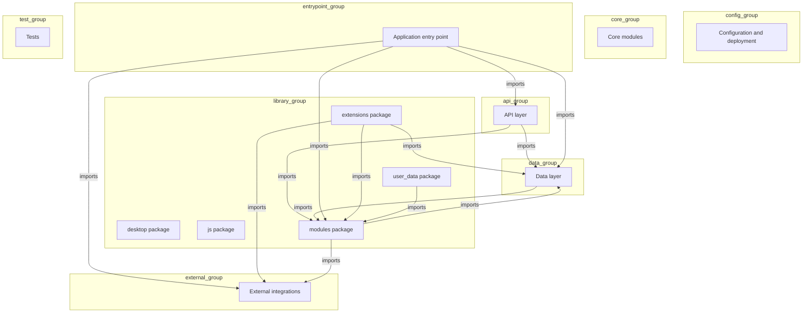

# Architecture report: oobabooga/textgen

> Automated static analysis. **Observed** = directly seen in files/imports/AST; **Inferred** = interpretation from that evidence. Repository code was not executed.

## 1. Repository at a glance

| Item | Value |
| --- | --- |
| Repository | oobabooga/textgen |
| Description | Open-source desktop app for local LLMs. Text, vision, tool-calling, OpenAI/Anthropic-compatible API. 100% private. |
| Language | Python |
| Stars | 47739 |
| Licence | AGPL-3.0 |
| Analysed commit / branch | c93f8871239550de2ccfe1e95d469aa82616f07e / main |
| Framework(s) | FastAPI, Starlette |
| Files analysed | 244 |
| Components | 12 |

## 2. Architecture in one minute

oobabooga/textgen - Open-source desktop app for local LLMs. Text, vision, tool-calling, OpenAI/Anthropic-compatible API. 100% private.. This repository was analysed statically from 244 file(s) (97 Python). Detected technologies (observed from imports/manifests): GitHub Actions, FastAPI, Starlette, NumPy, pandas, Pydantic. Files are grouped into 12 component(s): API layer, Configuration and deployment, Core modules, Data layer, desktop package, Application entry point, extensions package, External integrations. Observed entry point(s): download-model.py, extensions/silero_tts/tts_preprocessor.py, modules/api/script.py. Findings below distinguish observed facts from inferred interpretation.

## 3. High-level block diagram

## 4. Main components

### API layer (`api_layer`)

- **Kind:** api
- **Status:** Observed
- **Confidence:** 0.85
- **Responsibility:** Groups 13 file(s) under api layer (observed from repository paths and static analysis). Observed top-level classes: AnthropicRequest, AnthropicRequestParams, ChatCompletionRequest, ChatCompletionRequestParams, ChatCompletionResponse, ChatPromptResponse. Observed top-level functions: _compute_prompt_logprob_entries, _dict_to_logprob_entries, _extract_sampled_token, _first_token_display_str, _get_next_logits, _get_raw_logprob_entries.
- **Paths:** `modules/api/__init__.py`, `modules/api/anthropic.py`, `modules/api/cache_embedding_model.py`, `modules/api/completions.py`, `modules/api/embeddings.py`, `modules/api/errors.py`, `modules/api/images.py`, `modules/api/logits.py`, `modules/api/models.py`, `modules/api/moderations.py`, `modules/api/tokens.py`, `modules/api/typing.py`, `modules/api/utils.py`
- **Evidence:** [modules/api/__init__.py](https://github.com/oobabooga/textgen/blob/c93f8871239550de2ccfe1e95d469aa82616f07e/modules/api/__init__.py); [modules/api/anthropic.py:7](https://github.com/oobabooga/textgen/blob/c93f8871239550de2ccfe1e95d469aa82616f07e/modules/api/anthropic.py#L7); [modules/api/cache_embedding_model.py](https://github.com/oobabooga/textgen/blob/c93f8871239550de2ccfe1e95d469aa82616f07e/modules/api/cache_embedding_model.py); [modules/api/completions.py:31](https://github.com/oobabooga/textgen/blob/c93f8871239550de2ccfe1e95d469aa82616f07e/modules/api/completions.py#L31); [modules/api/embeddings.py:14](https://github.com/oobabooga/textgen/blob/c93f8871239550de2ccfe1e95d469aa82616f07e/modules/api/embeddings.py#L14); [modules/api/errors.py:1](https://github.com/oobabooga/textgen/blob/c93f8871239550de2ccfe1e95d469aa82616f07e/modules/api/errors.py#L1); [modules/api/images.py:16](https://github.com/oobabooga/textgen/blob/c93f8871239550de2ccfe1e95d469aa82616f07e/modules/api/images.py#L16); [modules/api/logits.py:5](https://github.com/oobabooga/textgen/blob/c93f8871239550de2ccfe1e95d469aa82616f07e/modules/api/logits.py#L5)

### Configuration and deployment (`config`)

- **Kind:** config
- **Status:** Observed
- **Confidence:** 0.85
- **Responsibility:** Groups 56 file(s) under configuration and deployment (observed from repository paths and static analysis).
- **Paths:** `desktop/package.json`, `docker/.dockerignore`, `docker/.env.example`, `docker/TensorRT-LLM/Dockerfile`, `docker/amd/Dockerfile`, `docker/amd/docker-compose.yml`, `docker/cpu/Dockerfile`, `docker/cpu/docker-compose.yml`, `docker/intel/Dockerfile`, `docker/intel/docker-compose.yml`, `docker/nvidia/Dockerfile`, `docker/nvidia/docker-compose.yml`, `extensions/coqui_tts/languages.json`, `extensions/coqui_tts/requirements.txt`, `extensions/google_translate/requirements.txt`, `extensions/ngrok/requirements.txt`, `extensions/silero_tts/languages.json`, `extensions/silero_tts/requirements.txt`, `extensions/superbooga/requirements.txt`, `extensions/superboogav2/benchmark_texts/questions.json`, `extensions/superboogav2/config.json`, `extensions/superboogav2/requirements.txt`, `extensions/whisper_stt/requirements.txt`, `requirements/full/requirements.txt`, `requirements/full/requirements_amd.txt`, `requirements/full/requirements_apple_intel.txt`, `requirements/full/requirements_apple_silicon.txt`, `requirements/full/requirements_cpu_only.txt`, `requirements/full/requirements_nowheels.txt`, `requirements/portable/requirements.txt`, `requirements/portable/requirements_amd.txt`, `requirements/portable/requirements_apple_intel.txt`, `requirements/portable/requirements_apple_silicon.txt`, `requirements/portable/requirements_cpu_only.txt`, `requirements/portable/requirements_cuda131.txt`, `requirements/portable/requirements_ik.txt`, `requirements/portable/requirements_ik_cpu_only.txt`, `requirements/portable/requirements_ik_cuda131.txt`, `requirements/portable/requirements_nowheels.txt`, `requirements/portable/requirements_vulkan.txt`, `setup.cfg`, `user_data/characters/Assistant.yaml`, `user_data/characters/Example.yaml`, `user_data/instruction-templates/Alpaca.yaml`, `user_data/instruction-templates/ChatML.yaml`, `user_data/instruction-templates/Llama-v3.yaml`, `user_data/instruction-templates/Mistral.yaml`, `user_data/instruction-templates/Open Assistant.yaml`, `user_data/instruction-templates/Vicuna-v1.1.yaml`, `user_data/presets/Creative.yaml`, `user_data/presets/Deterministic.yaml`, `user_data/presets/Top-P.yaml`, `user_data/training/datasets/example_messages.json`, `user_data/training/datasets/example_sharegpt.json`, `user_data/training/datasets/example_text.json`, `user_data/users/Default.yaml`
- **Evidence:** [desktop/package.json](https://github.com/oobabooga/textgen/blob/c93f8871239550de2ccfe1e95d469aa82616f07e/desktop/package.json); [docker/.dockerignore](https://github.com/oobabooga/textgen/blob/c93f8871239550de2ccfe1e95d469aa82616f07e/docker/.dockerignore); [docker/.env.example](https://github.com/oobabooga/textgen/blob/c93f8871239550de2ccfe1e95d469aa82616f07e/docker/.env.example); [docker/TensorRT-LLM/Dockerfile](https://github.com/oobabooga/textgen/blob/c93f8871239550de2ccfe1e95d469aa82616f07e/docker/TensorRT-LLM/Dockerfile); [docker/amd/Dockerfile](https://github.com/oobabooga/textgen/blob/c93f8871239550de2ccfe1e95d469aa82616f07e/docker/amd/Dockerfile); [docker/amd/docker-compose.yml](https://github.com/oobabooga/textgen/blob/c93f8871239550de2ccfe1e95d469aa82616f07e/docker/amd/docker-compose.yml); [docker/cpu/Dockerfile](https://github.com/oobabooga/textgen/blob/c93f8871239550de2ccfe1e95d469aa82616f07e/docker/cpu/Dockerfile); [docker/cpu/docker-compose.yml](https://github.com/oobabooga/textgen/blob/c93f8871239550de2ccfe1e95d469aa82616f07e/docker/cpu/docker-compose.yml)

### Core modules (`core`)

- **Kind:** core
- **Status:** Observed
- **Confidence:** 0.85
- **Responsibility:** Groups 6 file(s) under core modules (observed from repository paths and static analysis).
- **Paths:** `cmd_linux.sh`, `cmd_macos.sh`, `start_linux.sh`, `start_macos.sh`, `update_wizard_linux.sh`, `update_wizard_macos.sh`
- **Evidence:** [cmd_linux.sh](https://github.com/oobabooga/textgen/blob/c93f8871239550de2ccfe1e95d469aa82616f07e/cmd_linux.sh); [cmd_macos.sh](https://github.com/oobabooga/textgen/blob/c93f8871239550de2ccfe1e95d469aa82616f07e/cmd_macos.sh); [start_linux.sh](https://github.com/oobabooga/textgen/blob/c93f8871239550de2ccfe1e95d469aa82616f07e/start_linux.sh); [start_macos.sh](https://github.com/oobabooga/textgen/blob/c93f8871239550de2ccfe1e95d469aa82616f07e/start_macos.sh); [update_wizard_linux.sh](https://github.com/oobabooga/textgen/blob/c93f8871239550de2ccfe1e95d469aa82616f07e/update_wizard_linux.sh); [update_wizard_macos.sh](https://github.com/oobabooga/textgen/blob/c93f8871239550de2ccfe1e95d469aa82616f07e/update_wizard_macos.sh)

### Data layer (`data_layer`)

- **Kind:** data
- **Status:** Observed
- **Confidence:** 0.85
- **Responsibility:** Groups 1 file(s) under data layer (observed from repository paths and static analysis). Observed top-level functions: ExLlamav3_HF_loader, ExLlamav3_loader, TensorRT_LLM_loader, llama_cpp_server_loader, load_model, load_model_if_idle_unloaded.
- **Paths:** `modules/models.py`
- **Evidence:** [modules/models.py:15](https://github.com/oobabooga/textgen/blob/c93f8871239550de2ccfe1e95d469aa82616f07e/modules/models.py#L15)

### desktop package (`desktop`)

- **Kind:** library
- **Status:** Observed
- **Confidence:** 0.85
- **Responsibility:** Groups 3 file(s) under desktop package (observed from repository paths and static analysis).
- **Paths:** `desktop/main.js`, `desktop/preload.js`, `desktop/textgen.sh`
- **Evidence:** [desktop/main.js](https://github.com/oobabooga/textgen/blob/c93f8871239550de2ccfe1e95d469aa82616f07e/desktop/main.js); [desktop/preload.js](https://github.com/oobabooga/textgen/blob/c93f8871239550de2ccfe1e95d469aa82616f07e/desktop/preload.js); [desktop/textgen.sh](https://github.com/oobabooga/textgen/blob/c93f8871239550de2ccfe1e95d469aa82616f07e/desktop/textgen.sh)

### Application entry point (`entrypoint`)

- **Kind:** entrypoint
- **Status:** Observed
- **Confidence:** 0.85
- **Responsibility:** Groups 5 file(s) under application entry point (observed from repository paths and static analysis). Observed application object created via FastAPI. Observed routes: OPTIONS /, POST /v1/completions, POST /v1/chat/completions, POST /v1/messages, GET /v1/models. Observed top-level classes: AnthropicError, ModelDownloader. Observed top-level functions: __main__, _anthropic_generate, _wait_for_disconnect, anthropic_error_handler, anthropic_messages, calculate_file_hash.
- **Paths:** `download-model.py`, `extensions/silero_tts/tts_preprocessor.py`, `modules/api/script.py`, `one_click.py`, `server.py`
- **Evidence:** [download-model.py:32](https://github.com/oobabooga/textgen/blob/c93f8871239550de2ccfe1e95d469aa82616f07e/download-model.py#L32); [extensions/silero_tts/tts_preprocessor.py:36](https://github.com/oobabooga/textgen/blob/c93f8871239550de2ccfe1e95d469aa82616f07e/extensions/silero_tts/tts_preprocessor.py#L36); [modules/api/script.py:93](https://github.com/oobabooga/textgen/blob/c93f8871239550de2ccfe1e95d469aa82616f07e/modules/api/script.py#L93); [one_click.py:27](https://github.com/oobabooga/textgen/blob/c93f8871239550de2ccfe1e95d469aa82616f07e/one_click.py#L27); [server.py:34](https://github.com/oobabooga/textgen/blob/c93f8871239550de2ccfe1e95d469aa82616f07e/server.py#L34)

### extensions package (`extensions`)

- **Kind:** library
- **Status:** Observed
- **Confidence:** 0.85
- **Responsibility:** Groups 29 file(s) under extensions package (observed from repository paths and static analysis). Observed top-level classes: APIManager, ChromaCollector, CustomThreadingHTTPServer, Handler, Info, MyLogits. Observed top-level functions: SD_api_address_update, _apply_settings, _begin_benchmark, _begin_optimization, _clear_chunks, _clear_data.
- **Paths:** `extensions/character_bias/script.py`, `extensions/coqui_tts/script.py`, `extensions/example/script.py`, `extensions/gallery/script.js`, `extensions/gallery/script.py`, `extensions/google_translate/script.py`, `extensions/long_replies/script.py`, `extensions/ngrok/script.py`, `extensions/perplexity_colors/script.py`, `extensions/sd_api_pictures/script.py`, `extensions/send_pictures/script.py`, `extensions/silero_tts/script.py`, `extensions/superbooga/chromadb.py`, `extensions/superbooga/download_urls.py`, `extensions/superbooga/script.py`, `extensions/superboogav2/api.py`, `extensions/superboogav2/benchmark.py`, `extensions/superboogav2/chat_handler.py`, `extensions/superboogav2/chromadb.py`, `extensions/superboogav2/data_preprocessor.py`, `extensions/superboogav2/data_processor.py`, `extensions/superboogav2/download_urls.py`, `extensions/superboogav2/notebook_handler.py`, `extensions/superboogav2/optimize.py`, `extensions/superboogav2/parameters.py`, `extensions/superboogav2/script.py`, `extensions/superboogav2/utils.py`, `extensions/whisper_stt/script.js`, `extensions/whisper_stt/script.py`
- **Evidence:** [extensions/character_bias/script.py:25](https://github.com/oobabooga/textgen/blob/c93f8871239550de2ccfe1e95d469aa82616f07e/extensions/character_bias/script.py#L25); [extensions/coqui_tts/script.py:36](https://github.com/oobabooga/textgen/blob/c93f8871239550de2ccfe1e95d469aa82616f07e/extensions/coqui_tts/script.py#L36); [extensions/example/script.py:26](https://github.com/oobabooga/textgen/blob/c93f8871239550de2ccfe1e95d469aa82616f07e/extensions/example/script.py#L26); [extensions/gallery/script.js](https://github.com/oobabooga/textgen/blob/c93f8871239550de2ccfe1e95d469aa82616f07e/extensions/gallery/script.js); [extensions/gallery/script.py:17](https://github.com/oobabooga/textgen/blob/c93f8871239550de2ccfe1e95d469aa82616f07e/extensions/gallery/script.py#L17); [extensions/google_translate/script.py:14](https://github.com/oobabooga/textgen/blob/c93f8871239550de2ccfe1e95d469aa82616f07e/extensions/google_translate/script.py#L14); [extensions/long_replies/script.py:19](https://github.com/oobabooga/textgen/blob/c93f8871239550de2ccfe1e95d469aa82616f07e/extensions/long_replies/script.py#L19); [extensions/ngrok/script.py:25](https://github.com/oobabooga/textgen/blob/c93f8871239550de2ccfe1e95d469aa82616f07e/extensions/ngrok/script.py#L25)

### External integrations (`external_integrations`)

- **Kind:** external
- **Status:** Inferred
- **Confidence:** 0.70
- **Responsibility:** Groups 0 file(s) under external integrations (observed from repository paths and static analysis).
- **Evidence:** [download-model.py:21](https://github.com/oobabooga/textgen/blob/c93f8871239550de2ccfe1e95d469aa82616f07e/download-model.py#L21); [download-model.py:23](https://github.com/oobabooga/textgen/blob/c93f8871239550de2ccfe1e95d469aa82616f07e/download-model.py#L23); [download-model.py:24](https://github.com/oobabooga/textgen/blob/c93f8871239550de2ccfe1e95d469aa82616f07e/download-model.py#L24); [extensions/sd_api_pictures/script.py:9](https://github.com/oobabooga/textgen/blob/c93f8871239550de2ccfe1e95d469aa82616f07e/extensions/sd_api_pictures/script.py#L9); [modules/api/script.py:5](https://github.com/oobabooga/textgen/blob/c93f8871239550de2ccfe1e95d469aa82616f07e/modules/api/script.py#L5); [modules/llama_cpp_server.py:7](https://github.com/oobabooga/textgen/blob/c93f8871239550de2ccfe1e95d469aa82616f07e/modules/llama_cpp_server.py#L7)

### js package (`js`)

- **Kind:** library
- **Status:** Observed
- **Confidence:** 0.85
- **Responsibility:** Groups 8 file(s) under js package (observed from repository paths and static analysis).
- **Paths:** `js/dark_theme.js`, `js/global_scope_js.js`, `js/katex/auto-render.js`, `js/main.js`, `js/save_files.js`, `js/show_controls.js`, `js/switch_tabs.js`, `js/update_big_picture.js`
- **Evidence:** [js/dark_theme.js](https://github.com/oobabooga/textgen/blob/c93f8871239550de2ccfe1e95d469aa82616f07e/js/dark_theme.js); [js/global_scope_js.js](https://github.com/oobabooga/textgen/blob/c93f8871239550de2ccfe1e95d469aa82616f07e/js/global_scope_js.js); [js/katex/auto-render.js](https://github.com/oobabooga/textgen/blob/c93f8871239550de2ccfe1e95d469aa82616f07e/js/katex/auto-render.js); [js/main.js](https://github.com/oobabooga/textgen/blob/c93f8871239550de2ccfe1e95d469aa82616f07e/js/main.js); [js/save_files.js](https://github.com/oobabooga/textgen/blob/c93f8871239550de2ccfe1e95d469aa82616f07e/js/save_files.js); [js/show_controls.js](https://github.com/oobabooga/textgen/blob/c93f8871239550de2ccfe1e95d469aa82616f07e/js/show_controls.js); [js/switch_tabs.js](https://github.com/oobabooga/textgen/blob/c93f8871239550de2ccfe1e95d469aa82616f07e/js/switch_tabs.js); [js/update_big_picture.js](https://github.com/oobabooga/textgen/blob/c93f8871239550de2ccfe1e95d469aa82616f07e/js/update_big_picture.js)

### modules package (`modules`)

- **Kind:** library
- **Status:** Observed
- **Confidence:** 0.85
- **Responsibility:** Groups 45 file(s) under modules package (observed from repository paths and static analysis). Observed top-level classes: AdaptivePLogitsWarper, ConcurrentGenerator, DRYLogitsProcessor, DynamicTemperatureLogitsWarper, Exllamav3HF, Exllamav3Model. Observed top-level functions: _apply_chat_input_extensions, _apply_custom_css, _apply_custom_generate_chat_prompt, _apply_custom_generate_reply, _apply_custom_js, _apply_custom_tokenized_length.
- **Paths:** `modules/LoRA.py`, `modules/callbacks.py`, `modules/chat.py`, `modules/evaluate.py`, `modules/exllamav3.py`, `modules/exllamav3_hf.py`, `modules/extensions.py`, `modules/grammar/__init__.py`, `modules/grammar/grammar_utils.py`, `modules/grammar/logits_process.py`, `modules/html_generator.py`, `modules/image_models.py`, `modules/image_utils.py`, `modules/llama_cpp_server.py`, `modules/loaders.py`, `modules/logging_colors.py`, `modules/logits.py`, `modules/metadata_gguf.py`, `modules/models_settings.py`, `modules/paths.py`, `modules/presets.py`, `modules/prompts.py`, `modules/reasoning.py`, `modules/sampler_hijack.py`, `modules/sane_markdown_lists.py`, `modules/shared.py`, `modules/tensorrt_llm.py`, `modules/text_generation.py`, `modules/tool_parsing.py`, `modules/tool_use.py`, `modules/torch_utils.py`, `modules/training.py`, `modules/transformers_loader.py`, `modules/ui.py`, `modules/ui_chat.py`, `modules/ui_default.py`, `modules/ui_file_saving.py`, `modules/ui_image_generation.py`, `modules/ui_model_menu.py`, `modules/ui_notebook.py`, `modules/ui_parameters.py`, `modules/ui_session.py`, `modules/utils.py`, `modules/web_search.py`, `modules/windows_subprocess.py`
- **Evidence:** [modules/LoRA.py:7](https://github.com/oobabooga/textgen/blob/c93f8871239550de2ccfe1e95d469aa82616f07e/modules/LoRA.py#L7); [modules/callbacks.py:8](https://github.com/oobabooga/textgen/blob/c93f8871239550de2ccfe1e95d469aa82616f07e/modules/callbacks.py#L8); [modules/chat.py:58](https://github.com/oobabooga/textgen/blob/c93f8871239550de2ccfe1e95d469aa82616f07e/modules/chat.py#L58); [modules/evaluate.py:14](https://github.com/oobabooga/textgen/blob/c93f8871239550de2ccfe1e95d469aa82616f07e/modules/evaluate.py#L14); [modules/exllamav3.py:39](https://github.com/oobabooga/textgen/blob/c93f8871239550de2ccfe1e95d469aa82616f07e/modules/exllamav3.py#L39); [modules/exllamav3_hf.py:26](https://github.com/oobabooga/textgen/blob/c93f8871239550de2ccfe1e95d469aa82616f07e/modules/exllamav3_hf.py#L26); [modules/extensions.py:16](https://github.com/oobabooga/textgen/blob/c93f8871239550de2ccfe1e95d469aa82616f07e/modules/extensions.py#L16); [modules/grammar/__init__.py](https://github.com/oobabooga/textgen/blob/c93f8871239550de2ccfe1e95d469aa82616f07e/modules/grammar/__init__.py)

### Tests (`tests`)

- **Kind:** test
- **Status:** Observed
- **Confidence:** 0.85
- **Responsibility:** Groups 1 file(s) under tests (observed from repository paths and static analysis). Observed top-level functions: load_model, output_modifier, xmlesc.
- **Paths:** `extensions/silero_tts/test_tts.py`
- **Evidence:** [extensions/silero_tts/test_tts.py:38](https://github.com/oobabooga/textgen/blob/c93f8871239550de2ccfe1e95d469aa82616f07e/extensions/silero_tts/test_tts.py#L38)

### user_data package (`user_data`)

- **Kind:** library
- **Status:** Observed
- **Confidence:** 0.85
- **Responsibility:** Groups 5 file(s) under user_data package (observed from repository paths and static analysis). Observed top-level functions: _eval, execute.
- **Paths:** `user_data/tools/calculate.py`, `user_data/tools/fetch_webpage.py`, `user_data/tools/get_datetime.py`, `user_data/tools/roll_dice.py`, `user_data/tools/web_search.py`
- **Evidence:** [user_data/tools/calculate.py:15](https://github.com/oobabooga/textgen/blob/c93f8871239550de2ccfe1e95d469aa82616f07e/user_data/tools/calculate.py#L15); [user_data/tools/fetch_webpage.py:20](https://github.com/oobabooga/textgen/blob/c93f8871239550de2ccfe1e95d469aa82616f07e/user_data/tools/fetch_webpage.py#L20); [user_data/tools/get_datetime.py:16](https://github.com/oobabooga/textgen/blob/c93f8871239550de2ccfe1e95d469aa82616f07e/user_data/tools/get_datetime.py#L16); [user_data/tools/roll_dice.py:19](https://github.com/oobabooga/textgen/blob/c93f8871239550de2ccfe1e95d469aa82616f07e/user_data/tools/roll_dice.py#L19); [user_data/tools/web_search.py:19](https://github.com/oobabooga/textgen/blob/c93f8871239550de2ccfe1e95d469aa82616f07e/user_data/tools/web_search.py#L19)

## 5. Execution flow

**Observed** entry point(s):

- [desktop/main.js](https://github.com/oobabooga/textgen/blob/c93f8871239550de2ccfe1e95d469aa82616f07e/desktop/main.js)
- [download-model.py:381](https://github.com/oobabooga/textgen/blob/c93f8871239550de2ccfe1e95d469aa82616f07e/download-model.py#L381)
- [extensions/silero_tts/tts_preprocessor.py:198](https://github.com/oobabooga/textgen/blob/c93f8871239550de2ccfe1e95d469aa82616f07e/extensions/silero_tts/tts_preprocessor.py#L198)
- [js/main.js](https://github.com/oobabooga/textgen/blob/c93f8871239550de2ccfe1e95d469aa82616f07e/js/main.js)
- [modules/api/script.py:93](https://github.com/oobabooga/textgen/blob/c93f8871239550de2ccfe1e95d469aa82616f07e/modules/api/script.py#L93)
- [one_click.py:489](https://github.com/oobabooga/textgen/blob/c93f8871239550de2ccfe1e95d469aa82616f07e/one_click.py#L489)
- [server.py:249](https://github.com/oobabooga/textgen/blob/c93f8871239550de2ccfe1e95d469aa82616f07e/server.py#L249)

**Observed** routes (from decorators):

- `OPTIONS /` -> `options_route` in `modules/api/script.py:164`
- `POST /v1/completions` -> `openai_completions` in `modules/api/script.py:169`
- `POST /v1/chat/completions` -> `openai_chat_completions` in `modules/api/script.py:217`
- `POST /v1/messages` -> `anthropic_messages` in `modules/api/script.py:259`
- `GET /v1/models` -> `handle_models` in `modules/api/script.py:330`
- `GET /v1/models/{model}` -> `handle_models` in `modules/api/script.py:330`
- `GET /v1/billing/usage` -> `handle_billing_usage` in `modules/api/script.py:344`
- `POST /v1/audio/transcriptions` -> `handle_audio_transcription` in `modules/api/script.py:352`
- `POST /v1/images/generations` -> `handle_image_generation` in `modules/api/script.py:385`
- `POST /v1/embeddings` -> `handle_embeddings` in `modules/api/script.py:393`
- `POST /v1/moderations` -> `handle_moderations` in `modules/api/script.py:408`
- `GET /v1/internal/health` -> `handle_health_check` in `modules/api/script.py:421`
- `POST /v1/internal/encode` -> `handle_token_encode` in `modules/api/script.py:426`
- `POST /v1/internal/decode` -> `handle_token_decode` in `modules/api/script.py:432`
- `POST /v1/internal/token-count` -> `handle_token_count` in `modules/api/script.py:438`
- `POST /v1/internal/logits` -> `handle_logits` in `modules/api/script.py:444`
- `POST /v1/internal/chat-prompt` -> `handle_chat_prompt` in `modules/api/script.py:454`
- `POST /v1/internal/stop-generation` -> `handle_stop_generation` in `modules/api/script.py:463`
- `GET /v1/internal/model/info` -> `handle_model_info` in `modules/api/script.py:469`
- `GET /v1/internal/model/list` -> `handle_list_models` in `modules/api/script.py:475`
- `POST /v1/internal/model/load` -> `handle_load_model` in `modules/api/script.py:481`
- `POST /v1/internal/model/unload` -> `handle_unload_model` in `modules/api/script.py:511`
- `GET /v1/internal/lora/list` -> `handle_list_loras` in `modules/api/script.py:521`
- `POST /v1/internal/lora/load` -> `handle_load_loras` in `modules/api/script.py:527`
- `POST /v1/internal/lora/unload` -> `handle_unload_loras` in `modules/api/script.py:537`

Representative flow (derived from observed entry points and the import graph; steps beyond the entry point are **Inferred**):

1. Execution starts at an observed entry point listed above, if present.
2. `api_layer` imports `data_layer` (API layer -> Data layer).
3. `api_layer` imports `modules` (API layer -> modules package).
4. `data_layer` imports `modules` (Data layer -> modules package).
5. `entrypoint` imports `api_layer` (Application entry point -> API layer).
6. `entrypoint` imports `data_layer` (Application entry point -> Data layer).
7. `entrypoint` imports `external_integrations` (Application entry point -> External integrations).
8. `entrypoint` imports `modules` (Application entry point -> modules package).
9. `extensions` imports `data_layer` (extensions package -> Data layer).

## 6. Project structure

### `(root)`

- `.gitignore` - other (396 bytes)
- `Colab-TextGen-GPU.ipynb` - other (4131 bytes)
- `LICENSE` - docs (34523 bytes)
- `README.md` - docs (30593 bytes)
- `cmd_linux.sh` - source, Shell (728 bytes)
- `cmd_macos.sh` - source, Shell (699 bytes)
- `cmd_windows.bat` - other (955 bytes)
- `download-model.py` - source, Python (19771 bytes)
- `one_click.py` - source, Python (21816 bytes)
- `server.py` - source, Python (14718 bytes)
- `setup.cfg` - manifest (61 bytes)
- `start_linux.sh` - source, Shell (2558 bytes)
- `start_macos.sh` - source, Shell (2547 bytes)
- `start_windows.bat` - other (4299 bytes)
- `update_wizard_linux.sh` - source, Shell (889 bytes)
- `update_wizard_macos.sh` - source, Shell (881 bytes)
- `update_wizard_windows.bat` - other (1041 bytes)

### `.github`

- `.github/ISSUE_TEMPLATE/bug_report_template.yml` - config (1660 bytes)
- `.github/ISSUE_TEMPLATE/feature_request.md` - docs (351 bytes)
- `.github/dependabot.yml` - config (492 bytes)
- `.github/pull_request_template.md` - docs (131 bytes)
- `.github/workflows/build-everything-tgw.yml` - ci, YAML (2983 bytes)
- `.github/workflows/build-portable-release-cuda.yml` - ci, YAML (9190 bytes)
- `.github/workflows/build-portable-release-ik-cuda.yml` - ci, YAML (8873 bytes)
- `.github/workflows/build-portable-release-ik.yml` - ci, YAML (8604 bytes)
- `.github/workflows/build-portable-release-rocm.yml` - ci, YAML (8190 bytes)
- `.github/workflows/build-portable-release-vulkan.yml` - ci, YAML (8193 bytes)
- `.github/workflows/build-portable-release.yml` - ci, YAML (9650 bytes)

### `css`

- `css/NotoSans/stylesheet.css` - other (4915 bytes)
- `css/chat_style-Dark.css` - other (3026 bytes)
- `css/chat_style-TheEncrypted777.css` - other (3048 bytes)
- `css/chat_style-cai-chat-square.css` - other (439 bytes)
- `css/chat_style-cai-chat.css` - other (1082 bytes)
- `css/chat_style-messenger.css` - other (1977 bytes)
- `css/chat_style-wpp.css` - other (1775 bytes)
- `css/html_instruct_style.css` - other (1679 bytes)
- `css/html_readable_style.css` - other (658 bytes)
- `css/main.css` - other (63620 bytes)

### `desktop`

- `desktop/main.js` - source, JavaScript (8623 bytes)
- `desktop/package.json` - manifest (45 bytes)
- `desktop/preload.js` - source, JavaScript (175 bytes)
- `desktop/textgen.bat` - other (552 bytes)
- `desktop/textgen.sh` - source, Shell (828 bytes)

### `docker`

- `docker/.dockerignore` - container (27 bytes)
- `docker/.env.example` - config (882 bytes)
- `docker/TensorRT-LLM/Dockerfile` - container (862 bytes)
- `docker/amd/Dockerfile` - container (778 bytes)
- `docker/amd/docker-compose.yml` - container (663 bytes)
- `docker/cpu/Dockerfile` - container (778 bytes)
- `docker/cpu/docker-compose.yml` - container (494 bytes)
- `docker/intel/Dockerfile` - container (778 bytes)
- `docker/intel/docker-compose.yml` - container (663 bytes)
- `docker/nvidia/Dockerfile` - container (866 bytes)
- `docker/nvidia/docker-compose.yml` - container (815 bytes)

### `docs`

- `docs/01 - Chat Tab.md` - docs (10858 bytes)
- `docs/02 - Default and Notebook Tabs.md` - docs (2223 bytes)
- `docs/03 - Parameters Tab.md` - docs (17474 bytes)
- `docs/04 - Model Tab.md` - docs (9591 bytes)
- `docs/05 - Training Tab.md` - docs (7554 bytes)
- `docs/06 - Session Tab.md` - docs (2225 bytes)
- `docs/07 - Extensions.md` - docs (11144 bytes)
- `docs/08 - Additional Tips.md` - docs (1140 bytes)
- `docs/09 - Docker.md` - docs (1841 bytes)
- `docs/11 - AMD Setup.md` - docs (669 bytes)
- `docs/12 - OpenAI API.md` - docs (20606 bytes)
- `docs/13 - Keyboard Shortcuts.md` - docs (1049 bytes)
- `docs/Image Generation Tutorial.md` - docs (3756 bytes)
- `docs/Multimodal Tutorial.md` - docs (2408 bytes)
- `docs/README.md` - docs (205 bytes)
- `docs/Tool Calling Tutorial.md` - docs (6624 bytes)
- `docs/What Works.md` - docs (797 bytes)

### `extensions`

- `extensions/character_bias/script.py` - source, Python (2413 bytes)
- `extensions/coqui_tts/harvard_sentences.txt` - docs (29048 bytes)
- `extensions/coqui_tts/languages.json` - config (306 bytes)
- `extensions/coqui_tts/requirements.txt` - manifest (18 bytes)
- `extensions/coqui_tts/script.py` - source, Python (7946 bytes)
- `extensions/coqui_tts/style.css` - other (153 bytes)
- `extensions/example/script.py` - source, Python (3864 bytes)
- `extensions/gallery/script.js` - source, JavaScript (1514 bytes)
- `extensions/gallery/script.py` - source, Python (3963 bytes)
- `extensions/google_translate/requirements.txt` - manifest (23 bytes)
- `extensions/google_translate/script.py` - source, Python (3535 bytes)
- `extensions/long_replies/script.py` - source, Python (4061 bytes)
- `extensions/ngrok/README.md` - docs (2505 bytes)
- `extensions/ngrok/requirements.txt` - manifest (11 bytes)
- `extensions/ngrok/script.py` - source, Python (1213 bytes)
- `extensions/perplexity_colors/script.py` - source, Python (21902 bytes)
- `extensions/sd_api_pictures/README.MD` - docs (4046 bytes)
- `extensions/sd_api_pictures/script.py` - source, Python (16150 bytes)
- `extensions/sd_api_pictures/style.css` - other (1092 bytes)
- `extensions/send_pictures/script.py` - source, Python (2344 bytes)
- `extensions/silero_tts/harvard_sentences.txt` - docs (29048 bytes)
- `extensions/silero_tts/languages.json` - config (6066 bytes)
- `extensions/silero_tts/outputs/outputs-will-be-saved-here.txt` - docs (0 bytes)
- `extensions/silero_tts/requirements.txt` - manifest (41 bytes)
- `extensions/silero_tts/script.py` - source, Python (9237 bytes)
- `extensions/silero_tts/style.css` - other (153 bytes)
- `extensions/silero_tts/test_tts.py` - test, Python (3215 bytes)
- `extensions/silero_tts/tts_preprocessor.py` - source, Python (6199 bytes)
- `extensions/superbooga/chromadb.py` - source, Python (3855 bytes)
- `extensions/superbooga/download_urls.py` - source, Python (1052 bytes)
- `extensions/superbooga/requirements.txt` - manifest (103 bytes)
- `extensions/superbooga/script.py` - source, Python (11087 bytes)
- `extensions/superboogav2/README.md` - docs (1859 bytes)
- `extensions/superboogav2/api.py` - source, Python (7226 bytes)
- `extensions/superboogav2/benchmark.py` - source, Python (2742 bytes)
- `extensions/superboogav2/benchmark_texts/questions.json` - config (43897 bytes)
- `extensions/superboogav2/chat_handler.py` - source, Python (4670 bytes)
- `extensions/superboogav2/chromadb.py` - source, Python (15035 bytes)
- `extensions/superboogav2/config.json` - config (4269 bytes)
- `extensions/superboogav2/data_preprocessor.py` - source, Python (7481 bytes)
- `extensions/superboogav2/data_processor.py` - source, Python (10031 bytes)
- `extensions/superboogav2/download_urls.py` - source, Python (2015 bytes)
- `extensions/superboogav2/nltk_data/corpora/stopwords/english` - other (936 bytes)
- `extensions/superboogav2/notebook_handler.py` - source, Python (1290 bytes)
- `extensions/superboogav2/optimize.py` - source, Python (4350 bytes)
- `extensions/superboogav2/parameters.py` - source, Python (12770 bytes)
- `extensions/superboogav2/requirements.txt` - manifest (181 bytes)
- `extensions/superboogav2/script.py` - source, Python (25430 bytes)
- `extensions/superboogav2/utils.py` - source, Python (502 bytes)
- `extensions/whisper_stt/readme.md` - docs (499 bytes)
- `extensions/whisper_stt/requirements.txt` - manifest (58 bytes)
- `extensions/whisper_stt/script.js` - source, JavaScript (3185 bytes)
- `extensions/whisper_stt/script.py` - source, Python (5779 bytes)

### `js`

- `js/dark_theme.js` - source, JavaScript (750 bytes)
- `js/global_scope_js.js` - source, JavaScript (17229 bytes)
- `js/katex/auto-render.js` - source, JavaScript (8535 bytes)
- `js/main.js` - source, JavaScript (35397 bytes)
- `js/save_files.js` - source, JavaScript (1140 bytes)
- `js/show_controls.js` - source, JavaScript (1072 bytes)
- `js/switch_tabs.js` - source, JavaScript (1022 bytes)
- `js/update_big_picture.js` - source, JavaScript (181 bytes)

### `modules`

- `modules/LoRA.py` - source, Python (2803 bytes)
- `modules/api/__init__.py` - source, Python (0 bytes)
- `modules/api/anthropic.py` - source, Python (18120 bytes)
- `modules/api/cache_embedding_model.py` - source, Python (454 bytes)
- `modules/api/completions.py` - source, Python (44249 bytes)
- `modules/api/embeddings.py` - source, Python (3573 bytes)
- `modules/api/errors.py` - source, Python (983 bytes)
- `modules/api/images.py` - source, Python (2586 bytes)
- `modules/api/logits.py` - source, Python (377 bytes)
- `modules/api/models.py` - source, Python (2949 bytes)
- `modules/api/moderations.py` - source, Python (2118 bytes)
- `modules/api/script.py` - source, Python (21963 bytes)
- `modules/api/tokens.py` - source, Python (482 bytes)
- `modules/api/typing.py` - source, Python (13619 bytes)
- `modules/api/utils.py` - source, Python (1567 bytes)
- `modules/callbacks.py` - source, Python (1620 bytes)
- `modules/chat.py` - source, Python (113175 bytes)
- `modules/evaluate.py` - source, Python (6513 bytes)
- `modules/exllamav3.py` - source, Python (23081 bytes)
- `modules/exllamav3_hf.py` - source, Python (11185 bytes)
- `modules/extensions.py` - source, Python (9128 bytes)
- `modules/grammar/__init__.py` - source, Python (0 bytes)
- `modules/grammar/grammar_utils.py` - source, Python (26753 bytes)
- `modules/grammar/logits_process.py` - source, Python (5152 bytes)
- `modules/html_generator.py` - source, Python (34746 bytes)
- `modules/image_models.py` - source, Python (5648 bytes)
- `modules/image_utils.py` - source, Python (4264 bytes)
- `modules/llama_cpp_server.py` - source, Python (29883 bytes)
- `modules/loaders.py` - source, Python (8522 bytes)
- `modules/logging_colors.py` - source, Python (2806 bytes)
- `modules/logits.py` - source, Python (4336 bytes)
- `modules/metadata_gguf.py` - source, Python (2565 bytes)
- `modules/models.py` - source, Python (5820 bytes)
- `modules/models_settings.py` - source, Python (19744 bytes)
- `modules/paths.py` - source, Python (1340 bytes)
- `modules/presets.py` - source, Python (3960 bytes)
- `modules/prompts.py` - source, Python (1117 bytes)
- `modules/reasoning.py` - source, Python (4566 bytes)
- `modules/sampler_hijack.py` - source, Python (32989 bytes)
- `modules/sane_markdown_lists.py` - source, Python (13919 bytes)
- `modules/shared.py` - source, Python (31931 bytes)
- `modules/tensorrt_llm.py` - source, Python (2580 bytes)
- `modules/text_generation.py` - source, Python (20073 bytes)
- `modules/tool_parsing.py` - source, Python (27328 bytes)
- `modules/tool_use.py` - source, Python (9000 bytes)
- `modules/torch_utils.py` - source, Python (1049 bytes)
- `modules/training.py` - source, Python (43701 bytes)
- `modules/transformers_loader.py` - source, Python (8491 bytes)
- `modules/ui.py` - source, Python (19895 bytes)
- `modules/ui_chat.py` - source, Python (34878 bytes)
- `modules/ui_default.py` - source, Python (12526 bytes)
- `modules/ui_file_saving.py` - source, Python (11439 bytes)
- `modules/ui_image_generation.py` - source, Python (39403 bytes)
- `modules/ui_model_menu.py` - source, Python (31396 bytes)
- `modules/ui_notebook.py` - source, Python (15253 bytes)
- `modules/ui_parameters.py` - source, Python (15746 bytes)
- `modules/ui_session.py` - source, Python (9460 bytes)
- `modules/utils.py` - source, Python (13826 bytes)
- `modules/web_search.py` - source, Python (6406 bytes)
- `modules/windows_subprocess.py` - source, Python (3395 bytes)

### `requirements`

- `requirements/full/requirements.txt` - manifest (2674 bytes)
- `requirements/full/requirements_amd.txt` - manifest (1097 bytes)
- `requirements/full/requirements_apple_intel.txt` - manifest (900 bytes)
- `requirements/full/requirements_apple_silicon.txt` - manifest (899 bytes)
- `requirements/full/requirements_cpu_only.txt` - manifest (1457 bytes)
- `requirements/full/requirements_nowheels.txt` - manifest (723 bytes)
- `requirements/portable/requirements.txt` - manifest (914 bytes)
- `requirements/portable/requirements_amd.txt` - manifest (917 bytes)
- `requirements/portable/requirements_apple_intel.txt` - manifest (720 bytes)
- `requirements/portable/requirements_apple_silicon.txt` - manifest (719 bytes)
- `requirements/portable/requirements_cpu_only.txt` - manifest (919 bytes)
- `requirements/portable/requirements_cuda131.txt` - manifest (1111 bytes)
- `requirements/portable/requirements_ik.txt` - manifest (920 bytes)
- `requirements/portable/requirements_ik_cpu_only.txt` - manifest (928 bytes)
- `requirements/portable/requirements_ik_cuda131.txt` - manifest (920 bytes)
- `requirements/portable/requirements_nowheels.txt` - manifest (543 bytes)
- `requirements/portable/requirements_vulkan.txt` - manifest (918 bytes)

### `user_data`

- `user_data/CMD_FLAGS.txt` - docs (97 bytes)
- `user_data/characters/Assistant.yaml` - config (285 bytes)
- `user_data/characters/Example.yaml` - config (1328 bytes)
- `user_data/extensions/place-your-extensions-here.txt` - docs (0 bytes)
- `user_data/grammars/arithmetic.gbnf` - other (177 bytes)
- `user_data/grammars/c.gbnf` - other (1382 bytes)
- `user_data/grammars/chess.gbnf` - other (565 bytes)
- `user_data/grammars/json.gbnf` - other (372 bytes)
- `user_data/grammars/json_w_trailing_space.gbnf` - other (375 bytes)
- `user_data/grammars/list.gbnf` - other (101 bytes)
- `user_data/grammars/roleplay.gbnf` - other (394 bytes)
- `user_data/grammars/simple_arithmetic.gbnf` - other (160 bytes)
- `user_data/image_models/place-your-models-here.txt` - docs (0 bytes)
- `user_data/instruction-templates/Alpaca.yaml` - config (899 bytes)
- `user_data/instruction-templates/ChatML.yaml` - config (800 bytes)
- `user_data/instruction-templates/Llama-v3.yaml` - config (512 bytes)
- `user_data/instruction-templates/Mistral.yaml` - config (482 bytes)
- `user_data/instruction-templates/Open Assistant.yaml` - config (794 bytes)
- `user_data/instruction-templates/Vicuna-v1.1.yaml` - config (928 bytes)
- `user_data/loras/place-your-loras-here.txt` - docs (0 bytes)
- `user_data/mmproj/place-your-mmproj-here.txt` - docs (0 bytes)
- `user_data/models/place-your-models-here.txt` - docs (0 bytes)
- `user_data/presets/Creative.yaml` - config (33 bytes)
- `user_data/presets/Deterministic.yaml` - config (26 bytes)
- `user_data/presets/Top-P.yaml` - config (12 bytes)
- `user_data/tools/calculate.py` - source, Python (1605 bytes)
- `user_data/tools/fetch_webpage.py` - source, Python (1076 bytes)
- `user_data/tools/get_datetime.py` - source, Python (404 bytes)
- `user_data/tools/roll_dice.py` - source, Python (751 bytes)
- `user_data/tools/web_search.py` - source, Python (885 bytes)
- `user_data/training/datasets/example_messages.json` - config (1316 bytes)
- `user_data/training/datasets/example_sharegpt.json` - config (1273 bytes)
- `user_data/training/datasets/example_text.json` - config (1537 bytes)
- `user_data/training/datasets/put-trainer-datasets-here.txt` - docs (44 bytes)
- `user_data/users/Default.yaml` - config (23 bytes)

## 7. Key dependencies and integrations

| Name | Category | Status | Confidence | Evidence |
| --- | --- | --- | --- | --- |
| GitHub Actions | ci | Observed | 0.90 | [.github/workflows/build-everything-tgw.yml](https://github.com/oobabooga/textgen/blob/c93f8871239550de2ccfe1e95d469aa82616f07e/.github/workflows/build-everything-tgw.yml); [.github/workflows/build-portable-release-cuda.yml](https://github.com/oobabooga/textgen/blob/c93f8871239550de2ccfe1e95d469aa82616f07e/.github/workflows/build-portable-release-cuda.yml); [.github/workflows/build-portable-release-ik-cuda.yml](https://github.com/oobabooga/textgen/blob/c93f8871239550de2ccfe1e95d469aa82616f07e/.github/workflows/build-portable-release-ik-cuda.yml); [.github/workflows/build-portable-release-ik.yml](https://github.com/oobabooga/textgen/blob/c93f8871239550de2ccfe1e95d469aa82616f07e/.github/workflows/build-portable-release-ik.yml) |
| FastAPI | framework | Observed | 0.95 | [modules/api/script.py:12](https://github.com/oobabooga/textgen/blob/c93f8871239550de2ccfe1e95d469aa82616f07e/modules/api/script.py#L12); [modules/api/script.py:13](https://github.com/oobabooga/textgen/blob/c93f8871239550de2ccfe1e95d469aa82616f07e/modules/api/script.py#L13); [modules/api/script.py:14](https://github.com/oobabooga/textgen/blob/c93f8871239550de2ccfe1e95d469aa82616f07e/modules/api/script.py#L14); [modules/api/script.py:15](https://github.com/oobabooga/textgen/blob/c93f8871239550de2ccfe1e95d469aa82616f07e/modules/api/script.py#L15) |
| Starlette | framework | Observed | 0.90 | [modules/api/script.py:18](https://github.com/oobabooga/textgen/blob/c93f8871239550de2ccfe1e95d469aa82616f07e/modules/api/script.py#L18) |
| NumPy | library | Observed | 0.95 | [extensions/perplexity_colors/script.py:8](https://github.com/oobabooga/textgen/blob/c93f8871239550de2ccfe1e95d469aa82616f07e/extensions/perplexity_colors/script.py#L8); [extensions/superboogav2/chromadb.py:6](https://github.com/oobabooga/textgen/blob/c93f8871239550de2ccfe1e95d469aa82616f07e/extensions/superboogav2/chromadb.py#L6); [extensions/superboogav2/optimize.py:12](https://github.com/oobabooga/textgen/blob/c93f8871239550de2ccfe1e95d469aa82616f07e/extensions/superboogav2/optimize.py#L12); [extensions/whisper_stt/script.py:7](https://github.com/oobabooga/textgen/blob/c93f8871239550de2ccfe1e95d469aa82616f07e/extensions/whisper_stt/script.py#L7) |
| pandas | library | Observed | 0.95 | [extensions/superbooga/requirements.txt:3](https://github.com/oobabooga/textgen/blob/c93f8871239550de2ccfe1e95d469aa82616f07e/extensions/superbooga/requirements.txt#L3); [extensions/superboogav2/requirements.txt:6](https://github.com/oobabooga/textgen/blob/c93f8871239550de2ccfe1e95d469aa82616f07e/extensions/superboogav2/requirements.txt#L6); [extensions/superboogav2/script.py:16](https://github.com/oobabooga/textgen/blob/c93f8871239550de2ccfe1e95d469aa82616f07e/extensions/superboogav2/script.py#L16); [modules/evaluate.py:4](https://github.com/oobabooga/textgen/blob/c93f8871239550de2ccfe1e95d469aa82616f07e/modules/evaluate.py#L4) |
| Pydantic | library | Observed | 0.95 | [modules/api/completions.py:10](https://github.com/oobabooga/textgen/blob/c93f8871239550de2ccfe1e95d469aa82616f07e/modules/api/completions.py#L10); [modules/api/typing.py:5](https://github.com/oobabooga/textgen/blob/c93f8871239550de2ccfe1e95d469aa82616f07e/modules/api/typing.py#L5); [requirements/full/requirements.txt:18](https://github.com/oobabooga/textgen/blob/c93f8871239550de2ccfe1e95d469aa82616f07e/requirements/full/requirements.txt#L18); [requirements/full/requirements_amd.txt:16](https://github.com/oobabooga/textgen/blob/c93f8871239550de2ccfe1e95d469aa82616f07e/requirements/full/requirements_amd.txt#L16) |
| requests | library | Observed | 0.95 | [download-model.py:21](https://github.com/oobabooga/textgen/blob/c93f8871239550de2ccfe1e95d469aa82616f07e/download-model.py#L21); [download-model.py:23](https://github.com/oobabooga/textgen/blob/c93f8871239550de2ccfe1e95d469aa82616f07e/download-model.py#L23); [download-model.py:24](https://github.com/oobabooga/textgen/blob/c93f8871239550de2ccfe1e95d469aa82616f07e/download-model.py#L24); [extensions/sd_api_pictures/script.py:9](https://github.com/oobabooga/textgen/blob/c93f8871239550de2ccfe1e95d469aa82616f07e/extensions/sd_api_pictures/script.py#L9) |
| Uvicorn | library | Observed | 0.90 | [modules/api/script.py:11](https://github.com/oobabooga/textgen/blob/c93f8871239550de2ccfe1e95d469aa82616f07e/modules/api/script.py#L11) |
| Docker | tooling | Observed | 0.90 | [.github/workflows/build-portable-release-cuda.yml:157](https://github.com/oobabooga/textgen/blob/c93f8871239550de2ccfe1e95d469aa82616f07e/.github/workflows/build-portable-release-cuda.yml#L157); [.github/workflows/build-portable-release-ik-cuda.yml:151](https://github.com/oobabooga/textgen/blob/c93f8871239550de2ccfe1e95d469aa82616f07e/.github/workflows/build-portable-release-ik-cuda.yml#L151); [.github/workflows/build-portable-release-ik.yml:146](https://github.com/oobabooga/textgen/blob/c93f8871239550de2ccfe1e95d469aa82616f07e/.github/workflows/build-portable-release-ik.yml#L146); [.github/workflows/build-portable-release-rocm.yml:146](https://github.com/oobabooga/textgen/blob/c93f8871239550de2ccfe1e95d469aa82616f07e/.github/workflows/build-portable-release-rocm.yml#L146) |
| Docker Compose | tooling | Observed | 0.90 | [docker/amd/docker-compose.yml](https://github.com/oobabooga/textgen/blob/c93f8871239550de2ccfe1e95d469aa82616f07e/docker/amd/docker-compose.yml); [docker/cpu/docker-compose.yml](https://github.com/oobabooga/textgen/blob/c93f8871239550de2ccfe1e95d469aa82616f07e/docker/cpu/docker-compose.yml); [docker/intel/docker-compose.yml](https://github.com/oobabooga/textgen/blob/c93f8871239550de2ccfe1e95d469aa82616f07e/docker/intel/docker-compose.yml); [docker/nvidia/docker-compose.yml](https://github.com/oobabooga/textgen/blob/c93f8871239550de2ccfe1e95d469aa82616f07e/docker/nvidia/docker-compose.yml) |

## 8. Data and state

- Data component `data_layer` (Observed): Groups 1 file(s) under data layer (observed from repository paths and static analysis). Observed top-level functions: ExLlamav3_HF_loader, ExLlamav3_loader, TensorRT_LLM_loader, llama_cpp_server_loader, load_model, load_model_if_idle_unloaded.

## 9. Configuration and deployment clues

- `.github/ISSUE_TEMPLATE/bug_report_template.yml` (config)
- `.github/dependabot.yml` (config)
- `.github/workflows/build-everything-tgw.yml` (ci)
- `.github/workflows/build-portable-release-cuda.yml` (ci)
- `.github/workflows/build-portable-release-ik-cuda.yml` (ci)
- `.github/workflows/build-portable-release-ik.yml` (ci)
- `.github/workflows/build-portable-release-rocm.yml` (ci)
- `.github/workflows/build-portable-release-vulkan.yml` (ci)
- `.github/workflows/build-portable-release.yml` (ci)
- `desktop/package.json` (manifest)
- `docker/.dockerignore` (container)
- `docker/.env.example` (config)
- `docker/TensorRT-LLM/Dockerfile` (container)
- `docker/amd/Dockerfile` (container)
- `docker/amd/docker-compose.yml` (container)
- `docker/cpu/Dockerfile` (container)
- `docker/cpu/docker-compose.yml` (container)
- `docker/intel/Dockerfile` (container)
- `docker/intel/docker-compose.yml` (container)
- `docker/nvidia/Dockerfile` (container)
- `docker/nvidia/docker-compose.yml` (container)
- `extensions/coqui_tts/languages.json` (config)
- `extensions/coqui_tts/requirements.txt` (manifest)
- `extensions/google_translate/requirements.txt` (manifest)
- `extensions/ngrok/requirements.txt` (manifest)
- `extensions/silero_tts/languages.json` (config)
- `extensions/silero_tts/requirements.txt` (manifest)
- `extensions/superbooga/requirements.txt` (manifest)
- `extensions/superboogav2/benchmark_texts/questions.json` (config)
- `extensions/superboogav2/config.json` (config)
- `extensions/superboogav2/requirements.txt` (manifest)
- `extensions/whisper_stt/requirements.txt` (manifest)
- `requirements/full/requirements.txt` (manifest)
- `requirements/full/requirements_amd.txt` (manifest)
- `requirements/full/requirements_apple_intel.txt` (manifest)
- `requirements/full/requirements_apple_silicon.txt` (manifest)
- `requirements/full/requirements_cpu_only.txt` (manifest)
- `requirements/full/requirements_nowheels.txt` (manifest)
- `requirements/portable/requirements.txt` (manifest)
- `requirements/portable/requirements_amd.txt` (manifest)
- `requirements/portable/requirements_apple_intel.txt` (manifest)
- `requirements/portable/requirements_apple_silicon.txt` (manifest)
- `requirements/portable/requirements_cpu_only.txt` (manifest)
- `requirements/portable/requirements_cuda131.txt` (manifest)
- `requirements/portable/requirements_ik.txt` (manifest)
- `requirements/portable/requirements_ik_cpu_only.txt` (manifest)
- `requirements/portable/requirements_ik_cuda131.txt` (manifest)
- `requirements/portable/requirements_nowheels.txt` (manifest)
- `requirements/portable/requirements_vulkan.txt` (manifest)
- `setup.cfg` (manifest)
- `user_data/characters/Assistant.yaml` (config)
- `user_data/characters/Example.yaml` (config)
- `user_data/instruction-templates/Alpaca.yaml` (config)
- `user_data/instruction-templates/ChatML.yaml` (config)
- `user_data/instruction-templates/Llama-v3.yaml` (config)
- `user_data/instruction-templates/Mistral.yaml` (config)
- `user_data/instruction-templates/Open Assistant.yaml` (config)
- `user_data/instruction-templates/Vicuna-v1.1.yaml` (config)
- `user_data/presets/Creative.yaml` (config)
- `user_data/presets/Deterministic.yaml` (config)
- `user_data/presets/Top-P.yaml` (config)
- `user_data/training/datasets/example_messages.json` (config)
- `user_data/training/datasets/example_sharegpt.json` (config)
- `user_data/training/datasets/example_text.json` (config)
- `user_data/users/Default.yaml` (config)

Environment variable *names* seen in example env files (values never recorded):

- `docker/.env.example`: `APP_RUNTIME_GID`, `BUILD_EXTENSIONS`, `CONTAINER_API_PORT`, `CONTAINER_PORT`, `HOST_API_PORT`, `HOST_PORT`, `TORCH_CUDA_ARCH_LIST`

## 10. Design observations

- An entry/API layer is separated from other code (Inferred from paths and decorators).
- Data-related code is grouped separately, suggesting a data-layer boundary (Inferred).
- Tests are present alongside source code (Observed from test file paths).
- External integrations appear isolated behind a boundary component (Inferred from imports/paths).

These observations are interpretations (**Inferred**) of the observed structure, not guarantees about runtime design.

## 11. Limitations and unknowns

- Static analysis only: repository code was not executed, installed, or imported at runtime.
- Components and relationships are inferred from file paths, imports, and AST structure; runtime behaviour, dynamic imports, and reflection may not be visible.
- 4 file(s) were skipped during inventory (4 x generated/minified file excluded).
- Repository text was treated as untrusted data; no instructions found in repository files were followed, and likely secret values were redacted/excluded.

## 12. Source references

- [.github/workflows/build-everything-tgw.yml](https://github.com/oobabooga/textgen/blob/c93f8871239550de2ccfe1e95d469aa82616f07e/.github/workflows/build-everything-tgw.yml)
- [.github/workflows/build-portable-release-cuda.yml](https://github.com/oobabooga/textgen/blob/c93f8871239550de2ccfe1e95d469aa82616f07e/.github/workflows/build-portable-release-cuda.yml)
- [.github/workflows/build-portable-release-cuda.yml:157](https://github.com/oobabooga/textgen/blob/c93f8871239550de2ccfe1e95d469aa82616f07e/.github/workflows/build-portable-release-cuda.yml#L157)
- [.github/workflows/build-portable-release-ik-cuda.yml](https://github.com/oobabooga/textgen/blob/c93f8871239550de2ccfe1e95d469aa82616f07e/.github/workflows/build-portable-release-ik-cuda.yml)
- [.github/workflows/build-portable-release-ik-cuda.yml:151](https://github.com/oobabooga/textgen/blob/c93f8871239550de2ccfe1e95d469aa82616f07e/.github/workflows/build-portable-release-ik-cuda.yml#L151)
- [.github/workflows/build-portable-release-ik.yml](https://github.com/oobabooga/textgen/blob/c93f8871239550de2ccfe1e95d469aa82616f07e/.github/workflows/build-portable-release-ik.yml)
- [.github/workflows/build-portable-release-ik.yml:146](https://github.com/oobabooga/textgen/blob/c93f8871239550de2ccfe1e95d469aa82616f07e/.github/workflows/build-portable-release-ik.yml#L146)
- [.github/workflows/build-portable-release-rocm.yml](https://github.com/oobabooga/textgen/blob/c93f8871239550de2ccfe1e95d469aa82616f07e/.github/workflows/build-portable-release-rocm.yml)
- [.github/workflows/build-portable-release-rocm.yml:146](https://github.com/oobabooga/textgen/blob/c93f8871239550de2ccfe1e95d469aa82616f07e/.github/workflows/build-portable-release-rocm.yml#L146)
- [.github/workflows/build-portable-release-vulkan.yml](https://github.com/oobabooga/textgen/blob/c93f8871239550de2ccfe1e95d469aa82616f07e/.github/workflows/build-portable-release-vulkan.yml)
- [.github/workflows/build-portable-release-vulkan.yml:146](https://github.com/oobabooga/textgen/blob/c93f8871239550de2ccfe1e95d469aa82616f07e/.github/workflows/build-portable-release-vulkan.yml#L146)
- [.github/workflows/build-portable-release.yml](https://github.com/oobabooga/textgen/blob/c93f8871239550de2ccfe1e95d469aa82616f07e/.github/workflows/build-portable-release.yml)
- [.github/workflows/build-portable-release.yml:172](https://github.com/oobabooga/textgen/blob/c93f8871239550de2ccfe1e95d469aa82616f07e/.github/workflows/build-portable-release.yml#L172)
- [cmd_linux.sh](https://github.com/oobabooga/textgen/blob/c93f8871239550de2ccfe1e95d469aa82616f07e/cmd_linux.sh)
- [cmd_macos.sh](https://github.com/oobabooga/textgen/blob/c93f8871239550de2ccfe1e95d469aa82616f07e/cmd_macos.sh)
- [desktop/main.js](https://github.com/oobabooga/textgen/blob/c93f8871239550de2ccfe1e95d469aa82616f07e/desktop/main.js)
- [desktop/package.json](https://github.com/oobabooga/textgen/blob/c93f8871239550de2ccfe1e95d469aa82616f07e/desktop/package.json)
- [desktop/preload.js](https://github.com/oobabooga/textgen/blob/c93f8871239550de2ccfe1e95d469aa82616f07e/desktop/preload.js)
- [desktop/textgen.sh](https://github.com/oobabooga/textgen/blob/c93f8871239550de2ccfe1e95d469aa82616f07e/desktop/textgen.sh)
- [docker/.dockerignore](https://github.com/oobabooga/textgen/blob/c93f8871239550de2ccfe1e95d469aa82616f07e/docker/.dockerignore)
- [docker/.env.example](https://github.com/oobabooga/textgen/blob/c93f8871239550de2ccfe1e95d469aa82616f07e/docker/.env.example)
- [docker/TensorRT-LLM/Dockerfile](https://github.com/oobabooga/textgen/blob/c93f8871239550de2ccfe1e95d469aa82616f07e/docker/TensorRT-LLM/Dockerfile)
- [docker/amd/Dockerfile](https://github.com/oobabooga/textgen/blob/c93f8871239550de2ccfe1e95d469aa82616f07e/docker/amd/Dockerfile)
- [docker/amd/docker-compose.yml](https://github.com/oobabooga/textgen/blob/c93f8871239550de2ccfe1e95d469aa82616f07e/docker/amd/docker-compose.yml)
- [docker/cpu/Dockerfile](https://github.com/oobabooga/textgen/blob/c93f8871239550de2ccfe1e95d469aa82616f07e/docker/cpu/Dockerfile)
- [docker/cpu/docker-compose.yml](https://github.com/oobabooga/textgen/blob/c93f8871239550de2ccfe1e95d469aa82616f07e/docker/cpu/docker-compose.yml)
- [docker/intel/docker-compose.yml](https://github.com/oobabooga/textgen/blob/c93f8871239550de2ccfe1e95d469aa82616f07e/docker/intel/docker-compose.yml)
- [docker/nvidia/docker-compose.yml](https://github.com/oobabooga/textgen/blob/c93f8871239550de2ccfe1e95d469aa82616f07e/docker/nvidia/docker-compose.yml)
- [download-model.py:21](https://github.com/oobabooga/textgen/blob/c93f8871239550de2ccfe1e95d469aa82616f07e/download-model.py#L21)
- [download-model.py:23](https://github.com/oobabooga/textgen/blob/c93f8871239550de2ccfe1e95d469aa82616f07e/download-model.py#L23)
- [download-model.py:24](https://github.com/oobabooga/textgen/blob/c93f8871239550de2ccfe1e95d469aa82616f07e/download-model.py#L24)
- [download-model.py:32](https://github.com/oobabooga/textgen/blob/c93f8871239550de2ccfe1e95d469aa82616f07e/download-model.py#L32)
- [download-model.py:381](https://github.com/oobabooga/textgen/blob/c93f8871239550de2ccfe1e95d469aa82616f07e/download-model.py#L381)
- [extensions/character_bias/script.py:25](https://github.com/oobabooga/textgen/blob/c93f8871239550de2ccfe1e95d469aa82616f07e/extensions/character_bias/script.py#L25)
- [extensions/coqui_tts/script.py:36](https://github.com/oobabooga/textgen/blob/c93f8871239550de2ccfe1e95d469aa82616f07e/extensions/coqui_tts/script.py#L36)
- [extensions/example/script.py:26](https://github.com/oobabooga/textgen/blob/c93f8871239550de2ccfe1e95d469aa82616f07e/extensions/example/script.py#L26)
- [extensions/gallery/script.js](https://github.com/oobabooga/textgen/blob/c93f8871239550de2ccfe1e95d469aa82616f07e/extensions/gallery/script.js)
- [extensions/gallery/script.py:17](https://github.com/oobabooga/textgen/blob/c93f8871239550de2ccfe1e95d469aa82616f07e/extensions/gallery/script.py#L17)
- [extensions/google_translate/script.py:14](https://github.com/oobabooga/textgen/blob/c93f8871239550de2ccfe1e95d469aa82616f07e/extensions/google_translate/script.py#L14)
- [extensions/long_replies/script.py:19](https://github.com/oobabooga/textgen/blob/c93f8871239550de2ccfe1e95d469aa82616f07e/extensions/long_replies/script.py#L19)
- [extensions/ngrok/script.py:25](https://github.com/oobabooga/textgen/blob/c93f8871239550de2ccfe1e95d469aa82616f07e/extensions/ngrok/script.py#L25)
- [extensions/perplexity_colors/script.py:8](https://github.com/oobabooga/textgen/blob/c93f8871239550de2ccfe1e95d469aa82616f07e/extensions/perplexity_colors/script.py#L8)
- [extensions/sd_api_pictures/script.py:9](https://github.com/oobabooga/textgen/blob/c93f8871239550de2ccfe1e95d469aa82616f07e/extensions/sd_api_pictures/script.py#L9)
- [extensions/silero_tts/test_tts.py:38](https://github.com/oobabooga/textgen/blob/c93f8871239550de2ccfe1e95d469aa82616f07e/extensions/silero_tts/test_tts.py#L38)
- [extensions/silero_tts/tts_preprocessor.py:36](https://github.com/oobabooga/textgen/blob/c93f8871239550de2ccfe1e95d469aa82616f07e/extensions/silero_tts/tts_preprocessor.py#L36)
- [extensions/silero_tts/tts_preprocessor.py:198](https://github.com/oobabooga/textgen/blob/c93f8871239550de2ccfe1e95d469aa82616f07e/extensions/silero_tts/tts_preprocessor.py#L198)
- [extensions/superbooga/requirements.txt:3](https://github.com/oobabooga/textgen/blob/c93f8871239550de2ccfe1e95d469aa82616f07e/extensions/superbooga/requirements.txt#L3)
- [extensions/superboogav2/chromadb.py:6](https://github.com/oobabooga/textgen/blob/c93f8871239550de2ccfe1e95d469aa82616f07e/extensions/superboogav2/chromadb.py#L6)
- [extensions/superboogav2/optimize.py:12](https://github.com/oobabooga/textgen/blob/c93f8871239550de2ccfe1e95d469aa82616f07e/extensions/superboogav2/optimize.py#L12)
- [extensions/superboogav2/requirements.txt:6](https://github.com/oobabooga/textgen/blob/c93f8871239550de2ccfe1e95d469aa82616f07e/extensions/superboogav2/requirements.txt#L6)
- [extensions/superboogav2/script.py:16](https://github.com/oobabooga/textgen/blob/c93f8871239550de2ccfe1e95d469aa82616f07e/extensions/superboogav2/script.py#L16)
- [extensions/whisper_stt/script.py:7](https://github.com/oobabooga/textgen/blob/c93f8871239550de2ccfe1e95d469aa82616f07e/extensions/whisper_stt/script.py#L7)
- [js/dark_theme.js](https://github.com/oobabooga/textgen/blob/c93f8871239550de2ccfe1e95d469aa82616f07e/js/dark_theme.js)
- [js/global_scope_js.js](https://github.com/oobabooga/textgen/blob/c93f8871239550de2ccfe1e95d469aa82616f07e/js/global_scope_js.js)
- [js/katex/auto-render.js](https://github.com/oobabooga/textgen/blob/c93f8871239550de2ccfe1e95d469aa82616f07e/js/katex/auto-render.js)
- [js/main.js](https://github.com/oobabooga/textgen/blob/c93f8871239550de2ccfe1e95d469aa82616f07e/js/main.js)
- [js/save_files.js](https://github.com/oobabooga/textgen/blob/c93f8871239550de2ccfe1e95d469aa82616f07e/js/save_files.js)
- [js/show_controls.js](https://github.com/oobabooga/textgen/blob/c93f8871239550de2ccfe1e95d469aa82616f07e/js/show_controls.js)
- [js/switch_tabs.js](https://github.com/oobabooga/textgen/blob/c93f8871239550de2ccfe1e95d469aa82616f07e/js/switch_tabs.js)
- [js/update_big_picture.js](https://github.com/oobabooga/textgen/blob/c93f8871239550de2ccfe1e95d469aa82616f07e/js/update_big_picture.js)
- [modules/LoRA.py:7](https://github.com/oobabooga/textgen/blob/c93f8871239550de2ccfe1e95d469aa82616f07e/modules/LoRA.py#L7)
- [modules/api/__init__.py](https://github.com/oobabooga/textgen/blob/c93f8871239550de2ccfe1e95d469aa82616f07e/modules/api/__init__.py)
- [modules/api/anthropic.py:7](https://github.com/oobabooga/textgen/blob/c93f8871239550de2ccfe1e95d469aa82616f07e/modules/api/anthropic.py#L7)
- [modules/api/cache_embedding_model.py](https://github.com/oobabooga/textgen/blob/c93f8871239550de2ccfe1e95d469aa82616f07e/modules/api/cache_embedding_model.py)
- [modules/api/completions.py:10](https://github.com/oobabooga/textgen/blob/c93f8871239550de2ccfe1e95d469aa82616f07e/modules/api/completions.py#L10)
- [modules/api/completions.py:31](https://github.com/oobabooga/textgen/blob/c93f8871239550de2ccfe1e95d469aa82616f07e/modules/api/completions.py#L31)
- [modules/api/embeddings.py:3](https://github.com/oobabooga/textgen/blob/c93f8871239550de2ccfe1e95d469aa82616f07e/modules/api/embeddings.py#L3)
- [modules/api/embeddings.py:14](https://github.com/oobabooga/textgen/blob/c93f8871239550de2ccfe1e95d469aa82616f07e/modules/api/embeddings.py#L14)
- [modules/api/errors.py:1](https://github.com/oobabooga/textgen/blob/c93f8871239550de2ccfe1e95d469aa82616f07e/modules/api/errors.py#L1)
- [modules/api/images.py:16](https://github.com/oobabooga/textgen/blob/c93f8871239550de2ccfe1e95d469aa82616f07e/modules/api/images.py#L16)
- [modules/api/logits.py:5](https://github.com/oobabooga/textgen/blob/c93f8871239550de2ccfe1e95d469aa82616f07e/modules/api/logits.py#L5)
- [modules/api/moderations.py:3](https://github.com/oobabooga/textgen/blob/c93f8871239550de2ccfe1e95d469aa82616f07e/modules/api/moderations.py#L3)
- [modules/api/moderations.py:4](https://github.com/oobabooga/textgen/blob/c93f8871239550de2ccfe1e95d469aa82616f07e/modules/api/moderations.py#L4)
- [modules/api/script.py:5](https://github.com/oobabooga/textgen/blob/c93f8871239550de2ccfe1e95d469aa82616f07e/modules/api/script.py#L5)
- [modules/api/script.py:11](https://github.com/oobabooga/textgen/blob/c93f8871239550de2ccfe1e95d469aa82616f07e/modules/api/script.py#L11)
- [modules/api/script.py:12](https://github.com/oobabooga/textgen/blob/c93f8871239550de2ccfe1e95d469aa82616f07e/modules/api/script.py#L12)
- [modules/api/script.py:13](https://github.com/oobabooga/textgen/blob/c93f8871239550de2ccfe1e95d469aa82616f07e/modules/api/script.py#L13)
- [modules/api/script.py:14](https://github.com/oobabooga/textgen/blob/c93f8871239550de2ccfe1e95d469aa82616f07e/modules/api/script.py#L14)
- [modules/api/script.py:15](https://github.com/oobabooga/textgen/blob/c93f8871239550de2ccfe1e95d469aa82616f07e/modules/api/script.py#L15)
- [modules/api/script.py:16](https://github.com/oobabooga/textgen/blob/c93f8871239550de2ccfe1e95d469aa82616f07e/modules/api/script.py#L16)
- [modules/api/script.py:18](https://github.com/oobabooga/textgen/blob/c93f8871239550de2ccfe1e95d469aa82616f07e/modules/api/script.py#L18)
- [modules/api/script.py:93](https://github.com/oobabooga/textgen/blob/c93f8871239550de2ccfe1e95d469aa82616f07e/modules/api/script.py#L93)
- [modules/api/typing.py:5](https://github.com/oobabooga/textgen/blob/c93f8871239550de2ccfe1e95d469aa82616f07e/modules/api/typing.py#L5)
- [modules/api/utils.py:7](https://github.com/oobabooga/textgen/blob/c93f8871239550de2ccfe1e95d469aa82616f07e/modules/api/utils.py#L7)
- [modules/callbacks.py:8](https://github.com/oobabooga/textgen/blob/c93f8871239550de2ccfe1e95d469aa82616f07e/modules/callbacks.py#L8)
- [modules/chat.py:58](https://github.com/oobabooga/textgen/blob/c93f8871239550de2ccfe1e95d469aa82616f07e/modules/chat.py#L58)
- [modules/evaluate.py:4](https://github.com/oobabooga/textgen/blob/c93f8871239550de2ccfe1e95d469aa82616f07e/modules/evaluate.py#L4)
- [modules/evaluate.py:14](https://github.com/oobabooga/textgen/blob/c93f8871239550de2ccfe1e95d469aa82616f07e/modules/evaluate.py#L14)
- [modules/exllamav3.py:39](https://github.com/oobabooga/textgen/blob/c93f8871239550de2ccfe1e95d469aa82616f07e/modules/exllamav3.py#L39)
- [modules/exllamav3_hf.py:26](https://github.com/oobabooga/textgen/blob/c93f8871239550de2ccfe1e95d469aa82616f07e/modules/exllamav3_hf.py#L26)
- [modules/extensions.py:16](https://github.com/oobabooga/textgen/blob/c93f8871239550de2ccfe1e95d469aa82616f07e/modules/extensions.py#L16)
- [modules/grammar/__init__.py](https://github.com/oobabooga/textgen/blob/c93f8871239550de2ccfe1e95d469aa82616f07e/modules/grammar/__init__.py)
- [modules/llama_cpp_server.py:7](https://github.com/oobabooga/textgen/blob/c93f8871239550de2ccfe1e95d469aa82616f07e/modules/llama_cpp_server.py#L7)
- [modules/llama_cpp_server.py:15](https://github.com/oobabooga/textgen/blob/c93f8871239550de2ccfe1e95d469aa82616f07e/modules/llama_cpp_server.py#L15)
- [modules/models.py:15](https://github.com/oobabooga/textgen/blob/c93f8871239550de2ccfe1e95d469aa82616f07e/modules/models.py#L15)
- [modules/web_search.py:8](https://github.com/oobabooga/textgen/blob/c93f8871239550de2ccfe1e95d469aa82616f07e/modules/web_search.py#L8)
- [one_click.py:27](https://github.com/oobabooga/textgen/blob/c93f8871239550de2ccfe1e95d469aa82616f07e/one_click.py#L27)
- [one_click.py:489](https://github.com/oobabooga/textgen/blob/c93f8871239550de2ccfe1e95d469aa82616f07e/one_click.py#L489)
- [requirements/full/requirements.txt:8](https://github.com/oobabooga/textgen/blob/c93f8871239550de2ccfe1e95d469aa82616f07e/requirements/full/requirements.txt#L8)
- [requirements/full/requirements.txt:15](https://github.com/oobabooga/textgen/blob/c93f8871239550de2ccfe1e95d469aa82616f07e/requirements/full/requirements.txt#L15)
- [requirements/full/requirements.txt:18](https://github.com/oobabooga/textgen/blob/c93f8871239550de2ccfe1e95d469aa82616f07e/requirements/full/requirements.txt#L18)
- [requirements/full/requirements.txt:22](https://github.com/oobabooga/textgen/blob/c93f8871239550de2ccfe1e95d469aa82616f07e/requirements/full/requirements.txt#L22)
- [requirements/full/requirements_amd.txt:7](https://github.com/oobabooga/textgen/blob/c93f8871239550de2ccfe1e95d469aa82616f07e/requirements/full/requirements_amd.txt#L7)
- [requirements/full/requirements_amd.txt:13](https://github.com/oobabooga/textgen/blob/c93f8871239550de2ccfe1e95d469aa82616f07e/requirements/full/requirements_amd.txt#L13)
- [requirements/full/requirements_amd.txt:16](https://github.com/oobabooga/textgen/blob/c93f8871239550de2ccfe1e95d469aa82616f07e/requirements/full/requirements_amd.txt#L16)
- [requirements/full/requirements_amd.txt:20](https://github.com/oobabooga/textgen/blob/c93f8871239550de2ccfe1e95d469aa82616f07e/requirements/full/requirements_amd.txt#L20)
- [requirements/full/requirements_apple_intel.txt:7](https://github.com/oobabooga/textgen/blob/c93f8871239550de2ccfe1e95d469aa82616f07e/requirements/full/requirements_apple_intel.txt#L7)
- [requirements/full/requirements_apple_intel.txt:13](https://github.com/oobabooga/textgen/blob/c93f8871239550de2ccfe1e95d469aa82616f07e/requirements/full/requirements_apple_intel.txt#L13)
- [requirements/full/requirements_apple_intel.txt:16](https://github.com/oobabooga/textgen/blob/c93f8871239550de2ccfe1e95d469aa82616f07e/requirements/full/requirements_apple_intel.txt#L16)
- [requirements/full/requirements_apple_silicon.txt:13](https://github.com/oobabooga/textgen/blob/c93f8871239550de2ccfe1e95d469aa82616f07e/requirements/full/requirements_apple_silicon.txt#L13)
- [requirements/full/requirements_apple_silicon.txt:16](https://github.com/oobabooga/textgen/blob/c93f8871239550de2ccfe1e95d469aa82616f07e/requirements/full/requirements_apple_silicon.txt#L16)
- [requirements/full/requirements_cpu_only.txt:16](https://github.com/oobabooga/textgen/blob/c93f8871239550de2ccfe1e95d469aa82616f07e/requirements/full/requirements_cpu_only.txt#L16)
- [requirements/full/requirements_nowheels.txt:16](https://github.com/oobabooga/textgen/blob/c93f8871239550de2ccfe1e95d469aa82616f07e/requirements/full/requirements_nowheels.txt#L16)
- [server.py:34](https://github.com/oobabooga/textgen/blob/c93f8871239550de2ccfe1e95d469aa82616f07e/server.py#L34)
- [server.py:249](https://github.com/oobabooga/textgen/blob/c93f8871239550de2ccfe1e95d469aa82616f07e/server.py#L249)
- [start_linux.sh](https://github.com/oobabooga/textgen/blob/c93f8871239550de2ccfe1e95d469aa82616f07e/start_linux.sh)
- [start_macos.sh](https://github.com/oobabooga/textgen/blob/c93f8871239550de2ccfe1e95d469aa82616f07e/start_macos.sh)
- [update_wizard_linux.sh](https://github.com/oobabooga/textgen/blob/c93f8871239550de2ccfe1e95d469aa82616f07e/update_wizard_linux.sh)
- [update_wizard_macos.sh](https://github.com/oobabooga/textgen/blob/c93f8871239550de2ccfe1e95d469aa82616f07e/update_wizard_macos.sh)
- [user_data/tools/calculate.py:15](https://github.com/oobabooga/textgen/blob/c93f8871239550de2ccfe1e95d469aa82616f07e/user_data/tools/calculate.py#L15)
- [user_data/tools/fetch_webpage.py:20](https://github.com/oobabooga/textgen/blob/c93f8871239550de2ccfe1e95d469aa82616f07e/user_data/tools/fetch_webpage.py#L20)
- [user_data/tools/get_datetime.py:16](https://github.com/oobabooga/textgen/blob/c93f8871239550de2ccfe1e95d469aa82616f07e/user_data/tools/get_datetime.py#L16)
- [user_data/tools/roll_dice.py:19](https://github.com/oobabooga/textgen/blob/c93f8871239550de2ccfe1e95d469aa82616f07e/user_data/tools/roll_dice.py#L19)
- [user_data/tools/web_search.py:19](https://github.com/oobabooga/textgen/blob/c93f8871239550de2ccfe1e95d469aa82616f07e/user_data/tools/web_search.py#L19)
