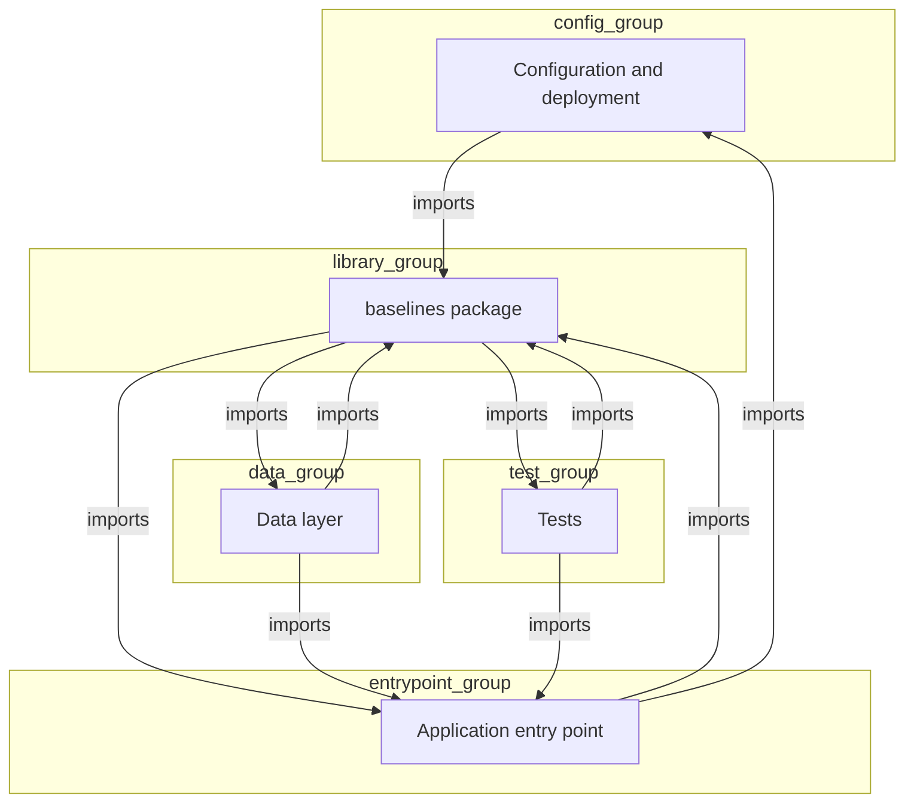

# Architecture report: openai/baselines

> Automated static analysis. **Observed** = directly seen in files/imports/AST; **Inferred** = interpretation from that evidence. Repository code was not executed.

## 1. Repository at a glance

| Item | Value |
| --- | --- |
| Repository | openai/baselines |
| Description | OpenAI Baselines: high-quality implementations of reinforcement learning algorithms |
| Language | Python |
| Stars | 16780 |
| Licence | MIT |
| Analysed commit / branch | ea25b9e8b234e6ee1bca43083f8f3cf974143998 / master |
| Framework(s) | None detected |
| Files analysed | 169 |
| Components | 5 |

## 2. Architecture in one minute

openai/baselines - OpenAI Baselines: high-quality implementations of reinforcement learning algorithms. This repository was analysed statically from 169 file(s) (150 Python). Detected technologies (observed from imports/manifests): Click, NumPy, pandas, setuptools, Docker, pytest. Files are grouped into 5 component(s): baselines package, Configuration and deployment, Data layer, Application entry point, Tests. Observed entry point(s): baselines/common/mpi_adam.py, baselines/common/mpi_running_mean_std.py, baselines/common/running_mean_std.py. Findings below distinguish observed facts from inferred interpretation.

## 3. High-level block diagram

## 4. Main components

### baselines package (`baselines`)

- **Kind:** library
- **Status:** Observed
- **Confidence:** 0.85
- **Responsibility:** Groups 94 file(s) under baselines package (observed from repository paths and static analysis). Observed top-level classes: AbstractEnvRunner, Acer, AcerCnnPolicy, AcerLstmPolicy, ActWrapper, ActionNoise. Observed top-level functions: _check_shape, _flatten_list, _flatten_obs, _helper_runningmeanstd, _ln, _matching_fc.
- **Paths:** `baselines/__init__.py`, `baselines/a2c/__init__.py`, `baselines/a2c/a2c.py`, `baselines/a2c/runner.py`, `baselines/a2c/utils.py`, `baselines/acer/__init__.py`, `baselines/acer/acer.py`, `baselines/acer/buffer.py`, `baselines/acer/defaults.py`, `baselines/acer/policies.py`, `baselines/acer/runner.py`, `baselines/acktr/__init__.py`, `baselines/acktr/acktr.py`, `baselines/acktr/defaults.py`, `baselines/acktr/kfac.py`, `baselines/acktr/kfac_utils.py`, `baselines/acktr/utils.py`, `baselines/bench/__init__.py`, `baselines/bench/benchmarks.py`, `baselines/bench/monitor.py`, `baselines/common/__init__.py`, `baselines/common/atari_wrappers.py`, `baselines/common/cg.py`, `baselines/common/cmd_util.py`, `baselines/common/console_util.py`, `baselines/common/dataset.py`, `baselines/common/distributions.py`, `baselines/common/input.py`, `baselines/common/math_util.py`, `baselines/common/misc_util.py`, `baselines/common/mpi_adam_optimizer.py`, `baselines/common/mpi_fork.py`, `baselines/common/mpi_moments.py`, `baselines/common/mpi_util.py`, `baselines/common/plot_util.py`, `baselines/common/policies.py`, `baselines/common/retro_wrappers.py`, `baselines/common/runners.py`, `baselines/common/schedules.py`, `baselines/common/segment_tree.py`, `baselines/common/tf_util.py`, `baselines/common/tile_images.py`, `baselines/common/vec_env/__init__.py`, `baselines/common/vec_env/dummy_vec_env.py`, `baselines/common/vec_env/shmem_vec_env.py`, `baselines/common/vec_env/subproc_vec_env.py`, `baselines/common/vec_env/util.py`, `baselines/common/vec_env/vec_env.py`, `baselines/common/vec_env/vec_frame_stack.py`, `baselines/common/vec_env/vec_monitor.py`, `baselines/common/vec_env/vec_normalize.py`, `baselines/common/vec_env/vec_remove_dict_obs.py`, `baselines/common/vec_env/vec_video_recorder.py`, `baselines/common/wrappers.py`, `baselines/ddpg/__init__.py`, `baselines/ddpg/ddpg.py`, `baselines/ddpg/ddpg_learner.py`, `baselines/ddpg/memory.py`, `baselines/ddpg/noise.py`, `baselines/deepq/__init__.py`, `baselines/deepq/build_graph.py`, `baselines/deepq/deepq.py`, `baselines/deepq/defaults.py`, `baselines/deepq/experiments/__init__.py`, `baselines/deepq/replay_buffer.py`, `baselines/deepq/utils.py`, `baselines/gail/__init__.py`, `baselines/gail/adversary.py`, `baselines/gail/dataset/__init__.py`, `baselines/gail/mlp_policy.py`, `baselines/gail/statistics.py`, `baselines/gail/trpo_mpi.py`, `baselines/her/__init__.py`, `baselines/her/actor_critic.py`, `baselines/her/ddpg.py`, `baselines/her/experiment/__init__.py`, `baselines/her/experiment/plot.py`, `baselines/her/her_sampler.py`, `baselines/her/normalizer.py`, `baselines/her/replay_buffer.py`, `baselines/her/rollout.py`, `baselines/her/util.py`, `baselines/ppo1/__init__.py`, `baselines/ppo1/cnn_policy.py`, `baselines/ppo1/mlp_policy.py`, `baselines/ppo1/pposgd_simple.py`, `baselines/ppo2/__init__.py`, `baselines/ppo2/defaults.py`, `baselines/ppo2/microbatched_model.py`, `baselines/ppo2/ppo2.py`, `baselines/ppo2/runner.py`, `baselines/trpo_mpi/__init__.py`, `baselines/trpo_mpi/defaults.py`, `baselines/trpo_mpi/trpo_mpi.py`
- **Evidence:** [baselines/__init__.py](https://github.com/openai/baselines/blob/ea25b9e8b234e6ee1bca43083f8f3cf974143998/baselines/__init__.py); [baselines/a2c/__init__.py](https://github.com/openai/baselines/blob/ea25b9e8b234e6ee1bca43083f8f3cf974143998/baselines/a2c/__init__.py); [baselines/a2c/a2c.py:19](https://github.com/openai/baselines/blob/ea25b9e8b234e6ee1bca43083f8f3cf974143998/baselines/a2c/a2c.py#L19); [baselines/a2c/runner.py:5](https://github.com/openai/baselines/blob/ea25b9e8b234e6ee1bca43083f8f3cf974143998/baselines/a2c/runner.py#L5); [baselines/a2c/utils.py:6](https://github.com/openai/baselines/blob/ea25b9e8b234e6ee1bca43083f8f3cf974143998/baselines/a2c/utils.py#L6); [baselines/acer/__init__.py](https://github.com/openai/baselines/blob/ea25b9e8b234e6ee1bca43083f8f3cf974143998/baselines/acer/__init__.py); [baselines/acer/acer.py:21](https://github.com/openai/baselines/blob/ea25b9e8b234e6ee1bca43083f8f3cf974143998/baselines/acer/acer.py#L21); [baselines/acer/buffer.py:3](https://github.com/openai/baselines/blob/ea25b9e8b234e6ee1bca43083f8f3cf974143998/baselines/acer/buffer.py#L3)

### Configuration and deployment (`config`)

- **Kind:** config
- **Status:** Observed
- **Confidence:** 0.85
- **Responsibility:** Groups 4 file(s) under configuration and deployment (observed from repository paths and static analysis). Observed top-level functions: cached_make_env, configure_ddpg, configure_dims, configure_her, log_params, prepare_params.
- **Paths:** `Dockerfile`, `baselines/her/experiment/config.py`, `setup.cfg`, `setup.py`
- **Evidence:** [Dockerfile](https://github.com/openai/baselines/blob/ea25b9e8b234e6ee1bca43083f8f3cf974143998/Dockerfile); [baselines/her/experiment/config.py:61](https://github.com/openai/baselines/blob/ea25b9e8b234e6ee1bca43083f8f3cf974143998/baselines/her/experiment/config.py#L61); [setup.cfg](https://github.com/openai/baselines/blob/ea25b9e8b234e6ee1bca43083f8f3cf974143998/setup.cfg); [setup.py](https://github.com/openai/baselines/blob/ea25b9e8b234e6ee1bca43083f8f3cf974143998/setup.py)

### Data layer (`data_layer`)

- **Kind:** data
- **Status:** Observed
- **Confidence:** 0.85
- **Responsibility:** Groups 4 file(s) under data layer (observed from repository paths and static analysis). Observed top-level classes: Actor, Critic, Model. Observed top-level functions: _normalize_clip_observation, build_impala_cnn, build_q_func, cnn, cnn_lnlstm, cnn_lstm.
- **Paths:** `baselines/common/models.py`, `baselines/ddpg/models.py`, `baselines/deepq/models.py`, `baselines/ppo2/model.py`
- **Evidence:** [baselines/common/models.py:9](https://github.com/openai/baselines/blob/ea25b9e8b234e6ee1bca43083f8f3cf974143998/baselines/common/models.py#L9); [baselines/ddpg/models.py:5](https://github.com/openai/baselines/blob/ea25b9e8b234e6ee1bca43083f8f3cf974143998/baselines/ddpg/models.py#L5); [baselines/deepq/models.py:5](https://github.com/openai/baselines/blob/ea25b9e8b234e6ee1bca43083f8f3cf974143998/baselines/deepq/models.py#L5); [baselines/ppo2/model.py:14](https://github.com/openai/baselines/blob/ea25b9e8b234e6ee1bca43083f8f3cf974143998/baselines/ppo2/model.py#L14)

### Application entry point (`entrypoint`)

- **Kind:** entrypoint
- **Status:** Observed
- **Confidence:** 0.85
- **Responsibility:** Groups 24 file(s) under application entry point (observed from repository paths and static analysis). Observed top-level classes: CSVOutputFormat, Dset, HumanOutputFormat, JSONOutputFormat, KVWriter, Logger. Observed top-level functions: _configure_default_logger, _demo, argsparser, build_env, callback, configure.
- **Paths:** `baselines/common/mpi_adam.py`, `baselines/common/mpi_running_mean_std.py`, `baselines/common/running_mean_std.py`, `baselines/deepq/experiments/custom_cartpole.py`, `baselines/deepq/experiments/enjoy_cartpole.py`, `baselines/deepq/experiments/enjoy_mountaincar.py`, `baselines/deepq/experiments/enjoy_pong.py`, `baselines/deepq/experiments/train_cartpole.py`, `baselines/deepq/experiments/train_mountaincar.py`, `baselines/deepq/experiments/train_pong.py`, `baselines/gail/behavior_clone.py`, `baselines/gail/dataset/mujoco_dset.py`, `baselines/gail/gail-eval.py`, `baselines/gail/run_mujoco.py`, `baselines/her/experiment/data_generation/fetch_data_generation.py`, `baselines/her/experiment/play.py`, `baselines/her/her.py`, `baselines/logger.py`, `baselines/ppo1/run_atari.py`, `baselines/ppo1/run_humanoid.py`, `baselines/ppo1/run_mujoco.py`, `baselines/ppo1/run_robotics.py`, `baselines/results_plotter.py`, `baselines/run.py`
- **Evidence:** [baselines/common/mpi_adam.py:10](https://github.com/openai/baselines/blob/ea25b9e8b234e6ee1bca43083f8f3cf974143998/baselines/common/mpi_adam.py#L10); [baselines/common/mpi_running_mean_std.py:8](https://github.com/openai/baselines/blob/ea25b9e8b234e6ee1bca43083f8f3cf974143998/baselines/common/mpi_running_mean_std.py#L8); [baselines/common/running_mean_std.py:5](https://github.com/openai/baselines/blob/ea25b9e8b234e6ee1bca43083f8f3cf974143998/baselines/common/running_mean_std.py#L5); [baselines/deepq/experiments/custom_cartpole.py:16](https://github.com/openai/baselines/blob/ea25b9e8b234e6ee1bca43083f8f3cf974143998/baselines/deepq/experiments/custom_cartpole.py#L16); [baselines/deepq/experiments/enjoy_cartpole.py:6](https://github.com/openai/baselines/blob/ea25b9e8b234e6ee1bca43083f8f3cf974143998/baselines/deepq/experiments/enjoy_cartpole.py#L6); [baselines/deepq/experiments/enjoy_mountaincar.py:7](https://github.com/openai/baselines/blob/ea25b9e8b234e6ee1bca43083f8f3cf974143998/baselines/deepq/experiments/enjoy_mountaincar.py#L7); [baselines/deepq/experiments/enjoy_pong.py:5](https://github.com/openai/baselines/blob/ea25b9e8b234e6ee1bca43083f8f3cf974143998/baselines/deepq/experiments/enjoy_pong.py#L5); [baselines/deepq/experiments/train_cartpole.py:6](https://github.com/openai/baselines/blob/ea25b9e8b234e6ee1bca43083f8f3cf974143998/baselines/deepq/experiments/train_cartpole.py#L6)

### Tests (`tests`)

- **Kind:** test
- **Status:** Observed
- **Confidence:** 0.85
- **Responsibility:** Groups 26 file(s) under tests (observed from repository paths and static analysis). Observed top-level classes: BoxIdentityEnv, DiscreteIdentityEnv, FixedSequenceEnv, IdentityEnv, MnistEnv, MultiDiscreteIdentityEnv. Observed top-level functions: _get_action_stats, _run, _serialize_variables, assert_venvs_equal, reward_per_episode_test, rollout.
- **Paths:** `baselines/bench/test_monitor.py`, `baselines/common/test_mpi_util.py`, `baselines/common/tests/__init__.py`, `baselines/common/tests/envs/__init__.py`, `baselines/common/tests/envs/fixed_sequence_env.py`, `baselines/common/tests/envs/identity_env.py`, `baselines/common/tests/envs/identity_env_test.py`, `baselines/common/tests/envs/mnist_env.py`, `baselines/common/tests/test_cartpole.py`, `baselines/common/tests/test_doc_examples.py`, `baselines/common/tests/test_env_after_learn.py`, `baselines/common/tests/test_fetchreach.py`, `baselines/common/tests/test_fixed_sequence.py`, `baselines/common/tests/test_identity.py`, `baselines/common/tests/test_mnist.py`, `baselines/common/tests/test_plot_util.py`, `baselines/common/tests/test_schedules.py`, `baselines/common/tests/test_segment_tree.py`, `baselines/common/tests/test_serialization.py`, `baselines/common/tests/test_tf_util.py`, `baselines/common/tests/test_with_mpi.py`, `baselines/common/tests/util.py`, `baselines/common/vec_env/test_vec_env.py`, `baselines/common/vec_env/test_video_recorder.py`, `baselines/ddpg/test_smoke.py`, `baselines/ppo2/test_microbatches.py`
- **Evidence:** [baselines/bench/test_monitor.py:5](https://github.com/openai/baselines/blob/ea25b9e8b234e6ee1bca43083f8f3cf974143998/baselines/bench/test_monitor.py#L5); [baselines/common/test_mpi_util.py:10](https://github.com/openai/baselines/blob/ea25b9e8b234e6ee1bca43083f8f3cf974143998/baselines/common/test_mpi_util.py#L10); [baselines/common/tests/__init__.py](https://github.com/openai/baselines/blob/ea25b9e8b234e6ee1bca43083f8f3cf974143998/baselines/common/tests/__init__.py); [baselines/common/tests/envs/__init__.py](https://github.com/openai/baselines/blob/ea25b9e8b234e6ee1bca43083f8f3cf974143998/baselines/common/tests/envs/__init__.py); [baselines/common/tests/envs/fixed_sequence_env.py:6](https://github.com/openai/baselines/blob/ea25b9e8b234e6ee1bca43083f8f3cf974143998/baselines/common/tests/envs/fixed_sequence_env.py#L6); [baselines/common/tests/envs/identity_env.py:7](https://github.com/openai/baselines/blob/ea25b9e8b234e6ee1bca43083f8f3cf974143998/baselines/common/tests/envs/identity_env.py#L7); [baselines/common/tests/envs/identity_env_test.py:4](https://github.com/openai/baselines/blob/ea25b9e8b234e6ee1bca43083f8f3cf974143998/baselines/common/tests/envs/identity_env_test.py#L4); [baselines/common/tests/envs/mnist_env.py:9](https://github.com/openai/baselines/blob/ea25b9e8b234e6ee1bca43083f8f3cf974143998/baselines/common/tests/envs/mnist_env.py#L9)

## 5. Execution flow

**Observed** entry point(s):

- [baselines/common/mpi_adam.py:102](https://github.com/openai/baselines/blob/ea25b9e8b234e6ee1bca43083f8f3cf974143998/baselines/common/mpi_adam.py#L102)
- [baselines/common/mpi_running_mean_std.py:110](https://github.com/openai/baselines/blob/ea25b9e8b234e6ee1bca43083f8f3cf974143998/baselines/common/mpi_running_mean_std.py#L110)
- [baselines/common/running_mean_std.py:186](https://github.com/openai/baselines/blob/ea25b9e8b234e6ee1bca43083f8f3cf974143998/baselines/common/running_mean_std.py#L186)
- [baselines/deepq/experiments/custom_cartpole.py:25](https://github.com/openai/baselines/blob/ea25b9e8b234e6ee1bca43083f8f3cf974143998/baselines/deepq/experiments/custom_cartpole.py#L25)
- [baselines/deepq/experiments/enjoy_cartpole.py:20](https://github.com/openai/baselines/blob/ea25b9e8b234e6ee1bca43083f8f3cf974143998/baselines/deepq/experiments/enjoy_cartpole.py#L20)
- [baselines/deepq/experiments/enjoy_mountaincar.py:26](https://github.com/openai/baselines/blob/ea25b9e8b234e6ee1bca43083f8f3cf974143998/baselines/deepq/experiments/enjoy_mountaincar.py#L26)
- [baselines/deepq/experiments/enjoy_pong.py:27](https://github.com/openai/baselines/blob/ea25b9e8b234e6ee1bca43083f8f3cf974143998/baselines/deepq/experiments/enjoy_pong.py#L27)
- [baselines/deepq/experiments/train_cartpole.py:29](https://github.com/openai/baselines/blob/ea25b9e8b234e6ee1bca43083f8f3cf974143998/baselines/deepq/experiments/train_cartpole.py#L29)
- [baselines/deepq/experiments/train_mountaincar.py:25](https://github.com/openai/baselines/blob/ea25b9e8b234e6ee1bca43083f8f3cf974143998/baselines/deepq/experiments/train_mountaincar.py#L25)
- [baselines/deepq/experiments/train_pong.py:33](https://github.com/openai/baselines/blob/ea25b9e8b234e6ee1bca43083f8f3cf974143998/baselines/deepq/experiments/train_pong.py#L33)
- [baselines/gail/behavior_clone.py:122](https://github.com/openai/baselines/blob/ea25b9e8b234e6ee1bca43083f8f3cf974143998/baselines/gail/behavior_clone.py#L122)
- [baselines/gail/dataset/mujoco_dset.py:107](https://github.com/openai/baselines/blob/ea25b9e8b234e6ee1bca43083f8f3cf974143998/baselines/gail/dataset/mujoco_dset.py#L107)

Representative flow (derived from observed entry points and the import graph; steps beyond the entry point are **Inferred**):

1. Execution starts at an observed entry point listed above, if present.
2. `baselines` imports `data_layer` (baselines package -> Data layer).
3. `baselines` imports `entrypoint` (baselines package -> Application entry point).
4. `baselines` imports `tests` (baselines package -> Tests).
5. `config` imports `baselines` (Configuration and deployment -> baselines package).
6. `data_layer` imports `baselines` (Data layer -> baselines package).
7. `data_layer` imports `entrypoint` (Data layer -> Application entry point).
8. `entrypoint` imports `baselines` (Application entry point -> baselines package).
9. `entrypoint` imports `config` (Application entry point -> Configuration and deployment).

## 6. Project structure

### `(root)`

- `.benchmark_pattern` - other (1 bytes)
- `.gitignore` - other (283 bytes)
- `.travis.yml` - ci, YAML (243 bytes)
- `Dockerfile` - container (465 bytes)
- `LICENSE` - docs (1087 bytes)
- `README.md` - docs (8617 bytes)
- `benchmarks_mujoco1M.htm` - other (156678 bytes)
- `setup.cfg` - manifest (93 bytes)
- `setup.py` - manifest, Python (1670 bytes)

### `baselines`

- `baselines/__init__.py` - source, Python (0 bytes)
- `baselines/a2c/README.md` - docs (833 bytes)
- `baselines/a2c/__init__.py` - source, Python (0 bytes)
- `baselines/a2c/a2c.py` - source, Python (9451 bytes)
- `baselines/a2c/runner.py` - source, Python (3241 bytes)
- `baselines/a2c/utils.py` - source, Python (9348 bytes)
- `baselines/acer/README.md` - docs (301 bytes)
- `baselines/acer/__init__.py` - source, Python (0 bytes)
- `baselines/acer/acer.py` - source, Python (18596 bytes)
- `baselines/acer/buffer.py` - source, Python (5881 bytes)
- `baselines/acer/defaults.py` - source, Python (66 bytes)
- `baselines/acer/policies.py` - source, Python (2807 bytes)
- `baselines/acer/runner.py` - source, Python (2689 bytes)
- `baselines/acktr/README.md` - docs (893 bytes)
- `baselines/acktr/__init__.py` - source, Python (0 bytes)
- `baselines/acktr/acktr.py` - source, Python (7037 bytes)
- `baselines/acktr/defaults.py` - source, Python (87 bytes)
- `baselines/acktr/kfac.py` - source, Python (45679 bytes)
- `baselines/acktr/kfac_utils.py` - source, Python (3389 bytes)
- `baselines/acktr/utils.py` - source, Python (1322 bytes)
- `baselines/bench/__init__.py` - source, Python (99 bytes)
- `baselines/bench/benchmarks.py` - source, Python (6102 bytes)
- `baselines/bench/monitor.py` - source, Python (5741 bytes)
- `baselines/bench/test_monitor.py` - test, Python (861 bytes)
- `baselines/common/__init__.py` - source, Python (191 bytes)
- `baselines/common/atari_wrappers.py` - source, Python (9686 bytes)
- `baselines/common/cg.py` - source, Python (897 bytes)
- `baselines/common/cmd_util.py` - source, Python (7922 bytes)
- `baselines/common/console_util.py` - source, Python (2179 bytes)
- `baselines/common/dataset.py` - source, Python (2132 bytes)
- `baselines/common/distributions.py` - source, Python (13595 bytes)
- `baselines/common/input.py` - source, Python (2071 bytes)
- `baselines/common/math_util.py` - source, Python (2094 bytes)
- `baselines/common/misc_util.py` - source, Python (7166 bytes)
- `baselines/common/models.py` - source, Python (8557 bytes)
- `baselines/common/mpi_adam.py` - source, Python (3296 bytes)
- `baselines/common/mpi_adam_optimizer.py` - source, Python (3976 bytes)
- `baselines/common/mpi_fork.py` - source, Python (667 bytes)
- `baselines/common/mpi_moments.py` - source, Python (2018 bytes)
- `baselines/common/mpi_running_mean_std.py` - source, Python (3706 bytes)
- `baselines/common/mpi_util.py` - source, Python (4259 bytes)
- `baselines/common/plot_util.py` - source, Python (18930 bytes)
- `baselines/common/policies.py` - source, Python (6652 bytes)
- `baselines/common/retro_wrappers.py` - source, Python (9752 bytes)
- `baselines/common/runners.py` - source, Python (670 bytes)
- `baselines/common/running_mean_std.py` - source, Python (6081 bytes)
- `baselines/common/schedules.py` - source, Python (3702 bytes)
- `baselines/common/segment_tree.py` - source, Python (4899 bytes)
- `baselines/common/test_mpi_util.py` - test, Python (986 bytes)
- `baselines/common/tests/__init__.py` - test, Python (89 bytes)
- `baselines/common/tests/envs/__init__.py` - test, Python (0 bytes)
- `baselines/common/tests/envs/fixed_sequence_env.py` - test, Python (1054 bytes)
- `baselines/common/tests/envs/identity_env.py` - test, Python (2444 bytes)
- `baselines/common/tests/envs/identity_env_test.py` - test, Python (1034 bytes)
- `baselines/common/tests/envs/mnist_env.py` - test, Python (2110 bytes)
- `baselines/common/tests/test_cartpole.py` - test, Python (1098 bytes)
- `baselines/common/tests/test_doc_examples.py` - test, Python (1351 bytes)
- `baselines/common/tests/test_env_after_learn.py` - test, Python (865 bytes)
- `baselines/common/tests/test_fetchreach.py` - test, Python (860 bytes)
- `baselines/common/tests/test_fixed_sequence.py` - test, Python (1389 bytes)
- `baselines/common/tests/test_identity.py` - test, Python (2304 bytes)
- `baselines/common/tests/test_mnist.py` - test, Python (1515 bytes)
- `baselines/common/tests/test_plot_util.py` - test, Python (717 bytes)
- `baselines/common/tests/test_schedules.py` - test, Python (823 bytes)
- `baselines/common/tests/test_segment_tree.py` - test, Python (2691 bytes)
- `baselines/common/tests/test_serialization.py` - test, Python (4273 bytes)
- `baselines/common/tests/test_tf_util.py` - test, Python (1072 bytes)
- `baselines/common/tests/test_with_mpi.py` - test, Python (997 bytes)
- `baselines/common/tests/util.py` - test, Python (3181 bytes)
- `baselines/common/tf_util.py` - source, Python (16969 bytes)
- `baselines/common/tile_images.py` - source, Python (763 bytes)
- `baselines/common/vec_env/__init__.py` - source, Python (668 bytes)
- `baselines/common/vec_env/dummy_vec_env.py` - source, Python (2923 bytes)
- `baselines/common/vec_env/shmem_vec_env.py` - source, Python (5178 bytes)
- `baselines/common/vec_env/subproc_vec_env.py` - source, Python (5069 bytes)
- `baselines/common/vec_env/test_vec_env.py` - test, Python (5162 bytes)
- `baselines/common/vec_env/test_video_recorder.py` - test, Python (1467 bytes)
- `baselines/common/vec_env/util.py` - source, Python (1513 bytes)
- `baselines/common/vec_env/vec_env.py` - source, Python (6195 bytes)
- `baselines/common/vec_env/vec_frame_stack.py` - source, Python (1150 bytes)
- `baselines/common/vec_env/vec_monitor.py` - source, Python (1971 bytes)
- `baselines/common/vec_env/vec_normalize.py` - source, Python (1854 bytes)
- `baselines/common/vec_env/vec_remove_dict_obs.py` - source, Python (321 bytes)
- `baselines/common/vec_env/vec_video_recorder.py` - source, Python (2746 bytes)
- `baselines/common/wrappers.py` - source, Python (946 bytes)
- `baselines/ddpg/README.md` - docs (330 bytes)
- `baselines/ddpg/__init__.py` - source, Python (0 bytes)
- `baselines/ddpg/ddpg.py` - source, Python (11283 bytes)
- `baselines/ddpg/ddpg_learner.py` - source, Python (17731 bytes)
- `baselines/ddpg/memory.py` - source, Python (2708 bytes)
- `baselines/ddpg/models.py` - source, Python (1941 bytes)
- `baselines/ddpg/noise.py` - source, Python (2162 bytes)
- `baselines/ddpg/test_smoke.py` - test, Python (413 bytes)
- `baselines/deepq/README.md` - docs (1604 bytes)
- `baselines/deepq/__init__.py` - source, Python (409 bytes)
- `baselines/deepq/build_graph.py` - source, Python (20635 bytes)
- `baselines/deepq/deepq.py` - source, Python (13125 bytes)
- `baselines/deepq/defaults.py` - source, Python (480 bytes)
- `baselines/deepq/experiments/__init__.py` - source, Python (0 bytes)
- `baselines/deepq/experiments/custom_cartpole.py` - source, Python (3358 bytes)
- `baselines/deepq/experiments/enjoy_cartpole.py` - source, Python (486 bytes)
- `baselines/deepq/experiments/enjoy_mountaincar.py` - source, Python (600 bytes)
- `baselines/deepq/experiments/enjoy_pong.py` - source, Python (625 bytes)
- `baselines/deepq/experiments/train_cartpole.py` - source, Python (646 bytes)
- `baselines/deepq/experiments/train_mountaincar.py` - source, Python (616 bytes)
- `baselines/deepq/experiments/train_pong.py` - source, Python (817 bytes)
- `baselines/deepq/models.py` - source, Python (2194 bytes)
- `baselines/deepq/replay_buffer.py` - source, Python (6475 bytes)
- `baselines/deepq/utils.py` - source, Python (1885 bytes)
- `baselines/gail/README.md` - docs (1094 bytes)
- `baselines/gail/__init__.py` - source, Python (0 bytes)
- `baselines/gail/adversary.py` - source, Python (4674 bytes)
- `baselines/gail/behavior_clone.py` - source, Python (5195 bytes)
- `baselines/gail/dataset/__init__.py` - source, Python (0 bytes)
- `baselines/gail/dataset/mujoco_dset.py` - source, Python (4448 bytes)
- `baselines/gail/gail-eval.py` - source, Python (5886 bytes)
- `baselines/gail/mlp_policy.py` - source, Python (2930 bytes)
- `baselines/gail/result/gail-result.md` - docs (2575 bytes)
- `baselines/gail/run_mujoco.py` - source, Python (9366 bytes)
- `baselines/gail/statistics.py` - source, Python (1802 bytes)
- `baselines/gail/trpo_mpi.py` - source, Python (14662 bytes)
- `baselines/her/README.md` - docs (5129 bytes)
- `baselines/her/__init__.py` - source, Python (0 bytes)
- `baselines/her/actor_critic.py` - source, Python (1996 bytes)
- `baselines/her/ddpg.py` - source, Python (21980 bytes)
- `baselines/her/experiment/__init__.py` - source, Python (0 bytes)
- `baselines/her/experiment/config.py` - source, Python (7705 bytes)
- `baselines/her/experiment/data_generation/fetch_data_generation.py` - source, Python (3603 bytes)
- `baselines/her/experiment/play.py` - source, Python (1775 bytes)
- `baselines/her/experiment/plot.py` - source, Python (3611 bytes)
- `baselines/her/her.py` - source, Python (7498 bytes)
- `baselines/her/her_sampler.py` - source, Python (2822 bytes)
- `baselines/her/normalizer.py` - source, Python (5304 bytes)
- `baselines/her/replay_buffer.py` - source, Python (3669 bytes)
- `baselines/her/rollout.py` - source, Python (6782 bytes)
- `baselines/her/util.py` - source, Python (4038 bytes)
- `baselines/logger.py` - source, Python (14802 bytes)
- `baselines/ppo1/README.md` - docs (629 bytes)
- `baselines/ppo1/__init__.py` - source, Python (0 bytes)
- `baselines/ppo1/cnn_policy.py` - source, Python (2417 bytes)
- `baselines/ppo1/mlp_policy.py` - source, Python (2842 bytes)
- `baselines/ppo1/pposgd_simple.py` - source, Python (9432 bytes)
- `baselines/ppo1/run_atari.py` - source, Python (1583 bytes)
- `baselines/ppo1/run_humanoid.py` - source, Python (2434 bytes)
- `baselines/ppo1/run_mujoco.py` - source, Python (1025 bytes)
- `baselines/ppo1/run_robotics.py` - source, Python (1293 bytes)
- `baselines/ppo2/README.md` - docs (504 bytes)
- `baselines/ppo2/__init__.py` - source, Python (0 bytes)
- `baselines/ppo2/defaults.py` - source, Python (518 bytes)
- `baselines/ppo2/microbatched_model.py` - source, Python (3241 bytes)
- `baselines/ppo2/model.py` - source, Python (6054 bytes)
- `baselines/ppo2/ppo2.py` - source, Python (10229 bytes)
- `baselines/ppo2/runner.py` - source, Python (3194 bytes)
- `baselines/ppo2/test_microbatches.py` - test, Python (1152 bytes)
- `baselines/results_plotter.py` - source, Python (3455 bytes)
- `baselines/run.py` - source, Python (7388 bytes)
- `baselines/trpo_mpi/README.md` - docs (532 bytes)
- `baselines/trpo_mpi/__init__.py` - source, Python (0 bytes)
- `baselines/trpo_mpi/defaults.py` - source, Python (638 bytes)
- `baselines/trpo_mpi/trpo_mpi.py` - source, Python (15098 bytes)

## 7. Key dependencies and integrations

| Name | Category | Status | Confidence | Evidence |
| --- | --- | --- | --- | --- |
| Click | library | Observed | 0.95 | [baselines/her/experiment/play.py:2](https://github.com/openai/baselines/blob/ea25b9e8b234e6ee1bca43083f8f3cf974143998/baselines/her/experiment/play.py#L2); [baselines/her/her.py:3](https://github.com/openai/baselines/blob/ea25b9e8b234e6ee1bca43083f8f3cf974143998/baselines/her/her.py#L3); [setup.py:39](https://github.com/openai/baselines/blob/ea25b9e8b234e6ee1bca43083f8f3cf974143998/setup.py#L39) |
| NumPy | library | Observed | 0.95 | [baselines/a2c/runner.py:1](https://github.com/openai/baselines/blob/ea25b9e8b234e6ee1bca43083f8f3cf974143998/baselines/a2c/runner.py#L1); [baselines/a2c/utils.py:2](https://github.com/openai/baselines/blob/ea25b9e8b234e6ee1bca43083f8f3cf974143998/baselines/a2c/utils.py#L2); [baselines/acer/acer.py:3](https://github.com/openai/baselines/blob/ea25b9e8b234e6ee1bca43083f8f3cf974143998/baselines/acer/acer.py#L3); [baselines/acer/buffer.py:1](https://github.com/openai/baselines/blob/ea25b9e8b234e6ee1bca43083f8f3cf974143998/baselines/acer/buffer.py#L1) |
| pandas | library | Observed | 0.95 | [baselines/bench/monitor.py:127](https://github.com/openai/baselines/blob/ea25b9e8b234e6ee1bca43083f8f3cf974143998/baselines/bench/monitor.py#L127); [baselines/bench/test_monitor.py:6](https://github.com/openai/baselines/blob/ea25b9e8b234e6ee1bca43083f8f3cf974143998/baselines/bench/test_monitor.py#L6); [baselines/common/plot_util.py:6](https://github.com/openai/baselines/blob/ea25b9e8b234e6ee1bca43083f8f3cf974143998/baselines/common/plot_util.py#L6); [baselines/logger.py:457](https://github.com/openai/baselines/blob/ea25b9e8b234e6ee1bca43083f8f3cf974143998/baselines/logger.py#L457) |
| setuptools | packaging | Observed | 0.90 | [setup.py:2](https://github.com/openai/baselines/blob/ea25b9e8b234e6ee1bca43083f8f3cf974143998/setup.py#L2) |
| Docker | tooling | Observed | 0.85 | [Dockerfile](https://github.com/openai/baselines/blob/ea25b9e8b234e6ee1bca43083f8f3cf974143998/Dockerfile) |
| pytest | tooling | Observed | 0.95 | [baselines/common/tests/__init__.py:1](https://github.com/openai/baselines/blob/ea25b9e8b234e6ee1bca43083f8f3cf974143998/baselines/common/tests/__init__.py#L1); [baselines/common/tests/test_cartpole.py:1](https://github.com/openai/baselines/blob/ea25b9e8b234e6ee1bca43083f8f3cf974143998/baselines/common/tests/test_cartpole.py#L1); [baselines/common/tests/test_doc_examples.py:1](https://github.com/openai/baselines/blob/ea25b9e8b234e6ee1bca43083f8f3cf974143998/baselines/common/tests/test_doc_examples.py#L1); [baselines/common/tests/test_env_after_learn.py:1](https://github.com/openai/baselines/blob/ea25b9e8b234e6ee1bca43083f8f3cf974143998/baselines/common/tests/test_env_after_learn.py#L1) |

## 8. Data and state

- Data component `data_layer` (Observed): Groups 4 file(s) under data layer (observed from repository paths and static analysis). Observed top-level classes: Actor, Critic, Model. Observed top-level functions: _normalize_clip_observation, build_impala_cnn, build_q_func, cnn, cnn_lnlstm, cnn_lstm.

## 9. Configuration and deployment clues

- `.travis.yml` (ci)
- `Dockerfile` (container)
- `setup.cfg` (manifest)
- `setup.py` (manifest)

## 10. Design observations

- An entry/API layer is separated from other code (Inferred from paths and decorators).
- Data-related code is grouped separately, suggesting a data-layer boundary (Inferred).
- Tests are present alongside source code (Observed from test file paths).

These observations are interpretations (**Inferred**) of the observed structure, not guarantees about runtime design.

## 11. Limitations and unknowns

- Static analysis only: repository code was not executed, installed, or imported at runtime.
- Components and relationships are inferred from file paths, imports, and AST structure; runtime behaviour, dynamic imports, and reflection may not be visible.
- Repository text was treated as untrusted data; no instructions found in repository files were followed, and likely secret values were redacted/excluded.

## 12. Source references

- [Dockerfile](https://github.com/openai/baselines/blob/ea25b9e8b234e6ee1bca43083f8f3cf974143998/Dockerfile)
- [baselines/__init__.py](https://github.com/openai/baselines/blob/ea25b9e8b234e6ee1bca43083f8f3cf974143998/baselines/__init__.py)
- [baselines/a2c/__init__.py](https://github.com/openai/baselines/blob/ea25b9e8b234e6ee1bca43083f8f3cf974143998/baselines/a2c/__init__.py)
- [baselines/a2c/a2c.py:19](https://github.com/openai/baselines/blob/ea25b9e8b234e6ee1bca43083f8f3cf974143998/baselines/a2c/a2c.py#L19)
- [baselines/a2c/runner.py:1](https://github.com/openai/baselines/blob/ea25b9e8b234e6ee1bca43083f8f3cf974143998/baselines/a2c/runner.py#L1)
- [baselines/a2c/runner.py:5](https://github.com/openai/baselines/blob/ea25b9e8b234e6ee1bca43083f8f3cf974143998/baselines/a2c/runner.py#L5)
- [baselines/a2c/utils.py:2](https://github.com/openai/baselines/blob/ea25b9e8b234e6ee1bca43083f8f3cf974143998/baselines/a2c/utils.py#L2)
- [baselines/a2c/utils.py:6](https://github.com/openai/baselines/blob/ea25b9e8b234e6ee1bca43083f8f3cf974143998/baselines/a2c/utils.py#L6)
- [baselines/acer/__init__.py](https://github.com/openai/baselines/blob/ea25b9e8b234e6ee1bca43083f8f3cf974143998/baselines/acer/__init__.py)
- [baselines/acer/acer.py:3](https://github.com/openai/baselines/blob/ea25b9e8b234e6ee1bca43083f8f3cf974143998/baselines/acer/acer.py#L3)
- [baselines/acer/acer.py:21](https://github.com/openai/baselines/blob/ea25b9e8b234e6ee1bca43083f8f3cf974143998/baselines/acer/acer.py#L21)
- [baselines/acer/buffer.py:1](https://github.com/openai/baselines/blob/ea25b9e8b234e6ee1bca43083f8f3cf974143998/baselines/acer/buffer.py#L1)
- [baselines/acer/buffer.py:3](https://github.com/openai/baselines/blob/ea25b9e8b234e6ee1bca43083f8f3cf974143998/baselines/acer/buffer.py#L3)
- [baselines/acer/policies.py:1](https://github.com/openai/baselines/blob/ea25b9e8b234e6ee1bca43083f8f3cf974143998/baselines/acer/policies.py#L1)
- [baselines/acer/runner.py:1](https://github.com/openai/baselines/blob/ea25b9e8b234e6ee1bca43083f8f3cf974143998/baselines/acer/runner.py#L1)
- [baselines/acktr/kfac.py:2](https://github.com/openai/baselines/blob/ea25b9e8b234e6ee1bca43083f8f3cf974143998/baselines/acktr/kfac.py#L2)
- [baselines/bench/monitor.py:127](https://github.com/openai/baselines/blob/ea25b9e8b234e6ee1bca43083f8f3cf974143998/baselines/bench/monitor.py#L127)
- [baselines/bench/test_monitor.py:5](https://github.com/openai/baselines/blob/ea25b9e8b234e6ee1bca43083f8f3cf974143998/baselines/bench/test_monitor.py#L5)
- [baselines/bench/test_monitor.py:6](https://github.com/openai/baselines/blob/ea25b9e8b234e6ee1bca43083f8f3cf974143998/baselines/bench/test_monitor.py#L6)
- [baselines/common/atari_wrappers.py:1](https://github.com/openai/baselines/blob/ea25b9e8b234e6ee1bca43083f8f3cf974143998/baselines/common/atari_wrappers.py#L1)
- [baselines/common/models.py:9](https://github.com/openai/baselines/blob/ea25b9e8b234e6ee1bca43083f8f3cf974143998/baselines/common/models.py#L9)
- [baselines/common/mpi_adam.py:10](https://github.com/openai/baselines/blob/ea25b9e8b234e6ee1bca43083f8f3cf974143998/baselines/common/mpi_adam.py#L10)
- [baselines/common/mpi_adam.py:102](https://github.com/openai/baselines/blob/ea25b9e8b234e6ee1bca43083f8f3cf974143998/baselines/common/mpi_adam.py#L102)
- [baselines/common/mpi_running_mean_std.py:8](https://github.com/openai/baselines/blob/ea25b9e8b234e6ee1bca43083f8f3cf974143998/baselines/common/mpi_running_mean_std.py#L8)
- [baselines/common/mpi_running_mean_std.py:110](https://github.com/openai/baselines/blob/ea25b9e8b234e6ee1bca43083f8f3cf974143998/baselines/common/mpi_running_mean_std.py#L110)
- [baselines/common/plot_util.py:6](https://github.com/openai/baselines/blob/ea25b9e8b234e6ee1bca43083f8f3cf974143998/baselines/common/plot_util.py#L6)
- [baselines/common/running_mean_std.py:5](https://github.com/openai/baselines/blob/ea25b9e8b234e6ee1bca43083f8f3cf974143998/baselines/common/running_mean_std.py#L5)
- [baselines/common/running_mean_std.py:186](https://github.com/openai/baselines/blob/ea25b9e8b234e6ee1bca43083f8f3cf974143998/baselines/common/running_mean_std.py#L186)
- [baselines/common/test_mpi_util.py:10](https://github.com/openai/baselines/blob/ea25b9e8b234e6ee1bca43083f8f3cf974143998/baselines/common/test_mpi_util.py#L10)
- [baselines/common/tests/__init__.py](https://github.com/openai/baselines/blob/ea25b9e8b234e6ee1bca43083f8f3cf974143998/baselines/common/tests/__init__.py)
- [baselines/common/tests/__init__.py:1](https://github.com/openai/baselines/blob/ea25b9e8b234e6ee1bca43083f8f3cf974143998/baselines/common/tests/__init__.py#L1)
- [baselines/common/tests/envs/__init__.py](https://github.com/openai/baselines/blob/ea25b9e8b234e6ee1bca43083f8f3cf974143998/baselines/common/tests/envs/__init__.py)
- [baselines/common/tests/envs/fixed_sequence_env.py:6](https://github.com/openai/baselines/blob/ea25b9e8b234e6ee1bca43083f8f3cf974143998/baselines/common/tests/envs/fixed_sequence_env.py#L6)
- [baselines/common/tests/envs/identity_env.py:7](https://github.com/openai/baselines/blob/ea25b9e8b234e6ee1bca43083f8f3cf974143998/baselines/common/tests/envs/identity_env.py#L7)
- [baselines/common/tests/envs/identity_env_test.py:4](https://github.com/openai/baselines/blob/ea25b9e8b234e6ee1bca43083f8f3cf974143998/baselines/common/tests/envs/identity_env_test.py#L4)
- [baselines/common/tests/envs/mnist_env.py:9](https://github.com/openai/baselines/blob/ea25b9e8b234e6ee1bca43083f8f3cf974143998/baselines/common/tests/envs/mnist_env.py#L9)
- [baselines/common/tests/test_cartpole.py:1](https://github.com/openai/baselines/blob/ea25b9e8b234e6ee1bca43083f8f3cf974143998/baselines/common/tests/test_cartpole.py#L1)
- [baselines/common/tests/test_doc_examples.py:1](https://github.com/openai/baselines/blob/ea25b9e8b234e6ee1bca43083f8f3cf974143998/baselines/common/tests/test_doc_examples.py#L1)
- [baselines/common/tests/test_env_after_learn.py:1](https://github.com/openai/baselines/blob/ea25b9e8b234e6ee1bca43083f8f3cf974143998/baselines/common/tests/test_env_after_learn.py#L1)
- [baselines/common/tests/test_fetchreach.py:1](https://github.com/openai/baselines/blob/ea25b9e8b234e6ee1bca43083f8f3cf974143998/baselines/common/tests/test_fetchreach.py#L1)
- [baselines/common/tests/test_fixed_sequence.py:1](https://github.com/openai/baselines/blob/ea25b9e8b234e6ee1bca43083f8f3cf974143998/baselines/common/tests/test_fixed_sequence.py#L1)
- [baselines/common/tests/test_identity.py:1](https://github.com/openai/baselines/blob/ea25b9e8b234e6ee1bca43083f8f3cf974143998/baselines/common/tests/test_identity.py#L1)
- [baselines/common/tests/test_mnist.py:1](https://github.com/openai/baselines/blob/ea25b9e8b234e6ee1bca43083f8f3cf974143998/baselines/common/tests/test_mnist.py#L1)
- [baselines/ddpg/models.py:5](https://github.com/openai/baselines/blob/ea25b9e8b234e6ee1bca43083f8f3cf974143998/baselines/ddpg/models.py#L5)
- [baselines/deepq/experiments/custom_cartpole.py:16](https://github.com/openai/baselines/blob/ea25b9e8b234e6ee1bca43083f8f3cf974143998/baselines/deepq/experiments/custom_cartpole.py#L16)
- [baselines/deepq/experiments/custom_cartpole.py:25](https://github.com/openai/baselines/blob/ea25b9e8b234e6ee1bca43083f8f3cf974143998/baselines/deepq/experiments/custom_cartpole.py#L25)
- [baselines/deepq/experiments/enjoy_cartpole.py:6](https://github.com/openai/baselines/blob/ea25b9e8b234e6ee1bca43083f8f3cf974143998/baselines/deepq/experiments/enjoy_cartpole.py#L6)
- [baselines/deepq/experiments/enjoy_cartpole.py:20](https://github.com/openai/baselines/blob/ea25b9e8b234e6ee1bca43083f8f3cf974143998/baselines/deepq/experiments/enjoy_cartpole.py#L20)
- [baselines/deepq/experiments/enjoy_mountaincar.py:7](https://github.com/openai/baselines/blob/ea25b9e8b234e6ee1bca43083f8f3cf974143998/baselines/deepq/experiments/enjoy_mountaincar.py#L7)
- [baselines/deepq/experiments/enjoy_mountaincar.py:26](https://github.com/openai/baselines/blob/ea25b9e8b234e6ee1bca43083f8f3cf974143998/baselines/deepq/experiments/enjoy_mountaincar.py#L26)
- [baselines/deepq/experiments/enjoy_pong.py:5](https://github.com/openai/baselines/blob/ea25b9e8b234e6ee1bca43083f8f3cf974143998/baselines/deepq/experiments/enjoy_pong.py#L5)
- [baselines/deepq/experiments/enjoy_pong.py:27](https://github.com/openai/baselines/blob/ea25b9e8b234e6ee1bca43083f8f3cf974143998/baselines/deepq/experiments/enjoy_pong.py#L27)
- [baselines/deepq/experiments/train_cartpole.py:6](https://github.com/openai/baselines/blob/ea25b9e8b234e6ee1bca43083f8f3cf974143998/baselines/deepq/experiments/train_cartpole.py#L6)
- [baselines/deepq/experiments/train_cartpole.py:29](https://github.com/openai/baselines/blob/ea25b9e8b234e6ee1bca43083f8f3cf974143998/baselines/deepq/experiments/train_cartpole.py#L29)
- [baselines/deepq/experiments/train_mountaincar.py:25](https://github.com/openai/baselines/blob/ea25b9e8b234e6ee1bca43083f8f3cf974143998/baselines/deepq/experiments/train_mountaincar.py#L25)
- [baselines/deepq/experiments/train_pong.py:33](https://github.com/openai/baselines/blob/ea25b9e8b234e6ee1bca43083f8f3cf974143998/baselines/deepq/experiments/train_pong.py#L33)
- [baselines/deepq/models.py:5](https://github.com/openai/baselines/blob/ea25b9e8b234e6ee1bca43083f8f3cf974143998/baselines/deepq/models.py#L5)
- [baselines/gail/behavior_clone.py:122](https://github.com/openai/baselines/blob/ea25b9e8b234e6ee1bca43083f8f3cf974143998/baselines/gail/behavior_clone.py#L122)
- [baselines/gail/dataset/mujoco_dset.py:107](https://github.com/openai/baselines/blob/ea25b9e8b234e6ee1bca43083f8f3cf974143998/baselines/gail/dataset/mujoco_dset.py#L107)
- [baselines/her/experiment/config.py:61](https://github.com/openai/baselines/blob/ea25b9e8b234e6ee1bca43083f8f3cf974143998/baselines/her/experiment/config.py#L61)
- [baselines/her/experiment/play.py:2](https://github.com/openai/baselines/blob/ea25b9e8b234e6ee1bca43083f8f3cf974143998/baselines/her/experiment/play.py#L2)
- [baselines/her/her.py:3](https://github.com/openai/baselines/blob/ea25b9e8b234e6ee1bca43083f8f3cf974143998/baselines/her/her.py#L3)
- [baselines/logger.py:457](https://github.com/openai/baselines/blob/ea25b9e8b234e6ee1bca43083f8f3cf974143998/baselines/logger.py#L457)
- [baselines/logger.py:465](https://github.com/openai/baselines/blob/ea25b9e8b234e6ee1bca43083f8f3cf974143998/baselines/logger.py#L465)
- [baselines/logger.py:473](https://github.com/openai/baselines/blob/ea25b9e8b234e6ee1bca43083f8f3cf974143998/baselines/logger.py#L473)
- [baselines/ppo2/model.py:14](https://github.com/openai/baselines/blob/ea25b9e8b234e6ee1bca43083f8f3cf974143998/baselines/ppo2/model.py#L14)
- [setup.cfg](https://github.com/openai/baselines/blob/ea25b9e8b234e6ee1bca43083f8f3cf974143998/setup.cfg)
- [setup.py](https://github.com/openai/baselines/blob/ea25b9e8b234e6ee1bca43083f8f3cf974143998/setup.py)
- [setup.py:2](https://github.com/openai/baselines/blob/ea25b9e8b234e6ee1bca43083f8f3cf974143998/setup.py#L2)
- [setup.py:17](https://github.com/openai/baselines/blob/ea25b9e8b234e6ee1bca43083f8f3cf974143998/setup.py#L17)
- [setup.py:39](https://github.com/openai/baselines/blob/ea25b9e8b234e6ee1bca43083f8f3cf974143998/setup.py#L39)
