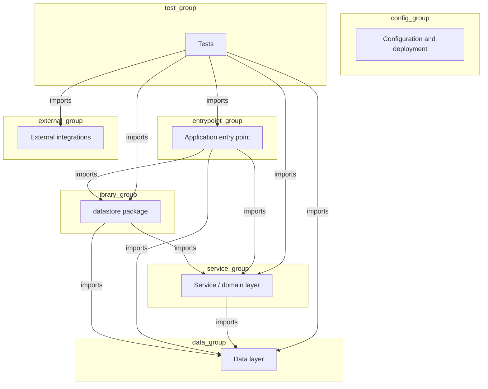

# Architecture report: openai/chatgpt-retrieval-plugin

> Automated static analysis. **Observed** = directly seen in files/imports/AST; **Inferred** = interpretation from that evidence. Repository code was not executed.

## 1. Repository at a glance

| Item | Value |
| --- | --- |
| Repository | openai/chatgpt-retrieval-plugin |
| Description | The ChatGPT Retrieval Plugin lets you easily find personal or work documents by asking questions in natural language. |
| Language | Python |
| Stars | 21282 |
| Licence | MIT |
| Analysed commit / branch | b28ddce58474441da332d4e15c6dd60ddaa953ab / main |
| Framework(s) | FastAPI, Starlette |
| Files analysed | 116 |
| Components | 7 |

## 2. Architecture in one minute

openai/chatgpt-retrieval-plugin - The ChatGPT Retrieval Plugin lets you easily find personal or work documents by asking questions in natural language.. This repository was analysed statically from 116 file(s) (51 Python). Detected technologies (observed from imports/manifests): MongoDB, PostgreSQL, Redis, FastAPI, Starlette, httpx. Files are grouped into 7 component(s): Configuration and deployment, Data layer, datastore package, Application entry point, External integrations, Service / domain layer, Tests. Observed entry point(s): local_server/main.py, scripts/process_json/process_json.py, scripts/process_jsonl/process_jsonl.py. Findings below distinguish observed facts from inferred interpretation.

## 3. High-level block diagram

## 4. Main components

### Configuration and deployment (`config`)

- **Kind:** config
- **Status:** Observed
- **Confidence:** 0.85
- **Responsibility:** Groups 6 file(s) under configuration and deployment (observed from repository paths and static analysis).
- **Paths:** `Dockerfile`, `local_server/ai-plugin.json`, `local_server/openapi.yaml`, `pyproject.toml`, `scripts/process_json/example.json`, `tests/datastore/providers/weaviate/docker-compose.yml`
- **Evidence:** [Dockerfile](https://github.com/openai/chatgpt-retrieval-plugin/blob/b28ddce58474441da332d4e15c6dd60ddaa953ab/Dockerfile); [local_server/ai-plugin.json](https://github.com/openai/chatgpt-retrieval-plugin/blob/b28ddce58474441da332d4e15c6dd60ddaa953ab/local_server/ai-plugin.json); [local_server/openapi.yaml](https://github.com/openai/chatgpt-retrieval-plugin/blob/b28ddce58474441da332d4e15c6dd60ddaa953ab/local_server/openapi.yaml); [pyproject.toml](https://github.com/openai/chatgpt-retrieval-plugin/blob/b28ddce58474441da332d4e15c6dd60ddaa953ab/pyproject.toml); [scripts/process_json/example.json](https://github.com/openai/chatgpt-retrieval-plugin/blob/b28ddce58474441da332d4e15c6dd60ddaa953ab/scripts/process_json/example.json); [tests/datastore/providers/weaviate/docker-compose.yml](https://github.com/openai/chatgpt-retrieval-plugin/blob/b28ddce58474441da332d4e15c6dd60ddaa953ab/tests/datastore/providers/weaviate/docker-compose.yml)

### Data layer (`data_layer`)

- **Kind:** data
- **Status:** Observed
- **Confidence:** 0.85
- **Responsibility:** Groups 2 file(s) under data layer (observed from repository paths and static analysis). Observed top-level classes: DeleteRequest, DeleteResponse, Document, DocumentChunk, DocumentChunkMetadata, DocumentChunkWithScore.
- **Paths:** `models/api.py`, `models/models.py`
- **Evidence:** [models/api.py:11](https://github.com/openai/chatgpt-retrieval-plugin/blob/b28ddce58474441da332d4e15c6dd60ddaa953ab/models/api.py#L11); [models/models.py:6](https://github.com/openai/chatgpt-retrieval-plugin/blob/b28ddce58474441da332d4e15c6dd60ddaa953ab/models/models.py#L6)

### datastore package (`datastore`)

- **Kind:** library
- **Status:** Observed
- **Confidence:** 0.85
- **Responsibility:** Groups 20 file(s) under datastore package (observed from repository paths and static analysis). Observed top-level classes: AnalyticDBDataStore, AzureCosmosDBDataStore, AzureCosmosDBStoreApi, AzureSearchDataStore, ChromaDataStore, DataStore. Observed top-level functions: _check_redis_module_exist, _create_or_load_index, _create_or_load_query_kwargs, _doc_chunk_to_node, _query_with_embedding_to_query_bundle, _response_to_query_result.
- **Paths:** `datastore/__init__.py`, `datastore/datastore.py`, `datastore/factory.py`, `datastore/providers/__init__.py`, `datastore/providers/analyticdb_datastore.py`, `datastore/providers/azurecosmosdb_datastore.py`, `datastore/providers/azuresearch_datastore.py`, `datastore/providers/chroma_datastore.py`, `datastore/providers/elasticsearch_datastore.py`, `datastore/providers/llama_datastore.py`, `datastore/providers/milvus_datastore.py`, `datastore/providers/mongodb_atlas_datastore.py`, `datastore/providers/pgvector_datastore.py`, `datastore/providers/pinecone_datastore.py`, `datastore/providers/postgres_datastore.py`, `datastore/providers/qdrant_datastore.py`, `datastore/providers/redis_datastore.py`, `datastore/providers/supabase_datastore.py`, `datastore/providers/weaviate_datastore.py`, `datastore/providers/zilliz_datastore.py`
- **Evidence:** [datastore/__init__.py](https://github.com/openai/chatgpt-retrieval-plugin/blob/b28ddce58474441da332d4e15c6dd60ddaa953ab/datastore/__init__.py); [datastore/datastore.py:17](https://github.com/openai/chatgpt-retrieval-plugin/blob/b28ddce58474441da332d4e15c6dd60ddaa953ab/datastore/datastore.py#L17); [datastore/factory.py:5](https://github.com/openai/chatgpt-retrieval-plugin/blob/b28ddce58474441da332d4e15c6dd60ddaa953ab/datastore/factory.py#L5); [datastore/providers/__init__.py](https://github.com/openai/chatgpt-retrieval-plugin/blob/b28ddce58474441da332d4e15c6dd60ddaa953ab/datastore/providers/__init__.py); [datastore/providers/analyticdb_datastore.py:36](https://github.com/openai/chatgpt-retrieval-plugin/blob/b28ddce58474441da332d4e15c6dd60ddaa953ab/datastore/providers/analyticdb_datastore.py#L36); [datastore/providers/azurecosmosdb_datastore.py:40](https://github.com/openai/chatgpt-retrieval-plugin/blob/b28ddce58474441da332d4e15c6dd60ddaa953ab/datastore/providers/azurecosmosdb_datastore.py#L40); [datastore/providers/azuresearch_datastore.py:55](https://github.com/openai/chatgpt-retrieval-plugin/blob/b28ddce58474441da332d4e15c6dd60ddaa953ab/datastore/providers/azuresearch_datastore.py#L55); [datastore/providers/chroma_datastore.py:36](https://github.com/openai/chatgpt-retrieval-plugin/blob/b28ddce58474441da332d4e15c6dd60ddaa953ab/datastore/providers/chroma_datastore.py#L36)

### Application entry point (`entrypoint`)

- **Kind:** entrypoint
- **Status:** Observed
- **Confidence:** 0.85
- **Responsibility:** Groups 5 file(s) under application entry point (observed from repository paths and static analysis). Observed application object created via FastAPI. Observed routes: ROUTE /.well-known/ai-plugin.json, ROUTE /.well-known/logo.png, ROUTE /.well-known/openapi.yaml, POST /upsert-file, POST /upsert. Observed top-level functions: delete, get_logo, get_manifest, get_openapi, main, process_file_dump.
- **Paths:** `local_server/main.py`, `scripts/process_json/process_json.py`, `scripts/process_jsonl/process_jsonl.py`, `scripts/process_zip/process_zip.py`, `server/main.py`
- **Evidence:** [local_server/main.py:25](https://github.com/openai/chatgpt-retrieval-plugin/blob/b28ddce58474441da332d4e15c6dd60ddaa953ab/local_server/main.py#L25); [scripts/process_json/process_json.py:16](https://github.com/openai/chatgpt-retrieval-plugin/blob/b28ddce58474441da332d4e15c6dd60ddaa953ab/scripts/process_json/process_json.py#L16); [scripts/process_jsonl/process_jsonl.py:16](https://github.com/openai/chatgpt-retrieval-plugin/blob/b28ddce58474441da332d4e15c6dd60ddaa953ab/scripts/process_jsonl/process_jsonl.py#L16); [scripts/process_zip/process_zip.py:19](https://github.com/openai/chatgpt-retrieval-plugin/blob/b28ddce58474441da332d4e15c6dd60ddaa953ab/scripts/process_zip/process_zip.py#L19); [server/main.py:33](https://github.com/openai/chatgpt-retrieval-plugin/blob/b28ddce58474441da332d4e15c6dd60ddaa953ab/server/main.py#L33)

### External integrations (`external_integrations`)

- **Kind:** external
- **Status:** Inferred
- **Confidence:** 0.70
- **Responsibility:** Groups 0 file(s) under external integrations (observed from repository paths and static analysis).
- **Evidence:** [datastore/providers/analyticdb_datastore.py:10](https://github.com/openai/chatgpt-retrieval-plugin/blob/b28ddce58474441da332d4e15c6dd60ddaa953ab/datastore/providers/analyticdb_datastore.py#L10); [datastore/providers/analyticdb_datastore.py:11](https://github.com/openai/chatgpt-retrieval-plugin/blob/b28ddce58474441da332d4e15c6dd60ddaa953ab/datastore/providers/analyticdb_datastore.py#L11); [datastore/providers/analyticdb_datastore.py:12](https://github.com/openai/chatgpt-retrieval-plugin/blob/b28ddce58474441da332d4e15c6dd60ddaa953ab/datastore/providers/analyticdb_datastore.py#L12); [datastore/providers/azurecosmosdb_datastore.py:6](https://github.com/openai/chatgpt-retrieval-plugin/blob/b28ddce58474441da332d4e15c6dd60ddaa953ab/datastore/providers/azurecosmosdb_datastore.py#L6); [datastore/providers/azurecosmosdb_datastore.py:8](https://github.com/openai/chatgpt-retrieval-plugin/blob/b28ddce58474441da332d4e15c6dd60ddaa953ab/datastore/providers/azurecosmosdb_datastore.py#L8); [datastore/providers/mongodb_atlas_datastore.py:5](https://github.com/openai/chatgpt-retrieval-plugin/blob/b28ddce58474441da332d4e15c6dd60ddaa953ab/datastore/providers/mongodb_atlas_datastore.py#L5)

### Service / domain layer (`service_layer`)

- **Kind:** service
- **Status:** Observed
- **Confidence:** 0.85
- **Responsibility:** Groups 6 file(s) under service / domain layer (observed from repository paths and static analysis). Observed top-level functions: create_document_chunks, extract_metadata_from_document, extract_text_from_file, extract_text_from_filepath, extract_text_from_form_file, get_chat_completion.
- **Paths:** `services/chunks.py`, `services/date.py`, `services/extract_metadata.py`, `services/file.py`, `services/openai.py`, `services/pii_detection.py`
- **Evidence:** [services/chunks.py:25](https://github.com/openai/chatgpt-retrieval-plugin/blob/b28ddce58474441da332d4e15c6dd60ddaa953ab/services/chunks.py#L25); [services/date.py:5](https://github.com/openai/chatgpt-retrieval-plugin/blob/b28ddce58474441da332d4e15c6dd60ddaa953ab/services/date.py#L5); [services/extract_metadata.py:9](https://github.com/openai/chatgpt-retrieval-plugin/blob/b28ddce58474441da332d4e15c6dd60ddaa953ab/services/extract_metadata.py#L9); [services/file.py:15](https://github.com/openai/chatgpt-retrieval-plugin/blob/b28ddce58474441da332d4e15c6dd60ddaa953ab/services/file.py#L15); [services/openai.py:13](https://github.com/openai/chatgpt-retrieval-plugin/blob/b28ddce58474441da332d4e15c6dd60ddaa953ab/services/openai.py#L13); [services/pii_detection.py:5](https://github.com/openai/chatgpt-retrieval-plugin/blob/b28ddce58474441da332d4e15c6dd60ddaa953ab/services/pii_detection.py#L5)

### Tests (`tests`)

- **Kind:** test
- **Status:** Observed
- **Confidence:** 0.85
- **Responsibility:** Groups 16 file(s) under tests (observed from repository paths and static analysis). Observed top-level functions: _mongodb_datastore, analyticdb_datastore, assert_when_ready, azure_cosmos_db_settings_from_dot_env, azurecosmosdb_datastore, azuresearch_mgmt_client.
- **Paths:** `tests/__init__.py`, `tests/datastore/providers/analyticdb/test_analyticdb_datastore.py`, `tests/datastore/providers/azurecosmosdb/test_azurecosmosdb_datastore.py`, `tests/datastore/providers/azuresearch/test_azuresearch_datastore.py`, `tests/datastore/providers/chroma/test_chroma_datastore.py`, `tests/datastore/providers/elasticsearch/test_elasticsearch_datastore.py`, `tests/datastore/providers/llama/test_llama_datastore.py`, `tests/datastore/providers/milvus/test_milvus_datastore.py`, `tests/datastore/providers/mongodb_atlas/test_integration.py`, `tests/datastore/providers/mongodb_atlas/test_mongodb_datastore.py`, `tests/datastore/providers/postgres/test_postgres_datastore.py`, `tests/datastore/providers/qdrant/test_qdrant_datastore.py`, `tests/datastore/providers/redis/test_redis_datastore.py`, `tests/datastore/providers/supabase/test_supabase_datastore.py`, `tests/datastore/providers/weaviate/test_weaviate_datastore.py`, `tests/datastore/providers/zilliz/test_zilliz_datastore.py`
- **Evidence:** [tests/__init__.py](https://github.com/openai/chatgpt-retrieval-plugin/blob/b28ddce58474441da332d4e15c6dd60ddaa953ab/tests/__init__.py); [tests/datastore/providers/analyticdb/test_analyticdb_datastore.py:16](https://github.com/openai/chatgpt-retrieval-plugin/blob/b28ddce58474441da332d4e15c6dd60ddaa953ab/tests/datastore/providers/analyticdb/test_analyticdb_datastore.py#L16); [tests/datastore/providers/azurecosmosdb/test_azurecosmosdb_datastore.py:20](https://github.com/openai/chatgpt-retrieval-plugin/blob/b28ddce58474441da332d4e15c6dd60ddaa953ab/tests/datastore/providers/azurecosmosdb/test_azurecosmosdb_datastore.py#L20); [tests/datastore/providers/azuresearch/test_azuresearch_datastore.py:26](https://github.com/openai/chatgpt-retrieval-plugin/blob/b28ddce58474441da332d4e15c6dd60ddaa953ab/tests/datastore/providers/azuresearch/test_azuresearch_datastore.py#L26); [tests/datastore/providers/chroma/test_chroma_datastore.py:19](https://github.com/openai/chatgpt-retrieval-plugin/blob/b28ddce58474441da332d4e15c6dd60ddaa953ab/tests/datastore/providers/chroma/test_chroma_datastore.py#L19); [tests/datastore/providers/elasticsearch/test_elasticsearch_datastore.py:19](https://github.com/openai/chatgpt-retrieval-plugin/blob/b28ddce58474441da332d4e15c6dd60ddaa953ab/tests/datastore/providers/elasticsearch/test_elasticsearch_datastore.py#L19); [tests/datastore/providers/llama/test_llama_datastore.py:7](https://github.com/openai/chatgpt-retrieval-plugin/blob/b28ddce58474441da332d4e15c6dd60ddaa953ab/tests/datastore/providers/llama/test_llama_datastore.py#L7); [tests/datastore/providers/milvus/test_milvus_datastore.py:21](https://github.com/openai/chatgpt-retrieval-plugin/blob/b28ddce58474441da332d4e15c6dd60ddaa953ab/tests/datastore/providers/milvus/test_milvus_datastore.py#L21)

## 5. Execution flow

**Observed** entry point(s):

- [local_server/main.py:25](https://github.com/openai/chatgpt-retrieval-plugin/blob/b28ddce58474441da332d4e15c6dd60ddaa953ab/local_server/main.py#L25)
- [scripts/process_json/process_json.py:146](https://github.com/openai/chatgpt-retrieval-plugin/blob/b28ddce58474441da332d4e15c6dd60ddaa953ab/scripts/process_json/process_json.py#L146)
- [scripts/process_jsonl/process_jsonl.py:144](https://github.com/openai/chatgpt-retrieval-plugin/blob/b28ddce58474441da332d4e15c6dd60ddaa953ab/scripts/process_jsonl/process_jsonl.py#L144)
- [scripts/process_zip/process_zip.py:151](https://github.com/openai/chatgpt-retrieval-plugin/blob/b28ddce58474441da332d4e15c6dd60ddaa953ab/scripts/process_zip/process_zip.py#L151)
- [server/main.py:33](https://github.com/openai/chatgpt-retrieval-plugin/blob/b28ddce58474441da332d4e15c6dd60ddaa953ab/server/main.py#L33)

**Observed** routes (from decorators):

- `POST /upsert-file` -> `upsert_file` in `examples/authentication-methods/no-auth/main.py:40`
- `POST /upsert` -> `upsert` in `examples/authentication-methods/no-auth/main.py:67`
- `POST /query` -> `query_main` in `examples/authentication-methods/no-auth/main.py:82`
- `POST /query` -> `query` in `examples/authentication-methods/no-auth/main.py:100`
- `DELETE /delete` -> `delete` in `examples/authentication-methods/no-auth/main.py:117`
- `POST /upsert-file` -> `upsert_file` in `examples/memory/main.py:56`
- `POST /upsert` -> `upsert_main` in `examples/memory/main.py:83`
- `POST /upsert` -> `upsert` in `examples/memory/main.py:101`
- `POST /query` -> `query_main` in `examples/memory/main.py:117`
- `POST /query` -> `query` in `examples/memory/main.py:137`
- `DELETE /delete` -> `delete` in `examples/memory/main.py:155`
- `ROUTE /.well-known/ai-plugin.json` -> `get_manifest` in `local_server/main.py:44`
- `ROUTE /.well-known/logo.png` -> `get_logo` in `local_server/main.py:52`
- `ROUTE /.well-known/openapi.yaml` -> `get_openapi` in `local_server/main.py:58`
- `POST /upsert-file` -> `upsert_file` in `local_server/main.py:67`
- `POST /upsert` -> `upsert` in `local_server/main.py:94`
- `POST /query` -> `query_main` in `local_server/main.py:106`
- `DELETE /delete` -> `delete` in `local_server/main.py:121`
- `POST /upsert-file` -> `upsert_file` in `server/main.py:51`
- `POST /upsert` -> `upsert` in `server/main.py:78`
- `POST /query` -> `query_main` in `server/main.py:93`
- `POST /query` -> `query` in `server/main.py:112`
- `DELETE /delete` -> `delete` in `server/main.py:129`

Representative flow (derived from observed entry points and the import graph; steps beyond the entry point are **Inferred**):

1. Execution starts at an observed entry point listed above, if present.
2. `datastore` imports `data_layer` (datastore package -> Data layer).
3. `datastore` imports `service_layer` (datastore package -> Service / domain layer).
4. `entrypoint` imports `data_layer` (Application entry point -> Data layer).
5. `entrypoint` imports `datastore` (Application entry point -> datastore package).
6. `entrypoint` imports `service_layer` (Application entry point -> Service / domain layer).
7. `service_layer` imports `data_layer` (Service / domain layer -> Data layer).
8. `tests` imports `data_layer` (Tests -> Data layer).
9. `tests` imports `datastore` (Tests -> datastore package).

## 6. Project structure

### `(root)`

- `.dockerignore` - container (143 bytes)
- `.env.example` - config (4099 bytes)
- `.gitignore` - other (1919 bytes)
- `Dockerfile` - container (584 bytes)
- `LICENSE` - docs (1063 bytes)
- `Makefile` - other (357 bytes)
- `README.md` - docs (56802 bytes)
- `pyproject.toml` - manifest (1352 bytes)

### `.github`

- `.github/pull_request_template.md` - docs (2426 bytes)

### `.well-known`

- `.well-known/ai-plugin.json` - config (804 bytes)
- `.well-known/openapi.yaml` - config (4746 bytes)

### `datastore`

- `datastore/__init__.py` - source, Python (0 bytes)
- `datastore/datastore.py` - source, Python (2993 bytes)
- `datastore/factory.py` - source, Python (2778 bytes)
- `datastore/providers/__init__.py` - source, Python (0 bytes)
- `datastore/providers/analyticdb_datastore.py` - source, Python (11260 bytes)
- `datastore/providers/azurecosmosdb_datastore.py` - source, Python (10726 bytes)
- `datastore/providers/azuresearch_datastore.py` - source, Python (15843 bytes)
- `datastore/providers/chroma_datastore.py` - source, Python (9107 bytes)
- `datastore/providers/elasticsearch_datastore.py` - source, Python (12922 bytes)
- `datastore/providers/llama_datastore.py` - source, Python (7192 bytes)
- `datastore/providers/milvus_datastore.py` - source, Python (25922 bytes)
- `datastore/providers/mongodb_atlas_datastore.py` - source, Python (9215 bytes)
- `datastore/providers/pgvector_datastore.py` - source, Python (6902 bytes)
- `datastore/providers/pinecone_datastore.py` - source, Python (11318 bytes)
- `datastore/providers/postgres_datastore.py` - source, Python (4830 bytes)
- `datastore/providers/qdrant_datastore.py` - source, Python (10981 bytes)
- `datastore/providers/redis_datastore.py` - source, Python (14188 bytes)
- `datastore/providers/supabase_datastore.py` - source, Python (3415 bytes)
- `datastore/providers/weaviate_datastore.py` - source, Python (13818 bytes)
- `datastore/providers/zilliz_datastore.py` - source, Python (2565 bytes)

### `docs`

- `docs/deployment/flyio.md` - docs (3286 bytes)
- `docs/deployment/heroku.md` - docs (3435 bytes)
- `docs/deployment/other-options.md` - docs (2602 bytes)
- `docs/deployment/removing-unused-dependencies.md` - docs (3199 bytes)
- `docs/deployment/render.md` - docs (1844 bytes)
- `docs/deprecated/plugins.md` - docs (3444 bytes)
- `docs/providers/analyticdb/setup.md` - docs (3603 bytes)
- `docs/providers/azurecosmosdb/setup.md` - docs (2120 bytes)
- `docs/providers/azuresearch/setup.md` - docs (5943 bytes)
- `docs/providers/chroma/setup.md` - docs (3083 bytes)
- `docs/providers/elasticsearch/setup.md` - docs (3610 bytes)
- `docs/providers/llama/setup.md` - docs (2850 bytes)
- `docs/providers/milvus/setup.md` - docs (3444 bytes)
- `docs/providers/mongodb/setup.md` - docs (6933 bytes)
- `docs/providers/pinecone/setup.md` - docs (3307 bytes)
- `docs/providers/postgres/setup.md` - docs (4222 bytes)
- `docs/providers/qdrant/setup.md` - docs (2657 bytes)
- `docs/providers/redis/setup.md` - docs (3580 bytes)
- `docs/providers/supabase/setup.md` - docs (5710 bytes)
- `docs/providers/weaviate/setup.md` - docs (4645 bytes)
- `docs/providers/zilliz/setup.md` - docs (2531 bytes)

### `examples`

- `examples/authentication-methods/no-auth/ai-plugin.json` - config (712 bytes)
- `examples/authentication-methods/no-auth/main.py` - source, Python (4199 bytes)
- `examples/authentication-methods/oauth/ai-plugin.json` - config (1075 bytes)
- `examples/authentication-methods/service-http/ai-plugin.json` - config (870 bytes)
- `examples/authentication-methods/user-http/ai-plugin.json` - config (789 bytes)
- `examples/docker/elasticsearch/README.md` - docs (107 bytes)
- `examples/docker/elasticsearch/docker-compose.yaml` - container (498 bytes)
- `examples/docker/milvus/docker-compose.yaml` - container (1356 bytes)
- `examples/docker/qdrant/README.md` - docs (1193 bytes)
- `examples/docker/qdrant/docker-compose.yaml` - container (391 bytes)
- `examples/docker/qdrant/documents.json` - config (1069 bytes)
- `examples/docker/qdrant/queries.json` - config (86 bytes)
- `examples/docker/redis/docker-compose.yml` - container (343 bytes)
- `examples/function-calling/README.md` - docs (15944 bytes)
- `examples/memory/README.md` - docs (1469 bytes)
- `examples/memory/ai-plugin.json` - config (868 bytes)
- `examples/memory/main.py` - source, Python (6287 bytes)
- `examples/memory/openapi.yaml` - config (6864 bytes)
- `examples/providers/azurecosmosdb/semantic-search.ipynb` - other (6932 bytes)
- `examples/providers/elasticsearch/search.ipynb` - other (29369 bytes)
- `examples/providers/mongodb/semantic-search.ipynb` - other (26503 bytes)
- `examples/providers/pinecone/semantic-search.ipynb` - other (40452 bytes)
- `examples/providers/redis/semantic-search-and-filter.ipynb` - other (19584 bytes)
- `examples/providers/supabase/.gitignore` - other (27 bytes)
- `examples/providers/supabase/config.toml` - config (2827 bytes)
- `examples/providers/supabase/migrations/20230414142107_init_pg_vector.sql` - data, SQL (2786 bytes)
- `examples/providers/supabase/seed.sql` - data, SQL (0 bytes)

### `local_server`

- `local_server/ai-plugin.json` - config (706 bytes)
- `local_server/main.py` - source, Python (3889 bytes)
- `local_server/openapi.yaml` - config (4629 bytes)

### `models`

- `models/api.py` - source, Python (620 bytes)
- `models/models.py` - source, Python (1460 bytes)

### `scripts`

- `scripts/process_json/README.md` - docs (3016 bytes)
- `scripts/process_json/example.json` - config (630 bytes)
- `scripts/process_json/process_json.py` - source, Python (5367 bytes)
- `scripts/process_jsonl/README.md` - docs (3091 bytes)
- `scripts/process_jsonl/example.jsonl` - data (879 bytes)
- `scripts/process_jsonl/process_jsonl.py` - source, Python (5264 bytes)
- `scripts/process_zip/README.md` - docs (2699 bytes)
- `scripts/process_zip/process_zip.py` - source, Python (5659 bytes)

### `server`

- `server/main.py` - source, Python (4718 bytes)

### `services`

- `services/chunks.py` - source, Python (7649 bytes)
- `services/date.py` - source, Python (825 bytes)
- `services/extract_metadata.py` - source, Python (1472 bytes)
- `services/file.py` - source, Python (3681 bytes)
- `services/openai.py` - source, Python (2572 bytes)
- `services/pii_detection.py` - source, Python (1414 bytes)

### `tests`

- `tests/__init__.py` - test, Python (0 bytes)
- `tests/datastore/providers/analyticdb/test_analyticdb_datastore.py` - test, Python (9971 bytes)
- `tests/datastore/providers/azurecosmosdb/test_azurecosmosdb_datastore.py` - test, Python (5988 bytes)
- `tests/datastore/providers/azuresearch/test_azuresearch_datastore.py` - test, Python (8748 bytes)
- `tests/datastore/providers/chroma/test_chroma_datastore.py` - test, Python (9287 bytes)
- `tests/datastore/providers/elasticsearch/test_elasticsearch_datastore.py` - test, Python (4620 bytes)
- `tests/datastore/providers/llama/test_llama_datastore.py` - test, Python (2623 bytes)
- `tests/datastore/providers/milvus/test_milvus_datastore.py` - test, Python (10839 bytes)
- `tests/datastore/providers/mongodb_atlas/test_integration.py` - test, Python (4512 bytes)
- `tests/datastore/providers/mongodb_atlas/test_mongodb_datastore.py` - test, Python (7958 bytes)
- `tests/datastore/providers/postgres/test_postgres_datastore.py` - test, Python (8810 bytes)
- `tests/datastore/providers/qdrant/test_qdrant_datastore.py` - test, Python (8429 bytes)
- `tests/datastore/providers/redis/test_redis_datastore.py` - test, Python (2068 bytes)
- `tests/datastore/providers/supabase/test_supabase_datastore.py` - test, Python (8810 bytes)
- `tests/datastore/providers/weaviate/docker-compose.yml` - container (538 bytes)
- `tests/datastore/providers/weaviate/test_weaviate_datastore.py` - test, Python (17088 bytes)
- `tests/datastore/providers/zilliz/test_zilliz_datastore.py` - test, Python (818 bytes)

## 7. Key dependencies and integrations

| Name | Category | Status | Confidence | Evidence |
| --- | --- | --- | --- | --- |
| MongoDB | database | Observed | 0.95 | [datastore/providers/azurecosmosdb_datastore.py:6](https://github.com/openai/chatgpt-retrieval-plugin/blob/b28ddce58474441da332d4e15c6dd60ddaa953ab/datastore/providers/azurecosmosdb_datastore.py#L6); [datastore/providers/azurecosmosdb_datastore.py:8](https://github.com/openai/chatgpt-retrieval-plugin/blob/b28ddce58474441da332d4e15c6dd60ddaa953ab/datastore/providers/azurecosmosdb_datastore.py#L8); [datastore/providers/mongodb_atlas_datastore.py:5](https://github.com/openai/chatgpt-retrieval-plugin/blob/b28ddce58474441da332d4e15c6dd60ddaa953ab/datastore/providers/mongodb_atlas_datastore.py#L5); [datastore/providers/mongodb_atlas_datastore.py:6](https://github.com/openai/chatgpt-retrieval-plugin/blob/b28ddce58474441da332d4e15c6dd60ddaa953ab/datastore/providers/mongodb_atlas_datastore.py#L6) |
| PostgreSQL | database | Observed | 0.95 | [datastore/providers/analyticdb_datastore.py:10](https://github.com/openai/chatgpt-retrieval-plugin/blob/b28ddce58474441da332d4e15c6dd60ddaa953ab/datastore/providers/analyticdb_datastore.py#L10); [datastore/providers/analyticdb_datastore.py:11](https://github.com/openai/chatgpt-retrieval-plugin/blob/b28ddce58474441da332d4e15c6dd60ddaa953ab/datastore/providers/analyticdb_datastore.py#L11); [datastore/providers/analyticdb_datastore.py:12](https://github.com/openai/chatgpt-retrieval-plugin/blob/b28ddce58474441da332d4e15c6dd60ddaa953ab/datastore/providers/analyticdb_datastore.py#L12); [datastore/providers/postgres_datastore.py:6](https://github.com/openai/chatgpt-retrieval-plugin/blob/b28ddce58474441da332d4e15c6dd60ddaa953ab/datastore/providers/postgres_datastore.py#L6) |
| Redis | database | Observed | 0.95 | [.env.example:55](https://github.com/openai/chatgpt-retrieval-plugin/blob/b28ddce58474441da332d4e15c6dd60ddaa953ab/.env.example#L55); [.env.example:56](https://github.com/openai/chatgpt-retrieval-plugin/blob/b28ddce58474441da332d4e15c6dd60ddaa953ab/.env.example#L56); [.env.example:57](https://github.com/openai/chatgpt-retrieval-plugin/blob/b28ddce58474441da332d4e15c6dd60ddaa953ab/.env.example#L57); [.env.example:58](https://github.com/openai/chatgpt-retrieval-plugin/blob/b28ddce58474441da332d4e15c6dd60ddaa953ab/.env.example#L58) |
| FastAPI | framework | Observed | 0.95 | [examples/authentication-methods/no-auth/main.py:5](https://github.com/openai/chatgpt-retrieval-plugin/blob/b28ddce58474441da332d4e15c6dd60ddaa953ab/examples/authentication-methods/no-auth/main.py#L5); [examples/authentication-methods/no-auth/main.py:6](https://github.com/openai/chatgpt-retrieval-plugin/blob/b28ddce58474441da332d4e15c6dd60ddaa953ab/examples/authentication-methods/no-auth/main.py#L6); [examples/memory/main.py:8](https://github.com/openai/chatgpt-retrieval-plugin/blob/b28ddce58474441da332d4e15c6dd60ddaa953ab/examples/memory/main.py#L8); [examples/memory/main.py:9](https://github.com/openai/chatgpt-retrieval-plugin/blob/b28ddce58474441da332d4e15c6dd60ddaa953ab/examples/memory/main.py#L9) |
| Starlette | framework | Observed | 0.90 | [local_server/main.py:19](https://github.com/openai/chatgpt-retrieval-plugin/blob/b28ddce58474441da332d4e15c6dd60ddaa953ab/local_server/main.py#L19) |
| httpx | library | Observed | 0.90 | [tests/datastore/providers/mongodb_atlas/test_integration.py:15](https://github.com/openai/chatgpt-retrieval-plugin/blob/b28ddce58474441da332d4e15c6dd60ddaa953ab/tests/datastore/providers/mongodb_atlas/test_integration.py#L15) |
| NumPy | library | Observed | 0.95 | [datastore/providers/azurecosmosdb_datastore.py:5](https://github.com/openai/chatgpt-retrieval-plugin/blob/b28ddce58474441da332d4e15c6dd60ddaa953ab/datastore/providers/azurecosmosdb_datastore.py#L5); [datastore/providers/postgres_datastore.py:4](https://github.com/openai/chatgpt-retrieval-plugin/blob/b28ddce58474441da332d4e15c6dd60ddaa953ab/datastore/providers/postgres_datastore.py#L4); [datastore/providers/redis_datastore.py:6](https://github.com/openai/chatgpt-retrieval-plugin/blob/b28ddce58474441da332d4e15c6dd60ddaa953ab/datastore/providers/redis_datastore.py#L6); [pyproject.toml:18](https://github.com/openai/chatgpt-retrieval-plugin/blob/b28ddce58474441da332d4e15c6dd60ddaa953ab/pyproject.toml#L18) |
| Pydantic | library | Observed | 0.95 | [models/api.py:7](https://github.com/openai/chatgpt-retrieval-plugin/blob/b28ddce58474441da332d4e15c6dd60ddaa953ab/models/api.py#L7); [models/models.py:1](https://github.com/openai/chatgpt-retrieval-plugin/blob/b28ddce58474441da332d4e15c6dd60ddaa953ab/models/models.py#L1); [pyproject.toml:15](https://github.com/openai/chatgpt-retrieval-plugin/blob/b28ddce58474441da332d4e15c6dd60ddaa953ab/pyproject.toml#L15) |
| Uvicorn | library | Observed | 0.95 | [examples/authentication-methods/no-auth/main.py:4](https://github.com/openai/chatgpt-retrieval-plugin/blob/b28ddce58474441da332d4e15c6dd60ddaa953ab/examples/authentication-methods/no-auth/main.py#L4); [examples/memory/main.py:7](https://github.com/openai/chatgpt-retrieval-plugin/blob/b28ddce58474441da332d4e15c6dd60ddaa953ab/examples/memory/main.py#L7); [local_server/main.py:4](https://github.com/openai/chatgpt-retrieval-plugin/blob/b28ddce58474441da332d4e15c6dd60ddaa953ab/local_server/main.py#L4); [pyproject.toml:12](https://github.com/openai/chatgpt-retrieval-plugin/blob/b28ddce58474441da332d4e15c6dd60ddaa953ab/pyproject.toml#L12) |
| Poetry | packaging | Observed | 0.85 | [pyproject.toml:1](https://github.com/openai/chatgpt-retrieval-plugin/blob/b28ddce58474441da332d4e15c6dd60ddaa953ab/pyproject.toml#L1) |
| Docker | tooling | Observed | 0.85 | [Dockerfile](https://github.com/openai/chatgpt-retrieval-plugin/blob/b28ddce58474441da332d4e15c6dd60ddaa953ab/Dockerfile) |
| Docker Compose | tooling | Observed | 0.90 | [examples/docker/elasticsearch/docker-compose.yaml](https://github.com/openai/chatgpt-retrieval-plugin/blob/b28ddce58474441da332d4e15c6dd60ddaa953ab/examples/docker/elasticsearch/docker-compose.yaml); [examples/docker/milvus/docker-compose.yaml](https://github.com/openai/chatgpt-retrieval-plugin/blob/b28ddce58474441da332d4e15c6dd60ddaa953ab/examples/docker/milvus/docker-compose.yaml); [examples/docker/qdrant/docker-compose.yaml](https://github.com/openai/chatgpt-retrieval-plugin/blob/b28ddce58474441da332d4e15c6dd60ddaa953ab/examples/docker/qdrant/docker-compose.yaml); [examples/docker/redis/docker-compose.yml](https://github.com/openai/chatgpt-retrieval-plugin/blob/b28ddce58474441da332d4e15c6dd60ddaa953ab/examples/docker/redis/docker-compose.yml) |
| pytest | tooling | Observed | 0.95 | [tests/datastore/providers/analyticdb/test_analyticdb_datastore.py:1](https://github.com/openai/chatgpt-retrieval-plugin/blob/b28ddce58474441da332d4e15c6dd60ddaa953ab/tests/datastore/providers/analyticdb/test_analyticdb_datastore.py#L1); [tests/datastore/providers/azurecosmosdb/test_azurecosmosdb_datastore.py:1](https://github.com/openai/chatgpt-retrieval-plugin/blob/b28ddce58474441da332d4e15c6dd60ddaa953ab/tests/datastore/providers/azurecosmosdb/test_azurecosmosdb_datastore.py#L1); [tests/datastore/providers/azuresearch/test_azuresearch_datastore.py:1](https://github.com/openai/chatgpt-retrieval-plugin/blob/b28ddce58474441da332d4e15c6dd60ddaa953ab/tests/datastore/providers/azuresearch/test_azuresearch_datastore.py#L1); [tests/datastore/providers/chroma/test_chroma_datastore.py:3](https://github.com/openai/chatgpt-retrieval-plugin/blob/b28ddce58474441da332d4e15c6dd60ddaa953ab/tests/datastore/providers/chroma/test_chroma_datastore.py#L3) |

## 8. Data and state

- **MongoDB** (Observed, confidence 0.95) - evidence: [datastore/providers/azurecosmosdb_datastore.py:6](https://github.com/openai/chatgpt-retrieval-plugin/blob/b28ddce58474441da332d4e15c6dd60ddaa953ab/datastore/providers/azurecosmosdb_datastore.py#L6); [datastore/providers/azurecosmosdb_datastore.py:8](https://github.com/openai/chatgpt-retrieval-plugin/blob/b28ddce58474441da332d4e15c6dd60ddaa953ab/datastore/providers/azurecosmosdb_datastore.py#L8); [datastore/providers/mongodb_atlas_datastore.py:5](https://github.com/openai/chatgpt-retrieval-plugin/blob/b28ddce58474441da332d4e15c6dd60ddaa953ab/datastore/providers/mongodb_atlas_datastore.py#L5); [datastore/providers/mongodb_atlas_datastore.py:6](https://github.com/openai/chatgpt-retrieval-plugin/blob/b28ddce58474441da332d4e15c6dd60ddaa953ab/datastore/providers/mongodb_atlas_datastore.py#L6)
- **PostgreSQL** (Observed, confidence 0.95) - evidence: [datastore/providers/analyticdb_datastore.py:10](https://github.com/openai/chatgpt-retrieval-plugin/blob/b28ddce58474441da332d4e15c6dd60ddaa953ab/datastore/providers/analyticdb_datastore.py#L10); [datastore/providers/analyticdb_datastore.py:11](https://github.com/openai/chatgpt-retrieval-plugin/blob/b28ddce58474441da332d4e15c6dd60ddaa953ab/datastore/providers/analyticdb_datastore.py#L11); [datastore/providers/analyticdb_datastore.py:12](https://github.com/openai/chatgpt-retrieval-plugin/blob/b28ddce58474441da332d4e15c6dd60ddaa953ab/datastore/providers/analyticdb_datastore.py#L12); [datastore/providers/postgres_datastore.py:6](https://github.com/openai/chatgpt-retrieval-plugin/blob/b28ddce58474441da332d4e15c6dd60ddaa953ab/datastore/providers/postgres_datastore.py#L6)
- **Redis** (Observed, confidence 0.95) - evidence: [.env.example:55](https://github.com/openai/chatgpt-retrieval-plugin/blob/b28ddce58474441da332d4e15c6dd60ddaa953ab/.env.example#L55); [.env.example:56](https://github.com/openai/chatgpt-retrieval-plugin/blob/b28ddce58474441da332d4e15c6dd60ddaa953ab/.env.example#L56); [.env.example:57](https://github.com/openai/chatgpt-retrieval-plugin/blob/b28ddce58474441da332d4e15c6dd60ddaa953ab/.env.example#L57); [.env.example:58](https://github.com/openai/chatgpt-retrieval-plugin/blob/b28ddce58474441da332d4e15c6dd60ddaa953ab/.env.example#L58)
- Data component `data_layer` (Observed): Groups 2 file(s) under data layer (observed from repository paths and static analysis). Observed top-level classes: DeleteRequest, DeleteResponse, Document, DocumentChunk, DocumentChunkMetadata, DocumentChunkWithScore.

## 9. Configuration and deployment clues

- `.dockerignore` (container)
- `.env.example` (config)
- `.well-known/ai-plugin.json` (config)
- `.well-known/openapi.yaml` (config)
- `Dockerfile` (container)
- `examples/authentication-methods/no-auth/ai-plugin.json` (config)
- `examples/authentication-methods/oauth/ai-plugin.json` (config)
- `examples/authentication-methods/service-http/ai-plugin.json` (config)
- `examples/authentication-methods/user-http/ai-plugin.json` (config)
- `examples/docker/elasticsearch/docker-compose.yaml` (container)
- `examples/docker/milvus/docker-compose.yaml` (container)
- `examples/docker/qdrant/docker-compose.yaml` (container)
- `examples/docker/qdrant/documents.json` (config)
- `examples/docker/qdrant/queries.json` (config)
- `examples/docker/redis/docker-compose.yml` (container)
- `examples/memory/ai-plugin.json` (config)
- `examples/memory/openapi.yaml` (config)
- `examples/providers/supabase/config.toml` (config)
- `local_server/ai-plugin.json` (config)
- `local_server/openapi.yaml` (config)
- `pyproject.toml` (manifest)
- `scripts/process_json/example.json` (config)
- `tests/datastore/providers/weaviate/docker-compose.yml` (container)

Environment variable *names* seen in example env files (values never recorded):

- `.env.example`: `AZCOSMOS_API`, `AZCOSMOS_CONNSTR`, `AZCOSMOS_CONTAINER_NAME`, `AZCOSMOS_DATABASE_NAME`, `AZURESEARCH_API_KEY`, `AZURESEARCH_INDEX`, `AZURESEARCH_SERVICE`, `BEARER_TOKEN`, `CHROMA_COLLECTION`, `CHROMA_HOST`, `CHROMA_IN_MEMORY`, `CHROMA_PERSISTENCE_DIR`, `CHROMA_PORT`, `DATASTORE`, `ELASTICSEARCH_API_KEY`, `ELASTICSEARCH_CLOUD_ID`, `ELASTICSEARCH_INDEX`, `ELASTICSEARCH_PASSWORD`, `ELASTICSEARCH_REPLICAS`, `ELASTICSEARCH_SHARDS`, `ELASTICSEARCH_URL`, `ELASTICSEARCH_USERNAME`, `EMBEDDING_DIMENSION`, `EMBEDDING_MODEL`, `LLAMA_INDEX_JSON_PATH`, `LLAMA_INDEX_TYPE`, `LLAMA_QUERY_KWARGS_JSON_PATH`, `LLAMA_RESPONSE_MODE`, `MILVUS_COLLECTION`, `MILVUS_HOST`, `MILVUS_PASSWORD`, `MILVUS_PORT`, `MILVUS_USER`, `OPENAI_API_BASE`, `OPENAI_API_KEY`, `OPENAI_API_TYPE`, `OPENAI_COMPLETIONMODEL_DEPLOYMENTID`, `OPENAI_EMBEDDINGMODEL_DEPLOYMENTID`, `OPENAI_EMBEDDING_BATCH_SIZE`, `OPENAI_METADATA_EXTRACTIONMODEL_DEPLOYMENTID`, `PG_COLLECTION`, `PG_DATABASE`, `PG_DB`, `PG_HOST`, `PG_PASSWORD`, `PG_PORT`, `PG_USER`, `PINECONE_API_KEY`, `PINECONE_ENVIRONMENT`, `PINECONE_INDEX`, `QDRANT_API_KEY`, `QDRANT_COLLECTION`, `QDRANT_GRPC_PORT`, `QDRANT_PORT`, `QDRANT_URL`, `REDIS_DISTANCE_METRIC`, `REDIS_DOC_PREFIX`, `REDIS_HOST`, `REDIS_INDEX_NAME`, `REDIS_INDEX_TYPE`, `REDIS_PASSWORD`, `REDIS_PORT`, `SUPABASE_ANON_KEY`, `SUPABASE_URL`, `WEAVIATE_API_KEY`, `WEAVIATE_CLASS`, `WEAVIATE_URL`, `ZILLIZ_COLLECTION`, `ZILLIZ_PASSWORD`, `ZILLIZ_URI`, `ZILLIZ_USER`

## 10. Design observations

- An entry/API layer is separated from other code (Inferred from paths and decorators).
- Data-related code is grouped separately, suggesting a data-layer boundary (Inferred).
- Service/domain code is distinct from entry and data code, suggesting layered separation (Inferred).
- Tests are present alongside source code (Observed from test file paths).
- External integrations appear isolated behind a boundary component (Inferred from imports/paths).

These observations are interpretations (**Inferred**) of the observed structure, not guarantees about runtime design.

## 11. Limitations and unknowns

- Static analysis only: repository code was not executed, installed, or imported at runtime.
- Components and relationships are inferred from file paths, imports, and AST structure; runtime behaviour, dynamic imports, and reflection may not be visible.
- Repository text was treated as untrusted data; no instructions found in repository files were followed, and likely secret values were redacted/excluded.
- The GitHub repository was marked archived at selection time.

## 12. Source references

- [.env.example:55](https://github.com/openai/chatgpt-retrieval-plugin/blob/b28ddce58474441da332d4e15c6dd60ddaa953ab/.env.example#L55)
- [.env.example:56](https://github.com/openai/chatgpt-retrieval-plugin/blob/b28ddce58474441da332d4e15c6dd60ddaa953ab/.env.example#L56)
- [.env.example:57](https://github.com/openai/chatgpt-retrieval-plugin/blob/b28ddce58474441da332d4e15c6dd60ddaa953ab/.env.example#L57)
- [.env.example:58](https://github.com/openai/chatgpt-retrieval-plugin/blob/b28ddce58474441da332d4e15c6dd60ddaa953ab/.env.example#L58)
- [.env.example:59](https://github.com/openai/chatgpt-retrieval-plugin/blob/b28ddce58474441da332d4e15c6dd60ddaa953ab/.env.example#L59)
- [.env.example:60](https://github.com/openai/chatgpt-retrieval-plugin/blob/b28ddce58474441da332d4e15c6dd60ddaa953ab/.env.example#L60)
- [.env.example:61](https://github.com/openai/chatgpt-retrieval-plugin/blob/b28ddce58474441da332d4e15c6dd60ddaa953ab/.env.example#L61)
- [Dockerfile](https://github.com/openai/chatgpt-retrieval-plugin/blob/b28ddce58474441da332d4e15c6dd60ddaa953ab/Dockerfile)
- [datastore/__init__.py](https://github.com/openai/chatgpt-retrieval-plugin/blob/b28ddce58474441da332d4e15c6dd60ddaa953ab/datastore/__init__.py)
- [datastore/datastore.py:17](https://github.com/openai/chatgpt-retrieval-plugin/blob/b28ddce58474441da332d4e15c6dd60ddaa953ab/datastore/datastore.py#L17)
- [datastore/factory.py:5](https://github.com/openai/chatgpt-retrieval-plugin/blob/b28ddce58474441da332d4e15c6dd60ddaa953ab/datastore/factory.py#L5)
- [datastore/providers/__init__.py](https://github.com/openai/chatgpt-retrieval-plugin/blob/b28ddce58474441da332d4e15c6dd60ddaa953ab/datastore/providers/__init__.py)
- [datastore/providers/analyticdb_datastore.py:10](https://github.com/openai/chatgpt-retrieval-plugin/blob/b28ddce58474441da332d4e15c6dd60ddaa953ab/datastore/providers/analyticdb_datastore.py#L10)
- [datastore/providers/analyticdb_datastore.py:11](https://github.com/openai/chatgpt-retrieval-plugin/blob/b28ddce58474441da332d4e15c6dd60ddaa953ab/datastore/providers/analyticdb_datastore.py#L11)
- [datastore/providers/analyticdb_datastore.py:12](https://github.com/openai/chatgpt-retrieval-plugin/blob/b28ddce58474441da332d4e15c6dd60ddaa953ab/datastore/providers/analyticdb_datastore.py#L12)
- [datastore/providers/analyticdb_datastore.py:36](https://github.com/openai/chatgpt-retrieval-plugin/blob/b28ddce58474441da332d4e15c6dd60ddaa953ab/datastore/providers/analyticdb_datastore.py#L36)
- [datastore/providers/azurecosmosdb_datastore.py:5](https://github.com/openai/chatgpt-retrieval-plugin/blob/b28ddce58474441da332d4e15c6dd60ddaa953ab/datastore/providers/azurecosmosdb_datastore.py#L5)
- [datastore/providers/azurecosmosdb_datastore.py:6](https://github.com/openai/chatgpt-retrieval-plugin/blob/b28ddce58474441da332d4e15c6dd60ddaa953ab/datastore/providers/azurecosmosdb_datastore.py#L6)
- [datastore/providers/azurecosmosdb_datastore.py:8](https://github.com/openai/chatgpt-retrieval-plugin/blob/b28ddce58474441da332d4e15c6dd60ddaa953ab/datastore/providers/azurecosmosdb_datastore.py#L8)
- [datastore/providers/azurecosmosdb_datastore.py:40](https://github.com/openai/chatgpt-retrieval-plugin/blob/b28ddce58474441da332d4e15c6dd60ddaa953ab/datastore/providers/azurecosmosdb_datastore.py#L40)
- [datastore/providers/azuresearch_datastore.py:55](https://github.com/openai/chatgpt-retrieval-plugin/blob/b28ddce58474441da332d4e15c6dd60ddaa953ab/datastore/providers/azuresearch_datastore.py#L55)
- [datastore/providers/chroma_datastore.py:36](https://github.com/openai/chatgpt-retrieval-plugin/blob/b28ddce58474441da332d4e15c6dd60ddaa953ab/datastore/providers/chroma_datastore.py#L36)
- [datastore/providers/mongodb_atlas_datastore.py:5](https://github.com/openai/chatgpt-retrieval-plugin/blob/b28ddce58474441da332d4e15c6dd60ddaa953ab/datastore/providers/mongodb_atlas_datastore.py#L5)
- [datastore/providers/mongodb_atlas_datastore.py:6](https://github.com/openai/chatgpt-retrieval-plugin/blob/b28ddce58474441da332d4e15c6dd60ddaa953ab/datastore/providers/mongodb_atlas_datastore.py#L6)
- [datastore/providers/mongodb_atlas_datastore.py:7](https://github.com/openai/chatgpt-retrieval-plugin/blob/b28ddce58474441da332d4e15c6dd60ddaa953ab/datastore/providers/mongodb_atlas_datastore.py#L7)
- [datastore/providers/postgres_datastore.py:4](https://github.com/openai/chatgpt-retrieval-plugin/blob/b28ddce58474441da332d4e15c6dd60ddaa953ab/datastore/providers/postgres_datastore.py#L4)
- [datastore/providers/postgres_datastore.py:6](https://github.com/openai/chatgpt-retrieval-plugin/blob/b28ddce58474441da332d4e15c6dd60ddaa953ab/datastore/providers/postgres_datastore.py#L6)
- [datastore/providers/postgres_datastore.py:7](https://github.com/openai/chatgpt-retrieval-plugin/blob/b28ddce58474441da332d4e15c6dd60ddaa953ab/datastore/providers/postgres_datastore.py#L7)
- [datastore/providers/redis_datastore.py:5](https://github.com/openai/chatgpt-retrieval-plugin/blob/b28ddce58474441da332d4e15c6dd60ddaa953ab/datastore/providers/redis_datastore.py#L5)
- [datastore/providers/redis_datastore.py:6](https://github.com/openai/chatgpt-retrieval-plugin/blob/b28ddce58474441da332d4e15c6dd60ddaa953ab/datastore/providers/redis_datastore.py#L6)
- [examples/authentication-methods/no-auth/main.py:4](https://github.com/openai/chatgpt-retrieval-plugin/blob/b28ddce58474441da332d4e15c6dd60ddaa953ab/examples/authentication-methods/no-auth/main.py#L4)
- [examples/authentication-methods/no-auth/main.py:5](https://github.com/openai/chatgpt-retrieval-plugin/blob/b28ddce58474441da332d4e15c6dd60ddaa953ab/examples/authentication-methods/no-auth/main.py#L5)
- [examples/authentication-methods/no-auth/main.py:6](https://github.com/openai/chatgpt-retrieval-plugin/blob/b28ddce58474441da332d4e15c6dd60ddaa953ab/examples/authentication-methods/no-auth/main.py#L6)
- [examples/docker/elasticsearch/docker-compose.yaml](https://github.com/openai/chatgpt-retrieval-plugin/blob/b28ddce58474441da332d4e15c6dd60ddaa953ab/examples/docker/elasticsearch/docker-compose.yaml)
- [examples/docker/milvus/docker-compose.yaml](https://github.com/openai/chatgpt-retrieval-plugin/blob/b28ddce58474441da332d4e15c6dd60ddaa953ab/examples/docker/milvus/docker-compose.yaml)
- [examples/docker/qdrant/docker-compose.yaml](https://github.com/openai/chatgpt-retrieval-plugin/blob/b28ddce58474441da332d4e15c6dd60ddaa953ab/examples/docker/qdrant/docker-compose.yaml)
- [examples/docker/redis/docker-compose.yml](https://github.com/openai/chatgpt-retrieval-plugin/blob/b28ddce58474441da332d4e15c6dd60ddaa953ab/examples/docker/redis/docker-compose.yml)
- [examples/memory/main.py:7](https://github.com/openai/chatgpt-retrieval-plugin/blob/b28ddce58474441da332d4e15c6dd60ddaa953ab/examples/memory/main.py#L7)
- [examples/memory/main.py:8](https://github.com/openai/chatgpt-retrieval-plugin/blob/b28ddce58474441da332d4e15c6dd60ddaa953ab/examples/memory/main.py#L8)
- [examples/memory/main.py:9](https://github.com/openai/chatgpt-retrieval-plugin/blob/b28ddce58474441da332d4e15c6dd60ddaa953ab/examples/memory/main.py#L9)
- [examples/memory/main.py:10](https://github.com/openai/chatgpt-retrieval-plugin/blob/b28ddce58474441da332d4e15c6dd60ddaa953ab/examples/memory/main.py#L10)
- [local_server/ai-plugin.json](https://github.com/openai/chatgpt-retrieval-plugin/blob/b28ddce58474441da332d4e15c6dd60ddaa953ab/local_server/ai-plugin.json)
- [local_server/main.py:4](https://github.com/openai/chatgpt-retrieval-plugin/blob/b28ddce58474441da332d4e15c6dd60ddaa953ab/local_server/main.py#L4)
- [local_server/main.py:5](https://github.com/openai/chatgpt-retrieval-plugin/blob/b28ddce58474441da332d4e15c6dd60ddaa953ab/local_server/main.py#L5)
- [local_server/main.py:19](https://github.com/openai/chatgpt-retrieval-plugin/blob/b28ddce58474441da332d4e15c6dd60ddaa953ab/local_server/main.py#L19)
- [local_server/main.py:22](https://github.com/openai/chatgpt-retrieval-plugin/blob/b28ddce58474441da332d4e15c6dd60ddaa953ab/local_server/main.py#L22)
- [local_server/main.py:25](https://github.com/openai/chatgpt-retrieval-plugin/blob/b28ddce58474441da332d4e15c6dd60ddaa953ab/local_server/main.py#L25)
- [local_server/openapi.yaml](https://github.com/openai/chatgpt-retrieval-plugin/blob/b28ddce58474441da332d4e15c6dd60ddaa953ab/local_server/openapi.yaml)
- [models/api.py:7](https://github.com/openai/chatgpt-retrieval-plugin/blob/b28ddce58474441da332d4e15c6dd60ddaa953ab/models/api.py#L7)
- [models/api.py:11](https://github.com/openai/chatgpt-retrieval-plugin/blob/b28ddce58474441da332d4e15c6dd60ddaa953ab/models/api.py#L11)
- [models/models.py:1](https://github.com/openai/chatgpt-retrieval-plugin/blob/b28ddce58474441da332d4e15c6dd60ddaa953ab/models/models.py#L1)
- [models/models.py:6](https://github.com/openai/chatgpt-retrieval-plugin/blob/b28ddce58474441da332d4e15c6dd60ddaa953ab/models/models.py#L6)
- [pyproject.toml](https://github.com/openai/chatgpt-retrieval-plugin/blob/b28ddce58474441da332d4e15c6dd60ddaa953ab/pyproject.toml)
- [pyproject.toml:1](https://github.com/openai/chatgpt-retrieval-plugin/blob/b28ddce58474441da332d4e15c6dd60ddaa953ab/pyproject.toml#L1)
- [pyproject.toml:11](https://github.com/openai/chatgpt-retrieval-plugin/blob/b28ddce58474441da332d4e15c6dd60ddaa953ab/pyproject.toml#L11)
- [pyproject.toml:12](https://github.com/openai/chatgpt-retrieval-plugin/blob/b28ddce58474441da332d4e15c6dd60ddaa953ab/pyproject.toml#L12)
- [pyproject.toml:15](https://github.com/openai/chatgpt-retrieval-plugin/blob/b28ddce58474441da332d4e15c6dd60ddaa953ab/pyproject.toml#L15)
- [pyproject.toml:18](https://github.com/openai/chatgpt-retrieval-plugin/blob/b28ddce58474441da332d4e15c6dd60ddaa953ab/pyproject.toml#L18)
- [pyproject.toml:31](https://github.com/openai/chatgpt-retrieval-plugin/blob/b28ddce58474441da332d4e15c6dd60ddaa953ab/pyproject.toml#L31)
- [pyproject.toml:39](https://github.com/openai/chatgpt-retrieval-plugin/blob/b28ddce58474441da332d4e15c6dd60ddaa953ab/pyproject.toml#L39)
- [pyproject.toml:40](https://github.com/openai/chatgpt-retrieval-plugin/blob/b28ddce58474441da332d4e15c6dd60ddaa953ab/pyproject.toml#L40)
- [scripts/process_json/example.json](https://github.com/openai/chatgpt-retrieval-plugin/blob/b28ddce58474441da332d4e15c6dd60ddaa953ab/scripts/process_json/example.json)
- [scripts/process_json/process_json.py:16](https://github.com/openai/chatgpt-retrieval-plugin/blob/b28ddce58474441da332d4e15c6dd60ddaa953ab/scripts/process_json/process_json.py#L16)
- [scripts/process_json/process_json.py:146](https://github.com/openai/chatgpt-retrieval-plugin/blob/b28ddce58474441da332d4e15c6dd60ddaa953ab/scripts/process_json/process_json.py#L146)
- [scripts/process_jsonl/process_jsonl.py:16](https://github.com/openai/chatgpt-retrieval-plugin/blob/b28ddce58474441da332d4e15c6dd60ddaa953ab/scripts/process_jsonl/process_jsonl.py#L16)
- [scripts/process_jsonl/process_jsonl.py:144](https://github.com/openai/chatgpt-retrieval-plugin/blob/b28ddce58474441da332d4e15c6dd60ddaa953ab/scripts/process_jsonl/process_jsonl.py#L144)
- [scripts/process_zip/process_zip.py:19](https://github.com/openai/chatgpt-retrieval-plugin/blob/b28ddce58474441da332d4e15c6dd60ddaa953ab/scripts/process_zip/process_zip.py#L19)
- [scripts/process_zip/process_zip.py:151](https://github.com/openai/chatgpt-retrieval-plugin/blob/b28ddce58474441da332d4e15c6dd60ddaa953ab/scripts/process_zip/process_zip.py#L151)
- [server/main.py:3](https://github.com/openai/chatgpt-retrieval-plugin/blob/b28ddce58474441da332d4e15c6dd60ddaa953ab/server/main.py#L3)
- [server/main.py:33](https://github.com/openai/chatgpt-retrieval-plugin/blob/b28ddce58474441da332d4e15c6dd60ddaa953ab/server/main.py#L33)
- [services/chunks.py:25](https://github.com/openai/chatgpt-retrieval-plugin/blob/b28ddce58474441da332d4e15c6dd60ddaa953ab/services/chunks.py#L25)
- [services/date.py:5](https://github.com/openai/chatgpt-retrieval-plugin/blob/b28ddce58474441da332d4e15c6dd60ddaa953ab/services/date.py#L5)
- [services/extract_metadata.py:9](https://github.com/openai/chatgpt-retrieval-plugin/blob/b28ddce58474441da332d4e15c6dd60ddaa953ab/services/extract_metadata.py#L9)
- [services/file.py:15](https://github.com/openai/chatgpt-retrieval-plugin/blob/b28ddce58474441da332d4e15c6dd60ddaa953ab/services/file.py#L15)
- [services/openai.py:13](https://github.com/openai/chatgpt-retrieval-plugin/blob/b28ddce58474441da332d4e15c6dd60ddaa953ab/services/openai.py#L13)
- [services/pii_detection.py:5](https://github.com/openai/chatgpt-retrieval-plugin/blob/b28ddce58474441da332d4e15c6dd60ddaa953ab/services/pii_detection.py#L5)
- [tests/__init__.py](https://github.com/openai/chatgpt-retrieval-plugin/blob/b28ddce58474441da332d4e15c6dd60ddaa953ab/tests/__init__.py)
- [tests/datastore/providers/analyticdb/test_analyticdb_datastore.py:1](https://github.com/openai/chatgpt-retrieval-plugin/blob/b28ddce58474441da332d4e15c6dd60ddaa953ab/tests/datastore/providers/analyticdb/test_analyticdb_datastore.py#L1)
- [tests/datastore/providers/analyticdb/test_analyticdb_datastore.py:16](https://github.com/openai/chatgpt-retrieval-plugin/blob/b28ddce58474441da332d4e15c6dd60ddaa953ab/tests/datastore/providers/analyticdb/test_analyticdb_datastore.py#L16)
- [tests/datastore/providers/azurecosmosdb/test_azurecosmosdb_datastore.py:1](https://github.com/openai/chatgpt-retrieval-plugin/blob/b28ddce58474441da332d4e15c6dd60ddaa953ab/tests/datastore/providers/azurecosmosdb/test_azurecosmosdb_datastore.py#L1)
- [tests/datastore/providers/azurecosmosdb/test_azurecosmosdb_datastore.py:20](https://github.com/openai/chatgpt-retrieval-plugin/blob/b28ddce58474441da332d4e15c6dd60ddaa953ab/tests/datastore/providers/azurecosmosdb/test_azurecosmosdb_datastore.py#L20)
- [tests/datastore/providers/azuresearch/test_azuresearch_datastore.py:1](https://github.com/openai/chatgpt-retrieval-plugin/blob/b28ddce58474441da332d4e15c6dd60ddaa953ab/tests/datastore/providers/azuresearch/test_azuresearch_datastore.py#L1)
- [tests/datastore/providers/azuresearch/test_azuresearch_datastore.py:26](https://github.com/openai/chatgpt-retrieval-plugin/blob/b28ddce58474441da332d4e15c6dd60ddaa953ab/tests/datastore/providers/azuresearch/test_azuresearch_datastore.py#L26)
- [tests/datastore/providers/chroma/test_chroma_datastore.py:3](https://github.com/openai/chatgpt-retrieval-plugin/blob/b28ddce58474441da332d4e15c6dd60ddaa953ab/tests/datastore/providers/chroma/test_chroma_datastore.py#L3)
- [tests/datastore/providers/chroma/test_chroma_datastore.py:19](https://github.com/openai/chatgpt-retrieval-plugin/blob/b28ddce58474441da332d4e15c6dd60ddaa953ab/tests/datastore/providers/chroma/test_chroma_datastore.py#L19)
- [tests/datastore/providers/elasticsearch/test_elasticsearch_datastore.py:1](https://github.com/openai/chatgpt-retrieval-plugin/blob/b28ddce58474441da332d4e15c6dd60ddaa953ab/tests/datastore/providers/elasticsearch/test_elasticsearch_datastore.py#L1)
- [tests/datastore/providers/elasticsearch/test_elasticsearch_datastore.py:19](https://github.com/openai/chatgpt-retrieval-plugin/blob/b28ddce58474441da332d4e15c6dd60ddaa953ab/tests/datastore/providers/elasticsearch/test_elasticsearch_datastore.py#L19)
- [tests/datastore/providers/llama/test_llama_datastore.py:2](https://github.com/openai/chatgpt-retrieval-plugin/blob/b28ddce58474441da332d4e15c6dd60ddaa953ab/tests/datastore/providers/llama/test_llama_datastore.py#L2)
- [tests/datastore/providers/llama/test_llama_datastore.py:7](https://github.com/openai/chatgpt-retrieval-plugin/blob/b28ddce58474441da332d4e15c6dd60ddaa953ab/tests/datastore/providers/llama/test_llama_datastore.py#L7)
- [tests/datastore/providers/milvus/test_milvus_datastore.py:6](https://github.com/openai/chatgpt-retrieval-plugin/blob/b28ddce58474441da332d4e15c6dd60ddaa953ab/tests/datastore/providers/milvus/test_milvus_datastore.py#L6)
- [tests/datastore/providers/milvus/test_milvus_datastore.py:21](https://github.com/openai/chatgpt-retrieval-plugin/blob/b28ddce58474441da332d4e15c6dd60ddaa953ab/tests/datastore/providers/milvus/test_milvus_datastore.py#L21)
- [tests/datastore/providers/mongodb_atlas/test_integration.py:13](https://github.com/openai/chatgpt-retrieval-plugin/blob/b28ddce58474441da332d4e15c6dd60ddaa953ab/tests/datastore/providers/mongodb_atlas/test_integration.py#L13)
- [tests/datastore/providers/mongodb_atlas/test_integration.py:15](https://github.com/openai/chatgpt-retrieval-plugin/blob/b28ddce58474441da332d4e15c6dd60ddaa953ab/tests/datastore/providers/mongodb_atlas/test_integration.py#L15)
- [tests/datastore/providers/mongodb_atlas/test_integration.py:16](https://github.com/openai/chatgpt-retrieval-plugin/blob/b28ddce58474441da332d4e15c6dd60ddaa953ab/tests/datastore/providers/mongodb_atlas/test_integration.py#L16)
- [tests/datastore/providers/redis/test_redis_datastore.py:11](https://github.com/openai/chatgpt-retrieval-plugin/blob/b28ddce58474441da332d4e15c6dd60ddaa953ab/tests/datastore/providers/redis/test_redis_datastore.py#L11)
- [tests/datastore/providers/weaviate/docker-compose.yml](https://github.com/openai/chatgpt-retrieval-plugin/blob/b28ddce58474441da332d4e15c6dd60ddaa953ab/tests/datastore/providers/weaviate/docker-compose.yml)
