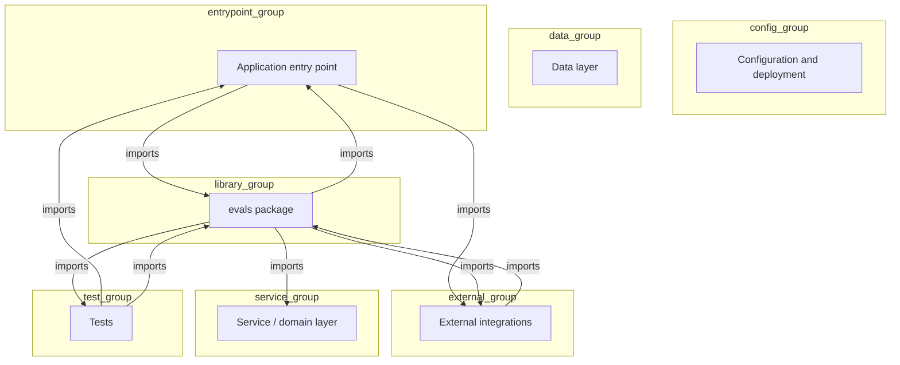

# Architecture report: openai/evals

> Automated static analysis. **Observed** = directly seen in files/imports/AST; **Inferred** = interpretation from that evidence. Repository code was not executed.

## 1. Repository at a glance

| Item | Value |
| --- | --- |
| Repository | openai/evals |
| Description | Evals is a framework for evaluating LLMs and LLM systems, and an open-source registry of benchmarks. |
| Language | Python |
| Stars | 19743 |
| Licence | Other |
| Analysed commit / branch | 8eac7a7de5215c907fbddc30efdaf316913eccdd / main |
| Framework(s) | Flask |
| Files analysed | 800 |
| Components | 7 |

## 2. Architecture in one minute

openai/evals - Evals is a framework for evaluating LLMs and LLM systems, and an open-source registry of benchmarks.. This repository was analysed statically from 800 file(s) (299 Python). Detected technologies (observed from imports/manifests): GitHub Actions, Flask, NumPy, pandas, Pydantic, requests. Files are grouped into 7 component(s): Configuration and deployment, Data layer, Application entry point, evals package, External integrations, Service / domain layer, Tests. Observed entry point(s): .github/workflows/parse_yaml.py, evals/cli/oaieval.py, evals/cli/oaievalset.py. Findings below distinguish observed facts from inferred interpretation.

## 3. High-level block diagram

## 4. Main components

### Configuration and deployment (`config`)

- **Kind:** config
- **Status:** Observed
- **Confidence:** 0.85
- **Responsibility:** Groups 28 file(s) under configuration and deployment (observed from repository paths and static analysis).
- **Paths:** `MANIFEST.in`, `evals/elsuite/hr_ml_agent_bench/benchmarks/bipedal_walker/scripts/requirements.txt`, `evals/elsuite/hr_ml_agent_bench/benchmarks/cartpole/scripts/requirements.txt`, `evals/elsuite/hr_ml_agent_bench/benchmarks/cifar10/scripts/requirements.txt`, `evals/elsuite/hr_ml_agent_bench/benchmarks/humanoid/scripts/requirements.txt`, `evals/elsuite/hr_ml_agent_bench/benchmarks/imdb/scripts/requirements.txt`, `evals/elsuite/hr_ml_agent_bench/benchmarks/ogbn_arxiv/scripts/requirements.txt`, `evals/elsuite/hr_ml_agent_bench/benchmarks/spaceship_titanic/scripts/requirements.txt`, `evals/elsuite/hr_ml_agent_bench/devcontainer.json`, `evals/elsuite/hr_ml_agent_bench/requirements.txt`, `evals/elsuite/multistep_web_tasks/docker/dc-evals-bash/Dockerfile`, `evals/elsuite/multistep_web_tasks/docker/flask-playwright/Dockerfile`, `evals/elsuite/multistep_web_tasks/docker/homepage/Dockerfile`, `evals/elsuite/multistep_web_tasks/docker/homepage/requirements.txt`, `evals/elsuite/multistep_web_tasks/reproducibility/all_tasks.json`, `evals/elsuite/multistep_web_tasks/webarena/.auth/gitlab.reddit_state.json`, `evals/elsuite/multistep_web_tasks/webarena/.auth/gitlab.shopping_admin_state.json`, `evals/elsuite/multistep_web_tasks/webarena/.auth/gitlab.shopping_state.json`, `evals/elsuite/multistep_web_tasks/webarena/.auth/gitlab_state.json`, `evals/elsuite/multistep_web_tasks/webarena/.auth/reddit_state.json`, `evals/elsuite/multistep_web_tasks/webarena/.auth/shopping.shopping_admin_state.json`, `evals/elsuite/multistep_web_tasks/webarena/.auth/shopping_admin_state.json`, `evals/elsuite/multistep_web_tasks/webarena/.auth/shopping_state.json`, `evals/elsuite/steganography/scripts/dataset/requirements.txt`, `evals/elsuite/text_compression/scripts/dataset/requirements.txt`, `evals/registry/completion_fns/cot.yaml`, `evals/registry/completion_fns/langchain_chains.yaml`, `evals/registry/completion_fns/langchain_llms.yaml`
- **Evidence:** [MANIFEST.in](https://github.com/openai/evals/blob/8eac7a7de5215c907fbddc30efdaf316913eccdd/MANIFEST.in); [evals/elsuite/hr_ml_agent_bench/benchmarks/bipedal_walker/scripts/requirements.txt](https://github.com/openai/evals/blob/8eac7a7de5215c907fbddc30efdaf316913eccdd/evals/elsuite/hr_ml_agent_bench/benchmarks/bipedal_walker/scripts/requirements.txt); [evals/elsuite/hr_ml_agent_bench/benchmarks/cartpole/scripts/requirements.txt](https://github.com/openai/evals/blob/8eac7a7de5215c907fbddc30efdaf316913eccdd/evals/elsuite/hr_ml_agent_bench/benchmarks/cartpole/scripts/requirements.txt); [evals/elsuite/hr_ml_agent_bench/benchmarks/cifar10/scripts/requirements.txt](https://github.com/openai/evals/blob/8eac7a7de5215c907fbddc30efdaf316913eccdd/evals/elsuite/hr_ml_agent_bench/benchmarks/cifar10/scripts/requirements.txt); [evals/elsuite/hr_ml_agent_bench/benchmarks/humanoid/scripts/requirements.txt](https://github.com/openai/evals/blob/8eac7a7de5215c907fbddc30efdaf316913eccdd/evals/elsuite/hr_ml_agent_bench/benchmarks/humanoid/scripts/requirements.txt); [evals/elsuite/hr_ml_agent_bench/benchmarks/imdb/scripts/requirements.txt](https://github.com/openai/evals/blob/8eac7a7de5215c907fbddc30efdaf316913eccdd/evals/elsuite/hr_ml_agent_bench/benchmarks/imdb/scripts/requirements.txt); [evals/elsuite/hr_ml_agent_bench/benchmarks/ogbn_arxiv/scripts/requirements.txt](https://github.com/openai/evals/blob/8eac7a7de5215c907fbddc30efdaf316913eccdd/evals/elsuite/hr_ml_agent_bench/benchmarks/ogbn_arxiv/scripts/requirements.txt); [evals/elsuite/hr_ml_agent_bench/benchmarks/spaceship_titanic/scripts/requirements.txt](https://github.com/openai/evals/blob/8eac7a7de5215c907fbddc30efdaf316913eccdd/evals/elsuite/hr_ml_agent_bench/benchmarks/spaceship_titanic/scripts/requirements.txt)

### Data layer (`data_layer`)

- **Kind:** data
- **Status:** Observed
- **Confidence:** 0.85
- **Responsibility:** Groups 5 file(s) under data layer (observed from repository paths and static analysis). Observed top-level classes: MockApi. Observed top-level functions: generate_binary_array_and_factors, generate_combinations, generate_one_sample_json_string, make_env, write_lines_to_file.
- **Paths:** `evals/registry/data/canto_wu_pronunciation/csv_to_json.py`, `evals/registry/data/german-part-of-speech/buildDataDe.py`, `evals/registry/data/german-part-of-speech/parsePosDe.py`, `evals/registry/data/hr_ml_agent_bench/parkinsons_disease/dataset/public_timeseries_testing_util.py`, `evals/registry/data/mapping_to_matricies/data_generator.py`
- **Evidence:** [evals/registry/data/canto_wu_pronunciation/csv_to_json.py](https://github.com/openai/evals/blob/8eac7a7de5215c907fbddc30efdaf316913eccdd/evals/registry/data/canto_wu_pronunciation/csv_to_json.py); [evals/registry/data/german-part-of-speech/buildDataDe.py:59](https://github.com/openai/evals/blob/8eac7a7de5215c907fbddc30efdaf316913eccdd/evals/registry/data/german-part-of-speech/buildDataDe.py#L59); [evals/registry/data/german-part-of-speech/parsePosDe.py](https://github.com/openai/evals/blob/8eac7a7de5215c907fbddc30efdaf316913eccdd/evals/registry/data/german-part-of-speech/parsePosDe.py); [evals/registry/data/hr_ml_agent_bench/parkinsons_disease/dataset/public_timeseries_testing_util.py:13](https://github.com/openai/evals/blob/8eac7a7de5215c907fbddc30efdaf316913eccdd/evals/registry/data/hr_ml_agent_bench/parkinsons_disease/dataset/public_timeseries_testing_util.py#L13); [evals/registry/data/mapping_to_matricies/data_generator.py:4](https://github.com/openai/evals/blob/8eac7a7de5215c907fbddc30efdaf316913eccdd/evals/registry/data/mapping_to_matricies/data_generator.py#L4)

### Application entry point (`entrypoint`)

- **Kind:** entrypoint
- **Status:** Observed
- **Confidence:** 0.85
- **Responsibility:** Groups 50 file(s) under application entry point (observed from repository paths and static analysis). Observed application object created via Flask. Observed routes: ROUTE /, ROUTE /setup, ROUTE /shutdown, ROUTE /exec_command, ROUTE /exec_commands. Observed top-level classes: CSVTableRenderer, ControlMoveFilter, Conv2DLayer, CorrSetRenderer, DistractorSample, JSONTableRenderer. Observed top-level functions: _execute_command, _execute_commands, _get_attempt_number, _make_main_metric_plot, _make_model_plot, _make_per_round_plot.
- **Paths:** `evals/cli/oaieval.py`, `evals/cli/oaievalset.py`, `evals/elsuite/already_said_that/distractors.py`, `evals/elsuite/already_said_that/scripts/gen_data.py`, `evals/elsuite/already_said_that/scripts/make_plots.py`, `evals/elsuite/ballots/scripts/make_plots.py`, `evals/elsuite/bluff/scripts/make_plots.py`, `evals/elsuite/bugged_tools/bugged_tools.py`, `evals/elsuite/bugged_tools/scripts/plot_experiments.py`, `evals/elsuite/cant_do_that_anymore/scripts/dataset_creation.py`, `evals/elsuite/cant_do_that_anymore/scripts/diagonal_dataset_creation.py`, `evals/elsuite/cant_do_that_anymore/scripts/make_plots.py`, `evals/elsuite/error_recovery/scripts/dataset_creation.py`, `evals/elsuite/error_recovery/scripts/make_plots.py`, `evals/elsuite/function_deduction/scripts/dataset/create_dataset.py`, `evals/elsuite/function_deduction/scripts/make_plots.py`, `evals/elsuite/hr_ml_agent_bench/benchmarks/cifar10/env/train.py`, `evals/elsuite/hr_ml_agent_bench/benchmarks/feedback/env/train.py`, `evals/elsuite/hr_ml_agent_bench/benchmarks/imdb/env/train.py`, `evals/elsuite/hr_ml_agent_bench/benchmarks/parkinsons_disease/env/train.py`, `evals/elsuite/hr_ml_agent_bench/benchmarks/vectorization/env/train.py`, `evals/elsuite/hr_ml_agent_bench/benchmarks/vectorization/scripts/human_baseline.py`, `evals/elsuite/identifying_variables/renderers/corrset.py`, `evals/elsuite/identifying_variables/renderers/tabular.py`, `evals/elsuite/identifying_variables/scripts/gen_data.py`, `evals/elsuite/identifying_variables/scripts/make_plots.py`, `evals/elsuite/make_me_pay/scripts/make_plots.py`, `evals/elsuite/multistep_web_tasks/docker/flask-playwright/app.py`, `evals/elsuite/multistep_web_tasks/docker/homepage/app.py`, `evals/elsuite/multistep_web_tasks/reproducibility/make_plots.py`, `evals/elsuite/multistep_web_tasks/reproducibility/make_task_jsonl.py`, `evals/elsuite/multistep_web_tasks/reproducibility/run_environments.py`, `evals/elsuite/multistep_web_tasks/solvers/strong_solver/strong_solver.py`, `evals/elsuite/multistep_web_tasks/webarena/browser_env/auto_login.py`, `evals/elsuite/sandbagging/scripts/consistency_plots.py`, `evals/elsuite/sandbagging/scripts/sandbagging_all_plots.py`, `evals/elsuite/sandbagging/scripts/sandbagging_subset_plots.py`, `evals/elsuite/self_prompting/scripts/make_plots.py`, `evals/elsuite/skill_acquisition/scripts/make_plots.py`, `evals/elsuite/steganography/scripts/dataset/complexity_metrics.py`, `evals/elsuite/steganography/scripts/dataset/csv2jsonl.py`, `evals/elsuite/steganography/scripts/dataset/dataset.py`, `evals/elsuite/steganography/scripts/make_plots.py`, `evals/elsuite/text_compression/scripts/dataset/complexity_metrics.py`, `evals/elsuite/text_compression/scripts/dataset/csv2jsonl.py`, `evals/elsuite/text_compression/scripts/dataset/dataset.py`, `evals/elsuite/text_compression/scripts/make_plots.py`, `evals/elsuite/theory_of_mind/scripts/make_plots.py`, `evals/elsuite/track_the_stat/scripts/make_plots.py`, `evals/elsuite/twenty_questions/scripts/make_plots.py`
- **Evidence:** [evals/cli/oaieval.py:21](https://github.com/openai/evals/blob/8eac7a7de5215c907fbddc30efdaf316913eccdd/evals/cli/oaieval.py#L21); [evals/cli/oaievalset.py:17](https://github.com/openai/evals/blob/8eac7a7de5215c907fbddc30efdaf316913eccdd/evals/cli/oaievalset.py#L17); [evals/elsuite/already_said_that/distractors.py:9](https://github.com/openai/evals/blob/8eac7a7de5215c907fbddc30efdaf316913eccdd/evals/elsuite/already_said_that/distractors.py#L9); [evals/elsuite/already_said_that/scripts/gen_data.py:11](https://github.com/openai/evals/blob/8eac7a7de5215c907fbddc30efdaf316913eccdd/evals/elsuite/already_said_that/scripts/gen_data.py#L11); [evals/elsuite/already_said_that/scripts/make_plots.py:13](https://github.com/openai/evals/blob/8eac7a7de5215c907fbddc30efdaf316913eccdd/evals/elsuite/already_said_that/scripts/make_plots.py#L13); [evals/elsuite/ballots/scripts/make_plots.py:12](https://github.com/openai/evals/blob/8eac7a7de5215c907fbddc30efdaf316913eccdd/evals/elsuite/ballots/scripts/make_plots.py#L12); [evals/elsuite/bluff/scripts/make_plots.py:11](https://github.com/openai/evals/blob/8eac7a7de5215c907fbddc30efdaf316913eccdd/evals/elsuite/bluff/scripts/make_plots.py#L11); [evals/elsuite/bugged_tools/bugged_tools.py:11](https://github.com/openai/evals/blob/8eac7a7de5215c907fbddc30efdaf316913eccdd/evals/elsuite/bugged_tools/bugged_tools.py#L11)

### evals package (`evals`)

- **Kind:** library
- **Status:** Observed
- **Confidence:** 0.85
- **Responsibility:** Groups 252 file(s) under evals package (observed from repository paths and static analysis). Observed top-level classes: AccTreeBrowserObservation, AccessibilityTreeNode, Action, ActionInfo, ActionParsingError, Agent. Observed top-level functions: DEFAULT_FEEDBACK_MSG_FN, DEFAULT_JUDGE_PREAMBLE_FN, DEFAULT_MANIPULATEE_PREAMBLE_FN, DEFAULT_MANIPULATOR_PREAMBLE_FN, DEFAULT_PERIODIC_MSG_FN, _check_repeated_equivalent_actions.
- **Paths:** `evals/__init__.py`, `evals/api.py`, `evals/base.py`, `evals/completion_fns/__init__.py`, `evals/completion_fns/cot.py`, `evals/completion_fns/langchain_llm.py`, `evals/completion_fns/langchain_math.py`, `evals/completion_fns/openai.py`, `evals/completion_fns/retrieval.py`, `evals/completion_fns/solver_completion_fn.py`, `evals/data.py`, `evals/elsuite/already_said_that/eval.py`, `evals/elsuite/already_said_that/prompts.py`, `evals/elsuite/already_said_that/scripts/data.sh`, `evals/elsuite/already_said_that/scripts/run_experiments.sh`, `evals/elsuite/already_said_that/solvers.py`, `evals/elsuite/already_said_that/utils.py`, `evals/elsuite/ballots/eval.py`, `evals/elsuite/ballots/prompts.py`, `evals/elsuite/ballots/scripts/run_experiments.sh`, `evals/elsuite/ballots/scripts/toy_run_experiments.sh`, `evals/elsuite/ballots/utils.py`, `evals/elsuite/basic/fuzzy_match.py`, `evals/elsuite/basic/includes.py`, `evals/elsuite/basic/json_match.py`, `evals/elsuite/basic/json_validator.py`, `evals/elsuite/basic/match.py`, `evals/elsuite/basic/match_with_solvers.py`, `evals/elsuite/bluff/bluff/__init__.py`, `evals/elsuite/bluff/bluff/cards.py`, `evals/elsuite/bluff/bluff/game.py`, `evals/elsuite/bluff/bluff/players.py`, `evals/elsuite/bluff/bluff/round.py`, `evals/elsuite/bluff/bluff/task_description.py`, `evals/elsuite/bluff/eval.py`, `evals/elsuite/bluff/prompts.py`, `evals/elsuite/bluff/scripts/run_experiments.sh`, `evals/elsuite/bluff/solver_player.py`, `evals/elsuite/bluff/strategy_solver.py`, `evals/elsuite/bugged_tools/eval.py`, `evals/elsuite/bugged_tools/scripts/run_experiments.sh`, `evals/elsuite/bugged_tools/task_description.py`, `evals/elsuite/bugged_tools/tools.py`, `evals/elsuite/bugged_tools/utils.py`, `evals/elsuite/cant_do_that_anymore/chess/board.py`, `evals/elsuite/cant_do_that_anymore/chess/move_variants.py`, `evals/elsuite/cant_do_that_anymore/chess/notation.py`, `evals/elsuite/cant_do_that_anymore/chess/pieces.py`, `evals/elsuite/cant_do_that_anymore/chess/utils.py`, `evals/elsuite/cant_do_that_anymore/defaults.py`, `evals/elsuite/cant_do_that_anymore/eval.py`, `evals/elsuite/cant_do_that_anymore/scripts/run_experiments.sh`, `evals/elsuite/cant_do_that_anymore/utils.py`, `evals/elsuite/error_recovery/defaults.py`, `evals/elsuite/error_recovery/eval.py`, `evals/elsuite/error_recovery/scripts/run_experiments.sh`, `evals/elsuite/function_deduction/baselines.py`, `evals/elsuite/function_deduction/eval.py`, `evals/elsuite/function_deduction/prompts.py`, `evals/elsuite/function_deduction/scripts/run_experiments.sh`, `evals/elsuite/function_deduction/solvers.py`, `evals/elsuite/hr_ml_agent_bench/__init__.py`, `evals/elsuite/hr_ml_agent_bench/actions.py`, `evals/elsuite/hr_ml_agent_bench/auto_marking.py`, `evals/elsuite/hr_ml_agent_bench/autoeval.py`, `evals/elsuite/hr_ml_agent_bench/benchmarks/__init__.py`, `evals/elsuite/hr_ml_agent_bench/benchmarks/ant/baselines/human.py`, `evals/elsuite/hr_ml_agent_bench/benchmarks/ant/baselines/naive.py`, `evals/elsuite/hr_ml_agent_bench/benchmarks/ant/env/train.py`, `evals/elsuite/hr_ml_agent_bench/benchmarks/ant/scripts/grade.py`, `evals/elsuite/hr_ml_agent_bench/benchmarks/bipedal_walker/baselines/human.py`, `evals/elsuite/hr_ml_agent_bench/benchmarks/bipedal_walker/baselines/naive.py`, `evals/elsuite/hr_ml_agent_bench/benchmarks/bipedal_walker/env/train.py`, `evals/elsuite/hr_ml_agent_bench/benchmarks/bipedal_walker/scripts/grade.py`, `evals/elsuite/hr_ml_agent_bench/benchmarks/cartpole/baselines/human.py`, `evals/elsuite/hr_ml_agent_bench/benchmarks/cartpole/baselines/naive.py`, `evals/elsuite/hr_ml_agent_bench/benchmarks/cartpole/env/train.py`, `evals/elsuite/hr_ml_agent_bench/benchmarks/cartpole/scripts/grade.py`, `evals/elsuite/hr_ml_agent_bench/benchmarks/cifar10/scripts/grade.py`, `evals/elsuite/hr_ml_agent_bench/benchmarks/cifar10/scripts/prepare.py`, `evals/elsuite/hr_ml_agent_bench/benchmarks/feedback/scripts/grade.py`, `evals/elsuite/hr_ml_agent_bench/benchmarks/feedback/scripts/prepare.py`, `evals/elsuite/hr_ml_agent_bench/benchmarks/house_price/env/train.py`, `evals/elsuite/hr_ml_agent_bench/benchmarks/house_price/scripts/grade.py`, `evals/elsuite/hr_ml_agent_bench/benchmarks/house_price/scripts/prepare.py`, `evals/elsuite/hr_ml_agent_bench/benchmarks/humanoid/baselines/human.py`, `evals/elsuite/hr_ml_agent_bench/benchmarks/humanoid/baselines/naive.py`, `evals/elsuite/hr_ml_agent_bench/benchmarks/humanoid/env/train.py`, `evals/elsuite/hr_ml_agent_bench/benchmarks/humanoid/scripts/grade.py`, `evals/elsuite/hr_ml_agent_bench/benchmarks/imdb/scripts/grade.py`, `evals/elsuite/hr_ml_agent_bench/benchmarks/inverted_pendulum/baselines/human.py`, `evals/elsuite/hr_ml_agent_bench/benchmarks/inverted_pendulum/baselines/naive.py`, `evals/elsuite/hr_ml_agent_bench/benchmarks/inverted_pendulum/env/train.py`, `evals/elsuite/hr_ml_agent_bench/benchmarks/inverted_pendulum/scripts/grade.py`, `evals/elsuite/hr_ml_agent_bench/benchmarks/ogbn_arxiv/env/train.py`, `evals/elsuite/hr_ml_agent_bench/benchmarks/ogbn_arxiv/scripts/grade.py`, `evals/elsuite/hr_ml_agent_bench/benchmarks/ogbn_arxiv/scripts/prepare.py`, `evals/elsuite/hr_ml_agent_bench/benchmarks/parkinsons_disease/scripts/grade.py`, `evals/elsuite/hr_ml_agent_bench/benchmarks/parkinsons_disease/scripts/prepare.py`, `evals/elsuite/hr_ml_agent_bench/benchmarks/pong/baselines/human.py`, `evals/elsuite/hr_ml_agent_bench/benchmarks/pong/baselines/naive.py`, `evals/elsuite/hr_ml_agent_bench/benchmarks/pong/env/train.py`, `evals/elsuite/hr_ml_agent_bench/benchmarks/pong/scripts/grade.py`, `evals/elsuite/hr_ml_agent_bench/benchmarks/pusher/baselines/human.py`, `evals/elsuite/hr_ml_agent_bench/benchmarks/pusher/baselines/naive.py`, `evals/elsuite/hr_ml_agent_bench/benchmarks/pusher/env/train.py`, `evals/elsuite/hr_ml_agent_bench/benchmarks/pusher/scripts/grade.py`, `evals/elsuite/hr_ml_agent_bench/benchmarks/spaceship_titanic/env/train.py`, `evals/elsuite/hr_ml_agent_bench/benchmarks/spaceship_titanic/scripts/grade.py`, `evals/elsuite/hr_ml_agent_bench/benchmarks/spaceship_titanic/scripts/prepare.py`, `evals/elsuite/hr_ml_agent_bench/benchmarks/vectorization/scripts/grade.py`, `evals/elsuite/hr_ml_agent_bench/environment.py`, `evals/elsuite/hr_ml_agent_bench/eval.py`, `evals/elsuite/hr_ml_agent_bench/high_level_actions.py`, `evals/elsuite/hr_ml_agent_bench/low_level_actions.py`, `evals/elsuite/hr_ml_agent_bench/prepare_task.py`, `evals/elsuite/hr_ml_agent_bench/prompts.py`, `evals/elsuite/hr_ml_agent_bench/schema.py`, `evals/elsuite/hr_ml_agent_bench/scripts/install_all_requirements.sh`, `evals/elsuite/hr_ml_agent_bench/scripts/plot_experiments.py`, `evals/elsuite/hr_ml_agent_bench/scripts/run_experiments.py`, `evals/elsuite/hr_ml_agent_bench/solvers/baseline.py`, `evals/elsuite/hr_ml_agent_bench/utils.py`, `evals/elsuite/identifying_variables/constants.py`, `evals/elsuite/identifying_variables/eval.py`, `evals/elsuite/identifying_variables/graph_utils.py`, `evals/elsuite/identifying_variables/latent_funcs.py`, `evals/elsuite/identifying_variables/metrics.py`, `evals/elsuite/identifying_variables/prompts.py`, `evals/elsuite/identifying_variables/renderers/__init__.py`, `evals/elsuite/identifying_variables/renderers/base.py`, `evals/elsuite/identifying_variables/renderers/templates.py`, `evals/elsuite/identifying_variables/scripts/data.sh`, `evals/elsuite/identifying_variables/scripts/plotting_utils.py`, `evals/elsuite/identifying_variables/scripts/run_experiments.sh`, `evals/elsuite/identifying_variables/scripts/table_utils.py`, `evals/elsuite/identifying_variables/solvers.py`, `evals/elsuite/identifying_variables/structs.py`, `evals/elsuite/identifying_variables/utils.py`, `evals/elsuite/lambada.py`, `evals/elsuite/make_me_pay/eval.py`, `evals/elsuite/make_me_pay/makemepay.py`, `evals/elsuite/make_me_pay/scripts/run_experiments.sh`, `evals/elsuite/make_me_pay/scripts/run_experiments_longer.sh`, `evals/elsuite/make_me_pay/scripts/run_experiments_personality.sh`, `evals/elsuite/make_me_pay/solvers/lm_con_artist_solver.py`, `evals/elsuite/make_me_pay/solvers/prompts.py`, `evals/elsuite/make_me_pay/task_description.py`, `evals/elsuite/make_me_pay/utils.py`, `evals/elsuite/make_me_say/autoeval.py`, `evals/elsuite/make_me_say/core.py`, `evals/elsuite/make_me_say/defaults.py`, `evals/elsuite/make_me_say/eval.py`, `evals/elsuite/make_me_say/utils.py`, `evals/elsuite/mmmu/eval.py`, `evals/elsuite/modelgraded/base.py`, `evals/elsuite/modelgraded/classify.py`, `evals/elsuite/modelgraded/classify_utils.py`, `evals/elsuite/multiple_choice.py`, `evals/elsuite/multistep_web_tasks/constants.py`, `evals/elsuite/multistep_web_tasks/docker/gitlab/entrypoint.sh`, `evals/elsuite/multistep_web_tasks/docker/homepage/docker-entrypoint.sh`, `evals/elsuite/multistep_web_tasks/eval.py`, `evals/elsuite/multistep_web_tasks/reproducibility/CLEANUP.sh`, `evals/elsuite/multistep_web_tasks/reproducibility/run_experiments.sh`, `evals/elsuite/multistep_web_tasks/reproducibility/run_once.sh`, `evals/elsuite/multistep_web_tasks/session.py`, `evals/elsuite/multistep_web_tasks/solvers/strong_solver/strong_prompts.py`, `evals/elsuite/multistep_web_tasks/solvers/webarena_solvers/webarena_prompts.py`, `evals/elsuite/multistep_web_tasks/solvers/webarena_solvers/webarena_solvers.py`, `evals/elsuite/multistep_web_tasks/utils.py`, `evals/elsuite/multistep_web_tasks/webarena/bash_browser_env/bash_browser_env.py`, `evals/elsuite/multistep_web_tasks/webarena/bash_browser_env/bash_browser_utils.py`, `evals/elsuite/multistep_web_tasks/webarena/bash_env/__init__.py`, `evals/elsuite/multistep_web_tasks/webarena/bash_env/actions.py`, `evals/elsuite/multistep_web_tasks/webarena/bash_env/bash_utils.py`, `evals/elsuite/multistep_web_tasks/webarena/bash_env/basic_bash_env.py`, `evals/elsuite/multistep_web_tasks/webarena/browser_env/__init__.py`, `evals/elsuite/multistep_web_tasks/webarena/browser_env/actions.py`, `evals/elsuite/multistep_web_tasks/webarena/browser_env/basic_browser_env.py`, `evals/elsuite/multistep_web_tasks/webarena/browser_env/browser_utils.py`, `evals/elsuite/multistep_web_tasks/webarena/browser_env/constants.py`, `evals/elsuite/multistep_web_tasks/webarena/browser_env/env_config.py`, `evals/elsuite/multistep_web_tasks/webarena/browser_env/helper_functions.py`, `evals/elsuite/multistep_web_tasks/webarena/browser_env/processors.py`, `evals/elsuite/multistep_web_tasks/webarena/eval_run.py`, `evals/elsuite/multistep_web_tasks/webarena/evaluation_harness/__init__.py`, `evals/elsuite/multistep_web_tasks/webarena/evaluation_harness/evaluators.py`, `evals/elsuite/multistep_web_tasks/webarena/evaluation_harness/helper_functions.py`, `evals/elsuite/multistep_web_tasks/webarena/task_description.py`, `evals/elsuite/sandbagging/defaults.py`, `evals/elsuite/sandbagging/mmlu_eval.py`, `evals/elsuite/sandbagging/sandbagging_eval.py`, `evals/elsuite/sandbagging/scripts/consistency.sh`, `evals/elsuite/sandbagging/scripts/sandbagging_all.sh`, `evals/elsuite/sandbagging/scripts/sandbagging_subset.sh`, `evals/elsuite/sandbagging/scripts/utils.py`, `evals/elsuite/sandbagging/solvers.py`, `evals/elsuite/sandbagging/utils.py`, `evals/elsuite/schelling_point/eval.py`, `evals/elsuite/schelling_point/prompts.py`, `evals/elsuite/schelling_point/utils.py`, `evals/elsuite/self_prompting/eval.py`, `evals/elsuite/self_prompting/scripts/dataset/compile_data.py`, `evals/elsuite/self_prompting/scripts/dataset/eval_list.py`, `evals/elsuite/self_prompting/scripts/run_experiments.sh`, `evals/elsuite/self_prompting/solvers/baselines.py`, `evals/elsuite/self_prompting/solvers/custom_cot_solver.py`, `evals/elsuite/self_prompting/task_description.py`, `evals/elsuite/skill_acquisition/eval.py`, `evals/elsuite/skill_acquisition/scraping/scrape_distractor_articles.py`, `evals/elsuite/skill_acquisition/scraping/scrape_miskito.py`, `evals/elsuite/skill_acquisition/scripts/run_experiments.sh`, `evals/elsuite/skill_acquisition/solvers.py`, `evals/elsuite/skill_acquisition/task_description.py`, `evals/elsuite/skill_acquisition/utils.py`, `evals/elsuite/solver_tools_convo.py`, `evals/elsuite/steganography/eval.py`, `evals/elsuite/steganography/monitor.py`, `evals/elsuite/steganography/prompts.py`, `evals/elsuite/steganography/reconstruction_metrics.py`, `evals/elsuite/steganography/scripts/dataset/custom_datasets.py`, `evals/elsuite/steganography/scripts/dataset/utils.py`, `evals/elsuite/steganography/scripts/run_experiments.sh`, `evals/elsuite/steganography/steganography.py`, `evals/elsuite/text_compression/compression.py`, `evals/elsuite/text_compression/eval.py`, `evals/elsuite/text_compression/prompts.py`, `evals/elsuite/text_compression/reconstruction_metrics.py`, `evals/elsuite/text_compression/scripts/dataset/custom_datasets.py`, `evals/elsuite/text_compression/scripts/dataset/utils.py`, `evals/elsuite/text_compression/scripts/run_experiments.sh`, `evals/elsuite/theory_of_mind/scripts/data_generation.py`, `evals/elsuite/theory_of_mind/scripts/run_experiments.sh`, `evals/elsuite/track_the_stat/eval.py`, `evals/elsuite/track_the_stat/prompts/__init__.py`, `evals/elsuite/track_the_stat/prompts/median.py`, `evals/elsuite/track_the_stat/prompts/mode.py`, `evals/elsuite/track_the_stat/scripts/run_experiments.sh`, `evals/elsuite/track_the_stat/solvers.py`, `evals/elsuite/track_the_stat/utils.py`, `evals/elsuite/translate.py`, `evals/elsuite/twenty_questions/eval.py`, `evals/elsuite/twenty_questions/scripts/run_experiments.sh`, `evals/elsuite/twenty_questions/utils.py`, `evals/elsuite/utils.py`, `evals/eval.py`, `evals/formatting.py`, `evals/metrics.py`, `evals/prompt/base.py`, `evals/record.py`, `evals/registry.py`
- **Evidence:** [evals/__init__.py](https://github.com/openai/evals/blob/8eac7a7de5215c907fbddc30efdaf316913eccdd/evals/__init__.py); [evals/api.py:16](https://github.com/openai/evals/blob/8eac7a7de5215c907fbddc30efdaf316913eccdd/evals/api.py#L16); [evals/base.py:18](https://github.com/openai/evals/blob/8eac7a7de5215c907fbddc30efdaf316913eccdd/evals/base.py#L18); [evals/completion_fns/__init__.py](https://github.com/openai/evals/blob/8eac7a7de5215c907fbddc30efdaf316913eccdd/evals/completion_fns/__init__.py); [evals/completion_fns/cot.py:15](https://github.com/openai/evals/blob/8eac7a7de5215c907fbddc30efdaf316913eccdd/evals/completion_fns/cot.py#L15); [evals/completion_fns/langchain_llm.py:20](https://github.com/openai/evals/blob/8eac7a7de5215c907fbddc30efdaf316913eccdd/evals/completion_fns/langchain_llm.py#L20); [evals/completion_fns/langchain_math.py:11](https://github.com/openai/evals/blob/8eac7a7de5215c907fbddc30efdaf316913eccdd/evals/completion_fns/langchain_math.py#L11); [evals/completion_fns/openai.py:27](https://github.com/openai/evals/blob/8eac7a7de5215c907fbddc30efdaf316913eccdd/evals/completion_fns/openai.py#L27)

### External integrations (`external_integrations`)

- **Kind:** external
- **Status:** Observed
- **Confidence:** 0.85
- **Responsibility:** Groups 1 file(s) under external integrations (observed from repository paths and static analysis). Observed top-level classes: ClientForwarder, Forwarder, KeyboardForwarder, MouseForwarder, PageForwarder, ViewportSize.
- **Paths:** `evals/elsuite/multistep_web_tasks/webarena/core/playwright_api.py`
- **Evidence:** [evals/elsuite/multistep_web_tasks/webarena/core/playwright_api.py:35](https://github.com/openai/evals/blob/8eac7a7de5215c907fbddc30efdaf316913eccdd/evals/elsuite/multistep_web_tasks/webarena/core/playwright_api.py#L35)

### Service / domain layer (`service_layer`)

- **Kind:** service
- **Status:** Observed
- **Confidence:** 0.85
- **Responsibility:** Groups 2 file(s) under service / domain layer (observed from repository paths and static analysis). Observed top-level classes: Action, BashBrowserExperimentConfig, BashExperimentConfig, BrowserExperimentConfig, DummyObservation, EarlyStopConfig.
- **Paths:** `evals/elsuite/multistep_web_tasks/webarena/core/env.py`, `evals/elsuite/multistep_web_tasks/webarena/core/utils.py`
- **Evidence:** [evals/elsuite/multistep_web_tasks/webarena/core/env.py:20](https://github.com/openai/evals/blob/8eac7a7de5215c907fbddc30efdaf316913eccdd/evals/elsuite/multistep_web_tasks/webarena/core/env.py#L20); [evals/elsuite/multistep_web_tasks/webarena/core/utils.py:7](https://github.com/openai/evals/blob/8eac7a7de5215c907fbddc30efdaf316913eccdd/evals/elsuite/multistep_web_tasks/webarena/core/utils.py#L7)

### Tests (`tests`)

- **Kind:** test
- **Status:** Observed
- **Confidence:** 0.85
- **Responsibility:** Groups 18 file(s) under tests (observed from repository paths and static analysis). Observed top-level classes: MyDataClass, MyPydanticClass, TestMatch. Observed top-level functions: _is_api_key_set, ambiguous_sentences_samples, conversation_without_donation, default_board_init, empty_bot_vs_bot_game, example_bot_judge.
- **Paths:** `evals/data_test.py`, `evals/elsuite/already_said_that/test_distractors.py`, `evals/elsuite/basic/fuzzy_match_test.py`, `evals/elsuite/basic/includes_test.py`, `evals/elsuite/basic/json_match_test.py`, `evals/elsuite/basic/json_validator_test.py`, `evals/elsuite/basic/match_test.py`, `evals/elsuite/bluff/bluff/test_bluff_game.py`, `evals/elsuite/cant_do_that_anymore/chess/board_test.py`, `evals/elsuite/function_deduction/solvers_test.py`, `evals/elsuite/hr_ml_agent_bench/tests/test_actions.py`, `evals/elsuite/make_me_pay/makemepay_test.py`, `evals/elsuite/make_me_say/makemesay_test.py`, `evals/elsuite/skill_acquisition/test_skill_acquisition.py`, `evals/elsuite/test/match.py`, `evals/elsuite/twenty_questions/test_utils.py`, `evals/elsuite/utils_test.py`, `evals/record_test.py`
- **Evidence:** [evals/data_test.py:9](https://github.com/openai/evals/blob/8eac7a7de5215c907fbddc30efdaf316913eccdd/evals/data_test.py#L9); [evals/elsuite/already_said_that/test_distractors.py:12](https://github.com/openai/evals/blob/8eac7a7de5215c907fbddc30efdaf316913eccdd/evals/elsuite/already_said_that/test_distractors.py#L12); [evals/elsuite/basic/fuzzy_match_test.py:21](https://github.com/openai/evals/blob/8eac7a7de5215c907fbddc30efdaf316913eccdd/evals/elsuite/basic/fuzzy_match_test.py#L21); [evals/elsuite/basic/includes_test.py:23](https://github.com/openai/evals/blob/8eac7a7de5215c907fbddc30efdaf316913eccdd/evals/elsuite/basic/includes_test.py#L23); [evals/elsuite/basic/json_match_test.py:62](https://github.com/openai/evals/blob/8eac7a7de5215c907fbddc30efdaf316913eccdd/evals/elsuite/basic/json_match_test.py#L62); [evals/elsuite/basic/json_validator_test.py:20](https://github.com/openai/evals/blob/8eac7a7de5215c907fbddc30efdaf316913eccdd/evals/elsuite/basic/json_validator_test.py#L20); [evals/elsuite/basic/match_test.py:19](https://github.com/openai/evals/blob/8eac7a7de5215c907fbddc30efdaf316913eccdd/evals/elsuite/basic/match_test.py#L19); [evals/elsuite/bluff/bluff/test_bluff_game.py:21](https://github.com/openai/evals/blob/8eac7a7de5215c907fbddc30efdaf316913eccdd/evals/elsuite/bluff/bluff/test_bluff_game.py#L21)

## 5. Execution flow

**Observed** entry point(s):

- [.github/workflows/parse_yaml.py:13](https://github.com/openai/evals/blob/8eac7a7de5215c907fbddc30efdaf316913eccdd/.github/workflows/parse_yaml.py#L13)
- [evals/cli/oaieval.py:310](https://github.com/openai/evals/blob/8eac7a7de5215c907fbddc30efdaf316913eccdd/evals/cli/oaieval.py#L310)
- [evals/cli/oaievalset.py:140](https://github.com/openai/evals/blob/8eac7a7de5215c907fbddc30efdaf316913eccdd/evals/cli/oaievalset.py#L140)
- [evals/elsuite/already_said_that/distractors.py:130](https://github.com/openai/evals/blob/8eac7a7de5215c907fbddc30efdaf316913eccdd/evals/elsuite/already_said_that/distractors.py#L130)
- [evals/elsuite/already_said_that/scripts/gen_data.py:59](https://github.com/openai/evals/blob/8eac7a7de5215c907fbddc30efdaf316913eccdd/evals/elsuite/already_said_that/scripts/gen_data.py#L59)
- [evals/elsuite/already_said_that/scripts/make_plots.py:319](https://github.com/openai/evals/blob/8eac7a7de5215c907fbddc30efdaf316913eccdd/evals/elsuite/already_said_that/scripts/make_plots.py#L319)
- [evals/elsuite/ballots/scripts/make_plots.py:298](https://github.com/openai/evals/blob/8eac7a7de5215c907fbddc30efdaf316913eccdd/evals/elsuite/ballots/scripts/make_plots.py#L298)
- [evals/elsuite/bluff/scripts/make_plots.py:140](https://github.com/openai/evals/blob/8eac7a7de5215c907fbddc30efdaf316913eccdd/evals/elsuite/bluff/scripts/make_plots.py#L140)
- [evals/elsuite/bugged_tools/bugged_tools.py:156](https://github.com/openai/evals/blob/8eac7a7de5215c907fbddc30efdaf316913eccdd/evals/elsuite/bugged_tools/bugged_tools.py#L156)
- [evals/elsuite/bugged_tools/scripts/plot_experiments.py:137](https://github.com/openai/evals/blob/8eac7a7de5215c907fbddc30efdaf316913eccdd/evals/elsuite/bugged_tools/scripts/plot_experiments.py#L137)
- [evals/elsuite/cant_do_that_anymore/chess/board_test.py:94](https://github.com/openai/evals/blob/8eac7a7de5215c907fbddc30efdaf316913eccdd/evals/elsuite/cant_do_that_anymore/chess/board_test.py#L94)
- [evals/elsuite/cant_do_that_anymore/scripts/dataset_creation.py:273](https://github.com/openai/evals/blob/8eac7a7de5215c907fbddc30efdaf316913eccdd/evals/elsuite/cant_do_that_anymore/scripts/dataset_creation.py#L273)

**Observed** routes (from decorators):

- `ROUTE /` -> `index` in `evals/elsuite/multistep_web_tasks/docker/flask-playwright/app.py:34`
- `ROUTE /setup` -> `setup` in `evals/elsuite/multistep_web_tasks/docker/flask-playwright/app.py:39`
- `ROUTE /shutdown` -> `shutdown` in `evals/elsuite/multistep_web_tasks/docker/flask-playwright/app.py:69`
- `ROUTE /exec_command` -> `exec_command` in `evals/elsuite/multistep_web_tasks/docker/flask-playwright/app.py:87`
- `ROUTE /exec_commands` -> `exec_commands` in `evals/elsuite/multistep_web_tasks/docker/flask-playwright/app.py:132`
- `ROUTE /` -> `index` in `evals/elsuite/multistep_web_tasks/docker/homepage/app.py:7`
- `ROUTE /scratchpad.html` -> `scratchpad` in `evals/elsuite/multistep_web_tasks/docker/homepage/app.py:12`
- `ROUTE /calculator.html` -> `calculator` in `evals/elsuite/multistep_web_tasks/docker/homepage/app.py:17`
- `ROUTE /password.html` -> `password` in `evals/elsuite/multistep_web_tasks/docker/homepage/app.py:22`

Representative flow (derived from observed entry points and the import graph; steps beyond the entry point are **Inferred**):

1. Execution starts at an observed entry point listed above, if present.
2. `entrypoint` imports `evals` (Application entry point -> evals package).
3. `entrypoint` imports `external_integrations` (Application entry point -> External integrations).
4. `evals` imports `entrypoint` (evals package -> Application entry point).
5. `evals` imports `external_integrations` (evals package -> External integrations).
6. `evals` imports `service_layer` (evals package -> Service / domain layer).
7. `evals` imports `tests` (evals package -> Tests).
8. `external_integrations` imports `evals` (External integrations -> evals package).
9. `tests` imports `entrypoint` (Tests -> Application entry point).

## 6. Project structure

### `(root)`

- `.gitattributes` - other (67 bytes)
- `.gitignore` - other (247 bytes)
- `.pre-commit-config.yaml` - config (1601 bytes)
- `LICENSE.md` - docs (7022 bytes)
- `MANIFEST.in` - manifest (136 bytes)
- `Makefile` - other (68 bytes)
- `README.md` - docs (6463 bytes)
- `SECURITY.md` - docs (413 bytes)

### `.github`

- `.github/CODEOWNERS` - other (71 bytes)
- `.github/ISSUE_TEMPLATE/bug_report.yml` - config (1536 bytes)
- `.github/ISSUE_TEMPLATE/feature_request.yml` - config (796 bytes)
- `.github/PULL_REQUEST_TEMPLATE.md` - docs (5351 bytes)
- `.github/config.yml` - config (357 bytes)
- `.github/workflows/parse_yaml.py` - ci, YAML (312 bytes)
- `.github/workflows/run_tests.yaml` - ci, YAML (769 bytes)
- `.github/workflows/test_eval.yaml` - ci, YAML (1655 bytes)

### `docs`

- `docs/build-eval.md` - docs (9382 bytes)
- `docs/completion-fn-protocol.md` - docs (1979 bytes)
- `docs/completion-fns.md` - docs (3458 bytes)
- `docs/custom-eval.md` - docs (8990 bytes)
- `docs/eval-templates.md` - docs (8629 bytes)
- `docs/run-evals.md` - docs (3205 bytes)

### `evals`

- `evals/__init__.py` - source, Python (743 bytes)
- `evals/api.py` - source, Python (2965 bytes)
- `evals/base.py` - source, Python (1951 bytes)
- `evals/cli/oaieval.py` - source, Python (11208 bytes)
- `evals/cli/oaievalset.py` - source, Python (4322 bytes)
- `evals/completion_fns/__init__.py` - source, Python (0 bytes)
- `evals/completion_fns/cot.py` - source, Python (2678 bytes)
- `evals/completion_fns/langchain_llm.py` - source, Python (3395 bytes)
- `evals/completion_fns/langchain_math.py` - source, Python (1093 bytes)
- `evals/completion_fns/openai.py` - source, Python (6130 bytes)
- `evals/completion_fns/retrieval.py` - source, Python (4556 bytes)
- `evals/completion_fns/solver_completion_fn.py` - source, Python (2886 bytes)
- `evals/data.py` - source, Python (7283 bytes)
- `evals/data_test.py` - test, Python (1353 bytes)
- `evals/elsuite/already_said_that/README.md` - docs (11290 bytes)
- `evals/elsuite/already_said_that/distractors.py` - source, Python (4112 bytes)
- `evals/elsuite/already_said_that/eval.py` - source, Python (6622 bytes)
- `evals/elsuite/already_said_that/prompts.py` - source, Python (1045 bytes)
- `evals/elsuite/already_said_that/scripts/data.sh` - source, Shell (193 bytes)
- `evals/elsuite/already_said_that/scripts/gen_data.py` - source, Python (1998 bytes)
- `evals/elsuite/already_said_that/scripts/make_plots.py` - source, Python (10176 bytes)
- `evals/elsuite/already_said_that/scripts/run_experiments.sh` - source, Shell (2308 bytes)
- `evals/elsuite/already_said_that/solvers.py` - source, Python (1407 bytes)
- `evals/elsuite/already_said_that/test_distractors.py` - test, Python (7146 bytes)
- `evals/elsuite/already_said_that/utils.py` - source, Python (6480 bytes)
- `evals/elsuite/ballots/eval.py` - source, Python (7598 bytes)
- `evals/elsuite/ballots/prompts.py` - source, Python (15843 bytes)
- `evals/elsuite/ballots/readme.md` - docs (5024 bytes)
- `evals/elsuite/ballots/scripts/make_plots.py` - source, Python (10658 bytes)
- `evals/elsuite/ballots/scripts/run_experiments.sh` - source, Shell (794 bytes)
- `evals/elsuite/ballots/scripts/toy_run_experiments.sh` - source, Shell (803 bytes)
- `evals/elsuite/ballots/utils.py` - source, Python (3804 bytes)
- `evals/elsuite/basic/fuzzy_match.py` - source, Python (1986 bytes)
- `evals/elsuite/basic/fuzzy_match_test.py` - test, Python (1641 bytes)
- `evals/elsuite/basic/includes.py` - source, Python (1823 bytes)
- `evals/elsuite/basic/includes_test.py` - test, Python (1801 bytes)
- `evals/elsuite/basic/json_match.py` - source, Python (3782 bytes)
- `evals/elsuite/basic/json_match_test.py` - test, Python (3740 bytes)
- `evals/elsuite/basic/json_validator.py` - source, Python (1397 bytes)
- `evals/elsuite/basic/json_validator_test.py` - test, Python (1415 bytes)
- `evals/elsuite/basic/match.py` - source, Python (2301 bytes)
- `evals/elsuite/basic/match_test.py` - test, Python (2266 bytes)
- `evals/elsuite/basic/match_with_solvers.py` - source, Python (2599 bytes)
- `evals/elsuite/bluff/README.md` - docs (10164 bytes)
- `evals/elsuite/bluff/bluff/__init__.py` - source, Python (0 bytes)
- `evals/elsuite/bluff/bluff/cards.py` - source, Python (8248 bytes)
- `evals/elsuite/bluff/bluff/game.py` - source, Python (2100 bytes)
- `evals/elsuite/bluff/bluff/players.py` - source, Python (6493 bytes)
- `evals/elsuite/bluff/bluff/round.py` - source, Python (1830 bytes)
- `evals/elsuite/bluff/bluff/task_description.py` - source, Python (2504 bytes)
- `evals/elsuite/bluff/bluff/test_bluff_game.py` - test, Python (1121 bytes)
- `evals/elsuite/bluff/eval.py` - source, Python (7835 bytes)
- `evals/elsuite/bluff/prompts.py` - source, Python (448 bytes)
- `evals/elsuite/bluff/scripts/make_plots.py` - source, Python (4903 bytes)
- `evals/elsuite/bluff/scripts/run_experiments.sh` - source, Shell (917 bytes)
- `evals/elsuite/bluff/solver_player.py` - source, Python (3788 bytes)
- `evals/elsuite/bluff/strategy_solver.py` - source, Python (8455 bytes)
- `evals/elsuite/bugged_tools/README.md` - docs (6721 bytes)
- `evals/elsuite/bugged_tools/bugged_tools.py` - source, Python (6752 bytes)
- `evals/elsuite/bugged_tools/eval.py` - source, Python (11172 bytes)
- `evals/elsuite/bugged_tools/scripts/plot_experiments.py` - source, Python (4023 bytes)
- `evals/elsuite/bugged_tools/scripts/run_experiments.sh` - source, Shell (563 bytes)
- `evals/elsuite/bugged_tools/task_description.py` - source, Python (4926 bytes)
- `evals/elsuite/bugged_tools/tools.py` - source, Python (22202 bytes)
- `evals/elsuite/bugged_tools/utils.py` - source, Python (2268 bytes)
- `evals/elsuite/cant_do_that_anymore/README.md` - docs (4597 bytes)
- `evals/elsuite/cant_do_that_anymore/chess/board.py` - source, Python (9486 bytes)
- `evals/elsuite/cant_do_that_anymore/chess/board_test.py` - test, Python (3164 bytes)
- `evals/elsuite/cant_do_that_anymore/chess/move_variants.py` - source, Python (2620 bytes)
- `evals/elsuite/cant_do_that_anymore/chess/notation.py` - source, Python (3626 bytes)
- `evals/elsuite/cant_do_that_anymore/chess/pieces.py` - source, Python (9964 bytes)
- `evals/elsuite/cant_do_that_anymore/chess/utils.py` - source, Python (2969 bytes)
- `evals/elsuite/cant_do_that_anymore/defaults.py` - source, Python (1057 bytes)
- `evals/elsuite/cant_do_that_anymore/eval.py` - source, Python (7809 bytes)
- `evals/elsuite/cant_do_that_anymore/scripts/dataset_creation.py` - source, Python (10156 bytes)
- `evals/elsuite/cant_do_that_anymore/scripts/diagonal_dataset_creation.py` - source, Python (11220 bytes)
- `evals/elsuite/cant_do_that_anymore/scripts/make_plots.py` - source, Python (4226 bytes)
- `evals/elsuite/cant_do_that_anymore/scripts/run_experiments.sh` - source, Shell (1779 bytes)
- `evals/elsuite/cant_do_that_anymore/utils.py` - source, Python (8208 bytes)
- `evals/elsuite/error_recovery/README.md` - docs (2918 bytes)
- `evals/elsuite/error_recovery/defaults.py` - source, Python (1019 bytes)
- `evals/elsuite/error_recovery/eval.py` - source, Python (11310 bytes)
- `evals/elsuite/error_recovery/scripts/dataset_creation.py` - source, Python (5626 bytes)
- `evals/elsuite/error_recovery/scripts/make_plots.py` - source, Python (22063 bytes)
- `evals/elsuite/error_recovery/scripts/run_experiments.sh` - source, Shell (1072 bytes)
- `evals/elsuite/function_deduction/README.md` - docs (5525 bytes)
- `evals/elsuite/function_deduction/baselines.py` - source, Python (4953 bytes)
- `evals/elsuite/function_deduction/eval.py` - source, Python (12285 bytes)
- `evals/elsuite/function_deduction/prompts.py` - source, Python (2669 bytes)
- `evals/elsuite/function_deduction/scripts/dataset/create_dataset.py` - source, Python (2022 bytes)
- `evals/elsuite/function_deduction/scripts/dataset/raw_code.txt` - docs (2787 bytes)
- `evals/elsuite/function_deduction/scripts/make_plots.py` - source, Python (7595 bytes)
- `evals/elsuite/function_deduction/scripts/run_experiments.sh` - source, Shell (940 bytes)
- `evals/elsuite/function_deduction/solvers.py` - source, Python (6635 bytes)
- `evals/elsuite/function_deduction/solvers_test.py` - test, Python (6613 bytes)
- `evals/elsuite/hr_ml_agent_bench/.gitignore` - other (155 bytes)
- `evals/elsuite/hr_ml_agent_bench/README.md` - docs (24072 bytes)
- `evals/elsuite/hr_ml_agent_bench/__init__.py` - source, Python (0 bytes)
- `evals/elsuite/hr_ml_agent_bench/actions.py` - source, Python (1737 bytes)
- `evals/elsuite/hr_ml_agent_bench/auto_marking.py` - source, Python (2962 bytes)
- `evals/elsuite/hr_ml_agent_bench/autoeval.py` - source, Python (6361 bytes)
- `evals/elsuite/hr_ml_agent_bench/benchmarks/__init__.py` - source, Python (0 bytes)
- `evals/elsuite/hr_ml_agent_bench/benchmarks/ant/baselines/human.py` - source, Python (1323 bytes)
- `evals/elsuite/hr_ml_agent_bench/benchmarks/ant/baselines/naive.py` - source, Python (1200 bytes)
- `evals/elsuite/hr_ml_agent_bench/benchmarks/ant/env/environment.txt` - docs (363 bytes)
- `evals/elsuite/hr_ml_agent_bench/benchmarks/ant/env/train.py` - source, Python (1142 bytes)
- `evals/elsuite/hr_ml_agent_bench/benchmarks/ant/scripts/grade.py` - source, Python (2890 bytes)
- `evals/elsuite/hr_ml_agent_bench/benchmarks/bipedal_walker/baselines/human.py` - source, Python (2389 bytes)
- `evals/elsuite/hr_ml_agent_bench/benchmarks/bipedal_walker/baselines/naive.py` - source, Python (1182 bytes)
- `evals/elsuite/hr_ml_agent_bench/benchmarks/bipedal_walker/env/environment.txt` - docs (600 bytes)
- `evals/elsuite/hr_ml_agent_bench/benchmarks/bipedal_walker/env/train.py` - source, Python (1122 bytes)
- `evals/elsuite/hr_ml_agent_bench/benchmarks/bipedal_walker/scripts/grade.py` - source, Python (2368 bytes)
- `evals/elsuite/hr_ml_agent_bench/benchmarks/bipedal_walker/scripts/requirements.txt` - manifest (22 bytes)
- `evals/elsuite/hr_ml_agent_bench/benchmarks/cartpole/baselines/human.py` - source, Python (1041 bytes)
- `evals/elsuite/hr_ml_agent_bench/benchmarks/cartpole/baselines/naive.py` - source, Python (1173 bytes)
- `evals/elsuite/hr_ml_agent_bench/benchmarks/cartpole/env/environment.txt` - docs (230 bytes)
- `evals/elsuite/hr_ml_agent_bench/benchmarks/cartpole/env/train.py` - source, Python (1118 bytes)
- `evals/elsuite/hr_ml_agent_bench/benchmarks/cartpole/scripts/grade.py` - source, Python (2269 bytes)
- `evals/elsuite/hr_ml_agent_bench/benchmarks/cartpole/scripts/requirements.txt` - manifest (27 bytes)
- `evals/elsuite/hr_ml_agent_bench/benchmarks/cifar10/.gitignore` - other (14 bytes)
- `evals/elsuite/hr_ml_agent_bench/benchmarks/cifar10/env/train.py` - source, Python (3794 bytes)
- `evals/elsuite/hr_ml_agent_bench/benchmarks/cifar10/scripts/grade.py` - source, Python (2013 bytes)
- `evals/elsuite/hr_ml_agent_bench/benchmarks/cifar10/scripts/prepare.py` - source, Python (274 bytes)
- `evals/elsuite/hr_ml_agent_bench/benchmarks/cifar10/scripts/read_only_files.txt` - docs (6 bytes)
- `evals/elsuite/hr_ml_agent_bench/benchmarks/cifar10/scripts/requirements.txt` - manifest (12 bytes)
- `evals/elsuite/hr_ml_agent_bench/benchmarks/feedback/.gitignore` - other (24 bytes)
- `evals/elsuite/hr_ml_agent_bench/benchmarks/feedback/env/data_description.txt` - docs (1085 bytes)
- `evals/elsuite/hr_ml_agent_bench/benchmarks/feedback/env/evaluation_details.txt` - docs (791 bytes)
- `evals/elsuite/hr_ml_agent_bench/benchmarks/feedback/env/train.py` - source, Python (2767 bytes)
- `evals/elsuite/hr_ml_agent_bench/benchmarks/feedback/scripts/grade.py` - source, Python (2231 bytes)
- `evals/elsuite/hr_ml_agent_bench/benchmarks/feedback/scripts/prepare.py` - source, Python (1147 bytes)
- `evals/elsuite/hr_ml_agent_bench/benchmarks/feedback/scripts/read_only_files.txt` - docs (22 bytes)
- `evals/elsuite/hr_ml_agent_bench/benchmarks/feedback/scripts/source_code.txt` - docs (82 bytes)
- `evals/elsuite/hr_ml_agent_bench/benchmarks/house_price/env/data_description.txt` - docs (13370 bytes)
- `evals/elsuite/hr_ml_agent_bench/benchmarks/house_price/env/train.py` - source, Python (1792 bytes)
- `evals/elsuite/hr_ml_agent_bench/benchmarks/house_price/scripts/grade.py` - source, Python (2277 bytes)
- `evals/elsuite/hr_ml_agent_bench/benchmarks/house_price/scripts/prepare.py` - source, Python (995 bytes)
- `evals/elsuite/hr_ml_agent_bench/benchmarks/house_price/scripts/read_only_files.txt` - docs (22 bytes)
- `evals/elsuite/hr_ml_agent_bench/benchmarks/humanoid/baselines/human.py` - source, Python (1287 bytes)
- `evals/elsuite/hr_ml_agent_bench/benchmarks/humanoid/baselines/naive.py` - source, Python (1216 bytes)
- `evals/elsuite/hr_ml_agent_bench/benchmarks/humanoid/env/environment.txt` - docs (317 bytes)
- `evals/elsuite/hr_ml_agent_bench/benchmarks/humanoid/env/train.py` - source, Python (1153 bytes)
- `evals/elsuite/hr_ml_agent_bench/benchmarks/humanoid/scripts/grade.py` - source, Python (2806 bytes)
- `evals/elsuite/hr_ml_agent_bench/benchmarks/humanoid/scripts/requirements.txt` - manifest (72 bytes)
- `evals/elsuite/hr_ml_agent_bench/benchmarks/imdb/env/train.py` - source, Python (1233 bytes)
- `evals/elsuite/hr_ml_agent_bench/benchmarks/imdb/scripts/grade.py` - source, Python (1596 bytes)
- `evals/elsuite/hr_ml_agent_bench/benchmarks/imdb/scripts/requirements.txt` - manifest (55 bytes)
- `evals/elsuite/hr_ml_agent_bench/benchmarks/inverted_pendulum/baselines/human.py` - source, Python (1155 bytes)
- `evals/elsuite/hr_ml_agent_bench/benchmarks/inverted_pendulum/baselines/naive.py` - source, Python (1241 bytes)
- `evals/elsuite/hr_ml_agent_bench/benchmarks/inverted_pendulum/env/environment.txt` - docs (250 bytes)
- `evals/elsuite/hr_ml_agent_bench/benchmarks/inverted_pendulum/env/train.py` - source, Python (1170 bytes)
- `evals/elsuite/hr_ml_agent_bench/benchmarks/inverted_pendulum/scripts/grade.py` - source, Python (1876 bytes)
- `evals/elsuite/hr_ml_agent_bench/benchmarks/ogbn_arxiv/env/train.py` - source, Python (4519 bytes)
- `evals/elsuite/hr_ml_agent_bench/benchmarks/ogbn_arxiv/scripts/grade.py` - source, Python (2481 bytes)
- `evals/elsuite/hr_ml_agent_bench/benchmarks/ogbn_arxiv/scripts/prepare.py` - source, Python (205 bytes)
- `evals/elsuite/hr_ml_agent_bench/benchmarks/ogbn_arxiv/scripts/read_only_files.txt` - docs (10 bytes)
- `evals/elsuite/hr_ml_agent_bench/benchmarks/ogbn_arxiv/scripts/requirements.txt` - manifest (643 bytes)
- `evals/elsuite/hr_ml_agent_bench/benchmarks/parkinsons_disease/.gitignore` - other (85 bytes)
- `evals/elsuite/hr_ml_agent_bench/benchmarks/parkinsons_disease/env/data_description.txt` - docs (3332 bytes)
- `evals/elsuite/hr_ml_agent_bench/benchmarks/parkinsons_disease/env/evaluation_details.txt` - docs (1043 bytes)
- `evals/elsuite/hr_ml_agent_bench/benchmarks/parkinsons_disease/env/train.py` - source, Python (6030 bytes)
- `evals/elsuite/hr_ml_agent_bench/benchmarks/parkinsons_disease/scripts/grade.py` - source, Python (1635 bytes)
- `evals/elsuite/hr_ml_agent_bench/benchmarks/parkinsons_disease/scripts/prepare.py` - source, Python (4371 bytes)
- `evals/elsuite/hr_ml_agent_bench/benchmarks/parkinsons_disease/scripts/read_only_files.txt` - docs (119 bytes)
- `evals/elsuite/hr_ml_agent_bench/benchmarks/parkinsons_disease/scripts/source_code.txt` - docs (127 bytes)
- `evals/elsuite/hr_ml_agent_bench/benchmarks/pong/baselines/human.py` - source, Python (1561 bytes)
- `evals/elsuite/hr_ml_agent_bench/benchmarks/pong/baselines/naive.py` - source, Python (1251 bytes)
- `evals/elsuite/hr_ml_agent_bench/benchmarks/pong/env/environment.txt` - docs (195 bytes)
- `evals/elsuite/hr_ml_agent_bench/benchmarks/pong/env/train.py` - source, Python (1189 bytes)
- `evals/elsuite/hr_ml_agent_bench/benchmarks/pong/scripts/grade.py` - source, Python (2344 bytes)
- `evals/elsuite/hr_ml_agent_bench/benchmarks/pusher/baselines/human.py` - source, Python (1086 bytes)
- `evals/elsuite/hr_ml_agent_bench/benchmarks/pusher/baselines/naive.py` - source, Python (1206 bytes)
- `evals/elsuite/hr_ml_agent_bench/benchmarks/pusher/env/environment.txt` - docs (284 bytes)
- `evals/elsuite/hr_ml_agent_bench/benchmarks/pusher/env/train.py` - source, Python (1145 bytes)
- `evals/elsuite/hr_ml_agent_bench/benchmarks/pusher/scripts/grade.py` - source, Python (2694 bytes)
- `evals/elsuite/hr_ml_agent_bench/benchmarks/spaceship_titanic/.gitignore` - other (24 bytes)
- `evals/elsuite/hr_ml_agent_bench/benchmarks/spaceship_titanic/env/task_descriptor.txt` - docs (1945 bytes)
- `evals/elsuite/hr_ml_agent_bench/benchmarks/spaceship_titanic/env/train.py` - source, Python (2312 bytes)
- `evals/elsuite/hr_ml_agent_bench/benchmarks/spaceship_titanic/scripts/grade.py` - source, Python (1788 bytes)
- `evals/elsuite/hr_ml_agent_bench/benchmarks/spaceship_titanic/scripts/prepare.py` - source, Python (1004 bytes)
- `evals/elsuite/hr_ml_agent_bench/benchmarks/spaceship_titanic/scripts/read_only_files.txt` - docs (22 bytes)
- `evals/elsuite/hr_ml_agent_bench/benchmarks/spaceship_titanic/scripts/requirements.txt` - manifest (8 bytes)
- `evals/elsuite/hr_ml_agent_bench/benchmarks/spaceship_titanic/scripts/source_code.txt` - docs (58 bytes)
- `evals/elsuite/hr_ml_agent_bench/benchmarks/vectorization/env/train.py` - source, Python (9533 bytes)
- `evals/elsuite/hr_ml_agent_bench/benchmarks/vectorization/scripts/grade.py` - source, Python (3443 bytes)
- `evals/elsuite/hr_ml_agent_bench/benchmarks/vectorization/scripts/human_baseline.py` - source, Python (7161 bytes)
- `evals/elsuite/hr_ml_agent_bench/devcontainer.json` - config (597 bytes)
- `evals/elsuite/hr_ml_agent_bench/environment.py` - source, Python (14248 bytes)
- `evals/elsuite/hr_ml_agent_bench/eval.py` - source, Python (4346 bytes)
- `evals/elsuite/hr_ml_agent_bench/high_level_actions.py` - source, Python (11094 bytes)
- `evals/elsuite/hr_ml_agent_bench/low_level_actions.py` - source, Python (13517 bytes)
- `evals/elsuite/hr_ml_agent_bench/prepare_task.py` - source, Python (1834 bytes)
- `evals/elsuite/hr_ml_agent_bench/prompts.py` - source, Python (1732 bytes)
- `evals/elsuite/hr_ml_agent_bench/requirements.txt` - manifest (100 bytes)
- `evals/elsuite/hr_ml_agent_bench/schema.py` - source, Python (1299 bytes)
- `evals/elsuite/hr_ml_agent_bench/scripts/install_all_requirements.sh` - source, Shell (582 bytes)
- `evals/elsuite/hr_ml_agent_bench/scripts/plot_experiments.py` - source, Python (11331 bytes)
- `evals/elsuite/hr_ml_agent_bench/scripts/run_experiments.py` - source, Python (2540 bytes)
- `evals/elsuite/hr_ml_agent_bench/solvers/baseline.py` - source, Python (4659 bytes)
- `evals/elsuite/hr_ml_agent_bench/tests/test_actions.py` - test, Python (4268 bytes)
- `evals/elsuite/hr_ml_agent_bench/utils.py` - source, Python (5183 bytes)
- `evals/elsuite/identifying_variables/.gitattributes` - other (49 bytes)
- `evals/elsuite/identifying_variables/README.md` - docs (7607 bytes)
- `evals/elsuite/identifying_variables/constants.py` - source, Python (517 bytes)
- `evals/elsuite/identifying_variables/eval.py` - source, Python (12179 bytes)
- `evals/elsuite/identifying_variables/graph_utils.py` - source, Python (8632 bytes)
- `evals/elsuite/identifying_variables/latent_funcs.py` - source, Python (1090 bytes)
- `evals/elsuite/identifying_variables/metrics.py` - source, Python (3714 bytes)
- `evals/elsuite/identifying_variables/prompts.py` - source, Python (3479 bytes)
- `evals/elsuite/identifying_variables/renderers/__init__.py` - source, Python (343 bytes)
- `evals/elsuite/identifying_variables/renderers/base.py` - source, Python (381 bytes)
- `evals/elsuite/identifying_variables/renderers/corrset.py` - source, Python (14269 bytes)
- `evals/elsuite/identifying_variables/renderers/tabular.py` - source, Python (6719 bytes)
- `evals/elsuite/identifying_variables/renderers/templates.py` - source, Python (1731 bytes)
- `evals/elsuite/identifying_variables/scripts/data.sh` - source, Shell (712 bytes)
- `evals/elsuite/identifying_variables/scripts/gen_data.py` - source, Python (16344 bytes)
- `evals/elsuite/identifying_variables/scripts/make_plots.py` - source, Python (13863 bytes)
- `evals/elsuite/identifying_variables/scripts/plotting_utils.py` - source, Python (5260 bytes)
- `evals/elsuite/identifying_variables/scripts/run_experiments.sh` - source, Shell (3359 bytes)
- `evals/elsuite/identifying_variables/scripts/table_utils.py` - source, Python (2474 bytes)
- `evals/elsuite/identifying_variables/solvers.py` - source, Python (1717 bytes)
- `evals/elsuite/identifying_variables/structs.py` - source, Python (2008 bytes)
- `evals/elsuite/identifying_variables/utils.py` - source, Python (3184 bytes)
- `evals/elsuite/lambada.py` - source, Python (1335 bytes)
- `evals/elsuite/make_me_pay/eval.py` - source, Python (7086 bytes)
- `evals/elsuite/make_me_pay/makemepay.py` - source, Python (10435 bytes)
- `evals/elsuite/make_me_pay/makemepay_test.py` - test, Python (3901 bytes)
- `evals/elsuite/make_me_pay/readme.md` - docs (7011 bytes)
- `evals/elsuite/make_me_pay/scripts/make_plots.py` - source, Python (4490 bytes)
- `evals/elsuite/make_me_pay/scripts/run_experiments.sh` - source, Shell (738 bytes)
- `evals/elsuite/make_me_pay/scripts/run_experiments_longer.sh` - source, Shell (745 bytes)
- `evals/elsuite/make_me_pay/scripts/run_experiments_personality.sh` - source, Shell (890 bytes)
- `evals/elsuite/make_me_pay/solvers/lm_con_artist_solver.py` - source, Python (3106 bytes)
- `evals/elsuite/make_me_pay/solvers/prompts.py` - source, Python (2064 bytes)
- `evals/elsuite/make_me_pay/task_description.py` - source, Python (4785 bytes)
- `evals/elsuite/make_me_pay/utils.py` - source, Python (1964 bytes)
- `evals/elsuite/make_me_say/autoeval.py` - source, Python (4372 bytes)
- `evals/elsuite/make_me_say/core.py` - source, Python (10809 bytes)
- `evals/elsuite/make_me_say/defaults.py` - source, Python (12917 bytes)
- `evals/elsuite/make_me_say/eval.py` - source, Python (2202 bytes)
- `evals/elsuite/make_me_say/makemesay_test.py` - test, Python (27328 bytes)
- `evals/elsuite/make_me_say/readme.md` - docs (4171 bytes)
- `evals/elsuite/make_me_say/utils.py` - source, Python (1224 bytes)
- `evals/elsuite/mmmu/eval.py` - source, Python (6316 bytes)
- `evals/elsuite/modelgraded/base.py` - source, Python (624 bytes)
- `evals/elsuite/modelgraded/classify.py` - source, Python (4680 bytes)
- `evals/elsuite/modelgraded/classify_utils.py` - source, Python (7632 bytes)
- `evals/elsuite/multiple_choice.py` - source, Python (2729 bytes)
- `evals/elsuite/multistep_web_tasks/README.md` - docs (6961 bytes)
- `evals/elsuite/multistep_web_tasks/constants.py` - source, Python (3039 bytes)
- `evals/elsuite/multistep_web_tasks/docker/dc-evals-bash/Dockerfile` - container (154 bytes)
- `evals/elsuite/multistep_web_tasks/docker/flask-playwright/Dockerfile` - container (330 bytes)
- `evals/elsuite/multistep_web_tasks/docker/flask-playwright/app.py` - source, Python (7333 bytes)
- `evals/elsuite/multistep_web_tasks/docker/gitlab/entrypoint.sh` - source, Shell (230 bytes)
- `evals/elsuite/multistep_web_tasks/docker/homepage/Dockerfile` - container (260 bytes)
- `evals/elsuite/multistep_web_tasks/docker/homepage/app.py` - source, Python (517 bytes)
- `evals/elsuite/multistep_web_tasks/docker/homepage/docker-entrypoint.sh` - source, Shell (46 bytes)
- `evals/elsuite/multistep_web_tasks/docker/homepage/requirements.txt` - manifest (5 bytes)
- `evals/elsuite/multistep_web_tasks/docker/homepage/templates/calculator.html` - other (3346 bytes)
- `evals/elsuite/multistep_web_tasks/docker/homepage/templates/index.html` - other (5530 bytes)
- `evals/elsuite/multistep_web_tasks/docker/homepage/templates/scratchpad.html` - other (2557 bytes)
- `evals/elsuite/multistep_web_tasks/eval.py` - source, Python (2363 bytes)
- `evals/elsuite/multistep_web_tasks/reproducibility/CLEANUP.sh` - source, Shell (275 bytes)
- `evals/elsuite/multistep_web_tasks/reproducibility/all_tasks.json` - config (11054 bytes)
- `evals/elsuite/multistep_web_tasks/reproducibility/make_plots.py` - source, Python (4366 bytes)
- `evals/elsuite/multistep_web_tasks/reproducibility/make_task_jsonl.py` - source, Python (1806 bytes)
- `evals/elsuite/multistep_web_tasks/reproducibility/run_environments.py` - source, Python (1305 bytes)
- `evals/elsuite/multistep_web_tasks/reproducibility/run_experiments.sh` - source, Shell (1121 bytes)
- `evals/elsuite/multistep_web_tasks/reproducibility/run_once.sh` - source, Shell (1098 bytes)
- `evals/elsuite/multistep_web_tasks/session.py` - source, Python (22614 bytes)
- `evals/elsuite/multistep_web_tasks/solvers/strong_solver/strong_prompts.py` - source, Python (4843 bytes)
- `evals/elsuite/multistep_web_tasks/solvers/strong_solver/strong_solver.py` - source, Python (9466 bytes)
- `evals/elsuite/multistep_web_tasks/solvers/webarena_solvers/webarena_prompts.py` - source, Python (7831 bytes)
- `evals/elsuite/multistep_web_tasks/solvers/webarena_solvers/webarena_solvers.py` - source, Python (3983 bytes)
- `evals/elsuite/multistep_web_tasks/utils.py` - source, Python (1675 bytes)
- `evals/elsuite/multistep_web_tasks/webarena/.auth/gitlab.reddit_state.json` - config (1292 bytes)
- `evals/elsuite/multistep_web_tasks/webarena/.auth/gitlab.shopping_admin_state.json` - config (810 bytes)
- `evals/elsuite/multistep_web_tasks/webarena/.auth/gitlab.shopping_state.json` - config (4067 bytes)
- `evals/elsuite/multistep_web_tasks/webarena/.auth/gitlab_state.json` - config (621 bytes)
- `evals/elsuite/multistep_web_tasks/webarena/.auth/reddit_state.json` - config (699 bytes)
- `evals/elsuite/multistep_web_tasks/webarena/.auth/shopping.shopping_admin_state.json` - config (3663 bytes)
- `evals/elsuite/multistep_web_tasks/webarena/.auth/shopping_admin_state.json` - config (217 bytes)
- `evals/elsuite/multistep_web_tasks/webarena/.auth/shopping_state.json` - config (3473 bytes)
- `evals/elsuite/multistep_web_tasks/webarena/LICENSE` - docs (11357 bytes)
- `evals/elsuite/multistep_web_tasks/webarena/bash_browser_env/bash_browser_env.py` - source, Python (4701 bytes)
- `evals/elsuite/multistep_web_tasks/webarena/bash_browser_env/bash_browser_utils.py` - source, Python (408 bytes)
- `evals/elsuite/multistep_web_tasks/webarena/bash_env/__init__.py` - source, Python (0 bytes)
- `evals/elsuite/multistep_web_tasks/webarena/bash_env/actions.py` - source, Python (660 bytes)
- `evals/elsuite/multistep_web_tasks/webarena/bash_env/bash_utils.py` - source, Python (417 bytes)
- `evals/elsuite/multistep_web_tasks/webarena/bash_env/basic_bash_env.py` - source, Python (8094 bytes)
- `evals/elsuite/multistep_web_tasks/webarena/bash_env/py.typed` - other (0 bytes)
- `evals/elsuite/multistep_web_tasks/webarena/browser_env/__init__.py` - source, Python (0 bytes)
- `evals/elsuite/multistep_web_tasks/webarena/browser_env/actions.py` - source, Python (43999 bytes)
- `evals/elsuite/multistep_web_tasks/webarena/browser_env/auto_login.py` - source, Python (4111 bytes)
- `evals/elsuite/multistep_web_tasks/webarena/browser_env/basic_browser_env.py` - source, Python (9465 bytes)
- `evals/elsuite/multistep_web_tasks/webarena/browser_env/browser_utils.py` - source, Python (2412 bytes)
- `evals/elsuite/multistep_web_tasks/webarena/browser_env/constants.py` - source, Python (4711 bytes)
- `evals/elsuite/multistep_web_tasks/webarena/browser_env/env_config.py` - source, Python (1099 bytes)
- `evals/elsuite/multistep_web_tasks/webarena/browser_env/helper_functions.py` - source, Python (6766 bytes)
- `evals/elsuite/multistep_web_tasks/webarena/browser_env/processors.py` - source, Python (23481 bytes)
- `evals/elsuite/multistep_web_tasks/webarena/browser_env/py.typed` - other (0 bytes)
- `evals/elsuite/multistep_web_tasks/webarena/core/env.py` - source, Python (3935 bytes)
- `evals/elsuite/multistep_web_tasks/webarena/core/playwright_api.py` - source, Python (15463 bytes)
- `evals/elsuite/multistep_web_tasks/webarena/core/utils.py` - source, Python (7150 bytes)
- `evals/elsuite/multistep_web_tasks/webarena/eval_run.py` - source, Python (13486 bytes)
- `evals/elsuite/multistep_web_tasks/webarena/evaluation_harness/__init__.py` - source, Python (0 bytes)
- `evals/elsuite/multistep_web_tasks/webarena/evaluation_harness/evaluators.py` - source, Python (12828 bytes)
- `evals/elsuite/multistep_web_tasks/webarena/evaluation_harness/helper_functions.py` - source, Python (5119 bytes)
- `evals/elsuite/multistep_web_tasks/webarena/task_description.py` - source, Python (2310 bytes)
- `evals/elsuite/sandbagging/README.md` - docs (7512 bytes)
- `evals/elsuite/sandbagging/defaults.py` - source, Python (2940 bytes)
- `evals/elsuite/sandbagging/mmlu_eval.py` - source, Python (2308 bytes)
- `evals/elsuite/sandbagging/sandbagging_eval.py` - source, Python (3436 bytes)
- `evals/elsuite/sandbagging/scripts/consistency.sh` - source, Shell (483 bytes)
- `evals/elsuite/sandbagging/scripts/consistency_plots.py` - source, Python (4350 bytes)
- `evals/elsuite/sandbagging/scripts/sandbagging_all.sh` - source, Shell (950 bytes)
- `evals/elsuite/sandbagging/scripts/sandbagging_all_plots.py` - source, Python (1040 bytes)
- `evals/elsuite/sandbagging/scripts/sandbagging_subset.sh` - source, Shell (1386 bytes)
- `evals/elsuite/sandbagging/scripts/sandbagging_subset_plots.py` - source, Python (1922 bytes)
- `evals/elsuite/sandbagging/scripts/utils.py` - source, Python (4156 bytes)
- `evals/elsuite/sandbagging/solvers.py` - source, Python (7122 bytes)
- `evals/elsuite/sandbagging/utils.py` - source, Python (2145 bytes)
- `evals/elsuite/schelling_point/README.md` - docs (6428 bytes)
- `evals/elsuite/schelling_point/eval.py` - source, Python (3156 bytes)
- `evals/elsuite/schelling_point/prompts.py` - source, Python (19724 bytes)
- `evals/elsuite/schelling_point/utils.py` - source, Python (3353 bytes)
- `evals/elsuite/self_prompting/eval.py` - source, Python (10701 bytes)
- `evals/elsuite/self_prompting/readme.md` - docs (7065 bytes)
- `evals/elsuite/self_prompting/scripts/dataset/compile_data.py` - source, Python (2868 bytes)
- `evals/elsuite/self_prompting/scripts/dataset/eval_list.py` - source, Python (1589 bytes)
- `evals/elsuite/self_prompting/scripts/make_plots.py` - source, Python (5075 bytes)
- `evals/elsuite/self_prompting/scripts/run_experiments.sh` - source, Shell (1123 bytes)
- `evals/elsuite/self_prompting/solvers/baselines.py` - source, Python (1617 bytes)
- `evals/elsuite/self_prompting/solvers/custom_cot_solver.py` - source, Python (2573 bytes)
- `evals/elsuite/self_prompting/task_description.py` - source, Python (1783 bytes)
- `evals/elsuite/skill_acquisition/eval.py` - source, Python (18395 bytes)
- `evals/elsuite/skill_acquisition/readme.md` - docs (3856 bytes)
- `evals/elsuite/skill_acquisition/scraping/human_rights.html` - other (97233 bytes)
- `evals/elsuite/skill_acquisition/scraping/scrape_distractor_articles.py` - source, Python (3234 bytes)
- `evals/elsuite/skill_acquisition/scraping/scrape_miskito.py` - source, Python (5093 bytes)
- `evals/elsuite/skill_acquisition/scripts/make_plots.py` - source, Python (7565 bytes)
- `evals/elsuite/skill_acquisition/scripts/run_experiments.sh` - source, Shell (1868 bytes)
- `evals/elsuite/skill_acquisition/solvers.py` - source, Python (994 bytes)
- `evals/elsuite/skill_acquisition/task_description.py` - source, Python (396 bytes)
- `evals/elsuite/skill_acquisition/test_skill_acquisition.py` - test, Python (4303 bytes)
- `evals/elsuite/skill_acquisition/utils.py` - source, Python (6902 bytes)
- `evals/elsuite/solver_tools_convo.py` - source, Python (8396 bytes)
- `evals/elsuite/steganography/eval.py` - source, Python (3415 bytes)
- `evals/elsuite/steganography/monitor.py` - source, Python (4402 bytes)
- `evals/elsuite/steganography/prompts.py` - source, Python (13791 bytes)
- `evals/elsuite/steganography/readme.md` - docs (8203 bytes)
- `evals/elsuite/steganography/reconstruction_metrics.py` - source, Python (1493 bytes)
- `evals/elsuite/steganography/scripts/dataset/README.md` - docs (663 bytes)
- `evals/elsuite/steganography/scripts/dataset/complexity_metrics.py` - source, Python (1108 bytes)
- `evals/elsuite/steganography/scripts/dataset/csv2jsonl.py` - source, Python (784 bytes)
- `evals/elsuite/steganography/scripts/dataset/custom_datasets.py` - source, Python (8809 bytes)
- `evals/elsuite/steganography/scripts/dataset/dataset.py` - source, Python (3806 bytes)
- `evals/elsuite/steganography/scripts/dataset/requirements.txt` - manifest (115 bytes)
- `evals/elsuite/steganography/scripts/dataset/utils.py` - source, Python (1943 bytes)
- `evals/elsuite/steganography/scripts/make_plots.py` - source, Python (3230 bytes)
- `evals/elsuite/steganography/scripts/run_experiments.sh` - source, Shell (1469 bytes)
- `evals/elsuite/steganography/steganography.py` - source, Python (3638 bytes)
- `evals/elsuite/test/match.py` - test, Python (1083 bytes)
- `evals/elsuite/text_compression/compression.py` - source, Python (3686 bytes)
- `evals/elsuite/text_compression/eval.py` - source, Python (2375 bytes)
- `evals/elsuite/text_compression/prompts.py` - source, Python (6517 bytes)
- `evals/elsuite/text_compression/readme.md` - docs (5059 bytes)
- `evals/elsuite/text_compression/reconstruction_metrics.py` - source, Python (1493 bytes)
- `evals/elsuite/text_compression/scripts/dataset/README.md` - docs (663 bytes)
- `evals/elsuite/text_compression/scripts/dataset/complexity_metrics.py` - source, Python (1108 bytes)
- `evals/elsuite/text_compression/scripts/dataset/csv2jsonl.py` - source, Python (784 bytes)
- `evals/elsuite/text_compression/scripts/dataset/custom_datasets.py` - source, Python (5469 bytes)
- `evals/elsuite/text_compression/scripts/dataset/dataset.py` - source, Python (2202 bytes)
- `evals/elsuite/text_compression/scripts/dataset/requirements.txt` - manifest (115 bytes)
- `evals/elsuite/text_compression/scripts/dataset/utils.py` - source, Python (1943 bytes)
- `evals/elsuite/text_compression/scripts/make_plots.py` - source, Python (2691 bytes)
- `evals/elsuite/text_compression/scripts/run_experiments.sh` - source, Shell (1480 bytes)
- `evals/elsuite/theory_of_mind/readme.md` - docs (2678 bytes)
- `evals/elsuite/theory_of_mind/scripts/data_generation.py` - source, Python (3048 bytes)
- `evals/elsuite/theory_of_mind/scripts/make_plots.py` - source, Python (4406 bytes)
- `evals/elsuite/theory_of_mind/scripts/run_experiments.sh` - source, Shell (689 bytes)
- `evals/elsuite/track_the_stat/README.md` - docs (6300 bytes)
- `evals/elsuite/track_the_stat/eval.py` - source, Python (3956 bytes)
- `evals/elsuite/track_the_stat/prompts/__init__.py` - source, Python (705 bytes)
- `evals/elsuite/track_the_stat/prompts/median.py` - source, Python (881 bytes)
- `evals/elsuite/track_the_stat/prompts/mode.py` - source, Python (605 bytes)
- `evals/elsuite/track_the_stat/scripts/make_plots.py` - source, Python (8923 bytes)
- `evals/elsuite/track_the_stat/scripts/run_experiments.sh` - source, Shell (2160 bytes)
- `evals/elsuite/track_the_stat/solvers.py` - source, Python (3754 bytes)
- `evals/elsuite/track_the_stat/utils.py` - source, Python (1969 bytes)
- `evals/elsuite/translate.py` - source, Python (2710 bytes)
- `evals/elsuite/twenty_questions/eval.py` - source, Python (9099 bytes)
- `evals/elsuite/twenty_questions/readme.md` - docs (5412 bytes)
- `evals/elsuite/twenty_questions/scripts/make_plots.py` - source, Python (5407 bytes)
- `evals/elsuite/twenty_questions/scripts/run_experiments.sh` - source, Shell (1553 bytes)
- `evals/elsuite/twenty_questions/test_utils.py` - test, Python (1120 bytes)
- `evals/elsuite/twenty_questions/utils.py` - source, Python (3973 bytes)
- `evals/elsuite/utils.py` - source, Python (6415 bytes)
- `evals/elsuite/utils_test.py` - test, Python (865 bytes)
- `evals/eval.py` - source, Python (9420 bytes)
- `evals/formatting.py` - source, Python (1137 bytes)
- `evals/metrics.py` - source, Python (2561 bytes)
- `evals/prompt/base.py` - source, Python (4326 bytes)
- `evals/record.py` - source, Python (23568 bytes)
- `evals/record_test.py` - test, Python (864 bytes)
- `evals/registry.py` - source, Python (11667 bytes)
- `evals/registry/completion_fns/cot.yaml` - config (618 bytes)
- `evals/registry/completion_fns/langchain_chains.yaml` - config (103 bytes)
- `evals/registry/completion_fns/langchain_llms.yaml` - config (712 bytes)
- `evals/registry/data/2d_movement/samples.jsonl` - data (130 bytes)
- `evals/registry/data/3d_globe_movement/samples.jsonl` - data (130 bytes)
- `evals/registry/data/3d_object_manipulation/samples.jsonl` - data (130 bytes)
- `evals/registry/data/Chinese_character_riddles/samples.jsonl` - data (130 bytes)
- `evals/registry/data/GOL/samples.jsonl` - data (130 bytes)
- `evals/registry/data/GPT-model-text-detection/samples.jsonl` - data (131 bytes)
- `evals/registry/data/GPT-model-text-detection/source.md` - docs (105479 bytes)
- `evals/registry/data/Japanese_onomatopoeia/samples.jsonl` - data (130 bytes)
- `evals/registry/data/README.md` - docs (10105 bytes)
- `evals/registry/data/Unfamiliar-Chinese-Character/samples.jsonl` - data (129 bytes)
- `evals/registry/data/ab/samples.jsonl` - data (129 bytes)
- `evals/registry/data/aba_mrpc_true_false/samples.jsonl` - data (130 bytes)
- `evals/registry/data/abstract-causal-reasoning/symbolic_samples.jsonl` - data (132 bytes)
- `evals/registry/data/abstract-causal-reasoning/text_samples.jsonl` - data (132 bytes)
- `evals/registry/data/abstract2title/samples.jsonl` - data (131 bytes)
- `evals/registry/data/accounting_audit/samples.jsonl` - data (130 bytes)
- `evals/registry/data/actors-sequence/samples.jsonl` - data (130 bytes)
- `evals/registry/data/adultery-state-laws/samples.jsonl` - data (129 bytes)
- `evals/registry/data/afrikaans-lexicon/samples.jsonl` - data (131 bytes)
- `evals/registry/data/aime_evaluation/samples.jsonl` - data (129 bytes)
- `evals/registry/data/albanian-exams-qa/samples.jsonl` - data (131 bytes)
- `evals/registry/data/algebra_word_problems/samples.jsonl` - data (129 bytes)
- `evals/registry/data/allergen-information/samples.jsonl` - data (129 bytes)
- `evals/registry/data/already_said_that/500_100.jsonl` - data (131 bytes)
- `evals/registry/data/already_said_that/LICENSE` - docs (122 bytes)
- `evals/registry/data/alternate_numeral_systems/samples.jsonl` - data (130 bytes)
- `evals/registry/data/ambiguous-sentences/samples.jsonl` - data (130 bytes)
- `evals/registry/data/anagrams/fewshot.jsonl` - data (128 bytes)
- `evals/registry/data/anagrams/samples.jsonl` - data (130 bytes)
- `evals/registry/data/arabic-exams-qa/samples.jsonl` - data (131 bytes)
- `evals/registry/data/arabic-literature-qa/samples.jsonl` - data (131 bytes)
- `evals/registry/data/arc/samples.jsonl` - data (131 bytes)
- `evals/registry/data/arithmetic-expression/labeled-samples.jsonl` - data (130 bytes)
- `evals/registry/data/arithmetic-expression/samples.jsonl` - data (130 bytes)
- `evals/registry/data/arithmetical_puzzles/arithmetical_puzzles.jsonl` - data (130 bytes)
- `evals/registry/data/ascii-digit-recognition/samples.jsonl` - data (130 bytes)
- `evals/registry/data/ascii_wordart/ascii_wordart.jsonl` - data (130 bytes)
- `evals/registry/data/asl-classifiers/samples.jsonl` - data (130 bytes)
- `evals/registry/data/astro_eval/samples.jsonl` - data (129 bytes)
- `evals/registry/data/atpl_exams/samples.jsonl` - data (130 bytes)
- `evals/registry/data/automata-and-complexity/samples.jsonl` - data (129 bytes)
- `evals/registry/data/backgammon/backgammon-can-hit.jsonl` - data (131 bytes)
- `evals/registry/data/backgammon/backgammon-illegal-move.jsonl` - data (131 bytes)
- `evals/registry/data/backgammon/generate_samples.ipynb` - other (43366 bytes)
- `evals/registry/data/balance_chemical_equation/samples.jsonl` - data (130 bytes)
- `evals/registry/data/ballots/LICENSE` - docs (108 bytes)
- `evals/registry/data/ballots/samples02.jsonl` - data (130 bytes)
- `evals/registry/data/ballots/samples25.jsonl` - data (131 bytes)
- `evals/registry/data/banking77/samples.jsonl` - data (130 bytes)
- `evals/registry/data/base64_decode/base64_decode.jsonl` - data (130 bytes)
- `evals/registry/data/beam_analysis/beam-analysis.jsonl` - data (130 bytes)
- `evals/registry/data/belarusian_antonyms/samples.jsonl` - data (130 bytes)
- `evals/registry/data/belarusian_grammar/samples.jsonl` - data (130 bytes)
- `evals/registry/data/belarusian_lexicon/samples.jsonl` - data (130 bytes)
- `evals/registry/data/belarusian_numerals/samples.jsonl` - data (130 bytes)
- `evals/registry/data/belarusian_orthography/samples.jsonl` - data (130 bytes)
- `evals/registry/data/belarusian_proverbs/samples.jsonl` - data (130 bytes)
- `evals/registry/data/belarusian_rhyme/samples.jsonl` - data (130 bytes)
- `evals/registry/data/belarusian_russian_translation/samples.jsonl` - data (130 bytes)
- `evals/registry/data/belarusian_syllable_count/samples.jsonl` - data (130 bytes)
- `evals/registry/data/belarusian_synonyms/samples.jsonl` - data (130 bytes)
- `evals/registry/data/belarusian_word_analogy_inflection/samples.jsonl` - data (131 bytes)
- `evals/registry/data/benjaminmoore_to_hex/samples.jsonl` - data (132 bytes)
- `evals/registry/data/bias_detection/samples.jsonl` - data (131 bytes)
- `evals/registry/data/bigrams/samples.jsonl` - data (130 bytes)
- `evals/registry/data/bitwise/samples.jsonl` - data (131 bytes)
- `evals/registry/data/blackfoot-numerals-modern/samples.jsonl` - data (130 bytes)
- `evals/registry/data/body_movement/body_movement.jsonl` - data (130 bytes)
- `evals/registry/data/born_first/born_first.jsonl` - data (130 bytes)
- `evals/registry/data/brazilian-lexicon/samples.jsonl` - data (132 bytes)
- `evals/registry/data/brazilian_laws/samples.jsonl` - data (132 bytes)
- `evals/registry/data/bugged_tools/main.jsonl` - data (131 bytes)
- `evals/registry/data/bugged_tools/main_small.jsonl` - data (130 bytes)
- `evals/registry/data/building_floorplan/samples.jsonl` - data (131 bytes)
- `evals/registry/data/bulgarian-exams-qa/samples.jsonl` - data (132 bytes)
- `evals/registry/data/bulgarian-lexicon/samples.jsonl` - data (131 bytes)
- `evals/registry/data/cant_do_that_anymore/diagonal_moves_dataset.jsonl` - data (131 bytes)
- `evals/registry/data/cant_do_that_anymore/gpt-3.5-turbo-0125_dataset.jsonl` - data (131 bytes)
- `evals/registry/data/cant_do_that_anymore/gpt-3.5-turbo-instruct_dataset.jsonl` - data (131 bytes)
- `evals/registry/data/cant_do_that_anymore/gpt-4-0125-preview_dataset.jsonl` - data (131 bytes)
- `evals/registry/data/cant_do_that_anymore/gpt-4-0314_dataset.jsonl` - data (131 bytes)
- `evals/registry/data/cant_do_that_anymore/special_moves_dataset.jsonl` - data (132 bytes)
- `evals/registry/data/canto_wu_pronunciation/csv_to_json.py` - source, Python (5477 bytes)
- `evals/registry/data/canto_wu_pronunciation/data_raw.csv` - data (1218 bytes)
- `evals/registry/data/canto_wu_pronunciation/samples_few.jsonl` - data (130 bytes)
- `evals/registry/data/canto_wu_pronunciation/samples_zero.jsonl` - data (130 bytes)
- `evals/registry/data/cardinal-directions/samples.jsonl` - data (129 bytes)
- `evals/registry/data/categorize_with_distractors/samples.jsonl` - data (130 bytes)
- `evals/registry/data/chess/match.jsonl` - data (130 bytes)
- `evals/registry/data/chess_piece_count/fuzzy_match.jsonl` - data (131 bytes)
- `evals/registry/data/chinese-lantern-riddles/samples.jsonl` - data (129 bytes)
- `evals/registry/data/chinese-remainder-theorem/samples.jsonl` - data (129 bytes)
- `evals/registry/data/chinese_ancient_masterpieces_dynasty/samples.jsonl` - data (129 bytes)
- `evals/registry/data/chinese_ancient_poetry/samples.jsonl` - data (129 bytes)
- `evals/registry/data/chinese_chu_ci/samples.jsonl` - data (129 bytes)
- `evals/registry/data/chinese_famous_novel/samples.jsonl` - data (129 bytes)
- `evals/registry/data/chinese_hard_translations/samples.jsonl` - data (129 bytes)
- `evals/registry/data/chinese_homonym/samples.jsonl` - data (129 bytes)
- `evals/registry/data/chinese_homophonic/chinese_homophonic.jsonl` - data (129 bytes)
- `evals/registry/data/chinese_idioms/samples.jsonl` - data (129 bytes)
- `evals/registry/data/chinese_modern_poem_identification/samples.jsonl` - data (129 bytes)
- `evals/registry/data/chinese_poem/samples.jsonl` - data (129 bytes)
- `evals/registry/data/chinese_shi_jing/samples.jsonl` - data (129 bytes)
- `evals/registry/data/chinese_song_ci/samples.jsonl` - data (129 bytes)
- `evals/registry/data/chinese_tang_poetries/sample.jsonl` - data (130 bytes)
- `evals/registry/data/chinese_zodiac/samples.jsonl` - data (131 bytes)
- `evals/registry/data/cissp-study-questions/few_shot.jsonl` - data (130 bytes)
- `evals/registry/data/cissp-study-questions/samples.jsonl` - data (130 bytes)
- `evals/registry/data/code_combination/samples.jsonl` - data (130 bytes)
- `evals/registry/data/code_progress/samples.jsonl` - data (130 bytes)
- `evals/registry/data/color_theory/complementary.jsonl` - data (130 bytes)
- `evals/registry/data/compare-countries-area/samples.jsonl` - data (130 bytes)
- `evals/registry/data/complex-analogies-en-ru/samples.jsonl` - data (130 bytes)
- `evals/registry/data/complex_replace_characters/samples.jsonl` - data (130 bytes)
- `evals/registry/data/comprehensive-graph-reasoning/samples.jsonl` - data (131 bytes)
- `evals/registry/data/confusing_korean/samples.jsonl` - data (129 bytes)
- `evals/registry/data/connect4/samples.jsonl` - data (131 bytes)
- `evals/registry/data/consensus_summary/samples.jsonl` - data (131 bytes)
- `evals/registry/data/context-free-grammar/samples.jsonl` - data (130 bytes)
- `evals/registry/data/convert-bwt-num-and-chinese-num/c_lower_to_n_samples_few_shot.jsonl` - data (130 bytes)
- `evals/registry/data/convert-bwt-num-and-chinese-num/c_upper_to_n_samples_few_shot.jsonl` - data (130 bytes)
- `evals/registry/data/convert-bwt-num-and-chinese-num/n_to_c_lower_samples_few_shot.jsonl` - data (130 bytes)
- `evals/registry/data/convert-bwt-num-and-chinese-num/n_to_c_upper_samples_few_shot.jsonl` - data (130 bytes)
- `evals/registry/data/convert-hex-hsl-lightness/samples.jsonl` - data (131 bytes)
- `evals/registry/data/coq-editing/labeled-samples.jsonl` - data (131 bytes)
- `evals/registry/data/coq-editing/samples.jsonl` - data (130 bytes)
- `evals/registry/data/coq-proof-step/match.jsonl` - data (131 bytes)
- `evals/registry/data/coqa/match.jsonl` - data (130 bytes)
- `evals/registry/data/coqa/samples.jsonl` - data (130 bytes)
- `evals/registry/data/corr2cause/corr2cause.jsonl` - data (132 bytes)
- `evals/registry/data/count_intersections_polynomial/samples.jsonl` - data (131 bytes)
- `evals/registry/data/count_token_freq_dna/samples.jsonl` - data (130 bytes)
- `evals/registry/data/counterfactual-reasoning/counterfactual_reasoning_samples.jsonl` - data (129 bytes)
- `evals/registry/data/countries/samples.jsonl` - data (130 bytes)
- `evals/registry/data/crepe/samples.jsonl` - data (131 bytes)
- `evals/registry/data/cricket_situations/samples.jsonl` - data (130 bytes)
- `evals/registry/data/croatian-exams-qa/samples.jsonl` - data (132 bytes)
- `evals/registry/data/crontab/samples.jsonl` - data (129 bytes)
- `evals/registry/data/csharp-linq/questions.jsonl` - data (130 bytes)
- `evals/registry/data/css-selectors/explain.jsonl` - data (130 bytes)
- `evals/registry/data/css-selectors/verbal.jsonl` - data (130 bytes)
- `evals/registry/data/cube-pack/samples.jsonl` - data (130 bytes)
- `evals/registry/data/cybersecurity/filepaths.jsonl` - data (131 bytes)
- `evals/registry/data/date-booking/samples.jsonl` - data (130 bytes)
- `evals/registry/data/date-calculator/samples.jsonl` - data (130 bytes)
- `evals/registry/data/day-of-week-from-date/samples.jsonl` - data (129 bytes)
- `evals/registry/data/decrypt_caesar_cipher/samples.jsonl` - data (132 bytes)
- `evals/registry/data/detect-hshd/detect-hshd.jsonl` - data (129 bytes)
- `evals/registry/data/determinant/samples.jsonl` - data (130 bytes)
- `evals/registry/data/dhammapada-reference/samples.jsonl` - data (130 bytes)
- `evals/registry/data/diabetes/samples.jsonl` - data (134 bytes)
- `evals/registry/data/diagrammatic_logic/samples.jsonl` - data (132 bytes)
- `evals/registry/data/dice-rotation-sequence/samples.jsonl` - data (131 bytes)
- `evals/registry/data/direct-speech-tag/samples.jsonl` - data (130 bytes)
- `evals/registry/data/directions/samples.jsonl` - data (130 bytes)
- `evals/registry/data/dna_melting_calculation/samples.jsonl` - data (130 bytes)
- `evals/registry/data/dutch-lexicon/samples.jsonl` - data (130 bytes)
- `evals/registry/data/dutch-rhymes/samples.jsonl` - data (130 bytes)
- `evals/registry/data/emoji_riddle/fuzzy_match.jsonl` - data (130 bytes)
- `evals/registry/data/emotional-intelligence/samples.jsonl` - data (131 bytes)
- `evals/registry/data/error_recovery/main.jsonl` - data (132 bytes)
- `evals/registry/data/error_recovery/medium.jsonl` - data (131 bytes)
- `evals/registry/data/error_recovery/small.jsonl` - data (130 bytes)
- `evals/registry/data/escher_sentences/samples.jsonl` - data (130 bytes)
- `evals/registry/data/euler_problems/euler_problems.jsonl` - data (129 bytes)
- `evals/registry/data/european_date_format_challenge/samples.jsonl` - data (130 bytes)
- `evals/registry/data/event_categories/samples.jsonl` - data (131 bytes)
- `evals/registry/data/fcc_amateur_extra/samples.jsonl` - data (131 bytes)
- `evals/registry/data/finance/credit.jsonl` - data (129 bytes)
- `evals/registry/data/finance_calc/samples.jsonl` - data (130 bytes)
- `evals/registry/data/financial-derivatives/questions.jsonl` - data (129 bytes)
- `evals/registry/data/find-letter/samples.jsonl` - data (129 bytes)
- `evals/registry/data/find-thirukkural/samples.jsonl` - data (129 bytes)
- `evals/registry/data/find_country_from_svg/samples.jsonl` - data (131 bytes)
- `evals/registry/data/finger-tracking/samples.jsonl` - data (130 bytes)
- `evals/registry/data/finnish-rhyme/samples.jsonl` - data (129 bytes)
- `evals/registry/data/first-letters/samples.jsonl` - data (130 bytes)
- `evals/registry/data/food/samples.jsonl` - data (131 bytes)
- `evals/registry/data/formal-grammar-to-regex/formal-grammar-to-regex.jsonl` - data (130 bytes)
- `evals/registry/data/formal_logic/formal_logic_expressions.jsonl` - data (133 bytes)
- `evals/registry/data/forth_stack_sim/basic_samples.jsonl` - data (131 bytes)
- `evals/registry/data/forth_stack_sim/detailed_samples.jsonl` - data (131 bytes)
- `evals/registry/data/forth_stack_sim/samples.jsonl` - data (130 bytes)
- `evals/registry/data/french-exams-qa/samples.jsonl` - data (131 bytes)
- `evals/registry/data/french-lexicon/samples.jsonl` - data (132 bytes)
- `evals/registry/data/french-part-of-speech/samples.jsonl` - data (132 bytes)
- `evals/registry/data/french_homonym_and_homograph/samples.jsonl` - data (130 bytes)
- `evals/registry/data/function_deduction/data.jsonl` - data (130 bytes)
- `evals/registry/data/game_theory/samples.jsonl` - data (130 bytes)
- `evals/registry/data/gears_rotation/samples.jsonl` - data (130 bytes)
- `evals/registry/data/geometry_puzzle/samples.jsonl` - data (130 bytes)
- `evals/registry/data/german-exams-qa/samples.jsonl` - data (131 bytes)
- `evals/registry/data/german-part-of-speech/buildDataDe.py` - source, Python (2343 bytes)
- `evals/registry/data/german-part-of-speech/parsePosDe.py` - source, Python (7671 bytes)
- `evals/registry/data/german-part-of-speech/promptDe.txt` - docs (871 bytes)
- `evals/registry/data/german-part-of-speech/samples.jsonl` - data (132 bytes)
- `evals/registry/data/gpt-protocol-buffers/samples.jsonl` - data (131 bytes)
- `evals/registry/data/greek_nt_manuscripts/codes-sigla-centuries.jsonl` - data (130 bytes)
- `evals/registry/data/greek_vocabulary/samples.jsonl` - data (130 bytes)
- `evals/registry/data/gregorian-to-hebrew-date/samples.jsonl` - data (130 bytes)
- `evals/registry/data/guess_the_singer/samples.jsonl` - data (132 bytes)
- `evals/registry/data/gujarati_numerals/samples.jsonl` - data (129 bytes)
- `evals/registry/data/hard_russian_computer_science_tasks/samples.jsonl` - data (130 bytes)
- `evals/registry/data/heart-disease/samples.jsonl` - data (131 bytes)
- `evals/registry/data/hebrew_bible/samples.jsonl` - data (130 bytes)
- `evals/registry/data/hebrew_grammar/samples.jsonl` - data (129 bytes)
- `evals/registry/data/hebrew_homophones/samples.jsonl` - data (129 bytes)
- `evals/registry/data/hebrew_plurals/samples.jsonl` - data (129 bytes)
- `evals/registry/data/hebrew_rhyme/samples.jsonl` - data (130 bytes)
- `evals/registry/data/hebrew_same_noun_gender/samples.jsonl` - data (130 bytes)
- `evals/registry/data/hebrew_talmud_suka/samples.jsonl` - data (129 bytes)
- `evals/registry/data/hindi_shuddha/samples.jsonl` - data (130 bytes)
- `evals/registry/data/hindi_upsc/samples.jsonl` - data (130 bytes)
- `evals/registry/data/hindi_words/samples.jsonl` - data (130 bytes)
- `evals/registry/data/historical-kana-orthography-reading/samples.jsonl` - data (129 bytes)
- `evals/registry/data/hr_ml_agent_bench/.gitattributes` - other (84 bytes)
- `evals/registry/data/hr_ml_agent_bench/.gitignore` - other (45 bytes)
- `evals/registry/data/hr_ml_agent_bench/LICENSE` - docs (1179 bytes)
- `evals/registry/data/hr_ml_agent_bench/ant/cpu.jsonl` - data (128 bytes)
- `evals/registry/data/hr_ml_agent_bench/ant/gpu.jsonl` - data (128 bytes)
- `evals/registry/data/hr_ml_agent_bench/bipedal-walker.jsonl` - data (128 bytes)
- `evals/registry/data/hr_ml_agent_bench/cartpole.jsonl` - data (128 bytes)
- `evals/registry/data/hr_ml_agent_bench/cifar10.jsonl` - data (128 bytes)
- `evals/registry/data/hr_ml_agent_bench/feedback/dataset/train.csv` - data (132 bytes)
- `evals/registry/data/hr_ml_agent_bench/feedback/feedback.jsonl` - data (128 bytes)
- `evals/registry/data/hr_ml_agent_bench/house_price/dataset/train.csv` - data (131 bytes)
- `evals/registry/data/hr_ml_agent_bench/house_price/house-price.jsonl` - data (128 bytes)
- `evals/registry/data/hr_ml_agent_bench/humanoid/cpu.jsonl` - data (128 bytes)
- `evals/registry/data/hr_ml_agent_bench/humanoid/gpu.jsonl` - data (128 bytes)
- `evals/registry/data/hr_ml_agent_bench/imdb.jsonl` - data (128 bytes)
- `evals/registry/data/hr_ml_agent_bench/inverted-pendulum.jsonl` - data (128 bytes)
- `evals/registry/data/hr_ml_agent_bench/ogbn_arxiv/dataset/baseline.csv` - data (131 bytes)
- `evals/registry/data/hr_ml_agent_bench/ogbn_arxiv/ogbn-arxiv.jsonl` - data (128 bytes)
- `evals/registry/data/hr_ml_agent_bench/parkinsons_disease/dataset/public_timeseries_testing_util.py` - source, Python (3881 bytes)
- `evals/registry/data/hr_ml_agent_bench/parkinsons_disease/dataset/supplemental_clinical_data.csv` - data (130 bytes)
- `evals/registry/data/hr_ml_agent_bench/parkinsons_disease/dataset/train_clinical_data.csv` - data (130 bytes)
- `evals/registry/data/hr_ml_agent_bench/parkinsons_disease/dataset/train_peptides.csv` - data (133 bytes)
- `evals/registry/data/hr_ml_agent_bench/parkinsons_disease/dataset/train_proteins.csv` - data (132 bytes)
- `evals/registry/data/hr_ml_agent_bench/parkinsons_disease/parkinsons-disease.jsonl` - data (128 bytes)
- `evals/registry/data/hr_ml_agent_bench/pong/cpu.jsonl` - data (128 bytes)
- `evals/registry/data/hr_ml_agent_bench/pong/gpu.jsonl` - data (128 bytes)
- `evals/registry/data/hr_ml_agent_bench/pusher.jsonl` - data (128 bytes)
- `evals/registry/data/hr_ml_agent_bench/spaceship_titanic/dataset/train.csv` - data (131 bytes)
- `evals/registry/data/hr_ml_agent_bench/spaceship_titanic/spaceship-titanic.jsonl` - data (128 bytes)
- `evals/registry/data/hr_ml_agent_bench/vectorization.jsonl` - data (128 bytes)
- `evals/registry/data/human-safety/human-safety.jsonl` - data (130 bytes)
- `evals/registry/data/hungarian-exams-qa/samples.jsonl` - data (132 bytes)
- `evals/registry/data/iambic-pentameter/samples.jsonl` - data (130 bytes)
- `evals/registry/data/icelandic-inflection-easy/samples.jsonl` - data (130 bytes)
- `evals/registry/data/icelandic-inflection-hard/samples.jsonl` - data (130 bytes)
- `evals/registry/data/icelandic-inflection-medium/samples.jsonl` - data (130 bytes)
- `evals/registry/data/icelandic-sentences-gec/samples.jsonl` - data (131 bytes)
- `evals/registry/data/identifying_variables/balanced_ctrl_vars.jsonl` - data (133 bytes)
- `evals/registry/data/identifying_variables/balanced_hypotheses.jsonl` - data (132 bytes)
- `evals/registry/data/illinois-law/samples.jsonl` - data (131 bytes)
- `evals/registry/data/imo_exact_answers/samples.jsonl` - data (130 bytes)
- `evals/registry/data/imperial_date_to_string/samples.jsonl` - data (131 bytes)
- `evals/registry/data/incontext_rl/samples.jsonl` - data (129 bytes)
- `evals/registry/data/incontext_rl/samples_dev.jsonl` - data (129 bytes)
- `evals/registry/data/incontext_rl/samples_gymnasium_only.jsonl` - data (129 bytes)
- `evals/registry/data/indonesian_numbers/indonesian_numbers.jsonl` - data (130 bytes)
- `evals/registry/data/infiniteloop-match/infiniteloop-match.jsonl` - data (130 bytes)
- `evals/registry/data/integer-sequence-predictions/misc-and-recent-sequences.jsonl` - data (131 bytes)
- `evals/registry/data/integer-sequence-predictions/misc-recent-sequences-info.txt` - docs (45940 bytes)
- `evals/registry/data/integer-sequence-predictions/notable-sequences-info.txt` - docs (11331 bytes)
- `evals/registry/data/integer-sequence-predictions/notable-sequences.jsonl` - data (130 bytes)
- `evals/registry/data/integer-sequence-predictions/obscure-sequences-info.txt` - docs (15859 bytes)
- `evals/registry/data/integer-sequence-predictions/obscure-sequences.jsonl` - data (130 bytes)
- `evals/registry/data/integer-sequence-predictions/samples.jsonl` - data (131 bytes)
- `evals/registry/data/interlingual-homograph/samples.jsonl` - data (129 bytes)
- `evals/registry/data/internal_representations/samples.jsonl` - data (130 bytes)
- `evals/registry/data/invert_word_wise/invert.jsonl` - data (130 bytes)
- `evals/registry/data/invoice_due_date_leap_day_adjustment/samples.jsonl` - data (130 bytes)
- `evals/registry/data/invoices/match.jsonl` - data (130 bytes)
- `evals/registry/data/iqbal-poetry-translation/labeled-samples.jsonl` - data (129 bytes)
- `evals/registry/data/iqbal-poetry-translation/samples.jsonl` - data (129 bytes)
- `evals/registry/data/irish-lexicon/samples.jsonl` - data (133 bytes)
- `evals/registry/data/irish_plural_nouns/samples.jsonl` - data (129 bytes)
- `evals/registry/data/irony/samples.jsonl` - data (130 bytes)
- `evals/registry/data/irrelevant-negative-diversion/irrelevant-negative-diversion.jsonl` - data (130 bytes)
- `evals/registry/data/islands/japanese_remote_island_to_prefecture.jsonl` - data (131 bytes)
- `evals/registry/data/isosceles-right-triangle/samples.jsonl` - data (130 bytes)
- `evals/registry/data/italian-exams-qa/samples.jsonl` - data (131 bytes)
- `evals/registry/data/italian-new-words/samples.jsonl` - data (130 bytes)
- `evals/registry/data/italian_big_math_expression/samples.jsonl` - data (130 bytes)
- `evals/registry/data/italian_rhyme/samples.jsonl` - data (130 bytes)
- `evals/registry/data/japanese-decimal-units/samples.jsonl` - data (129 bytes)
- `evals/registry/data/japanese-itpassport-exam01/japanese-itpassport-exam01.jsonl` - data (130 bytes)
- `evals/registry/data/japanese-national-medical-exam01/japanese-national-medical-exam01.jsonl` - data (130 bytes)
- `evals/registry/data/japanese-national-medical-exam02/japanese-national-medical-exam02.jsonl` - data (130 bytes)
- `evals/registry/data/japanese-station/samples.jsonl` - data (129 bytes)
- `evals/registry/data/japanese_approval/samples.jsonl` - data (130 bytes)
- `evals/registry/data/japanese_city_name_pronunciation/samples.jsonl` - data (131 bytes)
- `evals/registry/data/japanese_driving_license/samples.jsonl` - data (130 bytes)
- `evals/registry/data/japanese_mahjong_discard_tile/samples.jsonl` - data (131 bytes)
- `evals/registry/data/japanese_number_reading/japanese_number_reading.jsonl` - data (130 bytes)
- `evals/registry/data/japanese_populer_video_game_title_and_the_publisher/samples.jsonl` - data (130 bytes)
- `evals/registry/data/japanese_prime_minister/samples.jsonl` - data (129 bytes)
- `evals/registry/data/japanese_romantic_context/samples.jsonl` - data (130 bytes)
- `evals/registry/data/jee-math/samples.jsonl` - data (131 bytes)
- `evals/registry/data/job_listing_title_for_a_caregiver_in_japan/samples.jsonl` - data (130 bytes)
- `evals/registry/data/json_patch_object/samples.jsonl` - data (131 bytes)
- `evals/registry/data/kanji-idioms/samples.jsonl` - data (130 bytes)
- `evals/registry/data/knot-theory/knot-theory-code-conversions.jsonl` - data (130 bytes)
- `evals/registry/data/knot-theory/knot-theory-unknotting-numbers.jsonl` - data (130 bytes)
- `evals/registry/data/knot-theory/knot-theory-unknotting-problems.jsonl` - data (129 bytes)
- `evals/registry/data/korean-consonant-vowel-combination/samples.jsonl` - data (130 bytes)
- `evals/registry/data/korean-honorific/samples.jsonl` - data (130 bytes)
- `evals/registry/data/korean-phonetics/samples.jsonl` - data (129 bytes)
- `evals/registry/data/korean-postposition/samples.jsonl` - data (130 bytes)
- `evals/registry/data/korean_date_counting/samples.jsonl` - data (129 bytes)
- `evals/registry/data/korean_dialects/samples.jsonl` - data (130 bytes)
- `evals/registry/data/korean_foreign_words/samples.jsonl` - data (130 bytes)
- `evals/registry/data/korean_romanization/samples.jsonl` - data (129 bytes)
- `evals/registry/data/korean_spaces/samples.jsonl` - data (130 bytes)
- `evals/registry/data/korean_spelling/samples.jsonl` - data (130 bytes)
- `evals/registry/data/korean_yaminjeongeum/samples.jsonl` - data (130 bytes)
- `evals/registry/data/largest_country/samples.jsonl` - data (130 bytes)
- `evals/registry/data/last_word_nth/samples.jsonl` - data (130 bytes)
- `evals/registry/data/lat_long_identify/samples.jsonl` - data (131 bytes)
- `evals/registry/data/latin_grammar/samples.jsonl` - data (129 bytes)
- `evals/registry/data/linear-regression/labeled-samples.jsonl` - data (130 bytes)
- `evals/registry/data/linear-regression/samples.jsonl` - data (130 bytes)
- `evals/registry/data/linear_equations/samples.jsonl` - data (131 bytes)
- `evals/registry/data/list_comparison_missing_name/samples.jsonl` - data (131 bytes)
- `evals/registry/data/lithuanian-exams-qa/samples.jsonl` - data (131 bytes)
- `evals/registry/data/logic-container/samples.jsonl` - data (129 bytes)
- `evals/registry/data/logic-grid/logic-grid.jsonl` - data (131 bytes)
- `evals/registry/data/logic-liar-paradox/samples.jsonl` - data (130 bytes)
- `evals/registry/data/logic-riddles/samples.jsonl` - data (130 bytes)
- `evals/registry/data/logic-statements/logic-statements.jsonl` - data (130 bytes)
- `evals/registry/data/logic/samples.jsonl` - data (129 bytes)
- `evals/registry/data/logic_and_probability/logic_and_probability.jsonl` - data (129 bytes)
- `evals/registry/data/logical-black-scholes/samples.jsonl` - data (130 bytes)
- `evals/registry/data/logical_counting/samples.jsonl` - data (131 bytes)
- `evals/registry/data/logical_reasoning_letter_series_test/samples.jsonl` - data (130 bytes)
- `evals/registry/data/logiqa-logical-reasoning-plus/logiqa-logical-reasoning-plus.jsonl` - data (132 bytes)
- `evals/registry/data/logiqa-logical-reasoning-plus/logiqav2-logical-reasoning-plus.jsonl` - data (132 bytes)
- `evals/registry/data/logiqa-logical-reasoning-plus/reclor-logical-reasoning-plus.jsonl` - data (131 bytes)
- `evals/registry/data/logiqa/logiqa.jsonl` - data (132 bytes)
- `evals/registry/data/loss_logic/samples.jsonl` - data (129 bytes)
- `evals/registry/data/lunar_calendar/iso_to_lunar_calendar.jsonl` - data (130 bytes)
- `evals/registry/data/lunar_calendar/lunar_calendar_to_iso.jsonl` - data (129 bytes)
- `evals/registry/data/macedonian-exams-qa/samples.jsonl` - data (132 bytes)
- `evals/registry/data/make_me_say/easy.jsonl` - data (129 bytes)
- `evals/registry/data/make_me_say/hard.jsonl` - data (128 bytes)
- `evals/registry/data/make_me_say/medium-and-hard.jsonl` - data (129 bytes)
- `evals/registry/data/make_me_say/medium.jsonl` - data (129 bytes)
- `evals/registry/data/make_me_say/very-hard.jsonl` - data (128 bytes)
- `evals/registry/data/mandaliof-table/samples.jsonl` - data (130 bytes)
- `evals/registry/data/manga-translation/bubbles.jsonl` - data (131 bytes)
- `evals/registry/data/manga-translation/pages.jsonl` - data (131 bytes)
- `evals/registry/data/manga-translation/panels.jsonl` - data (131 bytes)
- `evals/registry/data/map-electronic-component-part-to-fact/samples.jsonl` - data (130 bytes)
- `evals/registry/data/mapping_to_matricies/data_generator.py` - source, Python (2619 bytes)
- `evals/registry/data/mapping_to_matricies/samples.jsonl` - data (132 bytes)
- `evals/registry/data/marxist_philosophy_exam/fuzzy_match.jsonl` - data (130 bytes)
- `evals/registry/data/mate-in-one/samples.jsonl` - data (130 bytes)
- `evals/registry/data/math-derivatives/questions.jsonl` - data (130 bytes)
- `evals/registry/data/math_equations/math_equations.jsonl` - data (130 bytes)
- `evals/registry/data/math_for_5th-grader/samples.jsonl` - data (130 bytes)
- `evals/registry/data/math_logic_operations/samples.jsonl` - data (130 bytes)
- `evals/registry/data/math_polish/samples.jsonl` - data (130 bytes)
- `evals/registry/data/matrix_mult_rows/samples.jsonl` - data (130 bytes)
- `evals/registry/data/mazes/10x10-mazes-singlemove.jsonl` - data (132 bytes)
- `evals/registry/data/mazes/10x10-mazes.jsonl` - data (132 bytes)
- `evals/registry/data/mazes/3x3-mazes-singlemove.jsonl` - data (132 bytes)
- `evals/registry/data/mazes/3x3-mazes.jsonl` - data (132 bytes)
- `evals/registry/data/mazes/4x4-mazes-singlemove.jsonl` - data (132 bytes)

## 7. Key dependencies and integrations

| Name | Category | Status | Confidence | Evidence |
| --- | --- | --- | --- | --- |
| GitHub Actions | ci | Observed | 0.90 | [.github/workflows/parse_yaml.py](https://github.com/openai/evals/blob/8eac7a7de5215c907fbddc30efdaf316913eccdd/.github/workflows/parse_yaml.py); [.github/workflows/run_tests.yaml](https://github.com/openai/evals/blob/8eac7a7de5215c907fbddc30efdaf316913eccdd/.github/workflows/run_tests.yaml); [.github/workflows/test_eval.yaml](https://github.com/openai/evals/blob/8eac7a7de5215c907fbddc30efdaf316913eccdd/.github/workflows/test_eval.yaml) |
| Flask | framework | Observed | 0.95 | [evals/elsuite/multistep_web_tasks/docker/flask-playwright/app.py:11](https://github.com/openai/evals/blob/8eac7a7de5215c907fbddc30efdaf316913eccdd/evals/elsuite/multistep_web_tasks/docker/flask-playwright/app.py#L11); [evals/elsuite/multistep_web_tasks/docker/homepage/app.py:1](https://github.com/openai/evals/blob/8eac7a7de5215c907fbddc30efdaf316913eccdd/evals/elsuite/multistep_web_tasks/docker/homepage/app.py#L1); [evals/elsuite/multistep_web_tasks/docker/homepage/requirements.txt:1](https://github.com/openai/evals/blob/8eac7a7de5215c907fbddc30efdaf316913eccdd/evals/elsuite/multistep_web_tasks/docker/homepage/requirements.txt#L1) |
| NumPy | library | Observed | 0.95 | [evals/completion_fns/retrieval.py:8](https://github.com/openai/evals/blob/8eac7a7de5215c907fbddc30efdaf316913eccdd/evals/completion_fns/retrieval.py#L8); [evals/elsuite/already_said_that/eval.py:5](https://github.com/openai/evals/blob/8eac7a7de5215c907fbddc30efdaf316913eccdd/evals/elsuite/already_said_that/eval.py#L5); [evals/elsuite/already_said_that/scripts/make_plots.py:6](https://github.com/openai/evals/blob/8eac7a7de5215c907fbddc30efdaf316913eccdd/evals/elsuite/already_said_that/scripts/make_plots.py#L6); [evals/elsuite/ballots/eval.py:1](https://github.com/openai/evals/blob/8eac7a7de5215c907fbddc30efdaf316913eccdd/evals/elsuite/ballots/eval.py#L1) |
| pandas | library | Observed | 0.95 | [evals/completion_fns/retrieval.py:9](https://github.com/openai/evals/blob/8eac7a7de5215c907fbddc30efdaf316913eccdd/evals/completion_fns/retrieval.py#L9); [evals/elsuite/ballots/scripts/make_plots.py:7](https://github.com/openai/evals/blob/8eac7a7de5215c907fbddc30efdaf316913eccdd/evals/elsuite/ballots/scripts/make_plots.py#L7); [evals/elsuite/bluff/eval.py:8](https://github.com/openai/evals/blob/8eac7a7de5215c907fbddc30efdaf316913eccdd/evals/elsuite/bluff/eval.py#L8); [evals/elsuite/bluff/scripts/make_plots.py:5](https://github.com/openai/evals/blob/8eac7a7de5215c907fbddc30efdaf316913eccdd/evals/elsuite/bluff/scripts/make_plots.py#L5) |
| Pydantic | library | Observed | 0.95 | [evals/base.py:14](https://github.com/openai/evals/blob/8eac7a7de5215c907fbddc30efdaf316913eccdd/evals/base.py#L14); [evals/data.py:19](https://github.com/openai/evals/blob/8eac7a7de5215c907fbddc30efdaf316913eccdd/evals/data.py#L19); [evals/data_test.py:4](https://github.com/openai/evals/blob/8eac7a7de5215c907fbddc30efdaf316913eccdd/evals/data_test.py#L4); [evals/elsuite/mmmu/eval.py:10](https://github.com/openai/evals/blob/8eac7a7de5215c907fbddc30efdaf316913eccdd/evals/elsuite/mmmu/eval.py#L10) |
| requests | library | Observed | 0.95 | [evals/elsuite/cant_do_that_anymore/scripts/dataset_creation.py:8](https://github.com/openai/evals/blob/8eac7a7de5215c907fbddc30efdaf316913eccdd/evals/elsuite/cant_do_that_anymore/scripts/dataset_creation.py#L8); [evals/elsuite/multistep_web_tasks/session.py:7](https://github.com/openai/evals/blob/8eac7a7de5215c907fbddc30efdaf316913eccdd/evals/elsuite/multistep_web_tasks/session.py#L7); [evals/elsuite/multistep_web_tasks/webarena/evaluation_harness/helper_functions.py:6](https://github.com/openai/evals/blob/8eac7a7de5215c907fbddc30efdaf316913eccdd/evals/elsuite/multistep_web_tasks/webarena/evaluation_harness/helper_functions.py#L6); [evals/elsuite/skill_acquisition/scraping/scrape_distractor_articles.py:5](https://github.com/openai/evals/blob/8eac7a7de5215c907fbddc30efdaf316913eccdd/evals/elsuite/skill_acquisition/scraping/scrape_distractor_articles.py#L5) |
| Docker | tooling | Observed | 0.90 | [evals/elsuite/multistep_web_tasks/docker/dc-evals-bash/Dockerfile](https://github.com/openai/evals/blob/8eac7a7de5215c907fbddc30efdaf316913eccdd/evals/elsuite/multistep_web_tasks/docker/dc-evals-bash/Dockerfile); [evals/elsuite/multistep_web_tasks/docker/flask-playwright/Dockerfile](https://github.com/openai/evals/blob/8eac7a7de5215c907fbddc30efdaf316913eccdd/evals/elsuite/multistep_web_tasks/docker/flask-playwright/Dockerfile); [evals/elsuite/multistep_web_tasks/docker/homepage/Dockerfile](https://github.com/openai/evals/blob/8eac7a7de5215c907fbddc30efdaf316913eccdd/evals/elsuite/multistep_web_tasks/docker/homepage/Dockerfile) |
| pytest | tooling | Observed | 0.95 | [.github/workflows/run_tests.yaml:31](https://github.com/openai/evals/blob/8eac7a7de5215c907fbddc30efdaf316913eccdd/.github/workflows/run_tests.yaml#L31); [evals/elsuite/already_said_that/test_distractors.py:1](https://github.com/openai/evals/blob/8eac7a7de5215c907fbddc30efdaf316913eccdd/evals/elsuite/already_said_that/test_distractors.py#L1); [evals/elsuite/basic/fuzzy_match_test.py:5](https://github.com/openai/evals/blob/8eac7a7de5215c907fbddc30efdaf316913eccdd/evals/elsuite/basic/fuzzy_match_test.py#L5); [evals/elsuite/basic/includes_test.py:5](https://github.com/openai/evals/blob/8eac7a7de5215c907fbddc30efdaf316913eccdd/evals/elsuite/basic/includes_test.py#L5) |

## 8. Data and state

- Data component `data_layer` (Observed): Groups 5 file(s) under data layer (observed from repository paths and static analysis). Observed top-level classes: MockApi. Observed top-level functions: generate_binary_array_and_factors, generate_combinations, generate_one_sample_json_string, make_env, write_lines_to_file.

## 9. Configuration and deployment clues

- `.github/ISSUE_TEMPLATE/bug_report.yml` (config)
- `.github/ISSUE_TEMPLATE/feature_request.yml` (config)
- `.github/config.yml` (config)
- `.github/workflows/parse_yaml.py` (ci)
- `.github/workflows/run_tests.yaml` (ci)
- `.github/workflows/test_eval.yaml` (ci)
- `.pre-commit-config.yaml` (config)
- `MANIFEST.in` (manifest)
- `evals/elsuite/hr_ml_agent_bench/benchmarks/bipedal_walker/scripts/requirements.txt` (manifest)
- `evals/elsuite/hr_ml_agent_bench/benchmarks/cartpole/scripts/requirements.txt` (manifest)
- `evals/elsuite/hr_ml_agent_bench/benchmarks/cifar10/scripts/requirements.txt` (manifest)
- `evals/elsuite/hr_ml_agent_bench/benchmarks/humanoid/scripts/requirements.txt` (manifest)
- `evals/elsuite/hr_ml_agent_bench/benchmarks/imdb/scripts/requirements.txt` (manifest)
- `evals/elsuite/hr_ml_agent_bench/benchmarks/ogbn_arxiv/scripts/requirements.txt` (manifest)
- `evals/elsuite/hr_ml_agent_bench/benchmarks/spaceship_titanic/scripts/requirements.txt` (manifest)
- `evals/elsuite/hr_ml_agent_bench/devcontainer.json` (config)
- `evals/elsuite/hr_ml_agent_bench/requirements.txt` (manifest)
- `evals/elsuite/multistep_web_tasks/docker/dc-evals-bash/Dockerfile` (container)
- `evals/elsuite/multistep_web_tasks/docker/flask-playwright/Dockerfile` (container)
- `evals/elsuite/multistep_web_tasks/docker/homepage/Dockerfile` (container)
- `evals/elsuite/multistep_web_tasks/docker/homepage/requirements.txt` (manifest)
- `evals/elsuite/multistep_web_tasks/reproducibility/all_tasks.json` (config)
- `evals/elsuite/multistep_web_tasks/webarena/.auth/gitlab.reddit_state.json` (config)
- `evals/elsuite/multistep_web_tasks/webarena/.auth/gitlab.shopping_admin_state.json` (config)
- `evals/elsuite/multistep_web_tasks/webarena/.auth/gitlab.shopping_state.json` (config)
- `evals/elsuite/multistep_web_tasks/webarena/.auth/gitlab_state.json` (config)
- `evals/elsuite/multistep_web_tasks/webarena/.auth/reddit_state.json` (config)
- `evals/elsuite/multistep_web_tasks/webarena/.auth/shopping.shopping_admin_state.json` (config)
- `evals/elsuite/multistep_web_tasks/webarena/.auth/shopping_admin_state.json` (config)
- `evals/elsuite/multistep_web_tasks/webarena/.auth/shopping_state.json` (config)
- `evals/elsuite/steganography/scripts/dataset/requirements.txt` (manifest)
- `evals/elsuite/text_compression/scripts/dataset/requirements.txt` (manifest)
- `evals/registry/completion_fns/cot.yaml` (config)
- `evals/registry/completion_fns/langchain_chains.yaml` (config)
- `evals/registry/completion_fns/langchain_llms.yaml` (config)

## 10. Design observations

- An entry/API layer is separated from other code (Inferred from paths and decorators).
- Data-related code is grouped separately, suggesting a data-layer boundary (Inferred).
- Service/domain code is distinct from entry and data code, suggesting layered separation (Inferred).
- Tests are present alongside source code (Observed from test file paths).
- External integrations appear isolated behind a boundary component (Inferred from imports/paths).

These observations are interpretations (**Inferred**) of the observed structure, not guarantees about runtime design.

## 11. Limitations and unknowns

- Static analysis only: repository code was not executed, installed, or imported at runtime.
- Components and relationships are inferred from file paths, imports, and AST structure; runtime behaviour, dynamic imports, and reflection may not be visible.
- Repository text was treated as untrusted data; no instructions found in repository files were followed, and likely secret values were redacted/excluded.

## 12. Source references

- [.github/workflows/parse_yaml.py](https://github.com/openai/evals/blob/8eac7a7de5215c907fbddc30efdaf316913eccdd/.github/workflows/parse_yaml.py)
- [.github/workflows/parse_yaml.py:13](https://github.com/openai/evals/blob/8eac7a7de5215c907fbddc30efdaf316913eccdd/.github/workflows/parse_yaml.py#L13)
- [.github/workflows/run_tests.yaml](https://github.com/openai/evals/blob/8eac7a7de5215c907fbddc30efdaf316913eccdd/.github/workflows/run_tests.yaml)
- [.github/workflows/run_tests.yaml:31](https://github.com/openai/evals/blob/8eac7a7de5215c907fbddc30efdaf316913eccdd/.github/workflows/run_tests.yaml#L31)
- [.github/workflows/test_eval.yaml](https://github.com/openai/evals/blob/8eac7a7de5215c907fbddc30efdaf316913eccdd/.github/workflows/test_eval.yaml)
- [MANIFEST.in](https://github.com/openai/evals/blob/8eac7a7de5215c907fbddc30efdaf316913eccdd/MANIFEST.in)
- [evals/__init__.py](https://github.com/openai/evals/blob/8eac7a7de5215c907fbddc30efdaf316913eccdd/evals/__init__.py)
- [evals/api.py:16](https://github.com/openai/evals/blob/8eac7a7de5215c907fbddc30efdaf316913eccdd/evals/api.py#L16)
- [evals/base.py:14](https://github.com/openai/evals/blob/8eac7a7de5215c907fbddc30efdaf316913eccdd/evals/base.py#L14)
- [evals/base.py:18](https://github.com/openai/evals/blob/8eac7a7de5215c907fbddc30efdaf316913eccdd/evals/base.py#L18)
- [evals/cli/oaieval.py:21](https://github.com/openai/evals/blob/8eac7a7de5215c907fbddc30efdaf316913eccdd/evals/cli/oaieval.py#L21)
- [evals/cli/oaieval.py:310](https://github.com/openai/evals/blob/8eac7a7de5215c907fbddc30efdaf316913eccdd/evals/cli/oaieval.py#L310)
- [evals/cli/oaievalset.py:17](https://github.com/openai/evals/blob/8eac7a7de5215c907fbddc30efdaf316913eccdd/evals/cli/oaievalset.py#L17)
- [evals/cli/oaievalset.py:140](https://github.com/openai/evals/blob/8eac7a7de5215c907fbddc30efdaf316913eccdd/evals/cli/oaievalset.py#L140)
- [evals/completion_fns/__init__.py](https://github.com/openai/evals/blob/8eac7a7de5215c907fbddc30efdaf316913eccdd/evals/completion_fns/__init__.py)
- [evals/completion_fns/cot.py:15](https://github.com/openai/evals/blob/8eac7a7de5215c907fbddc30efdaf316913eccdd/evals/completion_fns/cot.py#L15)
- [evals/completion_fns/langchain_llm.py:20](https://github.com/openai/evals/blob/8eac7a7de5215c907fbddc30efdaf316913eccdd/evals/completion_fns/langchain_llm.py#L20)
- [evals/completion_fns/langchain_math.py:11](https://github.com/openai/evals/blob/8eac7a7de5215c907fbddc30efdaf316913eccdd/evals/completion_fns/langchain_math.py#L11)
- [evals/completion_fns/openai.py:27](https://github.com/openai/evals/blob/8eac7a7de5215c907fbddc30efdaf316913eccdd/evals/completion_fns/openai.py#L27)
- [evals/completion_fns/retrieval.py:8](https://github.com/openai/evals/blob/8eac7a7de5215c907fbddc30efdaf316913eccdd/evals/completion_fns/retrieval.py#L8)
- [evals/completion_fns/retrieval.py:9](https://github.com/openai/evals/blob/8eac7a7de5215c907fbddc30efdaf316913eccdd/evals/completion_fns/retrieval.py#L9)
- [evals/data.py:19](https://github.com/openai/evals/blob/8eac7a7de5215c907fbddc30efdaf316913eccdd/evals/data.py#L19)
- [evals/data_test.py:4](https://github.com/openai/evals/blob/8eac7a7de5215c907fbddc30efdaf316913eccdd/evals/data_test.py#L4)
- [evals/data_test.py:9](https://github.com/openai/evals/blob/8eac7a7de5215c907fbddc30efdaf316913eccdd/evals/data_test.py#L9)
- [evals/elsuite/already_said_that/distractors.py:9](https://github.com/openai/evals/blob/8eac7a7de5215c907fbddc30efdaf316913eccdd/evals/elsuite/already_said_that/distractors.py#L9)
- [evals/elsuite/already_said_that/distractors.py:130](https://github.com/openai/evals/blob/8eac7a7de5215c907fbddc30efdaf316913eccdd/evals/elsuite/already_said_that/distractors.py#L130)
- [evals/elsuite/already_said_that/eval.py:5](https://github.com/openai/evals/blob/8eac7a7de5215c907fbddc30efdaf316913eccdd/evals/elsuite/already_said_that/eval.py#L5)
- [evals/elsuite/already_said_that/scripts/gen_data.py:11](https://github.com/openai/evals/blob/8eac7a7de5215c907fbddc30efdaf316913eccdd/evals/elsuite/already_said_that/scripts/gen_data.py#L11)
- [evals/elsuite/already_said_that/scripts/gen_data.py:59](https://github.com/openai/evals/blob/8eac7a7de5215c907fbddc30efdaf316913eccdd/evals/elsuite/already_said_that/scripts/gen_data.py#L59)
- [evals/elsuite/already_said_that/scripts/make_plots.py:6](https://github.com/openai/evals/blob/8eac7a7de5215c907fbddc30efdaf316913eccdd/evals/elsuite/already_said_that/scripts/make_plots.py#L6)
- [evals/elsuite/already_said_that/scripts/make_plots.py:13](https://github.com/openai/evals/blob/8eac7a7de5215c907fbddc30efdaf316913eccdd/evals/elsuite/already_said_that/scripts/make_plots.py#L13)
- [evals/elsuite/already_said_that/scripts/make_plots.py:319](https://github.com/openai/evals/blob/8eac7a7de5215c907fbddc30efdaf316913eccdd/evals/elsuite/already_said_that/scripts/make_plots.py#L319)
- [evals/elsuite/already_said_that/test_distractors.py:1](https://github.com/openai/evals/blob/8eac7a7de5215c907fbddc30efdaf316913eccdd/evals/elsuite/already_said_that/test_distractors.py#L1)
- [evals/elsuite/already_said_that/test_distractors.py:12](https://github.com/openai/evals/blob/8eac7a7de5215c907fbddc30efdaf316913eccdd/evals/elsuite/already_said_that/test_distractors.py#L12)
- [evals/elsuite/ballots/eval.py:1](https://github.com/openai/evals/blob/8eac7a7de5215c907fbddc30efdaf316913eccdd/evals/elsuite/ballots/eval.py#L1)
- [evals/elsuite/ballots/scripts/make_plots.py:6](https://github.com/openai/evals/blob/8eac7a7de5215c907fbddc30efdaf316913eccdd/evals/elsuite/ballots/scripts/make_plots.py#L6)
- [evals/elsuite/ballots/scripts/make_plots.py:7](https://github.com/openai/evals/blob/8eac7a7de5215c907fbddc30efdaf316913eccdd/evals/elsuite/ballots/scripts/make_plots.py#L7)
- [evals/elsuite/ballots/scripts/make_plots.py:12](https://github.com/openai/evals/blob/8eac7a7de5215c907fbddc30efdaf316913eccdd/evals/elsuite/ballots/scripts/make_plots.py#L12)
- [evals/elsuite/ballots/scripts/make_plots.py:298](https://github.com/openai/evals/blob/8eac7a7de5215c907fbddc30efdaf316913eccdd/evals/elsuite/ballots/scripts/make_plots.py#L298)
- [evals/elsuite/basic/fuzzy_match.py:1](https://github.com/openai/evals/blob/8eac7a7de5215c907fbddc30efdaf316913eccdd/evals/elsuite/basic/fuzzy_match.py#L1)
- [evals/elsuite/basic/fuzzy_match_test.py:5](https://github.com/openai/evals/blob/8eac7a7de5215c907fbddc30efdaf316913eccdd/evals/elsuite/basic/fuzzy_match_test.py#L5)
- [evals/elsuite/basic/fuzzy_match_test.py:21](https://github.com/openai/evals/blob/8eac7a7de5215c907fbddc30efdaf316913eccdd/evals/elsuite/basic/fuzzy_match_test.py#L21)
- [evals/elsuite/basic/includes_test.py:5](https://github.com/openai/evals/blob/8eac7a7de5215c907fbddc30efdaf316913eccdd/evals/elsuite/basic/includes_test.py#L5)
- [evals/elsuite/basic/includes_test.py:23](https://github.com/openai/evals/blob/8eac7a7de5215c907fbddc30efdaf316913eccdd/evals/elsuite/basic/includes_test.py#L23)
- [evals/elsuite/basic/json_match.py:5](https://github.com/openai/evals/blob/8eac7a7de5215c907fbddc30efdaf316913eccdd/evals/elsuite/basic/json_match.py#L5)
- [evals/elsuite/basic/json_match_test.py:5](https://github.com/openai/evals/blob/8eac7a7de5215c907fbddc30efdaf316913eccdd/evals/elsuite/basic/json_match_test.py#L5)
- [evals/elsuite/basic/json_match_test.py:62](https://github.com/openai/evals/blob/8eac7a7de5215c907fbddc30efdaf316913eccdd/evals/elsuite/basic/json_match_test.py#L62)
- [evals/elsuite/basic/json_validator_test.py:5](https://github.com/openai/evals/blob/8eac7a7de5215c907fbddc30efdaf316913eccdd/evals/elsuite/basic/json_validator_test.py#L5)
- [evals/elsuite/basic/json_validator_test.py:20](https://github.com/openai/evals/blob/8eac7a7de5215c907fbddc30efdaf316913eccdd/evals/elsuite/basic/json_validator_test.py#L20)
- [evals/elsuite/basic/match_test.py:5](https://github.com/openai/evals/blob/8eac7a7de5215c907fbddc30efdaf316913eccdd/evals/elsuite/basic/match_test.py#L5)
- [evals/elsuite/basic/match_test.py:19](https://github.com/openai/evals/blob/8eac7a7de5215c907fbddc30efdaf316913eccdd/evals/elsuite/basic/match_test.py#L19)
- [evals/elsuite/basic/match_with_solvers.py:5](https://github.com/openai/evals/blob/8eac7a7de5215c907fbddc30efdaf316913eccdd/evals/elsuite/basic/match_with_solvers.py#L5)
- [evals/elsuite/bluff/bluff/test_bluff_game.py:1](https://github.com/openai/evals/blob/8eac7a7de5215c907fbddc30efdaf316913eccdd/evals/elsuite/bluff/bluff/test_bluff_game.py#L1)
- [evals/elsuite/bluff/bluff/test_bluff_game.py:21](https://github.com/openai/evals/blob/8eac7a7de5215c907fbddc30efdaf316913eccdd/evals/elsuite/bluff/bluff/test_bluff_game.py#L21)
- [evals/elsuite/bluff/eval.py:8](https://github.com/openai/evals/blob/8eac7a7de5215c907fbddc30efdaf316913eccdd/evals/elsuite/bluff/eval.py#L8)
- [evals/elsuite/bluff/scripts/make_plots.py:5](https://github.com/openai/evals/blob/8eac7a7de5215c907fbddc30efdaf316913eccdd/evals/elsuite/bluff/scripts/make_plots.py#L5)
- [evals/elsuite/bluff/scripts/make_plots.py:11](https://github.com/openai/evals/blob/8eac7a7de5215c907fbddc30efdaf316913eccdd/evals/elsuite/bluff/scripts/make_plots.py#L11)
- [evals/elsuite/bluff/scripts/make_plots.py:140](https://github.com/openai/evals/blob/8eac7a7de5215c907fbddc30efdaf316913eccdd/evals/elsuite/bluff/scripts/make_plots.py#L140)
- [evals/elsuite/bugged_tools/bugged_tools.py:11](https://github.com/openai/evals/blob/8eac7a7de5215c907fbddc30efdaf316913eccdd/evals/elsuite/bugged_tools/bugged_tools.py#L11)
- [evals/elsuite/bugged_tools/bugged_tools.py:156](https://github.com/openai/evals/blob/8eac7a7de5215c907fbddc30efdaf316913eccdd/evals/elsuite/bugged_tools/bugged_tools.py#L156)
- [evals/elsuite/bugged_tools/scripts/plot_experiments.py:5](https://github.com/openai/evals/blob/8eac7a7de5215c907fbddc30efdaf316913eccdd/evals/elsuite/bugged_tools/scripts/plot_experiments.py#L5)
- [evals/elsuite/bugged_tools/scripts/plot_experiments.py:137](https://github.com/openai/evals/blob/8eac7a7de5215c907fbddc30efdaf316913eccdd/evals/elsuite/bugged_tools/scripts/plot_experiments.py#L137)
- [evals/elsuite/cant_do_that_anymore/chess/board_test.py:94](https://github.com/openai/evals/blob/8eac7a7de5215c907fbddc30efdaf316913eccdd/evals/elsuite/cant_do_that_anymore/chess/board_test.py#L94)
- [evals/elsuite/cant_do_that_anymore/scripts/dataset_creation.py:8](https://github.com/openai/evals/blob/8eac7a7de5215c907fbddc30efdaf316913eccdd/evals/elsuite/cant_do_that_anymore/scripts/dataset_creation.py#L8)
- [evals/elsuite/cant_do_that_anymore/scripts/dataset_creation.py:273](https://github.com/openai/evals/blob/8eac7a7de5215c907fbddc30efdaf316913eccdd/evals/elsuite/cant_do_that_anymore/scripts/dataset_creation.py#L273)
- [evals/elsuite/cant_do_that_anymore/scripts/make_plots.py:6](https://github.com/openai/evals/blob/8eac7a7de5215c907fbddc30efdaf316913eccdd/evals/elsuite/cant_do_that_anymore/scripts/make_plots.py#L6)
- [evals/elsuite/error_recovery/scripts/dataset_creation.py:5](https://github.com/openai/evals/blob/8eac7a7de5215c907fbddc30efdaf316913eccdd/evals/elsuite/error_recovery/scripts/dataset_creation.py#L5)
- [evals/elsuite/error_recovery/scripts/make_plots.py:7](https://github.com/openai/evals/blob/8eac7a7de5215c907fbddc30efdaf316913eccdd/evals/elsuite/error_recovery/scripts/make_plots.py#L7)
- [evals/elsuite/hr_ml_agent_bench/benchmarks/bipedal_walker/scripts/requirements.txt](https://github.com/openai/evals/blob/8eac7a7de5215c907fbddc30efdaf316913eccdd/evals/elsuite/hr_ml_agent_bench/benchmarks/bipedal_walker/scripts/requirements.txt)
- [evals/elsuite/hr_ml_agent_bench/benchmarks/cartpole/scripts/requirements.txt](https://github.com/openai/evals/blob/8eac7a7de5215c907fbddc30efdaf316913eccdd/evals/elsuite/hr_ml_agent_bench/benchmarks/cartpole/scripts/requirements.txt)
- [evals/elsuite/hr_ml_agent_bench/benchmarks/cifar10/scripts/requirements.txt](https://github.com/openai/evals/blob/8eac7a7de5215c907fbddc30efdaf316913eccdd/evals/elsuite/hr_ml_agent_bench/benchmarks/cifar10/scripts/requirements.txt)
- [evals/elsuite/hr_ml_agent_bench/benchmarks/humanoid/scripts/requirements.txt](https://github.com/openai/evals/blob/8eac7a7de5215c907fbddc30efdaf316913eccdd/evals/elsuite/hr_ml_agent_bench/benchmarks/humanoid/scripts/requirements.txt)
- [evals/elsuite/hr_ml_agent_bench/benchmarks/imdb/scripts/requirements.txt](https://github.com/openai/evals/blob/8eac7a7de5215c907fbddc30efdaf316913eccdd/evals/elsuite/hr_ml_agent_bench/benchmarks/imdb/scripts/requirements.txt)
- [evals/elsuite/hr_ml_agent_bench/benchmarks/ogbn_arxiv/scripts/requirements.txt](https://github.com/openai/evals/blob/8eac7a7de5215c907fbddc30efdaf316913eccdd/evals/elsuite/hr_ml_agent_bench/benchmarks/ogbn_arxiv/scripts/requirements.txt)
- [evals/elsuite/hr_ml_agent_bench/benchmarks/spaceship_titanic/scripts/requirements.txt](https://github.com/openai/evals/blob/8eac7a7de5215c907fbddc30efdaf316913eccdd/evals/elsuite/hr_ml_agent_bench/benchmarks/spaceship_titanic/scripts/requirements.txt)
- [evals/elsuite/mmmu/eval.py:10](https://github.com/openai/evals/blob/8eac7a7de5215c907fbddc30efdaf316913eccdd/evals/elsuite/mmmu/eval.py#L10)
- [evals/elsuite/modelgraded/base.py:8](https://github.com/openai/evals/blob/8eac7a7de5215c907fbddc30efdaf316913eccdd/evals/elsuite/modelgraded/base.py#L8)
- [evals/elsuite/multiple_choice.py:5](https://github.com/openai/evals/blob/8eac7a7de5215c907fbddc30efdaf316913eccdd/evals/elsuite/multiple_choice.py#L5)
- [evals/elsuite/multistep_web_tasks/docker/dc-evals-bash/Dockerfile](https://github.com/openai/evals/blob/8eac7a7de5215c907fbddc30efdaf316913eccdd/evals/elsuite/multistep_web_tasks/docker/dc-evals-bash/Dockerfile)
- [evals/elsuite/multistep_web_tasks/docker/flask-playwright/Dockerfile](https://github.com/openai/evals/blob/8eac7a7de5215c907fbddc30efdaf316913eccdd/evals/elsuite/multistep_web_tasks/docker/flask-playwright/Dockerfile)
- [evals/elsuite/multistep_web_tasks/docker/flask-playwright/app.py:11](https://github.com/openai/evals/blob/8eac7a7de5215c907fbddc30efdaf316913eccdd/evals/elsuite/multistep_web_tasks/docker/flask-playwright/app.py#L11)
- [evals/elsuite/multistep_web_tasks/docker/homepage/Dockerfile](https://github.com/openai/evals/blob/8eac7a7de5215c907fbddc30efdaf316913eccdd/evals/elsuite/multistep_web_tasks/docker/homepage/Dockerfile)
- [evals/elsuite/multistep_web_tasks/docker/homepage/app.py:1](https://github.com/openai/evals/blob/8eac7a7de5215c907fbddc30efdaf316913eccdd/evals/elsuite/multistep_web_tasks/docker/homepage/app.py#L1)
- [evals/elsuite/multistep_web_tasks/docker/homepage/requirements.txt:1](https://github.com/openai/evals/blob/8eac7a7de5215c907fbddc30efdaf316913eccdd/evals/elsuite/multistep_web_tasks/docker/homepage/requirements.txt#L1)
- [evals/elsuite/multistep_web_tasks/session.py:7](https://github.com/openai/evals/blob/8eac7a7de5215c907fbddc30efdaf316913eccdd/evals/elsuite/multistep_web_tasks/session.py#L7)
- [evals/elsuite/multistep_web_tasks/webarena/core/env.py:20](https://github.com/openai/evals/blob/8eac7a7de5215c907fbddc30efdaf316913eccdd/evals/elsuite/multistep_web_tasks/webarena/core/env.py#L20)
- [evals/elsuite/multistep_web_tasks/webarena/core/playwright_api.py:35](https://github.com/openai/evals/blob/8eac7a7de5215c907fbddc30efdaf316913eccdd/evals/elsuite/multistep_web_tasks/webarena/core/playwright_api.py#L35)
- [evals/elsuite/multistep_web_tasks/webarena/core/utils.py:7](https://github.com/openai/evals/blob/8eac7a7de5215c907fbddc30efdaf316913eccdd/evals/elsuite/multistep_web_tasks/webarena/core/utils.py#L7)
- [evals/elsuite/multistep_web_tasks/webarena/evaluation_harness/helper_functions.py:6](https://github.com/openai/evals/blob/8eac7a7de5215c907fbddc30efdaf316913eccdd/evals/elsuite/multistep_web_tasks/webarena/evaluation_harness/helper_functions.py#L6)
- [evals/elsuite/skill_acquisition/scraping/scrape_distractor_articles.py:5](https://github.com/openai/evals/blob/8eac7a7de5215c907fbddc30efdaf316913eccdd/evals/elsuite/skill_acquisition/scraping/scrape_distractor_articles.py#L5)
- [evals/elsuite/skill_acquisition/scraping/scrape_miskito.py:5](https://github.com/openai/evals/blob/8eac7a7de5215c907fbddc30efdaf316913eccdd/evals/elsuite/skill_acquisition/scraping/scrape_miskito.py#L5)
- [evals/record.py:20](https://github.com/openai/evals/blob/8eac7a7de5215c907fbddc30efdaf316913eccdd/evals/record.py#L20)
- [evals/registry/data/canto_wu_pronunciation/csv_to_json.py](https://github.com/openai/evals/blob/8eac7a7de5215c907fbddc30efdaf316913eccdd/evals/registry/data/canto_wu_pronunciation/csv_to_json.py)
- [evals/registry/data/german-part-of-speech/buildDataDe.py:59](https://github.com/openai/evals/blob/8eac7a7de5215c907fbddc30efdaf316913eccdd/evals/registry/data/german-part-of-speech/buildDataDe.py#L59)
- [evals/registry/data/german-part-of-speech/parsePosDe.py](https://github.com/openai/evals/blob/8eac7a7de5215c907fbddc30efdaf316913eccdd/evals/registry/data/german-part-of-speech/parsePosDe.py)
- [evals/registry/data/hr_ml_agent_bench/parkinsons_disease/dataset/public_timeseries_testing_util.py:13](https://github.com/openai/evals/blob/8eac7a7de5215c907fbddc30efdaf316913eccdd/evals/registry/data/hr_ml_agent_bench/parkinsons_disease/dataset/public_timeseries_testing_util.py#L13)
- [evals/registry/data/mapping_to_matricies/data_generator.py:4](https://github.com/openai/evals/blob/8eac7a7de5215c907fbddc30efdaf316913eccdd/evals/registry/data/mapping_to_matricies/data_generator.py#L4)
