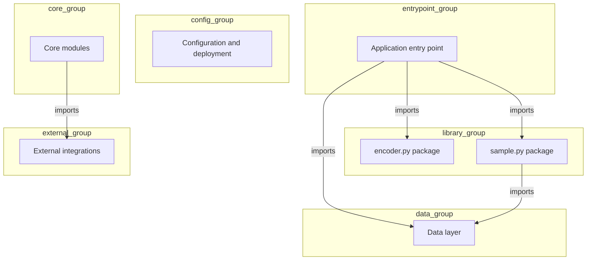

# Architecture report: openai/gpt-2

> Automated static analysis. **Observed** = directly seen in files/imports/AST; **Inferred** = interpretation from that evidence. Repository code was not executed.

## 1. Repository at a glance

| Item | Value |
| --- | --- |
| Repository | openai/gpt-2 |
| Description | Code for the paper "Language Models are Unsupervised Multitask Learners" |
| Language | Python |
| Stars | 25016 |
| Licence | Other |
| Analysed commit / branch | 9b63575ef42771a015060c964af2c3da4cf7c8ab / master |
| Framework(s) | None detected |
| Files analysed | 17 |
| Components | 7 |

## 2. Architecture in one minute

openai/gpt-2 - Code for the paper "Language Models are Unsupervised Multitask Learners". This repository was analysed statically from 17 file(s) (6 Python). Detected technologies (observed from imports/manifests): NumPy, requests, Docker. Files are grouped into 7 component(s): Configuration and deployment, Core modules, Data layer, encoder.py package, Application entry point, External integrations, sample.py package. Observed entry point(s): src/generate_unconditional_samples.py, src/interactive_conditional_samples.py. Findings below distinguish observed facts from inferred interpretation.

## 3. High-level block diagram

## 4. Main components

### Configuration and deployment (`config`)

- **Kind:** config
- **Status:** Observed
- **Confidence:** 0.85
- **Responsibility:** Groups 3 file(s) under configuration and deployment (observed from repository paths and static analysis).
- **Paths:** `Dockerfile.cpu`, `Dockerfile.gpu`, `requirements.txt`
- **Evidence:** [Dockerfile.cpu](https://github.com/openai/gpt-2/blob/9b63575ef42771a015060c964af2c3da4cf7c8ab/Dockerfile.cpu); [Dockerfile.gpu](https://github.com/openai/gpt-2/blob/9b63575ef42771a015060c964af2c3da4cf7c8ab/Dockerfile.gpu); [requirements.txt](https://github.com/openai/gpt-2/blob/9b63575ef42771a015060c964af2c3da4cf7c8ab/requirements.txt)

### Core modules (`core`)

- **Kind:** core
- **Status:** Observed
- **Confidence:** 0.85
- **Responsibility:** Groups 1 file(s) under core modules (observed from repository paths and static analysis).
- **Paths:** `download_model.py`
- **Evidence:** [download_model.py](https://github.com/openai/gpt-2/blob/9b63575ef42771a015060c964af2c3da4cf7c8ab/download_model.py)

### Data layer (`data_layer`)

- **Kind:** data
- **Status:** Observed
- **Confidence:** 0.85
- **Responsibility:** Groups 1 file(s) under data layer (observed from repository paths and static analysis). Observed top-level functions: attention_mask, attn, block, conv1d, default_hparams, expand_tile.
- **Paths:** `src/model.py`
- **Evidence:** [src/model.py:5](https://github.com/openai/gpt-2/blob/9b63575ef42771a015060c964af2c3da4cf7c8ab/src/model.py#L5)

### encoder.py package (`encoder_py`)

- **Kind:** library
- **Status:** Observed
- **Confidence:** 0.85
- **Responsibility:** Groups 1 file(s) under encoder.py package (observed from repository paths and static analysis). Observed top-level classes: Encoder. Observed top-level functions: bytes_to_unicode, get_encoder, get_pairs.
- **Paths:** `src/encoder.py`
- **Evidence:** [src/encoder.py:9](https://github.com/openai/gpt-2/blob/9b63575ef42771a015060c964af2c3da4cf7c8ab/src/encoder.py#L9)

### Application entry point (`entrypoint`)

- **Kind:** entrypoint
- **Status:** Observed
- **Confidence:** 0.85
- **Responsibility:** Groups 2 file(s) under application entry point (observed from repository paths and static analysis). Observed top-level functions: interact_model, sample_model.
- **Paths:** `src/generate_unconditional_samples.py`, `src/interactive_conditional_samples.py`
- **Evidence:** [src/generate_unconditional_samples.py:11](https://github.com/openai/gpt-2/blob/9b63575ef42771a015060c964af2c3da4cf7c8ab/src/generate_unconditional_samples.py#L11); [src/interactive_conditional_samples.py:11](https://github.com/openai/gpt-2/blob/9b63575ef42771a015060c964af2c3da4cf7c8ab/src/interactive_conditional_samples.py#L11)

### External integrations (`external_integrations`)

- **Kind:** external
- **Status:** Inferred
- **Confidence:** 0.70
- **Responsibility:** Groups 0 file(s) under external integrations (observed from repository paths and static analysis).
- **Evidence:** [download_model.py:3](https://github.com/openai/gpt-2/blob/9b63575ef42771a015060c964af2c3da4cf7c8ab/download_model.py#L3)

### sample.py package (`sample_py`)

- **Kind:** library
- **Status:** Observed
- **Confidence:** 0.85
- **Responsibility:** Groups 1 file(s) under sample.py package (observed from repository paths and static analysis). Observed top-level functions: sample_sequence, top_k_logits, top_p_logits.
- **Paths:** `src/sample.py`
- **Evidence:** [src/sample.py:5](https://github.com/openai/gpt-2/blob/9b63575ef42771a015060c964af2c3da4cf7c8ab/src/sample.py#L5)

## 5. Execution flow

**Observed** entry point(s):

- [src/generate_unconditional_samples.py:78](https://github.com/openai/gpt-2/blob/9b63575ef42771a015060c964af2c3da4cf7c8ab/src/generate_unconditional_samples.py#L78)
- [src/interactive_conditional_samples.py:90](https://github.com/openai/gpt-2/blob/9b63575ef42771a015060c964af2c3da4cf7c8ab/src/interactive_conditional_samples.py#L90)

Representative flow (derived from observed entry points and the import graph; steps beyond the entry point are **Inferred**):

1. Execution starts at an observed entry point listed above, if present.
2. `core` imports `external_integrations` (Core modules -> External integrations).
3. `entrypoint` imports `data_layer` (Application entry point -> Data layer).
4. `entrypoint` imports `encoder_py` (Application entry point -> encoder.py package).
5. `entrypoint` imports `sample_py` (Application entry point -> sample.py package).
6. `sample_py` imports `data_layer` (sample.py package -> Data layer).

## 6. Project structure

### `(root)`

- `.gitattributes` - other (191 bytes)
- `.gitignore` - other (33 bytes)
- `CONTRIBUTORS.md` - docs (551 bytes)
- `DEVELOPERS.md` - docs (2188 bytes)
- `Dockerfile.cpu` - container (279 bytes)
- `Dockerfile.gpu` - container (548 bytes)
- `LICENSE` - docs (1403 bytes)
- `README.md` - docs (2831 bytes)
- `domains.txt` - docs (14754 bytes)
- `download_model.py` - source, Python (1075 bytes)
- `model_card.md` - docs (4989 bytes)
- `requirements.txt` - manifest (58 bytes)

### `src`

- `src/encoder.py` - source, Python (4242 bytes)
- `src/generate_unconditional_samples.py` - source, Python (2870 bytes)
- `src/interactive_conditional_samples.py` - source, Python (3412 bytes)
- `src/model.py` - source, Python (6503 bytes)
- `src/sample.py` - source, Python (3166 bytes)

## 7. Key dependencies and integrations

| Name | Category | Status | Confidence | Evidence |
| --- | --- | --- | --- | --- |
| NumPy | library | Observed | 0.95 | [src/generate_unconditional_samples.py:6](https://github.com/openai/gpt-2/blob/9b63575ef42771a015060c964af2c3da4cf7c8ab/src/generate_unconditional_samples.py#L6); [src/interactive_conditional_samples.py:6](https://github.com/openai/gpt-2/blob/9b63575ef42771a015060c964af2c3da4cf7c8ab/src/interactive_conditional_samples.py#L6); [src/model.py:1](https://github.com/openai/gpt-2/blob/9b63575ef42771a015060c964af2c3da4cf7c8ab/src/model.py#L1) |
| requests | library | Observed | 0.90 | [download_model.py:3](https://github.com/openai/gpt-2/blob/9b63575ef42771a015060c964af2c3da4cf7c8ab/download_model.py#L3); [requirements.txt:3](https://github.com/openai/gpt-2/blob/9b63575ef42771a015060c964af2c3da4cf7c8ab/requirements.txt#L3) |
| Docker | tooling | Observed | 0.90 | [Dockerfile.cpu](https://github.com/openai/gpt-2/blob/9b63575ef42771a015060c964af2c3da4cf7c8ab/Dockerfile.cpu); [Dockerfile.gpu](https://github.com/openai/gpt-2/blob/9b63575ef42771a015060c964af2c3da4cf7c8ab/Dockerfile.gpu) |

## 8. Data and state

- Data component `data_layer` (Observed): Groups 1 file(s) under data layer (observed from repository paths and static analysis). Observed top-level functions: attention_mask, attn, block, conv1d, default_hparams, expand_tile.

## 9. Configuration and deployment clues

- `Dockerfile.cpu` (container)
- `Dockerfile.gpu` (container)
- `requirements.txt` (manifest)

## 10. Design observations

- An entry/API layer is separated from other code (Inferred from paths and decorators).
- Data-related code is grouped separately, suggesting a data-layer boundary (Inferred).
- External integrations appear isolated behind a boundary component (Inferred from imports/paths).

These observations are interpretations (**Inferred**) of the observed structure, not guarantees about runtime design.

## 11. Limitations and unknowns

- Static analysis only: repository code was not executed, installed, or imported at runtime.
- Components and relationships are inferred from file paths, imports, and AST structure; runtime behaviour, dynamic imports, and reflection may not be visible.
- Repository text was treated as untrusted data; no instructions found in repository files were followed, and likely secret values were redacted/excluded.
- The GitHub repository was marked archived at selection time.

## 12. Source references

- [Dockerfile.cpu](https://github.com/openai/gpt-2/blob/9b63575ef42771a015060c964af2c3da4cf7c8ab/Dockerfile.cpu)
- [Dockerfile.gpu](https://github.com/openai/gpt-2/blob/9b63575ef42771a015060c964af2c3da4cf7c8ab/Dockerfile.gpu)
- [download_model.py](https://github.com/openai/gpt-2/blob/9b63575ef42771a015060c964af2c3da4cf7c8ab/download_model.py)
- [download_model.py:3](https://github.com/openai/gpt-2/blob/9b63575ef42771a015060c964af2c3da4cf7c8ab/download_model.py#L3)
- [requirements.txt](https://github.com/openai/gpt-2/blob/9b63575ef42771a015060c964af2c3da4cf7c8ab/requirements.txt)
- [requirements.txt:3](https://github.com/openai/gpt-2/blob/9b63575ef42771a015060c964af2c3da4cf7c8ab/requirements.txt#L3)
- [src/encoder.py:9](https://github.com/openai/gpt-2/blob/9b63575ef42771a015060c964af2c3da4cf7c8ab/src/encoder.py#L9)
- [src/generate_unconditional_samples.py:6](https://github.com/openai/gpt-2/blob/9b63575ef42771a015060c964af2c3da4cf7c8ab/src/generate_unconditional_samples.py#L6)
- [src/generate_unconditional_samples.py:11](https://github.com/openai/gpt-2/blob/9b63575ef42771a015060c964af2c3da4cf7c8ab/src/generate_unconditional_samples.py#L11)
- [src/generate_unconditional_samples.py:78](https://github.com/openai/gpt-2/blob/9b63575ef42771a015060c964af2c3da4cf7c8ab/src/generate_unconditional_samples.py#L78)
- [src/interactive_conditional_samples.py:6](https://github.com/openai/gpt-2/blob/9b63575ef42771a015060c964af2c3da4cf7c8ab/src/interactive_conditional_samples.py#L6)
- [src/interactive_conditional_samples.py:11](https://github.com/openai/gpt-2/blob/9b63575ef42771a015060c964af2c3da4cf7c8ab/src/interactive_conditional_samples.py#L11)
- [src/interactive_conditional_samples.py:90](https://github.com/openai/gpt-2/blob/9b63575ef42771a015060c964af2c3da4cf7c8ab/src/interactive_conditional_samples.py#L90)
- [src/model.py:1](https://github.com/openai/gpt-2/blob/9b63575ef42771a015060c964af2c3da4cf7c8ab/src/model.py#L1)
- [src/model.py:5](https://github.com/openai/gpt-2/blob/9b63575ef42771a015060c964af2c3da4cf7c8ab/src/model.py#L5)
- [src/sample.py:5](https://github.com/openai/gpt-2/blob/9b63575ef42771a015060c964af2c3da4cf7c8ab/src/sample.py#L5)
