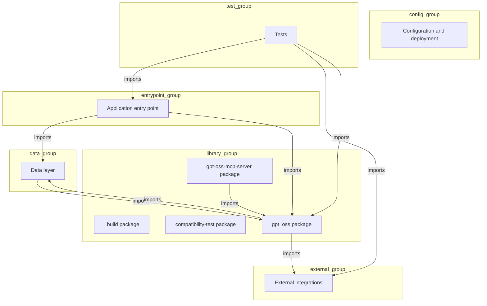

# Architecture report: openai/gpt-oss

> Automated static analysis. **Observed** = directly seen in files/imports/AST; **Inferred** = interpretation from that evidence. Repository code was not executed.

## 1. Repository at a glance

| Item | Value |
| --- | --- |
| Repository | openai/gpt-oss |
| Description | gpt-oss-120b and gpt-oss-20b are two open-weight language models by OpenAI |
| Language | Python |
| Stars | 20533 |
| Licence | Apache-2.0 |
| Analysed commit / branch | 277020131d524f06bed5f66b694a92ed7f6e5224 / main |
| Framework(s) | FastAPI |
| Files analysed | 154 |
| Components | 9 |

## 2. Architecture in one minute

openai/gpt-oss - gpt-oss-120b and gpt-oss-20b are two open-weight language models by OpenAI. This repository was analysed statically from 154 file(s) (62 Python). Detected technologies (observed from imports/manifests): GitHub Actions, FastAPI, aiohttp, httpx, NumPy, pandas. Files are grouped into 9 component(s): _build package, compatibility-test package, Configuration and deployment, Data layer, Application entry point, External integrations, gpt_oss package, gpt-oss-mcp-server package. Observed entry point(s): gpt_oss/chat.py, gpt_oss/evals/__main__.py, gpt_oss/evals/abcd_grader.py. Findings below distinguish observed facts from inferred interpretation.

## 3. High-level block diagram

## 4. Main components

### _build package (`build`)

- **Kind:** library
- **Status:** Observed
- **Confidence:** 0.85
- **Responsibility:** Groups 2 file(s) under _build package (observed from repository paths and static analysis). Observed top-level functions: _backend, _scikit_build_backend, _setuptools_backend, _use_metal_backend, build_editable, build_sdist.
- **Paths:** `_build/gpt_oss_build_backend/__init__.py`, `_build/gpt_oss_build_backend/backend.py`
- **Evidence:** [_build/gpt_oss_build_backend/__init__.py](https://github.com/openai/gpt-oss/blob/277020131d524f06bed5f66b694a92ed7f6e5224/_build/gpt_oss_build_backend/__init__.py); [_build/gpt_oss_build_backend/backend.py:39](https://github.com/openai/gpt-oss/blob/277020131d524f06bed5f66b694a92ed7f6e5224/_build/gpt_oss_build_backend/backend.py#L39)

### compatibility-test package (`compatibility_test`)

- **Kind:** library
- **Status:** Observed
- **Confidence:** 0.85
- **Responsibility:** Groups 5 file(s) under compatibility-test package (observed from repository paths and static analysis).
- **Paths:** `compatibility-test/analysis.ts`, `compatibility-test/index.ts`, `compatibility-test/providers.ts`, `compatibility-test/runCase.ts`, `compatibility-test/tools.ts`
- **Evidence:** [compatibility-test/analysis.ts](https://github.com/openai/gpt-oss/blob/277020131d524f06bed5f66b694a92ed7f6e5224/compatibility-test/analysis.ts); [compatibility-test/index.ts](https://github.com/openai/gpt-oss/blob/277020131d524f06bed5f66b694a92ed7f6e5224/compatibility-test/index.ts); [compatibility-test/providers.ts](https://github.com/openai/gpt-oss/blob/277020131d524f06bed5f66b694a92ed7f6e5224/compatibility-test/providers.ts); [compatibility-test/runCase.ts](https://github.com/openai/gpt-oss/blob/277020131d524f06bed5f66b694a92ed7f6e5224/compatibility-test/runCase.ts); [compatibility-test/tools.ts](https://github.com/openai/gpt-oss/blob/277020131d524f06bed5f66b694a92ed7f6e5224/compatibility-test/tools.ts)

### Configuration and deployment (`config`)

- **Kind:** config
- **Status:** Observed
- **Confidence:** 0.85
- **Responsibility:** Groups 4 file(s) under configuration and deployment (observed from repository paths and static analysis).
- **Paths:** `MANIFEST.in`, `compatibility-test/package.json`, `gpt-oss-mcp-server/pyproject.toml`, `pyproject.toml`
- **Evidence:** [MANIFEST.in](https://github.com/openai/gpt-oss/blob/277020131d524f06bed5f66b694a92ed7f6e5224/MANIFEST.in); [compatibility-test/package.json](https://github.com/openai/gpt-oss/blob/277020131d524f06bed5f66b694a92ed7f6e5224/compatibility-test/package.json); [gpt-oss-mcp-server/pyproject.toml](https://github.com/openai/gpt-oss/blob/277020131d524f06bed5f66b694a92ed7f6e5224/gpt-oss-mcp-server/pyproject.toml); [pyproject.toml](https://github.com/openai/gpt-oss/blob/277020131d524f06bed5f66b694a92ed7f6e5224/pyproject.toml)

### Data layer (`data_layer`)

- **Kind:** data
- **Status:** Observed
- **Confidence:** 0.85
- **Responsibility:** Groups 2 file(s) under data layer (observed from repository paths and static analysis). Observed top-level classes: AttentionBlock, Cache, MLPBlock, ModelConfig, RMSNorm, RotaryEmbedding. Observed top-level functions: _apply_rotary_emb, sdpa, swiglu.
- **Paths:** `gpt_oss/torch/model.py`, `gpt_oss/triton/model.py`
- **Evidence:** [gpt_oss/torch/model.py:13](https://github.com/openai/gpt-oss/blob/277020131d524f06bed5f66b694a92ed7f6e5224/gpt_oss/torch/model.py#L13); [gpt_oss/triton/model.py:14](https://github.com/openai/gpt-oss/blob/277020131d524f06bed5f66b694a92ed7f6e5224/gpt_oss/triton/model.py#L14)

### Application entry point (`entrypoint`)

- **Kind:** entrypoint
- **Status:** Observed
- **Confidence:** 0.85
- **Responsibility:** Groups 12 file(s) under application entry point (observed from repository paths and static analysis). Observed application object created via FastAPI. Observed top-level classes: ActionType, Chunk, Commit, DiffError, FileChange, GPQAEval. Observed top-level functions: _aggregate_get_clipped_mean, _compute_clipped_stats, _get_updated_file, apply_commit, apply_patch, calculate_score.
- **Paths:** `gpt_oss/chat.py`, `gpt_oss/evals/__main__.py`, `gpt_oss/evals/abcd_grader.py`, `gpt_oss/evals/gpqa_eval.py`, `gpt_oss/evals/healthbench_eval.py`, `gpt_oss/generate.py`, `gpt_oss/metal/examples/chat.py`, `gpt_oss/metal/examples/generate.py`, `gpt_oss/metal/scripts/create-local-model.py`, `gpt_oss/responses_api/api_server.py`, `gpt_oss/responses_api/serve.py`, `gpt_oss/tools/apply_patch.py`
- **Evidence:** [gpt_oss/chat.py:49](https://github.com/openai/gpt-oss/blob/277020131d524f06bed5f66b694a92ed7f6e5224/gpt_oss/chat.py#L49); [gpt_oss/evals/__main__.py:17](https://github.com/openai/gpt-oss/blob/277020131d524f06bed5f66b694a92ed7f6e5224/gpt_oss/evals/__main__.py#L17); [gpt_oss/evals/abcd_grader.py:81](https://github.com/openai/gpt-oss/blob/277020131d524f06bed5f66b694a92ed7f6e5224/gpt_oss/evals/abcd_grader.py#L81); [gpt_oss/evals/gpqa_eval.py:28](https://github.com/openai/gpt-oss/blob/277020131d524f06bed5f66b694a92ed7f6e5224/gpt_oss/evals/gpqa_eval.py#L28); [gpt_oss/evals/healthbench_eval.py:99](https://github.com/openai/gpt-oss/blob/277020131d524f06bed5f66b694a92ed7f6e5224/gpt_oss/evals/healthbench_eval.py#L99); [gpt_oss/generate.py:11](https://github.com/openai/gpt-oss/blob/277020131d524f06bed5f66b694a92ed7f6e5224/gpt_oss/generate.py#L11); [gpt_oss/metal/examples/chat.py:38](https://github.com/openai/gpt-oss/blob/277020131d524f06bed5f66b694a92ed7f6e5224/gpt_oss/metal/examples/chat.py#L38); [gpt_oss/metal/examples/generate.py:16](https://github.com/openai/gpt-oss/blob/277020131d524f06bed5f66b694a92ed7f6e5224/gpt_oss/metal/examples/generate.py#L16)

### External integrations (`external_integrations`)

- **Kind:** external
- **Status:** Inferred
- **Confidence:** 0.70
- **Responsibility:** Groups 0 file(s) under external integrations (observed from repository paths and static analysis).
- **Evidence:** [examples/gradio/gradio_chat.py:2](https://github.com/openai/gpt-oss/blob/277020131d524f06bed5f66b694a92ed7f6e5224/examples/gradio/gradio_chat.py#L2); [examples/streamlit/streamlit_chat.py:3](https://github.com/openai/gpt-oss/blob/277020131d524f06bed5f66b694a92ed7f6e5224/examples/streamlit/streamlit_chat.py#L3); [gpt_oss/responses_api/inference/ollama.py:12](https://github.com/openai/gpt-oss/blob/277020131d524f06bed5f66b694a92ed7f6e5224/gpt_oss/responses_api/inference/ollama.py#L12); [gpt_oss/tools/simple_browser/backend.py:15](https://github.com/openai/gpt-oss/blob/277020131d524f06bed5f66b694a92ed7f6e5224/gpt_oss/tools/simple_browser/backend.py#L15); [gpt_oss/tools/simple_browser/page_contents.py:13](https://github.com/openai/gpt-oss/blob/277020131d524f06bed5f66b694a92ed7f6e5224/gpt_oss/tools/simple_browser/page_contents.py#L13); [gpt_oss/tools/simple_browser/simple_browser_tool.py:14](https://github.com/openai/gpt-oss/blob/277020131d524f06bed5f66b694a92ed7f6e5224/gpt_oss/tools/simple_browser/simple_browser_tool.py#L14)

### gpt_oss package (`gpt_oss`)

- **Kind:** library
- **Status:** Observed
- **Confidence:** 0.85
- **Responsibility:** Groups 61 file(s) under gpt_oss package (observed from repository paths and static analysis). Observed top-level classes: AIME25Eval, Backend, BackendError, BasicEval, BrowserToolConfig, ChatCompletionsSampler. Observed top-level functions: _attn_fwd, _clean_links, _compute_stat, _escape_md, _escape_md_section, _get_text.
- **Paths:** `gpt_oss/__init__.py`, `gpt_oss/evals/__init__.py`, `gpt_oss/evals/aime_eval.py`, `gpt_oss/evals/basic_eval.py`, `gpt_oss/evals/chat_completions_sampler.py`, `gpt_oss/evals/report.py`, `gpt_oss/evals/responses_sampler.py`, `gpt_oss/evals/types.py`, `gpt_oss/metal/__init__.py`, `gpt_oss/metal/include/gpt-oss.h`, `gpt_oss/metal/include/gpt-oss/functions.h`, `gpt_oss/metal/include/gpt-oss/macros.h`, `gpt_oss/metal/include/gpt-oss/types.h`, `gpt_oss/metal/python/context.c`, `gpt_oss/metal/python/model.c`, `gpt_oss/metal/python/module.c`, `gpt_oss/metal/python/module.h`, `gpt_oss/metal/python/tokenizer.c`, `gpt_oss/metal/source/context.c`, `gpt_oss/metal/source/generate.c`, `gpt_oss/metal/source/include/internal/datatype.h`, `gpt_oss/metal/source/include/internal/kernel-args.h`, `gpt_oss/metal/source/include/internal/log.h`, `gpt_oss/metal/source/include/internal/macros.h`, `gpt_oss/metal/source/include/internal/math.h`, `gpt_oss/metal/source/include/internal/metal-kernels.h`, `gpt_oss/metal/source/include/internal/metal.h`, `gpt_oss/metal/source/include/internal/model.h`, `gpt_oss/metal/source/include/internal/rng.h`, `gpt_oss/metal/source/include/internal/storage.h`, `gpt_oss/metal/source/include/internal/uuid.h`, `gpt_oss/metal/source/log.c`, `gpt_oss/metal/source/metal-kernels.c`, `gpt_oss/metal/source/model.c`, `gpt_oss/metal/source/tokenizer.c`, `gpt_oss/responses_api/__init__.py`, `gpt_oss/responses_api/events.py`, `gpt_oss/responses_api/inference/__init__.py`, `gpt_oss/responses_api/inference/metal.py`, `gpt_oss/responses_api/inference/ollama.py`, `gpt_oss/responses_api/inference/stub.py`, `gpt_oss/responses_api/inference/transformers.py`, `gpt_oss/responses_api/inference/triton.py`, `gpt_oss/responses_api/inference/vllm.py`, `gpt_oss/responses_api/types.py`, `gpt_oss/responses_api/utils.py`, `gpt_oss/tokenizer.py`, `gpt_oss/tools/__init__.py`, `gpt_oss/tools/python_docker/docker_tool.py`, `gpt_oss/tools/simple_browser/__init__.py`, `gpt_oss/tools/simple_browser/backend.py`, `gpt_oss/tools/simple_browser/page_contents.py`, `gpt_oss/tools/simple_browser/simple_browser_tool.py`, `gpt_oss/tools/tool.py`, `gpt_oss/torch/__init__.py`, `gpt_oss/torch/utils.py`, `gpt_oss/torch/weights.py`, `gpt_oss/triton/__init__.py`, `gpt_oss/triton/attention.py`, `gpt_oss/triton/moe.py`, `gpt_oss/vllm/token_generator.py`
- **Evidence:** [gpt_oss/__init__.py](https://github.com/openai/gpt-oss/blob/277020131d524f06bed5f66b694a92ed7f6e5224/gpt_oss/__init__.py); [gpt_oss/evals/__init__.py](https://github.com/openai/gpt-oss/blob/277020131d524f06bed5f66b694a92ed7f6e5224/gpt_oss/evals/__init__.py); [gpt_oss/evals/aime_eval.py:17](https://github.com/openai/gpt-oss/blob/277020131d524f06bed5f66b694a92ed7f6e5224/gpt_oss/evals/aime_eval.py#L17); [gpt_oss/evals/basic_eval.py:8](https://github.com/openai/gpt-oss/blob/277020131d524f06bed5f66b694a92ed7f6e5224/gpt_oss/evals/basic_eval.py#L8); [gpt_oss/evals/chat_completions_sampler.py:17](https://github.com/openai/gpt-oss/blob/277020131d524f06bed5f66b694a92ed7f6e5224/gpt_oss/evals/chat_completions_sampler.py#L17); [gpt_oss/evals/report.py:27](https://github.com/openai/gpt-oss/blob/277020131d524f06bed5f66b694a92ed7f6e5224/gpt_oss/evals/report.py#L27); [gpt_oss/evals/responses_sampler.py:10](https://github.com/openai/gpt-oss/blob/277020131d524f06bed5f66b694a92ed7f6e5224/gpt_oss/evals/responses_sampler.py#L10); [gpt_oss/evals/types.py:10](https://github.com/openai/gpt-oss/blob/277020131d524f06bed5f66b694a92ed7f6e5224/gpt_oss/evals/types.py#L10)

### gpt-oss-mcp-server package (`gpt_oss_mcp_server`)

- **Kind:** library
- **Status:** Observed
- **Confidence:** 0.85
- **Responsibility:** Groups 4 file(s) under gpt-oss-mcp-server package (observed from repository paths and static analysis). Observed top-level classes: AppContext. Observed top-level functions: app_lifespan, find_pattern, list_server_and_tools, open_link, post_process_tools_description, python.
- **Paths:** `gpt-oss-mcp-server/browser_server.py`, `gpt-oss-mcp-server/build-system-prompt.py`, `gpt-oss-mcp-server/python_server.py`, `gpt-oss-mcp-server/reference-system-prompt.py`
- **Evidence:** [gpt-oss-mcp-server/browser_server.py:12](https://github.com/openai/gpt-oss/blob/277020131d524f06bed5f66b694a92ed7f6e5224/gpt-oss-mcp-server/browser_server.py#L12); [gpt-oss-mcp-server/build-system-prompt.py:24](https://github.com/openai/gpt-oss/blob/277020131d524f06bed5f66b694a92ed7f6e5224/gpt-oss-mcp-server/build-system-prompt.py#L24); [gpt-oss-mcp-server/python_server.py:26](https://github.com/openai/gpt-oss/blob/277020131d524f06bed5f66b694a92ed7f6e5224/gpt-oss-mcp-server/python_server.py#L26); [gpt-oss-mcp-server/reference-system-prompt.py](https://github.com/openai/gpt-oss/blob/277020131d524f06bed5f66b694a92ed7f6e5224/gpt-oss-mcp-server/reference-system-prompt.py)

### Tests (`tests`)

- **Kind:** test
- **Status:** Observed
- **Confidence:** 0.85
- **Responsibility:** Groups 16 file(s) under tests (observed from repository paths and static analysis). Observed routes: PATCH aiohttp.ClientSession.get, PATCH aiohttp.ClientSession.get, PATCH aiohttp.ClientSession.get, PATCH aiohttp.ClientSession.post, PATCH aiohttp.ClientSession.post. Observed top-level classes: MockAiohttpResponse, TestErrorHandling, TestPerformance, TestResponsesEndpoint, TestResponsesWithSession, TestToolIntegration. Observed top-level functions: api_client, harmony_encoding, mock_browser_tool, mock_exa_environ_get, mock_infer_token, mock_os_environ_get.
- **Paths:** `gpt_oss/metal/test/bf16-f32-embeddings.cc`, `gpt_oss/metal/test/embeddings-kernel-tester.hpp`, `gpt_oss/metal/test/f32-bf16w-matmul.cc`, `gpt_oss/metal/test/f32-bf16w-rmsnorm.cc`, `gpt_oss/metal/test/f32-random.cc`, `gpt_oss/metal/test/f32-rope.cc`, `gpt_oss/metal/test/fill-random-kernel-tester.hpp`, `gpt_oss/metal/test/matmul-kernel-tester.hpp`, `gpt_oss/metal/test/mf4-f32-convert.cc`, `gpt_oss/metal/test/rmsnorm-kernel-tester.hpp`, `gpt_oss/metal/test/rope-kernel-tester.hpp`, `gpt_oss/metal/test/u32-random.cc`, `tests/conftest.py`, `tests/gpt_oss/tools/simple_browser/test_backend.py`, `tests/test_api_endpoints.py`, `tests/test_responses_api.py`
- **Evidence:** [gpt_oss/metal/test/bf16-f32-embeddings.cc](https://github.com/openai/gpt-oss/blob/277020131d524f06bed5f66b694a92ed7f6e5224/gpt_oss/metal/test/bf16-f32-embeddings.cc); [gpt_oss/metal/test/embeddings-kernel-tester.hpp](https://github.com/openai/gpt-oss/blob/277020131d524f06bed5f66b694a92ed7f6e5224/gpt_oss/metal/test/embeddings-kernel-tester.hpp); [gpt_oss/metal/test/f32-bf16w-matmul.cc](https://github.com/openai/gpt-oss/blob/277020131d524f06bed5f66b694a92ed7f6e5224/gpt_oss/metal/test/f32-bf16w-matmul.cc); [gpt_oss/metal/test/f32-bf16w-rmsnorm.cc](https://github.com/openai/gpt-oss/blob/277020131d524f06bed5f66b694a92ed7f6e5224/gpt_oss/metal/test/f32-bf16w-rmsnorm.cc); [gpt_oss/metal/test/f32-random.cc](https://github.com/openai/gpt-oss/blob/277020131d524f06bed5f66b694a92ed7f6e5224/gpt_oss/metal/test/f32-random.cc); [gpt_oss/metal/test/f32-rope.cc](https://github.com/openai/gpt-oss/blob/277020131d524f06bed5f66b694a92ed7f6e5224/gpt_oss/metal/test/f32-rope.cc); [gpt_oss/metal/test/fill-random-kernel-tester.hpp](https://github.com/openai/gpt-oss/blob/277020131d524f06bed5f66b694a92ed7f6e5224/gpt_oss/metal/test/fill-random-kernel-tester.hpp); [gpt_oss/metal/test/matmul-kernel-tester.hpp](https://github.com/openai/gpt-oss/blob/277020131d524f06bed5f66b694a92ed7f6e5224/gpt_oss/metal/test/matmul-kernel-tester.hpp)

## 5. Execution flow

**Observed** entry point(s):

- [compatibility-test/index.ts](https://github.com/openai/gpt-oss/blob/277020131d524f06bed5f66b694a92ed7f6e5224/compatibility-test/index.ts)
- [gpt_oss/chat.py:289](https://github.com/openai/gpt-oss/blob/277020131d524f06bed5f66b694a92ed7f6e5224/gpt_oss/chat.py#L289)
- [gpt_oss/evals/__main__.py:210](https://github.com/openai/gpt-oss/blob/277020131d524f06bed5f66b694a92ed7f6e5224/gpt_oss/evals/__main__.py#L210)
- [gpt_oss/evals/abcd_grader.py:119](https://github.com/openai/gpt-oss/blob/277020131d524f06bed5f66b694a92ed7f6e5224/gpt_oss/evals/abcd_grader.py#L119)
- [gpt_oss/evals/gpqa_eval.py:100](https://github.com/openai/gpt-oss/blob/277020131d524f06bed5f66b694a92ed7f6e5224/gpt_oss/evals/gpqa_eval.py#L100)
- [gpt_oss/evals/healthbench_eval.py:611](https://github.com/openai/gpt-oss/blob/277020131d524f06bed5f66b694a92ed7f6e5224/gpt_oss/evals/healthbench_eval.py#L611)
- [gpt_oss/generate.py:40](https://github.com/openai/gpt-oss/blob/277020131d524f06bed5f66b694a92ed7f6e5224/gpt_oss/generate.py#L40)
- [gpt_oss/metal/scripts/create-local-model.py:357](https://github.com/openai/gpt-oss/blob/277020131d524f06bed5f66b694a92ed7f6e5224/gpt_oss/metal/scripts/create-local-model.py#L357)
- [gpt_oss/responses_api/api_server.py:103](https://github.com/openai/gpt-oss/blob/277020131d524f06bed5f66b694a92ed7f6e5224/gpt_oss/responses_api/api_server.py#L103)
- [gpt_oss/responses_api/serve.py:13](https://github.com/openai/gpt-oss/blob/277020131d524f06bed5f66b694a92ed7f6e5224/gpt_oss/responses_api/serve.py#L13)
- [gpt_oss/tools/apply_patch.py:528](https://github.com/openai/gpt-oss/blob/277020131d524f06bed5f66b694a92ed7f6e5224/gpt_oss/tools/apply_patch.py#L528)

**Observed** routes (from decorators):

- `PATCH aiohttp.ClientSession.get` -> `test_youcom_backend_search` in `tests/gpt_oss/tools/simple_browser/test_backend.py:39`
- `PATCH aiohttp.ClientSession.get` -> `test_youcom_backend_search_missing_results_key` in `tests/gpt_oss/tools/simple_browser/test_backend.py:62`
- `PATCH aiohttp.ClientSession.get` -> `test_youcom_backend_search_null_results` in `tests/gpt_oss/tools/simple_browser/test_backend.py:74`
- `PATCH aiohttp.ClientSession.post` -> `test_youcom_backend_fetch` in `tests/gpt_oss/tools/simple_browser/test_backend.py:86`
- `PATCH aiohttp.ClientSession.post` -> `test_exa_backend_search` in `tests/gpt_oss/tools/simple_browser/test_backend.py:109`
- `PATCH aiohttp.ClientSession.post` -> `test_exa_backend_fetch` in `tests/gpt_oss/tools/simple_browser/test_backend.py:126`

Representative flow (derived from observed entry points and the import graph; steps beyond the entry point are **Inferred**):

1. Execution starts at an observed entry point listed above, if present.
2. `data_layer` imports `gpt_oss` (Data layer -> gpt_oss package).
3. `entrypoint` imports `data_layer` (Application entry point -> Data layer).
4. `entrypoint` imports `gpt_oss` (Application entry point -> gpt_oss package).
5. `gpt_oss` imports `data_layer` (gpt_oss package -> Data layer).
6. `gpt_oss` imports `external_integrations` (gpt_oss package -> External integrations).
7. `gpt_oss_mcp_server` imports `gpt_oss` (gpt-oss-mcp-server package -> gpt_oss package).
8. `tests` imports `entrypoint` (Tests -> Application entry point).
9. `tests` imports `external_integrations` (Tests -> External integrations).

## 6. Project structure

### `(root)`

- `.gitignore` - other (58 bytes)
- `CMakeLists.txt` - docs (768 bytes)
- `LICENSE` - docs (11358 bytes)
- `MANIFEST.in` - manifest (27 bytes)
- `README.md` - docs (24453 bytes)
- `USAGE_POLICY` - other (216 bytes)
- `awesome-gpt-oss.md` - docs (5242 bytes)
- `pyproject.toml` - manifest (1267 bytes)

### `.github`

- `.github/CODEOWNERS` - other (73 bytes)
- `.github/ISSUE_TEMPLATE/config.yml` - config (369 bytes)
- `.github/workflows/CI.yml` - ci, YAML (1683 bytes)

### `_build`

- `_build/gpt_oss_build_backend/__init__.py` - source, Python (51 bytes)
- `_build/gpt_oss_build_backend/backend.py` - source, Python (4572 bytes)

### `compatibility-test`

- `compatibility-test/.gitignore` - other (2184 bytes)
- `compatibility-test/README.md` - docs (1086 bytes)
- `compatibility-test/analysis.ts` - source, TypeScript (4912 bytes)
- `compatibility-test/cases.jsonl` - data (4935 bytes)
- `compatibility-test/index.ts` - source, TypeScript (5692 bytes)
- `compatibility-test/package.json` - manifest (174 bytes)
- `compatibility-test/providers.ts` - source, TypeScript (480 bytes)
- `compatibility-test/runCase.ts` - source, TypeScript (10069 bytes)
- `compatibility-test/tools.ts` - source, TypeScript (4354 bytes)

### `examples`

- `examples/agents-sdk-js/index.ts` - source, TypeScript (2268 bytes)
- `examples/agents-sdk-js/package.json` - manifest (403 bytes)
- `examples/agents-sdk-python/example.py` - source, Python (2807 bytes)
- `examples/agents-sdk-python/pyproject.toml` - manifest (192 bytes)
- `examples/gradio/gradio_chat.py` - source, Python (9429 bytes)
- `examples/streamlit/streamlit_chat.py` - source, Python (14085 bytes)

### `gpt-oss-mcp-server`

- `gpt-oss-mcp-server/README.md` - docs (1277 bytes)
- `gpt-oss-mcp-server/browser_server.py` - source, Python (4687 bytes)
- `gpt-oss-mcp-server/build-system-prompt.py` - source, Python (3887 bytes)
- `gpt-oss-mcp-server/pyproject.toml` - manifest (142 bytes)
- `gpt-oss-mcp-server/python_server.py` - source, Python (1713 bytes)
- `gpt-oss-mcp-server/reference-system-prompt.py` - source, Python (1786 bytes)

### `gpt_oss`

- `gpt_oss/__init__.py` - source, Python (0 bytes)
- `gpt_oss/chat.py` - source, Python (14116 bytes)
- `gpt_oss/evals/README.md` - docs (235 bytes)
- `gpt_oss/evals/__init__.py` - source, Python (0 bytes)
- `gpt_oss/evals/__main__.py` - source, Python (7553 bytes)
- `gpt_oss/evals/abcd_grader.py` - source, Python (4565 bytes)
- `gpt_oss/evals/aime_eval.py` - source, Python (3913 bytes)
- `gpt_oss/evals/basic_eval.py` - source, Python (1472 bytes)
- `gpt_oss/evals/chat_completions_sampler.py` - source, Python (3605 bytes)
- `gpt_oss/evals/gpqa_eval.py` - source, Python (4487 bytes)
- `gpt_oss/evals/healthbench_eval.py` - source, Python (24446 bytes)
- `gpt_oss/evals/report.py` - source, Python (5471 bytes)
- `gpt_oss/evals/responses_sampler.py` - source, Python (3173 bytes)
- `gpt_oss/evals/types.py` - source, Python (1583 bytes)
- `gpt_oss/generate.py` - source, Python (3081 bytes)
- `gpt_oss/metal/CMakeLists.txt` - docs (10984 bytes)
- `gpt_oss/metal/__init__.py` - source, Python (228 bytes)
- `gpt_oss/metal/benchmark/end-to-end-threadgroup.cc` - other (26375 bytes)
- `gpt_oss/metal/benchmark/end-to-end.cc` - other (8833 bytes)
- `gpt_oss/metal/benchmark/f32-bf16w-rmsnorm.cc` - other (3776 bytes)
- `gpt_oss/metal/benchmark/f32-random.cc` - other (1951 bytes)
- `gpt_oss/metal/benchmark/mf4-f32-convert.cc` - other (2346 bytes)
- `gpt_oss/metal/benchmark/u32-random.cc` - other (1884 bytes)
- `gpt_oss/metal/examples/chat.py` - source, Python (3525 bytes)
- `gpt_oss/metal/examples/generate.py` - source, Python (1128 bytes)
- `gpt_oss/metal/include/gpt-oss.h` - source, C/C++ (100 bytes)
- `gpt_oss/metal/include/gpt-oss/functions.h` - source, C/C++ (16079 bytes)
- `gpt_oss/metal/include/gpt-oss/macros.h` - source, C/C++ (78 bytes)
- `gpt_oss/metal/include/gpt-oss/types.h` - source, C/C++ (1732 bytes)
- `gpt_oss/metal/python/context.c` - source, C (9240 bytes)
- `gpt_oss/metal/python/model.c` - source, C (2723 bytes)
- `gpt_oss/metal/python/module.c` - source, C (1447 bytes)
- `gpt_oss/metal/python/module.h` - source, C/C++ (421 bytes)
- `gpt_oss/metal/python/tokenizer.c` - source, C (6907 bytes)
- `gpt_oss/metal/scripts/create-local-model.py` - source, Python (14560 bytes)
- `gpt_oss/metal/source/accumulate.metal` - other (2450 bytes)
- `gpt_oss/metal/source/context.c` - source, C (52299 bytes)
- `gpt_oss/metal/source/convert.metal` - other (3441 bytes)
- `gpt_oss/metal/source/embeddings.metal` - other (867 bytes)
- `gpt_oss/metal/source/expert_routing_metadata.metal` - other (1606 bytes)
- `gpt_oss/metal/source/gather_and_accumulate.metal` - other (3011 bytes)
- `gpt_oss/metal/source/generate.c` - source, C (12836 bytes)
- `gpt_oss/metal/source/include/internal/datatype.h` - source, C/C++ (1203 bytes)
- `gpt_oss/metal/source/include/internal/datatype.hpp` - other (3671 bytes)
- `gpt_oss/metal/source/include/internal/kernel-args.h` - source, C/C++ (4564 bytes)
- `gpt_oss/metal/source/include/internal/log.h` - source, C/C++ (497 bytes)
- `gpt_oss/metal/source/include/internal/macros.h` - source, C/C++ (3321 bytes)
- `gpt_oss/metal/source/include/internal/math.h` - source, C/C++ (920 bytes)
- `gpt_oss/metal/source/include/internal/metal-kernels.h` - source, C/C++ (18465 bytes)
- `gpt_oss/metal/source/include/internal/metal.h` - source, C/C++ (4106 bytes)
- `gpt_oss/metal/source/include/internal/metal.hpp` - other (12401 bytes)
- `gpt_oss/metal/source/include/internal/model.h` - source, C/C++ (5965 bytes)
- `gpt_oss/metal/source/include/internal/rng.h` - source, C/C++ (466 bytes)
- `gpt_oss/metal/source/include/internal/rng.hpp` - other (583 bytes)
- `gpt_oss/metal/source/include/internal/storage.h` - source, C/C++ (770 bytes)
- `gpt_oss/metal/source/include/internal/uuid.h` - source, C/C++ (4661 bytes)
- `gpt_oss/metal/source/log.c` - source, C (1639 bytes)
- `gpt_oss/metal/source/matmul.metal` - other (23502 bytes)
- `gpt_oss/metal/source/metal-kernels.c` - source, C (67810 bytes)
- `gpt_oss/metal/source/metal.m` - other (18257 bytes)
- `gpt_oss/metal/source/model.c` - source, C (26427 bytes)
- `gpt_oss/metal/source/moematmul.metal` - other (32543 bytes)
- `gpt_oss/metal/source/random.metal` - other (3691 bytes)
- `gpt_oss/metal/source/rmsnorm.metal` - other (2066 bytes)
- `gpt_oss/metal/source/rope.metal` - other (2244 bytes)
- `gpt_oss/metal/source/sample.metal` - other (7423 bytes)
- `gpt_oss/metal/source/scatter.metal` - other (3171 bytes)
- `gpt_oss/metal/source/sdpa.metal` - other (15823 bytes)
- `gpt_oss/metal/source/tokenizer.c` - source, C (3121 bytes)
- `gpt_oss/metal/source/topk.metal` - other (6205 bytes)
- `gpt_oss/metal/test/bf16-f32-embeddings.cc` - test (789 bytes)
- `gpt_oss/metal/test/embeddings-kernel-tester.hpp` - test (4128 bytes)
- `gpt_oss/metal/test/f32-bf16w-matmul.cc` - test (2504 bytes)
- `gpt_oss/metal/test/f32-bf16w-rmsnorm.cc` - test (881 bytes)
- `gpt_oss/metal/test/f32-random.cc` - test (9402 bytes)
- `gpt_oss/metal/test/f32-rope.cc` - test (2005 bytes)
- `gpt_oss/metal/test/fill-random-kernel-tester.hpp` - test (3029 bytes)
- `gpt_oss/metal/test/matmul-kernel-tester.hpp` - test (13397 bytes)
- `gpt_oss/metal/test/mf4-f32-convert.cc` - test (5146 bytes)
- `gpt_oss/metal/test/rmsnorm-kernel-tester.hpp` - test (5302 bytes)
- `gpt_oss/metal/test/rope-kernel-tester.hpp` - test (7910 bytes)
- `gpt_oss/metal/test/u32-random.cc` - test (2016 bytes)
- `gpt_oss/responses_api/__init__.py` - source, Python (0 bytes)
- `gpt_oss/responses_api/api_server.py` - source, Python (60511 bytes)
- `gpt_oss/responses_api/events.py` - source, Python (5690 bytes)
- `gpt_oss/responses_api/inference/__init__.py` - source, Python (0 bytes)
- `gpt_oss/responses_api/inference/metal.py` - source, Python (1241 bytes)
- `gpt_oss/responses_api/inference/ollama.py` - source, Python (7039 bytes)
- `gpt_oss/responses_api/inference/stub.py` - source, Python (2352 bytes)
- `gpt_oss/responses_api/inference/transformers.py` - source, Python (1709 bytes)
- `gpt_oss/responses_api/inference/triton.py` - source, Python (3039 bytes)
- `gpt_oss/responses_api/inference/vllm.py` - source, Python (2899 bytes)
- `gpt_oss/responses_api/serve.py` - source, Python (1850 bytes)
- `gpt_oss/responses_api/types.py` - source, Python (5801 bytes)
- `gpt_oss/responses_api/utils.py` - source, Python (2184 bytes)
- `gpt_oss/tokenizer.py` - source, Python (1002 bytes)
- `gpt_oss/tools/__init__.py` - source, Python (0 bytes)
- `gpt_oss/tools/apply_patch.md` - docs (2578 bytes)
- `gpt_oss/tools/apply_patch.py` - source, Python (17575 bytes)
- `gpt_oss/tools/python_docker/docker_tool.py` - source, Python (13394 bytes)
- `gpt_oss/tools/simple_browser/__init__.py` - source, Python (177 bytes)
- `gpt_oss/tools/simple_browser/backend.py` - source, Python (7915 bytes)
- `gpt_oss/tools/simple_browser/page_contents.py` - source, Python (9605 bytes)
- `gpt_oss/tools/simple_browser/simple_browser_tool.py` - source, Python (23073 bytes)
- `gpt_oss/tools/tool.py` - source, Python (3683 bytes)
- `gpt_oss/torch/__init__.py` - source, Python (0 bytes)
- `gpt_oss/torch/model.py` - source, Python (16251 bytes)
- `gpt_oss/torch/utils.py` - source, Python (1179 bytes)
- `gpt_oss/torch/weights.py` - source, Python (5144 bytes)
- `gpt_oss/triton/__init__.py` - source, Python (0 bytes)
- `gpt_oss/triton/attention.py` - source, Python (8367 bytes)
- `gpt_oss/triton/model.py` - source, Python (18470 bytes)
- `gpt_oss/triton/moe.py` - source, Python (2741 bytes)
- `gpt_oss/vllm/token_generator.py` - source, Python (2180 bytes)

### `tests`

- `tests/conftest.py` - test, Python (2953 bytes)
- `tests/gpt_oss/tools/simple_browser/test_backend.py` - test, Python (5961 bytes)
- `tests/test_api_endpoints.py` - test, Python (9608 bytes)
- `tests/test_responses_api.py` - test, Python (1133 bytes)

### `tests-data`

- `tests-data/basic-event-stream.txt` - docs (6842 bytes)
- `tests-data/web-search-event-stream.txt` - docs (52265 bytes)

## 7. Key dependencies and integrations

| Name | Category | Status | Confidence | Evidence |
| --- | --- | --- | --- | --- |
| GitHub Actions | ci | Observed | 0.85 | [.github/workflows/CI.yml](https://github.com/openai/gpt-oss/blob/277020131d524f06bed5f66b694a92ed7f6e5224/.github/workflows/CI.yml) |
| FastAPI | framework | Observed | 0.95 | [gpt_oss/responses_api/api_server.py:6](https://github.com/openai/gpt-oss/blob/277020131d524f06bed5f66b694a92ed7f6e5224/gpt_oss/responses_api/api_server.py#L6); [gpt_oss/responses_api/api_server.py:7](https://github.com/openai/gpt-oss/blob/277020131d524f06bed5f66b694a92ed7f6e5224/gpt_oss/responses_api/api_server.py#L7); [gpt_oss/responses_api/api_server.py:8](https://github.com/openai/gpt-oss/blob/277020131d524f06bed5f66b694a92ed7f6e5224/gpt_oss/responses_api/api_server.py#L8); [gpt_oss/responses_api/api_server.py:9](https://github.com/openai/gpt-oss/blob/277020131d524f06bed5f66b694a92ed7f6e5224/gpt_oss/responses_api/api_server.py#L9) |
| aiohttp | library | Observed | 0.95 | [gpt_oss/tools/simple_browser/backend.py:15](https://github.com/openai/gpt-oss/blob/277020131d524f06bed5f66b694a92ed7f6e5224/gpt_oss/tools/simple_browser/backend.py#L15); [gpt_oss/tools/simple_browser/page_contents.py:13](https://github.com/openai/gpt-oss/blob/277020131d524f06bed5f66b694a92ed7f6e5224/gpt_oss/tools/simple_browser/page_contents.py#L13); [gpt_oss/tools/simple_browser/simple_browser_tool.py:14](https://github.com/openai/gpt-oss/blob/277020131d524f06bed5f66b694a92ed7f6e5224/gpt_oss/tools/simple_browser/simple_browser_tool.py#L14); [pyproject.toml:8](https://github.com/openai/gpt-oss/blob/277020131d524f06bed5f66b694a92ed7f6e5224/pyproject.toml#L8) |
| httpx | library | Observed | 0.85 | [pyproject.toml:30](https://github.com/openai/gpt-oss/blob/277020131d524f06bed5f66b694a92ed7f6e5224/pyproject.toml#L30) |
| NumPy | library | Observed | 0.95 | [gpt_oss/evals/healthbench_eval.py:26](https://github.com/openai/gpt-oss/blob/277020131d524f06bed5f66b694a92ed7f6e5224/gpt_oss/evals/healthbench_eval.py#L26); [gpt_oss/evals/report.py:7](https://github.com/openai/gpt-oss/blob/277020131d524f06bed5f66b694a92ed7f6e5224/gpt_oss/evals/report.py#L7); [pyproject.toml:29](https://github.com/openai/gpt-oss/blob/277020131d524f06bed5f66b694a92ed7f6e5224/pyproject.toml#L29) |
| pandas | library | Observed | 0.95 | [gpt_oss/evals/aime_eval.py:6](https://github.com/openai/gpt-oss/blob/277020131d524f06bed5f66b694a92ed7f6e5224/gpt_oss/evals/aime_eval.py#L6); [gpt_oss/evals/gpqa_eval.py:9](https://github.com/openai/gpt-oss/blob/277020131d524f06bed5f66b694a92ed7f6e5224/gpt_oss/evals/gpqa_eval.py#L9); [pyproject.toml:31](https://github.com/openai/gpt-oss/blob/277020131d524f06bed5f66b694a92ed7f6e5224/pyproject.toml#L31) |
| Pydantic | library | Observed | 0.95 | [gpt_oss/responses_api/events.py:4](https://github.com/openai/gpt-oss/blob/277020131d524f06bed5f66b694a92ed7f6e5224/gpt_oss/responses_api/events.py#L4); [gpt_oss/responses_api/types.py:4](https://github.com/openai/gpt-oss/blob/277020131d524f06bed5f66b694a92ed7f6e5224/gpt_oss/responses_api/types.py#L4); [gpt_oss/tools/simple_browser/page_contents.py:18](https://github.com/openai/gpt-oss/blob/277020131d524f06bed5f66b694a92ed7f6e5224/gpt_oss/tools/simple_browser/page_contents.py#L18); [gpt_oss/tools/simple_browser/simple_browser_tool.py:11](https://github.com/openai/gpt-oss/blob/277020131d524f06bed5f66b694a92ed7f6e5224/gpt_oss/tools/simple_browser/simple_browser_tool.py#L11) |
| requests | library | Observed | 0.95 | [examples/gradio/gradio_chat.py:2](https://github.com/openai/gpt-oss/blob/277020131d524f06bed5f66b694a92ed7f6e5224/examples/gradio/gradio_chat.py#L2); [examples/streamlit/streamlit_chat.py:3](https://github.com/openai/gpt-oss/blob/277020131d524f06bed5f66b694a92ed7f6e5224/examples/streamlit/streamlit_chat.py#L3); [gpt_oss/responses_api/inference/ollama.py:12](https://github.com/openai/gpt-oss/blob/277020131d524f06bed5f66b694a92ed7f6e5224/gpt_oss/responses_api/inference/ollama.py#L12); [pyproject.toml:18](https://github.com/openai/gpt-oss/blob/277020131d524f06bed5f66b694a92ed7f6e5224/pyproject.toml#L18) |
| Uvicorn | library | Observed | 0.90 | [gpt_oss/responses_api/serve.py:5](https://github.com/openai/gpt-oss/blob/277020131d524f06bed5f66b694a92ed7f6e5224/gpt_oss/responses_api/serve.py#L5); [pyproject.toml:17](https://github.com/openai/gpt-oss/blob/277020131d524f06bed5f66b694a92ed7f6e5224/pyproject.toml#L17) |
| Poetry | packaging | Observed | 0.90 | [examples/agents-sdk-python/pyproject.toml](https://github.com/openai/gpt-oss/blob/277020131d524f06bed5f66b694a92ed7f6e5224/examples/agents-sdk-python/pyproject.toml); [gpt-oss-mcp-server/pyproject.toml](https://github.com/openai/gpt-oss/blob/277020131d524f06bed5f66b694a92ed7f6e5224/gpt-oss-mcp-server/pyproject.toml); [pyproject.toml](https://github.com/openai/gpt-oss/blob/277020131d524f06bed5f66b694a92ed7f6e5224/pyproject.toml) |
| setuptools | packaging | Observed | 0.90 | [_build/gpt_oss_build_backend/backend.py:44](https://github.com/openai/gpt-oss/blob/277020131d524f06bed5f66b694a92ed7f6e5224/_build/gpt_oss_build_backend/backend.py#L44); [pyproject.toml:34](https://github.com/openai/gpt-oss/blob/277020131d524f06bed5f66b694a92ed7f6e5224/pyproject.toml#L34) |
| pytest | tooling | Observed | 0.95 | [gpt_oss/triton/attention.py:9](https://github.com/openai/gpt-oss/blob/277020131d524f06bed5f66b694a92ed7f6e5224/gpt_oss/triton/attention.py#L9); [pyproject.toml:30](https://github.com/openai/gpt-oss/blob/277020131d524f06bed5f66b694a92ed7f6e5224/pyproject.toml#L30); [tests/conftest.py:3](https://github.com/openai/gpt-oss/blob/277020131d524f06bed5f66b694a92ed7f6e5224/tests/conftest.py#L3); [tests/gpt_oss/tools/simple_browser/test_backend.py:1](https://github.com/openai/gpt-oss/blob/277020131d524f06bed5f66b694a92ed7f6e5224/tests/gpt_oss/tools/simple_browser/test_backend.py#L1) |
| TypeScript | tooling | Observed | 0.85 | [examples/agents-sdk-js/package.json:17](https://github.com/openai/gpt-oss/blob/277020131d524f06bed5f66b694a92ed7f6e5224/examples/agents-sdk-js/package.json#L17) |
| unittest | tooling | Observed | 0.95 | [tests/conftest.py:5](https://github.com/openai/gpt-oss/blob/277020131d524f06bed5f66b694a92ed7f6e5224/tests/conftest.py#L5); [tests/gpt_oss/tools/simple_browser/test_backend.py:3](https://github.com/openai/gpt-oss/blob/277020131d524f06bed5f66b694a92ed7f6e5224/tests/gpt_oss/tools/simple_browser/test_backend.py#L3); [tests/test_api_endpoints.py:5](https://github.com/openai/gpt-oss/blob/277020131d524f06bed5f66b694a92ed7f6e5224/tests/test_api_endpoints.py#L5) |

## 8. Data and state

- Data component `data_layer` (Observed): Groups 2 file(s) under data layer (observed from repository paths and static analysis). Observed top-level classes: AttentionBlock, Cache, MLPBlock, ModelConfig, RMSNorm, RotaryEmbedding. Observed top-level functions: _apply_rotary_emb, sdpa, swiglu.

## 9. Configuration and deployment clues

- `.github/ISSUE_TEMPLATE/config.yml` (config)
- `.github/workflows/CI.yml` (ci)
- `MANIFEST.in` (manifest)
- `compatibility-test/package.json` (manifest)
- `examples/agents-sdk-js/package.json` (manifest)
- `examples/agents-sdk-python/pyproject.toml` (manifest)
- `gpt-oss-mcp-server/pyproject.toml` (manifest)
- `pyproject.toml` (manifest)

## 10. Design observations

- An entry/API layer is separated from other code (Inferred from paths and decorators).
- Data-related code is grouped separately, suggesting a data-layer boundary (Inferred).
- Tests are present alongside source code (Observed from test file paths).
- External integrations appear isolated behind a boundary component (Inferred from imports/paths).

These observations are interpretations (**Inferred**) of the observed structure, not guarantees about runtime design.

## 11. Limitations and unknowns

- Static analysis only: repository code was not executed, installed, or imported at runtime.
- Components and relationships are inferred from file paths, imports, and AST structure; runtime behaviour, dynamic imports, and reflection may not be visible.
- 2 file(s) were skipped during inventory (2 x lockfile excluded).
- Repository text was treated as untrusted data; no instructions found in repository files were followed, and likely secret values were redacted/excluded.

## 12. Source references

- [.github/workflows/CI.yml](https://github.com/openai/gpt-oss/blob/277020131d524f06bed5f66b694a92ed7f6e5224/.github/workflows/CI.yml)
- [MANIFEST.in](https://github.com/openai/gpt-oss/blob/277020131d524f06bed5f66b694a92ed7f6e5224/MANIFEST.in)
- [_build/gpt_oss_build_backend/__init__.py](https://github.com/openai/gpt-oss/blob/277020131d524f06bed5f66b694a92ed7f6e5224/_build/gpt_oss_build_backend/__init__.py)
- [_build/gpt_oss_build_backend/backend.py:39](https://github.com/openai/gpt-oss/blob/277020131d524f06bed5f66b694a92ed7f6e5224/_build/gpt_oss_build_backend/backend.py#L39)
- [_build/gpt_oss_build_backend/backend.py:44](https://github.com/openai/gpt-oss/blob/277020131d524f06bed5f66b694a92ed7f6e5224/_build/gpt_oss_build_backend/backend.py#L44)
- [compatibility-test/analysis.ts](https://github.com/openai/gpt-oss/blob/277020131d524f06bed5f66b694a92ed7f6e5224/compatibility-test/analysis.ts)
- [compatibility-test/index.ts](https://github.com/openai/gpt-oss/blob/277020131d524f06bed5f66b694a92ed7f6e5224/compatibility-test/index.ts)
- [compatibility-test/package.json](https://github.com/openai/gpt-oss/blob/277020131d524f06bed5f66b694a92ed7f6e5224/compatibility-test/package.json)
- [compatibility-test/providers.ts](https://github.com/openai/gpt-oss/blob/277020131d524f06bed5f66b694a92ed7f6e5224/compatibility-test/providers.ts)
- [compatibility-test/runCase.ts](https://github.com/openai/gpt-oss/blob/277020131d524f06bed5f66b694a92ed7f6e5224/compatibility-test/runCase.ts)
- [compatibility-test/tools.ts](https://github.com/openai/gpt-oss/blob/277020131d524f06bed5f66b694a92ed7f6e5224/compatibility-test/tools.ts)
- [examples/agents-sdk-js/package.json:17](https://github.com/openai/gpt-oss/blob/277020131d524f06bed5f66b694a92ed7f6e5224/examples/agents-sdk-js/package.json#L17)
- [examples/agents-sdk-python/pyproject.toml](https://github.com/openai/gpt-oss/blob/277020131d524f06bed5f66b694a92ed7f6e5224/examples/agents-sdk-python/pyproject.toml)
- [examples/gradio/gradio_chat.py:2](https://github.com/openai/gpt-oss/blob/277020131d524f06bed5f66b694a92ed7f6e5224/examples/gradio/gradio_chat.py#L2)
- [examples/streamlit/streamlit_chat.py:3](https://github.com/openai/gpt-oss/blob/277020131d524f06bed5f66b694a92ed7f6e5224/examples/streamlit/streamlit_chat.py#L3)
- [gpt-oss-mcp-server/browser_server.py:12](https://github.com/openai/gpt-oss/blob/277020131d524f06bed5f66b694a92ed7f6e5224/gpt-oss-mcp-server/browser_server.py#L12)
- [gpt-oss-mcp-server/build-system-prompt.py:24](https://github.com/openai/gpt-oss/blob/277020131d524f06bed5f66b694a92ed7f6e5224/gpt-oss-mcp-server/build-system-prompt.py#L24)
- [gpt-oss-mcp-server/pyproject.toml](https://github.com/openai/gpt-oss/blob/277020131d524f06bed5f66b694a92ed7f6e5224/gpt-oss-mcp-server/pyproject.toml)
- [gpt-oss-mcp-server/python_server.py:26](https://github.com/openai/gpt-oss/blob/277020131d524f06bed5f66b694a92ed7f6e5224/gpt-oss-mcp-server/python_server.py#L26)
- [gpt-oss-mcp-server/reference-system-prompt.py](https://github.com/openai/gpt-oss/blob/277020131d524f06bed5f66b694a92ed7f6e5224/gpt-oss-mcp-server/reference-system-prompt.py)
- [gpt_oss/__init__.py](https://github.com/openai/gpt-oss/blob/277020131d524f06bed5f66b694a92ed7f6e5224/gpt_oss/__init__.py)
- [gpt_oss/chat.py:49](https://github.com/openai/gpt-oss/blob/277020131d524f06bed5f66b694a92ed7f6e5224/gpt_oss/chat.py#L49)
- [gpt_oss/chat.py:289](https://github.com/openai/gpt-oss/blob/277020131d524f06bed5f66b694a92ed7f6e5224/gpt_oss/chat.py#L289)
- [gpt_oss/evals/__init__.py](https://github.com/openai/gpt-oss/blob/277020131d524f06bed5f66b694a92ed7f6e5224/gpt_oss/evals/__init__.py)
- [gpt_oss/evals/__main__.py:17](https://github.com/openai/gpt-oss/blob/277020131d524f06bed5f66b694a92ed7f6e5224/gpt_oss/evals/__main__.py#L17)
- [gpt_oss/evals/__main__.py:210](https://github.com/openai/gpt-oss/blob/277020131d524f06bed5f66b694a92ed7f6e5224/gpt_oss/evals/__main__.py#L210)
- [gpt_oss/evals/abcd_grader.py:81](https://github.com/openai/gpt-oss/blob/277020131d524f06bed5f66b694a92ed7f6e5224/gpt_oss/evals/abcd_grader.py#L81)
- [gpt_oss/evals/abcd_grader.py:119](https://github.com/openai/gpt-oss/blob/277020131d524f06bed5f66b694a92ed7f6e5224/gpt_oss/evals/abcd_grader.py#L119)
- [gpt_oss/evals/aime_eval.py:6](https://github.com/openai/gpt-oss/blob/277020131d524f06bed5f66b694a92ed7f6e5224/gpt_oss/evals/aime_eval.py#L6)
- [gpt_oss/evals/aime_eval.py:17](https://github.com/openai/gpt-oss/blob/277020131d524f06bed5f66b694a92ed7f6e5224/gpt_oss/evals/aime_eval.py#L17)
- [gpt_oss/evals/basic_eval.py:8](https://github.com/openai/gpt-oss/blob/277020131d524f06bed5f66b694a92ed7f6e5224/gpt_oss/evals/basic_eval.py#L8)
- [gpt_oss/evals/chat_completions_sampler.py:17](https://github.com/openai/gpt-oss/blob/277020131d524f06bed5f66b694a92ed7f6e5224/gpt_oss/evals/chat_completions_sampler.py#L17)
- [gpt_oss/evals/gpqa_eval.py:9](https://github.com/openai/gpt-oss/blob/277020131d524f06bed5f66b694a92ed7f6e5224/gpt_oss/evals/gpqa_eval.py#L9)
- [gpt_oss/evals/gpqa_eval.py:28](https://github.com/openai/gpt-oss/blob/277020131d524f06bed5f66b694a92ed7f6e5224/gpt_oss/evals/gpqa_eval.py#L28)
- [gpt_oss/evals/gpqa_eval.py:100](https://github.com/openai/gpt-oss/blob/277020131d524f06bed5f66b694a92ed7f6e5224/gpt_oss/evals/gpqa_eval.py#L100)
- [gpt_oss/evals/healthbench_eval.py:26](https://github.com/openai/gpt-oss/blob/277020131d524f06bed5f66b694a92ed7f6e5224/gpt_oss/evals/healthbench_eval.py#L26)
- [gpt_oss/evals/healthbench_eval.py:99](https://github.com/openai/gpt-oss/blob/277020131d524f06bed5f66b694a92ed7f6e5224/gpt_oss/evals/healthbench_eval.py#L99)
- [gpt_oss/evals/healthbench_eval.py:611](https://github.com/openai/gpt-oss/blob/277020131d524f06bed5f66b694a92ed7f6e5224/gpt_oss/evals/healthbench_eval.py#L611)
- [gpt_oss/evals/report.py:7](https://github.com/openai/gpt-oss/blob/277020131d524f06bed5f66b694a92ed7f6e5224/gpt_oss/evals/report.py#L7)
- [gpt_oss/evals/report.py:27](https://github.com/openai/gpt-oss/blob/277020131d524f06bed5f66b694a92ed7f6e5224/gpt_oss/evals/report.py#L27)
- [gpt_oss/evals/responses_sampler.py:10](https://github.com/openai/gpt-oss/blob/277020131d524f06bed5f66b694a92ed7f6e5224/gpt_oss/evals/responses_sampler.py#L10)
- [gpt_oss/evals/types.py:10](https://github.com/openai/gpt-oss/blob/277020131d524f06bed5f66b694a92ed7f6e5224/gpt_oss/evals/types.py#L10)
- [gpt_oss/generate.py:11](https://github.com/openai/gpt-oss/blob/277020131d524f06bed5f66b694a92ed7f6e5224/gpt_oss/generate.py#L11)
- [gpt_oss/generate.py:40](https://github.com/openai/gpt-oss/blob/277020131d524f06bed5f66b694a92ed7f6e5224/gpt_oss/generate.py#L40)
- [gpt_oss/metal/examples/chat.py:38](https://github.com/openai/gpt-oss/blob/277020131d524f06bed5f66b694a92ed7f6e5224/gpt_oss/metal/examples/chat.py#L38)
- [gpt_oss/metal/examples/generate.py:16](https://github.com/openai/gpt-oss/blob/277020131d524f06bed5f66b694a92ed7f6e5224/gpt_oss/metal/examples/generate.py#L16)
- [gpt_oss/metal/scripts/create-local-model.py:357](https://github.com/openai/gpt-oss/blob/277020131d524f06bed5f66b694a92ed7f6e5224/gpt_oss/metal/scripts/create-local-model.py#L357)
- [gpt_oss/metal/test/bf16-f32-embeddings.cc](https://github.com/openai/gpt-oss/blob/277020131d524f06bed5f66b694a92ed7f6e5224/gpt_oss/metal/test/bf16-f32-embeddings.cc)
- [gpt_oss/metal/test/embeddings-kernel-tester.hpp](https://github.com/openai/gpt-oss/blob/277020131d524f06bed5f66b694a92ed7f6e5224/gpt_oss/metal/test/embeddings-kernel-tester.hpp)
- [gpt_oss/metal/test/f32-bf16w-matmul.cc](https://github.com/openai/gpt-oss/blob/277020131d524f06bed5f66b694a92ed7f6e5224/gpt_oss/metal/test/f32-bf16w-matmul.cc)
- [gpt_oss/metal/test/f32-bf16w-rmsnorm.cc](https://github.com/openai/gpt-oss/blob/277020131d524f06bed5f66b694a92ed7f6e5224/gpt_oss/metal/test/f32-bf16w-rmsnorm.cc)
- [gpt_oss/metal/test/f32-random.cc](https://github.com/openai/gpt-oss/blob/277020131d524f06bed5f66b694a92ed7f6e5224/gpt_oss/metal/test/f32-random.cc)
- [gpt_oss/metal/test/f32-rope.cc](https://github.com/openai/gpt-oss/blob/277020131d524f06bed5f66b694a92ed7f6e5224/gpt_oss/metal/test/f32-rope.cc)
- [gpt_oss/metal/test/fill-random-kernel-tester.hpp](https://github.com/openai/gpt-oss/blob/277020131d524f06bed5f66b694a92ed7f6e5224/gpt_oss/metal/test/fill-random-kernel-tester.hpp)
- [gpt_oss/metal/test/matmul-kernel-tester.hpp](https://github.com/openai/gpt-oss/blob/277020131d524f06bed5f66b694a92ed7f6e5224/gpt_oss/metal/test/matmul-kernel-tester.hpp)
- [gpt_oss/responses_api/api_server.py:6](https://github.com/openai/gpt-oss/blob/277020131d524f06bed5f66b694a92ed7f6e5224/gpt_oss/responses_api/api_server.py#L6)
- [gpt_oss/responses_api/api_server.py:7](https://github.com/openai/gpt-oss/blob/277020131d524f06bed5f66b694a92ed7f6e5224/gpt_oss/responses_api/api_server.py#L7)
- [gpt_oss/responses_api/api_server.py:8](https://github.com/openai/gpt-oss/blob/277020131d524f06bed5f66b694a92ed7f6e5224/gpt_oss/responses_api/api_server.py#L8)
- [gpt_oss/responses_api/api_server.py:9](https://github.com/openai/gpt-oss/blob/277020131d524f06bed5f66b694a92ed7f6e5224/gpt_oss/responses_api/api_server.py#L9)
- [gpt_oss/responses_api/api_server.py:103](https://github.com/openai/gpt-oss/blob/277020131d524f06bed5f66b694a92ed7f6e5224/gpt_oss/responses_api/api_server.py#L103)
- [gpt_oss/responses_api/api_server.py:1207](https://github.com/openai/gpt-oss/blob/277020131d524f06bed5f66b694a92ed7f6e5224/gpt_oss/responses_api/api_server.py#L1207)
- [gpt_oss/responses_api/events.py:4](https://github.com/openai/gpt-oss/blob/277020131d524f06bed5f66b694a92ed7f6e5224/gpt_oss/responses_api/events.py#L4)
- [gpt_oss/responses_api/inference/ollama.py:12](https://github.com/openai/gpt-oss/blob/277020131d524f06bed5f66b694a92ed7f6e5224/gpt_oss/responses_api/inference/ollama.py#L12)
- [gpt_oss/responses_api/serve.py:5](https://github.com/openai/gpt-oss/blob/277020131d524f06bed5f66b694a92ed7f6e5224/gpt_oss/responses_api/serve.py#L5)
- [gpt_oss/responses_api/serve.py:13](https://github.com/openai/gpt-oss/blob/277020131d524f06bed5f66b694a92ed7f6e5224/gpt_oss/responses_api/serve.py#L13)
- [gpt_oss/responses_api/types.py:4](https://github.com/openai/gpt-oss/blob/277020131d524f06bed5f66b694a92ed7f6e5224/gpt_oss/responses_api/types.py#L4)
- [gpt_oss/tools/apply_patch.py:528](https://github.com/openai/gpt-oss/blob/277020131d524f06bed5f66b694a92ed7f6e5224/gpt_oss/tools/apply_patch.py#L528)
- [gpt_oss/tools/simple_browser/backend.py:15](https://github.com/openai/gpt-oss/blob/277020131d524f06bed5f66b694a92ed7f6e5224/gpt_oss/tools/simple_browser/backend.py#L15)
- [gpt_oss/tools/simple_browser/page_contents.py:13](https://github.com/openai/gpt-oss/blob/277020131d524f06bed5f66b694a92ed7f6e5224/gpt_oss/tools/simple_browser/page_contents.py#L13)
- [gpt_oss/tools/simple_browser/page_contents.py:18](https://github.com/openai/gpt-oss/blob/277020131d524f06bed5f66b694a92ed7f6e5224/gpt_oss/tools/simple_browser/page_contents.py#L18)
- [gpt_oss/tools/simple_browser/simple_browser_tool.py:11](https://github.com/openai/gpt-oss/blob/277020131d524f06bed5f66b694a92ed7f6e5224/gpt_oss/tools/simple_browser/simple_browser_tool.py#L11)
- [gpt_oss/tools/simple_browser/simple_browser_tool.py:14](https://github.com/openai/gpt-oss/blob/277020131d524f06bed5f66b694a92ed7f6e5224/gpt_oss/tools/simple_browser/simple_browser_tool.py#L14)
- [gpt_oss/torch/model.py:13](https://github.com/openai/gpt-oss/blob/277020131d524f06bed5f66b694a92ed7f6e5224/gpt_oss/torch/model.py#L13)
- [gpt_oss/triton/attention.py:9](https://github.com/openai/gpt-oss/blob/277020131d524f06bed5f66b694a92ed7f6e5224/gpt_oss/triton/attention.py#L9)
- [gpt_oss/triton/model.py:14](https://github.com/openai/gpt-oss/blob/277020131d524f06bed5f66b694a92ed7f6e5224/gpt_oss/triton/model.py#L14)
- [pyproject.toml](https://github.com/openai/gpt-oss/blob/277020131d524f06bed5f66b694a92ed7f6e5224/pyproject.toml)
- [pyproject.toml:8](https://github.com/openai/gpt-oss/blob/277020131d524f06bed5f66b694a92ed7f6e5224/pyproject.toml#L8)
- [pyproject.toml:11](https://github.com/openai/gpt-oss/blob/277020131d524f06bed5f66b694a92ed7f6e5224/pyproject.toml#L11)
- [pyproject.toml:14](https://github.com/openai/gpt-oss/blob/277020131d524f06bed5f66b694a92ed7f6e5224/pyproject.toml#L14)
- [pyproject.toml:17](https://github.com/openai/gpt-oss/blob/277020131d524f06bed5f66b694a92ed7f6e5224/pyproject.toml#L17)
- [pyproject.toml:18](https://github.com/openai/gpt-oss/blob/277020131d524f06bed5f66b694a92ed7f6e5224/pyproject.toml#L18)
- [pyproject.toml:29](https://github.com/openai/gpt-oss/blob/277020131d524f06bed5f66b694a92ed7f6e5224/pyproject.toml#L29)
- [pyproject.toml:30](https://github.com/openai/gpt-oss/blob/277020131d524f06bed5f66b694a92ed7f6e5224/pyproject.toml#L30)
- [pyproject.toml:31](https://github.com/openai/gpt-oss/blob/277020131d524f06bed5f66b694a92ed7f6e5224/pyproject.toml#L31)
- [pyproject.toml:34](https://github.com/openai/gpt-oss/blob/277020131d524f06bed5f66b694a92ed7f6e5224/pyproject.toml#L34)
- [tests/conftest.py:3](https://github.com/openai/gpt-oss/blob/277020131d524f06bed5f66b694a92ed7f6e5224/tests/conftest.py#L3)
- [tests/conftest.py:5](https://github.com/openai/gpt-oss/blob/277020131d524f06bed5f66b694a92ed7f6e5224/tests/conftest.py#L5)
- [tests/conftest.py:6](https://github.com/openai/gpt-oss/blob/277020131d524f06bed5f66b694a92ed7f6e5224/tests/conftest.py#L6)
- [tests/gpt_oss/tools/simple_browser/test_backend.py:1](https://github.com/openai/gpt-oss/blob/277020131d524f06bed5f66b694a92ed7f6e5224/tests/gpt_oss/tools/simple_browser/test_backend.py#L1)
- [tests/gpt_oss/tools/simple_browser/test_backend.py:3](https://github.com/openai/gpt-oss/blob/277020131d524f06bed5f66b694a92ed7f6e5224/tests/gpt_oss/tools/simple_browser/test_backend.py#L3)
- [tests/gpt_oss/tools/simple_browser/test_backend.py:4](https://github.com/openai/gpt-oss/blob/277020131d524f06bed5f66b694a92ed7f6e5224/tests/gpt_oss/tools/simple_browser/test_backend.py#L4)
- [tests/test_api_endpoints.py:1](https://github.com/openai/gpt-oss/blob/277020131d524f06bed5f66b694a92ed7f6e5224/tests/test_api_endpoints.py#L1)
- [tests/test_api_endpoints.py:4](https://github.com/openai/gpt-oss/blob/277020131d524f06bed5f66b694a92ed7f6e5224/tests/test_api_endpoints.py#L4)
- [tests/test_api_endpoints.py:5](https://github.com/openai/gpt-oss/blob/277020131d524f06bed5f66b694a92ed7f6e5224/tests/test_api_endpoints.py#L5)
- [tests/test_responses_api.py:3](https://github.com/openai/gpt-oss/blob/277020131d524f06bed5f66b694a92ed7f6e5224/tests/test_responses_api.py#L3)
