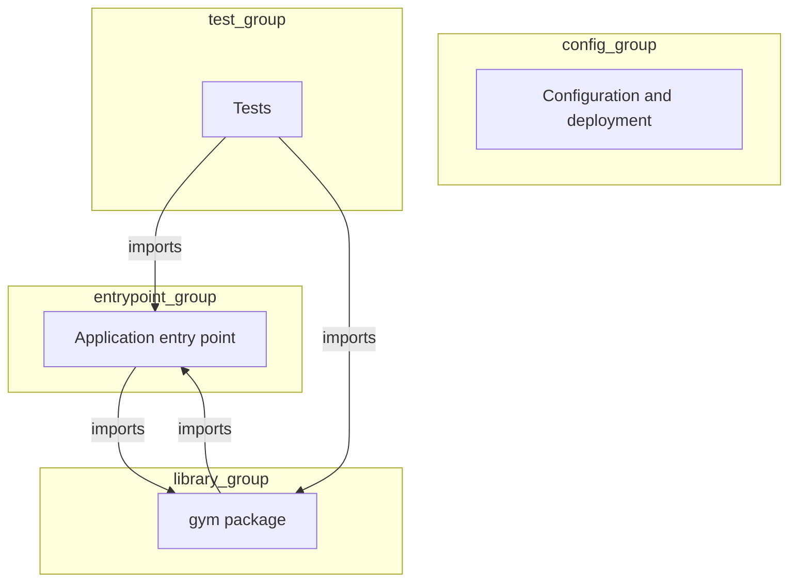

# Architecture report: openai/gym

> Automated static analysis. **Observed** = directly seen in files/imports/AST; **Inferred** = interpretation from that evidence. Repository code was not executed.

## 1. Repository at a glance

| Item | Value |
| --- | --- |
| Repository | openai/gym |
| Description | A toolkit for developing and comparing reinforcement learning algorithms. |
| Language | Python |
| Stars | 37236 |
| Licence | Other |
| Analysed commit / branch | bc212954b6713d5db303b3ead124de6cba66063e / master |
| Framework(s) | None detected |
| Files analysed | 219 |
| Components | 4 |

## 2. Architecture in one minute

openai/gym - A toolkit for developing and comparing reinforcement learning algorithms.. This repository was analysed statically from 219 file(s) (187 Python). Detected technologies (observed from imports/manifests): GitHub Actions, NumPy, Poetry, setuptools, Docker, pytest. Files are grouped into 4 component(s): Configuration and deployment, Application entry point, gym package, Tests. Observed entry point(s): gym/envs/box2d/bipedal_walker.py, gym/envs/box2d/car_racing.py, gym/envs/box2d/lunar_lander.py. Findings below distinguish observed facts from inferred interpretation.

## 3. High-level block diagram

## 4. Main components

### Configuration and deployment (`config`)

- **Kind:** config
- **Status:** Observed
- **Confidence:** 0.85
- **Responsibility:** Groups 3 file(s) under configuration and deployment (observed from repository paths and static analysis).
- **Paths:** `pyproject.toml`, `requirements.txt`, `setup.py`
- **Evidence:** [pyproject.toml](https://github.com/openai/gym/blob/bc212954b6713d5db303b3ead124de6cba66063e/pyproject.toml); [requirements.txt](https://github.com/openai/gym/blob/bc212954b6713d5db303b3ead124de6cba66063e/requirements.txt); [setup.py](https://github.com/openai/gym/blob/bc212954b6713d5db303b3ead124de6cba66063e/setup.py)

### Application entry point (`entrypoint`)

- **Kind:** entrypoint
- **Status:** Observed
- **Confidence:** 0.85
- **Responsibility:** Groups 3 file(s) under application entry point (observed from repository paths and static analysis). Observed top-level classes: BipedalWalker, BipedalWalkerHardcore, CarRacing, ContactDetector, FrictionDetector, LunarLander. Observed top-level functions: demo_heuristic_lander, heuristic.
- **Paths:** `gym/envs/box2d/bipedal_walker.py`, `gym/envs/box2d/car_racing.py`, `gym/envs/box2d/lunar_lander.py`
- **Evidence:** [gym/envs/box2d/bipedal_walker.py:80](https://github.com/openai/gym/blob/bc212954b6713d5db303b3ead124de6cba66063e/gym/envs/box2d/bipedal_walker.py#L80); [gym/envs/box2d/car_racing.py:57](https://github.com/openai/gym/blob/bc212954b6713d5db303b3ead124de6cba66063e/gym/envs/box2d/car_racing.py#L57); [gym/envs/box2d/lunar_lander.py:54](https://github.com/openai/gym/blob/bc212954b6713d5db303b3ead124de6cba66063e/gym/envs/box2d/lunar_lander.py#L54)

### gym package (`gym`)

- **Kind:** library
- **Status:** Observed
- **Confidence:** 0.85
- **Responsibility:** Groups 110 file(s) under gym package (observed from repository paths and static analysis). Observed top-level classes: APIConnectionError, APIError, AcrobotEnv, ActionWrapper, AlreadyPendingCallError, AntEnv. Observed top-level functions: _batch_space_box, _batch_space_custom, _batch_space_dict, _batch_space_discrete, _batch_space_multibinary, _batch_space_multidiscrete.
- **Paths:** `gym/__init__.py`, `gym/core.py`, `gym/envs/__init__.py`, `gym/envs/box2d/__init__.py`, `gym/envs/box2d/car_dynamics.py`, `gym/envs/classic_control/__init__.py`, `gym/envs/classic_control/acrobot.py`, `gym/envs/classic_control/cartpole.py`, `gym/envs/classic_control/continuous_mountain_car.py`, `gym/envs/classic_control/mountain_car.py`, `gym/envs/classic_control/pendulum.py`, `gym/envs/classic_control/utils.py`, `gym/envs/mujoco/__init__.py`, `gym/envs/mujoco/ant.py`, `gym/envs/mujoco/ant_v3.py`, `gym/envs/mujoco/ant_v4.py`, `gym/envs/mujoco/half_cheetah.py`, `gym/envs/mujoco/half_cheetah_v3.py`, `gym/envs/mujoco/half_cheetah_v4.py`, `gym/envs/mujoco/hopper.py`, `gym/envs/mujoco/hopper_v3.py`, `gym/envs/mujoco/hopper_v4.py`, `gym/envs/mujoco/humanoid.py`, `gym/envs/mujoco/humanoid_v3.py`, `gym/envs/mujoco/humanoid_v4.py`, `gym/envs/mujoco/humanoidstandup.py`, `gym/envs/mujoco/humanoidstandup_v4.py`, `gym/envs/mujoco/inverted_double_pendulum.py`, `gym/envs/mujoco/inverted_double_pendulum_v4.py`, `gym/envs/mujoco/inverted_pendulum.py`, `gym/envs/mujoco/inverted_pendulum_v4.py`, `gym/envs/mujoco/mujoco_env.py`, `gym/envs/mujoco/mujoco_rendering.py`, `gym/envs/mujoco/pusher.py`, `gym/envs/mujoco/pusher_v4.py`, `gym/envs/mujoco/reacher.py`, `gym/envs/mujoco/reacher_v4.py`, `gym/envs/mujoco/swimmer.py`, `gym/envs/mujoco/swimmer_v3.py`, `gym/envs/mujoco/swimmer_v4.py`, `gym/envs/mujoco/walker2d.py`, `gym/envs/mujoco/walker2d_v3.py`, `gym/envs/mujoco/walker2d_v4.py`, `gym/envs/registration.py`, `gym/envs/toy_text/__init__.py`, `gym/envs/toy_text/blackjack.py`, `gym/envs/toy_text/cliffwalking.py`, `gym/envs/toy_text/frozen_lake.py`, `gym/envs/toy_text/taxi.py`, `gym/envs/toy_text/utils.py`, `gym/error.py`, `gym/logger.py`, `gym/spaces/__init__.py`, `gym/spaces/box.py`, `gym/spaces/dict.py`, `gym/spaces/discrete.py`, `gym/spaces/graph.py`, `gym/spaces/multi_binary.py`, `gym/spaces/multi_discrete.py`, `gym/spaces/sequence.py`, `gym/spaces/space.py`, `gym/spaces/text.py`, `gym/spaces/tuple.py`, `gym/spaces/utils.py`, `gym/utils/__init__.py`, `gym/utils/colorize.py`, `gym/utils/env_checker.py`, `gym/utils/ezpickle.py`, `gym/utils/passive_env_checker.py`, `gym/utils/play.py`, `gym/utils/save_video.py`, `gym/utils/seeding.py`, `gym/utils/step_api_compatibility.py`, `gym/vector/__init__.py`, `gym/vector/async_vector_env.py`, `gym/vector/sync_vector_env.py`, `gym/vector/utils/__init__.py`, `gym/vector/utils/misc.py`, `gym/vector/utils/numpy_utils.py`, `gym/vector/utils/shared_memory.py`, `gym/vector/utils/spaces.py`, `gym/vector/vector_env.py`, `gym/version.py`, `gym/wrappers/__init__.py`, `gym/wrappers/atari_preprocessing.py`, `gym/wrappers/autoreset.py`, `gym/wrappers/clip_action.py`, `gym/wrappers/compatibility.py`, `gym/wrappers/env_checker.py`, `gym/wrappers/filter_observation.py`, `gym/wrappers/flatten_observation.py`, `gym/wrappers/frame_stack.py`, `gym/wrappers/gray_scale_observation.py`, `gym/wrappers/human_rendering.py`, `gym/wrappers/monitoring/__init__.py`, `gym/wrappers/monitoring/video_recorder.py`, `gym/wrappers/normalize.py`, `gym/wrappers/order_enforcing.py`, `gym/wrappers/pixel_observation.py`, `gym/wrappers/record_episode_statistics.py`, `gym/wrappers/record_video.py`, `gym/wrappers/render_collection.py`, `gym/wrappers/rescale_action.py`, `gym/wrappers/resize_observation.py`, `gym/wrappers/step_api_compatibility.py`, `gym/wrappers/time_aware_observation.py`, `gym/wrappers/time_limit.py`, `gym/wrappers/transform_observation.py`, `gym/wrappers/transform_reward.py`, `gym/wrappers/vector_list_info.py`
- **Evidence:** [gym/__init__.py](https://github.com/openai/gym/blob/bc212954b6713d5db303b3ead124de6cba66063e/gym/__init__.py); [gym/core.py:35](https://github.com/openai/gym/blob/bc212954b6713d5db303b3ead124de6cba66063e/gym/core.py#L35); [gym/envs/__init__.py](https://github.com/openai/gym/blob/bc212954b6713d5db303b3ead124de6cba66063e/gym/envs/__init__.py); [gym/envs/box2d/__init__.py](https://github.com/openai/gym/blob/bc212954b6713d5db303b3ead124de6cba66063e/gym/envs/box2d/__init__.py); [gym/envs/box2d/car_dynamics.py:50](https://github.com/openai/gym/blob/bc212954b6713d5db303b3ead124de6cba66063e/gym/envs/box2d/car_dynamics.py#L50); [gym/envs/classic_control/__init__.py](https://github.com/openai/gym/blob/bc212954b6713d5db303b3ead124de6cba66063e/gym/envs/classic_control/__init__.py); [gym/envs/classic_control/acrobot.py:26](https://github.com/openai/gym/blob/bc212954b6713d5db303b3ead124de6cba66063e/gym/envs/classic_control/acrobot.py#L26); [gym/envs/classic_control/cartpole.py:17](https://github.com/openai/gym/blob/bc212954b6713d5db303b3ead124de6cba66063e/gym/envs/classic_control/cartpole.py#L17)

### Tests (`tests`)

- **Kind:** test
- **Status:** Observed
- **Confidence:** 0.85
- **Responsibility:** Groups 74 file(s) under tests (observed from repository paths and static analysis). Observed top-level classes: AleTesting, ArgumentEnv, AtariTestingEnv, BrokenRecordableEnv, CustomSpace, CustomSpaceEnv. Observed top-level functions: _deprecated_return_info, _make_reset_results, _modified_step, _modify_space, _no_super_reset, _process_write.
- **Paths:** `test_requirements.txt`, `tests/__init__.py`, `tests/envs/__init__.py`, `tests/envs/test_action_dim_check.py`, `tests/envs/test_compatibility.py`, `tests/envs/test_env_implementation.py`, `tests/envs/test_envs.py`, `tests/envs/test_make.py`, `tests/envs/test_mujoco.py`, `tests/envs/test_register.py`, `tests/envs/test_spec.py`, `tests/envs/utils.py`, `tests/envs/utils_envs.py`, `tests/spaces/__init__.py`, `tests/spaces/test_box.py`, `tests/spaces/test_dict.py`, `tests/spaces/test_discrete.py`, `tests/spaces/test_graph.py`, `tests/spaces/test_multibinary.py`, `tests/spaces/test_multidiscrete.py`, `tests/spaces/test_sequence.py`, `tests/spaces/test_space.py`, `tests/spaces/test_spaces.py`, `tests/spaces/test_text.py`, `tests/spaces/test_tuple.py`, `tests/spaces/test_utils.py`, `tests/spaces/utils.py`, `tests/test_core.py`, `tests/testing_env.py`, `tests/utils/__init__.py`, `tests/utils/test_env_checker.py`, `tests/utils/test_passive_env_checker.py`, `tests/utils/test_play.py`, `tests/utils/test_save_video.py`, `tests/utils/test_seeding.py`, `tests/utils/test_step_api_compatibility.py`, `tests/vector/__init__.py`, `tests/vector/test_async_vector_env.py`, `tests/vector/test_numpy_utils.py`, `tests/vector/test_shared_memory.py`, `tests/vector/test_spaces.py`, `tests/vector/test_sync_vector_env.py`, `tests/vector/test_vector_env.py`, `tests/vector/test_vector_env_info.py`, `tests/vector/test_vector_env_wrapper.py`, `tests/vector/test_vector_make.py`, `tests/vector/utils.py`, `tests/wrappers/__init__.py`, `tests/wrappers/test_atari_preprocessing.py`, `tests/wrappers/test_autoreset.py`, `tests/wrappers/test_clip_action.py`, `tests/wrappers/test_filter_observation.py`, `tests/wrappers/test_flatten.py`, `tests/wrappers/test_flatten_observation.py`, `tests/wrappers/test_frame_stack.py`, `tests/wrappers/test_gray_scale_observation.py`, `tests/wrappers/test_human_rendering.py`, `tests/wrappers/test_nested_dict.py`, `tests/wrappers/test_normalize.py`, `tests/wrappers/test_order_enforcing.py`, `tests/wrappers/test_passive_env_checker.py`, `tests/wrappers/test_pixel_observation.py`, `tests/wrappers/test_record_episode_statistics.py`, `tests/wrappers/test_record_video.py`, `tests/wrappers/test_rescale_action.py`, `tests/wrappers/test_resize_observation.py`, `tests/wrappers/test_step_compatibility.py`, `tests/wrappers/test_time_aware_observation.py`, `tests/wrappers/test_time_limit.py`, `tests/wrappers/test_transform_observation.py`, `tests/wrappers/test_transform_reward.py`, `tests/wrappers/test_vector_list_info.py`, `tests/wrappers/test_video_recorder.py`, `tests/wrappers/utils.py`
- **Evidence:** [test_requirements.txt](https://github.com/openai/gym/blob/bc212954b6713d5db303b3ead124de6cba66063e/test_requirements.txt); [tests/__init__.py](https://github.com/openai/gym/blob/bc212954b6713d5db303b3ead124de6cba66063e/tests/__init__.py); [tests/envs/__init__.py](https://github.com/openai/gym/blob/bc212954b6713d5db303b3ead124de6cba66063e/tests/envs/__init__.py); [tests/envs/test_action_dim_check.py:15](https://github.com/openai/gym/blob/bc212954b6713d5db303b3ead124de6cba66063e/tests/envs/test_action_dim_check.py#L15); [tests/envs/test_compatibility.py:11](https://github.com/openai/gym/blob/bc212954b6713d5db303b3ead124de6cba66063e/tests/envs/test_compatibility.py#L11); [tests/envs/test_env_implementation.py:13](https://github.com/openai/gym/blob/bc212954b6713d5db303b3ead124de6cba66063e/tests/envs/test_env_implementation.py#L13); [tests/envs/test_envs.py:41](https://github.com/openai/gym/blob/bc212954b6713d5db303b3ead124de6cba66063e/tests/envs/test_envs.py#L41); [tests/envs/test_make.py:49](https://github.com/openai/gym/blob/bc212954b6713d5db303b3ead124de6cba66063e/tests/envs/test_make.py#L49)

## 5. Execution flow

**Observed** entry point(s):

- [gym/envs/box2d/bipedal_walker.py:776](https://github.com/openai/gym/blob/bc212954b6713d5db303b3ead124de6cba66063e/gym/envs/box2d/bipedal_walker.py#L776)
- [gym/envs/box2d/car_racing.py:777](https://github.com/openai/gym/blob/bc212954b6713d5db303b3ead124de6cba66063e/gym/envs/box2d/car_racing.py#L777)
- [gym/envs/box2d/lunar_lander.py:816](https://github.com/openai/gym/blob/bc212954b6713d5db303b3ead124de6cba66063e/gym/envs/box2d/lunar_lander.py#L816)

Representative flow (derived from observed entry points and the import graph; steps beyond the entry point are **Inferred**):

1. Execution starts at an observed entry point listed above, if present.
2. `entrypoint` imports `gym` (Application entry point -> gym package).
3. `gym` imports `entrypoint` (gym package -> Application entry point).
4. `tests` imports `entrypoint` (Tests -> Application entry point).
5. `tests` imports `gym` (Tests -> gym package).

## 6. Project structure

### `(root)`

- `.gitignore` - other (411 bytes)
- `.pre-commit-config.yaml` - config (1536 bytes)
- `CODE_OF_CONDUCT.rst` - docs (673 bytes)
- `CONTRIBUTING.md` - docs (3771 bytes)
- `LICENSE.md` - docs (1464 bytes)
- `README.md` - docs (4854 bytes)
- `py.Dockerfile` - other (1016 bytes)
- `pyproject.toml` - manifest (1263 bytes)
- `requirements.txt` - manifest (334 bytes)
- `setup.py` - manifest, Python (3048 bytes)
- `test_requirements.txt` - test (140 bytes)

### `.github`

- `.github/ISSUE_TEMPLATE/bug.md` - docs (875 bytes)
- `.github/ISSUE_TEMPLATE/proposal.md` - docs (810 bytes)
- `.github/ISSUE_TEMPLATE/question.md` - docs (594 bytes)
- `.github/PULL_REQUEST_TEMPLATE.md` - docs (1596 bytes)
- `.github/stale.yml` - config (2004 bytes)
- `.github/workflows/build.yml` - ci, YAML (550 bytes)
- `.github/workflows/pre-commit.yml` - ci, YAML (606 bytes)

### `bin`

- `bin/docker_entrypoint` - other (484 bytes)

### `gym`

- `gym/__init__.py` - source, Python (1177 bytes)
- `gym/core.py` - source, Python (20620 bytes)
- `gym/envs/__init__.py` - source, Python (6961 bytes)
- `gym/envs/box2d/__init__.py` - source, Python (202 bytes)
- `gym/envs/box2d/bipedal_walker.py` - source, Python (31175 bytes)
- `gym/envs/box2d/car_dynamics.py` - source, Python (12147 bytes)
- `gym/envs/box2d/car_racing.py` - source, Python (28932 bytes)
- `gym/envs/box2d/lunar_lander.py` - source, Python (29802 bytes)
- `gym/envs/classic_control/__init__.py` - source, Python (324 bytes)
- `gym/envs/classic_control/acrobot.py` - source, Python (16814 bytes)
- `gym/envs/classic_control/cartpole.py` - source, Python (11579 bytes)
- `gym/envs/classic_control/continuous_mountain_car.py` - source, Python (10546 bytes)
- `gym/envs/classic_control/mountain_car.py` - source, Python (9826 bytes)
- `gym/envs/classic_control/pendulum.py` - source, Python (9519 bytes)
- `gym/envs/classic_control/utils.py` - source, Python (1415 bytes)
- `gym/envs/mujoco/__init__.py` - source, Python (662 bytes)
- `gym/envs/mujoco/ant.py` - source, Python (2400 bytes)
- `gym/envs/mujoco/ant_v3.py` - source, Python (5705 bytes)
- `gym/envs/mujoco/ant_v4.py` - source, Python (19981 bytes)
- `gym/envs/mujoco/assets/ant.xml` - other (4934 bytes)
- `gym/envs/mujoco/assets/half_cheetah.xml` - other (5616 bytes)
- `gym/envs/mujoco/assets/hopper.xml` - other (3028 bytes)
- `gym/envs/mujoco/assets/humanoid.xml` - other (8866 bytes)
- `gym/envs/mujoco/assets/humanoidstandup.xml` - other (8854 bytes)
- `gym/envs/mujoco/assets/inverted_double_pendulum.xml` - other (1953 bytes)
- `gym/envs/mujoco/assets/inverted_pendulum.xml` - other (1378 bytes)
- `gym/envs/mujoco/assets/point.xml` - other (1815 bytes)
- `gym/envs/mujoco/assets/pusher.xml` - other (5368 bytes)
- `gym/envs/mujoco/assets/reacher.xml` - other (2362 bytes)
- `gym/envs/mujoco/assets/swimmer.xml` - other (2361 bytes)
- `gym/envs/mujoco/assets/walker2d.xml` - other (4285 bytes)
- `gym/envs/mujoco/half_cheetah.py` - source, Python (1840 bytes)
- `gym/envs/mujoco/half_cheetah_v3.py` - source, Python (3669 bytes)
- `gym/envs/mujoco/half_cheetah_v4.py` - source, Python (13252 bytes)
- `gym/envs/mujoco/hopper.py` - source, Python (2026 bytes)
- `gym/envs/mujoco/hopper_v3.py` - source, Python (5316 bytes)
- `gym/envs/mujoco/hopper_v4.py` - source, Python (16025 bytes)
- `gym/envs/mujoco/humanoid.py` - source, Python (2800 bytes)
- `gym/envs/mujoco/humanoid_v3.py` - source, Python (6299 bytes)
- `gym/envs/mujoco/humanoid_v4.py` - source, Python (27951 bytes)
- `gym/envs/mujoco/humanoidstandup.py` - source, Python (2449 bytes)
- `gym/envs/mujoco/humanoidstandup_v4.py` - source, Python (21674 bytes)
- `gym/envs/mujoco/inverted_double_pendulum.py` - source, Python (2125 bytes)
- `gym/envs/mujoco/inverted_double_pendulum_v4.py` - source, Python (9332 bytes)
- `gym/envs/mujoco/inverted_pendulum.py` - source, Python (1596 bytes)
- `gym/envs/mujoco/inverted_pendulum_v4.py` - source, Python (5736 bytes)
- `gym/envs/mujoco/mujoco_env.py` - source, Python (14450 bytes)
- `gym/envs/mujoco/mujoco_rendering.py` - source, Python (19629 bytes)
- `gym/envs/mujoco/pusher.py` - source, Python (2504 bytes)
- `gym/envs/mujoco/pusher_v4.py` - source, Python (12160 bytes)
- `gym/envs/mujoco/reacher.py` - source, Python (2190 bytes)
- `gym/envs/mujoco/reacher_v4.py` - source, Python (10039 bytes)
- `gym/envs/mujoco/swimmer.py` - source, Python (1676 bytes)
- `gym/envs/mujoco/swimmer_v3.py` - source, Python (3877 bytes)
- `gym/envs/mujoco/swimmer_v4.py` - source, Python (11896 bytes)
- `gym/envs/mujoco/walker2d.py` - source, Python (1897 bytes)
- `gym/envs/mujoco/walker2d_v3.py` - source, Python (4942 bytes)
- `gym/envs/mujoco/walker2d_v4.py` - source, Python (16500 bytes)
- `gym/envs/registration.py` - source, Python (26208 bytes)
- `gym/envs/toy_text/__init__.py` - source, Python (211 bytes)
- `gym/envs/toy_text/blackjack.py` - source, Python (10806 bytes)
- `gym/envs/toy_text/cliffwalking.py` - source, Python (10940 bytes)
- `gym/envs/toy_text/frozen_lake.py` - source, Python (13715 bytes)
- `gym/envs/toy_text/taxi.py` - source, Python (18318 bytes)
- `gym/envs/toy_text/utils.py` - source, Python (295 bytes)
- `gym/error.py` - source, Python (5545 bytes)
- `gym/logger.py` - source, Python (1774 bytes)
- `gym/py.typed` - other (0 bytes)
- `gym/spaces/__init__.py` - source, Python (1266 bytes)
- `gym/spaces/box.py` - source, Python (12732 bytes)
- `gym/spaces/dict.py` - source, Python (10427 bytes)
- `gym/spaces/discrete.py` - source, Python (4476 bytes)
- `gym/spaces/graph.py` - source, Python (9771 bytes)
- `gym/spaces/multi_binary.py` - source, Python (4569 bytes)
- `gym/spaces/multi_discrete.py` - source, Python (7519 bytes)
- `gym/spaces/sequence.py` - source, Python (5487 bytes)
- `gym/spaces/space.py` - source, Python (5653 bytes)
- `gym/spaces/text.py` - source, Python (7660 bytes)
- `gym/spaces/tuple.py` - source, Python (6382 bytes)
- `gym/spaces/utils.py` - source, Python (14940 bytes)
- `gym/utils/__init__.py` - source, Python (420 bytes)
- `gym/utils/colorize.py` - source, Python (974 bytes)
- `gym/utils/env_checker.py` - source, Python (12606 bytes)
- `gym/utils/ezpickle.py` - source, Python (1354 bytes)
- `gym/utils/passive_env_checker.py` - source, Python (15046 bytes)
- `gym/utils/play.py` - source, Python (15289 bytes)
- `gym/utils/save_video.py` - source, Python (4191 bytes)
- `gym/utils/seeding.py` - source, Python (911 bytes)
- `gym/utils/step_api_compatibility.py` - source, Python (6522 bytes)
- `gym/vector/__init__.py` - source, Python (3023 bytes)
- `gym/vector/async_vector_env.py` - source, Python (27608 bytes)
- `gym/vector/sync_vector_env.py` - source, Python (8760 bytes)
- `gym/vector/utils/__init__.py` - source, Python (727 bytes)
- `gym/vector/utils/misc.py` - source, Python (1587 bytes)
- `gym/vector/utils/numpy_utils.py` - source, Python (4477 bytes)
- `gym/vector/utils/shared_memory.py` - source, Python (6522 bytes)
- `gym/vector/utils/spaces.py` - source, Python (6434 bytes)
- `gym/vector/vector_env.py` - source, Python (11487 bytes)
- `gym/version.py` - source, Python (19 bytes)
- `gym/wrappers/README.md` - docs (1056 bytes)
- `gym/wrappers/__init__.py` - source, Python (1356 bytes)
- `gym/wrappers/atari_preprocessing.py` - source, Python (7860 bytes)
- `gym/wrappers/autoreset.py` - source, Python (3131 bytes)
- `gym/wrappers/clip_action.py` - source, Python (1155 bytes)
- `gym/wrappers/compatibility.py` - source, Python (4288 bytes)
- `gym/wrappers/env_checker.py` - source, Python (2306 bytes)
- `gym/wrappers/filter_observation.py` - source, Python (3435 bytes)
- `gym/wrappers/flatten_observation.py` - source, Python (1092 bytes)
- `gym/wrappers/frame_stack.py` - source, Python (6322 bytes)
- `gym/wrappers/gray_scale_observation.py` - source, Python (2079 bytes)
- `gym/wrappers/human_rendering.py` - source, Python (5051 bytes)
- `gym/wrappers/monitoring/__init__.py` - source, Python (44 bytes)
- `gym/wrappers/monitoring/video_recorder.py` - source, Python (6362 bytes)
- `gym/wrappers/normalize.py` - source, Python (5712 bytes)
- `gym/wrappers/order_enforcing.py` - source, Python (2158 bytes)
- `gym/wrappers/pixel_observation.py` - source, Python (8049 bytes)
- `gym/wrappers/record_episode_statistics.py` - source, Python (5650 bytes)
- `gym/wrappers/record_video.py` - source, Python (8310 bytes)
- `gym/wrappers/render_collection.py` - source, Python (1804 bytes)
- `gym/wrappers/rescale_action.py` - source, Python (3100 bytes)
- `gym/wrappers/resize_observation.py` - source, Python (2399 bytes)
- `gym/wrappers/step_api_compatibility.py` - source, Python (2649 bytes)
- `gym/wrappers/time_aware_observation.py` - source, Python (2402 bytes)
- `gym/wrappers/time_limit.py` - source, Python (2527 bytes)
- `gym/wrappers/transform_observation.py` - source, Python (1672 bytes)
- `gym/wrappers/transform_reward.py` - source, Python (1332 bytes)
- `gym/wrappers/vector_list_info.py` - source, Python (3821 bytes)

### `tests`

- `tests/__init__.py` - test, Python (0 bytes)
- `tests/envs/__init__.py` - test, Python (0 bytes)
- `tests/envs/test_action_dim_check.py` - test, Python (4045 bytes)
- `tests/envs/test_compatibility.py` - test, Python (3885 bytes)
- `tests/envs/test_env_implementation.py` - test, Python (7592 bytes)
- `tests/envs/test_envs.py` - test, Python (7474 bytes)
- `tests/envs/test_make.py` - test, Python (10418 bytes)
- `tests/envs/test_mujoco.py` - test, Python (4833 bytes)
- `tests/envs/test_register.py` - test, Python (6631 bytes)
- `tests/envs/test_spec.py` - test, Python (2694 bytes)
- `tests/envs/utils.py` - test, Python (2770 bytes)
- `tests/envs/utils_envs.py` - test, Python (1382 bytes)
- `tests/spaces/__init__.py` - test, Python (0 bytes)
- `tests/spaces/test_box.py` - test, Python (10945 bytes)
- `tests/spaces/test_dict.py` - test, Python (4135 bytes)
- `tests/spaces/test_discrete.py` - test, Python (1167 bytes)
- `tests/spaces/test_graph.py` - test, Python (4111 bytes)
- `tests/spaces/test_multibinary.py` - test, Python (603 bytes)
- `tests/spaces/test_multidiscrete.py` - test, Python (2507 bytes)
- `tests/spaces/test_sequence.py` - test, Python (1673 bytes)
- `tests/spaces/test_space.py` - test, Python (561 bytes)
- `tests/spaces/test_spaces.py` - test, Python (18219 bytes)
- `tests/spaces/test_text.py` - test, Python (1091 bytes)
- `tests/spaces/test_tuple.py` - test, Python (3035 bytes)
- `tests/spaces/test_utils.py` - test, Python (3718 bytes)
- `tests/spaces/utils.py` - test, Python (3047 bytes)
- `tests/test_core.py` - test, Python (4240 bytes)
- `tests/testing_env.py` - test, Python (3161 bytes)
- `tests/utils/__init__.py` - test, Python (0 bytes)
- `tests/utils/test_env_checker.py` - test, Python (9325 bytes)
- `tests/utils/test_passive_env_checker.py` - test, Python (17819 bytes)
- `tests/utils/test_play.py` - test, Python (6763 bytes)
- `tests/utils/test_save_video.py` - test, Python (3573 bytes)
- `tests/utils/test_seeding.py` - test, Python (721 bytes)
- `tests/utils/test_step_api_compatibility.py` - test, Python (6019 bytes)
- `tests/vector/__init__.py` - test, Python (0 bytes)
- `tests/vector/test_async_vector_env.py` - test, Python (10139 bytes)
- `tests/vector/test_numpy_utils.py` - test, Python (5025 bytes)
- `tests/vector/test_shared_memory.py` - test, Python (5713 bytes)
- `tests/vector/test_spaces.py` - test, Python (6908 bytes)
- `tests/vector/test_sync_vector_env.py` - test, Python (5756 bytes)
- `tests/vector/test_vector_env.py` - test, Python (4274 bytes)
- `tests/vector/test_vector_env_info.py` - test, Python (2180 bytes)
- `tests/vector/test_vector_env_wrapper.py` - test, Python (972 bytes)
- `tests/vector/test_vector_make.py` - test, Python (2726 bytes)
- `tests/vector/utils.py` - test, Python (3834 bytes)
- `tests/wrappers/__init__.py` - test, Python (0 bytes)
- `tests/wrappers/test_atari_preprocessing.py` - test, Python (4102 bytes)
- `tests/wrappers/test_autoreset.py` - test, Python (4731 bytes)
- `tests/wrappers/test_clip_action.py` - test, Python (790 bytes)
- `tests/wrappers/test_filter_observation.py` - test, Python (2972 bytes)
- `tests/wrappers/test_flatten.py` - test, Python (3314 bytes)
- `tests/wrappers/test_flatten_observation.py` - test, Python (702 bytes)
- `tests/wrappers/test_frame_stack.py` - test, Python (1457 bytes)
- `tests/wrappers/test_gray_scale_observation.py` - test, Python (920 bytes)
- `tests/wrappers/test_human_rendering.py` - test, Python (828 bytes)
- `tests/wrappers/test_nested_dict.py` - test, Python (4067 bytes)
- `tests/wrappers/test_normalize.py` - test, Python (3760 bytes)
- `tests/wrappers/test_order_enforcing.py` - test, Python (1786 bytes)
- `tests/wrappers/test_passive_env_checker.py` - test, Python (3060 bytes)
- `tests/wrappers/test_pixel_observation.py` - test, Python (4188 bytes)
- `tests/wrappers/test_record_episode_statistics.py` - test, Python (3578 bytes)
- `tests/wrappers/test_record_video.py` - test, Python (2831 bytes)
- `tests/wrappers/test_rescale_action.py` - test, Python (861 bytes)
- `tests/wrappers/test_resize_observation.py` - test, Python (739 bytes)
- `tests/wrappers/test_step_compatibility.py` - test, Python (2458 bytes)
- `tests/wrappers/test_time_aware_observation.py` - test, Python (1277 bytes)
- `tests/wrappers/test_time_limit.py` - test, Python (1703 bytes)
- `tests/wrappers/test_transform_observation.py` - test, Python (1085 bytes)
- `tests/wrappers/test_transform_reward.py` - test, Python (1834 bytes)
- `tests/wrappers/test_vector_list_info.py` - test, Python (2090 bytes)
- `tests/wrappers/test_video_recorder.py` - test, Python (2910 bytes)
- `tests/wrappers/utils.py` - test, Python (257 bytes)

## 7. Key dependencies and integrations

| Name | Category | Status | Confidence | Evidence |
| --- | --- | --- | --- | --- |
| GitHub Actions | ci | Observed | 0.90 | [.github/workflows/build.yml](https://github.com/openai/gym/blob/bc212954b6713d5db303b3ead124de6cba66063e/.github/workflows/build.yml); [.github/workflows/pre-commit.yml](https://github.com/openai/gym/blob/bc212954b6713d5db303b3ead124de6cba66063e/.github/workflows/pre-commit.yml) |
| NumPy | library | Observed | 0.95 | [gym/core.py:16](https://github.com/openai/gym/blob/bc212954b6713d5db303b3ead124de6cba66063e/gym/core.py#L16); [gym/envs/box2d/bipedal_walker.py:6](https://github.com/openai/gym/blob/bc212954b6713d5db303b3ead124de6cba66063e/gym/envs/box2d/bipedal_walker.py#L6); [gym/envs/box2d/car_dynamics.py:13](https://github.com/openai/gym/blob/bc212954b6713d5db303b3ead124de6cba66063e/gym/envs/box2d/car_dynamics.py#L13); [gym/envs/box2d/car_racing.py:6](https://github.com/openai/gym/blob/bc212954b6713d5db303b3ead124de6cba66063e/gym/envs/box2d/car_racing.py#L6) |
| Poetry | packaging | Observed | 0.85 | [pyproject.toml](https://github.com/openai/gym/blob/bc212954b6713d5db303b3ead124de6cba66063e/pyproject.toml) |
| setuptools | packaging | Observed | 0.90 | [setup.py:5](https://github.com/openai/gym/blob/bc212954b6713d5db303b3ead124de6cba66063e/setup.py#L5) |
| Docker | tooling | Observed | 0.70 | [.github/workflows/build.yml:16](https://github.com/openai/gym/blob/bc212954b6713d5db303b3ead124de6cba66063e/.github/workflows/build.yml#L16) |
| pytest | tooling | Observed | 0.95 | [.github/workflows/build.yml:20](https://github.com/openai/gym/blob/bc212954b6713d5db303b3ead124de6cba66063e/.github/workflows/build.yml#L20); [setup.py:30](https://github.com/openai/gym/blob/bc212954b6713d5db303b3ead124de6cba66063e/setup.py#L30); [tests/envs/test_action_dim_check.py:2](https://github.com/openai/gym/blob/bc212954b6713d5db303b3ead124de6cba66063e/tests/envs/test_action_dim_check.py#L2); [tests/envs/test_env_implementation.py:4](https://github.com/openai/gym/blob/bc212954b6713d5db303b3ead124de6cba66063e/tests/envs/test_env_implementation.py#L4) |
| unittest | tooling | Observed | 0.90 | [tests/wrappers/test_autoreset.py:3](https://github.com/openai/gym/blob/bc212954b6713d5db303b3ead124de6cba66063e/tests/wrappers/test_autoreset.py#L3) |

## 8. Data and state

No database, cache, queue, or persistent-state usage was observed in the analysed files. State handling, if any, may be in-memory or in files that were not analysed.

## 9. Configuration and deployment clues

- `.github/stale.yml` (config)
- `.github/workflows/build.yml` (ci)
- `.github/workflows/pre-commit.yml` (ci)
- `.pre-commit-config.yaml` (config)
- `pyproject.toml` (manifest)
- `requirements.txt` (manifest)
- `setup.py` (manifest)

## 10. Design observations

- An entry/API layer is separated from other code (Inferred from paths and decorators).
- Tests are present alongside source code (Observed from test file paths).

These observations are interpretations (**Inferred**) of the observed structure, not guarantees about runtime design.

## 11. Limitations and unknowns

- Static analysis only: repository code was not executed, installed, or imported at runtime.
- Components and relationships are inferred from file paths, imports, and AST structure; runtime behaviour, dynamic imports, and reflection may not be visible.
- Repository text was treated as untrusted data; no instructions found in repository files were followed, and likely secret values were redacted/excluded.
- The GitHub repository was marked archived at selection time.

## 12. Source references

- [.github/workflows/build.yml](https://github.com/openai/gym/blob/bc212954b6713d5db303b3ead124de6cba66063e/.github/workflows/build.yml)
- [.github/workflows/build.yml:16](https://github.com/openai/gym/blob/bc212954b6713d5db303b3ead124de6cba66063e/.github/workflows/build.yml#L16)
- [.github/workflows/build.yml:20](https://github.com/openai/gym/blob/bc212954b6713d5db303b3ead124de6cba66063e/.github/workflows/build.yml#L20)
- [.github/workflows/pre-commit.yml](https://github.com/openai/gym/blob/bc212954b6713d5db303b3ead124de6cba66063e/.github/workflows/pre-commit.yml)
- [gym/__init__.py](https://github.com/openai/gym/blob/bc212954b6713d5db303b3ead124de6cba66063e/gym/__init__.py)
- [gym/core.py:16](https://github.com/openai/gym/blob/bc212954b6713d5db303b3ead124de6cba66063e/gym/core.py#L16)
- [gym/core.py:35](https://github.com/openai/gym/blob/bc212954b6713d5db303b3ead124de6cba66063e/gym/core.py#L35)
- [gym/envs/__init__.py](https://github.com/openai/gym/blob/bc212954b6713d5db303b3ead124de6cba66063e/gym/envs/__init__.py)
- [gym/envs/box2d/__init__.py](https://github.com/openai/gym/blob/bc212954b6713d5db303b3ead124de6cba66063e/gym/envs/box2d/__init__.py)
- [gym/envs/box2d/bipedal_walker.py:6](https://github.com/openai/gym/blob/bc212954b6713d5db303b3ead124de6cba66063e/gym/envs/box2d/bipedal_walker.py#L6)
- [gym/envs/box2d/bipedal_walker.py:80](https://github.com/openai/gym/blob/bc212954b6713d5db303b3ead124de6cba66063e/gym/envs/box2d/bipedal_walker.py#L80)
- [gym/envs/box2d/bipedal_walker.py:776](https://github.com/openai/gym/blob/bc212954b6713d5db303b3ead124de6cba66063e/gym/envs/box2d/bipedal_walker.py#L776)
- [gym/envs/box2d/car_dynamics.py:13](https://github.com/openai/gym/blob/bc212954b6713d5db303b3ead124de6cba66063e/gym/envs/box2d/car_dynamics.py#L13)
- [gym/envs/box2d/car_dynamics.py:50](https://github.com/openai/gym/blob/bc212954b6713d5db303b3ead124de6cba66063e/gym/envs/box2d/car_dynamics.py#L50)
- [gym/envs/box2d/car_racing.py:6](https://github.com/openai/gym/blob/bc212954b6713d5db303b3ead124de6cba66063e/gym/envs/box2d/car_racing.py#L6)
- [gym/envs/box2d/car_racing.py:57](https://github.com/openai/gym/blob/bc212954b6713d5db303b3ead124de6cba66063e/gym/envs/box2d/car_racing.py#L57)
- [gym/envs/box2d/car_racing.py:777](https://github.com/openai/gym/blob/bc212954b6713d5db303b3ead124de6cba66063e/gym/envs/box2d/car_racing.py#L777)
- [gym/envs/box2d/lunar_lander.py:7](https://github.com/openai/gym/blob/bc212954b6713d5db303b3ead124de6cba66063e/gym/envs/box2d/lunar_lander.py#L7)
- [gym/envs/box2d/lunar_lander.py:54](https://github.com/openai/gym/blob/bc212954b6713d5db303b3ead124de6cba66063e/gym/envs/box2d/lunar_lander.py#L54)
- [gym/envs/box2d/lunar_lander.py:816](https://github.com/openai/gym/blob/bc212954b6713d5db303b3ead124de6cba66063e/gym/envs/box2d/lunar_lander.py#L816)
- [gym/envs/classic_control/__init__.py](https://github.com/openai/gym/blob/bc212954b6713d5db303b3ead124de6cba66063e/gym/envs/classic_control/__init__.py)
- [gym/envs/classic_control/acrobot.py:4](https://github.com/openai/gym/blob/bc212954b6713d5db303b3ead124de6cba66063e/gym/envs/classic_control/acrobot.py#L4)
- [gym/envs/classic_control/acrobot.py:5](https://github.com/openai/gym/blob/bc212954b6713d5db303b3ead124de6cba66063e/gym/envs/classic_control/acrobot.py#L5)
- [gym/envs/classic_control/acrobot.py:26](https://github.com/openai/gym/blob/bc212954b6713d5db303b3ead124de6cba66063e/gym/envs/classic_control/acrobot.py#L26)
- [gym/envs/classic_control/cartpole.py:9](https://github.com/openai/gym/blob/bc212954b6713d5db303b3ead124de6cba66063e/gym/envs/classic_control/cartpole.py#L9)
- [gym/envs/classic_control/cartpole.py:17](https://github.com/openai/gym/blob/bc212954b6713d5db303b3ead124de6cba66063e/gym/envs/classic_control/cartpole.py#L17)
- [pyproject.toml](https://github.com/openai/gym/blob/bc212954b6713d5db303b3ead124de6cba66063e/pyproject.toml)
- [requirements.txt](https://github.com/openai/gym/blob/bc212954b6713d5db303b3ead124de6cba66063e/requirements.txt)
- [setup.py](https://github.com/openai/gym/blob/bc212954b6713d5db303b3ead124de6cba66063e/setup.py)
- [setup.py:5](https://github.com/openai/gym/blob/bc212954b6713d5db303b3ead124de6cba66063e/setup.py#L5)
- [setup.py:30](https://github.com/openai/gym/blob/bc212954b6713d5db303b3ead124de6cba66063e/setup.py#L30)
- [test_requirements.txt](https://github.com/openai/gym/blob/bc212954b6713d5db303b3ead124de6cba66063e/test_requirements.txt)
- [tests/__init__.py](https://github.com/openai/gym/blob/bc212954b6713d5db303b3ead124de6cba66063e/tests/__init__.py)
- [tests/envs/__init__.py](https://github.com/openai/gym/blob/bc212954b6713d5db303b3ead124de6cba66063e/tests/envs/__init__.py)
- [tests/envs/test_action_dim_check.py:2](https://github.com/openai/gym/blob/bc212954b6713d5db303b3ead124de6cba66063e/tests/envs/test_action_dim_check.py#L2)
- [tests/envs/test_action_dim_check.py:15](https://github.com/openai/gym/blob/bc212954b6713d5db303b3ead124de6cba66063e/tests/envs/test_action_dim_check.py#L15)
- [tests/envs/test_compatibility.py:11](https://github.com/openai/gym/blob/bc212954b6713d5db303b3ead124de6cba66063e/tests/envs/test_compatibility.py#L11)
- [tests/envs/test_env_implementation.py:4](https://github.com/openai/gym/blob/bc212954b6713d5db303b3ead124de6cba66063e/tests/envs/test_env_implementation.py#L4)
- [tests/envs/test_env_implementation.py:13](https://github.com/openai/gym/blob/bc212954b6713d5db303b3ead124de6cba66063e/tests/envs/test_env_implementation.py#L13)
- [tests/envs/test_envs.py:5](https://github.com/openai/gym/blob/bc212954b6713d5db303b3ead124de6cba66063e/tests/envs/test_envs.py#L5)
- [tests/envs/test_envs.py:41](https://github.com/openai/gym/blob/bc212954b6713d5db303b3ead124de6cba66063e/tests/envs/test_envs.py#L41)
- [tests/envs/test_make.py:8](https://github.com/openai/gym/blob/bc212954b6713d5db303b3ead124de6cba66063e/tests/envs/test_make.py#L8)
- [tests/envs/test_make.py:49](https://github.com/openai/gym/blob/bc212954b6713d5db303b3ead124de6cba66063e/tests/envs/test_make.py#L49)
- [tests/envs/test_mujoco.py:2](https://github.com/openai/gym/blob/bc212954b6713d5db303b3ead124de6cba66063e/tests/envs/test_mujoco.py#L2)
- [tests/envs/test_register.py:5](https://github.com/openai/gym/blob/bc212954b6713d5db303b3ead124de6cba66063e/tests/envs/test_register.py#L5)
- [tests/wrappers/test_autoreset.py:3](https://github.com/openai/gym/blob/bc212954b6713d5db303b3ead124de6cba66063e/tests/wrappers/test_autoreset.py#L3)
