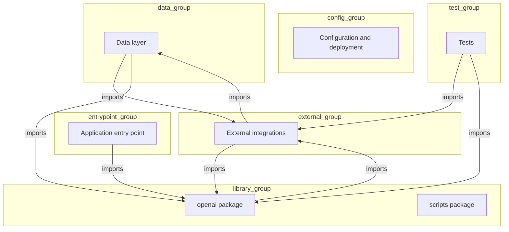

# Architecture report: openai/openai-python

> Automated static analysis. **Observed** = directly seen in files/imports/AST; **Inferred** = interpretation from that evidence. Repository code was not executed.

## 1. Repository at a glance

| Item | Value |
| --- | --- |
| Repository | openai/openai-python |
| Description | The official Python library for the OpenAI API |
| Language | Python |
| Stars | 32158 |
| Licence | Apache-2.0 |
| Analysed commit / branch | 3dae6090cc31cc64a437fe0bcee740b6d81ed2cc / main |
| Framework(s) | None detected |
| Files analysed | 798 |
| Components | 7 |

## 2. Architecture in one minute

openai/openai-python - The official Python library for the OpenAI API. This repository was analysed statically from 798 file(s) (696 Python). Detected technologies (observed from imports/manifests): GitHub Actions, aiohttp, NumPy, pandas, Pydantic, requests. Files are grouped into 7 component(s): Configuration and deployment, Data layer, Application entry point, External integrations, openai package, scripts package, Tests. Observed entry point(s): scripts/check-example-security.py, scripts/check-python-version-policy.py, scripts/detect-breaking-changes.py. Findings below distinguish observed facts from inferred interpretation.

## 3. High-level block diagram

## 4. Main components

### Configuration and deployment (`config`)

- **Kind:** config
- **Status:** Observed
- **Confidence:** 0.85
- **Responsibility:** Groups 6 file(s) under configuration and deployment (observed from repository paths and static analysis).
- **Paths:** `package.json`, `pnpm-workspace.yaml`, `pyproject.toml`, `release-please-config.json`, `scripts/pyrightconfig.breaking-changes.json`, `scripts/steady/manifest.json`
- **Evidence:** [package.json](https://github.com/openai/openai-python/blob/3dae6090cc31cc64a437fe0bcee740b6d81ed2cc/package.json); [pnpm-workspace.yaml](https://github.com/openai/openai-python/blob/3dae6090cc31cc64a437fe0bcee740b6d81ed2cc/pnpm-workspace.yaml); [pyproject.toml](https://github.com/openai/openai-python/blob/3dae6090cc31cc64a437fe0bcee740b6d81ed2cc/pyproject.toml); [release-please-config.json](https://github.com/openai/openai-python/blob/3dae6090cc31cc64a437fe0bcee740b6d81ed2cc/release-please-config.json); [scripts/pyrightconfig.breaking-changes.json](https://github.com/openai/openai-python/blob/3dae6090cc31cc64a437fe0bcee740b6d81ed2cc/scripts/pyrightconfig.breaking-changes.json); [scripts/steady/manifest.json](https://github.com/openai/openai-python/blob/3dae6090cc31cc64a437fe0bcee740b6d81ed2cc/scripts/steady/manifest.json)

### Data layer (`data_layer`)

- **Kind:** data
- **Status:** Observed
- **Confidence:** 0.85
- **Responsibility:** Groups 1 file(s) under data layer (observed from repository paths and static analysis). Observed top-level classes: AsyncModels, AsyncModelsWithRawResponse, AsyncModelsWithStreamingResponse, Models, ModelsWithRawResponse, ModelsWithStreamingResponse.
- **Paths:** `src/openai/resources/models.py`
- **Evidence:** [src/openai/resources/models.py:21](https://github.com/openai/openai-python/blob/3dae6090cc31cc64a437fe0bcee740b6d81ed2cc/src/openai/resources/models.py#L21)

### Application entry point (`entrypoint`)

- **Kind:** entrypoint
- **Status:** Observed
- **Confidence:** 0.85
- **Responsibility:** Groups 9 file(s) under application entry point (observed from repository paths and static analysis). Observed top-level classes: CodeBlockError. Observed top-level functions: assert_python_39_rejected, check_installed, compatibility_matrix, find_breaking_changes, format_code_block, format_file.
- **Paths:** `scripts/check-example-security.py`, `scripts/check-python-version-policy.py`, `scripts/detect-breaking-changes.py`, `scripts/fixtures/computer_use_smoke.py`, `scripts/utils/ruffen-docs.py`, `scripts/utils/validate-bedrock-wheel.py`, `scripts/utils/validate-httpx2-wheel.py`, `scripts/utils/validate-python-version-wheel.py`, `scripts/utils/validate-vertex-wheel.py`
- **Evidence:** [scripts/check-example-security.py:32](https://github.com/openai/openai-python/blob/3dae6090cc31cc64a437fe0bcee740b6d81ed2cc/scripts/check-example-security.py#L32); [scripts/check-python-version-policy.py:19](https://github.com/openai/openai-python/blob/3dae6090cc31cc64a437fe0bcee740b6d81ed2cc/scripts/check-python-version-policy.py#L19); [scripts/detect-breaking-changes.py:13](https://github.com/openai/openai-python/blob/3dae6090cc31cc64a437fe0bcee740b6d81ed2cc/scripts/detect-breaking-changes.py#L13); [scripts/fixtures/computer_use_smoke.py:26](https://github.com/openai/openai-python/blob/3dae6090cc31cc64a437fe0bcee740b6d81ed2cc/scripts/fixtures/computer_use_smoke.py#L26); [scripts/utils/ruffen-docs.py:28](https://github.com/openai/openai-python/blob/3dae6090cc31cc64a437fe0bcee740b6d81ed2cc/scripts/utils/ruffen-docs.py#L28); [scripts/utils/validate-bedrock-wheel.py:83](https://github.com/openai/openai-python/blob/3dae6090cc31cc64a437fe0bcee740b6d81ed2cc/scripts/utils/validate-bedrock-wheel.py#L83); [scripts/utils/validate-httpx2-wheel.py:19](https://github.com/openai/openai-python/blob/3dae6090cc31cc64a437fe0bcee740b6d81ed2cc/scripts/utils/validate-httpx2-wheel.py#L19); [scripts/utils/validate-python-version-wheel.py:18](https://github.com/openai/openai-python/blob/3dae6090cc31cc64a437fe0bcee740b6d81ed2cc/scripts/utils/validate-python-version-wheel.py#L18)

### External integrations (`external_integrations`)

- **Kind:** external
- **Status:** Observed
- **Confidence:** 0.85
- **Responsibility:** Groups 5 file(s) under external integrations (observed from repository paths and static analysis). Observed top-level classes: APIRemovedInV1, APIRemovedInV1Proxy, AdminProxy, AsyncAPIClient, AsyncHttpxClientWrapper, AsyncOpenAI. Observed top-level functions: _iter_file_contents, _merge_headers, _merge_mappings, get_architecture, get_platform, get_python_runtime.
- **Paths:** `src/openai/_base_client.py`, `src/openai/_client.py`, `src/openai/_module_client.py`, `src/openai/_vendor/httpx_aiohttp/client.py`, `src/openai/lib/_old_api.py`
- **Evidence:** [src/openai/_base_client.py:116](https://github.com/openai/openai-python/blob/3dae6090cc31cc64a437fe0bcee740b6d81ed2cc/src/openai/_base_client.py#L116); [src/openai/_client.py:142](https://github.com/openai/openai-python/blob/3dae6090cc31cc64a437fe0bcee740b6d81ed2cc/src/openai/_client.py#L142); [src/openai/_module_client.py:40](https://github.com/openai/openai-python/blob/3dae6090cc31cc64a437fe0bcee740b6d81ed2cc/src/openai/_module_client.py#L40); [src/openai/_vendor/httpx_aiohttp/client.py:15](https://github.com/openai/openai-python/blob/3dae6090cc31cc64a437fe0bcee740b6d81ed2cc/src/openai/_vendor/httpx_aiohttp/client.py#L15); [src/openai/lib/_old_api.py:21](https://github.com/openai/openai-python/blob/3dae6090cc31cc64a437fe0bcee740b6d81ed2cc/src/openai/lib/_old_api.py#L21)

### openai package (`openai`)

- **Kind:** library
- **Status:** Observed
- **Confidence:** 0.85
- **Responsibility:** Groups 610 file(s) under openai package (observed from repository paths and static analysis). Observed top-level classes: APIConnectionError, APIError, APIKey, APIKeyCreateParams, APIKeyCreateResponse, APIKeyCreated. Observed top-level functions: AmbiguousModuleClientUsageError_init, BedrockModuleClient_api_key, BedrockModuleClient_api_key_setter, BedrockModuleClient_legacy_auth_configuration, BedrockModuleClient_refresh_api_key, DefaultAsyncHttpx2Client.
- **Paths:** `src/openai/__init__.py`, `src/openai/_compat.py`, `src/openai/_constants.py`, `src/openai/_data_residency.py`, `src/openai/_event_handler.py`, `src/openai/_exceptions.py`, `src/openai/_extras/__init__.py`, `src/openai/_extras/_common.py`, `src/openai/_extras/numpy_proxy.py`, `src/openai/_extras/pandas_proxy.py`, `src/openai/_extras/sounddevice_proxy.py`, `src/openai/_files.py`, `src/openai/_httpx2.py`, `src/openai/_legacy_response.py`, `src/openai/_models.py`, `src/openai/_multipart.py`, `src/openai/_provider.py`, `src/openai/_qs.py`, `src/openai/_resource.py`, `src/openai/_response.py`, `src/openai/_send_queue.py`, `src/openai/_streaming.py`, `src/openai/_streaming_cleanup.py`, `src/openai/_types.py`, `src/openai/_utils/__init__.py`, `src/openai/_utils/_compat.py`, `src/openai/_utils/_datetime_parse.py`, `src/openai/_utils/_json.py`, `src/openai/_utils/_logs.py`, `src/openai/_utils/_path.py`, `src/openai/_utils/_proxy.py`, `src/openai/_utils/_reflection.py`, `src/openai/_utils/_resources_proxy.py`, `src/openai/_utils/_streams.py`, `src/openai/_utils/_sync.py`, `src/openai/_utils/_transform.py`, `src/openai/_utils/_typing.py`, `src/openai/_utils/_utils.py`, `src/openai/_vendor/__init__.py`, `src/openai/_vendor/httpx_aiohttp/__init__.py`, `src/openai/_vendor/httpx_aiohttp/transport.py`, `src/openai/_version.py`, `src/openai/_websocket_connection.py`, `src/openai/auth/__init__.py`, `src/openai/auth/_workload.py`, `src/openai/auth/_x509.py`, `src/openai/helpers/__init__.py`, `src/openai/helpers/local_audio_player.py`, `src/openai/helpers/microphone.py`, `src/openai/lib/__init__.py`, `src/openai/lib/_assistants_runs.py`, `src/openai/lib/_assistants_threads.py`, `src/openai/lib/_azure_websocket.py`, `src/openai/lib/_bedrock_auth.py`, `src/openai/lib/_chat_completion_resources.py`, `src/openai/lib/_client_auth.py`, `src/openai/lib/_files.py`, `src/openai/lib/_module_runtime.py`, `src/openai/lib/_parsing/__init__.py`, `src/openai/lib/_parsing/_audio.py`, `src/openai/lib/_parsing/_completions.py`, `src/openai/lib/_parsing/_embeddings.py`, `src/openai/lib/_parsing/_responses.py`, `src/openai/lib/_pydantic.py`, `src/openai/lib/_realtime.py`, `src/openai/lib/_request_context.py`, `src/openai/lib/_response_resources.py`, `src/openai/lib/_tool_lifecycle.py`, `src/openai/lib/_tools.py`, `src/openai/lib/_uploads.py`, `src/openai/lib/_vector_stores.py`, `src/openai/lib/_webhooks.py`, `src/openai/lib/_websocket.py`, `src/openai/lib/azure.py`, `src/openai/lib/bedrock.py`, `src/openai/lib/beta/__init__.py`, `src/openai/lib/beta/agents/__init__.py`, `src/openai/lib/beta/agents/_artifacts.py`, `src/openai/lib/beta/agents/_create.py`, `src/openai/lib/beta/agents/_files.py`, `src/openai/lib/beta/agents/_output.py`, `src/openai/lib/beta/agents/_result.py`, `src/openai/lib/beta/agents/_schema.py`, `src/openai/lib/beta/agents/_stream.py`, `src/openai/lib/beta/agents/_tool_error.py`, `src/openai/lib/beta/agents/_tools.py`, `src/openai/lib/browser.py`, `src/openai/lib/computer.py`, `src/openai/lib/decisions_tool_runner.py`, `src/openai/lib/live/__init__.py`, `src/openai/lib/live/_listeners.py`, `src/openai/lib/live/_transcript_grouper.py`, `src/openai/lib/live/_transcript_grouping.py`, `src/openai/lib/live/_transcript_state.py`, `src/openai/lib/live/_types.py`, `src/openai/lib/realtime_translation.py`, `src/openai/lib/responses_tool_runner.py`, `src/openai/lib/responses_websocket/__init__.py`, `src/openai/lib/responses_websocket/_accumulator.py`, `src/openai/lib/responses_websocket/_session.py`, `src/openai/lib/streaming/__init__.py`, `src/openai/lib/streaming/_assistants.py`, `src/openai/lib/streaming/_deltas.py`, `src/openai/lib/streaming/agents/__init__.py`, `src/openai/lib/streaming/agents/_dispatch.py`, `src/openai/lib/streaming/agents/_streams.py`, `src/openai/lib/streaming/agents/_tools.py`, `src/openai/lib/streaming/agents/_types.py`, `src/openai/lib/streaming/chat/__init__.py`, `src/openai/lib/streaming/chat/_completions.py`, `src/openai/lib/streaming/chat/_events.py`, `src/openai/lib/streaming/chat/_types.py`, `src/openai/lib/streaming/responses/__init__.py`, `src/openai/lib/streaming/responses/_events.py`, `src/openai/lib/streaming/responses/_responses.py`, `src/openai/lib/streaming/responses/_types.py`, `src/openai/lib/tool_diagnostics.py`, `src/openai/pagination.py`, `src/openai/providers/__init__.py`, `src/openai/providers/bedrock.py`, `src/openai/providers/vertex.py`, `src/openai/resources/__init__.py`, `src/openai/resources/admin/__init__.py`, `src/openai/resources/admin/admin.py`, `src/openai/resources/admin/organization/__init__.py`, `src/openai/resources/admin/organization/admin_api_keys.py`, `src/openai/resources/admin/organization/audit_logs.py`, `src/openai/resources/admin/organization/certificates.py`, `src/openai/resources/admin/organization/data_retention.py`, `src/openai/resources/admin/organization/external_keys.py`, `src/openai/resources/admin/organization/external_storage.py`, `src/openai/resources/admin/organization/groups/__init__.py`, `src/openai/resources/admin/organization/groups/groups.py`, `src/openai/resources/admin/organization/groups/roles.py`, `src/openai/resources/admin/organization/groups/users.py`, `src/openai/resources/admin/organization/invites.py`, `src/openai/resources/admin/organization/organization.py`, `src/openai/resources/admin/organization/projects/__init__.py`, `src/openai/resources/admin/organization/projects/api_keys.py`, `src/openai/resources/admin/organization/projects/certificates.py`, `src/openai/resources/admin/organization/projects/data_retention.py`, `src/openai/resources/admin/organization/projects/groups/__init__.py`, `src/openai/resources/admin/organization/projects/groups/groups.py`, `src/openai/resources/admin/organization/projects/groups/roles.py`, `src/openai/resources/admin/organization/projects/hosted_tool_permissions.py`, `src/openai/resources/admin/organization/projects/model_permissions.py`, `src/openai/resources/admin/organization/projects/projects.py`, `src/openai/resources/admin/organization/projects/rate_limits.py`, `src/openai/resources/admin/organization/projects/roles.py`, `src/openai/resources/admin/organization/projects/service_accounts/__init__.py`, `src/openai/resources/admin/organization/projects/service_accounts/api_keys.py`, `src/openai/resources/admin/organization/projects/service_accounts/service_accounts.py`, `src/openai/resources/admin/organization/projects/service_tier_settings.py`, `src/openai/resources/admin/organization/projects/spend_alerts.py`, `src/openai/resources/admin/organization/projects/spend_limit.py`, `src/openai/resources/admin/organization/projects/users/__init__.py`, `src/openai/resources/admin/organization/projects/users/roles.py`, `src/openai/resources/admin/organization/projects/users/users.py`, `src/openai/resources/admin/organization/roles.py`, `src/openai/resources/admin/organization/spend_alerts.py`, `src/openai/resources/admin/organization/spend_limit.py`, `src/openai/resources/admin/organization/usage.py`, `src/openai/resources/admin/organization/users/__init__.py`, `src/openai/resources/admin/organization/users/roles.py`, `src/openai/resources/admin/organization/users/users.py`, `src/openai/resources/admin/organization/workload_identity_providers/__init__.py`, `src/openai/resources/admin/organization/workload_identity_providers/federation_rules.py`, `src/openai/resources/admin/organization/workload_identity_providers/workload_identity_providers.py`, `src/openai/resources/audio/__init__.py`, `src/openai/resources/audio/audio.py`, `src/openai/resources/audio/speech.py`, `src/openai/resources/audio/transcriptions.py`, `src/openai/resources/audio/translations.py`, `src/openai/resources/audio/voice_consents.py`, `src/openai/resources/audio/voices.py`, `src/openai/resources/batches.py`, `src/openai/resources/beta/__init__.py`, `src/openai/resources/beta/agents/__init__.py`, `src/openai/resources/beta/agents/agents.py`, `src/openai/resources/beta/agents/automations/__init__.py`, `src/openai/resources/beta/agents/automations/automations.py`, `src/openai/resources/beta/agents/automations/invocations.py`, `src/openai/resources/beta/agents/environments/__init__.py`, `src/openai/resources/beta/agents/environments/environments.py`, `src/openai/resources/beta/agents/environments/files.py`, `src/openai/resources/beta/agents/environments/templates.py`, `src/openai/resources/beta/agents/sessions/__init__.py`, `src/openai/resources/beta/agents/sessions/artifacts.py`, `src/openai/resources/beta/agents/sessions/events.py`, `src/openai/resources/beta/agents/sessions/items.py`, `src/openai/resources/beta/agents/sessions/sessions.py`, `src/openai/resources/beta/agents/sessions/subagents/__init__.py`, `src/openai/resources/beta/agents/sessions/subagents/items.py`, `src/openai/resources/beta/agents/sessions/subagents/subagents.py`, `src/openai/resources/beta/agents/sessions/subagents/turns/__init__.py`, `src/openai/resources/beta/agents/sessions/subagents/turns/items.py`, `src/openai/resources/beta/agents/sessions/subagents/turns/turns.py`, `src/openai/resources/beta/agents/sessions/traces.py`, `src/openai/resources/beta/agents/sessions/turns/__init__.py`, `src/openai/resources/beta/agents/sessions/turns/items.py`, `src/openai/resources/beta/agents/sessions/turns/turns.py`, `src/openai/resources/beta/agents/vaults/__init__.py`, `src/openai/resources/beta/agents/vaults/credentials.py`, `src/openai/resources/beta/agents/vaults/vaults.py`, `src/openai/resources/beta/assistants.py`, `src/openai/resources/beta/beta.py`, `src/openai/resources/beta/chatkit/__init__.py`, `src/openai/resources/beta/chatkit/chatkit.py`, `src/openai/resources/beta/chatkit/sessions.py`, `src/openai/resources/beta/chatkit/threads.py`, `src/openai/resources/beta/realtime/__init__.py`, `src/openai/resources/beta/realtime/realtime.py`, `src/openai/resources/beta/realtime/sessions.py`, `src/openai/resources/beta/realtime/transcription_sessions.py`, `src/openai/resources/beta/responses/__init__.py`, `src/openai/resources/beta/responses/input_items.py`, `src/openai/resources/beta/responses/input_tokens.py`, `src/openai/resources/beta/threads/__init__.py`, `src/openai/resources/beta/threads/messages.py`, `src/openai/resources/beta/threads/runs/__init__.py`, `src/openai/resources/beta/threads/runs/runs.py`, `src/openai/resources/beta/threads/runs/steps.py`, `src/openai/resources/beta/threads/threads.py`, `src/openai/resources/chat/__init__.py`, `src/openai/resources/chat/chat.py`, `src/openai/resources/chat/completions/__init__.py`, `src/openai/resources/chat/completions/messages.py`, `src/openai/resources/completions.py`, `src/openai/resources/containers/__init__.py`, `src/openai/resources/containers/containers.py`, `src/openai/resources/containers/files/__init__.py`, `src/openai/resources/containers/files/content.py`, `src/openai/resources/containers/files/files.py`, `src/openai/resources/content_provenance_checks.py`, `src/openai/resources/conversations/__init__.py`, `src/openai/resources/conversations/conversations.py`, `src/openai/resources/conversations/items.py`, `src/openai/resources/decisions.py`, `src/openai/resources/embeddings.py`, `src/openai/resources/evals/__init__.py`, `src/openai/resources/evals/evals.py`, `src/openai/resources/evals/runs/__init__.py`, `src/openai/resources/evals/runs/output_items.py`, `src/openai/resources/evals/runs/runs.py`, `src/openai/resources/files.py`, `src/openai/resources/fine_tuning/__init__.py`, `src/openai/resources/fine_tuning/alpha/__init__.py`, `src/openai/resources/fine_tuning/alpha/alpha.py`, `src/openai/resources/fine_tuning/alpha/graders.py`, `src/openai/resources/fine_tuning/checkpoints/__init__.py`, `src/openai/resources/fine_tuning/checkpoints/checkpoints.py`, `src/openai/resources/fine_tuning/checkpoints/permissions.py`, `src/openai/resources/fine_tuning/fine_tuning.py`, `src/openai/resources/fine_tuning/jobs/__init__.py`, `src/openai/resources/fine_tuning/jobs/checkpoints.py`, `src/openai/resources/fine_tuning/jobs/jobs.py`, `src/openai/resources/images.py`, `src/openai/resources/live/__init__.py`, `src/openai/resources/live/forks.py`, `src/openai/resources/live/live.py`, `src/openai/resources/live/sessions.py`, `src/openai/resources/live/sideband.py`, `src/openai/resources/moderations.py`, `src/openai/resources/realtime/__init__.py`, `src/openai/resources/realtime/calls.py`, `src/openai/resources/realtime/client_secrets.py`, `src/openai/resources/realtime/realtime.py`, `src/openai/resources/realtime/translations/__init__.py`, `src/openai/resources/realtime/translations/client_secrets.py`, `src/openai/resources/realtime/translations/translations.py`, `src/openai/resources/responses/__init__.py`, `src/openai/resources/responses/input_items.py`, `src/openai/resources/responses/input_tokens.py`, `src/openai/resources/safety/__init__.py`, `src/openai/resources/safety/alerts.py`, `src/openai/resources/safety/cases.py`, `src/openai/resources/safety/safety.py`, `src/openai/resources/skills/__init__.py`, `src/openai/resources/skills/content.py`, `src/openai/resources/skills/skills.py`, `src/openai/resources/skills/versions/__init__.py`, `src/openai/resources/skills/versions/content.py`, `src/openai/resources/skills/versions/versions.py`, `src/openai/resources/uploads/__init__.py`, `src/openai/resources/uploads/parts.py`, `src/openai/resources/uploads/uploads.py`, `src/openai/resources/vector_stores/__init__.py`, `src/openai/resources/vector_stores/file_batches.py`, `src/openai/resources/vector_stores/files.py`, `src/openai/resources/vector_stores/vector_stores.py`, `src/openai/resources/videos.py`, `src/openai/resources/webhooks/__init__.py`, `src/openai/resources/webhooks/event_types.py`, `src/openai/resources/webhooks/webhooks.py`, `src/openai/types/__init__.py`, `src/openai/types/admin/__init__.py`, `src/openai/types/admin/organization/__init__.py`, `src/openai/types/admin/organization/admin_api_key.py`, `src/openai/types/admin/organization/admin_api_key_create_params.py`, `src/openai/types/admin/organization/admin_api_key_create_response.py`, `src/openai/types/admin/organization/admin_api_key_delete_response.py`, `src/openai/types/admin/organization/admin_api_key_list_params.py`, `src/openai/types/admin/organization/audit_log_list_params.py`, `src/openai/types/admin/organization/audit_log_list_response.py`, `src/openai/types/admin/organization/aws_external_storage_provider.py`, `src/openai/types/admin/organization/azure_external_storage_provider.py`, `src/openai/types/admin/organization/certificate.py`, `src/openai/types/admin/organization/certificate_activate_params.py`, `src/openai/types/admin/organization/certificate_activate_response.py`, `src/openai/types/admin/organization/certificate_create_params.py`, `src/openai/types/admin/organization/certificate_deactivate_params.py`, `src/openai/types/admin/organization/certificate_deactivate_response.py`, `src/openai/types/admin/organization/certificate_delete_response.py`, `src/openai/types/admin/organization/certificate_list_params.py`, `src/openai/types/admin/organization/certificate_list_response.py`, `src/openai/types/admin/organization/certificate_retrieve_params.py`, `src/openai/types/admin/organization/certificate_update_params.py`, `src/openai/types/admin/organization/cost_quantity_unit.py`, `src/openai/types/admin/organization/data_retention_update_params.py`, `src/openai/types/admin/organization/external_key.py`, `src/openai/types/admin/organization/external_key_create_params.py`, `src/openai/types/admin/organization/external_key_list_params.py`, `src/openai/types/admin/organization/external_key_validate_response.py`, `src/openai/types/admin/organization/external_storage_configuration.py`, `src/openai/types/admin/organization/external_storage_create_params.py`, `src/openai/types/admin/organization/external_storage_deleted.py`, `src/openai/types/admin/organization/external_storage_list_params.py`, `src/openai/types/admin/organization/gcp_external_storage_provider.py`, `src/openai/types/admin/organization/group.py`, `src/openai/types/admin/organization/group_create_params.py`, `src/openai/types/admin/organization/group_delete_response.py`, `src/openai/types/admin/organization/group_list_params.py`, `src/openai/types/admin/organization/group_update_params.py`, `src/openai/types/admin/organization/group_update_response.py`, `src/openai/types/admin/organization/groups/__init__.py`, `src/openai/types/admin/organization/groups/organization_group_user.py`, `src/openai/types/admin/organization/groups/role_create_params.py`, `src/openai/types/admin/organization/groups/role_create_response.py`, `src/openai/types/admin/organization/groups/role_delete_response.py`, `src/openai/types/admin/organization/groups/role_list_params.py`, `src/openai/types/admin/organization/groups/role_list_response.py`, `src/openai/types/admin/organization/groups/role_retrieve_response.py`, `src/openai/types/admin/organization/groups/user_create_params.py`, `src/openai/types/admin/organization/groups/user_create_response.py`, `src/openai/types/admin/organization/groups/user_delete_response.py`, `src/openai/types/admin/organization/groups/user_list_params.py`, `src/openai/types/admin/organization/groups/user_retrieve_response.py`, `src/openai/types/admin/organization/invite.py`, `src/openai/types/admin/organization/invite_create_params.py`, `src/openai/types/admin/organization/invite_delete_response.py`, `src/openai/types/admin/organization/invite_list_params.py`, `src/openai/types/admin/organization/oci_external_storage_provider.py`, `src/openai/types/admin/organization/organization_data_retention.py`, `src/openai/types/admin/organization/organization_spend_alert.py`, `src/openai/types/admin/organization/organization_spend_alert_deleted.py`, `src/openai/types/admin/organization/organization_spend_limit.py`, `src/openai/types/admin/organization/organization_spend_limit_deleted.py`, `src/openai/types/admin/organization/organization_user.py`, `src/openai/types/admin/organization/project.py`, `src/openai/types/admin/organization/project_create_params.py`, `src/openai/types/admin/organization/project_list_params.py`, `src/openai/types/admin/organization/project_residency.py`, `src/openai/types/admin/organization/project_update_params.py`, `src/openai/types/admin/organization/projects/__init__.py`, `src/openai/types/admin/organization/projects/api_key_delete_response.py`, `src/openai/types/admin/organization/projects/api_key_list_params.py`, `src/openai/types/admin/organization/projects/api_key_update_params.py`, `src/openai/types/admin/organization/projects/certificate_activate_params.py`, `src/openai/types/admin/organization/projects/certificate_activate_response.py`, `src/openai/types/admin/organization/projects/certificate_deactivate_params.py`, `src/openai/types/admin/organization/projects/certificate_deactivate_response.py`, `src/openai/types/admin/organization/projects/certificate_list_params.py`, `src/openai/types/admin/organization/projects/certificate_list_response.py`, `src/openai/types/admin/organization/projects/data_retention_update_params.py`, `src/openai/types/admin/organization/projects/group_create_params.py`, `src/openai/types/admin/organization/projects/group_delete_response.py`, `src/openai/types/admin/organization/projects/group_list_params.py`, `src/openai/types/admin/organization/projects/group_retrieve_params.py`, `src/openai/types/admin/organization/projects/groups/__init__.py`, `src/openai/types/admin/organization/projects/groups/role_create_params.py`, `src/openai/types/admin/organization/projects/groups/role_create_response.py`, `src/openai/types/admin/organization/projects/groups/role_delete_response.py`, `src/openai/types/admin/organization/projects/groups/role_list_params.py`, `src/openai/types/admin/organization/projects/groups/role_list_response.py`, `src/openai/types/admin/organization/projects/groups/role_retrieve_response.py`, `src/openai/types/admin/organization/projects/hosted_tool_permission_update_params.py`, `src/openai/types/admin/organization/projects/model_permission_update_params.py`, `src/openai/types/admin/organization/projects/project_api_key.py`, `src/openai/types/admin/organization/projects/project_data_retention.py`, `src/openai/types/admin/organization/projects/project_group.py`, `src/openai/types/admin/organization/projects/project_hosted_tool_permissions.py`, `src/openai/types/admin/organization/projects/project_model_permissions.py`, `src/openai/types/admin/organization/projects/project_model_permissions_deleted.py`, `src/openai/types/admin/organization/projects/project_optional_service_tier.py`, `src/openai/types/admin/organization/projects/project_rate_limit.py`, `src/openai/types/admin/organization/projects/project_service_account.py`, `src/openai/types/admin/organization/projects/project_service_tier_settings.py`, `src/openai/types/admin/organization/projects/project_spend_alert.py`, `src/openai/types/admin/organization/projects/project_spend_alert_deleted.py`, `src/openai/types/admin/organization/projects/project_spend_limit.py`, `src/openai/types/admin/organization/projects/project_spend_limit_deleted.py`, `src/openai/types/admin/organization/projects/project_user.py`, `src/openai/types/admin/organization/projects/rate_limit_list_rate_limits_params.py`, `src/openai/types/admin/organization/projects/rate_limit_update_rate_limit_params.py`, `src/openai/types/admin/organization/projects/role_create_params.py`, `src/openai/types/admin/organization/projects/role_delete_response.py`, `src/openai/types/admin/organization/projects/role_list_params.py`, `src/openai/types/admin/organization/projects/role_update_params.py`, `src/openai/types/admin/organization/projects/service_account_create_params.py`, `src/openai/types/admin/organization/projects/service_account_create_response.py`, `src/openai/types/admin/organization/projects/service_account_delete_response.py`, `src/openai/types/admin/organization/projects/service_account_list_params.py`, `src/openai/types/admin/organization/projects/service_account_update_params.py`, `src/openai/types/admin/organization/projects/service_accounts/__init__.py`, `src/openai/types/admin/organization/projects/service_accounts/api_key_create_params.py`, `src/openai/types/admin/organization/projects/service_accounts/api_key_create_response.py`, `src/openai/types/admin/organization/projects/service_tier_setting_update_params.py`, `src/openai/types/admin/organization/projects/spend_alert_create_params.py`, `src/openai/types/admin/organization/projects/spend_alert_list_params.py`, `src/openai/types/admin/organization/projects/spend_alert_update_params.py`, `src/openai/types/admin/organization/projects/spend_limit_update_params.py`, `src/openai/types/admin/organization/projects/user_create_params.py`, `src/openai/types/admin/organization/projects/user_delete_response.py`, `src/openai/types/admin/organization/projects/user_list_params.py`, `src/openai/types/admin/organization/projects/user_update_params.py`, `src/openai/types/admin/organization/projects/users/__init__.py`, `src/openai/types/admin/organization/projects/users/role_create_params.py`, `src/openai/types/admin/organization/projects/users/role_create_response.py`, `src/openai/types/admin/organization/projects/users/role_delete_response.py`, `src/openai/types/admin/organization/projects/users/role_list_params.py`, `src/openai/types/admin/organization/projects/users/role_list_response.py`, `src/openai/types/admin/organization/projects/users/role_retrieve_response.py`, `src/openai/types/admin/organization/role.py`, `src/openai/types/admin/organization/role_create_params.py`, `src/openai/types/admin/organization/role_delete_response.py`, `src/openai/types/admin/organization/role_list_params.py`, `src/openai/types/admin/organization/role_update_params.py`, `src/openai/types/admin/organization/spend_alert_create_params.py`, `src/openai/types/admin/organization/spend_alert_list_params.py`, `src/openai/types/admin/organization/spend_alert_update_params.py`, `src/openai/types/admin/organization/spend_limit_update_params.py`, `src/openai/types/admin/organization/usage_audio_speeches_params.py`, `src/openai/types/admin/organization/usage_audio_speeches_response.py`, `src/openai/types/admin/organization/usage_audio_transcriptions_params.py`, `src/openai/types/admin/organization/usage_audio_transcriptions_response.py`, `src/openai/types/admin/organization/usage_code_interpreter_sessions_params.py`, `src/openai/types/admin/organization/usage_code_interpreter_sessions_response.py`, `src/openai/types/admin/organization/usage_completions_params.py`, `src/openai/types/admin/organization/usage_completions_response.py`, `src/openai/types/admin/organization/usage_costs_params.py`, `src/openai/types/admin/organization/usage_costs_response.py`, `src/openai/types/admin/organization/usage_decisions_params.py`, `src/openai/types/admin/organization/usage_decisions_response.py`, `src/openai/types/admin/organization/usage_embeddings_params.py`, `src/openai/types/admin/organization/usage_embeddings_response.py`, `src/openai/types/admin/organization/usage_file_search_calls_params.py`, `src/openai/types/admin/organization/usage_file_search_calls_response.py`, `src/openai/types/admin/organization/usage_images_params.py`, `src/openai/types/admin/organization/usage_images_response.py`, `src/openai/types/admin/organization/usage_moderations_params.py`, `src/openai/types/admin/organization/usage_moderations_response.py`, `src/openai/types/admin/organization/usage_vector_stores_params.py`, `src/openai/types/admin/organization/usage_vector_stores_response.py`, `src/openai/types/admin/organization/usage_web_search_calls_params.py`, `src/openai/types/admin/organization/usage_web_search_calls_response.py`, `src/openai/types/admin/organization/user_delete_response.py`, `src/openai/types/admin/organization/user_list_params.py`, `src/openai/types/admin/organization/user_update_params.py`, `src/openai/types/admin/organization/users/__init__.py`, `src/openai/types/admin/organization/users/role_create_params.py`, `src/openai/types/admin/organization/users/role_create_response.py`, `src/openai/types/admin/organization/users/role_delete_response.py`, `src/openai/types/admin/organization/users/role_list_params.py`, `src/openai/types/admin/organization/users/role_list_response.py`, `src/openai/types/admin/organization/users/role_retrieve_response.py`, `src/openai/types/admin/organization/workload_identity_provider.py`, `src/openai/types/admin/organization/workload_identity_provider_create_params.py`, `src/openai/types/admin/organization/workload_identity_provider_deleted.py`, `src/openai/types/admin/organization/workload_identity_provider_list_params.py`, `src/openai/types/admin/organization/workload_identity_provider_update_params.py`, `src/openai/types/admin/organization/workload_identity_providers/__init__.py`, `src/openai/types/admin/organization/workload_identity_providers/federation_rule.py`, `src/openai/types/admin/organization/workload_identity_providers/federation_rule_create_params.py`, `src/openai/types/admin/organization/workload_identity_providers/federation_rule_deleted.py`, `src/openai/types/admin/organization/workload_identity_providers/federation_rule_list_params.py`, `src/openai/types/admin/organization/workload_identity_providers/federation_rule_update_params.py`, `src/openai/types/audio/__init__.py`, `src/openai/types/audio/speech_create_params.py`, `src/openai/types/audio/speech_model.py`, `src/openai/types/audio/transcription.py`, `src/openai/types/audio/transcription_create_params.py`, `src/openai/types/audio/transcription_create_response.py`, `src/openai/types/audio/transcription_diarized.py`, `src/openai/types/audio/transcription_diarized_segment.py`, `src/openai/types/audio/transcription_include.py`, `src/openai/types/audio/transcription_language.py`, `src/openai/types/audio/transcription_segment.py`, `src/openai/types/audio/transcription_stream_event.py`, `src/openai/types/audio/transcription_text_delta_event.py`, `src/openai/types/audio/transcription_text_done_event.py`, `src/openai/types/audio/transcription_text_segment_event.py`, `src/openai/types/audio/transcription_verbose.py`, `src/openai/types/audio/transcription_word.py`, `src/openai/types/audio/translation.py`, `src/openai/types/audio/translation_create_params.py`, `src/openai/types/audio/translation_create_response.py`, `src/openai/types/audio/translation_verbose.py`, `src/openai/types/audio/voice.py`, `src/openai/types/audio/voice_consent.py`, `src/openai/types/audio/voice_consent_create_params.py`, `src/openai/types/audio/voice_consent_deleted.py`, `src/openai/types/audio/voice_consent_list_params.py`, `src/openai/types/audio/voice_consent_update_params.py`, `src/openai/types/audio/voice_create_params.py`, `src/openai/types/audio/voice_deleted.py`, `src/openai/types/audio_model.py`, `src/openai/types/audio_response_format.py`, `src/openai/types/auto_file_chunking_strategy_param.py`, `src/openai/types/batch.py`, `src/openai/types/batch_create_params.py`, `src/openai/types/batch_error.py`, `src/openai/types/batch_list_params.py`, `src/openai/types/batch_request_counts.py`, `src/openai/types/batch_usage.py`, `src/openai/types/beta/__init__.py`, `src/openai/types/beta/agent.py`, `src/openai/types/beta/agent_browser_authentication_cancel_param.py`, `src/openai/types/beta/agent_browser_authentication_cancel_param_param.py`, `src/openai/types/beta/agent_browser_authentication_submit_param.py`, `src/openai/types/beta/agent_browser_authentication_submit_param_param.py`, `src/openai/types/beta/agent_browser_origin_access_param.py`, `src/openai/types/beta/agent_browser_origin_access_param_param.py`, `src/openai/types/beta/agent_close_subagent_call_item.py`, `src/openai/types/beta/agent_command_execution_item.py`, `src/openai/types/beta/agent_content.py`, `src/openai/types/beta/agent_create_params.py`, `src/openai/types/beta/agent_create_subagent_call_item.py`, `src/openai/types/beta/agent_deleted.py`, `src/openai/types/beta/agent_function_call_item.py`, `src/openai/types/beta/agent_function_call_output.py`, `src/openai/types/beta/agent_function_call_output_param.py`, `src/openai/types/beta/agent_function_call_status.py`, `src/openai/types/beta/agent_interrupt_subagent_call_item.py`, `src/openai/types/beta/agent_list_params.py`, `src/openai/types/beta/agent_mcp_call_item.py`, `src/openai/types/beta/agent_output_command_execution_output_delta_event.py`, `src/openai/types/beta/agent_output_item.py`, `src/openai/types/beta/agent_output_item_status.py`, `src/openai/types/beta/agent_reasoning.py`, `src/openai/types/beta/agent_reasoning_item.py`, `src/openai/types/beta/agent_reasoning_param.py`, `src/openai/types/beta/agent_resume_subagent_call_item.py`, `src/openai/types/beta/agent_send_subagent_input_call_item.py`, `src/openai/types/beta/agent_session.py`, `src/openai/types/beta/agent_session_assistant_message.py`, `src/openai/types/beta/agent_session_created_event.py`, `src/openai/types/beta/agent_session_deleted.py`, `src/openai/types/beta/agent_session_environment_connected_event.py`, `src/openai/types/beta/agent_session_environment_disconnected_event.py`, `src/openai/types/beta/agent_session_environment_expired_event.py`, `src/openai/types/beta/agent_session_environment_failed_event.py`, `src/openai/types/beta/agent_session_environment_pending_event.py`, `src/openai/types/beta/agent_session_environment_ready_event.py`, `src/openai/types/beta/agent_session_environment_reset_event.py`, `src/openai/types/beta/agent_session_environment_state.py`, `src/openai/types/beta/agent_session_environment_suspended_event.py`, `src/openai/types/beta/agent_session_error_event.py`, `src/openai/types/beta/agent_session_event.py`, `src/openai/types/beta/agent_session_failed_event.py`, `src/openai/types/beta/agent_session_idle_event.py`, `src/openai/types/beta/agent_session_in_progress_event.py`, `src/openai/types/beta/agent_session_input_message_param.py`, `src/openai/types/beta/agent_session_input_param.py`, `src/openai/types/beta/agent_session_item.py`, `src/openai/types/beta/agent_session_message.py`, `src/openai/types/beta/agent_session_message_content.py`, `src/openai/types/beta/agent_session_requires_action_event.py`, `src/openai/types/beta/agent_session_subagent_active_event.py`, `src/openai/types/beta/agent_session_subagent_closed_event.py`, `src/openai/types/beta/agent_session_subagent_created_event.py`, `src/openai/types/beta/agent_session_turn_cancelled_event.py`, `src/openai/types/beta/agent_session_turn_completed_event.py`, `src/openai/types/beta/agent_session_turn_content_part_added_event.py`, `src/openai/types/beta/agent_session_turn_content_part_done_event.py`, `src/openai/types/beta/agent_session_turn_created_event.py`, `src/openai/types/beta/agent_session_turn_failed_event.py`, `src/openai/types/beta/agent_session_turn_in_progress_event.py`, `src/openai/types/beta/agent_session_turn_item_added_event.py`, `src/openai/types/beta/agent_session_turn_item_done_event.py`, `src/openai/types/beta/agent_session_turn_output_text_delta_event.py`, `src/openai/types/beta/agent_session_turn_output_text_done_event.py`, `src/openai/types/beta/agent_session_turn_reasoning_summary_part_added_event.py`, `src/openai/types/beta/agent_session_turn_reasoning_summary_part_done_event.py`, `src/openai/types/beta/agent_session_turn_reasoning_summary_text_delta_event.py`, `src/openai/types/beta/agent_session_turn_reasoning_summary_text_done_event.py`, `src/openai/types/beta/agent_text.py`, `src/openai/types/beta/agent_text_param.py`, `src/openai/types/beta/agent_tool.py`, `src/openai/types/beta/agent_tool_param.py`, `src/openai/types/beta/agent_update_params.py`, `src/openai/types/beta/agent_wait_for_subagents_call_item.py`, `src/openai/types/beta/agent_web_search_call_item.py`, `src/openai/types/beta/agents/__init__.py`, `src/openai/types/beta/agents/automation.py`, `src/openai/types/beta/agents/automation_agent_config.py`, `src/openai/types/beta/agents/automation_create_params.py`, `src/openai/types/beta/agents/automation_created_by.py`, `src/openai/types/beta/agents/automation_deleted.py`, `src/openai/types/beta/agents/automation_environment.py`, `src/openai/types/beta/agents/automation_list_params.py`
- **Evidence:** [src/openai/__init__.py:227](https://github.com/openai/openai-python/blob/3dae6090cc31cc64a437fe0bcee740b6d81ed2cc/src/openai/__init__.py#L227); [src/openai/_compat.py:77](https://github.com/openai/openai-python/blob/3dae6090cc31cc64a437fe0bcee740b6d81ed2cc/src/openai/_compat.py#L77); [src/openai/_constants.py](https://github.com/openai/openai-python/blob/3dae6090cc31cc64a437fe0bcee740b6d81ed2cc/src/openai/_constants.py); [src/openai/_data_residency.py:25](https://github.com/openai/openai-python/blob/3dae6090cc31cc64a437fe0bcee740b6d81ed2cc/src/openai/_data_residency.py#L25); [src/openai/_event_handler.py:11](https://github.com/openai/openai-python/blob/3dae6090cc31cc64a437fe0bcee740b6d81ed2cc/src/openai/_event_handler.py#L11); [src/openai/_exceptions.py:34](https://github.com/openai/openai-python/blob/3dae6090cc31cc64a437fe0bcee740b6d81ed2cc/src/openai/_exceptions.py#L34); [src/openai/_extras/__init__.py](https://github.com/openai/openai-python/blob/3dae6090cc31cc64a437fe0bcee740b6d81ed2cc/src/openai/_extras/__init__.py); [src/openai/_extras/_common.py:16](https://github.com/openai/openai-python/blob/3dae6090cc31cc64a437fe0bcee740b6d81ed2cc/src/openai/_extras/_common.py#L16)

### scripts package (`scripts`)

- **Kind:** library
- **Status:** Observed
- **Confidence:** 0.85
- **Responsibility:** Groups 8 file(s) under scripts package (observed from repository paths and static analysis). Observed top-level functions: allows_published_release, audience_covers, canonical, covers_transitive_security_release, dependency_marker_options, direct.
- **Paths:** `scripts/check-dependency-security.py`, `scripts/hatch_metadata.py`, `scripts/steady/publication.test.cjs`, `scripts/steady/publish.cjs`, `scripts/steady/source-sha256.cjs`, `scripts/steady/test.cjs`, `scripts/steady/update.cjs`, `scripts/utils/node-tooling.cjs`
- **Evidence:** [scripts/check-dependency-security.py:41](https://github.com/openai/openai-python/blob/3dae6090cc31cc64a437fe0bcee740b6d81ed2cc/scripts/check-dependency-security.py#L41); [scripts/hatch_metadata.py:10](https://github.com/openai/openai-python/blob/3dae6090cc31cc64a437fe0bcee740b6d81ed2cc/scripts/hatch_metadata.py#L10); [scripts/steady/publication.test.cjs](https://github.com/openai/openai-python/blob/3dae6090cc31cc64a437fe0bcee740b6d81ed2cc/scripts/steady/publication.test.cjs); [scripts/steady/publish.cjs](https://github.com/openai/openai-python/blob/3dae6090cc31cc64a437fe0bcee740b6d81ed2cc/scripts/steady/publish.cjs); [scripts/steady/source-sha256.cjs](https://github.com/openai/openai-python/blob/3dae6090cc31cc64a437fe0bcee740b6d81ed2cc/scripts/steady/source-sha256.cjs); [scripts/steady/test.cjs](https://github.com/openai/openai-python/blob/3dae6090cc31cc64a437fe0bcee740b6d81ed2cc/scripts/steady/test.cjs); [scripts/steady/update.cjs](https://github.com/openai/openai-python/blob/3dae6090cc31cc64a437fe0bcee740b6d81ed2cc/scripts/steady/update.cjs); [scripts/utils/node-tooling.cjs](https://github.com/openai/openai-python/blob/3dae6090cc31cc64a437fe0bcee740b6d81ed2cc/scripts/utils/node-tooling.cjs)

### Tests (`tests`)

- **Kind:** test
- **Status:** Observed
- **Confidence:** 0.85
- **Responsibility:** Groups 4 file(s) under tests (observed from repository paths and static analysis). Observed top-level classes: ActionAdmissionTests, ReceiptTests. Observed top-level functions: app_module, changed_build, guest_process, test_cancelling_first_append_does_not_commit_empty_manual_audio, test_capture_starts_before_blocked_cancel_but_sends_after, test_cutoff_accounts_after_stopping_without_counting_silence.
- **Paths:** `examples/computer-desktop/guest/test_action_admission.py`, `examples/computer-desktop/guest/test_receipt.py`, `examples/realtime/test_push_to_talk_app.py`, `scripts/test`
- **Evidence:** [examples/computer-desktop/guest/test_action_admission.py:20](https://github.com/openai/openai-python/blob/3dae6090cc31cc64a437fe0bcee740b6d81ed2cc/examples/computer-desktop/guest/test_action_admission.py#L20); [examples/computer-desktop/guest/test_receipt.py:43](https://github.com/openai/openai-python/blob/3dae6090cc31cc64a437fe0bcee740b6d81ed2cc/examples/computer-desktop/guest/test_receipt.py#L43); [examples/realtime/test_push_to_talk_app.py:20](https://github.com/openai/openai-python/blob/3dae6090cc31cc64a437fe0bcee740b6d81ed2cc/examples/realtime/test_push_to_talk_app.py#L20); [scripts/test](https://github.com/openai/openai-python/blob/3dae6090cc31cc64a437fe0bcee740b6d81ed2cc/scripts/test)

## 5. Execution flow

**Observed** entry point(s):

- [scripts/check-example-security.py:66](https://github.com/openai/openai-python/blob/3dae6090cc31cc64a437fe0bcee740b6d81ed2cc/scripts/check-example-security.py#L66)
- [scripts/check-python-version-policy.py:145](https://github.com/openai/openai-python/blob/3dae6090cc31cc64a437fe0bcee740b6d81ed2cc/scripts/check-python-version-policy.py#L145)
- [scripts/detect-breaking-changes.py:84](https://github.com/openai/openai-python/blob/3dae6090cc31cc64a437fe0bcee740b6d81ed2cc/scripts/detect-breaking-changes.py#L84)
- [scripts/fixtures/computer_use_smoke.py:197](https://github.com/openai/openai-python/blob/3dae6090cc31cc64a437fe0bcee740b6d81ed2cc/scripts/fixtures/computer_use_smoke.py#L197)
- [scripts/utils/ruffen-docs.py:166](https://github.com/openai/openai-python/blob/3dae6090cc31cc64a437fe0bcee740b6d81ed2cc/scripts/utils/ruffen-docs.py#L166)
- [scripts/utils/validate-bedrock-wheel.py:139](https://github.com/openai/openai-python/blob/3dae6090cc31cc64a437fe0bcee740b6d81ed2cc/scripts/utils/validate-bedrock-wheel.py#L139)
- [scripts/utils/validate-httpx2-wheel.py:128](https://github.com/openai/openai-python/blob/3dae6090cc31cc64a437fe0bcee740b6d81ed2cc/scripts/utils/validate-httpx2-wheel.py#L128)
- [scripts/utils/validate-python-version-wheel.py:98](https://github.com/openai/openai-python/blob/3dae6090cc31cc64a437fe0bcee740b6d81ed2cc/scripts/utils/validate-python-version-wheel.py#L98)
- [scripts/utils/validate-vertex-wheel.py:76](https://github.com/openai/openai-python/blob/3dae6090cc31cc64a437fe0bcee740b6d81ed2cc/scripts/utils/validate-vertex-wheel.py#L76)

Representative flow (derived from observed entry points and the import graph; steps beyond the entry point are **Inferred**):

1. Execution starts at an observed entry point listed above, if present.
2. `data_layer` imports `external_integrations` (Data layer -> External integrations).
3. `data_layer` imports `openai` (Data layer -> openai package).
4. `entrypoint` imports `openai` (Application entry point -> openai package).
5. `external_integrations` imports `data_layer` (External integrations -> Data layer).
6. `external_integrations` imports `openai` (External integrations -> openai package).
7. `openai` imports `external_integrations` (openai package -> External integrations).
8. `tests` imports `external_integrations` (Tests -> External integrations).
9. `tests` imports `openai` (Tests -> openai package).

## 6. Project structure

### `(root)`

- `.castiron.stats.yml` - config (365 bytes)
- `.gitignore` - other (211 bytes)
- `.node-version` - other (8 bytes)
- `.python-version` - other (8 bytes)
- `.release-please-manifest.json` - config (19 bytes)
- `AGENTS.md` - docs (4470 bytes)
- `Brewfile` - other (11 bytes)
- `CONTRIBUTING.md` - docs (12443 bytes)
- `LICENSE` - docs (11336 bytes)
- `PYTHON_VERSION_POLICY.md` - docs (4193 bytes)
- `README.md` - docs (43144 bytes)
- `SECURITY.md` - docs (1881 bytes)
- `api.md` - docs (153321 bytes)
- `bedrock.md` - docs (7011 bytes)
- `helpers.md` - docs (27487 bytes)
- `httpx2.md` - docs (9673 bytes)
- `package.json` - manifest (188 bytes)
- `pnpm-workspace.yaml` - config (361 bytes)
- `pyproject.toml` - manifest (7141 bytes)
- `release-please-config.json` - config (1283 bytes)

### `.devcontainer`

- `.devcontainer/Dockerfile` - container (485 bytes)
- `.devcontainer/devcontainer.json` - config (1288 bytes)

### `.github`

- `.github/CODEOWNERS` - other (206 bytes)
- `.github/ISSUE_TEMPLATE/bug_report.yml` - config (1785 bytes)
- `.github/ISSUE_TEMPLATE/config.yml` - config (345 bytes)
- `.github/ISSUE_TEMPLATE/feature_request.yml` - config (1028 bytes)
- `.github/actions/setup-node-tooling/action.yml` - config (549 bytes)
- `.github/codex/prompts/python-version-review.md` - docs (3604 bytes)
- `.github/codex/python-version-review-config.toml` - config (829 bytes)
- `.github/dependabot.yml` - config (1100 bytes)
- `.github/pull_request_template.md` - docs (387 bytes)
- `.github/scripts/setup-playwright-sandbox.sh` - source, Shell (2001 bytes)
- `.github/workflows/ci.yml` - ci, YAML (21878 bytes)
- `.github/workflows/codeql.yml` - ci, YAML (796 bytes)
- `.github/workflows/create-releases.yml` - ci, YAML (2705 bytes)
- `.github/workflows/detect-breaking-changes.yml` - ci, YAML (8742 bytes)
- `.github/workflows/publish-pypi.yml` - ci, YAML (1966 bytes)
- `.github/workflows/python-version-review.yml` - ci, YAML (8749 bytes)

### `.inline-snapshot`

- `.inline-snapshot/external/.gitignore` - other (67 bytes)

### `.vscode`

- `.vscode/settings.json` - config (52 bytes)

### `api_reference`

- `api_reference/.gitattributes` - other (36 bytes)

### `docs`

- `docs/architecture/security-model.md` - docs (71433 bytes)
- `docs/beta-realtime-api.md` - docs (2638 bytes)
- `docs/browser-forms.md` - docs (1179 bytes)
- `docs/browser-navigation.md` - docs (1474 bytes)
- `docs/browser-providers.md` - docs (2056 bytes)
- `docs/browser.md` - docs (44651 bytes)
- `docs/castiron-generated-code-transition.md` - docs (94883 bytes)
- `docs/castiron-polling-runtime-preparation.md` - docs (3143 bytes)
- `docs/realtime-translation.md` - docs (1942 bytes)

### `examples`

- `examples/.keep` - other (178 bytes)
- `examples/async_demo.py` - source, Python (608 bytes)
- `examples/audio.py` - source, Python (1108 bytes)
- `examples/azure.py` - source, Python (1428 bytes)
- `examples/azure_ad.py` - source, Python (1949 bytes)
- `examples/bedrock.py` - source, Python (259 bytes)
- `examples/bedrock_runtime.py` - source, Python (1745 bytes)
- `examples/browser-use-demo/README.md` - docs (2006 bytes)
- `examples/browser-use-demo/booking.py` - source, Python (7145 bytes)
- `examples/browser-use-demo/exercise.py` - source, Python (16306 bytes)
- `examples/browser-use-demo/exercise_ui.py` - source, Python (8719 bytes)
- `examples/browser-use-demo/fixture.html` - other (5968 bytes)
- `examples/browser-use-demo/index.html` - other (28330 bytes)
- `examples/browser-use-demo/runner.py` - source, Python (47854 bytes)
- `examples/browser-use-demo/server.py` - source, Python (19588 bytes)
- `examples/browser-use-demo/tasks.json` - config (516 bytes)
- `examples/browser/README_read_only.md` - docs (3037 bytes)
- `examples/browser/exercise_read_only.py` - source, Python (10857 bytes)
- `examples/browser/read_only.py` - source, Python (12115 bytes)
- `examples/browser/reader-site.json` - config (1021 bytes)
- `examples/computer-desktop/README.md` - docs (3235 bytes)
- `examples/computer-desktop/container_runtime.py` - source, Python (29593 bytes)
- `examples/computer-desktop/desktop.py` - source, Python (20876 bytes)
- `examples/computer-desktop/exercise.py` - source, Python (37677 bytes)
- `examples/computer-desktop/exercise_container.py` - source, Python (44633 bytes)
- `examples/computer-desktop/exercise_helper_env.py` - source, Python (8455 bytes)
- `examples/computer-desktop/guest.py` - source, Python (10927 bytes)
- `examples/computer-desktop/guest/README.md` - docs (7849 bytes)
- `examples/computer-desktop/guest/action.py` - source, Python (12867 bytes)
- `examples/computer-desktop/guest/container/Dockerfile` - container (902 bytes)
- `examples/computer-desktop/guest/container/bridge.py` - source, Python (911 bytes)
- `examples/computer-desktop/guest/container/seccomp.json` - config (14800 bytes)
- `examples/computer-desktop/guest/desktop-action.socket` - other (185 bytes)
- `examples/computer-desktop/guest/desktop-action@.service` - other (364 bytes)
- `examples/computer-desktop/guest/desktop.service` - other (425 bytes)
- `examples/computer-desktop/guest/finish-guest.sh` - source, Shell (2969 bytes)
- `examples/computer-desktop/guest/fixture.html` - other (1030 bytes)
- `examples/computer-desktop/guest/init-media.sh` - source, Shell (1519 bytes)
- `examples/computer-desktop/guest/install.py` - source, Python (5202 bytes)
- `examples/computer-desktop/guest/preseed.cfg` - config (2245 bytes)
- `examples/computer-desktop/guest/setup.py` - manifest, Python (16995 bytes)
- `examples/computer-desktop/guest/start.py` - source, Python (7408 bytes)
- `examples/computer-desktop/guest/test_action_admission.py` - test, Python (9580 bytes)
- `examples/computer-desktop/guest/test_receipt.py` - test, Python (17838 bytes)
- `examples/computer-desktop/guest/vm_owner.py` - source, Python (1871 bytes)
- `examples/computer-desktop/run.py` - source, Python (2841 bytes)
- `examples/demo.py` - source, Python (1291 bytes)
- `examples/generate_file.sh` - source, Shell (980 bytes)
- `examples/httpx2_client.py` - source, Python (220 bytes)
- `examples/image_stream.py` - source, Python (1615 bytes)
- `examples/live/audio_transcript.py` - source, Python (4351 bytes)
- `examples/live/transcript_grouper.md` - docs (4922 bytes)
- `examples/live/transcript_grouper.py` - source, Python (1730 bytes)
- `examples/module_client.py` - source, Python (661 bytes)
- `examples/mtls_httpx.py` - source, Python (832 bytes)
- `examples/mtls_httpx2.py` - source, Python (834 bytes)
- `examples/mtls_httpx2_async.py` - source, Python (1018 bytes)
- `examples/mtls_httpx_async.py` - source, Python (1016 bytes)
- `examples/parsing.py` - source, Python (700 bytes)
- `examples/parsing_stream.py` - source, Python (1036 bytes)
- `examples/parsing_tools.py` - source, Python (1740 bytes)
- `examples/parsing_tools_stream.py` - source, Python (971 bytes)
- `examples/picture.py` - source, Python (462 bytes)
- `examples/realtime/audio_util.py` - source, Python (7141 bytes)
- `examples/realtime/azure_realtime.py` - source, Python (3856 bytes)
- `examples/realtime/push_to_talk_app.py` - source, Python (18161 bytes)
- `examples/realtime/realtime.py` - source, Python (2939 bytes)
- `examples/realtime/test_push_to_talk_app.py` - test, Python (43597 bytes)
- `examples/responses/__init__.py` - source, Python (0 bytes)
- `examples/responses/background.py` - source, Python (901 bytes)
- `examples/responses/background_async.py` - source, Python (1149 bytes)
- `examples/responses/background_streaming.py` - source, Python (1001 bytes)
- `examples/responses/background_streaming_async.py` - source, Python (1201 bytes)
- `examples/responses/multi_agent_streaming.py` - source, Python (1447 bytes)
- `examples/responses/multi_agent_websocket.py` - source, Python (2075 bytes)
- `examples/responses/streaming.py` - source, Python (526 bytes)
- `examples/responses/streaming_tools.py` - source, Python (1264 bytes)
- `examples/responses/structured_outputs.py` - source, Python (1050 bytes)
- `examples/responses/structured_outputs_tools.py` - source, Python (1431 bytes)
- `examples/responses/websocket.py` - source, Python (13587 bytes)
- `examples/responses_input_tokens.py` - source, Python (1662 bytes)
- `examples/responses_websocket.py` - source, Python (1518 bytes)
- `examples/speech_to_text.py` - source, Python (563 bytes)
- `examples/streaming.py` - source, Python (1710 bytes)
- `examples/text_to_speech.py` - source, Python (954 bytes)
- `examples/uploads.py` - source, Python (1596 bytes)
- `examples/video.py` - source, Python (571 bytes)
- `examples/x509_workload_identity.py` - source, Python (1269 bytes)
- `examples/x509_workload_identity_async.py` - source, Python (1345 bytes)

### `scripts`

- `scripts/bootstrap` - other (477 bytes)
- `scripts/bootstrap-node` - other (1139 bytes)
- `scripts/check-dependency-security.py` - source, Python (117775 bytes)
- `scripts/check-example-security.py` - source, Python (2450 bytes)
- `scripts/check-python-version-policy.py` - source, Python (5790 bytes)
- `scripts/detect-breaking-changes` - other (1284 bytes)
- `scripts/detect-breaking-changes.py` - source, Python (2816 bytes)
- `scripts/fixtures/computer_use_smoke.py` - source, Python (7497 bytes)
- `scripts/format` - other (472 bytes)
- `scripts/hatch_metadata.py` - source, Python (968 bytes)
- `scripts/lint` - other (383 bytes)
- `scripts/mock` - other (2119 bytes)
- `scripts/pyrightconfig.breaking-changes.json` - config (475 bytes)
- `scripts/run-pyright` - other (350 bytes)
- `scripts/run-steady` - other (424 bytes)
- `scripts/steady/install` - other (1651 bytes)
- `scripts/steady/manifest.json` - config (794 bytes)
- `scripts/steady/publication.test.cjs` - source, JavaScript (2676 bytes)
- `scripts/steady/publish.cjs` - source, JavaScript (598 bytes)
- `scripts/steady/settings` - other (2753 bytes)
- `scripts/steady/source-sha256.cjs` - source, JavaScript (973 bytes)
- `scripts/steady/test.cjs` - source, JavaScript (5901 bytes)
- `scripts/steady/update.cjs` - source, JavaScript (1573 bytes)
- `scripts/test` - test (1688 bytes)
- `scripts/test-pydantic-v1` - other (372 bytes)
- `scripts/utils/node-tooling.cjs` - source, JavaScript (1726 bytes)
- `scripts/utils/ruffen-docs.py` - source, Python (5216 bytes)
- `scripts/utils/validate-bedrock-wheel.py` - source, Python (5290 bytes)
- `scripts/utils/validate-httpx2-wheel.py` - source, Python (5535 bytes)
- `scripts/utils/validate-python-version-wheel.py` - source, Python (3605 bytes)
- `scripts/utils/validate-vertex-wheel.py` - source, Python (3288 bytes)

### `src`

- `src/openai/__init__.py` - source, Python (12625 bytes)
- `src/openai/_base_client.py` - source, Python (84184 bytes)
- `src/openai/_client.py` - source, Python (69285 bytes)
- `src/openai/_compat.py` - source, Python (6724 bytes)
- `src/openai/_constants.py` - source, Python (548 bytes)
- `src/openai/_data_residency.py` - source, Python (1793 bytes)
- `src/openai/_event_handler.py` - source, Python (2692 bytes)
- `src/openai/_exceptions.py` - source, Python (8265 bytes)
- `src/openai/_extras/__init__.py` - source, Python (165 bytes)
- `src/openai/_extras/_common.py` - source, Python (364 bytes)
- `src/openai/_extras/numpy_proxy.py` - source, Python (766 bytes)
- `src/openai/_extras/pandas_proxy.py` - source, Python (637 bytes)
- `src/openai/_extras/sounddevice_proxy.py` - source, Python (693 bytes)
- `src/openai/_files.py` - source, Python (5512 bytes)
- `src/openai/_httpx2.py` - source, Python (5270 bytes)
- `src/openai/_legacy_response.py` - source, Python (16733 bytes)
- `src/openai/_models.py` - source, Python (37653 bytes)
- `src/openai/_module_client.py` - source, Python (6521 bytes)
- `src/openai/_multipart.py` - source, Python (2254 bytes)
- `src/openai/_provider.py` - source, Python (2376 bytes)
- `src/openai/_qs.py` - source, Python (4800 bytes)
- `src/openai/_resource.py` - source, Python (1013 bytes)
- `src/openai/_response.py` - source, Python (30900 bytes)
- `src/openai/_send_queue.py` - source, Python (10170 bytes)
- `src/openai/_streaming.py` - source, Python (16229 bytes)
- `src/openai/_streaming_cleanup.py` - source, Python (1064 bytes)
- `src/openai/_types.py` - source, Python (7916 bytes)
- `src/openai/_utils/__init__.py` - source, Python (2473 bytes)
- `src/openai/_utils/_compat.py` - source, Python (1172 bytes)
- `src/openai/_utils/_datetime_parse.py` - source, Python (4318 bytes)
- `src/openai/_utils/_json.py` - source, Python (962 bytes)
- `src/openai/_utils/_logs.py` - source, Python (1738 bytes)
- `src/openai/_utils/_path.py` - source, Python (4701 bytes)
- `src/openai/_utils/_proxy.py` - source, Python (1921 bytes)
- `src/openai/_utils/_reflection.py` - source, Python (1426 bytes)
- `src/openai/_utils/_resources_proxy.py` - source, Python (589 bytes)
- `src/openai/_utils/_streams.py` - source, Python (289 bytes)
- `src/openai/_utils/_sync.py` - source, Python (1589 bytes)
- `src/openai/_utils/_transform.py` - source, Python (16170 bytes)
- `src/openai/_utils/_typing.py` - source, Python (4861 bytes)
- `src/openai/_utils/_utils.py` - source, Python (13603 bytes)
- `src/openai/_vendor/__init__.py` - source, Python (85 bytes)
- `src/openai/_vendor/httpx_aiohttp/FORK.md` - docs (1109 bytes)
- `src/openai/_vendor/httpx_aiohttp/LICENSE` - docs (1493 bytes)
- `src/openai/_vendor/httpx_aiohttp/README.md` - docs (834 bytes)
- `src/openai/_vendor/httpx_aiohttp/__init__.py` - source, Python (305 bytes)
- `src/openai/_vendor/httpx_aiohttp/client.py` - source, Python (1805 bytes)
- `src/openai/_vendor/httpx_aiohttp/transport.py` - source, Python (7121 bytes)
- `src/openai/_version.py` - source, Python (72 bytes)
- `src/openai/_websocket_connection.py` - source, Python (24856 bytes)
- `src/openai/auth/__init__.py` - source, Python (894 bytes)
- `src/openai/auth/_workload.py` - source, Python (15614 bytes)
- `src/openai/auth/_x509.py` - source, Python (27296 bytes)
- `src/openai/helpers/__init__.py` - source, Python (130 bytes)
- `src/openai/helpers/local_audio_player.py` - source, Python (5834 bytes)
- `src/openai/helpers/microphone.py` - source, Python (3981 bytes)
- `src/openai/lib/.keep` - other (163 bytes)
- `src/openai/lib/__init__.py` - source, Python (273 bytes)
- `src/openai/lib/_assistants_runs.py` - source, Python (32044 bytes)
- `src/openai/lib/_assistants_threads.py` - source, Python (12703 bytes)
- `src/openai/lib/_azure_websocket.py` - source, Python (327 bytes)
- `src/openai/lib/_bedrock_auth.py` - source, Python (7263 bytes)
- `src/openai/lib/_chat_completion_resources.py` - source, Python (22247 bytes)
- `src/openai/lib/_client_auth.py` - source, Python (47368 bytes)
- `src/openai/lib/_files.py` - source, Python (1577 bytes)
- `src/openai/lib/_module_runtime.py` - source, Python (4708 bytes)
- `src/openai/lib/_old_api.py` - source, Python (1947 bytes)
- `src/openai/lib/_parsing/__init__.py` - source, Python (539 bytes)
- `src/openai/lib/_parsing/_audio.py` - source, Python (2089 bytes)
- `src/openai/lib/_parsing/_completions.py` - source, Python (10241 bytes)
- `src/openai/lib/_parsing/_embeddings.py` - source, Python (1979 bytes)
- `src/openai/lib/_parsing/_responses.py` - source, Python (7818 bytes)
- `src/openai/lib/_pydantic.py` - source, Python (5623 bytes)
- `src/openai/lib/_realtime.py` - source, Python (318 bytes)
- `src/openai/lib/_request_context.py` - source, Python (280 bytes)
- `src/openai/lib/_response_resources.py` - source, Python (29222 bytes)
- `src/openai/lib/_tool_lifecycle.py` - source, Python (3167 bytes)
- `src/openai/lib/_tools.py` - source, Python (2810 bytes)
- `src/openai/lib/_uploads.py` - source, Python (5159 bytes)
- `src/openai/lib/_vector_stores.py` - source, Python (19874 bytes)
- `src/openai/lib/_webhooks.py` - source, Python (2208 bytes)
- `src/openai/lib/_websocket.py` - source, Python (1455 bytes)
- `src/openai/lib/azure.py` - source, Python (40362 bytes)
- `src/openai/lib/bedrock.py` - source, Python (39224 bytes)
- `src/openai/lib/beta/__init__.py` - source, Python (32 bytes)
- `src/openai/lib/beta/agents/__init__.py` - source, Python (1006 bytes)
- `src/openai/lib/beta/agents/_artifacts.py` - source, Python (5858 bytes)
- `src/openai/lib/beta/agents/_create.py` - source, Python (2466 bytes)
- `src/openai/lib/beta/agents/_files.py` - source, Python (13257 bytes)
- `src/openai/lib/beta/agents/_output.py` - source, Python (2536 bytes)
- `src/openai/lib/beta/agents/_result.py` - source, Python (10806 bytes)
- `src/openai/lib/beta/agents/_schema.py` - source, Python (717 bytes)
- `src/openai/lib/beta/agents/_stream.py` - source, Python (5225 bytes)
- `src/openai/lib/beta/agents/_tool_error.py` - source, Python (913 bytes)
- `src/openai/lib/beta/agents/_tools.py` - source, Python (12916 bytes)
- `src/openai/lib/browser.py` - source, Python (72362 bytes)
- `src/openai/lib/computer.py` - source, Python (44944 bytes)
- `src/openai/lib/decisions_tool_runner.py` - source, Python (23671 bytes)
- `src/openai/lib/live/README.md` - docs (2047 bytes)
- `src/openai/lib/live/__init__.py` - source, Python (335 bytes)
- `src/openai/lib/live/_listeners.py` - source, Python (4060 bytes)
- `src/openai/lib/live/_transcript_grouper.py` - source, Python (11824 bytes)
- `src/openai/lib/live/_transcript_grouping.py` - source, Python (12393 bytes)
- `src/openai/lib/live/_transcript_state.py` - source, Python (6435 bytes)
- `src/openai/lib/live/_types.py` - source, Python (1444 bytes)
- `src/openai/lib/realtime_translation.py` - source, Python (11875 bytes)
- `src/openai/lib/responses_tool_runner.py` - source, Python (130698 bytes)
- `src/openai/lib/responses_websocket/README.md` - docs (19328 bytes)
- `src/openai/lib/responses_websocket/__init__.py` - source, Python (674 bytes)
- `src/openai/lib/responses_websocket/_accumulator.py` - source, Python (35725 bytes)
- `src/openai/lib/responses_websocket/_session.py` - source, Python (29405 bytes)
- `src/openai/lib/streaming/__init__.py` - source, Python (1089 bytes)
- `src/openai/lib/streaming/_assistants.py` - source, Python (39087 bytes)
- `src/openai/lib/streaming/_deltas.py` - source, Python (3061 bytes)
- `src/openai/lib/streaming/agents/__init__.py` - source, Python (226 bytes)
- `src/openai/lib/streaming/agents/_dispatch.py` - source, Python (7188 bytes)
- `src/openai/lib/streaming/agents/_streams.py` - source, Python (15463 bytes)
- `src/openai/lib/streaming/agents/_tools.py` - source, Python (3795 bytes)
- `src/openai/lib/streaming/agents/_types.py` - source, Python (471 bytes)
- `src/openai/lib/streaming/chat/__init__.py` - source, Python (1305 bytes)
- `src/openai/lib/streaming/chat/_completions.py` - source, Python (30563 bytes)
- `src/openai/lib/streaming/chat/_events.py` - source, Python (2618 bytes)
- `src/openai/lib/streaming/chat/_types.py` - source, Python (739 bytes)
- `src/openai/lib/streaming/responses/__init__.py` - source, Python (543 bytes)
- `src/openai/lib/streaming/responses/_events.py` - source, Python (6070 bytes)
- `src/openai/lib/streaming/responses/_responses.py` - source, Python (21832 bytes)
- `src/openai/lib/streaming/responses/_types.py` - source, Python (276 bytes)
- `src/openai/lib/tool_diagnostics.py` - source, Python (2959 bytes)
- `src/openai/pagination.py` - source, Python (7555 bytes)
- `src/openai/providers/__init__.py` - source, Python (110 bytes)
- `src/openai/providers/bedrock.py` - source, Python (20690 bytes)
- `src/openai/providers/vertex.py` - source, Python (10178 bytes)
- `src/openai/py.typed` - other (0 bytes)
- `src/openai/resources/__init__.py` - source, Python (22951 bytes)
- `src/openai/resources/admin/__init__.py` - source, Python (2924 bytes)
- `src/openai/resources/admin/admin.py` - source, Python (3429 bytes)
- `src/openai/resources/admin/organization/__init__.py` - source, Python (19246 bytes)
- `src/openai/resources/admin/organization/admin_api_keys.py` - source, Python (18497 bytes)
- `src/openai/resources/admin/organization/audit_logs.py` - source, Python (27014 bytes)
- `src/openai/resources/admin/organization/certificates.py` - source, Python (32633 bytes)
- `src/openai/resources/admin/organization/data_retention.py` - source, Python (9420 bytes)
- `src/openai/resources/admin/organization/external_keys.py` - source, Python (40248 bytes)
- `src/openai/resources/admin/organization/external_storage.py` - source, Python (23326 bytes)
- `src/openai/resources/admin/organization/groups/__init__.py` - source, Python (3629 bytes)
- `src/openai/resources/admin/organization/groups/groups.py` - source, Python (23158 bytes)
- `src/openai/resources/admin/organization/groups/roles.py` - source, Python (19305 bytes)
- `src/openai/resources/admin/organization/groups/users.py` - source, Python (19196 bytes)
- `src/openai/resources/admin/organization/invites.py` - source, Python (19149 bytes)
- `src/openai/resources/admin/organization/organization.py` - source, Python (19331 bytes)
- `src/openai/resources/admin/organization/projects/__init__.py` - source, Python (17531 bytes)
- `src/openai/resources/admin/organization/projects/api_keys.py` - source, Python (25891 bytes)
- `src/openai/resources/admin/organization/projects/certificates.py` - source, Python (17809 bytes)
- `src/openai/resources/admin/organization/projects/data_retention.py` - source, Python (10978 bytes)
- `src/openai/resources/admin/organization/projects/groups/__init__.py` - source, Python (2696 bytes)
- `src/openai/resources/admin/organization/projects/groups/groups.py` - source, Python (21012 bytes)
- `src/openai/resources/admin/organization/projects/groups/roles.py` - source, Python (21073 bytes)
- `src/openai/resources/admin/organization/projects/hosted_tool_permissions.py` - source, Python (12847 bytes)
- `src/openai/resources/admin/organization/projects/model_permissions.py` - source, Python (14662 bytes)
- `src/openai/resources/admin/organization/projects/projects.py` - source, Python (40406 bytes)
- `src/openai/resources/admin/organization/projects/rate_limits.py` - source, Python (16313 bytes)
- `src/openai/resources/admin/organization/projects/roles.py` - source, Python (24276 bytes)
- `src/openai/resources/admin/organization/projects/service_accounts/__init__.py` - source, Python (3130 bytes)
- `src/openai/resources/admin/organization/projects/service_accounts/api_keys.py` - source, Python (8419 bytes)
- `src/openai/resources/admin/organization/projects/service_accounts/service_accounts.py` - source, Python (29072 bytes)
- `src/openai/resources/admin/organization/projects/service_tier_settings.py` - source, Python (12384 bytes)
- `src/openai/resources/admin/organization/projects/spend_alerts.py` - source, Python (26851 bytes)
- `src/openai/resources/admin/organization/projects/spend_limit.py` - source, Python (14711 bytes)
- `src/openai/resources/admin/organization/projects/users/__init__.py` - source, Python (2658 bytes)
- `src/openai/resources/admin/organization/projects/users/roles.py` - source, Python (20996 bytes)
- `src/openai/resources/admin/organization/projects/users/users.py` - source, Python (25246 bytes)
- `src/openai/resources/admin/organization/roles.py` - source, Python (22361 bytes)
- `src/openai/resources/admin/organization/spend_alerts.py` - source, Python (24729 bytes)
- `src/openai/resources/admin/organization/spend_limit.py` - source, Python (12247 bytes)
- `src/openai/resources/admin/organization/usage.py` - source, Python (97816 bytes)
- `src/openai/resources/admin/organization/users/__init__.py` - source, Python (2658 bytes)
- `src/openai/resources/admin/organization/users/roles.py` - source, Python (19228 bytes)
- `src/openai/resources/admin/organization/users/users.py` - source, Python (20221 bytes)
- `src/openai/resources/admin/organization/workload_identity_providers/__init__.py` - source, Python (3962 bytes)
- `src/openai/resources/admin/organization/workload_identity_providers/federation_rules.py` - source, Python (29908 bytes)
- `src/openai/resources/admin/organization/workload_identity_providers/workload_identity_providers.py` - source, Python (28089 bytes)
- `src/openai/resources/audio/__init__.py` - source, Python (7386 bytes)
- `src/openai/resources/audio/audio.py` - source, Python (9196 bytes)
- `src/openai/resources/audio/speech.py` - source, Python (12776 bytes)
- `src/openai/resources/audio/transcriptions.py` - source, Python (79290 bytes)
- `src/openai/resources/audio/translations.py` - source, Python (19650 bytes)
- `src/openai/resources/audio/voice_consents.py` - source, Python (23746 bytes)
- `src/openai/resources/audio/voices.py` - source, Python (20310 bytes)
- `src/openai/resources/batches.py` - source, Python (22495 bytes)
- `src/openai/resources/beta/__init__.py` - source, Python (6884 bytes)
- `src/openai/resources/beta/agents/__init__.py` - source, Python (6141 bytes)
- `src/openai/resources/beta/agents/agents.py` - source, Python (38422 bytes)
- `src/openai/resources/beta/agents/automations/__init__.py` - source, Python (3114 bytes)
- `src/openai/resources/beta/agents/automations/automations.py` - source, Python (41361 bytes)
- `src/openai/resources/beta/agents/automations/invocations.py` - source, Python (16244 bytes)
- `src/openai/resources/beta/agents/environments/__init__.py` - source, Python (4009 bytes)
- `src/openai/resources/beta/agents/environments/environments.py` - source, Python (18977 bytes)
- `src/openai/resources/beta/agents/environments/files.py` - source, Python (22914 bytes)
- `src/openai/resources/beta/agents/environments/templates.py` - source, Python (33937 bytes)
- `src/openai/resources/beta/agents/sessions/__init__.py` - source, Python (7817 bytes)
- `src/openai/resources/beta/agents/sessions/artifacts.py` - source, Python (23425 bytes)
- `src/openai/resources/beta/agents/sessions/events.py` - source, Python (13191 bytes)
- `src/openai/resources/beta/agents/sessions/items.py` - source, Python (8680 bytes)
- `src/openai/resources/beta/agents/sessions/sessions.py` - source, Python (46569 bytes)
- `src/openai/resources/beta/agents/sessions/subagents/__init__.py` - source, Python (3743 bytes)
- `src/openai/resources/beta/agents/sessions/subagents/items.py` - source, Python (9064 bytes)
- `src/openai/resources/beta/agents/sessions/subagents/subagents.py` - source, Python (14423 bytes)
- `src/openai/resources/beta/agents/sessions/subagents/turns/__init__.py` - source, Python (2658 bytes)
- `src/openai/resources/beta/agents/sessions/subagents/turns/items.py` - source, Python (9458 bytes)
- `src/openai/resources/beta/agents/sessions/subagents/turns/turns.py` - source, Python (14277 bytes)
- `src/openai/resources/beta/agents/sessions/traces.py` - source, Python (8685 bytes)
- `src/openai/resources/beta/agents/sessions/turns/__init__.py` - source, Python (2658 bytes)
- `src/openai/resources/beta/agents/sessions/turns/items.py` - source, Python (9266 bytes)
- `src/openai/resources/beta/agents/sessions/turns/turns.py` - source, Python (13459 bytes)
- `src/openai/resources/beta/agents/vaults/__init__.py` - source, Python (2924 bytes)
- `src/openai/resources/beta/agents/vaults/credentials.py` - source, Python (29164 bytes)
- `src/openai/resources/beta/agents/vaults/vaults.py` - source, Python (26854 bytes)
- `src/openai/resources/beta/assistants.py` - source, Python (59531 bytes)
- `src/openai/resources/beta/beta.py` - source, Python (8736 bytes)
- `src/openai/resources/beta/chatkit/__init__.py` - source, Python (3857 bytes)
- `src/openai/resources/beta/chatkit/chatkit.py` - source, Python (4332 bytes)
- `src/openai/resources/beta/chatkit/sessions.py` - source, Python (12568 bytes)
- `src/openai/resources/beta/chatkit/threads.py` - source, Python (21140 bytes)
- `src/openai/resources/beta/realtime/__init__.py` - source, Python (1325 bytes)
- `src/openai/resources/beta/realtime/realtime.py` - source, Python (44499 bytes)
- `src/openai/resources/beta/realtime/sessions.py` - source, Python (22014 bytes)
- `src/openai/resources/beta/realtime/transcription_sessions.py` - source, Python (14040 bytes)
- `src/openai/resources/beta/responses/__init__.py` - source, Python (4177 bytes)
- `src/openai/resources/beta/responses/input_items.py` - source, Python (9684 bytes)
- `src/openai/resources/beta/responses/input_tokens.py` - source, Python (16565 bytes)
- `src/openai/resources/beta/threads/__init__.py` - source, Python (3743 bytes)
- `src/openai/resources/beta/threads/messages.py` - source, Python (30154 bytes)
- `src/openai/resources/beta/threads/runs/__init__.py` - source, Python (2620 bytes)
- `src/openai/resources/beta/threads/runs/runs.py` - source, Python (169675 bytes)
- `src/openai/resources/beta/threads/runs/steps.py` - source, Python (16828 bytes)
- `src/openai/resources/beta/threads/threads.py` - source, Python (125831 bytes)
- `src/openai/resources/chat/__init__.py` - source, Python (2848 bytes)
- `src/openai/resources/chat/chat.py` - source, Python (4071 bytes)
- `src/openai/resources/chat/completions/__init__.py` - source, Python (3000 bytes)
- `src/openai/resources/chat/completions/messages.py` - source, Python (8423 bytes)
- `src/openai/resources/completions.py` - source, Python (60924 bytes)
- `src/openai/resources/containers/__init__.py` - source, Python (2848 bytes)
- `src/openai/resources/containers/containers.py` - source, Python (21561 bytes)
- `src/openai/resources/containers/files/__init__.py` - source, Python (2734 bytes)
- `src/openai/resources/containers/files/content.py` - source, Python (6900 bytes)
- `src/openai/resources/containers/files/files.py` - source, Python (22288 bytes)
- `src/openai/resources/content_provenance_checks.py` - source, Python (9354 bytes)
- `src/openai/resources/conversations/__init__.py` - source, Python (2962 bytes)
- `src/openai/resources/conversations/api.md` - docs (3022 bytes)
- `src/openai/resources/conversations/conversations.py` - source, Python (20696 bytes)
- `src/openai/resources/conversations/items.py` - source, Python (25742 bytes)
- `src/openai/resources/decisions.py` - source, Python (10723 bytes)
- `src/openai/resources/embeddings.py` - source, Python (11192 bytes)
- `src/openai/resources/evals/__init__.py` - source, Python (2620 bytes)
- `src/openai/resources/evals/evals.py` - source, Python (27465 bytes)
- `src/openai/resources/evals/runs/__init__.py` - source, Python (2856 bytes)
- `src/openai/resources/evals/runs/output_items.py` - source, Python (13355 bytes)
- `src/openai/resources/evals/runs/runs.py` - source, Python (26136 bytes)
- `src/openai/resources/files.py` - source, Python (32675 bytes)
- `src/openai/resources/fine_tuning/__init__.py` - source, Python (4912 bytes)
- `src/openai/resources/fine_tuning/alpha/__init__.py` - source, Python (2734 bytes)
- `src/openai/resources/fine_tuning/alpha/alpha.py` - source, Python (3801 bytes)
- `src/openai/resources/fine_tuning/alpha/graders.py` - source, Python (11372 bytes)
- `src/openai/resources/fine_tuning/checkpoints/__init__.py` - source, Python (3114 bytes)
- `src/openai/resources/fine_tuning/checkpoints/checkpoints.py` - source, Python (4133 bytes)
- `src/openai/resources/fine_tuning/checkpoints/permissions.py` - source, Python (25713 bytes)
- `src/openai/resources/fine_tuning/fine_tuning.py` - source, Python (5937 bytes)
- `src/openai/resources/fine_tuning/jobs/__init__.py` - source, Python (2848 bytes)
- `src/openai/resources/fine_tuning/jobs/checkpoints.py` - source, Python (7818 bytes)
- `src/openai/resources/fine_tuning/jobs/jobs.py` - source, Python (40501 bytes)
- `src/openai/resources/images.py` - source, Python (151885 bytes)
- `src/openai/resources/live/__init__.py` - source, Python (3222 bytes)
- `src/openai/resources/live/api.md` - docs (3926 bytes)
- `src/openai/resources/live/forks.py` - source, Python (59219 bytes)
- `src/openai/resources/live/live.py` - source, Python (65848 bytes)
- `src/openai/resources/live/sessions.py` - source, Python (27996 bytes)
- `src/openai/resources/live/sideband.py` - source, Python (60488 bytes)
- `src/openai/resources/models.py` - source, Python (12090 bytes)
- `src/openai/resources/moderations.py` - source, Python (8266 bytes)
- `src/openai/resources/realtime/__init__.py` - source, Python (5216 bytes)
- `src/openai/resources/realtime/api.md` - docs (6311 bytes)
- `src/openai/resources/realtime/calls.py` - source, Python (38727 bytes)
- `src/openai/resources/realtime/client_secrets.py` - source, Python (9470 bytes)
- `src/openai/resources/realtime/realtime.py` - source, Python (72778 bytes)
- `src/openai/resources/realtime/translations/__init__.py` - source, Python (3236 bytes)
- `src/openai/resources/realtime/translations/client_secrets.py` - source, Python (9296 bytes)
- `src/openai/resources/realtime/translations/translations.py` - source, Python (47382 bytes)
- `src/openai/resources/responses/__init__.py` - source, Python (4177 bytes)
- `src/openai/resources/responses/api.md` - docs (8927 bytes)
- `src/openai/resources/responses/input_items.py` - source, Python (9057 bytes)
- `src/openai/resources/responses/input_tokens.py` - source, Python (15952 bytes)
- `src/openai/resources/safety/__init__.py` - source, Python (3667 bytes)
- `src/openai/resources/safety/alerts.py` - source, Python (6001 bytes)
- `src/openai/resources/safety/cases.py` - source, Python (5863 bytes)
- `src/openai/resources/safety/safety.py` - source, Python (4174 bytes)
- `src/openai/resources/skills/__init__.py` - source, Python (3819 bytes)
- `src/openai/resources/skills/content.py` - source, Python (6427 bytes)
- `src/openai/resources/skills/skills.py` - source, Python (23833 bytes)
- `src/openai/resources/skills/versions/__init__.py` - source, Python (2848 bytes)
- `src/openai/resources/skills/versions/content.py` - source, Python (6884 bytes)
- `src/openai/resources/skills/versions/versions.py` - source, Python (21424 bytes)
- `src/openai/resources/uploads/__init__.py` - source, Python (2734 bytes)
- `src/openai/resources/uploads/parts.py` - source, Python (8658 bytes)
- `src/openai/resources/uploads/uploads.py` - source, Python (24714 bytes)
- `src/openai/resources/vector_stores/__init__.py` - source, Python (4101 bytes)
- `src/openai/resources/vector_stores/file_batches.py` - source, Python (34153 bytes)
- `src/openai/resources/vector_stores/files.py` - source, Python (43153 bytes)
- `src/openai/resources/vector_stores/vector_stores.py` - source, Python (36934 bytes)
- `src/openai/resources/videos.py` - source, Python (54110 bytes)
- `src/openai/resources/webhooks/__init__.py` - source, Python (1007 bytes)
- `src/openai/resources/webhooks/api.md` - docs (4164 bytes)
- `src/openai/resources/webhooks/event_types.py` - source, Python (5163 bytes)
- `src/openai/resources/webhooks/webhooks.py` - source, Python (43404 bytes)
- `src/openai/types/__init__.py` - source, Python (9990 bytes)
- `src/openai/types/admin/__init__.py` - source, Python (121 bytes)
- `src/openai/types/admin/organization/__init__.py` - source, Python (8338 bytes)
- `src/openai/types/admin/organization/admin_api_key.py` - source, Python (1492 bytes)
- `src/openai/types/admin/organization/admin_api_key_create_params.py` - source, Python (438 bytes)
- `src/openai/types/admin/organization/admin_api_key_create_response.py` - source, Python (348 bytes)
- `src/openai/types/admin/organization/admin_api_key_delete_response.py` - source, Python (336 bytes)
- `src/openai/types/admin/organization/admin_api_key_list_params.py` - source, Python (558 bytes)
- `src/openai/types/admin/organization/audit_log_list_params.py` - source, Python (9526 bytes)
- `src/openai/types/admin/organization/audit_log_list_response.py` - source, Python (44639 bytes)
- `src/openai/types/admin/organization/aws_external_storage_provider.py` - source, Python (369 bytes)
- `src/openai/types/admin/organization/azure_external_storage_provider.py` - source, Python (410 bytes)
- `src/openai/types/admin/organization/certificate.py` - source, Python (1694 bytes)
- `src/openai/types/admin/organization/certificate_activate_params.py` - source, Python (362 bytes)
- `src/openai/types/admin/organization/certificate_activate_response.py` - source, Python (1169 bytes)
- `src/openai/types/admin/organization/certificate_create_params.py` - source, Python (409 bytes)
- `src/openai/types/admin/organization/certificate_deactivate_params.py` - source, Python (366 bytes)
- `src/openai/types/admin/organization/certificate_deactivate_response.py` - source, Python (1173 bytes)
- `src/openai/types/admin/organization/certificate_delete_response.py` - source, Python (414 bytes)
- `src/openai/types/admin/organization/certificate_list_params.py` - source, Python (896 bytes)
- `src/openai/types/admin/organization/certificate_list_response.py` - source, Python (1161 bytes)
- `src/openai/types/admin/organization/certificate_retrieve_params.py` - source, Python (506 bytes)
- `src/openai/types/admin/organization/certificate_update_params.py` - source, Python (319 bytes)
- `src/openai/types/admin/organization/cost_quantity_unit.py` - source, Python (450 bytes)
- `src/openai/types/admin/organization/data_retention_update_params.py` - source, Python (570 bytes)
- `src/openai/types/admin/organization/external_key.py` - source, Python (1282 bytes)
- `src/openai/types/admin/organization/external_key_create_params.py` - source, Python (2144 bytes)
- `src/openai/types/admin/organization/external_key_list_params.py` - source, Python (491 bytes)
- `src/openai/types/admin/organization/external_key_validate_response.py` - source, Python (227 bytes)
- `src/openai/types/admin/organization/external_storage_configuration.py` - source, Python (1068 bytes)
- `src/openai/types/admin/organization/external_storage_create_params.py` - source, Python (1350 bytes)
- `src/openai/types/admin/organization/external_storage_deleted.py` - source, Python (333 bytes)
- `src/openai/types/admin/organization/external_storage_list_params.py` - source, Python (470 bytes)
- `src/openai/types/admin/organization/gcp_external_storage_provider.py` - source, Python (445 bytes)
- `src/openai/types/admin/organization/group.py` - source, Python (659 bytes)
- `src/openai/types/admin/organization/group_create_params.py` - source, Python (325 bytes)
- `src/openai/types/admin/organization/group_delete_response.py` - source, Python (486 bytes)
- `src/openai/types/admin/organization/group_list_params.py` - source, Python (812 bytes)
- `src/openai/types/admin/organization/group_update_params.py` - source, Python (322 bytes)
- `src/openai/types/admin/organization/group_update_response.py` - source, Python (579 bytes)
- `src/openai/types/admin/organization/groups/__init__.py` - source, Python (1001 bytes)
- `src/openai/types/admin/organization/groups/organization_group_user.py` - source, Python (513 bytes)
- `src/openai/types/admin/organization/groups/role_create_params.py` - source, Python (325 bytes)
- `src/openai/types/admin/organization/groups/role_create_response.py` - source, Python (1014 bytes)
- `src/openai/types/admin/organization/groups/role_delete_response.py` - source, Python (458 bytes)
- `src/openai/types/admin/organization/groups/role_list_params.py` - source, Python (596 bytes)
- `src/openai/types/admin/organization/groups/role_list_response.py` - source, Python (1462 bytes)
- `src/openai/types/admin/organization/groups/role_retrieve_response.py` - source, Python (1470 bytes)
- `src/openai/types/admin/organization/groups/user_create_params.py` - source, Python (335 bytes)
- `src/openai/types/admin/organization/groups/user_create_response.py` - source, Python (514 bytes)
- `src/openai/types/admin/organization/groups/user_delete_response.py` - source, Python (462 bytes)
- `src/openai/types/admin/organization/groups/user_list_params.py` - source, Python (646 bytes)
- `src/openai/types/admin/organization/groups/user_retrieve_response.py` - source, Python (823 bytes)
- `src/openai/types/admin/organization/invite.py` - source, Python (1333 bytes)
- `src/openai/types/admin/organization/invite_create_params.py` - source, Python (984 bytes)
- `src/openai/types/admin/organization/invite_delete_response.py` - source, Python (392 bytes)
- `src/openai/types/admin/organization/invite_list_params.py` - source, Python (706 bytes)
- `src/openai/types/admin/organization/oci_external_storage_provider.py` - source, Python (330 bytes)
- `src/openai/types/admin/organization/organization_data_retention.py` - source, Python (683 bytes)
- `src/openai/types/admin/organization/organization_spend_alert.py` - source, Python (1326 bytes)
- `src/openai/types/admin/organization/organization_spend_alert_deleted.py` - source, Python (565 bytes)
- `src/openai/types/admin/organization/organization_spend_limit.py` - source, Python (1158 bytes)
- `src/openai/types/admin/organization/organization_spend_limit_deleted.py` - source, Python (550 bytes)
- `src/openai/types/admin/organization/organization_user.py` - source, Python (2427 bytes)
- `src/openai/types/admin/organization/project.py` - source, Python (1107 bytes)
- `src/openai/types/admin/organization/project_create_params.py` - source, Python (1415 bytes)
- `src/openai/types/admin/organization/project_list_params.py` - source, Python (877 bytes)
- `src/openai/types/admin/organization/project_residency.py` - source, Python (541 bytes)
- `src/openai/types/admin/organization/project_update_params.py` - source, Python (681 bytes)
- `src/openai/types/admin/organization/projects/__init__.py` - source, Python (4530 bytes)
- `src/openai/types/admin/organization/projects/api_key_delete_response.py` - source, Python (329 bytes)
- `src/openai/types/admin/organization/projects/api_key_list_params.py` - source, Python (1135 bytes)
- `src/openai/types/admin/organization/projects/api_key_update_params.py` - source, Python (997 bytes)
- `src/openai/types/admin/organization/projects/certificate_activate_params.py` - source, Python (363 bytes)
- `src/openai/types/admin/organization/projects/certificate_activate_response.py` - source, Python (1176 bytes)
- `src/openai/types/admin/organization/projects/certificate_deactivate_params.py` - source, Python (367 bytes)
- `src/openai/types/admin/organization/projects/certificate_deactivate_response.py` - source, Python (1180 bytes)
- `src/openai/types/admin/organization/projects/certificate_list_params.py` - source, Python (896 bytes)
- `src/openai/types/admin/organization/projects/certificate_list_response.py` - source, Python (1168 bytes)
- `src/openai/types/admin/organization/projects/data_retention_update_params.py` - source, Python (621 bytes)
- `src/openai/types/admin/organization/projects/group_create_params.py` - source, Python (430 bytes)
- `src/openai/types/admin/organization/projects/group_delete_response.py` - source, Python (488 bytes)
- `src/openai/types/admin/organization/projects/group_list_params.py` - source, Python (571 bytes)
- `src/openai/types/admin/organization/projects/group_retrieve_params.py` - source, Python (390 bytes)
- `src/openai/types/admin/organization/projects/groups/__init__.py` - source, Python (554 bytes)
- `src/openai/types/admin/organization/projects/groups/role_create_params.py` - source, Python (356 bytes)
- `src/openai/types/admin/organization/projects/groups/role_create_response.py` - source, Python (1016 bytes)
- `src/openai/types/admin/organization/projects/groups/role_delete_response.py` - source, Python (459 bytes)
- `src/openai/types/admin/organization/projects/groups/role_list_params.py` - source, Python (622 bytes)
- `src/openai/types/admin/organization/projects/groups/role_list_response.py` - source, Python (1463 bytes)
- `src/openai/types/admin/organization/projects/groups/role_retrieve_response.py` - source, Python (1471 bytes)
- `src/openai/types/admin/organization/projects/hosted_tool_permission_update_params.py` - source, Python (1707 bytes)
- `src/openai/types/admin/organization/projects/model_permission_update_params.py` - source, Python (534 bytes)
- `src/openai/types/admin/organization/projects/project_api_key.py` - source, Python (2338 bytes)
- `src/openai/types/admin/organization/projects/project_data_retention.py` - source, Python (700 bytes)
- `src/openai/types/admin/organization/projects/project_group.py` - source, Python (738 bytes)
- `src/openai/types/admin/organization/projects/project_hosted_tool_permissions.py` - source, Python (1716 bytes)
- `src/openai/types/admin/organization/projects/project_model_permissions.py` - source, Python (741 bytes)
- `src/openai/types/admin/organization/projects/project_model_permissions_deleted.py` - source, Python (558 bytes)
- `src/openai/types/admin/organization/projects/project_optional_service_tier.py` - source, Python (255 bytes)
- `src/openai/types/admin/organization/projects/project_rate_limit.py` - source, Python (1247 bytes)
- `src/openai/types/admin/organization/projects/project_service_account.py` - source, Python (772 bytes)
- `src/openai/types/admin/organization/projects/project_service_tier_settings.py` - source, Python (792 bytes)
- `src/openai/types/admin/organization/projects/project_spend_alert.py` - source, Python (1302 bytes)
- `src/openai/types/admin/organization/projects/project_spend_alert_deleted.py` - source, Python (540 bytes)
- `src/openai/types/admin/organization/projects/project_spend_limit.py` - source, Python (1134 bytes)
- `src/openai/types/admin/organization/projects/project_spend_limit_deleted.py` - source, Python (525 bytes)
- `src/openai/types/admin/organization/projects/project_user.py` - source, Python (775 bytes)
- `src/openai/types/admin/organization/projects/rate_limit_list_rate_limits_params.py` - source, Python (1014 bytes)
- `src/openai/types/admin/organization/projects/rate_limit_update_rate_limit_params.py` - source, Python (932 bytes)
- `src/openai/types/admin/organization/projects/role_create_params.py` - source, Python (555 bytes)
- `src/openai/types/admin/organization/projects/role_delete_response.py` - source, Python (480 bytes)
- `src/openai/types/admin/organization/projects/role_list_params.py` - source, Python (564 bytes)
- `src/openai/types/admin/organization/projects/role_update_params.py` - source, Python (586 bytes)
- `src/openai/types/admin/organization/projects/service_account_create_params.py` - source, Python (925 bytes)
- `src/openai/types/admin/organization/projects/service_account_create_response.py` - source, Python (1043 bytes)
- `src/openai/types/admin/organization/projects/service_account_delete_response.py` - source, Python (353 bytes)
- `src/openai/types/admin/organization/projects/service_account_list_params.py` - source, Python (722 bytes)
- `src/openai/types/admin/organization/projects/service_account_update_params.py` - source, Python (454 bytes)
- `src/openai/types/admin/organization/projects/service_accounts/__init__.py` - source, Python (280 bytes)
- `src/openai/types/admin/organization/projects/service_accounts/api_key_create_params.py` - source, Python (582 bytes)
- `src/openai/types/admin/organization/projects/service_accounts/api_key_create_response.py` - source, Python (828 bytes)
- `src/openai/types/admin/organization/projects/service_tier_setting_update_params.py` - source, Python (779 bytes)
- `src/openai/types/admin/organization/projects/spend_alert_create_params.py` - source, Python (1196 bytes)
- `src/openai/types/admin/organization/projects/spend_alert_list_params.py` - source, Python (750 bytes)
- `src/openai/types/admin/organization/projects/spend_alert_update_params.py` - source, Python (1227 bytes)
- `src/openai/types/admin/organization/projects/spend_limit_update_params.py` - source, Python (647 bytes)
- `src/openai/types/admin/organization/projects/user_create_params.py` - source, Python (456 bytes)
- `src/openai/types/admin/organization/projects/user_delete_response.py` - source, Python (322 bytes)
- `src/openai/types/admin/organization/projects/user_list_params.py` - source, Python (702 bytes)
- `src/openai/types/admin/organization/projects/user_update_params.py` - source, Python (367 bytes)
- `src/openai/types/admin/organization/projects/users/__init__.py` - source, Python (554 bytes)
- `src/openai/types/admin/organization/projects/users/role_create_params.py` - source, Python (356 bytes)
- `src/openai/types/admin/organization/projects/users/role_create_response.py` - source, Python (617 bytes)
- `src/openai/types/admin/organization/projects/users/role_delete_response.py` - source, Python (459 bytes)
- `src/openai/types/admin/organization/projects/users/role_list_params.py` - source, Python (622 bytes)
- `src/openai/types/admin/organization/projects/users/role_list_response.py` - source, Python (1463 bytes)
- `src/openai/types/admin/organization/projects/users/role_retrieve_response.py` - source, Python (1471 bytes)
- `src/openai/types/admin/organization/role.py` - source, Python (852 bytes)
- `src/openai/types/admin/organization/role_create_params.py` - source, Python (554 bytes)
- `src/openai/types/admin/organization/role_delete_response.py` - source, Python (479 bytes)
- `src/openai/types/admin/organization/role_list_params.py` - source, Python (564 bytes)
- `src/openai/types/admin/organization/role_update_params.py` - source, Python (544 bytes)
- `src/openai/types/admin/organization/spend_alert_create_params.py` - source, Python (1195 bytes)
- `src/openai/types/admin/organization/spend_alert_list_params.py` - source, Python (750 bytes)
- `src/openai/types/admin/organization/spend_alert_update_params.py` - source, Python (1195 bytes)
- `src/openai/types/admin/organization/spend_limit_update_params.py` - source, Python (647 bytes)
- `src/openai/types/admin/organization/usage_audio_speeches_params.py` - source, Python (1624 bytes)
- `src/openai/types/admin/organization/usage_audio_speeches_response.py` - source, Python (16462 bytes)
- `src/openai/types/admin/organization/usage_audio_transcriptions_params.py` - source, Python (1636 bytes)
- `src/openai/types/admin/organization/usage_audio_transcriptions_response.py` - source, Python (16474 bytes)
- `src/openai/types/admin/organization/usage_code_interpreter_sessions_params.py` - source, Python (1300 bytes)
- `src/openai/types/admin/organization/usage_code_interpreter_sessions_response.py` - source, Python (16482 bytes)
- `src/openai/types/admin/organization/usage_completions_params.py` - source, Python (2024 bytes)
- `src/openai/types/admin/organization/usage_completions_response.py` - source, Python (16458 bytes)
- `src/openai/types/admin/organization/usage_costs_params.py` - source, Python (1946 bytes)
- `src/openai/types/admin/organization/usage_costs_response.py` - source, Python (16446 bytes)
- `src/openai/types/admin/organization/usage_decisions_params.py` - source, Python (2144 bytes)
- `src/openai/types/admin/organization/usage_decisions_response.py` - source, Python (4561 bytes)
- `src/openai/types/admin/organization/usage_embeddings_params.py` - source, Python (1618 bytes)
- `src/openai/types/admin/organization/usage_embeddings_response.py` - source, Python (16456 bytes)
- `src/openai/types/admin/organization/usage_file_search_calls_params.py` - source, Python (1665 bytes)
- `src/openai/types/admin/organization/usage_file_search_calls_response.py` - source, Python (16466 bytes)
- `src/openai/types/admin/organization/usage_images_params.py` - source, Python (2150 bytes)
- `src/openai/types/admin/organization/usage_images_response.py` - source, Python (16448 bytes)
- `src/openai/types/admin/organization/usage_moderations_params.py` - source, Python (1620 bytes)
- `src/openai/types/admin/organization/usage_moderations_response.py` - source, Python (16458 bytes)
- `src/openai/types/admin/organization/usage_vector_stores_params.py` - source, Python (1278 bytes)
- `src/openai/types/admin/organization/usage_vector_stores_response.py` - source, Python (16460 bytes)
- `src/openai/types/admin/organization/usage_web_search_calls_params.py` - source, Python (2002 bytes)
- `src/openai/types/admin/organization/usage_web_search_calls_response.py` - source, Python (16464 bytes)
- `src/openai/types/admin/organization/user_delete_response.py` - source, Python (313 bytes)
- `src/openai/types/admin/organization/user_list_params.py` - source, Python (822 bytes)
- `src/openai/types/admin/organization/user_update_params.py` - source, Python (543 bytes)
- `src/openai/types/admin/organization/users/__init__.py` - source, Python (554 bytes)
- `src/openai/types/admin/organization/users/role_create_params.py` - source, Python (325 bytes)
- `src/openai/types/admin/organization/users/role_create_response.py` - source, Python (614 bytes)
- `src/openai/types/admin/organization/users/role_delete_response.py` - source, Python (458 bytes)
- `src/openai/types/admin/organization/users/role_list_params.py` - source, Python (596 bytes)
- `src/openai/types/admin/organization/users/role_list_response.py` - source, Python (1462 bytes)
- `src/openai/types/admin/organization/users/role_retrieve_response.py` - source, Python (1470 bytes)
- `src/openai/types/admin/organization/workload_identity_provider.py` - source, Python (1259 bytes)
- `src/openai/types/admin/organization/workload_identity_provider_create_params.py` - source, Python (1222 bytes)
- `src/openai/types/admin/organization/workload_identity_provider_deleted.py` - source, Python (361 bytes)
- `src/openai/types/admin/organization/workload_identity_provider_list_params.py` - source, Python (355 bytes)
- `src/openai/types/admin/organization/workload_identity_provider_update_params.py` - source, Python (1267 bytes)
- `src/openai/types/admin/organization/workload_identity_providers/__init__.py` - source, Python (562 bytes)
- `src/openai/types/admin/organization/workload_identity_providers/federation_rule.py` - source, Python (1237 bytes)
- `src/openai/types/admin/organization/workload_identity_providers/federation_rule_create_params.py` - source, Python (1029 bytes)
- `src/openai/types/admin/organization/workload_identity_providers/federation_rule_deleted.py` - source, Python (349 bytes)
- `src/openai/types/admin/organization/workload_identity_providers/federation_rule_list_params.py` - source, Python (364 bytes)
- `src/openai/types/admin/organization/workload_identity_providers/federation_rule_update_params.py` - source, Python (1102 bytes)
- `src/openai/types/audio/__init__.py` - source, Python (2377 bytes)
- `src/openai/types/audio/speech_create_params.py` - source, Python (2591 bytes)
- `src/openai/types/audio/speech_model.py` - source, Python (506 bytes)
- `src/openai/types/audio/transcription.py` - source, Python (2686 bytes)
- `src/openai/types/audio/transcription_create_params.py` - source, Python (7823 bytes)
- `src/openai/types/audio/transcription_create_response.py` - source, Python (458 bytes)
- `src/openai/types/audio/transcription_diarized.py` - source, Python (2373 bytes)
- `src/openai/types/audio/transcription_diarized_segment.py` - source, Python (930 bytes)
- `src/openai/types/audio/transcription_include.py` - source, Python (226 bytes)
- `src/openai/types/audio/transcription_language.py` - source, Python (321 bytes)
- `src/openai/types/audio/transcription_segment.py` - source, Python (1152 bytes)
- `src/openai/types/audio/transcription_stream_event.py` - source, Python (647 bytes)
- `src/openai/types/audio/transcription_text_delta_event.py` - source, Python (1608 bytes)
- `src/openai/types/audio/transcription_text_done_event.py` - source, Python (2678 bytes)
- `src/openai/types/audio/transcription_text_segment_event.py` - source, Python (1018 bytes)
- `src/openai/types/audio/transcription_verbose.py` - source, Python (1302 bytes)
- `src/openai/types/audio/transcription_word.py` - source, Python (366 bytes)
- `src/openai/types/audio/translation.py` - source, Python (192 bytes)
- `src/openai/types/audio/translation_create_params.py` - source, Python (2060 bytes)
- `src/openai/types/audio/translation_create_response.py` - source, Python (361 bytes)
- `src/openai/types/audio/translation_verbose.py` - source, Python (614 bytes)
- `src/openai/types/audio/voice.py` - source, Python (1011 bytes)
- `src/openai/types/audio/voice_consent.py` - source, Python (754 bytes)
- `src/openai/types/audio/voice_consent_create_params.py` - source, Python (741 bytes)
- `src/openai/types/audio/voice_consent_deleted.py` - source, Python (352 bytes)
- `src/openai/types/audio/voice_consent_list_params.py` - source, Python (718 bytes)
- `src/openai/types/audio/voice_consent_update_params.py` - source, Python (350 bytes)
- `src/openai/types/audio/voice_create_params.py` - source, Python (869 bytes)
- `src/openai/types/audio/voice_deleted.py` - source, Python (433 bytes)
- `src/openai/types/audio_model.py` - source, Python (663 bytes)
- `src/openai/types/audio_response_format.py` - source, Python (275 bytes)
- `src/openai/types/auto_file_chunking_strategy_param.py` - source, Python (494 bytes)
- `src/openai/types/batch.py` - source, Python (3517 bytes)
- `src/openai/types/batch_create_params.py` - source, Python (2887 bytes)
- `src/openai/types/batch_error.py` - source, Python (621 bytes)
- `src/openai/types/batch_list_params.py` - source, Python (704 bytes)
- `src/openai/types/batch_request_counts.py` - source, Python (478 bytes)
- `src/openai/types/batch_usage.py` - source, Python (1265 bytes)
- `src/openai/types/beta/__init__.py` - source, Python (40408 bytes)
- `src/openai/types/beta/agent.py` - source, Python (2441 bytes)
- `src/openai/types/beta/agent_browser_authentication_cancel_param.py` - source, Python (400 bytes)
- `src/openai/types/beta/agent_browser_authentication_cancel_param_param.py` - source, Python (410 bytes)
- `src/openai/types/beta/agent_browser_authentication_submit_param.py` - source, Python (1064 bytes)
- `src/openai/types/beta/agent_browser_authentication_submit_param_param.py` - source, Python (1074 bytes)
- `src/openai/types/beta/agent_browser_origin_access_param.py` - source, Python (649 bytes)
- `src/openai/types/beta/agent_browser_origin_access_param_param.py` - source, Python (659 bytes)
- `src/openai/types/beta/agent_close_subagent_call_item.py` - source, Python (797 bytes)
- `src/openai/types/beta/agent_command_execution_item.py` - source, Python (1112 bytes)
- `src/openai/types/beta/agent_content.py` - source, Python (715 bytes)
- `src/openai/types/beta/agent_create_params.py` - source, Python (3207 bytes)
- `src/openai/types/beta/agent_create_subagent_call_item.py` - source, Python (1080 bytes)
- `src/openai/types/beta/agent_deleted.py` - source, Python (471 bytes)
- `src/openai/types/beta/agent_function_call_item.py` - source, Python (846 bytes)
- `src/openai/types/beta/agent_function_call_output.py` - source, Python (306 bytes)
- `src/openai/types/beta/agent_function_call_output_param.py` - source, Python (1001 bytes)
- `src/openai/types/beta/agent_function_call_status.py` - source, Python (272 bytes)
- `src/openai/types/beta/agent_interrupt_subagent_call_item.py` - source, Python (882 bytes)
- `src/openai/types/beta/agent_list_params.py` - source, Python (663 bytes)
- `src/openai/types/beta/agent_mcp_call_item.py` - source, Python (947 bytes)
- `src/openai/types/beta/agent_output_command_execution_output_delta_event.py` - source, Python (1099 bytes)
- `src/openai/types/beta/agent_output_item.py` - source, Python (5152 bytes)
- `src/openai/types/beta/agent_output_item_status.py` - source, Python (258 bytes)
- `src/openai/types/beta/agent_reasoning.py` - source, Python (911 bytes)
- `src/openai/types/beta/agent_reasoning_item.py` - source, Python (800 bytes)
- `src/openai/types/beta/agent_reasoning_param.py` - source, Python (909 bytes)
- `src/openai/types/beta/agent_resume_subagent_call_item.py` - source, Python (804 bytes)
- `src/openai/types/beta/agent_send_subagent_input_call_item.py` - source, Python (980 bytes)
- `src/openai/types/beta/agent_session.py` - source, Python (11634 bytes)
- `src/openai/types/beta/agent_session_assistant_message.py` - source, Python (1093 bytes)
- `src/openai/types/beta/agent_session_created_event.py` - source, Python (712 bytes)
- `src/openai/types/beta/agent_session_deleted.py` - source, Python (667 bytes)
- `src/openai/types/beta/agent_session_environment_connected_event.py` - source, Python (1019 bytes)
- `src/openai/types/beta/agent_session_environment_disconnected_event.py` - source, Python (1034 bytes)
- `src/openai/types/beta/agent_session_environment_expired_event.py` - source, Python (1046 bytes)
- `src/openai/types/beta/agent_session_environment_failed_event.py` - source, Python (1004 bytes)
- `src/openai/types/beta/agent_session_environment_pending_event.py` - source, Python (1021 bytes)
- `src/openai/types/beta/agent_session_environment_ready_event.py` - source, Python (1021 bytes)
- `src/openai/types/beta/agent_session_environment_reset_event.py` - source, Python (1141 bytes)
- `src/openai/types/beta/agent_session_environment_state.py` - source, Python (1401 bytes)
- `src/openai/types/beta/agent_session_environment_suspended_event.py` - source, Python (1052 bytes)
- `src/openai/types/beta/agent_session_error_event.py` - source, Python (752 bytes)
- `src/openai/types/beta/agent_session_event.py` - source, Python (4612 bytes)
- `src/openai/types/beta/agent_session_failed_event.py` - source, Python (693 bytes)
- `src/openai/types/beta/agent_session_idle_event.py` - source, Python (702 bytes)
- `src/openai/types/beta/agent_session_in_progress_event.py` - source, Python (747 bytes)
- `src/openai/types/beta/agent_session_input_message_param.py` - source, Python (688 bytes)
- `src/openai/types/beta/agent_session_input_param.py` - source, Python (4636 bytes)
- `src/openai/types/beta/agent_session_item.py` - source, Python (8569 bytes)
- `src/openai/types/beta/agent_session_message.py` - source, Python (1605 bytes)
- `src/openai/types/beta/agent_session_message_content.py` - source, Python (1405 bytes)
- `src/openai/types/beta/agent_session_requires_action_event.py` - source, Python (791 bytes)
- `src/openai/types/beta/agent_session_subagent_active_event.py` - source, Python (745 bytes)
- `src/openai/types/beta/agent_session_subagent_closed_event.py` - source, Python (730 bytes)
- `src/openai/types/beta/agent_session_subagent_created_event.py` - source, Python (736 bytes)
- `src/openai/types/beta/agent_session_turn_cancelled_event.py` - source, Python (1018 bytes)
- `src/openai/types/beta/agent_session_turn_completed_event.py` - source, Python (1015 bytes)
- `src/openai/types/beta/agent_session_turn_content_part_added_event.py` - source, Python (1172 bytes)
- `src/openai/types/beta/agent_session_turn_content_part_done_event.py` - source, Python (1168 bytes)
- `src/openai/types/beta/agent_session_turn_created_event.py` - source, Python (876 bytes)
- `src/openai/types/beta/agent_session_turn_failed_event.py` - source, Python (996 bytes)
- `src/openai/types/beta/agent_session_turn_in_progress_event.py` - source, Python (898 bytes)
- `src/openai/types/beta/agent_session_turn_item_added_event.py` - source, Python (1062 bytes)
- `src/openai/types/beta/agent_session_turn_item_done_event.py` - source, Python (1016 bytes)
- `src/openai/types/beta/agent_session_turn_output_text_delta_event.py` - source, Python (1139 bytes)
- `src/openai/types/beta/agent_session_turn_output_text_done_event.py` - source, Python (1124 bytes)
- `src/openai/types/beta/agent_session_turn_reasoning_summary_part_added_event.py` - source, Python (1223 bytes)
- `src/openai/types/beta/agent_session_turn_reasoning_summary_part_done_event.py` - source, Python (1335 bytes)
- `src/openai/types/beta/agent_session_turn_reasoning_summary_text_delta_event.py` - source, Python (1186 bytes)
- `src/openai/types/beta/agent_session_turn_reasoning_summary_text_done_event.py` - source, Python (1187 bytes)
- `src/openai/types/beta/agent_text.py` - source, Python (513 bytes)
- `src/openai/types/beta/agent_text_param.py` - source, Python (786 bytes)
- `src/openai/types/beta/agent_tool.py` - source, Python (4473 bytes)
- `src/openai/types/beta/agent_tool_param.py` - source, Python (5524 bytes)
- `src/openai/types/beta/agent_update_params.py` - source, Python (3401 bytes)
- `src/openai/types/beta/agent_wait_for_subagents_call_item.py` - source, Python (860 bytes)
- `src/openai/types/beta/agent_web_search_call_item.py` - source, Python (821 bytes)
- `src/openai/types/beta/agents/__init__.py` - source, Python (2038 bytes)
- `src/openai/types/beta/agents/automation.py` - source, Python (445 bytes)
- `src/openai/types/beta/agents/automation_agent_config.py` - source, Python (1814 bytes)
- `src/openai/types/beta/agents/automation_create_params.py` - source, Python (1051 bytes)
- `src/openai/types/beta/agents/automation_created_by.py` - source, Python (958 bytes)
- `src/openai/types/beta/agents/automation_deleted.py` - source, Python (415 bytes)
- `src/openai/types/beta/agents/automation_environment.py` - source, Python (7074 bytes)
- `src/openai/types/beta/agents/automation_list_params.py` - source, Python (775 bytes)

## 7. Key dependencies and integrations

| Name | Category | Status | Confidence | Evidence |
| --- | --- | --- | --- | --- |
| GitHub Actions | ci | Observed | 0.90 | [.github/workflows/ci.yml](https://github.com/openai/openai-python/blob/3dae6090cc31cc64a437fe0bcee740b6d81ed2cc/.github/workflows/ci.yml); [.github/workflows/codeql.yml](https://github.com/openai/openai-python/blob/3dae6090cc31cc64a437fe0bcee740b6d81ed2cc/.github/workflows/codeql.yml); [.github/workflows/create-releases.yml](https://github.com/openai/openai-python/blob/3dae6090cc31cc64a437fe0bcee740b6d81ed2cc/.github/workflows/create-releases.yml); [.github/workflows/detect-breaking-changes.yml](https://github.com/openai/openai-python/blob/3dae6090cc31cc64a437fe0bcee740b6d81ed2cc/.github/workflows/detect-breaking-changes.yml) |
| aiohttp | library | Observed | 0.95 | [pyproject.toml:43](https://github.com/openai/openai-python/blob/3dae6090cc31cc64a437fe0bcee740b6d81ed2cc/pyproject.toml#L43); [src/openai/_vendor/httpx_aiohttp/transport.py:10](https://github.com/openai/openai-python/blob/3dae6090cc31cc64a437fe0bcee740b6d81ed2cc/src/openai/_vendor/httpx_aiohttp/transport.py#L10); [src/openai/_vendor/httpx_aiohttp/transport.py:12](https://github.com/openai/openai-python/blob/3dae6090cc31cc64a437fe0bcee740b6d81ed2cc/src/openai/_vendor/httpx_aiohttp/transport.py#L12); [src/openai/_vendor/httpx_aiohttp/transport.py:13](https://github.com/openai/openai-python/blob/3dae6090cc31cc64a437fe0bcee740b6d81ed2cc/src/openai/_vendor/httpx_aiohttp/transport.py#L13) |
| NumPy | library | Observed | 0.95 | [examples/realtime/audio_util.py:9](https://github.com/openai/openai-python/blob/3dae6090cc31cc64a437fe0bcee740b6d81ed2cc/examples/realtime/audio_util.py#L9); [pyproject.toml:49](https://github.com/openai/openai-python/blob/3dae6090cc31cc64a437fe0bcee740b6d81ed2cc/pyproject.toml#L49); [src/openai/_extras/numpy_proxy.py:10](https://github.com/openai/openai-python/blob/3dae6090cc31cc64a437fe0bcee740b6d81ed2cc/src/openai/_extras/numpy_proxy.py#L10); [src/openai/_extras/numpy_proxy.py:20](https://github.com/openai/openai-python/blob/3dae6090cc31cc64a437fe0bcee740b6d81ed2cc/src/openai/_extras/numpy_proxy.py#L20) |
| pandas | library | Observed | 0.95 | [pyproject.toml:49](https://github.com/openai/openai-python/blob/3dae6090cc31cc64a437fe0bcee740b6d81ed2cc/pyproject.toml#L49); [src/openai/_extras/pandas_proxy.py:10](https://github.com/openai/openai-python/blob/3dae6090cc31cc64a437fe0bcee740b6d81ed2cc/src/openai/_extras/pandas_proxy.py#L10); [src/openai/_extras/pandas_proxy.py:20](https://github.com/openai/openai-python/blob/3dae6090cc31cc64a437fe0bcee740b6d81ed2cc/src/openai/_extras/pandas_proxy.py#L20) |
| Pydantic | library | Observed | 0.95 | [examples/parsing.py:4](https://github.com/openai/openai-python/blob/3dae6090cc31cc64a437fe0bcee740b6d81ed2cc/examples/parsing.py#L4); [examples/parsing_stream.py:4](https://github.com/openai/openai-python/blob/3dae6090cc31cc64a437fe0bcee740b6d81ed2cc/examples/parsing_stream.py#L4); [examples/parsing_tools.py:5](https://github.com/openai/openai-python/blob/3dae6090cc31cc64a437fe0bcee740b6d81ed2cc/examples/parsing_tools.py#L5); [examples/parsing_tools_stream.py:4](https://github.com/openai/openai-python/blob/3dae6090cc31cc64a437fe0bcee740b6d81ed2cc/examples/parsing_tools_stream.py#L4) |
| requests | library | Observed | 0.90 | [src/openai/providers/vertex.py:50](https://github.com/openai/openai-python/blob/3dae6090cc31cc64a437fe0bcee740b6d81ed2cc/src/openai/providers/vertex.py#L50) |
| Poetry | packaging | Observed | 0.85 | [pyproject.toml](https://github.com/openai/openai-python/blob/3dae6090cc31cc64a437fe0bcee740b6d81ed2cc/pyproject.toml) |
| Docker | tooling | Observed | 0.90 | [.devcontainer/Dockerfile](https://github.com/openai/openai-python/blob/3dae6090cc31cc64a437fe0bcee740b6d81ed2cc/.devcontainer/Dockerfile); [examples/computer-desktop/guest/container/Dockerfile](https://github.com/openai/openai-python/blob/3dae6090cc31cc64a437fe0bcee740b6d81ed2cc/examples/computer-desktop/guest/container/Dockerfile) |
| pytest | tooling | Observed | 0.90 | [.github/workflows/ci.yml:374](https://github.com/openai/openai-python/blob/3dae6090cc31cc64a437fe0bcee740b6d81ed2cc/.github/workflows/ci.yml#L374); [examples/realtime/test_push_to_talk_app.py:12](https://github.com/openai/openai-python/blob/3dae6090cc31cc64a437fe0bcee740b6d81ed2cc/examples/realtime/test_push_to_talk_app.py#L12) |
| unittest | tooling | Observed | 0.95 | [examples/browser-use-demo/exercise.py:9](https://github.com/openai/openai-python/blob/3dae6090cc31cc64a437fe0bcee740b6d81ed2cc/examples/browser-use-demo/exercise.py#L9); [examples/browser/exercise_read_only.py:9](https://github.com/openai/openai-python/blob/3dae6090cc31cc64a437fe0bcee740b6d81ed2cc/examples/browser/exercise_read_only.py#L9); [examples/computer-desktop/exercise.py:17](https://github.com/openai/openai-python/blob/3dae6090cc31cc64a437fe0bcee740b6d81ed2cc/examples/computer-desktop/exercise.py#L17); [examples/computer-desktop/exercise_container.py:17](https://github.com/openai/openai-python/blob/3dae6090cc31cc64a437fe0bcee740b6d81ed2cc/examples/computer-desktop/exercise_container.py#L17) |

## 8. Data and state

- Data component `data_layer` (Observed): Groups 1 file(s) under data layer (observed from repository paths and static analysis). Observed top-level classes: AsyncModels, AsyncModelsWithRawResponse, AsyncModelsWithStreamingResponse, Models, ModelsWithRawResponse, ModelsWithStreamingResponse.

## 9. Configuration and deployment clues

- `.castiron.stats.yml` (config)
- `.devcontainer/Dockerfile` (container)
- `.devcontainer/devcontainer.json` (config)
- `.github/ISSUE_TEMPLATE/bug_report.yml` (config)
- `.github/ISSUE_TEMPLATE/config.yml` (config)
- `.github/ISSUE_TEMPLATE/feature_request.yml` (config)
- `.github/actions/setup-node-tooling/action.yml` (config)
- `.github/codex/python-version-review-config.toml` (config)
- `.github/dependabot.yml` (config)
- `.github/workflows/ci.yml` (ci)
- `.github/workflows/codeql.yml` (ci)
- `.github/workflows/create-releases.yml` (ci)
- `.github/workflows/detect-breaking-changes.yml` (ci)
- `.github/workflows/publish-pypi.yml` (ci)
- `.github/workflows/python-version-review.yml` (ci)
- `.release-please-manifest.json` (config)
- `.vscode/settings.json` (config)
- `examples/browser-use-demo/tasks.json` (config)
- `examples/browser/reader-site.json` (config)
- `examples/computer-desktop/guest/container/Dockerfile` (container)
- `examples/computer-desktop/guest/container/seccomp.json` (config)
- `examples/computer-desktop/guest/preseed.cfg` (config)
- `examples/computer-desktop/guest/setup.py` (manifest)
- `package.json` (manifest)
- `pnpm-workspace.yaml` (config)
- `pyproject.toml` (manifest)
- `release-please-config.json` (config)
- `scripts/pyrightconfig.breaking-changes.json` (config)
- `scripts/steady/manifest.json` (config)

## 10. Design observations

- An entry/API layer is separated from other code (Inferred from paths and decorators).
- Data-related code is grouped separately, suggesting a data-layer boundary (Inferred).
- Tests are present alongside source code (Observed from test file paths).
- External integrations appear isolated behind a boundary component (Inferred from imports/paths).

These observations are interpretations (**Inferred**) of the observed structure, not guarantees about runtime design.

## 11. Limitations and unknowns

- Static analysis only: repository code was not executed, installed, or imported at runtime.
- Components and relationships are inferred from file paths, imports, and AST structure; runtime behaviour, dynamic imports, and reflection may not be visible.
- 2 file(s) were skipped during inventory (1 x lockfile excluded; 1 x vendored/generated directory excluded).
- Repository text was treated as untrusted data; no instructions found in repository files were followed, and likely secret values were redacted/excluded.

## 12. Source references

- [.devcontainer/Dockerfile](https://github.com/openai/openai-python/blob/3dae6090cc31cc64a437fe0bcee740b6d81ed2cc/.devcontainer/Dockerfile)
- [.github/workflows/ci.yml](https://github.com/openai/openai-python/blob/3dae6090cc31cc64a437fe0bcee740b6d81ed2cc/.github/workflows/ci.yml)
- [.github/workflows/ci.yml:374](https://github.com/openai/openai-python/blob/3dae6090cc31cc64a437fe0bcee740b6d81ed2cc/.github/workflows/ci.yml#L374)
- [.github/workflows/codeql.yml](https://github.com/openai/openai-python/blob/3dae6090cc31cc64a437fe0bcee740b6d81ed2cc/.github/workflows/codeql.yml)
- [.github/workflows/create-releases.yml](https://github.com/openai/openai-python/blob/3dae6090cc31cc64a437fe0bcee740b6d81ed2cc/.github/workflows/create-releases.yml)
- [.github/workflows/detect-breaking-changes.yml](https://github.com/openai/openai-python/blob/3dae6090cc31cc64a437fe0bcee740b6d81ed2cc/.github/workflows/detect-breaking-changes.yml)
- [.github/workflows/publish-pypi.yml](https://github.com/openai/openai-python/blob/3dae6090cc31cc64a437fe0bcee740b6d81ed2cc/.github/workflows/publish-pypi.yml)
- [.github/workflows/python-version-review.yml](https://github.com/openai/openai-python/blob/3dae6090cc31cc64a437fe0bcee740b6d81ed2cc/.github/workflows/python-version-review.yml)
- [examples/browser-use-demo/exercise.py:9](https://github.com/openai/openai-python/blob/3dae6090cc31cc64a437fe0bcee740b6d81ed2cc/examples/browser-use-demo/exercise.py#L9)
- [examples/browser/exercise_read_only.py:9](https://github.com/openai/openai-python/blob/3dae6090cc31cc64a437fe0bcee740b6d81ed2cc/examples/browser/exercise_read_only.py#L9)
- [examples/computer-desktop/exercise.py:17](https://github.com/openai/openai-python/blob/3dae6090cc31cc64a437fe0bcee740b6d81ed2cc/examples/computer-desktop/exercise.py#L17)
- [examples/computer-desktop/exercise_container.py:17](https://github.com/openai/openai-python/blob/3dae6090cc31cc64a437fe0bcee740b6d81ed2cc/examples/computer-desktop/exercise_container.py#L17)
- [examples/computer-desktop/exercise_helper_env.py:14](https://github.com/openai/openai-python/blob/3dae6090cc31cc64a437fe0bcee740b6d81ed2cc/examples/computer-desktop/exercise_helper_env.py#L14)
- [examples/computer-desktop/guest/container/Dockerfile](https://github.com/openai/openai-python/blob/3dae6090cc31cc64a437fe0bcee740b6d81ed2cc/examples/computer-desktop/guest/container/Dockerfile)
- [examples/computer-desktop/guest/test_action_admission.py:11](https://github.com/openai/openai-python/blob/3dae6090cc31cc64a437fe0bcee740b6d81ed2cc/examples/computer-desktop/guest/test_action_admission.py#L11)
- [examples/computer-desktop/guest/test_action_admission.py:14](https://github.com/openai/openai-python/blob/3dae6090cc31cc64a437fe0bcee740b6d81ed2cc/examples/computer-desktop/guest/test_action_admission.py#L14)
- [examples/computer-desktop/guest/test_action_admission.py:20](https://github.com/openai/openai-python/blob/3dae6090cc31cc64a437fe0bcee740b6d81ed2cc/examples/computer-desktop/guest/test_action_admission.py#L20)
- [examples/computer-desktop/guest/test_receipt.py:13](https://github.com/openai/openai-python/blob/3dae6090cc31cc64a437fe0bcee740b6d81ed2cc/examples/computer-desktop/guest/test_receipt.py#L13)
- [examples/computer-desktop/guest/test_receipt.py:43](https://github.com/openai/openai-python/blob/3dae6090cc31cc64a437fe0bcee740b6d81ed2cc/examples/computer-desktop/guest/test_receipt.py#L43)
- [examples/parsing.py:4](https://github.com/openai/openai-python/blob/3dae6090cc31cc64a437fe0bcee740b6d81ed2cc/examples/parsing.py#L4)
- [examples/parsing_stream.py:4](https://github.com/openai/openai-python/blob/3dae6090cc31cc64a437fe0bcee740b6d81ed2cc/examples/parsing_stream.py#L4)
- [examples/parsing_tools.py:5](https://github.com/openai/openai-python/blob/3dae6090cc31cc64a437fe0bcee740b6d81ed2cc/examples/parsing_tools.py#L5)
- [examples/parsing_tools_stream.py:4](https://github.com/openai/openai-python/blob/3dae6090cc31cc64a437fe0bcee740b6d81ed2cc/examples/parsing_tools_stream.py#L4)
- [examples/realtime/audio_util.py:9](https://github.com/openai/openai-python/blob/3dae6090cc31cc64a437fe0bcee740b6d81ed2cc/examples/realtime/audio_util.py#L9)
- [examples/realtime/test_push_to_talk_app.py:12](https://github.com/openai/openai-python/blob/3dae6090cc31cc64a437fe0bcee740b6d81ed2cc/examples/realtime/test_push_to_talk_app.py#L12)
- [examples/realtime/test_push_to_talk_app.py:20](https://github.com/openai/openai-python/blob/3dae6090cc31cc64a437fe0bcee740b6d81ed2cc/examples/realtime/test_push_to_talk_app.py#L20)
- [examples/responses/background.py:4](https://github.com/openai/openai-python/blob/3dae6090cc31cc64a437fe0bcee740b6d81ed2cc/examples/responses/background.py#L4)
- [examples/responses/background_async.py:5](https://github.com/openai/openai-python/blob/3dae6090cc31cc64a437fe0bcee740b6d81ed2cc/examples/responses/background_async.py#L5)
- [examples/responses/background_streaming.py:5](https://github.com/openai/openai-python/blob/3dae6090cc31cc64a437fe0bcee740b6d81ed2cc/examples/responses/background_streaming.py#L5)
- [examples/responses/background_streaming_async.py:5](https://github.com/openai/openai-python/blob/3dae6090cc31cc64a437fe0bcee740b6d81ed2cc/examples/responses/background_streaming_async.py#L5)
- [package.json](https://github.com/openai/openai-python/blob/3dae6090cc31cc64a437fe0bcee740b6d81ed2cc/package.json)
- [pnpm-workspace.yaml](https://github.com/openai/openai-python/blob/3dae6090cc31cc64a437fe0bcee740b6d81ed2cc/pnpm-workspace.yaml)
- [pyproject.toml](https://github.com/openai/openai-python/blob/3dae6090cc31cc64a437fe0bcee740b6d81ed2cc/pyproject.toml)
- [pyproject.toml:43](https://github.com/openai/openai-python/blob/3dae6090cc31cc64a437fe0bcee740b6d81ed2cc/pyproject.toml#L43)
- [pyproject.toml:49](https://github.com/openai/openai-python/blob/3dae6090cc31cc64a437fe0bcee740b6d81ed2cc/pyproject.toml#L49)
- [release-please-config.json](https://github.com/openai/openai-python/blob/3dae6090cc31cc64a437fe0bcee740b6d81ed2cc/release-please-config.json)
- [scripts/check-dependency-security.py:41](https://github.com/openai/openai-python/blob/3dae6090cc31cc64a437fe0bcee740b6d81ed2cc/scripts/check-dependency-security.py#L41)
- [scripts/check-example-security.py:32](https://github.com/openai/openai-python/blob/3dae6090cc31cc64a437fe0bcee740b6d81ed2cc/scripts/check-example-security.py#L32)
- [scripts/check-example-security.py:66](https://github.com/openai/openai-python/blob/3dae6090cc31cc64a437fe0bcee740b6d81ed2cc/scripts/check-example-security.py#L66)
- [scripts/check-python-version-policy.py:19](https://github.com/openai/openai-python/blob/3dae6090cc31cc64a437fe0bcee740b6d81ed2cc/scripts/check-python-version-policy.py#L19)
- [scripts/check-python-version-policy.py:145](https://github.com/openai/openai-python/blob/3dae6090cc31cc64a437fe0bcee740b6d81ed2cc/scripts/check-python-version-policy.py#L145)
- [scripts/detect-breaking-changes.py:13](https://github.com/openai/openai-python/blob/3dae6090cc31cc64a437fe0bcee740b6d81ed2cc/scripts/detect-breaking-changes.py#L13)
- [scripts/detect-breaking-changes.py:84](https://github.com/openai/openai-python/blob/3dae6090cc31cc64a437fe0bcee740b6d81ed2cc/scripts/detect-breaking-changes.py#L84)
- [scripts/fixtures/computer_use_smoke.py:26](https://github.com/openai/openai-python/blob/3dae6090cc31cc64a437fe0bcee740b6d81ed2cc/scripts/fixtures/computer_use_smoke.py#L26)
- [scripts/fixtures/computer_use_smoke.py:197](https://github.com/openai/openai-python/blob/3dae6090cc31cc64a437fe0bcee740b6d81ed2cc/scripts/fixtures/computer_use_smoke.py#L197)
- [scripts/hatch_metadata.py:10](https://github.com/openai/openai-python/blob/3dae6090cc31cc64a437fe0bcee740b6d81ed2cc/scripts/hatch_metadata.py#L10)
- [scripts/pyrightconfig.breaking-changes.json](https://github.com/openai/openai-python/blob/3dae6090cc31cc64a437fe0bcee740b6d81ed2cc/scripts/pyrightconfig.breaking-changes.json)
- [scripts/steady/manifest.json](https://github.com/openai/openai-python/blob/3dae6090cc31cc64a437fe0bcee740b6d81ed2cc/scripts/steady/manifest.json)
- [scripts/steady/publication.test.cjs](https://github.com/openai/openai-python/blob/3dae6090cc31cc64a437fe0bcee740b6d81ed2cc/scripts/steady/publication.test.cjs)
- [scripts/steady/publish.cjs](https://github.com/openai/openai-python/blob/3dae6090cc31cc64a437fe0bcee740b6d81ed2cc/scripts/steady/publish.cjs)
- [scripts/steady/source-sha256.cjs](https://github.com/openai/openai-python/blob/3dae6090cc31cc64a437fe0bcee740b6d81ed2cc/scripts/steady/source-sha256.cjs)
- [scripts/steady/test.cjs](https://github.com/openai/openai-python/blob/3dae6090cc31cc64a437fe0bcee740b6d81ed2cc/scripts/steady/test.cjs)
- [scripts/steady/update.cjs](https://github.com/openai/openai-python/blob/3dae6090cc31cc64a437fe0bcee740b6d81ed2cc/scripts/steady/update.cjs)
- [scripts/test](https://github.com/openai/openai-python/blob/3dae6090cc31cc64a437fe0bcee740b6d81ed2cc/scripts/test)
- [scripts/utils/node-tooling.cjs](https://github.com/openai/openai-python/blob/3dae6090cc31cc64a437fe0bcee740b6d81ed2cc/scripts/utils/node-tooling.cjs)
- [scripts/utils/ruffen-docs.py:28](https://github.com/openai/openai-python/blob/3dae6090cc31cc64a437fe0bcee740b6d81ed2cc/scripts/utils/ruffen-docs.py#L28)
- [scripts/utils/ruffen-docs.py:166](https://github.com/openai/openai-python/blob/3dae6090cc31cc64a437fe0bcee740b6d81ed2cc/scripts/utils/ruffen-docs.py#L166)
- [scripts/utils/validate-bedrock-wheel.py:83](https://github.com/openai/openai-python/blob/3dae6090cc31cc64a437fe0bcee740b6d81ed2cc/scripts/utils/validate-bedrock-wheel.py#L83)
- [scripts/utils/validate-bedrock-wheel.py:139](https://github.com/openai/openai-python/blob/3dae6090cc31cc64a437fe0bcee740b6d81ed2cc/scripts/utils/validate-bedrock-wheel.py#L139)
- [scripts/utils/validate-httpx2-wheel.py:19](https://github.com/openai/openai-python/blob/3dae6090cc31cc64a437fe0bcee740b6d81ed2cc/scripts/utils/validate-httpx2-wheel.py#L19)
- [scripts/utils/validate-httpx2-wheel.py:128](https://github.com/openai/openai-python/blob/3dae6090cc31cc64a437fe0bcee740b6d81ed2cc/scripts/utils/validate-httpx2-wheel.py#L128)
- [scripts/utils/validate-python-version-wheel.py:18](https://github.com/openai/openai-python/blob/3dae6090cc31cc64a437fe0bcee740b6d81ed2cc/scripts/utils/validate-python-version-wheel.py#L18)
- [scripts/utils/validate-python-version-wheel.py:98](https://github.com/openai/openai-python/blob/3dae6090cc31cc64a437fe0bcee740b6d81ed2cc/scripts/utils/validate-python-version-wheel.py#L98)
- [scripts/utils/validate-vertex-wheel.py:76](https://github.com/openai/openai-python/blob/3dae6090cc31cc64a437fe0bcee740b6d81ed2cc/scripts/utils/validate-vertex-wheel.py#L76)
- [src/openai/__init__.py:227](https://github.com/openai/openai-python/blob/3dae6090cc31cc64a437fe0bcee740b6d81ed2cc/src/openai/__init__.py#L227)
- [src/openai/_base_client.py:116](https://github.com/openai/openai-python/blob/3dae6090cc31cc64a437fe0bcee740b6d81ed2cc/src/openai/_base_client.py#L116)
- [src/openai/_client.py:142](https://github.com/openai/openai-python/blob/3dae6090cc31cc64a437fe0bcee740b6d81ed2cc/src/openai/_client.py#L142)
- [src/openai/_compat.py:77](https://github.com/openai/openai-python/blob/3dae6090cc31cc64a437fe0bcee740b6d81ed2cc/src/openai/_compat.py#L77)
- [src/openai/_constants.py](https://github.com/openai/openai-python/blob/3dae6090cc31cc64a437fe0bcee740b6d81ed2cc/src/openai/_constants.py)
- [src/openai/_data_residency.py:25](https://github.com/openai/openai-python/blob/3dae6090cc31cc64a437fe0bcee740b6d81ed2cc/src/openai/_data_residency.py#L25)
- [src/openai/_event_handler.py:11](https://github.com/openai/openai-python/blob/3dae6090cc31cc64a437fe0bcee740b6d81ed2cc/src/openai/_event_handler.py#L11)
- [src/openai/_exceptions.py:34](https://github.com/openai/openai-python/blob/3dae6090cc31cc64a437fe0bcee740b6d81ed2cc/src/openai/_exceptions.py#L34)
- [src/openai/_extras/__init__.py](https://github.com/openai/openai-python/blob/3dae6090cc31cc64a437fe0bcee740b6d81ed2cc/src/openai/_extras/__init__.py)
- [src/openai/_extras/_common.py:16](https://github.com/openai/openai-python/blob/3dae6090cc31cc64a437fe0bcee740b6d81ed2cc/src/openai/_extras/_common.py#L16)
- [src/openai/_extras/numpy_proxy.py:10](https://github.com/openai/openai-python/blob/3dae6090cc31cc64a437fe0bcee740b6d81ed2cc/src/openai/_extras/numpy_proxy.py#L10)
- [src/openai/_extras/numpy_proxy.py:20](https://github.com/openai/openai-python/blob/3dae6090cc31cc64a437fe0bcee740b6d81ed2cc/src/openai/_extras/numpy_proxy.py#L20)
- [src/openai/_extras/numpy_proxy.py:33](https://github.com/openai/openai-python/blob/3dae6090cc31cc64a437fe0bcee740b6d81ed2cc/src/openai/_extras/numpy_proxy.py#L33)
- [src/openai/_extras/pandas_proxy.py:10](https://github.com/openai/openai-python/blob/3dae6090cc31cc64a437fe0bcee740b6d81ed2cc/src/openai/_extras/pandas_proxy.py#L10)
- [src/openai/_extras/pandas_proxy.py:20](https://github.com/openai/openai-python/blob/3dae6090cc31cc64a437fe0bcee740b6d81ed2cc/src/openai/_extras/pandas_proxy.py#L20)
- [src/openai/_module_client.py:40](https://github.com/openai/openai-python/blob/3dae6090cc31cc64a437fe0bcee740b6d81ed2cc/src/openai/_module_client.py#L40)
- [src/openai/_vendor/httpx_aiohttp/client.py:15](https://github.com/openai/openai-python/blob/3dae6090cc31cc64a437fe0bcee740b6d81ed2cc/src/openai/_vendor/httpx_aiohttp/client.py#L15)
- [src/openai/_vendor/httpx_aiohttp/transport.py:10](https://github.com/openai/openai-python/blob/3dae6090cc31cc64a437fe0bcee740b6d81ed2cc/src/openai/_vendor/httpx_aiohttp/transport.py#L10)
- [src/openai/_vendor/httpx_aiohttp/transport.py:12](https://github.com/openai/openai-python/blob/3dae6090cc31cc64a437fe0bcee740b6d81ed2cc/src/openai/_vendor/httpx_aiohttp/transport.py#L12)
- [src/openai/_vendor/httpx_aiohttp/transport.py:13](https://github.com/openai/openai-python/blob/3dae6090cc31cc64a437fe0bcee740b6d81ed2cc/src/openai/_vendor/httpx_aiohttp/transport.py#L13)
- [src/openai/helpers/local_audio_player.py:13](https://github.com/openai/openai-python/blob/3dae6090cc31cc64a437fe0bcee740b6d81ed2cc/src/openai/helpers/local_audio_player.py#L13)
- [src/openai/helpers/microphone.py:14](https://github.com/openai/openai-python/blob/3dae6090cc31cc64a437fe0bcee740b6d81ed2cc/src/openai/helpers/microphone.py#L14)
- [src/openai/lib/_old_api.py:21](https://github.com/openai/openai-python/blob/3dae6090cc31cc64a437fe0bcee740b6d81ed2cc/src/openai/lib/_old_api.py#L21)
- [src/openai/providers/vertex.py:50](https://github.com/openai/openai-python/blob/3dae6090cc31cc64a437fe0bcee740b6d81ed2cc/src/openai/providers/vertex.py#L50)
- [src/openai/resources/models.py:21](https://github.com/openai/openai-python/blob/3dae6090cc31cc64a437fe0bcee740b6d81ed2cc/src/openai/resources/models.py#L21)
