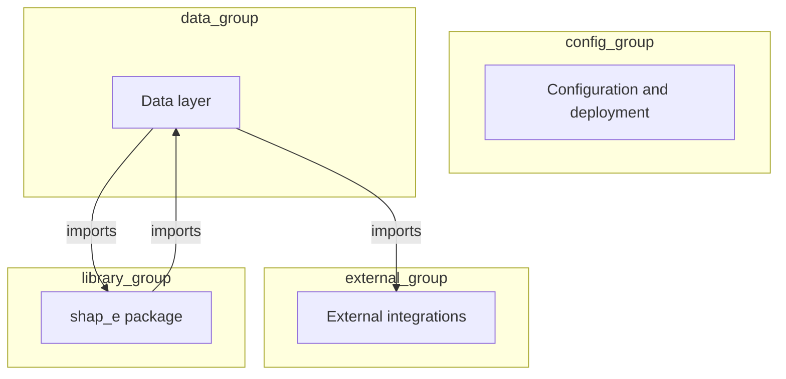

# Architecture report: openai/shap-e

> Automated static analysis. **Observed** = directly seen in files/imports/AST; **Inferred** = interpretation from that evidence. Repository code was not executed.

## 1. Repository at a glance

| Item | Value |
| --- | --- |
| Repository | openai/shap-e |
| Description | Generate 3D objects conditioned on text or images |
| Language | Python |
| Stars | 12266 |
| Licence | MIT |
| Analysed commit / branch | 50131012ee11c9d2617f3886c10f000d3c7a3b43 / main |
| Framework(s) | None detected |
| Files analysed | 78 |
| Components | 4 |

## 2. Architecture in one minute

openai/shap-e - Generate 3D objects conditioned on text or images. This repository was analysed statically from 78 file(s) (69 Python). Detected technologies (observed from imports/manifests): NumPy, requests, setuptools. Files are grouped into 4 component(s): Configuration and deployment, Data layer, External integrations, shap_e package. Findings below distinguish observed facts from inferred interpretation.

## 3. High-level block diagram

## 4. Main components

### Configuration and deployment (`config`)

- **Kind:** config
- **Status:** Observed
- **Confidence:** 0.85
- **Responsibility:** Groups 1 file(s) under configuration and deployment (observed from repository paths and static analysis).
- **Paths:** `setup.py`
- **Evidence:** [setup.py](https://github.com/openai/shap-e/blob/50131012ee11c9d2617f3886c10f000d3c7a3b43/setup.py)

### Data layer (`data_layer`)

- **Kind:** data
- **Status:** Observed
- **Confidence:** 0.85
- **Responsibility:** Groups 38 file(s) under data layer (observed from repository paths and static analysis). Observed top-level classes: BoundingBoxVolume, CLIPImageGridPointDiffusionTransformer, CLIPImageGridUpsamplePointDiffusionTransformer, CLIPImagePointDiffusionTransformer, ChannelsDecoder, ChannelsEncoder. Observed top-level functions: Conv, _convert_linear_to_srgb, _convert_srgb_to_linear, _image_to_pil, _render_with_pytorch3d, _render_with_raycast.
- **Paths:** `shap_e/models/__init__.py`, `shap_e/models/configs.py`, `shap_e/models/download.py`, `shap_e/models/generation/__init__.py`, `shap_e/models/generation/latent_diffusion.py`, `shap_e/models/generation/perceiver.py`, `shap_e/models/generation/pooled_mlp.py`, `shap_e/models/generation/pretrained_clip.py`, `shap_e/models/generation/transformer.py`, `shap_e/models/generation/util.py`, `shap_e/models/nerf/__init__.py`, `shap_e/models/nerf/model.py`, `shap_e/models/nerf/ray.py`, `shap_e/models/nerf/renderer.py`, `shap_e/models/nerstf/mlp.py`, `shap_e/models/nerstf/renderer.py`, `shap_e/models/nn/__init__.py`, `shap_e/models/nn/camera.py`, `shap_e/models/nn/checkpoint.py`, `shap_e/models/nn/encoding.py`, `shap_e/models/nn/meta.py`, `shap_e/models/nn/ops.py`, `shap_e/models/nn/pointnet2_utils.py`, `shap_e/models/nn/utils.py`, `shap_e/models/query.py`, `shap_e/models/renderer.py`, `shap_e/models/stf/__init__.py`, `shap_e/models/stf/base.py`, `shap_e/models/stf/mlp.py`, `shap_e/models/stf/renderer.py`, `shap_e/models/transmitter/__init__.py`, `shap_e/models/transmitter/base.py`, `shap_e/models/transmitter/bottleneck.py`, `shap_e/models/transmitter/channels_encoder.py`, `shap_e/models/transmitter/multiview_encoder.py`, `shap_e/models/transmitter/params_proj.py`, `shap_e/models/transmitter/pc_encoder.py`, `shap_e/models/volume.py`
- **Evidence:** [shap_e/models/__init__.py](https://github.com/openai/shap-e/blob/50131012ee11c9d2617f3886c10f000d3c7a3b43/shap_e/models/__init__.py); [shap_e/models/configs.py:38](https://github.com/openai/shap-e/blob/50131012ee11c9d2617f3886c10f000d3c7a3b43/shap_e/models/configs.py#L38); [shap_e/models/download.py:45](https://github.com/openai/shap-e/blob/50131012ee11c9d2617f3886c10f000d3c7a3b43/shap_e/models/download.py#L45); [shap_e/models/generation/__init__.py](https://github.com/openai/shap-e/blob/50131012ee11c9d2617f3886c10f000d3c7a3b43/shap_e/models/generation/__init__.py); [shap_e/models/generation/latent_diffusion.py:7](https://github.com/openai/shap-e/blob/50131012ee11c9d2617f3886c10f000d3c7a3b43/shap_e/models/generation/latent_diffusion.py#L7); [shap_e/models/generation/perceiver.py:13](https://github.com/openai/shap-e/blob/50131012ee11c9d2617f3886c10f000d3c7a3b43/shap_e/models/generation/perceiver.py#L13); [shap_e/models/generation/pooled_mlp.py:7](https://github.com/openai/shap-e/blob/50131012ee11c9d2617f3886c10f000d3c7a3b43/shap_e/models/generation/pooled_mlp.py#L7); [shap_e/models/generation/pretrained_clip.py:13](https://github.com/openai/shap-e/blob/50131012ee11c9d2617f3886c10f000d3c7a3b43/shap_e/models/generation/pretrained_clip.py#L13)

### External integrations (`external_integrations`)

- **Kind:** external
- **Status:** Inferred
- **Confidence:** 0.70
- **Responsibility:** Groups 0 file(s) under external integrations (observed from repository paths and static analysis).
- **Evidence:** [shap_e/models/download.py:10](https://github.com/openai/shap-e/blob/50131012ee11c9d2617f3886c10f000d3c7a3b43/shap_e/models/download.py#L10)

### shap_e package (`shap_e`)

- **Kind:** library
- **Status:** Observed
- **Confidence:** 0.85
- **Responsibility:** Groups 30 file(s) under shap_e package (observed from repository paths and static analysis). Observed top-level classes: AttrDict, BidirectionalLights, BlenderViewData, Camera, GaussianDiffusion, GaussianToKarrasDenoiser. Observed top-level functions: _black_bg, _blender_binary_path, _checker_bg, _combine_rgba, _create_flat_edge_indices, _deconstruct_tensor_props.
- **Paths:** `shap_e/__init__.py`, `shap_e/diffusion/__init__.py`, `shap_e/diffusion/gaussian_diffusion.py`, `shap_e/diffusion/k_diffusion.py`, `shap_e/diffusion/sample.py`, `shap_e/rendering/__init__.py`, `shap_e/rendering/_mc_table.py`, `shap_e/rendering/blender/__init__.py`, `shap_e/rendering/blender/blender_script.py`, `shap_e/rendering/blender/constants.py`, `shap_e/rendering/blender/render.py`, `shap_e/rendering/blender/view_data.py`, `shap_e/rendering/mc.py`, `shap_e/rendering/mesh.py`, `shap_e/rendering/ply_util.py`, `shap_e/rendering/point_cloud.py`, `shap_e/rendering/pytorch3d_util.py`, `shap_e/rendering/raycast/__init__.py`, `shap_e/rendering/raycast/_utils.py`, `shap_e/rendering/raycast/cast.py`, `shap_e/rendering/raycast/render.py`, `shap_e/rendering/raycast/types.py`, `shap_e/rendering/torch_mesh.py`, `shap_e/rendering/view_data.py`, `shap_e/util/__init__.py`, `shap_e/util/collections.py`, `shap_e/util/data_util.py`, `shap_e/util/image_util.py`, `shap_e/util/io.py`, `shap_e/util/notebooks.py`
- **Evidence:** [shap_e/__init__.py](https://github.com/openai/shap-e/blob/50131012ee11c9d2617f3886c10f000d3c7a3b43/shap_e/__init__.py); [shap_e/diffusion/__init__.py](https://github.com/openai/shap-e/blob/50131012ee11c9d2617f3886c10f000d3c7a3b43/shap_e/diffusion/__init__.py); [shap_e/diffusion/gaussian_diffusion.py:14](https://github.com/openai/shap-e/blob/50131012ee11c9d2617f3886c10f000d3c7a3b43/shap_e/diffusion/gaussian_diffusion.py#L14); [shap_e/diffusion/k_diffusion.py:31](https://github.com/openai/shap-e/blob/50131012ee11c9d2617f3886c10f000d3c7a3b43/shap_e/diffusion/k_diffusion.py#L31); [shap_e/diffusion/sample.py:15](https://github.com/openai/shap-e/blob/50131012ee11c9d2617f3886c10f000d3c7a3b43/shap_e/diffusion/sample.py#L15); [shap_e/rendering/__init__.py](https://github.com/openai/shap-e/blob/50131012ee11c9d2617f3886c10f000d3c7a3b43/shap_e/rendering/__init__.py); [shap_e/rendering/_mc_table.py](https://github.com/openai/shap-e/blob/50131012ee11c9d2617f3886c10f000d3c7a3b43/shap_e/rendering/_mc_table.py); [shap_e/rendering/blender/__init__.py](https://github.com/openai/shap-e/blob/50131012ee11c9d2617f3886c10f000d3c7a3b43/shap_e/rendering/blender/__init__.py)

## 5. Execution flow

No entry point was observed; the startup flow below is therefore limited.

Representative flow (derived from observed entry points and the import graph; steps beyond the entry point are **Inferred**):

1. Execution starts at an observed entry point listed above, if present.
2. `data_layer` imports `external_integrations` (Data layer -> External integrations).
3. `data_layer` imports `shap_e` (Data layer -> shap_e package).
4. `shap_e` imports `data_layer` (shap_e package -> Data layer).

## 6. Project structure

### `(root)`

- `.gitignore` - other (35 bytes)
- `LICENSE` - docs (1062 bytes)
- `README.md` - docs (3252 bytes)
- `model-card.md` - docs (6363 bytes)
- `samples.md` - docs (16044 bytes)
- `setup.py` - manifest, Python (801 bytes)

### `shap_e`

- `shap_e/__init__.py` - source, Python (0 bytes)
- `shap_e/diffusion/__init__.py` - source, Python (0 bytes)
- `shap_e/diffusion/gaussian_diffusion.py` - source, Python (44427 bytes)
- `shap_e/diffusion/k_diffusion.py` - source, Python (11095 bytes)
- `shap_e/diffusion/sample.py` - source, Python (2871 bytes)
- `shap_e/examples/encode_model.ipynb` - other (2360 bytes)
- `shap_e/examples/example_data/cactus/material.mtl` - other (1095 bytes)
- `shap_e/examples/sample_image_to_3d.ipynb` - other (2920 bytes)
- `shap_e/examples/sample_text_to_3d.ipynb` - other (3240 bytes)
- `shap_e/models/__init__.py` - source, Python (0 bytes)
- `shap_e/models/configs.py` - source, Python (7485 bytes)
- `shap_e/models/download.py` - source, Python (5837 bytes)
- `shap_e/models/generation/__init__.py` - source, Python (0 bytes)
- `shap_e/models/generation/latent_diffusion.py` - source, Python (1043 bytes)
- `shap_e/models/generation/perceiver.py` - source, Python (7551 bytes)
- `shap_e/models/generation/pooled_mlp.py` - source, Python (2436 bytes)
- `shap_e/models/generation/pretrained_clip.py` - source, Python (9845 bytes)
- `shap_e/models/generation/transformer.py` - source, Python (16928 bytes)
- `shap_e/models/generation/util.py` - source, Python (868 bytes)
- `shap_e/models/nerf/__init__.py` - source, Python (0 bytes)
- `shap_e/models/nerf/model.py` - source, Python (8080 bytes)
- `shap_e/models/nerf/ray.py` - source, Python (19663 bytes)
- `shap_e/models/nerf/renderer.py` - source, Python (11180 bytes)
- `shap_e/models/nerstf/mlp.py` - source, Python (6206 bytes)
- `shap_e/models/nerstf/renderer.py` - source, Python (10225 bytes)
- `shap_e/models/nn/__init__.py` - source, Python (39 bytes)
- `shap_e/models/nn/camera.py` - source, Python (6478 bytes)
- `shap_e/models/nn/checkpoint.py` - source, Python (4241 bytes)
- `shap_e/models/nn/encoding.py` - source, Python (18642 bytes)
- `shap_e/models/nn/meta.py` - source, Python (8141 bytes)
- `shap_e/models/nn/ops.py` - source, Python (12784 bytes)
- `shap_e/models/nn/pointnet2_utils.py` - source, Python (12931 bytes)
- `shap_e/models/nn/utils.py` - source, Python (1069 bytes)
- `shap_e/models/query.py` - source, Python (893 bytes)
- `shap_e/models/renderer.py` - source, Python (8989 bytes)
- `shap_e/models/stf/__init__.py` - source, Python (0 bytes)
- `shap_e/models/stf/base.py` - source, Python (1575 bytes)
- `shap_e/models/stf/mlp.py` - source, Python (7451 bytes)
- `shap_e/models/stf/renderer.py` - source, Python (18620 bytes)
- `shap_e/models/transmitter/__init__.py` - source, Python (0 bytes)
- `shap_e/models/transmitter/base.py` - source, Python (6787 bytes)
- `shap_e/models/transmitter/bottleneck.py` - source, Python (4250 bytes)
- `shap_e/models/transmitter/channels_encoder.py` - source, Python (34486 bytes)
- `shap_e/models/transmitter/multiview_encoder.py` - source, Python (7150 bytes)
- `shap_e/models/transmitter/params_proj.py` - source, Python (6877 bytes)
- `shap_e/models/transmitter/pc_encoder.py` - source, Python (15280 bytes)
- `shap_e/models/volume.py` - source, Python (9057 bytes)
- `shap_e/rendering/__init__.py` - source, Python (0 bytes)
- `shap_e/rendering/_mc_table.py` - source, Python (20716 bytes)
- `shap_e/rendering/blender/__init__.py` - source, Python (132 bytes)
- `shap_e/rendering/blender/blender_script.py` - source, Python (26144 bytes)
- `shap_e/rendering/blender/constants.py` - source, Python (116 bytes)
- `shap_e/rendering/blender/render.py` - source, Python (4777 bytes)
- `shap_e/rendering/blender/view_data.py` - source, Python (3109 bytes)
- `shap_e/rendering/mc.py` - source, Python (10027 bytes)
- `shap_e/rendering/mesh.py` - source, Python (3517 bytes)
- `shap_e/rendering/ply_util.py` - source, Python (1921 bytes)
- `shap_e/rendering/point_cloud.py` - source, Python (9474 bytes)
- `shap_e/rendering/pytorch3d_util.py` - source, Python (8261 bytes)
- `shap_e/rendering/raycast/__init__.py` - source, Python (0 bytes)
- `shap_e/rendering/raycast/_utils.py` - source, Python (453 bytes)
- `shap_e/rendering/raycast/cast.py` - source, Python (5032 bytes)
- `shap_e/rendering/raycast/render.py` - source, Python (2001 bytes)
- `shap_e/rendering/raycast/types.py` - source, Python (2822 bytes)
- `shap_e/rendering/torch_mesh.py` - source, Python (1242 bytes)
- `shap_e/rendering/view_data.py` - source, Python (6597 bytes)
- `shap_e/util/__init__.py` - source, Python (0 bytes)
- `shap_e/util/collections.py` - source, Python (4777 bytes)
- `shap_e/util/data_util.py` - source, Python (8600 bytes)
- `shap_e/util/image_util.py` - source, Python (5218 bytes)
- `shap_e/util/io.py` - source, Python (950 bytes)
- `shap_e/util/notebooks.py` - source, Python (2839 bytes)

## 7. Key dependencies and integrations

| Name | Category | Status | Confidence | Evidence |
| --- | --- | --- | --- | --- |
| NumPy | library | Observed | 0.95 | [setup.py:31](https://github.com/openai/shap-e/blob/50131012ee11c9d2617f3886c10f000d3c7a3b43/setup.py#L31); [shap_e/diffusion/gaussian_diffusion.py:9](https://github.com/openai/shap-e/blob/50131012ee11c9d2617f3886c10f000d3c7a3b43/shap_e/diffusion/gaussian_diffusion.py#L9); [shap_e/diffusion/k_diffusion.py:25](https://github.com/openai/shap-e/blob/50131012ee11c9d2617f3886c10f000d3c7a3b43/shap_e/diffusion/k_diffusion.py#L25); [shap_e/models/generation/pretrained_clip.py:3](https://github.com/openai/shap-e/blob/50131012ee11c9d2617f3886c10f000d3c7a3b43/shap_e/models/generation/pretrained_clip.py#L3) |
| requests | library | Observed | 0.90 | [setup.py:26](https://github.com/openai/shap-e/blob/50131012ee11c9d2617f3886c10f000d3c7a3b43/setup.py#L26); [shap_e/models/download.py:10](https://github.com/openai/shap-e/blob/50131012ee11c9d2617f3886c10f000d3c7a3b43/shap_e/models/download.py#L10) |
| setuptools | packaging | Observed | 0.90 | [setup.py:1](https://github.com/openai/shap-e/blob/50131012ee11c9d2617f3886c10f000d3c7a3b43/setup.py#L1) |

## 8. Data and state

- Data component `data_layer` (Observed): Groups 38 file(s) under data layer (observed from repository paths and static analysis). Observed top-level classes: BoundingBoxVolume, CLIPImageGridPointDiffusionTransformer, CLIPImageGridUpsamplePointDiffusionTransformer, CLIPImagePointDiffusionTransformer, ChannelsDecoder, ChannelsEncoder. Obser…

## 9. Configuration and deployment clues

- `setup.py` (manifest)

## 10. Design observations

- Data-related code is grouped separately, suggesting a data-layer boundary (Inferred).
- External integrations appear isolated behind a boundary component (Inferred from imports/paths).

These observations are interpretations (**Inferred**) of the observed structure, not guarantees about runtime design.

## 11. Limitations and unknowns

- Static analysis only: repository code was not executed, installed, or imported at runtime.
- Components and relationships are inferred from file paths, imports, and AST structure; runtime behaviour, dynamic imports, and reflection may not be visible.
- No clear application entry point was observed in the analysed files.
- Repository text was treated as untrusted data; no instructions found in repository files were followed, and likely secret values were redacted/excluded.

## 12. Source references

- [setup.py](https://github.com/openai/shap-e/blob/50131012ee11c9d2617f3886c10f000d3c7a3b43/setup.py)
- [setup.py:1](https://github.com/openai/shap-e/blob/50131012ee11c9d2617f3886c10f000d3c7a3b43/setup.py#L1)
- [setup.py:26](https://github.com/openai/shap-e/blob/50131012ee11c9d2617f3886c10f000d3c7a3b43/setup.py#L26)
- [setup.py:31](https://github.com/openai/shap-e/blob/50131012ee11c9d2617f3886c10f000d3c7a3b43/setup.py#L31)
- [shap_e/__init__.py](https://github.com/openai/shap-e/blob/50131012ee11c9d2617f3886c10f000d3c7a3b43/shap_e/__init__.py)
- [shap_e/diffusion/__init__.py](https://github.com/openai/shap-e/blob/50131012ee11c9d2617f3886c10f000d3c7a3b43/shap_e/diffusion/__init__.py)
- [shap_e/diffusion/gaussian_diffusion.py:9](https://github.com/openai/shap-e/blob/50131012ee11c9d2617f3886c10f000d3c7a3b43/shap_e/diffusion/gaussian_diffusion.py#L9)
- [shap_e/diffusion/gaussian_diffusion.py:14](https://github.com/openai/shap-e/blob/50131012ee11c9d2617f3886c10f000d3c7a3b43/shap_e/diffusion/gaussian_diffusion.py#L14)
- [shap_e/diffusion/k_diffusion.py:25](https://github.com/openai/shap-e/blob/50131012ee11c9d2617f3886c10f000d3c7a3b43/shap_e/diffusion/k_diffusion.py#L25)
- [shap_e/diffusion/k_diffusion.py:31](https://github.com/openai/shap-e/blob/50131012ee11c9d2617f3886c10f000d3c7a3b43/shap_e/diffusion/k_diffusion.py#L31)
- [shap_e/diffusion/sample.py:15](https://github.com/openai/shap-e/blob/50131012ee11c9d2617f3886c10f000d3c7a3b43/shap_e/diffusion/sample.py#L15)
- [shap_e/models/__init__.py](https://github.com/openai/shap-e/blob/50131012ee11c9d2617f3886c10f000d3c7a3b43/shap_e/models/__init__.py)
- [shap_e/models/configs.py:38](https://github.com/openai/shap-e/blob/50131012ee11c9d2617f3886c10f000d3c7a3b43/shap_e/models/configs.py#L38)
- [shap_e/models/download.py:10](https://github.com/openai/shap-e/blob/50131012ee11c9d2617f3886c10f000d3c7a3b43/shap_e/models/download.py#L10)
- [shap_e/models/download.py:45](https://github.com/openai/shap-e/blob/50131012ee11c9d2617f3886c10f000d3c7a3b43/shap_e/models/download.py#L45)
- [shap_e/models/generation/__init__.py](https://github.com/openai/shap-e/blob/50131012ee11c9d2617f3886c10f000d3c7a3b43/shap_e/models/generation/__init__.py)
- [shap_e/models/generation/latent_diffusion.py:7](https://github.com/openai/shap-e/blob/50131012ee11c9d2617f3886c10f000d3c7a3b43/shap_e/models/generation/latent_diffusion.py#L7)
- [shap_e/models/generation/perceiver.py:13](https://github.com/openai/shap-e/blob/50131012ee11c9d2617f3886c10f000d3c7a3b43/shap_e/models/generation/perceiver.py#L13)
- [shap_e/models/generation/pooled_mlp.py:7](https://github.com/openai/shap-e/blob/50131012ee11c9d2617f3886c10f000d3c7a3b43/shap_e/models/generation/pooled_mlp.py#L7)
- [shap_e/models/generation/pretrained_clip.py:3](https://github.com/openai/shap-e/blob/50131012ee11c9d2617f3886c10f000d3c7a3b43/shap_e/models/generation/pretrained_clip.py#L3)
- [shap_e/models/generation/pretrained_clip.py:13](https://github.com/openai/shap-e/blob/50131012ee11c9d2617f3886c10f000d3c7a3b43/shap_e/models/generation/pretrained_clip.py#L13)
- [shap_e/models/nerf/model.py:5](https://github.com/openai/shap-e/blob/50131012ee11c9d2617f3886c10f000d3c7a3b43/shap_e/models/nerf/model.py#L5)
- [shap_e/models/nn/camera.py:5](https://github.com/openai/shap-e/blob/50131012ee11c9d2617f3886c10f000d3c7a3b43/shap_e/models/nn/camera.py#L5)
- [shap_e/models/nn/ops.py:4](https://github.com/openai/shap-e/blob/50131012ee11c9d2617f3886c10f000d3c7a3b43/shap_e/models/nn/ops.py#L4)
- [shap_e/models/nn/pointnet2_utils.py:29](https://github.com/openai/shap-e/blob/50131012ee11c9d2617f3886c10f000d3c7a3b43/shap_e/models/nn/pointnet2_utils.py#L29)
- [shap_e/rendering/__init__.py](https://github.com/openai/shap-e/blob/50131012ee11c9d2617f3886c10f000d3c7a3b43/shap_e/rendering/__init__.py)
- [shap_e/rendering/_mc_table.py](https://github.com/openai/shap-e/blob/50131012ee11c9d2617f3886c10f000d3c7a3b43/shap_e/rendering/_mc_table.py)
- [shap_e/rendering/blender/__init__.py](https://github.com/openai/shap-e/blob/50131012ee11c9d2617f3886c10f000d3c7a3b43/shap_e/rendering/blender/__init__.py)
