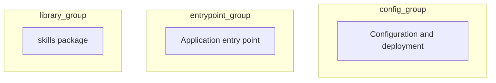

# Architecture report: openai/skills

> Automated static analysis. **Observed** = directly seen in files/imports/AST; **Inferred** = interpretation from that evidence. Repository code was not executed.

## 1. Repository at a glance

| Item | Value |
| --- | --- |
| Repository | openai/skills |
| Description | Skills Catalog for Codex |
| Language | Python |
| Stars | 28745 |
| Licence | Not detected |
| Analysed commit / branch | 49f948faa9258a0c61caceaf225e179651397431 / main |
| Framework(s) | None detected |
| Files analysed | 748 |
| Components | 3 |

## 2. Architecture in one minute

openai/skills - Skills Catalog for Codex. This repository was analysed statically from 748 file(s) (42 Python). Detected technologies (observed from imports/manifests): no known frameworks/libraries. Files are grouped into 3 component(s): Configuration and deployment, Application entry point, skills package. Observed entry point(s): skills/.curated/figma-code-connect-components/scripts/normalize_node_id.py, skills/.curated/gh-address-comments/scripts/fetch_comments.py, skills/.curated/gh-fix-ci/scripts/inspect_pr_checks.py. Findings below distinguish observed facts from inferred interpretation.

## 3. High-level block diagram

## 4. Main components

### Configuration and deployment (`config`)

- **Kind:** config
- **Status:** Observed
- **Confidence:** 0.85
- **Responsibility:** Groups 66 file(s) under configuration and deployment (observed from repository paths and static analysis).
- **Paths:** `skills/.curated/aspnet-core/agents/openai.yaml`, `skills/.curated/chatgpt-apps/agents/openai.yaml`, `skills/.curated/cli-creator/agents/openai.yaml`, `skills/.curated/cloudflare-deploy/agents/openai.yaml`, `skills/.curated/define-goal/agents/openai.yaml`, `skills/.curated/figma-code-connect-components/agents/openai.yaml`, `skills/.curated/figma-create-design-system-rules/agents/openai.yaml`, `skills/.curated/figma-create-new-file/agents/openai.yaml`, `skills/.curated/figma-create-new-file/maintainers.yml`, `skills/.curated/figma-generate-design/agents/openai.yaml`, `skills/.curated/figma-generate-design/maintainers.yml`, `skills/.curated/figma-generate-library/agents/openai.yaml`, `skills/.curated/figma-generate-library/maintainers.yml`, `skills/.curated/figma-implement-design/agents/openai.yaml`, `skills/.curated/figma-use/agents/openai.yaml`, `skills/.curated/figma-use/maintainers.yml`, `skills/.curated/figma-use/references/maintainers.yml`, `skills/.curated/figma-use/references/working-with-design-systems/maintainers.yml`, `skills/.curated/figma/agents/openai.yaml`, `skills/.curated/gh-address-comments/agents/openai.yaml`, `skills/.curated/gh-fix-ci/agents/openai.yaml`, `skills/.curated/hatch-pet/agents/openai.yaml`, `skills/.curated/jupyter-notebook/agents/openai.yaml`, `skills/.curated/linear/agents/openai.yaml`, `skills/.curated/migrate-to-codex/agents/openai.yaml`, `skills/.curated/migrate-to-codex/scripts/migrate/settings.py`, `skills/.curated/netlify-deploy/agents/openai.yaml`, `skills/.curated/notion-knowledge-capture/agents/openai.yaml`, `skills/.curated/notion-knowledge-capture/evaluations/conversation-to-wiki.json`, `skills/.curated/notion-knowledge-capture/evaluations/decision-record.json`, `skills/.curated/notion-meeting-intelligence/agents/openai.yaml`, `skills/.curated/notion-meeting-intelligence/evaluations/decision-meeting-prep.json`, `skills/.curated/notion-meeting-intelligence/evaluations/status-meeting-prep.json`, `skills/.curated/notion-research-documentation/agents/openai.yaml`, `skills/.curated/notion-research-documentation/evaluations/basic-research.json`, `skills/.curated/notion-research-documentation/evaluations/research-to-database.json`, `skills/.curated/notion-spec-to-implementation/agents/openai.yaml`, `skills/.curated/notion-spec-to-implementation/evaluations/basic-spec-implementation.json`, `skills/.curated/notion-spec-to-implementation/evaluations/spec-to-tasks.json`, `skills/.curated/openai-docs/agents/openai.yaml`, `skills/.curated/pdf/agents/openai.yaml`, `skills/.curated/playwright-interactive/agents/openai.yaml`, `skills/.curated/playwright/agents/openai.yaml`, `skills/.curated/render-deploy/agents/openai.yaml`, `skills/.curated/render-deploy/assets/docker.yaml`, `skills/.curated/render-deploy/assets/go-api.yaml`, `skills/.curated/render-deploy/assets/nextjs-postgres.yaml`, `skills/.curated/render-deploy/assets/node-express.yaml`, `skills/.curated/render-deploy/assets/python-django.yaml`, `skills/.curated/render-deploy/assets/static-site.yaml`, `skills/.curated/screenshot/agents/openai.yaml`, `skills/.curated/security-best-practices/agents/openai.yaml`, `skills/.curated/security-ownership-map/agents/openai.yaml`, `skills/.curated/security-threat-model/agents/openai.yaml`, `skills/.curated/sentry/agents/openai.yaml`, `skills/.curated/speech/agents/openai.yaml`, `skills/.curated/transcribe/agents/openai.yaml`, `skills/.curated/vercel-deploy/agents/openai.yaml`, `skills/.curated/winui-app/agents/openai.yaml`, `skills/.curated/winui-app/config.yaml`, `skills/.curated/yeet/agents/openai.yaml`, `skills/.system/imagegen/agents/openai.yaml`, `skills/.system/openai-docs/agents/openai.yaml`, `skills/.system/plugin-creator/agents/openai.yaml`, `skills/.system/skill-creator/agents/openai.yaml`, `skills/.system/skill-installer/agents/openai.yaml`
- **Evidence:** [skills/.curated/aspnet-core/agents/openai.yaml](https://github.com/openai/skills/blob/49f948faa9258a0c61caceaf225e179651397431/skills/.curated/aspnet-core/agents/openai.yaml); [skills/.curated/chatgpt-apps/agents/openai.yaml](https://github.com/openai/skills/blob/49f948faa9258a0c61caceaf225e179651397431/skills/.curated/chatgpt-apps/agents/openai.yaml); [skills/.curated/cli-creator/agents/openai.yaml](https://github.com/openai/skills/blob/49f948faa9258a0c61caceaf225e179651397431/skills/.curated/cli-creator/agents/openai.yaml); [skills/.curated/cloudflare-deploy/agents/openai.yaml](https://github.com/openai/skills/blob/49f948faa9258a0c61caceaf225e179651397431/skills/.curated/cloudflare-deploy/agents/openai.yaml); [skills/.curated/define-goal/agents/openai.yaml](https://github.com/openai/skills/blob/49f948faa9258a0c61caceaf225e179651397431/skills/.curated/define-goal/agents/openai.yaml); [skills/.curated/figma-code-connect-components/agents/openai.yaml](https://github.com/openai/skills/blob/49f948faa9258a0c61caceaf225e179651397431/skills/.curated/figma-code-connect-components/agents/openai.yaml); [skills/.curated/figma-create-design-system-rules/agents/openai.yaml](https://github.com/openai/skills/blob/49f948faa9258a0c61caceaf225e179651397431/skills/.curated/figma-create-design-system-rules/agents/openai.yaml); [skills/.curated/figma-create-new-file/agents/openai.yaml](https://github.com/openai/skills/blob/49f948faa9258a0c61caceaf225e179651397431/skills/.curated/figma-create-new-file/agents/openai.yaml)

### Application entry point (`entrypoint`)

- **Kind:** entrypoint
- **Status:** Observed
- **Confidence:** 0.85
- **Responsibility:** Groups 28 file(s) under application entry point (observed from repository paths and static analysis). Observed top-level classes: Args, DeployMode, DeploymentPlan, GhResult, InstallError, ListError. Observed top-level functions: _add_common_args, _add_shared_args, _augment_prompt, _augment_prompt_fields, _build_output_path, _build_output_paths.
- **Paths:** `skills/.curated/figma-code-connect-components/scripts/normalize_node_id.py`, `skills/.curated/gh-address-comments/scripts/fetch_comments.py`, `skills/.curated/gh-fix-ci/scripts/inspect_pr_checks.py`, `skills/.curated/hatch-pet/scripts/compose_atlas.py`, `skills/.curated/hatch-pet/scripts/derive_running_left_from_running_right.py`, `skills/.curated/hatch-pet/scripts/extract_strip_frames.py`, `skills/.curated/hatch-pet/scripts/inspect_frames.py`, `skills/.curated/hatch-pet/scripts/make_contact_sheet.py`, `skills/.curated/hatch-pet/scripts/prepare_pet_run.py`, `skills/.curated/hatch-pet/scripts/render_animation_previews.py`, `skills/.curated/hatch-pet/scripts/validate_atlas.py`, `skills/.curated/jupyter-notebook/scripts/new_notebook.py`, `skills/.curated/migrate-to-codex/scripts/cli.py`, `skills/.curated/migrate-to-codex/scripts/migrate-to-codex.py`, `skills/.curated/screenshot/scripts/take_screenshot.py`, `skills/.curated/security-ownership-map/scripts/build_ownership_map.py`, `skills/.curated/security-ownership-map/scripts/community_maintainers.py`, `skills/.curated/security-ownership-map/scripts/query_ownership.py`, `skills/.curated/security-ownership-map/scripts/run_ownership_map.py`, `skills/.curated/speech/scripts/text_to_speech.py`, `skills/.curated/transcribe/scripts/transcribe_diarize.py`, `skills/.system/imagegen/scripts/image_gen.py`, `skills/.system/plugin-creator/scripts/create_basic_plugin.py`, `skills/.system/skill-creator/scripts/generate_openai_yaml.py`, `skills/.system/skill-creator/scripts/init_skill.py`, `skills/.system/skill-creator/scripts/quick_validate.py`, `skills/.system/skill-installer/scripts/install-skill-from-github.py`, `skills/.system/skill-installer/scripts/list-skills.py`
- **Evidence:** [skills/.curated/figma-code-connect-components/scripts/normalize_node_id.py:9](https://github.com/openai/skills/blob/49f948faa9258a0c61caceaf225e179651397431/skills/.curated/figma-code-connect-components/scripts/normalize_node_id.py#L9); [skills/.curated/gh-address-comments/scripts/fetch_comments.py:95](https://github.com/openai/skills/blob/49f948faa9258a0c61caceaf225e179651397431/skills/.curated/gh-address-comments/scripts/fetch_comments.py#L95); [skills/.curated/gh-fix-ci/scripts/inspect_pr_checks.py:51](https://github.com/openai/skills/blob/49f948faa9258a0c61caceaf225e179651397431/skills/.curated/gh-fix-ci/scripts/inspect_pr_checks.py#L51); [skills/.curated/hatch-pet/scripts/compose_atlas.py:32](https://github.com/openai/skills/blob/49f948faa9258a0c61caceaf225e179651397431/skills/.curated/hatch-pet/scripts/compose_atlas.py#L32); [skills/.curated/hatch-pet/scripts/derive_running_left_from_running_right.py:16](https://github.com/openai/skills/blob/49f948faa9258a0c61caceaf225e179651397431/skills/.curated/hatch-pet/scripts/derive_running_left_from_running_right.py#L16); [skills/.curated/hatch-pet/scripts/extract_strip_frames.py:29](https://github.com/openai/skills/blob/49f948faa9258a0c61caceaf225e179651397431/skills/.curated/hatch-pet/scripts/extract_strip_frames.py#L29); [skills/.curated/hatch-pet/scripts/inspect_frames.py:30](https://github.com/openai/skills/blob/49f948faa9258a0c61caceaf225e179651397431/skills/.curated/hatch-pet/scripts/inspect_frames.py#L30); [skills/.curated/hatch-pet/scripts/make_contact_sheet.py:30](https://github.com/openai/skills/blob/49f948faa9258a0c61caceaf225e179651397431/skills/.curated/hatch-pet/scripts/make_contact_sheet.py#L30)

### skills package (`skills`)

- **Kind:** library
- **Status:** Observed
- **Confidence:** 0.85
- **Responsibility:** Groups 31 file(s) under skills package (observed from repository paths and static analysis). Observed top-level classes: ArtifactKind, ClaudeHookCommand, ClaudeHookMatcherGroup, ClaudeHooks, ConversionResult, GeneratedText. Observed top-level functions: agent_metadata, agent_report_detail, agent_report_item, append_blank_line, append_env_config, append_header_config.
- **Paths:** `skills/.curated/chatgpt-apps/scripts/scaffold_node_ext_apps.mjs`, `skills/.curated/figma-create-design-system-rules/scripts/check_agents_md.sh`, `skills/.curated/figma-generate-library/scripts/bindVariablesToComponent.js`, `skills/.curated/figma-generate-library/scripts/cleanupOrphans.js`, `skills/.curated/figma-generate-library/scripts/createComponentWithVariants.js`, `skills/.curated/figma-generate-library/scripts/createDocumentationPage.js`, `skills/.curated/figma-generate-library/scripts/createSemanticTokens.js`, `skills/.curated/figma-generate-library/scripts/createVariableCollection.js`, `skills/.curated/figma-generate-library/scripts/inspectFileStructure.js`, `skills/.curated/figma-generate-library/scripts/rehydrateState.js`, `skills/.curated/figma-generate-library/scripts/validateCreation.js`, `skills/.curated/migrate-to-codex/scripts/migrate/__init__.py`, `skills/.curated/migrate-to-codex/scripts/migrate/agents.py`, `skills/.curated/migrate-to-codex/scripts/migrate/codex_config.py`, `skills/.curated/migrate-to-codex/scripts/migrate/common.py`, `skills/.curated/migrate-to-codex/scripts/migrate/hooks.py`, `skills/.curated/migrate-to-codex/scripts/migrate/instructions.py`, `skills/.curated/migrate-to-codex/scripts/migrate/mcps.py`, `skills/.curated/migrate-to-codex/scripts/migrate/plugins.py`, `skills/.curated/migrate-to-codex/scripts/migrate/skills.py`, `skills/.curated/migrate-to-codex/scripts/utils/__init__.py`, `skills/.curated/migrate-to-codex/scripts/utils/scan.py`, `skills/.curated/migrate-to-codex/scripts/utils/util.py`, `skills/.curated/openai-docs/scripts/fetch-codex-manual.mjs`, `skills/.curated/openai-docs/scripts/resolve-latest-model-info.js`, `skills/.curated/playwright/scripts/playwright_cli.sh`, `skills/.curated/screenshot/scripts/ensure_macos_permissions.sh`, `skills/.curated/vercel-deploy/scripts/deploy.sh`, `skills/.system/openai-docs/scripts/fetch-codex-manual.mjs`, `skills/.system/openai-docs/scripts/resolve-latest-model-info.js`, `skills/.system/skill-installer/scripts/github_utils.py`
- **Evidence:** [skills/.curated/chatgpt-apps/scripts/scaffold_node_ext_apps.mjs](https://github.com/openai/skills/blob/49f948faa9258a0c61caceaf225e179651397431/skills/.curated/chatgpt-apps/scripts/scaffold_node_ext_apps.mjs); [skills/.curated/figma-create-design-system-rules/scripts/check_agents_md.sh](https://github.com/openai/skills/blob/49f948faa9258a0c61caceaf225e179651397431/skills/.curated/figma-create-design-system-rules/scripts/check_agents_md.sh); [skills/.curated/figma-generate-library/scripts/bindVariablesToComponent.js](https://github.com/openai/skills/blob/49f948faa9258a0c61caceaf225e179651397431/skills/.curated/figma-generate-library/scripts/bindVariablesToComponent.js); [skills/.curated/figma-generate-library/scripts/cleanupOrphans.js](https://github.com/openai/skills/blob/49f948faa9258a0c61caceaf225e179651397431/skills/.curated/figma-generate-library/scripts/cleanupOrphans.js); [skills/.curated/figma-generate-library/scripts/createComponentWithVariants.js](https://github.com/openai/skills/blob/49f948faa9258a0c61caceaf225e179651397431/skills/.curated/figma-generate-library/scripts/createComponentWithVariants.js); [skills/.curated/figma-generate-library/scripts/createDocumentationPage.js](https://github.com/openai/skills/blob/49f948faa9258a0c61caceaf225e179651397431/skills/.curated/figma-generate-library/scripts/createDocumentationPage.js); [skills/.curated/figma-generate-library/scripts/createSemanticTokens.js](https://github.com/openai/skills/blob/49f948faa9258a0c61caceaf225e179651397431/skills/.curated/figma-generate-library/scripts/createSemanticTokens.js); [skills/.curated/figma-generate-library/scripts/createVariableCollection.js](https://github.com/openai/skills/blob/49f948faa9258a0c61caceaf225e179651397431/skills/.curated/figma-generate-library/scripts/createVariableCollection.js)

## 5. Execution flow

**Observed** entry point(s):

- [skills/.curated/figma-code-connect-components/scripts/normalize_node_id.py:24](https://github.com/openai/skills/blob/49f948faa9258a0c61caceaf225e179651397431/skills/.curated/figma-code-connect-components/scripts/normalize_node_id.py#L24)
- [skills/.curated/gh-address-comments/scripts/fetch_comments.py:236](https://github.com/openai/skills/blob/49f948faa9258a0c61caceaf225e179651397431/skills/.curated/gh-address-comments/scripts/fetch_comments.py#L236)
- [skills/.curated/gh-fix-ci/scripts/inspect_pr_checks.py:508](https://github.com/openai/skills/blob/49f948faa9258a0c61caceaf225e179651397431/skills/.curated/gh-fix-ci/scripts/inspect_pr_checks.py#L508)
- [skills/.curated/hatch-pet/scripts/compose_atlas.py:168](https://github.com/openai/skills/blob/49f948faa9258a0c61caceaf225e179651397431/skills/.curated/hatch-pet/scripts/compose_atlas.py#L168)
- [skills/.curated/hatch-pet/scripts/derive_running_left_from_running_right.py:149](https://github.com/openai/skills/blob/49f948faa9258a0c61caceaf225e179651397431/skills/.curated/hatch-pet/scripts/derive_running_left_from_running_right.py#L149)
- [skills/.curated/hatch-pet/scripts/extract_strip_frames.py:407](https://github.com/openai/skills/blob/49f948faa9258a0c61caceaf225e179651397431/skills/.curated/hatch-pet/scripts/extract_strip_frames.py#L407)
- [skills/.curated/hatch-pet/scripts/inspect_frames.py:255](https://github.com/openai/skills/blob/49f948faa9258a0c61caceaf225e179651397431/skills/.curated/hatch-pet/scripts/inspect_frames.py#L255)
- [skills/.curated/hatch-pet/scripts/make_contact_sheet.py:95](https://github.com/openai/skills/blob/49f948faa9258a0c61caceaf225e179651397431/skills/.curated/hatch-pet/scripts/make_contact_sheet.py#L95)
- [skills/.curated/hatch-pet/scripts/prepare_pet_run.py:829](https://github.com/openai/skills/blob/49f948faa9258a0c61caceaf225e179651397431/skills/.curated/hatch-pet/scripts/prepare_pet_run.py#L829)
- [skills/.curated/hatch-pet/scripts/render_animation_previews.py:77](https://github.com/openai/skills/blob/49f948faa9258a0c61caceaf225e179651397431/skills/.curated/hatch-pet/scripts/render_animation_previews.py#L77)
- [skills/.curated/hatch-pet/scripts/validate_atlas.py:156](https://github.com/openai/skills/blob/49f948faa9258a0c61caceaf225e179651397431/skills/.curated/hatch-pet/scripts/validate_atlas.py#L156)
- [skills/.curated/jupyter-notebook/scripts/new_notebook.py:129](https://github.com/openai/skills/blob/49f948faa9258a0c61caceaf225e179651397431/skills/.curated/jupyter-notebook/scripts/new_notebook.py#L129)

Representative flow (derived from observed entry points and the import graph; steps beyond the entry point are **Inferred**):

1. Execution starts at an observed entry point listed above, if present.
2. No internal import relationships between components were observed.

## 6. Project structure

### `(root)`

- `.gitignore` - other (75 bytes)
- `README.md` - docs (1840 bytes)
- `contributing.md` - docs (527 bytes)

### `skills`

- `skills/.curated/aspnet-core/LICENSE.txt` - docs (11357 bytes)
- `skills/.curated/aspnet-core/SKILL.md` - docs (5544 bytes)
- `skills/.curated/aspnet-core/agents/openai.yaml` - config (222 bytes)
- `skills/.curated/aspnet-core/references/_sections.md` - docs (2412 bytes)
- `skills/.curated/aspnet-core/references/apis-minimal-and-controllers.md` - docs (3040 bytes)
- `skills/.curated/aspnet-core/references/data-state-and-services.md` - docs (2422 bytes)
- `skills/.curated/aspnet-core/references/program-and-pipeline.md` - docs (4182 bytes)
- `skills/.curated/aspnet-core/references/realtime-grpc-and-background-work.md` - docs (1896 bytes)
- `skills/.curated/aspnet-core/references/security-and-identity.md` - docs (2941 bytes)
- `skills/.curated/aspnet-core/references/source-map.md` - docs (2040 bytes)
- `skills/.curated/aspnet-core/references/stack-selection.md` - docs (3700 bytes)
- `skills/.curated/aspnet-core/references/testing-performance-and-operations.md` - docs (2698 bytes)
- `skills/.curated/aspnet-core/references/ui-blazor.md` - docs (2478 bytes)
- `skills/.curated/aspnet-core/references/ui-mvc.md` - docs (1954 bytes)
- `skills/.curated/aspnet-core/references/ui-razor-pages.md` - docs (1937 bytes)
- `skills/.curated/aspnet-core/references/versioning-and-upgrades.md` - docs (2085 bytes)
- `skills/.curated/chatgpt-apps/LICENSE.txt` - docs (10774 bytes)
- `skills/.curated/chatgpt-apps/SKILL.md` - docs (19626 bytes)
- `skills/.curated/chatgpt-apps/agents/openai.yaml` - config (842 bytes)
- `skills/.curated/chatgpt-apps/references/app-archetypes.md` - docs (3514 bytes)
- `skills/.curated/chatgpt-apps/references/apps-sdk-docs-workflow.md` - docs (8143 bytes)
- `skills/.curated/chatgpt-apps/references/interactive-state-sync-patterns.md` - docs (4281 bytes)
- `skills/.curated/chatgpt-apps/references/repo-contract-and-validation.md` - docs (2962 bytes)
- `skills/.curated/chatgpt-apps/references/search-fetch-standard.md` - docs (2021 bytes)
- `skills/.curated/chatgpt-apps/references/upstream-example-workflow.md` - docs (3443 bytes)
- `skills/.curated/chatgpt-apps/references/window-openai-patterns.md` - docs (4707 bytes)
- `skills/.curated/chatgpt-apps/scripts/scaffold_node_ext_apps.mjs` - source, JavaScript (16371 bytes)
- `skills/.curated/cli-creator/LICENSE.txt` - docs (10776 bytes)
- `skills/.curated/cli-creator/SKILL.md` - docs (10502 bytes)
- `skills/.curated/cli-creator/agents/openai.yaml` - config (280 bytes)
- `skills/.curated/cli-creator/references/agent-cli-patterns.md` - docs (5244 bytes)
- `skills/.curated/cloudflare-deploy/LICENSE.txt` - docs (10776 bytes)
- `skills/.curated/cloudflare-deploy/SKILL.md` - docs (7377 bytes)
- `skills/.curated/cloudflare-deploy/agents/openai.yaml` - config (331 bytes)
- `skills/.curated/cloudflare-deploy/assets/cloudflare-small.svg` - other (1221 bytes)
- `skills/.curated/cloudflare-deploy/references/agents-sdk/README.md` - docs (2765 bytes)
- `skills/.curated/cloudflare-deploy/references/agents-sdk/api.md` - docs (5862 bytes)
- `skills/.curated/cloudflare-deploy/references/agents-sdk/configuration.md` - docs (3575 bytes)
- `skills/.curated/cloudflare-deploy/references/agents-sdk/gotchas.md` - docs (5108 bytes)
- `skills/.curated/cloudflare-deploy/references/agents-sdk/patterns.md` - docs (5595 bytes)
- `skills/.curated/cloudflare-deploy/references/ai-gateway/README.md` - docs (6308 bytes)
- `skills/.curated/cloudflare-deploy/references/ai-gateway/configuration.md` - docs (2954 bytes)
- `skills/.curated/cloudflare-deploy/references/ai-gateway/dynamic-routing.md` - docs (1835 bytes)
- `skills/.curated/cloudflare-deploy/references/ai-gateway/features.md` - docs (2726 bytes)
- `skills/.curated/cloudflare-deploy/references/ai-gateway/sdk-integration.md` - docs (2684 bytes)
- `skills/.curated/cloudflare-deploy/references/ai-gateway/troubleshooting.md` - docs (2420 bytes)
- `skills/.curated/cloudflare-deploy/references/ai-search/README.md` - docs (4521 bytes)
- `skills/.curated/cloudflare-deploy/references/ai-search/api.md` - docs (2519 bytes)
- `skills/.curated/cloudflare-deploy/references/ai-search/configuration.md` - docs (1760 bytes)
- `skills/.curated/cloudflare-deploy/references/ai-search/gotchas.md` - docs (2135 bytes)
- `skills/.curated/cloudflare-deploy/references/ai-search/patterns.md` - docs (2008 bytes)
- `skills/.curated/cloudflare-deploy/references/analytics-engine/README.md` - docs (3195 bytes)
- `skills/.curated/cloudflare-deploy/references/analytics-engine/api.md` - docs (3161 bytes)
- `skills/.curated/cloudflare-deploy/references/analytics-engine/configuration.md` - docs (2361 bytes)
- `skills/.curated/cloudflare-deploy/references/analytics-engine/gotchas.md` - docs (2018 bytes)
- `skills/.curated/cloudflare-deploy/references/analytics-engine/patterns.md` - docs (2312 bytes)
- `skills/.curated/cloudflare-deploy/references/api-shield/README.md` - docs (1796 bytes)
- `skills/.curated/cloudflare-deploy/references/api-shield/api.md` - docs (3900 bytes)
- `skills/.curated/cloudflare-deploy/references/api-shield/configuration.md` - docs (5020 bytes)
- `skills/.curated/cloudflare-deploy/references/api-shield/gotchas.md` - docs (4946 bytes)
- `skills/.curated/cloudflare-deploy/references/api-shield/patterns.md` - docs (5844 bytes)
- `skills/.curated/cloudflare-deploy/references/api/README.md` - docs (2381 bytes)
- `skills/.curated/cloudflare-deploy/references/api/api.md` - docs (4308 bytes)
- `skills/.curated/cloudflare-deploy/references/api/configuration.md` - docs (3748 bytes)
- `skills/.curated/cloudflare-deploy/references/api/gotchas.md` - docs (5390 bytes)
- `skills/.curated/cloudflare-deploy/references/api/patterns.md` - docs (4639 bytes)
- `skills/.curated/cloudflare-deploy/references/argo-smart-routing/README.md` - docs (4060 bytes)
- `skills/.curated/cloudflare-deploy/references/argo-smart-routing/api.md` - docs (6579 bytes)
- `skills/.curated/cloudflare-deploy/references/argo-smart-routing/configuration.md` - docs (4457 bytes)
- `skills/.curated/cloudflare-deploy/references/argo-smart-routing/gotchas.md` - docs (4327 bytes)
- `skills/.curated/cloudflare-deploy/references/argo-smart-routing/patterns.md` - docs (3053 bytes)
- `skills/.curated/cloudflare-deploy/references/bindings/README.md` - docs (4042 bytes)
- `skills/.curated/cloudflare-deploy/references/bindings/api.md` - docs (5199 bytes)
- `skills/.curated/cloudflare-deploy/references/bindings/configuration.md` - docs (4496 bytes)
- `skills/.curated/cloudflare-deploy/references/bindings/gotchas.md` - docs (6169 bytes)
- `skills/.curated/cloudflare-deploy/references/bindings/patterns.md` - docs (5058 bytes)
- `skills/.curated/cloudflare-deploy/references/bot-management/README.md` - docs (3762 bytes)
- `skills/.curated/cloudflare-deploy/references/bot-management/api.md` - docs (5803 bytes)
- `skills/.curated/cloudflare-deploy/references/bot-management/configuration.md` - docs (5744 bytes)
- `skills/.curated/cloudflare-deploy/references/bot-management/gotchas.md` - docs (5657 bytes)
- `skills/.curated/cloudflare-deploy/references/bot-management/patterns.md` - docs (4970 bytes)
- `skills/.curated/cloudflare-deploy/references/browser-rendering/README.md` - docs (3092 bytes)
- `skills/.curated/cloudflare-deploy/references/browser-rendering/api.md` - docs (2976 bytes)
- `skills/.curated/cloudflare-deploy/references/browser-rendering/configuration.md` - docs (1802 bytes)
- `skills/.curated/cloudflare-deploy/references/browser-rendering/gotchas.md` - docs (2520 bytes)
- `skills/.curated/cloudflare-deploy/references/browser-rendering/patterns.md` - docs (2647 bytes)
- `skills/.curated/cloudflare-deploy/references/c3/README.md` - docs (3352 bytes)
- `skills/.curated/cloudflare-deploy/references/c3/api.md` - docs (2286 bytes)
- `skills/.curated/cloudflare-deploy/references/c3/configuration.md` - docs (1637 bytes)
- `skills/.curated/cloudflare-deploy/references/c3/gotchas.md` - docs (2307 bytes)
- `skills/.curated/cloudflare-deploy/references/c3/patterns.md` - docs (2203 bytes)
- `skills/.curated/cloudflare-deploy/references/cache-reserve/README.md` - docs (5609 bytes)
- `skills/.curated/cloudflare-deploy/references/cache-reserve/api.md` - docs (6018 bytes)
- `skills/.curated/cloudflare-deploy/references/cache-reserve/configuration.md` - docs (3660 bytes)
- `skills/.curated/cloudflare-deploy/references/cache-reserve/gotchas.md` - docs (5797 bytes)
- `skills/.curated/cloudflare-deploy/references/cache-reserve/patterns.md` - docs (6265 bytes)
- `skills/.curated/cloudflare-deploy/references/containers/README.md` - docs (3531 bytes)
- `skills/.curated/cloudflare-deploy/references/containers/api.md` - docs (4310 bytes)
- `skills/.curated/cloudflare-deploy/references/containers/configuration.md` - docs (5424 bytes)
- `skills/.curated/cloudflare-deploy/references/containers/gotchas.md` - docs (4485 bytes)
- `skills/.curated/cloudflare-deploy/references/containers/patterns.md` - docs (4925 bytes)
- `skills/.curated/cloudflare-deploy/references/cron-triggers/README.md` - docs (2949 bytes)
- `skills/.curated/cloudflare-deploy/references/cron-triggers/api.md` - docs (5866 bytes)
- `skills/.curated/cloudflare-deploy/references/cron-triggers/configuration.md` - docs (4250 bytes)
- `skills/.curated/cloudflare-deploy/references/cron-triggers/gotchas.md` - docs (6316 bytes)
- `skills/.curated/cloudflare-deploy/references/cron-triggers/patterns.md` - docs (6980 bytes)
- `skills/.curated/cloudflare-deploy/references/d1/README.md` - docs (4719 bytes)
- `skills/.curated/cloudflare-deploy/references/d1/api.md` - docs (6806 bytes)
- `skills/.curated/cloudflare-deploy/references/d1/configuration.md` - docs (5386 bytes)
- `skills/.curated/cloudflare-deploy/references/d1/gotchas.md` - docs (4318 bytes)
- `skills/.curated/cloudflare-deploy/references/d1/patterns.md` - docs (7251 bytes)
- `skills/.curated/cloudflare-deploy/references/ddos/README.md` - docs (2054 bytes)
- `skills/.curated/cloudflare-deploy/references/ddos/api.md` - docs (4170 bytes)
- `skills/.curated/cloudflare-deploy/references/ddos/configuration.md` - docs (3005 bytes)
- `skills/.curated/cloudflare-deploy/references/ddos/gotchas.md` - docs (3912 bytes)
- `skills/.curated/cloudflare-deploy/references/ddos/patterns.md` - docs (5680 bytes)
- `skills/.curated/cloudflare-deploy/references/do-storage/README.md` - docs (2765 bytes)
- `skills/.curated/cloudflare-deploy/references/do-storage/api.md` - docs (3571 bytes)
- `skills/.curated/cloudflare-deploy/references/do-storage/configuration.md` - docs (2235 bytes)
- `skills/.curated/cloudflare-deploy/references/do-storage/gotchas.md` - docs (5200 bytes)
- `skills/.curated/cloudflare-deploy/references/do-storage/patterns.md` - docs (5278 bytes)
- `skills/.curated/cloudflare-deploy/references/do-storage/testing.md` - docs (4912 bytes)
- `skills/.curated/cloudflare-deploy/references/durable-objects/README.md` - docs (6609 bytes)
- `skills/.curated/cloudflare-deploy/references/durable-objects/api.md` - docs (6142 bytes)
- `skills/.curated/cloudflare-deploy/references/durable-objects/configuration.md` - docs (4266 bytes)
- `skills/.curated/cloudflare-deploy/references/durable-objects/gotchas.md` - docs (7318 bytes)
- `skills/.curated/cloudflare-deploy/references/durable-objects/patterns.md` - docs (6691 bytes)
- `skills/.curated/cloudflare-deploy/references/email-routing/README.md` - docs (3431 bytes)
- `skills/.curated/cloudflare-deploy/references/email-routing/api.md` - docs (5311 bytes)
- `skills/.curated/cloudflare-deploy/references/email-routing/configuration.md` - docs (3571 bytes)
- `skills/.curated/cloudflare-deploy/references/email-routing/gotchas.md` - docs (4106 bytes)
- `skills/.curated/cloudflare-deploy/references/email-routing/patterns.md` - docs (5480 bytes)
- `skills/.curated/cloudflare-deploy/references/email-workers/README.md` - docs (5368 bytes)
- `skills/.curated/cloudflare-deploy/references/email-workers/api.md` - docs (6078 bytes)
- `skills/.curated/cloudflare-deploy/references/email-workers/configuration.md` - docs (2719 bytes)
- `skills/.curated/cloudflare-deploy/references/email-workers/gotchas.md` - docs (3041 bytes)
- `skills/.curated/cloudflare-deploy/references/email-workers/patterns.md` - docs (2785 bytes)
- `skills/.curated/cloudflare-deploy/references/hyperdrive/README.md` - docs (2918 bytes)
- `skills/.curated/cloudflare-deploy/references/hyperdrive/api.md` - docs (3875 bytes)
- `skills/.curated/cloudflare-deploy/references/hyperdrive/configuration.md` - docs (3913 bytes)
- `skills/.curated/cloudflare-deploy/references/hyperdrive/gotchas.md` - docs (3926 bytes)
- `skills/.curated/cloudflare-deploy/references/hyperdrive/patterns.md` - docs (5980 bytes)
- `skills/.curated/cloudflare-deploy/references/images/README.md` - docs (2900 bytes)
- `skills/.curated/cloudflare-deploy/references/images/api.md` - docs (2574 bytes)
- `skills/.curated/cloudflare-deploy/references/images/configuration.md` - docs (4126 bytes)
- `skills/.curated/cloudflare-deploy/references/images/gotchas.md` - docs (2490 bytes)
- `skills/.curated/cloudflare-deploy/references/images/patterns.md` - docs (3582 bytes)
- `skills/.curated/cloudflare-deploy/references/kv/README.md` - docs (2883 bytes)
- `skills/.curated/cloudflare-deploy/references/kv/api.md` - docs (4327 bytes)
- `skills/.curated/cloudflare-deploy/references/kv/configuration.md` - docs (3083 bytes)
- `skills/.curated/cloudflare-deploy/references/kv/gotchas.md` - docs (4455 bytes)
- `skills/.curated/cloudflare-deploy/references/kv/patterns.md` - docs (4740 bytes)
- `skills/.curated/cloudflare-deploy/references/miniflare/README.md` - docs (2976 bytes)
- `skills/.curated/cloudflare-deploy/references/miniflare/api.md` - docs (4606 bytes)
- `skills/.curated/cloudflare-deploy/references/miniflare/configuration.md` - docs (3525 bytes)
- `skills/.curated/cloudflare-deploy/references/miniflare/gotchas.md` - docs (3724 bytes)
- `skills/.curated/cloudflare-deploy/references/miniflare/patterns.md` - docs (4260 bytes)
- `skills/.curated/cloudflare-deploy/references/network-interconnect/README.md` - docs (3230 bytes)
- `skills/.curated/cloudflare-deploy/references/network-interconnect/api.md` - docs (5626 bytes)
- `skills/.curated/cloudflare-deploy/references/network-interconnect/configuration.md` - docs (4257 bytes)
- `skills/.curated/cloudflare-deploy/references/network-interconnect/gotchas.md` - docs (5554 bytes)
- `skills/.curated/cloudflare-deploy/references/network-interconnect/patterns.md` - docs (4041 bytes)
- `skills/.curated/cloudflare-deploy/references/observability/README.md` - docs (3887 bytes)
- `skills/.curated/cloudflare-deploy/references/observability/api.md` - docs (3480 bytes)
- `skills/.curated/cloudflare-deploy/references/observability/configuration.md` - docs (3584 bytes)
- `skills/.curated/cloudflare-deploy/references/observability/gotchas.md` - docs (3755 bytes)
- `skills/.curated/cloudflare-deploy/references/observability/patterns.md` - docs (2481 bytes)
- `skills/.curated/cloudflare-deploy/references/pages-functions/README.md` - docs (3322 bytes)
- `skills/.curated/cloudflare-deploy/references/pages-functions/api.md` - docs (4677 bytes)
- `skills/.curated/cloudflare-deploy/references/pages-functions/configuration.md` - docs (3002 bytes)
- `skills/.curated/cloudflare-deploy/references/pages-functions/gotchas.md` - docs (3850 bytes)
- `skills/.curated/cloudflare-deploy/references/pages-functions/patterns.md` - docs (4214 bytes)
- `skills/.curated/cloudflare-deploy/references/pages/README.md` - docs (2834 bytes)
- `skills/.curated/cloudflare-deploy/references/pages/api.md` - docs (5980 bytes)
- `skills/.curated/cloudflare-deploy/references/pages/configuration.md` - docs (5865 bytes)
- `skills/.curated/cloudflare-deploy/references/pages/gotchas.md` - docs (7998 bytes)
- `skills/.curated/cloudflare-deploy/references/pages/patterns.md` - docs (5992 bytes)
- `skills/.curated/cloudflare-deploy/references/pipelines/README.md` - docs (3400 bytes)
- `skills/.curated/cloudflare-deploy/references/pipelines/api.md` - docs (5109 bytes)
- `skills/.curated/cloudflare-deploy/references/pipelines/configuration.md` - docs (2747 bytes)
- `skills/.curated/cloudflare-deploy/references/pipelines/gotchas.md` - docs (2427 bytes)
- `skills/.curated/cloudflare-deploy/references/pipelines/patterns.md` - docs (2080 bytes)
- `skills/.curated/cloudflare-deploy/references/pulumi/README.md` - docs (3231 bytes)
- `skills/.curated/cloudflare-deploy/references/pulumi/api.md` - docs (5761 bytes)
- `skills/.curated/cloudflare-deploy/references/pulumi/configuration.md` - docs (5657 bytes)
- `skills/.curated/cloudflare-deploy/references/pulumi/gotchas.md` - docs (6536 bytes)
- `skills/.curated/cloudflare-deploy/references/pulumi/patterns.md` - docs (6974 bytes)
- `skills/.curated/cloudflare-deploy/references/queues/README.md` - docs (3058 bytes)
- `skills/.curated/cloudflare-deploy/references/queues/api.md` - docs (5563 bytes)
- `skills/.curated/cloudflare-deploy/references/queues/configuration.md` - docs (3828 bytes)
- `skills/.curated/cloudflare-deploy/references/queues/gotchas.md` - docs (7233 bytes)
- `skills/.curated/cloudflare-deploy/references/queues/patterns.md` - docs (5498 bytes)
- `skills/.curated/cloudflare-deploy/references/r2-data-catalog/README.md` - docs (7105 bytes)
- `skills/.curated/cloudflare-deploy/references/r2-data-catalog/api.md` - docs (5991 bytes)
- `skills/.curated/cloudflare-deploy/references/r2-data-catalog/configuration.md` - docs (5297 bytes)
- `skills/.curated/cloudflare-deploy/references/r2-data-catalog/gotchas.md` - docs (6126 bytes)
- `skills/.curated/cloudflare-deploy/references/r2-data-catalog/patterns.md` - docs (5883 bytes)
- `skills/.curated/cloudflare-deploy/references/r2-sql/README.md` - docs (5209 bytes)
- `skills/.curated/cloudflare-deploy/references/r2-sql/api.md` - docs (4007 bytes)
- `skills/.curated/cloudflare-deploy/references/r2-sql/configuration.md` - docs (3739 bytes)
- `skills/.curated/cloudflare-deploy/references/r2-sql/gotchas.md` - docs (6235 bytes)
- `skills/.curated/cloudflare-deploy/references/r2-sql/patterns.md` - docs (6758 bytes)
- `skills/.curated/cloudflare-deploy/references/r2/README.md` - docs (2825 bytes)
- `skills/.curated/cloudflare-deploy/references/r2/api.md` - docs (5649 bytes)
- `skills/.curated/cloudflare-deploy/references/r2/configuration.md` - docs (3654 bytes)
- `skills/.curated/cloudflare-deploy/references/r2/gotchas.md` - docs (5048 bytes)
- `skills/.curated/cloudflare-deploy/references/r2/patterns.md` - docs (5844 bytes)
- `skills/.curated/cloudflare-deploy/references/realtime-sfu/README.md` - docs (3078 bytes)
- `skills/.curated/cloudflare-deploy/references/realtime-sfu/api.md` - docs (3768 bytes)
- `skills/.curated/cloudflare-deploy/references/realtime-sfu/configuration.md` - docs (3509 bytes)
- `skills/.curated/cloudflare-deploy/references/realtime-sfu/gotchas.md` - docs (4902 bytes)
- `skills/.curated/cloudflare-deploy/references/realtime-sfu/patterns.md` - docs (5403 bytes)
- `skills/.curated/cloudflare-deploy/references/realtimekit/README.md` - docs (4047 bytes)
- `skills/.curated/cloudflare-deploy/references/realtimekit/api.md` - docs (8352 bytes)
- `skills/.curated/cloudflare-deploy/references/realtimekit/configuration.md` - docs (5192 bytes)
- `skills/.curated/cloudflare-deploy/references/realtimekit/gotchas.md` - docs (6883 bytes)
- `skills/.curated/cloudflare-deploy/references/realtimekit/patterns.md` - docs (7660 bytes)
- `skills/.curated/cloudflare-deploy/references/sandbox/README.md` - docs (3119 bytes)
- `skills/.curated/cloudflare-deploy/references/sandbox/api.md` - docs (4972 bytes)
- `skills/.curated/cloudflare-deploy/references/sandbox/configuration.md` - docs (3415 bytes)
- `skills/.curated/cloudflare-deploy/references/sandbox/gotchas.md` - docs (5456 bytes)
- `skills/.curated/cloudflare-deploy/references/sandbox/patterns.md` - docs (5236 bytes)
- `skills/.curated/cloudflare-deploy/references/secrets-store/README.md` - docs (2215 bytes)
- `skills/.curated/cloudflare-deploy/references/secrets-store/api.md` - docs (4358 bytes)
- `skills/.curated/cloudflare-deploy/references/secrets-store/configuration.md` - docs (3890 bytes)
- `skills/.curated/cloudflare-deploy/references/secrets-store/gotchas.md` - docs (3838 bytes)
- `skills/.curated/cloudflare-deploy/references/secrets-store/patterns.md` - docs (5660 bytes)
- `skills/.curated/cloudflare-deploy/references/smart-placement/README.md` - docs (5024 bytes)
- `skills/.curated/cloudflare-deploy/references/smart-placement/api.md` - docs (5559 bytes)
- `skills/.curated/cloudflare-deploy/references/smart-placement/configuration.md` - docs (6119 bytes)
- `skills/.curated/cloudflare-deploy/references/smart-placement/gotchas.md` - docs (5637 bytes)
- `skills/.curated/cloudflare-deploy/references/smart-placement/patterns.md` - docs (5784 bytes)
- `skills/.curated/cloudflare-deploy/references/snippets/README.md` - docs (3132 bytes)
- `skills/.curated/cloudflare-deploy/references/snippets/api.md` - docs (5133 bytes)
- `skills/.curated/cloudflare-deploy/references/snippets/configuration.md` - docs (6311 bytes)
- `skills/.curated/cloudflare-deploy/references/snippets/gotchas.md` - docs (2220 bytes)
- `skills/.curated/cloudflare-deploy/references/snippets/patterns.md` - docs (3346 bytes)
- `skills/.curated/cloudflare-deploy/references/spectrum/README.md` - docs (2355 bytes)
- `skills/.curated/cloudflare-deploy/references/spectrum/api.md` - docs (4924 bytes)
- `skills/.curated/cloudflare-deploy/references/spectrum/configuration.md` - docs (4332 bytes)
- `skills/.curated/cloudflare-deploy/references/spectrum/gotchas.md` - docs (3739 bytes)
- `skills/.curated/cloudflare-deploy/references/spectrum/patterns.md` - docs (4778 bytes)
- `skills/.curated/cloudflare-deploy/references/static-assets/README.md` - docs (2197 bytes)
- `skills/.curated/cloudflare-deploy/references/static-assets/api.md` - docs (4451 bytes)
- `skills/.curated/cloudflare-deploy/references/static-assets/configuration.md` - docs (4826 bytes)
- `skills/.curated/cloudflare-deploy/references/static-assets/gotchas.md` - docs (4127 bytes)
- `skills/.curated/cloudflare-deploy/references/static-assets/patterns.md` - docs (4895 bytes)
- `skills/.curated/cloudflare-deploy/references/stream/README.md` - docs (3864 bytes)
- `skills/.curated/cloudflare-deploy/references/stream/api-live.md` - docs (5174 bytes)
- `skills/.curated/cloudflare-deploy/references/stream/api.md` - docs (5260 bytes)
- `skills/.curated/cloudflare-deploy/references/stream/configuration.md` - docs (3222 bytes)
- `skills/.curated/cloudflare-deploy/references/stream/gotchas.md` - docs (4308 bytes)
- `skills/.curated/cloudflare-deploy/references/stream/patterns.md` - docs (6394 bytes)
- `skills/.curated/cloudflare-deploy/references/tail-workers/README.md` - docs (3020 bytes)
- `skills/.curated/cloudflare-deploy/references/tail-workers/api.md` - docs (5132 bytes)
- `skills/.curated/cloudflare-deploy/references/tail-workers/configuration.md` - docs (3474 bytes)
- `skills/.curated/cloudflare-deploy/references/tail-workers/gotchas.md` - docs (4595 bytes)
- `skills/.curated/cloudflare-deploy/references/tail-workers/patterns.md` - docs (4034 bytes)
- `skills/.curated/cloudflare-deploy/references/terraform/README.md` - docs (3680 bytes)
- `skills/.curated/cloudflare-deploy/references/terraform/api.md` - docs (4020 bytes)
- `skills/.curated/cloudflare-deploy/references/terraform/configuration.md` - docs (7577 bytes)
- `skills/.curated/cloudflare-deploy/references/terraform/gotchas.md` - docs (5268 bytes)
- `skills/.curated/cloudflare-deploy/references/terraform/patterns.md` - docs (6640 bytes)
- `skills/.curated/cloudflare-deploy/references/tunnel/README.md` - docs (3738 bytes)
- `skills/.curated/cloudflare-deploy/references/tunnel/api.md` - docs (4444 bytes)
- `skills/.curated/cloudflare-deploy/references/tunnel/configuration.md` - docs (3698 bytes)
- `skills/.curated/cloudflare-deploy/references/tunnel/gotchas.md` - docs (3933 bytes)
- `skills/.curated/cloudflare-deploy/references/tunnel/networking.md` - docs (3993 bytes)
- `skills/.curated/cloudflare-deploy/references/tunnel/patterns.md` - docs (3853 bytes)
- `skills/.curated/cloudflare-deploy/references/turn/README.md` - docs (3693 bytes)
- `skills/.curated/cloudflare-deploy/references/turn/api.md` - docs (5220 bytes)
- `skills/.curated/cloudflare-deploy/references/turn/configuration.md` - docs (4178 bytes)
- `skills/.curated/cloudflare-deploy/references/turn/gotchas.md` - docs (7020 bytes)
- `skills/.curated/cloudflare-deploy/references/turn/patterns.md` - docs (6189 bytes)
- `skills/.curated/cloudflare-deploy/references/turnstile/README.md` - docs (3539 bytes)
- `skills/.curated/cloudflare-deploy/references/turnstile/api.md` - docs (6424 bytes)
- `skills/.curated/cloudflare-deploy/references/turnstile/configuration.md` - docs (6719 bytes)
- `skills/.curated/cloudflare-deploy/references/turnstile/gotchas.md` - docs (6276 bytes)
- `skills/.curated/cloudflare-deploy/references/turnstile/patterns.md` - docs (4677 bytes)
- `skills/.curated/cloudflare-deploy/references/vectorize/README.md` - docs (4288 bytes)
- `skills/.curated/cloudflare-deploy/references/vectorize/api.md` - docs (2375 bytes)
- `skills/.curated/cloudflare-deploy/references/vectorize/configuration.md` - docs (1986 bytes)
- `skills/.curated/cloudflare-deploy/references/vectorize/gotchas.md` - docs (2157 bytes)
- `skills/.curated/cloudflare-deploy/references/vectorize/patterns.md` - docs (2514 bytes)
- `skills/.curated/cloudflare-deploy/references/waf/README.md` - docs (3455 bytes)
- `skills/.curated/cloudflare-deploy/references/waf/api.md` - docs (5831 bytes)
- `skills/.curated/cloudflare-deploy/references/waf/configuration.md` - docs (4765 bytes)
- `skills/.curated/cloudflare-deploy/references/waf/gotchas.md` - docs (6290 bytes)
- `skills/.curated/cloudflare-deploy/references/waf/patterns.md` - docs (5356 bytes)
- `skills/.curated/cloudflare-deploy/references/web-analytics/README.md` - docs (5236 bytes)
- `skills/.curated/cloudflare-deploy/references/web-analytics/configuration.md` - docs (2003 bytes)
- `skills/.curated/cloudflare-deploy/references/web-analytics/gotchas.md` - docs (1999 bytes)
- `skills/.curated/cloudflare-deploy/references/web-analytics/integration.md` - docs (1772 bytes)
- `skills/.curated/cloudflare-deploy/references/web-analytics/patterns.md` - docs (2237 bytes)
- `skills/.curated/cloudflare-deploy/references/workerd/README.md` - docs (2789 bytes)
- `skills/.curated/cloudflare-deploy/references/workerd/api.md` - docs (4959 bytes)
- `skills/.curated/cloudflare-deploy/references/workerd/configuration.md` - docs (5263 bytes)
- `skills/.curated/cloudflare-deploy/references/workerd/gotchas.md` - docs (4781 bytes)
- `skills/.curated/cloudflare-deploy/references/workerd/patterns.md` - docs (4938 bytes)
- `skills/.curated/cloudflare-deploy/references/workers-ai/README.md` - docs (6042 bytes)
- `skills/.curated/cloudflare-deploy/references/workers-ai/api.md` - docs (2715 bytes)
- `skills/.curated/cloudflare-deploy/references/workers-ai/configuration.md` - docs (1989 bytes)
- `skills/.curated/cloudflare-deploy/references/workers-ai/gotchas.md` - docs (2693 bytes)
- `skills/.curated/cloudflare-deploy/references/workers-ai/patterns.md` - docs (3063 bytes)
- `skills/.curated/cloudflare-deploy/references/workers-for-platforms/README.md` - docs (3913 bytes)
- `skills/.curated/cloudflare-deploy/references/workers-for-platforms/api.md` - docs (5515 bytes)
- `skills/.curated/cloudflare-deploy/references/workers-for-platforms/configuration.md` - docs (3892 bytes)
- `skills/.curated/cloudflare-deploy/references/workers-for-platforms/gotchas.md` - docs (5440 bytes)
- `skills/.curated/cloudflare-deploy/references/workers-for-platforms/patterns.md` - docs (5587 bytes)
- `skills/.curated/cloudflare-deploy/references/workers-playground/README.md` - docs (4016 bytes)
- `skills/.curated/cloudflare-deploy/references/workers-playground/api.md` - docs (2224 bytes)
- `skills/.curated/cloudflare-deploy/references/workers-playground/configuration.md` - docs (4462 bytes)
- `skills/.curated/cloudflare-deploy/references/workers-playground/gotchas.md` - docs (2019 bytes)
- `skills/.curated/cloudflare-deploy/references/workers-playground/patterns.md` - docs (3303 bytes)
- `skills/.curated/cloudflare-deploy/references/workers-vpc/README.md` - docs (5484 bytes)
- `skills/.curated/cloudflare-deploy/references/workers-vpc/api.md` - docs (5321 bytes)
- `skills/.curated/cloudflare-deploy/references/workers-vpc/configuration.md` - docs (3898 bytes)
- `skills/.curated/cloudflare-deploy/references/workers-vpc/gotchas.md` - docs (4477 bytes)
- `skills/.curated/cloudflare-deploy/references/workers-vpc/patterns.md` - docs (6011 bytes)
- `skills/.curated/cloudflare-deploy/references/workers/README.md` - docs (3451 bytes)
- `skills/.curated/cloudflare-deploy/references/workers/api.md` - docs (5158 bytes)
- `skills/.curated/cloudflare-deploy/references/workers/configuration.md` - docs (4355 bytes)
- `skills/.curated/cloudflare-deploy/references/workers/frameworks.md` - docs (4276 bytes)
- `skills/.curated/cloudflare-deploy/references/workers/gotchas.md` - docs (4751 bytes)
- `skills/.curated/cloudflare-deploy/references/workers/patterns.md` - docs (5447 bytes)
- `skills/.curated/cloudflare-deploy/references/workflows/README.md` - docs (2429 bytes)
- `skills/.curated/cloudflare-deploy/references/workflows/api.md` - docs (6423 bytes)
- `skills/.curated/cloudflare-deploy/references/workflows/configuration.md` - docs (3707 bytes)
- `skills/.curated/cloudflare-deploy/references/workflows/gotchas.md` - docs (4649 bytes)
- `skills/.curated/cloudflare-deploy/references/workflows/patterns.md` - docs (6638 bytes)
- `skills/.curated/cloudflare-deploy/references/wrangler/README.md` - docs (4668 bytes)
- `skills/.curated/cloudflare-deploy/references/wrangler/api.md` - docs (4624 bytes)
- `skills/.curated/cloudflare-deploy/references/wrangler/auth.md` - docs (2169 bytes)
- `skills/.curated/cloudflare-deploy/references/wrangler/configuration.md` - docs (4722 bytes)
- `skills/.curated/cloudflare-deploy/references/wrangler/gotchas.md` - docs (5868 bytes)
- `skills/.curated/cloudflare-deploy/references/wrangler/patterns.md` - docs (4876 bytes)
- `skills/.curated/cloudflare-deploy/references/zaraz/IMPLEMENTATION_SUMMARY.md` - docs (3494 bytes)
- `skills/.curated/cloudflare-deploy/references/zaraz/README.md` - docs (3909 bytes)
- `skills/.curated/cloudflare-deploy/references/zaraz/api.md` - docs (3197 bytes)
- `skills/.curated/cloudflare-deploy/references/zaraz/configuration.md` - docs (1811 bytes)
- `skills/.curated/cloudflare-deploy/references/zaraz/gotchas.md` - docs (2001 bytes)
- `skills/.curated/cloudflare-deploy/references/zaraz/patterns.md` - docs (2133 bytes)
- `skills/.curated/define-goal/LICENSE.txt` - docs (10776 bytes)
- `skills/.curated/define-goal/SKILL.md` - docs (5647 bytes)
- `skills/.curated/define-goal/agents/openai.yaml` - config (208 bytes)
- `skills/.curated/figma-code-connect-components/LICENSE.TXT` - docs (440 bytes)
- `skills/.curated/figma-code-connect-components/SKILL.md` - docs (16763 bytes)
- `skills/.curated/figma-code-connect-components/agents/openai.yaml` - config (520 bytes)
- `skills/.curated/figma-code-connect-components/assets/figma-small.svg` - other (818 bytes)
- `skills/.curated/figma-code-connect-components/assets/icon.svg` - other (964 bytes)
- `skills/.curated/figma-code-connect-components/references/mapping-checklist.md` - docs (262 bytes)
- `skills/.curated/figma-code-connect-components/scripts/normalize_node_id.py` - source, Python (560 bytes)
- `skills/.curated/figma-create-design-system-rules/LICENSE.TXT` - docs (440 bytes)
- `skills/.curated/figma-create-design-system-rules/SKILL.md` - docs (18221 bytes)
- `skills/.curated/figma-create-design-system-rules/agents/openai.yaml` - config (524 bytes)
- `skills/.curated/figma-create-design-system-rules/assets/figma-small.svg` - other (818 bytes)
- `skills/.curated/figma-create-design-system-rules/assets/icon.svg` - other (964 bytes)
- `skills/.curated/figma-create-design-system-rules/references/rule-template.md` - docs (334 bytes)
- `skills/.curated/figma-create-design-system-rules/scripts/check_agents_md.sh` - source, Shell (191 bytes)
- `skills/.curated/figma-create-new-file/LICENSE.TXT` - docs (440 bytes)
- `skills/.curated/figma-create-new-file/SKILL.md` - docs (2731 bytes)
- `skills/.curated/figma-create-new-file/agents/openai.yaml` - config (492 bytes)
- `skills/.curated/figma-create-new-file/assets/figma-small.svg` - other (818 bytes)
- `skills/.curated/figma-create-new-file/assets/icon.svg` - other (964 bytes)
- `skills/.curated/figma-create-new-file/maintainers.yml` - config (21 bytes)
- `skills/.curated/figma-generate-design/LICENSE.TXT` - docs (440 bytes)
- `skills/.curated/figma-generate-design/SKILL.md` - docs (20164 bytes)
- `skills/.curated/figma-generate-design/agents/openai.yaml` - config (532 bytes)
- `skills/.curated/figma-generate-design/assets/figma-small.svg` - other (818 bytes)
- `skills/.curated/figma-generate-design/assets/icon.svg` - other (964 bytes)
- `skills/.curated/figma-generate-design/maintainers.yml` - config (21 bytes)
- `skills/.curated/figma-generate-library/LICENSE.TXT` - docs (440 bytes)
- `skills/.curated/figma-generate-library/SKILL.md` - docs (17853 bytes)
- `skills/.curated/figma-generate-library/agents/openai.yaml` - config (540 bytes)
- `skills/.curated/figma-generate-library/assets/figma-small.svg` - other (818 bytes)
- `skills/.curated/figma-generate-library/assets/icon.svg` - other (964 bytes)
- `skills/.curated/figma-generate-library/maintainers.yml` - config (64 bytes)
- `skills/.curated/figma-generate-library/references/code-connect-setup.md` - docs (12111 bytes)
- `skills/.curated/figma-generate-library/references/component-creation.md` - docs (41830 bytes)
- `skills/.curated/figma-generate-library/references/discovery-phase.md` - docs (20138 bytes)
- `skills/.curated/figma-generate-library/references/documentation-creation.md` - docs (28944 bytes)
- `skills/.curated/figma-generate-library/references/error-recovery.md` - docs (22659 bytes)
- `skills/.curated/figma-generate-library/references/naming-conventions.md` - docs (19003 bytes)
- `skills/.curated/figma-generate-library/references/token-creation.md` - docs (38267 bytes)
- `skills/.curated/figma-generate-library/scripts/bindVariablesToComponent.js` - source, JavaScript (3686 bytes)
- `skills/.curated/figma-generate-library/scripts/cleanupOrphans.js` - source, JavaScript (3649 bytes)
- `skills/.curated/figma-generate-library/scripts/createComponentWithVariants.js` - source, JavaScript (4943 bytes)
- `skills/.curated/figma-generate-library/scripts/createDocumentationPage.js` - source, JavaScript (4810 bytes)
- `skills/.curated/figma-generate-library/scripts/createSemanticTokens.js` - source, JavaScript (3891 bytes)
- `skills/.curated/figma-generate-library/scripts/createVariableCollection.js` - source, JavaScript (1785 bytes)
- `skills/.curated/figma-generate-library/scripts/inspectFileStructure.js` - source, JavaScript (3591 bytes)
- `skills/.curated/figma-generate-library/scripts/rehydrateState.js` - source, JavaScript (2967 bytes)
- `skills/.curated/figma-generate-library/scripts/validateCreation.js` - source, JavaScript (2718 bytes)
- `skills/.curated/figma-implement-design/LICENSE.txt` - docs (440 bytes)
- `skills/.curated/figma-implement-design/SKILL.md` - docs (11621 bytes)
- `skills/.curated/figma-implement-design/agents/openai.yaml` - config (519 bytes)
- `skills/.curated/figma-implement-design/assets/figma-small.svg` - other (818 bytes)
- `skills/.curated/figma-implement-design/assets/icon.svg` - other (964 bytes)
- `skills/.curated/figma-use/LICENSE.TXT` - docs (440 bytes)
- `skills/.curated/figma-use/SKILL.md` - docs (17799 bytes)
- `skills/.curated/figma-use/agents/openai.yaml` - config (452 bytes)
- `skills/.curated/figma-use/assets/figma-small.svg` - other (818 bytes)
- `skills/.curated/figma-use/assets/icon.svg` - other (964 bytes)
- `skills/.curated/figma-use/maintainers.yml` - config (21 bytes)
- `skills/.curated/figma-use/references/api-reference.md` - docs (11199 bytes)
- `skills/.curated/figma-use/references/common-patterns.md` - docs (16111 bytes)
- `skills/.curated/figma-use/references/component-patterns.md` - docs (18511 bytes)
- `skills/.curated/figma-use/references/effect-style-patterns.md` - docs (3097 bytes)
- `skills/.curated/figma-use/references/gotchas.md` - docs (23528 bytes)
- `skills/.curated/figma-use/references/maintainers.yml` - config (418 bytes)
- `skills/.curated/figma-use/references/plugin-api-patterns.md` - docs (12369 bytes)
- `skills/.curated/figma-use/references/plugin-api-standalone.index.md` - docs (28598 bytes)
- `skills/.curated/figma-use/references/text-style-patterns.md` - docs (6588 bytes)
- `skills/.curated/figma-use/references/validation-and-recovery.md` - docs (5785 bytes)
- `skills/.curated/figma-use/references/variable-patterns.md` - docs (12240 bytes)
- `skills/.curated/figma-use/references/working-with-design-systems/maintainers.yml` - config (303 bytes)
- `skills/.curated/figma-use/references/working-with-design-systems/wwds-components--creating.md` - docs (2199 bytes)
- `skills/.curated/figma-use/references/working-with-design-systems/wwds-components--using.md` - docs (2062 bytes)
- `skills/.curated/figma-use/references/working-with-design-systems/wwds-components.md` - docs (4067 bytes)
- `skills/.curated/figma-use/references/working-with-design-systems/wwds-effect-styles.md` - docs (3268 bytes)
- `skills/.curated/figma-use/references/working-with-design-systems/wwds-text-styles.md` - docs (6012 bytes)
- `skills/.curated/figma-use/references/working-with-design-systems/wwds-variables--creating.md` - docs (1559 bytes)
- `skills/.curated/figma-use/references/working-with-design-systems/wwds-variables--using.md` - docs (1908 bytes)
- `skills/.curated/figma-use/references/working-with-design-systems/wwds-variables.md` - docs (4737 bytes)
- `skills/.curated/figma-use/references/working-with-design-systems/wwds.md` - docs (5220 bytes)
- `skills/.curated/figma/LICENSE.txt` - docs (440 bytes)
- `skills/.curated/figma/SKILL.md` - docs (3170 bytes)
- `skills/.curated/figma/agents/openai.yaml` - config (457 bytes)
- `skills/.curated/figma/assets/figma-small.svg` - other (810 bytes)
- `skills/.curated/figma/assets/icon.svg` - other (964 bytes)
- `skills/.curated/figma/references/figma-mcp-config.md` - docs (2471 bytes)
- `skills/.curated/figma/references/figma-tools-and-prompts.md` - docs (2796 bytes)
- `skills/.curated/gh-address-comments/LICENSE.txt` - docs (11357 bytes)
- `skills/.curated/gh-address-comments/SKILL.md` - docs (1278 bytes)
- `skills/.curated/gh-address-comments/agents/openai.yaml` - config (303 bytes)
- `skills/.curated/gh-address-comments/assets/github-small.svg` - other (853 bytes)
- `skills/.curated/gh-address-comments/scripts/fetch_comments.py` - source, Python (6537 bytes)
- `skills/.curated/gh-fix-ci/LICENSE.txt` - docs (10776 bytes)
- `skills/.curated/gh-fix-ci/SKILL.md` - docs (3651 bytes)
- `skills/.curated/gh-fix-ci/agents/openai.yaml` - config (302 bytes)
- `skills/.curated/gh-fix-ci/assets/github-small.svg` - other (853 bytes)
- `skills/.curated/gh-fix-ci/scripts/inspect_pr_checks.py` - source, Python (15222 bytes)
- `skills/.curated/hatch-pet/LICENSE.txt` - docs (10776 bytes)
- `skills/.curated/hatch-pet/SKILL.md` - docs (37296 bytes)
- `skills/.curated/hatch-pet/agents/openai.yaml` - config (244 bytes)
- `skills/.curated/hatch-pet/references/animation-rows.md` - docs (1787 bytes)
- `skills/.curated/hatch-pet/references/codex-pet-contract.md` - docs (788 bytes)
- `skills/.curated/hatch-pet/references/qa-rubric.md` - docs (4156 bytes)
- `skills/.curated/hatch-pet/scripts/compose_atlas.py` - source, Python (5750 bytes)
- `skills/.curated/hatch-pet/scripts/derive_running_left_from_running_right.py` - source, Python (5159 bytes)
- `skills/.curated/hatch-pet/scripts/extract_strip_frames.py` - source, Python (13935 bytes)
- `skills/.curated/hatch-pet/scripts/inspect_frames.py` - source, Python (8962 bytes)
- `skills/.curated/hatch-pet/scripts/make_contact_sheet.py` - source, Python (2992 bytes)
- `skills/.curated/hatch-pet/scripts/prepare_pet_run.py` - source, Python (32866 bytes)
- `skills/.curated/hatch-pet/scripts/render_animation_previews.py` - source, Python (2547 bytes)
- `skills/.curated/hatch-pet/scripts/validate_atlas.py` - source, Python (5394 bytes)
- `skills/.curated/jupyter-notebook/LICENSE.txt` - docs (10776 bytes)
- `skills/.curated/jupyter-notebook/SKILL.md` - docs (4154 bytes)
- `skills/.curated/jupyter-notebook/agents/openai.yaml` - config (325 bytes)
- `skills/.curated/jupyter-notebook/assets/experiment-template.ipynb` - other (2570 bytes)
- `skills/.curated/jupyter-notebook/assets/jupyter-small.svg` - other (1043 bytes)
- `skills/.curated/jupyter-notebook/assets/tutorial-template.ipynb` - other (2490 bytes)
- `skills/.curated/jupyter-notebook/references/experiment-patterns.md` - docs (699 bytes)
- `skills/.curated/jupyter-notebook/references/notebook-structure.md` - docs (751 bytes)
- `skills/.curated/jupyter-notebook/references/quality-checklist.md` - docs (572 bytes)
- `skills/.curated/jupyter-notebook/references/tutorial-patterns.md` - docs (685 bytes)
- `skills/.curated/jupyter-notebook/scripts/new_notebook.py` - source, Python (4086 bytes)
- `skills/.curated/linear/LICENSE.txt` - docs (11357 bytes)
- `skills/.curated/linear/SKILL.md` - docs (4952 bytes)
- `skills/.curated/linear/agents/openai.yaml` - config (460 bytes)
- `skills/.curated/linear/assets/linear-small.svg` - other (1065 bytes)
- `skills/.curated/migrate-to-codex/LICENSE.txt` - docs (11357 bytes)
- `skills/.curated/migrate-to-codex/SKILL.md` - docs (7939 bytes)
- `skills/.curated/migrate-to-codex/agents/openai.yaml` - config (144 bytes)
- `skills/.curated/migrate-to-codex/references/differences.md` - docs (13735 bytes)
- `skills/.curated/migrate-to-codex/scripts/cli.py` - source, Python (30124 bytes)
- `skills/.curated/migrate-to-codex/scripts/migrate-to-codex.py` - source, Python (208 bytes)
- `skills/.curated/migrate-to-codex/scripts/migrate/__init__.py` - source, Python (285 bytes)
- `skills/.curated/migrate-to-codex/scripts/migrate/agents.py` - source, Python (9991 bytes)
- `skills/.curated/migrate-to-codex/scripts/migrate/codex_config.py` - source, Python (4031 bytes)
- `skills/.curated/migrate-to-codex/scripts/migrate/common.py` - source, Python (11492 bytes)
- `skills/.curated/migrate-to-codex/scripts/migrate/hooks.py` - source, Python (8194 bytes)
- `skills/.curated/migrate-to-codex/scripts/migrate/instructions.py` - source, Python (2434 bytes)
- `skills/.curated/migrate-to-codex/scripts/migrate/mcps.py` - source, Python (7078 bytes)
- `skills/.curated/migrate-to-codex/scripts/migrate/plugins.py` - source, Python (660 bytes)
- `skills/.curated/migrate-to-codex/scripts/migrate/settings.py` - source, Python (1027 bytes)
- `skills/.curated/migrate-to-codex/scripts/migrate/skills.py` - source, Python (12605 bytes)
- `skills/.curated/migrate-to-codex/scripts/utils/__init__.py` - source, Python (35 bytes)
- `skills/.curated/migrate-to-codex/scripts/utils/scan.py` - source, Python (4370 bytes)
- `skills/.curated/migrate-to-codex/scripts/utils/util.py` - source, Python (9441 bytes)
- `skills/.curated/netlify-deploy/LICENSE.txt` - docs (10776 bytes)
- `skills/.curated/netlify-deploy/SKILL.md` - docs (7011 bytes)
- `skills/.curated/netlify-deploy/agents/openai.yaml` - config (318 bytes)
- `skills/.curated/netlify-deploy/assets/netlify-small.svg` - other (1291 bytes)
- `skills/.curated/netlify-deploy/references/cli-commands.md` - docs (2652 bytes)
- `skills/.curated/netlify-deploy/references/deployment-patterns.md` - docs (6702 bytes)
- `skills/.curated/netlify-deploy/references/netlify-toml.md` - docs (3972 bytes)
- `skills/.curated/notion-knowledge-capture/LICENSE.txt` - docs (1057 bytes)
- `skills/.curated/notion-knowledge-capture/SKILL.md` - docs (3316 bytes)
- `skills/.curated/notion-knowledge-capture/agents/openai.yaml` - config (512 bytes)
- `skills/.curated/notion-knowledge-capture/assets/notion-small.svg` - other (15777 bytes)
- `skills/.curated/notion-knowledge-capture/evaluations/README.md` - docs (3487 bytes)
- `skills/.curated/notion-knowledge-capture/evaluations/conversation-to-wiki.json` - config (2035 bytes)
- `skills/.curated/notion-knowledge-capture/evaluations/decision-record.json` - config (2220 bytes)
- `skills/.curated/notion-knowledge-capture/examples/conversation-to-faq.md` - docs (16242 bytes)
- `skills/.curated/notion-knowledge-capture/examples/decision-capture.md` - docs (3568 bytes)
- `skills/.curated/notion-knowledge-capture/examples/how-to-guide.md` - docs (2838 bytes)
- `skills/.curated/notion-knowledge-capture/reference/database-best-practices.md` - docs (2876 bytes)
- `skills/.curated/notion-knowledge-capture/reference/decision-log-database.md` - docs (2033 bytes)
- `skills/.curated/notion-knowledge-capture/reference/documentation-database.md` - docs (2745 bytes)
- `skills/.curated/notion-knowledge-capture/reference/faq-database.md` - docs (2037 bytes)
- `skills/.curated/notion-knowledge-capture/reference/how-to-guide-database.md` - docs (1237 bytes)
- `skills/.curated/notion-knowledge-capture/reference/learning-database.md` - docs (1322 bytes)
- `skills/.curated/notion-knowledge-capture/reference/team-wiki-database.md` - docs (927 bytes)
- `skills/.curated/notion-meeting-intelligence/LICENSE.txt` - docs (1057 bytes)
- `skills/.curated/notion-meeting-intelligence/SKILL.md` - docs (3418 bytes)
- `skills/.curated/notion-meeting-intelligence/agents/openai.yaml` - config (512 bytes)
- `skills/.curated/notion-meeting-intelligence/assets/notion-small.svg` - other (15777 bytes)
- `skills/.curated/notion-meeting-intelligence/evaluations/README.md` - docs (3971 bytes)
- `skills/.curated/notion-meeting-intelligence/evaluations/decision-meeting-prep.json` - config (3441 bytes)
- `skills/.curated/notion-meeting-intelligence/evaluations/status-meeting-prep.json` - config (3312 bytes)
- `skills/.curated/notion-meeting-intelligence/examples/customer-meeting.md` - docs (3133 bytes)
- `skills/.curated/notion-meeting-intelligence/examples/executive-review.md` - docs (2150 bytes)
- `skills/.curated/notion-meeting-intelligence/examples/project-decision.md` - docs (12840 bytes)
- `skills/.curated/notion-meeting-intelligence/examples/sprint-planning.md` - docs (2100 bytes)
- `skills/.curated/notion-meeting-intelligence/reference/brainstorming-template.md` - docs (1480 bytes)
- `skills/.curated/notion-meeting-intelligence/reference/decision-meeting-template.md` - docs (1825 bytes)
- `skills/.curated/notion-meeting-intelligence/reference/one-on-one-template.md` - docs (932 bytes)
- `skills/.curated/notion-meeting-intelligence/reference/retrospective-template.md` - docs (940 bytes)
- `skills/.curated/notion-meeting-intelligence/reference/sprint-planning-template.md` - docs (1301 bytes)
- `skills/.curated/notion-meeting-intelligence/reference/status-update-template.md` - docs (1356 bytes)
- `skills/.curated/notion-meeting-intelligence/reference/template-selection-guide.md` - docs (1948 bytes)
- `skills/.curated/notion-research-documentation/LICENSE.txt` - docs (1057 bytes)
- `skills/.curated/notion-research-documentation/SKILL.md` - docs (3404 bytes)
- `skills/.curated/notion-research-documentation/agents/openai.yaml` - config (497 bytes)
- `skills/.curated/notion-research-documentation/assets/notion-small.svg` - other (15777 bytes)
- `skills/.curated/notion-research-documentation/evaluations/README.md` - docs (4254 bytes)
- `skills/.curated/notion-research-documentation/evaluations/basic-research.json` - config (1731 bytes)
- `skills/.curated/notion-research-documentation/evaluations/research-to-database.json` - config (1681 bytes)
- `skills/.curated/notion-research-documentation/examples/competitor-analysis.md` - docs (8213 bytes)
- `skills/.curated/notion-research-documentation/examples/market-research.md` - docs (1899 bytes)
- `skills/.curated/notion-research-documentation/examples/technical-investigation.md` - docs (6521 bytes)
- `skills/.curated/notion-research-documentation/examples/trip-planning.md` - docs (3789 bytes)
- `skills/.curated/notion-research-documentation/reference/advanced-search.md` - docs (4593 bytes)
- `skills/.curated/notion-research-documentation/reference/citations.md` - docs (5152 bytes)
- `skills/.curated/notion-research-documentation/reference/comparison-format.md` - docs (870 bytes)
- `skills/.curated/notion-research-documentation/reference/comparison-template.md` - docs (911 bytes)
- `skills/.curated/notion-research-documentation/reference/comprehensive-report-format.md` - docs (1077 bytes)
- `skills/.curated/notion-research-documentation/reference/comprehensive-report-template.md` - docs (1270 bytes)
- `skills/.curated/notion-research-documentation/reference/format-selection-guide.md` - docs (2798 bytes)
- `skills/.curated/notion-research-documentation/reference/quick-brief-format.md` - docs (767 bytes)
- `skills/.curated/notion-research-documentation/reference/quick-brief-template.md` - docs (473 bytes)
- `skills/.curated/notion-research-documentation/reference/research-summary-format.md` - docs (841 bytes)
- `skills/.curated/notion-research-documentation/reference/research-summary-template.md` - docs (1152 bytes)
- `skills/.curated/notion-spec-to-implementation/LICENSE.txt` - docs (1057 bytes)
- `skills/.curated/notion-spec-to-implementation/SKILL.md` - docs (3521 bytes)
- `skills/.curated/notion-spec-to-implementation/agents/openai.yaml` - config (524 bytes)
- `skills/.curated/notion-spec-to-implementation/assets/notion-small.svg` - other (15777 bytes)
- `skills/.curated/notion-spec-to-implementation/evaluations/README.md` - docs (4427 bytes)
- `skills/.curated/notion-spec-to-implementation/evaluations/basic-spec-implementation.json` - config (2401 bytes)
- `skills/.curated/notion-spec-to-implementation/evaluations/spec-to-tasks.json` - config (2561 bytes)
- `skills/.curated/notion-spec-to-implementation/examples/api-feature.md` - docs (13579 bytes)
- `skills/.curated/notion-spec-to-implementation/examples/database-migration.md` - docs (2443 bytes)
- `skills/.curated/notion-spec-to-implementation/examples/ui-component.md` - docs (1662 bytes)
- `skills/.curated/notion-spec-to-implementation/reference/milestone-summary-template.md` - docs (456 bytes)
- `skills/.curated/notion-spec-to-implementation/reference/progress-tracking.md` - docs (9020 bytes)
- `skills/.curated/notion-spec-to-implementation/reference/progress-update-template.md` - docs (420 bytes)
- `skills/.curated/notion-spec-to-implementation/reference/quick-implementation-plan.md` - docs (480 bytes)
- `skills/.curated/notion-spec-to-implementation/reference/spec-parsing.md` - docs (6942 bytes)
- `skills/.curated/notion-spec-to-implementation/reference/standard-implementation-plan.md` - docs (3286 bytes)
- `skills/.curated/notion-spec-to-implementation/reference/task-creation-template.md` - docs (597 bytes)
- `skills/.curated/notion-spec-to-implementation/reference/task-creation.md` - docs (7965 bytes)
- `skills/.curated/openai-docs/LICENSE.txt` - docs (10776 bytes)
- `skills/.curated/openai-docs/SKILL.md` - docs (18302 bytes)
- `skills/.curated/openai-docs/agents/openai.yaml` - config (598 bytes)
- `skills/.curated/openai-docs/assets/openai-small.svg` - other (1091 bytes)
- `skills/.curated/openai-docs/references/latest-model.md` - docs (2028 bytes)
- `skills/.curated/openai-docs/references/prompting-guide.md` - docs (14338 bytes)
- `skills/.curated/openai-docs/references/upgrade-guide.md` - docs (11308 bytes)
- `skills/.curated/openai-docs/scripts/fetch-codex-manual.mjs` - source, JavaScript (16085 bytes)
- `skills/.curated/openai-docs/scripts/resolve-latest-model-info.js` - source, JavaScript (3463 bytes)
- `skills/.curated/pdf/LICENSE.txt` - docs (10776 bytes)
- `skills/.curated/pdf/SKILL.md` - docs (2517 bytes)
- `skills/.curated/pdf/agents/openai.yaml` - config (219 bytes)
- `skills/.curated/playwright-interactive/LICENSE.txt` - docs (11552 bytes)
- `skills/.curated/playwright-interactive/NOTICE.txt` - docs (478 bytes)
- `skills/.curated/playwright-interactive/SKILL.md` - docs (31711 bytes)
- `skills/.curated/playwright-interactive/agents/openai.yaml` - config (345 bytes)
- `skills/.curated/playwright-interactive/assets/playwright-small.svg` - other (843 bytes)
- `skills/.curated/playwright/LICENSE.txt` - docs (11552 bytes)
- `skills/.curated/playwright/NOTICE.txt` - docs (403 bytes)
- `skills/.curated/playwright/SKILL.md` - docs (3771 bytes)
- `skills/.curated/playwright/agents/openai.yaml` - config (313 bytes)
- `skills/.curated/playwright/assets/playwright-small.svg` - other (828 bytes)
- `skills/.curated/playwright/references/cli.md` - docs (1863 bytes)
- `skills/.curated/playwright/references/workflows.md` - docs (1864 bytes)
- `skills/.curated/playwright/scripts/playwright_cli.sh` - source, Shell (526 bytes)
- `skills/.curated/render-deploy/LICENSE.txt` - docs (10776 bytes)
- `skills/.curated/render-deploy/SKILL.md` - docs (17582 bytes)
- `skills/.curated/render-deploy/agents/openai.yaml` - config (480 bytes)
- `skills/.curated/render-deploy/assets/docker.yaml` - config (1398 bytes)
- `skills/.curated/render-deploy/assets/go-api.yaml` - config (848 bytes)
- `skills/.curated/render-deploy/assets/nextjs-postgres.yaml` - config (870 bytes)
- `skills/.curated/render-deploy/assets/node-express.yaml` - config (619 bytes)
- `skills/.curated/render-deploy/assets/python-django.yaml` - config (2538 bytes)
- `skills/.curated/render-deploy/assets/render-small.svg` - other (553 bytes)
- `skills/.curated/render-deploy/assets/static-site.yaml` - config (1352 bytes)
- `skills/.curated/render-deploy/references/blueprint-spec.md` - docs (16013 bytes)
- `skills/.curated/render-deploy/references/codebase-analysis.md` - docs (2300 bytes)
- `skills/.curated/render-deploy/references/configuration-guide.md` - docs (11735 bytes)
- `skills/.curated/render-deploy/references/deployment-details.md` - docs (5345 bytes)
- `skills/.curated/render-deploy/references/direct-creation.md` - docs (2786 bytes)
- `skills/.curated/render-deploy/references/error-patterns.md` - docs (833 bytes)
- `skills/.curated/render-deploy/references/post-deploy-checks.md` - docs (1025 bytes)
- `skills/.curated/render-deploy/references/runtimes.md` - docs (9849 bytes)
- `skills/.curated/render-deploy/references/service-types.md` - docs (11338 bytes)
- `skills/.curated/render-deploy/references/troubleshooting-basics.md` - docs (1361 bytes)
- `skills/.curated/screenshot/LICENSE.txt` - docs (10776 bytes)
- `skills/.curated/screenshot/SKILL.md` - docs (7754 bytes)
- `skills/.curated/screenshot/agents/openai.yaml` - config (273 bytes)
- `skills/.curated/screenshot/assets/screenshot-small.svg` - other (1019 bytes)
- `skills/.curated/screenshot/scripts/ensure_macos_permissions.sh` - source, Shell (1702 bytes)
- `skills/.curated/screenshot/scripts/macos_display_info.swift` - other (482 bytes)
- `skills/.curated/screenshot/scripts/macos_permissions.swift` - other (929 bytes)
- `skills/.curated/screenshot/scripts/macos_window_info.swift` - other (3595 bytes)
- `skills/.curated/screenshot/scripts/take_screenshot.ps1` - other (4947 bytes)
- `skills/.curated/screenshot/scripts/take_screenshot.py` - source, Python (19659 bytes)
- `skills/.curated/security-best-practices/LICENSE.txt` - docs (10776 bytes)
- `skills/.curated/security-best-practices/SKILL.md` - docs (8612 bytes)
- `skills/.curated/security-best-practices/agents/openai.yaml` - config (237 bytes)
- `skills/.curated/security-best-practices/references/golang-general-backend-security.md` - docs (38659 bytes)
- `skills/.curated/security-best-practices/references/javascript-express-web-server-security.md` - docs (49357 bytes)
- `skills/.curated/security-best-practices/references/javascript-general-web-frontend-security.md` - docs (38638 bytes)
- `skills/.curated/security-best-practices/references/javascript-jquery-web-frontend-security.md` - docs (33581 bytes)
- `skills/.curated/security-best-practices/references/javascript-typescript-nextjs-web-server-security.md` - docs (43423 bytes)
- `skills/.curated/security-best-practices/references/javascript-typescript-react-web-frontend-security.md` - docs (41686 bytes)
- `skills/.curated/security-best-practices/references/javascript-typescript-vue-web-frontend-security.md` - docs (31445 bytes)
- `skills/.curated/security-best-practices/references/python-django-web-server-security.md` - docs (38661 bytes)
- `skills/.curated/security-best-practices/references/python-fastapi-web-server-security.md` - docs (44926 bytes)
- `skills/.curated/security-best-practices/references/python-flask-web-server-security.md` - docs (31748 bytes)
- `skills/.curated/security-ownership-map/LICENSE.txt` - docs (10776 bytes)
- `skills/.curated/security-ownership-map/SKILL.md` - docs (8736 bytes)
- `skills/.curated/security-ownership-map/agents/openai.yaml` - config (253 bytes)
- `skills/.curated/security-ownership-map/references/neo4j-import.md` - docs (2428 bytes)
- `skills/.curated/security-ownership-map/scripts/build_ownership_map.py` - source, Python (34330 bytes)
- `skills/.curated/security-ownership-map/scripts/community_maintainers.py` - source, Python (18122 bytes)
- `skills/.curated/security-ownership-map/scripts/query_ownership.py` - source, Python (17991 bytes)
- `skills/.curated/security-ownership-map/scripts/run_ownership_map.py` - source, Python (5890 bytes)
- `skills/.curated/security-threat-model/LICENSE.txt` - docs (10776 bytes)
- `skills/.curated/security-threat-model/SKILL.md` - docs (5561 bytes)
- `skills/.curated/security-threat-model/agents/openai.yaml` - config (254 bytes)
- `skills/.curated/security-threat-model/references/prompt-template.md` - docs (12642 bytes)
- `skills/.curated/security-threat-model/references/security-controls-and-assets.md` - docs (1680 bytes)
- `skills/.curated/sentry/LICENSE.txt` - docs (10776 bytes)
- `skills/.curated/sentry/SKILL.md` - docs (3810 bytes)
- `skills/.curated/sentry/agents/openai.yaml` - config (316 bytes)
- `skills/.curated/sentry/assets/sentry-small.svg` - other (661 bytes)
- `skills/.curated/speech/LICENSE.txt` - docs (10776 bytes)
- `skills/.curated/speech/SKILL.md` - docs (7241 bytes)
- `skills/.curated/speech/agents/openai.yaml` - config (299 bytes)
- `skills/.curated/speech/assets/speech-small.svg` - other (742 bytes)
- `skills/.curated/speech/references/accessibility.md` - docs (696 bytes)
- `skills/.curated/speech/references/audio-api.md` - docs (902 bytes)
- `skills/.curated/speech/references/cli.md` - docs (3275 bytes)
- `skills/.curated/speech/references/codex-network.md` - docs (1148 bytes)
- `skills/.curated/speech/references/ivr.md` - docs (708 bytes)
- `skills/.curated/speech/references/narration.md` - docs (671 bytes)
- `skills/.curated/speech/references/prompting.md` - docs (1553 bytes)
- `skills/.curated/speech/references/sample-prompts.md` - docs (991 bytes)
- `skills/.curated/speech/references/voice-directions.md` - docs (2155 bytes)
- `skills/.curated/speech/references/voiceover.md` - docs (790 bytes)
- `skills/.curated/speech/scripts/text_to_speech.py` - source, Python (15592 bytes)
- `skills/.curated/transcribe/LICENSE.txt` - docs (10776 bytes)
- `skills/.curated/transcribe/SKILL.md` - docs (2834 bytes)
- `skills/.curated/transcribe/agents/openai.yaml` - config (414 bytes)
- `skills/.curated/transcribe/assets/transcribe-small.svg` - other (750 bytes)
- `skills/.curated/transcribe/references/api.md` - docs (457 bytes)
- `skills/.curated/transcribe/scripts/transcribe_diarize.py` - source, Python (8684 bytes)
- `skills/.curated/vercel-deploy/LICENSE.txt` - docs (1063 bytes)
- `skills/.curated/vercel-deploy/SKILL.md` - docs (2653 bytes)
- `skills/.curated/vercel-deploy/agents/openai.yaml` - config (306 bytes)
- `skills/.curated/vercel-deploy/assets/vercel-small.svg` - other (243 bytes)
- `skills/.curated/vercel-deploy/scripts/deploy.sh` - source, Shell (8877 bytes)
- `skills/.curated/winui-app/LICENSE.txt` - docs (11357 bytes)
- `skills/.curated/winui-app/SKILL.md` - docs (11272 bytes)
- `skills/.curated/winui-app/agents/openai.yaml` - config (202 bytes)
- `skills/.curated/winui-app/config.yaml` - config (2515 bytes)
- `skills/.curated/winui-app/references/_sections.md` - docs (4279 bytes)
- `skills/.curated/winui-app/references/accessibility-input-and-localization.md` - docs (2026 bytes)
- `skills/.curated/winui-app/references/build-run-and-launch-verification.md` - docs (4332 bytes)
- `skills/.curated/winui-app/references/community-toolkit-controls-and-helpers.md` - docs (1954 bytes)
- `skills/.curated/winui-app/references/controls-layout-and-adaptive-ui.md` - docs (6012 bytes)
- `skills/.curated/winui-app/references/foundation-environment-audit-and-remediation.md` - docs (3730 bytes)
- `skills/.curated/winui-app/references/foundation-setup-and-project-selection.md` - docs (4412 bytes)
- `skills/.curated/winui-app/references/foundation-template-first-recovery.md` - docs (3381 bytes)
- `skills/.curated/winui-app/references/foundation-winui-app-structure.md` - docs (2479 bytes)
- `skills/.curated/winui-app/references/motion-animations-and-polish.md` - docs (1577 bytes)
- `skills/.curated/winui-app/references/performance-diagnostics-and-responsiveness.md` - docs (1759 bytes)
- `skills/.curated/winui-app/references/sample-source-map.md` - docs (2201 bytes)
- `skills/.curated/winui-app/references/shell-navigation-and-windowing.md` - docs (3551 bytes)
- `skills/.curated/winui-app/references/styling-theming-materials-and-icons.md` - docs (3948 bytes)
- `skills/.curated/winui-app/references/testing-debugging-and-review-checklists.md` - docs (4288 bytes)
- `skills/.curated/winui-app/references/windows-app-sdk-lifecycle-notifications-and-deployment.md` - docs (2731 bytes)
- `skills/.curated/yeet/LICENSE.txt` - docs (10776 bytes)
- `skills/.curated/yeet/SKILL.md` - docs (6952 bytes)
- `skills/.curated/yeet/agents/openai.yaml` - config (273 bytes)
- `skills/.curated/yeet/assets/yeet-small.svg` - other (967 bytes)
- `skills/.system/imagegen/LICENSE.txt` - docs (10776 bytes)
- `skills/.system/imagegen/SKILL.md` - docs (16204 bytes)
- `skills/.system/imagegen/agents/openai.yaml` - config (918 bytes)
- `skills/.system/imagegen/assets/imagegen-small.svg` - other (2889 bytes)
- `skills/.system/imagegen/references/cli.md` - docs (6257 bytes)
- `skills/.system/imagegen/references/codex-network.md` - docs (1620 bytes)
- `skills/.system/imagegen/references/image-api.md` - docs (2500 bytes)
- `skills/.system/imagegen/references/prompting.md` - docs (6462 bytes)
- `skills/.system/imagegen/references/sample-prompts.md` - docs (14789 bytes)
- `skills/.system/imagegen/scripts/image_gen.py` - source, Python (31856 bytes)
- `skills/.system/openai-docs/LICENSE.txt` - docs (10776 bytes)
- `skills/.system/openai-docs/SKILL.md` - docs (18747 bytes)
- `skills/.system/openai-docs/agents/openai.yaml` - config (598 bytes)
- `skills/.system/openai-docs/assets/openai-small.svg` - other (1091 bytes)
- `skills/.system/openai-docs/references/latest-model.md` - docs (1959 bytes)
- `skills/.system/openai-docs/references/prompting-guide.md` - docs (14338 bytes)
- `skills/.system/openai-docs/references/upgrade-guide.md` - docs (11308 bytes)
- `skills/.system/openai-docs/scripts/fetch-codex-manual.mjs` - source, JavaScript (16085 bytes)
- `skills/.system/openai-docs/scripts/resolve-latest-model-info.js` - source, JavaScript (3463 bytes)
- `skills/.system/plugin-creator/LICENSE.txt` - docs (10775 bytes)
- `skills/.system/plugin-creator/SKILL.md` - docs (6382 bytes)
- `skills/.system/plugin-creator/agents/openai.yaml` - config (343 bytes)
- `skills/.system/plugin-creator/references/plugin-json-spec.md` - docs (7152 bytes)
- `skills/.system/plugin-creator/scripts/create_basic_plugin.py` - source, Python (10457 bytes)
- `skills/.system/skill-creator/LICENSE.txt` - docs (11358 bytes)
- `skills/.system/skill-creator/SKILL.md` - docs (18664 bytes)
- `skills/.system/skill-creator/agents/openai.yaml` - config (192 bytes)
- `skills/.system/skill-creator/references/openai_yaml.md` - docs (2130 bytes)
- `skills/.system/skill-creator/scripts/generate_openai_yaml.py` - source, Python (6614 bytes)
- `skills/.system/skill-creator/scripts/init_skill.py` - source, Python (14483 bytes)
- `skills/.system/skill-creator/scripts/quick_validate.py` - source, Python (3293 bytes)
- `skills/.system/skill-installer/LICENSE.txt` - docs (11358 bytes)
- `skills/.system/skill-installer/SKILL.md` - docs (3240 bytes)
- `skills/.system/skill-installer/agents/openai.yaml` - config (221 bytes)
- `skills/.system/skill-installer/assets/skill-installer-small.svg` - other (923 bytes)
- `skills/.system/skill-installer/scripts/github_utils.py` - source, Python (659 bytes)
- `skills/.system/skill-installer/scripts/install-skill-from-github.py` - source, Python (10096 bytes)
- `skills/.system/skill-installer/scripts/list-skills.py` - source, Python (2967 bytes)

## 7. Key dependencies and integrations

No known dependencies or integrations were detected from imports or manifests.

## 8. Data and state

No database, cache, queue, or persistent-state usage was observed in the analysed files. State handling, if any, may be in-memory or in files that were not analysed.

## 9. Configuration and deployment clues

- `skills/.curated/aspnet-core/agents/openai.yaml` (config)
- `skills/.curated/chatgpt-apps/agents/openai.yaml` (config)
- `skills/.curated/cli-creator/agents/openai.yaml` (config)
- `skills/.curated/cloudflare-deploy/agents/openai.yaml` (config)
- `skills/.curated/define-goal/agents/openai.yaml` (config)
- `skills/.curated/figma-code-connect-components/agents/openai.yaml` (config)
- `skills/.curated/figma-create-design-system-rules/agents/openai.yaml` (config)
- `skills/.curated/figma-create-new-file/agents/openai.yaml` (config)
- `skills/.curated/figma-create-new-file/maintainers.yml` (config)
- `skills/.curated/figma-generate-design/agents/openai.yaml` (config)
- `skills/.curated/figma-generate-design/maintainers.yml` (config)
- `skills/.curated/figma-generate-library/agents/openai.yaml` (config)
- `skills/.curated/figma-generate-library/maintainers.yml` (config)
- `skills/.curated/figma-implement-design/agents/openai.yaml` (config)
- `skills/.curated/figma-use/agents/openai.yaml` (config)
- `skills/.curated/figma-use/maintainers.yml` (config)
- `skills/.curated/figma-use/references/maintainers.yml` (config)
- `skills/.curated/figma-use/references/working-with-design-systems/maintainers.yml` (config)
- `skills/.curated/figma/agents/openai.yaml` (config)
- `skills/.curated/gh-address-comments/agents/openai.yaml` (config)
- `skills/.curated/gh-fix-ci/agents/openai.yaml` (config)
- `skills/.curated/hatch-pet/agents/openai.yaml` (config)
- `skills/.curated/jupyter-notebook/agents/openai.yaml` (config)
- `skills/.curated/linear/agents/openai.yaml` (config)
- `skills/.curated/migrate-to-codex/agents/openai.yaml` (config)
- `skills/.curated/netlify-deploy/agents/openai.yaml` (config)
- `skills/.curated/notion-knowledge-capture/agents/openai.yaml` (config)
- `skills/.curated/notion-knowledge-capture/evaluations/conversation-to-wiki.json` (config)
- `skills/.curated/notion-knowledge-capture/evaluations/decision-record.json` (config)
- `skills/.curated/notion-meeting-intelligence/agents/openai.yaml` (config)
- `skills/.curated/notion-meeting-intelligence/evaluations/decision-meeting-prep.json` (config)
- `skills/.curated/notion-meeting-intelligence/evaluations/status-meeting-prep.json` (config)
- `skills/.curated/notion-research-documentation/agents/openai.yaml` (config)
- `skills/.curated/notion-research-documentation/evaluations/basic-research.json` (config)
- `skills/.curated/notion-research-documentation/evaluations/research-to-database.json` (config)
- `skills/.curated/notion-spec-to-implementation/agents/openai.yaml` (config)
- `skills/.curated/notion-spec-to-implementation/evaluations/basic-spec-implementation.json` (config)
- `skills/.curated/notion-spec-to-implementation/evaluations/spec-to-tasks.json` (config)
- `skills/.curated/openai-docs/agents/openai.yaml` (config)
- `skills/.curated/pdf/agents/openai.yaml` (config)
- `skills/.curated/playwright-interactive/agents/openai.yaml` (config)
- `skills/.curated/playwright/agents/openai.yaml` (config)
- `skills/.curated/render-deploy/agents/openai.yaml` (config)
- `skills/.curated/render-deploy/assets/docker.yaml` (config)
- `skills/.curated/render-deploy/assets/go-api.yaml` (config)
- `skills/.curated/render-deploy/assets/nextjs-postgres.yaml` (config)
- `skills/.curated/render-deploy/assets/node-express.yaml` (config)
- `skills/.curated/render-deploy/assets/python-django.yaml` (config)
- `skills/.curated/render-deploy/assets/static-site.yaml` (config)
- `skills/.curated/screenshot/agents/openai.yaml` (config)
- `skills/.curated/security-best-practices/agents/openai.yaml` (config)
- `skills/.curated/security-ownership-map/agents/openai.yaml` (config)
- `skills/.curated/security-threat-model/agents/openai.yaml` (config)
- `skills/.curated/sentry/agents/openai.yaml` (config)
- `skills/.curated/speech/agents/openai.yaml` (config)
- `skills/.curated/transcribe/agents/openai.yaml` (config)
- `skills/.curated/vercel-deploy/agents/openai.yaml` (config)
- `skills/.curated/winui-app/agents/openai.yaml` (config)
- `skills/.curated/winui-app/config.yaml` (config)
- `skills/.curated/yeet/agents/openai.yaml` (config)
- `skills/.system/imagegen/agents/openai.yaml` (config)
- `skills/.system/openai-docs/agents/openai.yaml` (config)
- `skills/.system/plugin-creator/agents/openai.yaml` (config)
- `skills/.system/skill-creator/agents/openai.yaml` (config)
- `skills/.system/skill-installer/agents/openai.yaml` (config)

## 10. Design observations

- An entry/API layer is separated from other code (Inferred from paths and decorators).

These observations are interpretations (**Inferred**) of the observed structure, not guarantees about runtime design.

## 11. Limitations and unknowns

- Static analysis only: repository code was not executed, installed, or imported at runtime.
- Components and relationships are inferred from file paths, imports, and AST structure; runtime behaviour, dynamic imports, and reflection may not be visible.
- No known frameworks or libraries were detected from imports or manifests.
- Repository text was treated as untrusted data; no instructions found in repository files were followed, and likely secret values were redacted/excluded.

## 12. Source references

- [skills/.curated/aspnet-core/agents/openai.yaml](https://github.com/openai/skills/blob/49f948faa9258a0c61caceaf225e179651397431/skills/.curated/aspnet-core/agents/openai.yaml)
- [skills/.curated/chatgpt-apps/agents/openai.yaml](https://github.com/openai/skills/blob/49f948faa9258a0c61caceaf225e179651397431/skills/.curated/chatgpt-apps/agents/openai.yaml)
- [skills/.curated/chatgpt-apps/scripts/scaffold_node_ext_apps.mjs](https://github.com/openai/skills/blob/49f948faa9258a0c61caceaf225e179651397431/skills/.curated/chatgpt-apps/scripts/scaffold_node_ext_apps.mjs)
- [skills/.curated/cli-creator/agents/openai.yaml](https://github.com/openai/skills/blob/49f948faa9258a0c61caceaf225e179651397431/skills/.curated/cli-creator/agents/openai.yaml)
- [skills/.curated/cloudflare-deploy/agents/openai.yaml](https://github.com/openai/skills/blob/49f948faa9258a0c61caceaf225e179651397431/skills/.curated/cloudflare-deploy/agents/openai.yaml)
- [skills/.curated/define-goal/agents/openai.yaml](https://github.com/openai/skills/blob/49f948faa9258a0c61caceaf225e179651397431/skills/.curated/define-goal/agents/openai.yaml)
- [skills/.curated/figma-code-connect-components/agents/openai.yaml](https://github.com/openai/skills/blob/49f948faa9258a0c61caceaf225e179651397431/skills/.curated/figma-code-connect-components/agents/openai.yaml)
- [skills/.curated/figma-code-connect-components/scripts/normalize_node_id.py:9](https://github.com/openai/skills/blob/49f948faa9258a0c61caceaf225e179651397431/skills/.curated/figma-code-connect-components/scripts/normalize_node_id.py#L9)
- [skills/.curated/figma-code-connect-components/scripts/normalize_node_id.py:24](https://github.com/openai/skills/blob/49f948faa9258a0c61caceaf225e179651397431/skills/.curated/figma-code-connect-components/scripts/normalize_node_id.py#L24)
- [skills/.curated/figma-create-design-system-rules/agents/openai.yaml](https://github.com/openai/skills/blob/49f948faa9258a0c61caceaf225e179651397431/skills/.curated/figma-create-design-system-rules/agents/openai.yaml)
- [skills/.curated/figma-create-design-system-rules/scripts/check_agents_md.sh](https://github.com/openai/skills/blob/49f948faa9258a0c61caceaf225e179651397431/skills/.curated/figma-create-design-system-rules/scripts/check_agents_md.sh)
- [skills/.curated/figma-create-new-file/agents/openai.yaml](https://github.com/openai/skills/blob/49f948faa9258a0c61caceaf225e179651397431/skills/.curated/figma-create-new-file/agents/openai.yaml)
- [skills/.curated/figma-generate-library/scripts/bindVariablesToComponent.js](https://github.com/openai/skills/blob/49f948faa9258a0c61caceaf225e179651397431/skills/.curated/figma-generate-library/scripts/bindVariablesToComponent.js)
- [skills/.curated/figma-generate-library/scripts/cleanupOrphans.js](https://github.com/openai/skills/blob/49f948faa9258a0c61caceaf225e179651397431/skills/.curated/figma-generate-library/scripts/cleanupOrphans.js)
- [skills/.curated/figma-generate-library/scripts/createComponentWithVariants.js](https://github.com/openai/skills/blob/49f948faa9258a0c61caceaf225e179651397431/skills/.curated/figma-generate-library/scripts/createComponentWithVariants.js)
- [skills/.curated/figma-generate-library/scripts/createDocumentationPage.js](https://github.com/openai/skills/blob/49f948faa9258a0c61caceaf225e179651397431/skills/.curated/figma-generate-library/scripts/createDocumentationPage.js)
- [skills/.curated/figma-generate-library/scripts/createSemanticTokens.js](https://github.com/openai/skills/blob/49f948faa9258a0c61caceaf225e179651397431/skills/.curated/figma-generate-library/scripts/createSemanticTokens.js)
- [skills/.curated/figma-generate-library/scripts/createVariableCollection.js](https://github.com/openai/skills/blob/49f948faa9258a0c61caceaf225e179651397431/skills/.curated/figma-generate-library/scripts/createVariableCollection.js)
- [skills/.curated/gh-address-comments/scripts/fetch_comments.py:95](https://github.com/openai/skills/blob/49f948faa9258a0c61caceaf225e179651397431/skills/.curated/gh-address-comments/scripts/fetch_comments.py#L95)
- [skills/.curated/gh-address-comments/scripts/fetch_comments.py:236](https://github.com/openai/skills/blob/49f948faa9258a0c61caceaf225e179651397431/skills/.curated/gh-address-comments/scripts/fetch_comments.py#L236)
- [skills/.curated/gh-fix-ci/scripts/inspect_pr_checks.py:51](https://github.com/openai/skills/blob/49f948faa9258a0c61caceaf225e179651397431/skills/.curated/gh-fix-ci/scripts/inspect_pr_checks.py#L51)
- [skills/.curated/gh-fix-ci/scripts/inspect_pr_checks.py:508](https://github.com/openai/skills/blob/49f948faa9258a0c61caceaf225e179651397431/skills/.curated/gh-fix-ci/scripts/inspect_pr_checks.py#L508)
- [skills/.curated/hatch-pet/scripts/compose_atlas.py:32](https://github.com/openai/skills/blob/49f948faa9258a0c61caceaf225e179651397431/skills/.curated/hatch-pet/scripts/compose_atlas.py#L32)
- [skills/.curated/hatch-pet/scripts/compose_atlas.py:168](https://github.com/openai/skills/blob/49f948faa9258a0c61caceaf225e179651397431/skills/.curated/hatch-pet/scripts/compose_atlas.py#L168)
- [skills/.curated/hatch-pet/scripts/derive_running_left_from_running_right.py:16](https://github.com/openai/skills/blob/49f948faa9258a0c61caceaf225e179651397431/skills/.curated/hatch-pet/scripts/derive_running_left_from_running_right.py#L16)
- [skills/.curated/hatch-pet/scripts/derive_running_left_from_running_right.py:149](https://github.com/openai/skills/blob/49f948faa9258a0c61caceaf225e179651397431/skills/.curated/hatch-pet/scripts/derive_running_left_from_running_right.py#L149)
- [skills/.curated/hatch-pet/scripts/extract_strip_frames.py:29](https://github.com/openai/skills/blob/49f948faa9258a0c61caceaf225e179651397431/skills/.curated/hatch-pet/scripts/extract_strip_frames.py#L29)
- [skills/.curated/hatch-pet/scripts/extract_strip_frames.py:407](https://github.com/openai/skills/blob/49f948faa9258a0c61caceaf225e179651397431/skills/.curated/hatch-pet/scripts/extract_strip_frames.py#L407)
- [skills/.curated/hatch-pet/scripts/inspect_frames.py:30](https://github.com/openai/skills/blob/49f948faa9258a0c61caceaf225e179651397431/skills/.curated/hatch-pet/scripts/inspect_frames.py#L30)
- [skills/.curated/hatch-pet/scripts/inspect_frames.py:255](https://github.com/openai/skills/blob/49f948faa9258a0c61caceaf225e179651397431/skills/.curated/hatch-pet/scripts/inspect_frames.py#L255)
- [skills/.curated/hatch-pet/scripts/make_contact_sheet.py:30](https://github.com/openai/skills/blob/49f948faa9258a0c61caceaf225e179651397431/skills/.curated/hatch-pet/scripts/make_contact_sheet.py#L30)
- [skills/.curated/hatch-pet/scripts/make_contact_sheet.py:95](https://github.com/openai/skills/blob/49f948faa9258a0c61caceaf225e179651397431/skills/.curated/hatch-pet/scripts/make_contact_sheet.py#L95)
- [skills/.curated/hatch-pet/scripts/prepare_pet_run.py:829](https://github.com/openai/skills/blob/49f948faa9258a0c61caceaf225e179651397431/skills/.curated/hatch-pet/scripts/prepare_pet_run.py#L829)
- [skills/.curated/hatch-pet/scripts/render_animation_previews.py:77](https://github.com/openai/skills/blob/49f948faa9258a0c61caceaf225e179651397431/skills/.curated/hatch-pet/scripts/render_animation_previews.py#L77)
- [skills/.curated/hatch-pet/scripts/validate_atlas.py:156](https://github.com/openai/skills/blob/49f948faa9258a0c61caceaf225e179651397431/skills/.curated/hatch-pet/scripts/validate_atlas.py#L156)
- [skills/.curated/jupyter-notebook/scripts/new_notebook.py:129](https://github.com/openai/skills/blob/49f948faa9258a0c61caceaf225e179651397431/skills/.curated/jupyter-notebook/scripts/new_notebook.py#L129)
