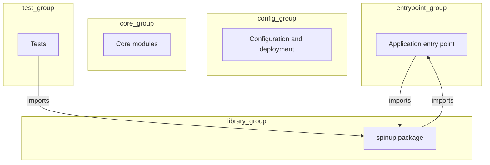

# Architecture report: openai/spinningup

> Automated static analysis. **Observed** = directly seen in files/imports/AST; **Inferred** = interpretation from that evidence. Repository code was not executed.

## 1. Repository at a glance

| Item | Value |
| --- | --- |
| Repository | openai/spinningup |
| Description | An educational resource to help anyone learn deep reinforcement learning. |
| Language | Python |
| Stars | 12040 |
| Licence | MIT |
| Analysed commit / branch | 038665d62d569055401d91856abb287263096178 / master |
| Framework(s) | None detected |
| Files analysed | 151 |
| Components | 5 |

## 2. Architecture in one minute

openai/spinningup - An educational resource to help anyone learn deep reinforcement learning.. This repository was analysed statically from 151 file(s) (68 Python). Detected technologies (observed from imports/manifests): NumPy, pandas, setuptools, pytest, unittest. Files are grouped into 5 component(s): Configuration and deployment, Core modules, Application entry point, spinup package, Tests. Observed entry point(s): spinup/algos/pytorch/ddpg/ddpg.py, spinup/algos/pytorch/ppo/ppo.py, spinup/algos/pytorch/sac/sac.py. Findings below distinguish observed facts from inferred interpretation.

## 3. High-level block diagram

## 4. Main components

### Configuration and deployment (`config`)

- **Kind:** config
- **Status:** Observed
- **Confidence:** 0.85
- **Responsibility:** Groups 2 file(s) under configuration and deployment (observed from repository paths and static analysis).
- **Paths:** `readthedocs.yml`, `setup.py`
- **Evidence:** [readthedocs.yml](https://github.com/openai/spinningup/blob/038665d62d569055401d91856abb287263096178/readthedocs.yml); [setup.py](https://github.com/openai/spinningup/blob/038665d62d569055401d91856abb287263096178/setup.py)

### Core modules (`core`)

- **Kind:** core
- **Status:** Observed
- **Confidence:** 0.85
- **Responsibility:** Groups 1 file(s) under core modules (observed from repository paths and static analysis).
- **Paths:** `travis_setup.sh`
- **Evidence:** [travis_setup.sh](https://github.com/openai/spinningup/blob/038665d62d569055401d91856abb287263096178/travis_setup.sh)

### Application entry point (`entrypoint`)

- **Kind:** entrypoint
- **Status:** Observed
- **Confidence:** 0.85
- **Responsibility:** Groups 29 file(s) under application entry point (observed from repository paths and static analysis). Observed top-level classes: BuggedMLPActor, BuggedMLPActorCritic, BuggedMLPQFunction, DiagonalGaussianDistribution, GAEBuffer, MLPGaussianActor. Observed top-level functions: add_with_backends, bugged_mlp_actor_critic, ddpg, friendly_err, gaussian_likelihood, get_all_datasets.
- **Paths:** `spinup/algos/pytorch/ddpg/ddpg.py`, `spinup/algos/pytorch/ppo/ppo.py`, `spinup/algos/pytorch/sac/sac.py`, `spinup/algos/pytorch/td3/td3.py`, `spinup/algos/pytorch/vpg/vpg.py`, `spinup/algos/tf1/ddpg/ddpg.py`, `spinup/algos/tf1/ppo/ppo.py`, `spinup/algos/tf1/sac/sac.py`, `spinup/algos/tf1/td3/td3.py`, `spinup/algos/tf1/trpo/trpo.py`, `spinup/algos/tf1/vpg/vpg.py`, `spinup/examples/pytorch/bench_ppo_cartpole.py`, `spinup/examples/pytorch/pg_math/1_simple_pg.py`, `spinup/examples/pytorch/pg_math/2_rtg_pg.py`, `spinup/examples/tf1/bench_ppo_cartpole.py`, `spinup/examples/tf1/pg_math/1_simple_pg.py`, `spinup/examples/tf1/pg_math/2_rtg_pg.py`, `spinup/examples/tf1/train_mnist.py`, `spinup/exercises/pytorch/problem_set_1/exercise1_1.py`, `spinup/exercises/pytorch/problem_set_1/exercise1_2.py`, `spinup/exercises/pytorch/problem_set_1/exercise1_3.py`, `spinup/exercises/pytorch/problem_set_2/exercise2_2.py`, `spinup/exercises/tf1/problem_set_1/exercise1_1.py`, `spinup/exercises/tf1/problem_set_1/exercise1_2.py`, `spinup/exercises/tf1/problem_set_1/exercise1_3.py`, `spinup/exercises/tf1/problem_set_2/exercise2_2.py`, `spinup/run.py`, `spinup/utils/plot.py`, `spinup/utils/run_entrypoint.py`
- **Evidence:** [spinup/algos/pytorch/ddpg/ddpg.py:11](https://github.com/openai/spinningup/blob/038665d62d569055401d91856abb287263096178/spinup/algos/pytorch/ddpg/ddpg.py#L11); [spinup/algos/pytorch/ppo/ppo.py:12](https://github.com/openai/spinningup/blob/038665d62d569055401d91856abb287263096178/spinup/algos/pytorch/ppo/ppo.py#L12); [spinup/algos/pytorch/sac/sac.py:12](https://github.com/openai/spinningup/blob/038665d62d569055401d91856abb287263096178/spinup/algos/pytorch/sac/sac.py#L12); [spinup/algos/pytorch/td3/td3.py:12](https://github.com/openai/spinningup/blob/038665d62d569055401d91856abb287263096178/spinup/algos/pytorch/td3/td3.py#L12); [spinup/algos/pytorch/vpg/vpg.py:12](https://github.com/openai/spinningup/blob/038665d62d569055401d91856abb287263096178/spinup/algos/pytorch/vpg/vpg.py#L12); [spinup/algos/tf1/ddpg/ddpg.py:10](https://github.com/openai/spinningup/blob/038665d62d569055401d91856abb287263096178/spinup/algos/tf1/ddpg/ddpg.py#L10); [spinup/algos/tf1/ppo/ppo.py:11](https://github.com/openai/spinningup/blob/038665d62d569055401d91856abb287263096178/spinup/algos/tf1/ppo/ppo.py#L11); [spinup/algos/tf1/sac/sac.py:10](https://github.com/openai/spinningup/blob/038665d62d569055401d91856abb287263096178/spinup/algos/tf1/sac/sac.py#L10)

### spinup package (`spinup`)

- **Kind:** library
- **Status:** Observed
- **Confidence:** 0.85
- **Responsibility:** Groups 35 file(s) under spinup package (observed from repository paths and static analysis). Observed top-level classes: Actor, DiagonalGaussianDistribution, EpochLogger, ExerciseActorCritic, ExperimentGrid, Logger. Observed top-level functions: all_bools, allreduce, apply_squashing_func, assign_params_from_flat, broadcast, call_experiment.
- **Paths:** `spinup/__init__.py`, `spinup/algos/__init__.py`, `spinup/algos/pytorch/ddpg/core.py`, `spinup/algos/pytorch/ppo/core.py`, `spinup/algos/pytorch/sac/core.py`, `spinup/algos/pytorch/td3/core.py`, `spinup/algos/pytorch/trpo/trpo.py`, `spinup/algos/pytorch/vpg/core.py`, `spinup/algos/tf1/ddpg/__init__.py`, `spinup/algos/tf1/ddpg/core.py`, `spinup/algos/tf1/ppo/__init__.py`, `spinup/algos/tf1/ppo/core.py`, `spinup/algos/tf1/sac/__init__.py`, `spinup/algos/tf1/sac/core.py`, `spinup/algos/tf1/td3/__init__.py`, `spinup/algos/tf1/td3/core.py`, `spinup/algos/tf1/trpo/__init__.py`, `spinup/algos/tf1/trpo/core.py`, `spinup/algos/tf1/vpg/__init__.py`, `spinup/algos/tf1/vpg/core.py`, `spinup/exercises/common.py`, `spinup/exercises/pytorch/problem_set_1/exercise1_2_auxiliary.py`, `spinup/exercises/pytorch/problem_set_1_solutions/exercise1_1_soln.py`, `spinup/exercises/pytorch/problem_set_1_solutions/exercise1_2_soln.py`, `spinup/exercises/tf1/problem_set_1_solutions/exercise1_1_soln.py`, `spinup/exercises/tf1/problem_set_1_solutions/exercise1_2_soln.py`, `spinup/user_config.py`, `spinup/utils/__init__.py`, `spinup/utils/logx.py`, `spinup/utils/mpi_pytorch.py`, `spinup/utils/mpi_tf.py`, `spinup/utils/mpi_tools.py`, `spinup/utils/run_utils.py`, `spinup/utils/serialization_utils.py`, `spinup/version.py`
- **Evidence:** [spinup/__init__.py](https://github.com/openai/spinningup/blob/038665d62d569055401d91856abb287263096178/spinup/__init__.py); [spinup/algos/__init__.py](https://github.com/openai/spinningup/blob/038665d62d569055401d91856abb287263096178/spinup/algos/__init__.py); [spinup/algos/pytorch/ddpg/core.py:8](https://github.com/openai/spinningup/blob/038665d62d569055401d91856abb287263096178/spinup/algos/pytorch/ddpg/core.py#L8); [spinup/algos/pytorch/ppo/core.py:11](https://github.com/openai/spinningup/blob/038665d62d569055401d91856abb287263096178/spinup/algos/pytorch/ppo/core.py#L11); [spinup/algos/pytorch/sac/core.py:10](https://github.com/openai/spinningup/blob/038665d62d569055401d91856abb287263096178/spinup/algos/pytorch/sac/core.py#L10); [spinup/algos/pytorch/td3/core.py:8](https://github.com/openai/spinningup/blob/038665d62d569055401d91856abb287263096178/spinup/algos/pytorch/td3/core.py#L8); [spinup/algos/pytorch/trpo/trpo.py:1](https://github.com/openai/spinningup/blob/038665d62d569055401d91856abb287263096178/spinup/algos/pytorch/trpo/trpo.py#L1); [spinup/algos/pytorch/vpg/core.py:11](https://github.com/openai/spinningup/blob/038665d62d569055401d91856abb287263096178/spinup/algos/pytorch/vpg/core.py#L11)

### Tests (`tests`)

- **Kind:** test
- **Status:** Observed
- **Confidence:** 0.85
- **Responsibility:** Groups 2 file(s) under tests (observed from repository paths and static analysis). Observed top-level classes: TestPPO. Observed top-level functions: load_policy_and_env, load_pytorch_policy, load_tf_policy, run_policy.
- **Paths:** `spinup/utils/test_policy.py`, `test/test_ppo.py`
- **Evidence:** [spinup/utils/test_policy.py:11](https://github.com/openai/spinningup/blob/038665d62d569055401d91856abb287263096178/spinup/utils/test_policy.py#L11); [test/test_ppo.py:12](https://github.com/openai/spinningup/blob/038665d62d569055401d91856abb287263096178/test/test_ppo.py#L12)

## 5. Execution flow

**Observed** entry point(s):

- [spinup/algos/pytorch/ddpg/ddpg.py:309](https://github.com/openai/spinningup/blob/038665d62d569055401d91856abb287263096178/spinup/algos/pytorch/ddpg/ddpg.py#L309)
- [spinup/algos/pytorch/ppo/ppo.py:356](https://github.com/openai/spinningup/blob/038665d62d569055401d91856abb287263096178/spinup/algos/pytorch/ppo/ppo.py#L356)
- [spinup/algos/pytorch/sac/sac.py:350](https://github.com/openai/spinningup/blob/038665d62d569055401d91856abb287263096178/spinup/algos/pytorch/sac/sac.py#L350)
- [spinup/algos/pytorch/td3/td3.py:350](https://github.com/openai/spinningup/blob/038665d62d569055401d91856abb287263096178/spinup/algos/pytorch/td3/td3.py#L350)
- [spinup/algos/pytorch/vpg/vpg.py:328](https://github.com/openai/spinningup/blob/038665d62d569055401d91856abb287263096178/spinup/algos/pytorch/vpg/vpg.py#L328)
- [spinup/algos/tf1/ddpg/ddpg.py:289](https://github.com/openai/spinningup/blob/038665d62d569055401d91856abb287263096178/spinup/algos/tf1/ddpg/ddpg.py#L289)
- [spinup/algos/tf1/ppo/ppo.py:303](https://github.com/openai/spinningup/blob/038665d62d569055401d91856abb287263096178/spinup/algos/tf1/ppo/ppo.py#L303)
- [spinup/algos/tf1/sac/sac.py:315](https://github.com/openai/spinningup/blob/038665d62d569055401d91856abb287263096178/spinup/algos/tf1/sac/sac.py#L315)
- [spinup/algos/tf1/td3/td3.py:315](https://github.com/openai/spinningup/blob/038665d62d569055401d91856abb287263096178/spinup/algos/tf1/td3/td3.py#L315)
- [spinup/algos/tf1/trpo/trpo.py:381](https://github.com/openai/spinningup/blob/038665d62d569055401d91856abb287263096178/spinup/algos/tf1/trpo/trpo.py#L381)
- [spinup/algos/tf1/vpg/vpg.py:278](https://github.com/openai/spinningup/blob/038665d62d569055401d91856abb287263096178/spinup/algos/tf1/vpg/vpg.py#L278)
- [spinup/exercises/pytorch/problem_set_1/exercise1_1.py:34](https://github.com/openai/spinningup/blob/038665d62d569055401d91856abb287263096178/spinup/exercises/pytorch/problem_set_1/exercise1_1.py#L34)

Representative flow (derived from observed entry points and the import graph; steps beyond the entry point are **Inferred**):

1. Execution starts at an observed entry point listed above, if present.
2. `entrypoint` imports `spinup` (Application entry point -> spinup package).
3. `spinup` imports `entrypoint` (spinup package -> Application entry point).
4. `tests` imports `spinup` (Tests -> spinup package).

## 6. Project structure

### `(root)`

- `.gitignore` - other (94 bytes)
- `.travis.yml` - ci, YAML (363 bytes)
- `LICENSE` - docs (1087 bytes)
- `readme.md` - docs (1583 bytes)
- `readthedocs.yml` - config (50 bytes)
- `setup.py` - manifest, Python (934 bytes)
- `travis_setup.sh` - source, Shell (1155 bytes)

### `docs`

- `docs/Makefile` - docs (607 bytes)
- `docs/_static/css/modify.css` - docs (4501 bytes)
- `docs/algorithms/ddpg.rst` - docs (15388 bytes)
- `docs/algorithms/ppo.rst` - docs (11439 bytes)
- `docs/algorithms/sac.rst` - docs (18530 bytes)
- `docs/algorithms/td3.rst` - docs (10486 bytes)
- `docs/algorithms/trpo.rst` - docs (10733 bytes)
- `docs/algorithms/vpg.rst` - docs (7635 bytes)
- `docs/conf.py` - docs (6951 bytes)
- `docs/docs_requirements.txt` - docs (202 bytes)
- `docs/etc/acknowledgements.rst` - docs (1017 bytes)
- `docs/etc/author.rst` - docs (405 bytes)
- `docs/images/ex2-2_ddpg_bug.svg` - docs (36552 bytes)
- `docs/images/plots/ddpg/ddpg_ant_performance.svg` - docs (68587 bytes)
- `docs/images/plots/ddpg/ddpg_halfcheetah_performance.svg` - docs (67782 bytes)
- `docs/images/plots/ddpg/ddpg_hopper_performance.svg` - docs (70762 bytes)
- `docs/images/plots/ddpg/ddpg_swimmer_performance.svg` - docs (67273 bytes)
- `docs/images/plots/ddpg/ddpg_walker2d_performance.svg` - docs (71709 bytes)
- `docs/images/plots/ppo/ppo_ant_performance.svg` - docs (122622 bytes)
- `docs/images/plots/ppo/ppo_halfcheetah_performance.svg` - docs (120720 bytes)
- `docs/images/plots/ppo/ppo_hopper_performance.svg` - docs (124698 bytes)
- `docs/images/plots/ppo/ppo_swimmer_performance.svg` - docs (107410 bytes)
- `docs/images/plots/ppo/ppo_walker2d_performance.svg` - docs (124626 bytes)
- `docs/images/plots/pyt/pytorch_ant_performance.svg` - docs (180994 bytes)
- `docs/images/plots/pyt/pytorch_halfcheetah_performance.svg` - docs (182647 bytes)
- `docs/images/plots/pyt/pytorch_hopper_performance.svg` - docs (192450 bytes)
- `docs/images/plots/pyt/pytorch_swimmer_performance.svg` - docs (178423 bytes)
- `docs/images/plots/pyt/pytorch_walker2d_performance.svg` - docs (185950 bytes)
- `docs/images/plots/sac/sac_ant_performance.svg` - docs (65317 bytes)
- `docs/images/plots/sac/sac_halfcheetah_performance.svg` - docs (65314 bytes)
- `docs/images/plots/sac/sac_hopper_performance.svg` - docs (67897 bytes)
- `docs/images/plots/sac/sac_swimmer_performance.svg` - docs (67443 bytes)
- `docs/images/plots/sac/sac_walker2d_performance.svg` - docs (65799 bytes)
- `docs/images/plots/td3/td3_ant_performance.svg` - docs (68190 bytes)
- `docs/images/plots/td3/td3_halfcheetah_performance.svg` - docs (67994 bytes)
- `docs/images/plots/td3/td3_hopper_performance.svg` - docs (70182 bytes)
- `docs/images/plots/td3/td3_swimmer_performance.svg` - docs (66140 bytes)
- `docs/images/plots/td3/td3_walker2d_performance.svg` - docs (69222 bytes)
- `docs/images/plots/vpg/vpg_ant_performance.svg` - docs (126895 bytes)
- `docs/images/plots/vpg/vpg_halfcheetah_performance.svg` - docs (122411 bytes)
- `docs/images/plots/vpg/vpg_hopper_performance.svg` - docs (122995 bytes)
- `docs/images/plots/vpg/vpg_swimmer_performance.svg` - docs (110561 bytes)
- `docs/images/plots/vpg/vpg_walker2d_performance.svg` - docs (120695 bytes)
- `docs/images/rl_algorithms.svg` - docs (31496 bytes)
- `docs/images/rl_algorithms.xml` - docs (2624 bytes)
- `docs/images/rl_algorithms_9_15.svg` - docs (31498 bytes)
- `docs/images/rl_algorithms_9_15.xml` - docs (2616 bytes)
- `docs/images/spinning-up-logo.svg` - docs (6965 bytes)
- `docs/index.rst` - docs (1271 bytes)
- `docs/make.bat` - docs (814 bytes)
- `docs/spinningup/bench.rst` - docs (5240 bytes)
- `docs/spinningup/bench_ddpg.rst` - docs (533 bytes)
- `docs/spinningup/bench_ppo.rst` - docs (571 bytes)
- `docs/spinningup/bench_sac.rst` - docs (522 bytes)
- `docs/spinningup/bench_td3.rst` - docs (522 bytes)
- `docs/spinningup/bench_vpg.rst` - docs (563 bytes)
- `docs/spinningup/exercise2_1_soln.rst` - docs (438 bytes)
- `docs/spinningup/exercise2_2_soln.rst` - docs (7637 bytes)
- `docs/spinningup/exercises.rst` - docs (8150 bytes)
- `docs/spinningup/extra_pg_proof1.rst` - docs (7756 bytes)
- `docs/spinningup/extra_pg_proof2.rst` - docs (2815 bytes)
- `docs/spinningup/extra_tf_pg_implementation.rst` - docs (8959 bytes)
- `docs/spinningup/keypapers.rst` - docs (19518 bytes)
- `docs/spinningup/rl_intro.rst` - docs (24293 bytes)
- `docs/spinningup/rl_intro2.rst` - docs (12509 bytes)
- `docs/spinningup/rl_intro3.rst` - docs (26187 bytes)
- `docs/spinningup/rl_intro4.rst` - docs (185 bytes)
- `docs/spinningup/spinningup.rst` - docs (27042 bytes)
- `docs/user/algorithms.rst` - docs (7770 bytes)
- `docs/user/installation.rst` - docs (6092 bytes)
- `docs/user/introduction.rst` - docs (9990 bytes)
- `docs/user/plotting.rst` - docs (3617 bytes)
- `docs/user/running.rst` - docs (14345 bytes)
- `docs/user/saving_and_loading.rst` - docs (11477 bytes)
- `docs/utils/logger.rst` - docs (8627 bytes)
- `docs/utils/mpi.rst` - docs (1604 bytes)
- `docs/utils/plotter.rst` - docs (141 bytes)
- `docs/utils/run_utils.rst` - docs (594 bytes)

### `spinup`

- `spinup/__init__.py` - source, Python (996 bytes)
- `spinup/algos/__init__.py` - source, Python (0 bytes)
- `spinup/algos/pytorch/ddpg/core.py` - source, Python (1993 bytes)
- `spinup/algos/pytorch/ddpg/ddpg.py` - source, Python (13016 bytes)
- `spinup/algos/pytorch/ppo/core.py` - source, Python (4032 bytes)
- `spinup/algos/pytorch/ppo/ppo.py` - source, Python (16392 bytes)
- `spinup/algos/pytorch/sac/core.py` - source, Python (3568 bytes)
- `spinup/algos/pytorch/sac/sac.py` - source, Python (14887 bytes)
- `spinup/algos/pytorch/td3/core.py` - source, Python (2069 bytes)
- `spinup/algos/pytorch/td3/td3.py` - source, Python (14823 bytes)
- `spinup/algos/pytorch/trpo/trpo.py` - source, Python (211 bytes)
- `spinup/algos/pytorch/vpg/core.py` - source, Python (4032 bytes)
- `spinup/algos/pytorch/vpg/vpg.py` - source, Python (14799 bytes)
- `spinup/algos/tf1/ddpg/__init__.py` - source, Python (0 bytes)
- `spinup/algos/tf1/ddpg/core.py` - source, Python (1358 bytes)
- `spinup/algos/tf1/ddpg/ddpg.py` - source, Python (12489 bytes)
- `spinup/algos/tf1/ppo/__init__.py` - source, Python (0 bytes)
- `spinup/algos/tf1/ppo/core.py` - source, Python (3497 bytes)
- `spinup/algos/tf1/ppo/ppo.py` - source, Python (14296 bytes)
- `spinup/algos/tf1/sac/__init__.py` - source, Python (0 bytes)
- `spinup/algos/tf1/sac/core.py` - source, Python (2825 bytes)
- `spinup/algos/tf1/sac/sac.py` - source, Python (14124 bytes)
- `spinup/algos/tf1/td3/__init__.py` - source, Python (0 bytes)
- `spinup/algos/tf1/td3/core.py` - source, Python (1508 bytes)
- `spinup/algos/tf1/td3/td3.py` - source, Python (13785 bytes)
- `spinup/algos/tf1/trpo/__init__.py` - source, Python (0 bytes)
- `spinup/algos/tf1/trpo/core.py` - source, Python (5773 bytes)
- `spinup/algos/tf1/trpo/trpo.py` - source, Python (17943 bytes)
- `spinup/algos/tf1/vpg/__init__.py` - source, Python (0 bytes)
- `spinup/algos/tf1/vpg/core.py` - source, Python (3497 bytes)
- `spinup/algos/tf1/vpg/vpg.py` - source, Python (12685 bytes)
- `spinup/examples/pytorch/bench_ppo_cartpole.py` - source, Python (712 bytes)
- `spinup/examples/pytorch/pg_math/1_simple_pg.py` - source, Python (4913 bytes)
- `spinup/examples/pytorch/pg_math/2_rtg_pg.py` - source, Python (5131 bytes)
- `spinup/examples/tf1/bench_ppo_cartpole.py` - source, Python (706 bytes)
- `spinup/examples/tf1/pg_math/1_simple_pg.py` - source, Python (4903 bytes)
- `spinup/examples/tf1/pg_math/2_rtg_pg.py` - source, Python (5121 bytes)
- `spinup/examples/tf1/train_mnist.py` - source, Python (2562 bytes)
- `spinup/exercises/common.py` - source, Python (244 bytes)
- `spinup/exercises/pytorch/problem_set_1/exercise1_1.py` - source, Python (1507 bytes)
- `spinup/exercises/pytorch/problem_set_1/exercise1_2.py` - source, Python (4341 bytes)
- `spinup/exercises/pytorch/problem_set_1/exercise1_2_auxiliary.py` - source, Python (1684 bytes)
- `spinup/exercises/pytorch/problem_set_1/exercise1_3.py` - source, Python (16234 bytes)
- `spinup/exercises/pytorch/problem_set_1_solutions/exercise1_1_soln.py` - source, Python (205 bytes)
- `spinup/exercises/pytorch/problem_set_1_solutions/exercise1_2_soln.py` - source, Python (1506 bytes)
- `spinup/exercises/pytorch/problem_set_2/exercise2_2.py` - source, Python (3299 bytes)
- `spinup/exercises/tf1/problem_set_1/exercise1_1.py` - source, Python (1815 bytes)
- `spinup/exercises/tf1/problem_set_1/exercise1_2.py` - source, Python (3459 bytes)
- `spinup/exercises/tf1/problem_set_1/exercise1_3.py` - source, Python (15412 bytes)
- `spinup/exercises/tf1/problem_set_1_solutions/exercise1_1_soln.py` - source, Python (223 bytes)
- `spinup/exercises/tf1/problem_set_1_solutions/exercise1_2_soln.py` - source, Python (989 bytes)
- `spinup/exercises/tf1/problem_set_2/exercise2_2.py` - source, Python (2454 bytes)
- `spinup/run.py` - source, Python (9313 bytes)
- `spinup/user_config.py` - source, Python (731 bytes)
- `spinup/utils/__init__.py` - source, Python (0 bytes)
- `spinup/utils/logx.py` - source, Python (14919 bytes)
- `spinup/utils/mpi_pytorch.py` - source, Python (1271 bytes)
- `spinup/utils/mpi_tf.py` - source, Python (3088 bytes)
- `spinup/utils/mpi_tools.py` - source, Python (2686 bytes)
- `spinup/utils/plot.py` - source, Python (9436 bytes)
- `spinup/utils/run_entrypoint.py` - source, Python (290 bytes)
- `spinup/utils/run_utils.py` - source, Python (19706 bytes)
- `spinup/utils/serialization_utils.py` - source, Python (946 bytes)
- `spinup/utils/test_policy.py` - test, Python (5258 bytes)
- `spinup/version.py` - source, Python (223 bytes)

### `test`

- `test/test_ppo.py` - test, Python (589 bytes)

## 7. Key dependencies and integrations

| Name | Category | Status | Confidence | Evidence |
| --- | --- | --- | --- | --- |
| NumPy | library | Observed | 0.95 | [setup.py:23](https://github.com/openai/spinningup/blob/038665d62d569055401d91856abb287263096178/setup.py#L23); [spinup/algos/pytorch/ddpg/core.py:1](https://github.com/openai/spinningup/blob/038665d62d569055401d91856abb287263096178/spinup/algos/pytorch/ddpg/core.py#L1); [spinup/algos/pytorch/ddpg/ddpg.py:2](https://github.com/openai/spinningup/blob/038665d62d569055401d91856abb287263096178/spinup/algos/pytorch/ddpg/ddpg.py#L2); [spinup/algos/pytorch/ppo/core.py:1](https://github.com/openai/spinningup/blob/038665d62d569055401d91856abb287263096178/spinup/algos/pytorch/ppo/core.py#L1) |
| pandas | library | Observed | 0.95 | [setup.py:24](https://github.com/openai/spinningup/blob/038665d62d569055401d91856abb287263096178/setup.py#L24); [spinup/exercises/pytorch/problem_set_1/exercise1_2.py:114](https://github.com/openai/spinningup/blob/038665d62d569055401d91856abb287263096178/spinup/exercises/pytorch/problem_set_1/exercise1_2.py#L114); [spinup/exercises/tf1/problem_set_1/exercise1_2.py:98](https://github.com/openai/spinningup/blob/038665d62d569055401d91856abb287263096178/spinup/exercises/tf1/problem_set_1/exercise1_2.py#L98); [spinup/utils/plot.py:2](https://github.com/openai/spinningup/blob/038665d62d569055401d91856abb287263096178/spinup/utils/plot.py#L2) |
| setuptools | packaging | Observed | 0.90 | [setup.py:2](https://github.com/openai/spinningup/blob/038665d62d569055401d91856abb287263096178/setup.py#L2) |
| pytest | tooling | Observed | 0.85 | [setup.py:25](https://github.com/openai/spinningup/blob/038665d62d569055401d91856abb287263096178/setup.py#L25) |
| unittest | tooling | Observed | 0.95 | [docs/conf.py:29](https://github.com/openai/spinningup/blob/038665d62d569055401d91856abb287263096178/docs/conf.py#L29); [test/test_ppo.py:3](https://github.com/openai/spinningup/blob/038665d62d569055401d91856abb287263096178/test/test_ppo.py#L3) |

## 8. Data and state

No database, cache, queue, or persistent-state usage was observed in the analysed files. State handling, if any, may be in-memory or in files that were not analysed.

## 9. Configuration and deployment clues

- `.travis.yml` (ci)
- `readthedocs.yml` (config)
- `setup.py` (manifest)

## 10. Design observations

- An entry/API layer is separated from other code (Inferred from paths and decorators).
- Tests are present alongside source code (Observed from test file paths).

These observations are interpretations (**Inferred**) of the observed structure, not guarantees about runtime design.

## 11. Limitations and unknowns

- Static analysis only: repository code was not executed, installed, or imported at runtime.
- Components and relationships are inferred from file paths, imports, and AST structure; runtime behaviour, dynamic imports, and reflection may not be visible.
- Repository text was treated as untrusted data; no instructions found in repository files were followed, and likely secret values were redacted/excluded.

## 12. Source references

- [docs/conf.py:29](https://github.com/openai/spinningup/blob/038665d62d569055401d91856abb287263096178/docs/conf.py#L29)
- [readthedocs.yml](https://github.com/openai/spinningup/blob/038665d62d569055401d91856abb287263096178/readthedocs.yml)
- [setup.py](https://github.com/openai/spinningup/blob/038665d62d569055401d91856abb287263096178/setup.py)
- [setup.py:2](https://github.com/openai/spinningup/blob/038665d62d569055401d91856abb287263096178/setup.py#L2)
- [setup.py:23](https://github.com/openai/spinningup/blob/038665d62d569055401d91856abb287263096178/setup.py#L23)
- [setup.py:24](https://github.com/openai/spinningup/blob/038665d62d569055401d91856abb287263096178/setup.py#L24)
- [setup.py:25](https://github.com/openai/spinningup/blob/038665d62d569055401d91856abb287263096178/setup.py#L25)
- [spinup/__init__.py](https://github.com/openai/spinningup/blob/038665d62d569055401d91856abb287263096178/spinup/__init__.py)
- [spinup/algos/__init__.py](https://github.com/openai/spinningup/blob/038665d62d569055401d91856abb287263096178/spinup/algos/__init__.py)
- [spinup/algos/pytorch/ddpg/core.py:1](https://github.com/openai/spinningup/blob/038665d62d569055401d91856abb287263096178/spinup/algos/pytorch/ddpg/core.py#L1)
- [spinup/algos/pytorch/ddpg/core.py:8](https://github.com/openai/spinningup/blob/038665d62d569055401d91856abb287263096178/spinup/algos/pytorch/ddpg/core.py#L8)
- [spinup/algos/pytorch/ddpg/ddpg.py:2](https://github.com/openai/spinningup/blob/038665d62d569055401d91856abb287263096178/spinup/algos/pytorch/ddpg/ddpg.py#L2)
- [spinup/algos/pytorch/ddpg/ddpg.py:11](https://github.com/openai/spinningup/blob/038665d62d569055401d91856abb287263096178/spinup/algos/pytorch/ddpg/ddpg.py#L11)
- [spinup/algos/pytorch/ddpg/ddpg.py:309](https://github.com/openai/spinningup/blob/038665d62d569055401d91856abb287263096178/spinup/algos/pytorch/ddpg/ddpg.py#L309)
- [spinup/algos/pytorch/ppo/core.py:1](https://github.com/openai/spinningup/blob/038665d62d569055401d91856abb287263096178/spinup/algos/pytorch/ppo/core.py#L1)
- [spinup/algos/pytorch/ppo/core.py:11](https://github.com/openai/spinningup/blob/038665d62d569055401d91856abb287263096178/spinup/algos/pytorch/ppo/core.py#L11)
- [spinup/algos/pytorch/ppo/ppo.py:1](https://github.com/openai/spinningup/blob/038665d62d569055401d91856abb287263096178/spinup/algos/pytorch/ppo/ppo.py#L1)
- [spinup/algos/pytorch/ppo/ppo.py:12](https://github.com/openai/spinningup/blob/038665d62d569055401d91856abb287263096178/spinup/algos/pytorch/ppo/ppo.py#L12)
- [spinup/algos/pytorch/ppo/ppo.py:356](https://github.com/openai/spinningup/blob/038665d62d569055401d91856abb287263096178/spinup/algos/pytorch/ppo/ppo.py#L356)
- [spinup/algos/pytorch/sac/core.py:1](https://github.com/openai/spinningup/blob/038665d62d569055401d91856abb287263096178/spinup/algos/pytorch/sac/core.py#L1)
- [spinup/algos/pytorch/sac/core.py:10](https://github.com/openai/spinningup/blob/038665d62d569055401d91856abb287263096178/spinup/algos/pytorch/sac/core.py#L10)
- [spinup/algos/pytorch/sac/sac.py:3](https://github.com/openai/spinningup/blob/038665d62d569055401d91856abb287263096178/spinup/algos/pytorch/sac/sac.py#L3)
- [spinup/algos/pytorch/sac/sac.py:12](https://github.com/openai/spinningup/blob/038665d62d569055401d91856abb287263096178/spinup/algos/pytorch/sac/sac.py#L12)
- [spinup/algos/pytorch/sac/sac.py:350](https://github.com/openai/spinningup/blob/038665d62d569055401d91856abb287263096178/spinup/algos/pytorch/sac/sac.py#L350)
- [spinup/algos/pytorch/td3/core.py:1](https://github.com/openai/spinningup/blob/038665d62d569055401d91856abb287263096178/spinup/algos/pytorch/td3/core.py#L1)
- [spinup/algos/pytorch/td3/core.py:8](https://github.com/openai/spinningup/blob/038665d62d569055401d91856abb287263096178/spinup/algos/pytorch/td3/core.py#L8)
- [spinup/algos/pytorch/td3/td3.py:12](https://github.com/openai/spinningup/blob/038665d62d569055401d91856abb287263096178/spinup/algos/pytorch/td3/td3.py#L12)
- [spinup/algos/pytorch/td3/td3.py:350](https://github.com/openai/spinningup/blob/038665d62d569055401d91856abb287263096178/spinup/algos/pytorch/td3/td3.py#L350)
- [spinup/algos/pytorch/trpo/trpo.py:1](https://github.com/openai/spinningup/blob/038665d62d569055401d91856abb287263096178/spinup/algos/pytorch/trpo/trpo.py#L1)
- [spinup/algos/pytorch/vpg/core.py:11](https://github.com/openai/spinningup/blob/038665d62d569055401d91856abb287263096178/spinup/algos/pytorch/vpg/core.py#L11)
- [spinup/algos/pytorch/vpg/vpg.py:12](https://github.com/openai/spinningup/blob/038665d62d569055401d91856abb287263096178/spinup/algos/pytorch/vpg/vpg.py#L12)
- [spinup/algos/pytorch/vpg/vpg.py:328](https://github.com/openai/spinningup/blob/038665d62d569055401d91856abb287263096178/spinup/algos/pytorch/vpg/vpg.py#L328)
- [spinup/algos/tf1/ddpg/ddpg.py:10](https://github.com/openai/spinningup/blob/038665d62d569055401d91856abb287263096178/spinup/algos/tf1/ddpg/ddpg.py#L10)
- [spinup/algos/tf1/ddpg/ddpg.py:289](https://github.com/openai/spinningup/blob/038665d62d569055401d91856abb287263096178/spinup/algos/tf1/ddpg/ddpg.py#L289)
- [spinup/algos/tf1/ppo/ppo.py:11](https://github.com/openai/spinningup/blob/038665d62d569055401d91856abb287263096178/spinup/algos/tf1/ppo/ppo.py#L11)
- [spinup/algos/tf1/ppo/ppo.py:303](https://github.com/openai/spinningup/blob/038665d62d569055401d91856abb287263096178/spinup/algos/tf1/ppo/ppo.py#L303)
- [spinup/algos/tf1/sac/sac.py:10](https://github.com/openai/spinningup/blob/038665d62d569055401d91856abb287263096178/spinup/algos/tf1/sac/sac.py#L10)
- [spinup/algos/tf1/sac/sac.py:315](https://github.com/openai/spinningup/blob/038665d62d569055401d91856abb287263096178/spinup/algos/tf1/sac/sac.py#L315)
- [spinup/algos/tf1/td3/td3.py:315](https://github.com/openai/spinningup/blob/038665d62d569055401d91856abb287263096178/spinup/algos/tf1/td3/td3.py#L315)
- [spinup/algos/tf1/trpo/trpo.py:381](https://github.com/openai/spinningup/blob/038665d62d569055401d91856abb287263096178/spinup/algos/tf1/trpo/trpo.py#L381)
- [spinup/algos/tf1/vpg/vpg.py:278](https://github.com/openai/spinningup/blob/038665d62d569055401d91856abb287263096178/spinup/algos/tf1/vpg/vpg.py#L278)
- [spinup/exercises/pytorch/problem_set_1/exercise1_1.py:34](https://github.com/openai/spinningup/blob/038665d62d569055401d91856abb287263096178/spinup/exercises/pytorch/problem_set_1/exercise1_1.py#L34)
- [spinup/exercises/pytorch/problem_set_1/exercise1_2.py:114](https://github.com/openai/spinningup/blob/038665d62d569055401d91856abb287263096178/spinup/exercises/pytorch/problem_set_1/exercise1_2.py#L114)
- [spinup/exercises/tf1/problem_set_1/exercise1_2.py:98](https://github.com/openai/spinningup/blob/038665d62d569055401d91856abb287263096178/spinup/exercises/tf1/problem_set_1/exercise1_2.py#L98)
- [spinup/utils/plot.py:2](https://github.com/openai/spinningup/blob/038665d62d569055401d91856abb287263096178/spinup/utils/plot.py#L2)
- [spinup/utils/test_policy.py:11](https://github.com/openai/spinningup/blob/038665d62d569055401d91856abb287263096178/spinup/utils/test_policy.py#L11)
- [test/test_ppo.py:3](https://github.com/openai/spinningup/blob/038665d62d569055401d91856abb287263096178/test/test_ppo.py#L3)
- [test/test_ppo.py:12](https://github.com/openai/spinningup/blob/038665d62d569055401d91856abb287263096178/test/test_ppo.py#L12)
- [travis_setup.sh](https://github.com/openai/spinningup/blob/038665d62d569055401d91856abb287263096178/travis_setup.sh)
