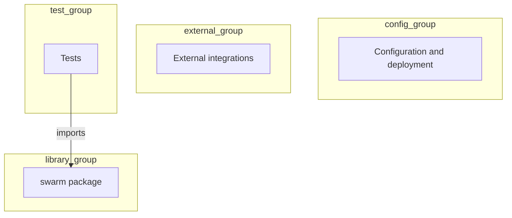

# Architecture report: openai/swarm

> Automated static analysis. **Observed** = directly seen in files/imports/AST; **Inferred** = interpretation from that evidence. Repository code was not executed.

## 1. Repository at a glance

| Item | Value |
| --- | --- |
| Repository | openai/swarm |
| Description | Educational framework exploring ergonomic, lightweight multi-agent orchestration. Managed by OpenAI Solution team. |
| Language | Python |
| Stars | 22138 |
| Licence | MIT |
| Analysed commit / branch | 6af0b4caf37dca4526dfd98e9fbd8ce36e7eeb22 / main |
| Framework(s) | None detected |
| Files analysed | 285 |
| Components | 4 |

## 2. Architecture in one minute

openai/swarm - Educational framework exploring ergonomic, lightweight multi-agent orchestration. Managed by OpenAI Solution team.. This repository was analysed statically from 285 file(s) (62 Python). Detected technologies (observed from imports/manifests): SQLite, NumPy, pandas, Pydantic, requests, Poetry. Files are grouped into 4 component(s): Configuration and deployment, External integrations, swarm package, Tests. Findings below distinguish observed facts from inferred interpretation.

## 3. High-level block diagram

## 4. Main components

### Configuration and deployment (`config`)

- **Kind:** config
- **Status:** Observed
- **Confidence:** 0.85
- **Responsibility:** Groups 33 file(s) under configuration and deployment (observed from repository paths and static analysis).
- **Paths:** `logs/session_20240402-112114.json`, `logs/session_20240402-112443.json`, `logs/session_20240402-112456.json`, `logs/session_20240402-112501.json`, `logs/session_20240402-113222.json`, `logs/session_20240402-113415.json`, `logs/session_20240425-135655.json`, `logs/session_20240425-135657.json`, `logs/session_20240425-135728.json`, `logs/session_20240425-140427.json`, `logs/session_20240425-140502.json`, `logs/session_20240425-140516.json`, `logs/session_20240425-140553.json`, `logs/session_20240425-141416.json`, `logs/session_20240425-141509.json`, `logs/session_20240425-141709.json`, `logs/session_20240425-145129.json`, `logs/session_20240425-145324.json`, `logs/session_20240425-145907.json`, `logs/session_20240425-145930.json`, `logs/session_20240425-150004.json`, `logs/session_20240425-150040.json`, `logs/session_20240425-155814.json`, `logs/session_20240425-172809.json`, `logs/session_20240425-211732.json`, `logs/session_20240425-211813.json`, `logs/session_20240425-211942.json`, `logs/session_20240425-212341.json`, `logs/session_20240425-212431.json`, `logs/session_20240425-212748.json`, `logs/session_20240425-213023.json`, `pyproject.toml`, `setup.cfg`
- **Evidence:** [logs/session_20240402-112114.json](https://github.com/openai/swarm/blob/6af0b4caf37dca4526dfd98e9fbd8ce36e7eeb22/logs/session_20240402-112114.json); [logs/session_20240402-112443.json](https://github.com/openai/swarm/blob/6af0b4caf37dca4526dfd98e9fbd8ce36e7eeb22/logs/session_20240402-112443.json); [logs/session_20240402-112456.json](https://github.com/openai/swarm/blob/6af0b4caf37dca4526dfd98e9fbd8ce36e7eeb22/logs/session_20240402-112456.json); [logs/session_20240402-112501.json](https://github.com/openai/swarm/blob/6af0b4caf37dca4526dfd98e9fbd8ce36e7eeb22/logs/session_20240402-112501.json); [logs/session_20240402-113222.json](https://github.com/openai/swarm/blob/6af0b4caf37dca4526dfd98e9fbd8ce36e7eeb22/logs/session_20240402-113222.json); [logs/session_20240402-113415.json](https://github.com/openai/swarm/blob/6af0b4caf37dca4526dfd98e9fbd8ce36e7eeb22/logs/session_20240402-113415.json); [logs/session_20240425-135655.json](https://github.com/openai/swarm/blob/6af0b4caf37dca4526dfd98e9fbd8ce36e7eeb22/logs/session_20240425-135655.json); [logs/session_20240425-135657.json](https://github.com/openai/swarm/blob/6af0b4caf37dca4526dfd98e9fbd8ce36e7eeb22/logs/session_20240425-135657.json)

### External integrations (`external_integrations`)

- **Kind:** external
- **Status:** Inferred
- **Confidence:** 0.70
- **Responsibility:** Groups 0 file(s) under external integrations (observed from repository paths and static analysis).
- **Evidence:** [examples/personal_shopper/database.py:1](https://github.com/openai/swarm/blob/6af0b4caf37dca4526dfd98e9fbd8ce36e7eeb22/examples/personal_shopper/database.py#L1)

### swarm package (`swarm`)

- **Kind:** library
- **Status:** Observed
- **Confidence:** 0.85
- **Responsibility:** Groups 6 file(s) under swarm package (observed from repository paths and static analysis). Observed top-level classes: Agent, Response, Result, Swarm. Observed top-level functions: debug_print, function_to_json, merge_chunk, merge_fields, pretty_print_messages, process_and_print_streaming_response.
- **Paths:** `swarm/__init__.py`, `swarm/core.py`, `swarm/repl/__init__.py`, `swarm/repl/repl.py`, `swarm/types.py`, `swarm/util.py`
- **Evidence:** [swarm/__init__.py](https://github.com/openai/swarm/blob/6af0b4caf37dca4526dfd98e9fbd8ce36e7eeb22/swarm/__init__.py); [swarm/core.py:26](https://github.com/openai/swarm/blob/6af0b4caf37dca4526dfd98e9fbd8ce36e7eeb22/swarm/core.py#L26); [swarm/repl/__init__.py](https://github.com/openai/swarm/blob/6af0b4caf37dca4526dfd98e9fbd8ce36e7eeb22/swarm/repl/__init__.py); [swarm/repl/repl.py:6](https://github.com/openai/swarm/blob/6af0b4caf37dca4526dfd98e9fbd8ce36e7eeb22/swarm/repl/repl.py#L6); [swarm/types.py:14](https://github.com/openai/swarm/blob/6af0b4caf37dca4526dfd98e9fbd8ce36e7eeb22/swarm/types.py#L14); [swarm/util.py:5](https://github.com/openai/swarm/blob/6af0b4caf37dca4526dfd98e9fbd8ce36e7eeb22/swarm/util.py#L5)

### Tests (`tests`)

- **Kind:** test
- **Status:** Observed
- **Confidence:** 0.85
- **Responsibility:** Groups 7 file(s) under tests (observed from repository paths and static analysis). Observed top-level classes: MockOpenAIClient. Observed top-level functions: create_mock_response, mock_openai_client, test_basic_function, test_complex_function, test_execute_tools_false, test_handoff.
- **Paths:** `examples/customer_service_streaming/tests/test_prompts.jsonl`, `examples/customer_service_streaming/tests/test_runs/.gitkeep`, `tests/__init__.py`, `tests/mock_client.py`, `tests/test_core.py`, `tests/test_runs/test_20240402-113647.json`, `tests/test_util.py`
- **Evidence:** [examples/customer_service_streaming/tests/test_prompts.jsonl](https://github.com/openai/swarm/blob/6af0b4caf37dca4526dfd98e9fbd8ce36e7eeb22/examples/customer_service_streaming/tests/test_prompts.jsonl); [examples/customer_service_streaming/tests/test_runs/.gitkeep](https://github.com/openai/swarm/blob/6af0b4caf37dca4526dfd98e9fbd8ce36e7eeb22/examples/customer_service_streaming/tests/test_runs/.gitkeep); [tests/__init__.py](https://github.com/openai/swarm/blob/6af0b4caf37dca4526dfd98e9fbd8ce36e7eeb22/tests/__init__.py); [tests/mock_client.py:8](https://github.com/openai/swarm/blob/6af0b4caf37dca4526dfd98e9fbd8ce36e7eeb22/tests/mock_client.py#L8); [tests/test_core.py:11](https://github.com/openai/swarm/blob/6af0b4caf37dca4526dfd98e9fbd8ce36e7eeb22/tests/test_core.py#L11); [tests/test_runs/test_20240402-113647.json](https://github.com/openai/swarm/blob/6af0b4caf37dca4526dfd98e9fbd8ce36e7eeb22/tests/test_runs/test_20240402-113647.json); [tests/test_util.py:4](https://github.com/openai/swarm/blob/6af0b4caf37dca4526dfd98e9fbd8ce36e7eeb22/tests/test_util.py#L4)

## 5. Execution flow

No entry point was observed; the startup flow below is therefore limited.

Representative flow (derived from observed entry points and the import graph; steps beyond the entry point are **Inferred**):

1. Execution starts at an observed entry point listed above, if present.
2. `tests` imports `swarm` (Tests -> swarm package).

## 6. Project structure

### `(root)`

- `.gitignore` - other (1476 bytes)
- `.pre-commit-config.yaml` - config (206 bytes)
- `LICENSE` - docs (1063 bytes)
- `README.md` - docs (16860 bytes)
- `SECURITY.md` - docs (415 bytes)
- `pyproject.toml` - manifest (80 bytes)
- `setup.cfg` - manifest (549 bytes)

### `examples`

- `examples/__init__.py` - source, Python (0 bytes)
- `examples/airline/README.md` - docs (1889 bytes)
- `examples/airline/__init__.py` - source, Python (0 bytes)
- `examples/airline/configs/__init__.py` - source, Python (0 bytes)
- `examples/airline/configs/agents.py` - source, Python (3305 bytes)
- `examples/airline/configs/tools.py` - source, Python (586 bytes)
- `examples/airline/data/routines/baggage/policies.py` - source, Python (1709 bytes)
- `examples/airline/data/routines/flight_modification/policies.py` - source, Python (2802 bytes)
- `examples/airline/data/routines/prompts.py` - source, Python (1775 bytes)
- `examples/airline/evals/eval_cases/flight_modification_cases.json` - config (519 bytes)
- `examples/airline/evals/eval_cases/triage_cases.json` - config (653 bytes)
- `examples/airline/evals/eval_results/flight_modification_evals.json` - config (13720 bytes)
- `examples/airline/evals/eval_results/triage_evals.json` - config (17946 bytes)
- `examples/airline/evals/eval_utils.py` - source, Python (3633 bytes)
- `examples/airline/evals/function_evals.py` - source, Python (859 bytes)
- `examples/airline/main.py` - source, Python (699 bytes)
- `examples/basic/README.md` - docs (1392 bytes)
- `examples/basic/agent_handoff.py` - source, Python (585 bytes)
- `examples/basic/bare_minimum.py` - source, Python (274 bytes)
- `examples/basic/context_variables.py` - source, Python (966 bytes)
- `examples/basic/function_calling.py` - source, Python (400 bytes)
- `examples/basic/simple_loop_no_helpers.py` - source, Python (611 bytes)
- `examples/customer_service/logs/session_20240422-134602.json` - config (1554 bytes)
- `examples/customer_service/logs/session_20240422-135231.json` - config (1959 bytes)
- `examples/customer_service/logs/session_20240422-135321.json` - config (2128 bytes)
- `examples/customer_service/logs/session_20240422-140035.json` - config (558 bytes)
- `examples/customer_service/logs/session_20240422-141344.json` - config (558 bytes)
- `examples/customer_service_lite/logs/session_20240425-175026.json` - config (1374 bytes)
- `examples/customer_service_lite/logs/session_20240425-175112.json` - config (1749 bytes)
- `examples/customer_service_lite/logs/session_20240425-175154.json` - config (1624 bytes)
- `examples/customer_service_lite/logs/session_20240425-175210.json` - config (1936 bytes)
- `examples/customer_service_streaming/.gitignore` - other (116 bytes)
- `examples/customer_service_streaming/configs/__init__.py` - source, Python (0 bytes)
- `examples/customer_service_streaming/configs/assistants/user_interface/assistant.json` - config (400 bytes)
- `examples/customer_service_streaming/configs/general.py` - source, Python (438 bytes)
- `examples/customer_service_streaming/configs/prompts.py` - source, Python (8271 bytes)
- `examples/customer_service_streaming/configs/swarm_tasks.json` - config (390 bytes)
- `examples/customer_service_streaming/configs/tools/query_docs/handler.py` - source, Python (1646 bytes)
- `examples/customer_service_streaming/configs/tools/query_docs/tool.json` - config (475 bytes)
- `examples/customer_service_streaming/configs/tools/send_email/handler.py` - source, Python (269 bytes)
- `examples/customer_service_streaming/configs/tools/send_email/tool.json` - config (628 bytes)
- `examples/customer_service_streaming/configs/tools/submit_ticket/handler.py` - source, Python (191 bytes)
- `examples/customer_service_streaming/configs/tools/submit_ticket/tool.json` - config (460 bytes)
- `examples/customer_service_streaming/data/article_6233728.json` - config (7781 bytes)
- `examples/customer_service_streaming/data/article_6272941.json` - config (8059 bytes)
- `examples/customer_service_streaming/data/article_6272952.json` - config (4744 bytes)
- `examples/customer_service_streaming/data/article_6283125.json` - config (2967 bytes)
- `examples/customer_service_streaming/data/article_6338764.json` - config (2279 bytes)
- `examples/customer_service_streaming/data/article_6338765.json` - config (823 bytes)
- `examples/customer_service_streaming/data/article_6378378.json` - config (683 bytes)
- `examples/customer_service_streaming/data/article_6378407.json` - config (8296 bytes)
- `examples/customer_service_streaming/data/article_6399305.json` - config (1975 bytes)
- `examples/customer_service_streaming/data/article_6402865.json` - config (306 bytes)
- `examples/customer_service_streaming/data/article_6425277.json` - config (509 bytes)
- `examples/customer_service_streaming/data/article_6431339.json` - config (298 bytes)
- `examples/customer_service_streaming/data/article_6431922.json` - config (438 bytes)
- `examples/customer_service_streaming/data/article_6468065.json` - config (2410 bytes)
- `examples/customer_service_streaming/data/article_6485334.json` - config (3269 bytes)
- `examples/customer_service_streaming/data/article_6503842.json` - config (835 bytes)
- `examples/customer_service_streaming/data/article_6516417.json` - config (4380 bytes)
- `examples/customer_service_streaming/data/article_6582257.json` - config (891 bytes)
- `examples/customer_service_streaming/data/article_6582391.json` - config (1109 bytes)
- `examples/customer_service_streaming/data/article_6584194.json` - config (673 bytes)
- `examples/customer_service_streaming/data/article_6584249.json` - config (508 bytes)
- `examples/customer_service_streaming/data/article_6613520.json` - config (6372 bytes)
- `examples/customer_service_streaming/data/article_6613605.json` - config (714 bytes)
- `examples/customer_service_streaming/data/article_6613629.json` - config (2363 bytes)
- `examples/customer_service_streaming/data/article_6613657.json` - config (856 bytes)
- `examples/customer_service_streaming/data/article_6614161.json` - config (581 bytes)
- `examples/customer_service_streaming/data/article_6614209.json` - config (1348 bytes)
- `examples/customer_service_streaming/data/article_6614457.json` - config (1454 bytes)
- `examples/customer_service_streaming/data/article_6639781.json` - config (896 bytes)
- `examples/customer_service_streaming/data/article_6640792.json` - config (562 bytes)
- `examples/customer_service_streaming/data/article_6640864.json` - config (990 bytes)
- `examples/customer_service_streaming/data/article_6640875.json` - config (1164 bytes)
- `examples/customer_service_streaming/data/article_6641048.json` - config (987 bytes)
- `examples/customer_service_streaming/data/article_6643004.json` - config (1286 bytes)
- `examples/customer_service_streaming/data/article_6643036.json` - config (619 bytes)
- `examples/customer_service_streaming/data/article_6643167.json` - config (1296 bytes)
- `examples/customer_service_streaming/data/article_6643200.json` - config (1427 bytes)
- `examples/customer_service_streaming/data/article_6643435.json` - config (983 bytes)
- `examples/customer_service_streaming/data/article_6653653.json` - config (686 bytes)
- `examples/customer_service_streaming/data/article_6654000.json` - config (9214 bytes)
- `examples/customer_service_streaming/data/article_6654303.json` - config (2408 bytes)
- `examples/customer_service_streaming/data/article_6681258.json` - config (3579 bytes)
- `examples/customer_service_streaming/data/article_6684216.json` - config (2277 bytes)
- `examples/customer_service_streaming/data/article_6696591.json` - config (665 bytes)
- `examples/customer_service_streaming/data/article_6705023.json` - config (4154 bytes)
- `examples/customer_service_streaming/data/article_6742369.json` - config (997 bytes)
- `examples/customer_service_streaming/data/article_6781152.json` - config (866 bytes)
- `examples/customer_service_streaming/data/article_6781222.json` - config (805 bytes)
- `examples/customer_service_streaming/data/article_6781228.json` - config (790 bytes)
- `examples/customer_service_streaming/data/article_6783457.json` - config (4907 bytes)
- `examples/customer_service_streaming/data/article_6811186.json` - config (4676 bytes)
- `examples/customer_service_streaming/data/article_6824809.json` - config (2439 bytes)
- `examples/customer_service_streaming/data/article_6825453.json` - config (21537 bytes)
- `examples/customer_service_streaming/data/article_6837156.json` - config (272 bytes)
- `examples/customer_service_streaming/data/article_6843909.json` - config (697 bytes)
- `examples/customer_service_streaming/data/article_6843914.json` - config (287 bytes)
- `examples/customer_service_streaming/data/article_6882433.json` - config (2351 bytes)
- `examples/customer_service_streaming/data/article_6891753.json` - config (2254 bytes)
- `examples/customer_service_streaming/data/article_6891767.json` - config (1101 bytes)
- `examples/customer_service_streaming/data/article_6891781.json` - config (1277 bytes)
- `examples/customer_service_streaming/data/article_6891827.json` - config (917 bytes)
- `examples/customer_service_streaming/data/article_6891829.json` - config (1850 bytes)
- `examples/customer_service_streaming/data/article_6891831.json` - config (1416 bytes)
- `examples/customer_service_streaming/data/article_6891834.json` - config (1337 bytes)
- `examples/customer_service_streaming/data/article_6891839.json` - config (2751 bytes)
- `examples/customer_service_streaming/data/article_6897179.json` - config (1384 bytes)
- `examples/customer_service_streaming/data/article_6897186.json` - config (1394 bytes)
- `examples/customer_service_streaming/data/article_6897191.json` - config (1558 bytes)
- `examples/customer_service_streaming/data/article_6897194.json` - config (1692 bytes)
- `examples/customer_service_streaming/data/article_6897198.json` - config (760 bytes)
- `examples/customer_service_streaming/data/article_6897199.json` - config (804 bytes)
- `examples/customer_service_streaming/data/article_6897202.json` - config (1079 bytes)
- `examples/customer_service_streaming/data/article_6897204.json` - config (1413 bytes)
- `examples/customer_service_streaming/data/article_6897213.json` - config (4033 bytes)
- `examples/customer_service_streaming/data/article_6901266.json` - config (450 bytes)
- `examples/customer_service_streaming/data/article_6950777.json` - config (4082 bytes)
- `examples/customer_service_streaming/docker-compose.yaml` - container (142 bytes)
- `examples/customer_service_streaming/logs/.gitkeep` - other (0 bytes)
- `examples/customer_service_streaming/main.py` - source, Python (2597 bytes)
- `examples/customer_service_streaming/prep_data.py` - source, Python (1569 bytes)
- `examples/customer_service_streaming/src/__init__.py` - source, Python (0 bytes)
- `examples/customer_service_streaming/src/arg_parser.py` - source, Python (907 bytes)
- `examples/customer_service_streaming/src/evals/eval_function.py` - source, Python (2254 bytes)
- `examples/customer_service_streaming/src/runs/run.py` - source, Python (1471 bytes)
- `examples/customer_service_streaming/src/swarm/assistants.py` - source, Python (3353 bytes)
- `examples/customer_service_streaming/src/swarm/conversation.py` - source, Python (849 bytes)
- `examples/customer_service_streaming/src/swarm/engines/assistants_engine.py` - source, Python (15333 bytes)
- `examples/customer_service_streaming/src/swarm/engines/engine.py` - source, Python (91 bytes)
- `examples/customer_service_streaming/src/swarm/engines/local_engine.py` - source, Python (19899 bytes)
- `examples/customer_service_streaming/src/swarm/swarm.py` - source, Python (1858 bytes)
- `examples/customer_service_streaming/src/swarm/tool.py` - source, Python (642 bytes)
- `examples/customer_service_streaming/src/tasks/task.py` - source, Python (750 bytes)
- `examples/customer_service_streaming/src/utils.py` - source, Python (1484 bytes)
- `examples/customer_service_streaming/src/validator.py` - source, Python (3205 bytes)
- `examples/customer_service_streaming/tests/test_prompts.jsonl` - test (603 bytes)
- `examples/customer_service_streaming/tests/test_runs/.gitkeep` - test (0 bytes)
- `examples/personal_shopper/README.md` - docs (870 bytes)
- `examples/personal_shopper/__init__.py` - source, Python (0 bytes)
- `examples/personal_shopper/database.py` - source, Python (4463 bytes)
- `examples/personal_shopper/main.py` - source, Python (4927 bytes)
- `examples/support_bot/Makefile` - other (112 bytes)
- `examples/support_bot/README.md` - docs (908 bytes)
- `examples/support_bot/__init__.py` - source, Python (0 bytes)
- `examples/support_bot/customer_service.py` - source, Python (2714 bytes)
- `examples/support_bot/data/article_6233728.json` - config (7781 bytes)
- `examples/support_bot/data/article_6272941.json` - config (8059 bytes)
- `examples/support_bot/data/article_6272952.json` - config (4744 bytes)
- `examples/support_bot/data/article_6283125.json` - config (2967 bytes)
- `examples/support_bot/data/article_6338764.json` - config (2279 bytes)
- `examples/support_bot/data/article_6338765.json` - config (823 bytes)
- `examples/support_bot/data/article_6378378.json` - config (683 bytes)
- `examples/support_bot/data/article_6378407.json` - config (8296 bytes)
- `examples/support_bot/data/article_6399305.json` - config (1975 bytes)
- `examples/support_bot/data/article_6402865.json` - config (306 bytes)
- `examples/support_bot/data/article_6425277.json` - config (509 bytes)
- `examples/support_bot/data/article_6431339.json` - config (298 bytes)
- `examples/support_bot/data/article_6431922.json` - config (438 bytes)
- `examples/support_bot/data/article_6468065.json` - config (2410 bytes)
- `examples/support_bot/data/article_6485334.json` - config (3269 bytes)
- `examples/support_bot/data/article_6503842.json` - config (835 bytes)
- `examples/support_bot/data/article_6516417.json` - config (4380 bytes)
- `examples/support_bot/data/article_6582257.json` - config (891 bytes)
- `examples/support_bot/data/article_6582391.json` - config (1109 bytes)
- `examples/support_bot/data/article_6584194.json` - config (673 bytes)
- `examples/support_bot/data/article_6584249.json` - config (508 bytes)
- `examples/support_bot/data/article_6613520.json` - config (6372 bytes)
- `examples/support_bot/data/article_6613605.json` - config (714 bytes)
- `examples/support_bot/data/article_6613629.json` - config (2363 bytes)
- `examples/support_bot/data/article_6613657.json` - config (856 bytes)
- `examples/support_bot/data/article_6614161.json` - config (581 bytes)
- `examples/support_bot/data/article_6614209.json` - config (1348 bytes)
- `examples/support_bot/data/article_6614457.json` - config (1454 bytes)
- `examples/support_bot/data/article_6639781.json` - config (896 bytes)
- `examples/support_bot/data/article_6640792.json` - config (562 bytes)
- `examples/support_bot/data/article_6640864.json` - config (990 bytes)
- `examples/support_bot/data/article_6640875.json` - config (1164 bytes)
- `examples/support_bot/data/article_6641048.json` - config (987 bytes)
- `examples/support_bot/data/article_6643004.json` - config (1286 bytes)
- `examples/support_bot/data/article_6643036.json` - config (619 bytes)
- `examples/support_bot/data/article_6643167.json` - config (1296 bytes)
- `examples/support_bot/data/article_6643200.json` - config (1427 bytes)
- `examples/support_bot/data/article_6643435.json` - config (983 bytes)
- `examples/support_bot/data/article_6653653.json` - config (686 bytes)
- `examples/support_bot/data/article_6654000.json` - config (9214 bytes)
- `examples/support_bot/data/article_6654303.json` - config (2408 bytes)
- `examples/support_bot/data/article_6681258.json` - config (3579 bytes)
- `examples/support_bot/data/article_6684216.json` - config (2277 bytes)
- `examples/support_bot/data/article_6696591.json` - config (665 bytes)
- `examples/support_bot/data/article_6705023.json` - config (4154 bytes)
- `examples/support_bot/data/article_6742369.json` - config (997 bytes)
- `examples/support_bot/data/article_6781152.json` - config (866 bytes)
- `examples/support_bot/data/article_6781222.json` - config (805 bytes)
- `examples/support_bot/data/article_6781228.json` - config (790 bytes)
- `examples/support_bot/data/article_6783457.json` - config (4907 bytes)
- `examples/support_bot/data/article_6811186.json` - config (4663 bytes)
- `examples/support_bot/data/article_6824809.json` - config (2439 bytes)
- `examples/support_bot/data/article_6825453.json` - config (21540 bytes)
- `examples/support_bot/data/article_6837156.json` - config (272 bytes)
- `examples/support_bot/data/article_6843909.json` - config (697 bytes)
- `examples/support_bot/data/article_6843914.json` - config (287 bytes)
- `examples/support_bot/data/article_6882433.json` - config (2351 bytes)
- `examples/support_bot/data/article_6891753.json` - config (2254 bytes)
- `examples/support_bot/data/article_6891767.json` - config (1101 bytes)
- `examples/support_bot/data/article_6891781.json` - config (1277 bytes)
- `examples/support_bot/data/article_6891827.json` - config (917 bytes)
- `examples/support_bot/data/article_6891829.json` - config (1850 bytes)
- `examples/support_bot/data/article_6891831.json` - config (1416 bytes)
- `examples/support_bot/data/article_6891834.json` - config (1337 bytes)
- `examples/support_bot/data/article_6891839.json` - config (2751 bytes)
- `examples/support_bot/data/article_6897179.json` - config (1384 bytes)
- `examples/support_bot/data/article_6897186.json` - config (1394 bytes)
- `examples/support_bot/data/article_6897191.json` - config (1558 bytes)
- `examples/support_bot/data/article_6897194.json` - config (1692 bytes)
- `examples/support_bot/data/article_6897198.json` - config (760 bytes)
- `examples/support_bot/data/article_6897199.json` - config (804 bytes)
- `examples/support_bot/data/article_6897202.json` - config (1079 bytes)
- `examples/support_bot/data/article_6897204.json` - config (1413 bytes)
- `examples/support_bot/data/article_6897213.json` - config (4033 bytes)
- `examples/support_bot/data/article_6901266.json` - config (450 bytes)
- `examples/support_bot/data/article_6950777.json` - config (4082 bytes)
- `examples/support_bot/docker-compose.yaml` - container (122 bytes)
- `examples/support_bot/main.py` - source, Python (2745 bytes)
- `examples/support_bot/prep_data.py` - source, Python (1779 bytes)
- `examples/support_bot/requirements.txt` - manifest (13 bytes)
- `examples/triage_agent/README.md` - docs (742 bytes)
- `examples/triage_agent/agents.py` - source, Python (1465 bytes)
- `examples/triage_agent/evals.py` - source, Python (2599 bytes)
- `examples/triage_agent/evals_util.py` - source, Python (588 bytes)
- `examples/triage_agent/run.py` - source, Python (129 bytes)
- `examples/weather_agent/README.md` - docs (752 bytes)
- `examples/weather_agent/agents.py` - source, Python (561 bytes)
- `examples/weather_agent/evals.py` - source, Python (1041 bytes)
- `examples/weather_agent/run.py` - source, Python (144 bytes)

### `logs`

- `logs/session_20240402-112114.json` - config (288 bytes)
- `logs/session_20240402-112443.json` - config (222 bytes)
- `logs/session_20240402-112456.json` - config (222 bytes)
- `logs/session_20240402-112501.json` - config (222 bytes)
- `logs/session_20240402-113222.json` - config (264 bytes)
- `logs/session_20240402-113415.json` - config (462 bytes)
- `logs/session_20240425-135655.json` - config (222 bytes)
- `logs/session_20240425-135657.json` - config (222 bytes)
- `logs/session_20240425-135728.json` - config (222 bytes)
- `logs/session_20240425-140427.json` - config (296 bytes)
- `logs/session_20240425-140502.json` - config (222 bytes)
- `logs/session_20240425-140516.json` - config (222 bytes)
- `logs/session_20240425-140553.json` - config (309 bytes)
- `logs/session_20240425-141416.json` - config (306 bytes)
- `logs/session_20240425-141509.json` - config (222 bytes)
- `logs/session_20240425-141709.json` - config (222 bytes)
- `logs/session_20240425-145129.json` - config (222 bytes)
- `logs/session_20240425-145324.json` - config (222 bytes)
- `logs/session_20240425-145907.json` - config (222 bytes)
- `logs/session_20240425-145930.json` - config (222 bytes)
- `logs/session_20240425-150004.json` - config (279 bytes)
- `logs/session_20240425-150040.json` - config (286 bytes)
- `logs/session_20240425-155814.json` - config (314 bytes)
- `logs/session_20240425-172809.json` - config (314 bytes)
- `logs/session_20240425-211732.json` - config (222 bytes)
- `logs/session_20240425-211813.json` - config (296 bytes)
- `logs/session_20240425-211942.json` - config (222 bytes)
- `logs/session_20240425-212341.json` - config (222 bytes)
- `logs/session_20240425-212431.json` - config (222 bytes)
- `logs/session_20240425-212748.json` - config (222 bytes)
- `logs/session_20240425-213023.json` - config (222 bytes)

### `swarm`

- `swarm/__init__.py` - source, Python (101 bytes)
- `swarm/core.py` - source, Python (10219 bytes)
- `swarm/repl/__init__.py` - source, Python (32 bytes)
- `swarm/repl/repl.py` - source, Python (2609 bytes)
- `swarm/types.py` - source, Python (1102 bytes)
- `swarm/util.py` - source, Python (2469 bytes)

### `tests`

- `tests/__init__.py` - test, Python (0 bytes)
- `tests/mock_client.py` - test, Python (2912 bytes)
- `tests/test_core.py` - test, Python (4782 bytes)
- `tests/test_runs/test_20240402-113647.json` - test (260 bytes)
- `tests/test_util.py` - test, Python (1519 bytes)

## 7. Key dependencies and integrations

| Name | Category | Status | Confidence | Evidence |
| --- | --- | --- | --- | --- |
| SQLite | database | Observed | 0.90 | [examples/personal_shopper/database.py:1](https://github.com/openai/swarm/blob/6af0b4caf37dca4526dfd98e9fbd8ce36e7eeb22/examples/personal_shopper/database.py#L1) |
| NumPy | library | Observed | 0.85 | [setup.cfg:15](https://github.com/openai/swarm/blob/6af0b4caf37dca4526dfd98e9fbd8ce36e7eeb22/setup.cfg#L15) |
| pandas | library | Observed | 0.95 | [examples/customer_service_streaming/prep_data.py:39](https://github.com/openai/swarm/blob/6af0b4caf37dca4526dfd98e9fbd8ce36e7eeb22/examples/customer_service_streaming/prep_data.py#L39); [examples/support_bot/prep_data.py:4](https://github.com/openai/swarm/blob/6af0b4caf37dca4526dfd98e9fbd8ce36e7eeb22/examples/support_bot/prep_data.py#L4) |
| Pydantic | library | Observed | 0.95 | [examples/customer_service_streaming/src/swarm/assistants.py:1](https://github.com/openai/swarm/blob/6af0b4caf37dca4526dfd98e9fbd8ce36e7eeb22/examples/customer_service_streaming/src/swarm/assistants.py#L1); [examples/customer_service_streaming/src/swarm/tool.py:1](https://github.com/openai/swarm/blob/6af0b4caf37dca4526dfd98e9fbd8ce36e7eeb22/examples/customer_service_streaming/src/swarm/tool.py#L1); [examples/triage_agent/evals_util.py:3](https://github.com/openai/swarm/blob/6af0b4caf37dca4526dfd98e9fbd8ce36e7eeb22/examples/triage_agent/evals_util.py#L3); [swarm/types.py:9](https://github.com/openai/swarm/blob/6af0b4caf37dca4526dfd98e9fbd8ce36e7eeb22/swarm/types.py#L9) |
| requests | library | Observed | 0.85 | [setup.cfg:18](https://github.com/openai/swarm/blob/6af0b4caf37dca4526dfd98e9fbd8ce36e7eeb22/setup.cfg#L18) |
| Poetry | packaging | Observed | 0.85 | [pyproject.toml](https://github.com/openai/swarm/blob/6af0b4caf37dca4526dfd98e9fbd8ce36e7eeb22/pyproject.toml) |
| setuptools | packaging | Observed | 0.85 | [pyproject.toml:2](https://github.com/openai/swarm/blob/6af0b4caf37dca4526dfd98e9fbd8ce36e7eeb22/pyproject.toml#L2) |
| Docker Compose | tooling | Observed | 0.90 | [examples/customer_service_streaming/docker-compose.yaml](https://github.com/openai/swarm/blob/6af0b4caf37dca4526dfd98e9fbd8ce36e7eeb22/examples/customer_service_streaming/docker-compose.yaml); [examples/support_bot/docker-compose.yaml](https://github.com/openai/swarm/blob/6af0b4caf37dca4526dfd98e9fbd8ce36e7eeb22/examples/support_bot/docker-compose.yaml) |
| pytest | tooling | Observed | 0.95 | [examples/triage_agent/evals.py:4](https://github.com/openai/swarm/blob/6af0b4caf37dca4526dfd98e9fbd8ce36e7eeb22/examples/triage_agent/evals.py#L4); [examples/weather_agent/evals.py:3](https://github.com/openai/swarm/blob/6af0b4caf37dca4526dfd98e9fbd8ce36e7eeb22/examples/weather_agent/evals.py#L3); [setup.cfg:17](https://github.com/openai/swarm/blob/6af0b4caf37dca4526dfd98e9fbd8ce36e7eeb22/setup.cfg#L17); [tests/test_core.py:1](https://github.com/openai/swarm/blob/6af0b4caf37dca4526dfd98e9fbd8ce36e7eeb22/tests/test_core.py#L1) |
| unittest | tooling | Observed | 0.95 | [tests/mock_client.py:1](https://github.com/openai/swarm/blob/6af0b4caf37dca4526dfd98e9fbd8ce36e7eeb22/tests/mock_client.py#L1); [tests/test_core.py:4](https://github.com/openai/swarm/blob/6af0b4caf37dca4526dfd98e9fbd8ce36e7eeb22/tests/test_core.py#L4) |

## 8. Data and state

- **SQLite** (Observed, confidence 0.90) - evidence: [examples/personal_shopper/database.py:1](https://github.com/openai/swarm/blob/6af0b4caf37dca4526dfd98e9fbd8ce36e7eeb22/examples/personal_shopper/database.py#L1)

## 9. Configuration and deployment clues

- `.pre-commit-config.yaml` (config)
- `examples/airline/evals/eval_cases/flight_modification_cases.json` (config)
- `examples/airline/evals/eval_cases/triage_cases.json` (config)
- `examples/airline/evals/eval_results/flight_modification_evals.json` (config)
- `examples/airline/evals/eval_results/triage_evals.json` (config)
- `examples/customer_service/logs/session_20240422-134602.json` (config)
- `examples/customer_service/logs/session_20240422-135231.json` (config)
- `examples/customer_service/logs/session_20240422-135321.json` (config)
- `examples/customer_service/logs/session_20240422-140035.json` (config)
- `examples/customer_service/logs/session_20240422-141344.json` (config)
- `examples/customer_service_lite/logs/session_20240425-175026.json` (config)
- `examples/customer_service_lite/logs/session_20240425-175112.json` (config)
- `examples/customer_service_lite/logs/session_20240425-175154.json` (config)
- `examples/customer_service_lite/logs/session_20240425-175210.json` (config)
- `examples/customer_service_streaming/configs/assistants/user_interface/assistant.json` (config)
- `examples/customer_service_streaming/configs/swarm_tasks.json` (config)
- `examples/customer_service_streaming/configs/tools/query_docs/tool.json` (config)
- `examples/customer_service_streaming/configs/tools/send_email/tool.json` (config)
- `examples/customer_service_streaming/configs/tools/submit_ticket/tool.json` (config)
- `examples/customer_service_streaming/data/article_6233728.json` (config)
- `examples/customer_service_streaming/data/article_6272941.json` (config)
- `examples/customer_service_streaming/data/article_6272952.json` (config)
- `examples/customer_service_streaming/data/article_6283125.json` (config)
- `examples/customer_service_streaming/data/article_6338764.json` (config)
- `examples/customer_service_streaming/data/article_6338765.json` (config)
- `examples/customer_service_streaming/data/article_6378378.json` (config)
- `examples/customer_service_streaming/data/article_6378407.json` (config)
- `examples/customer_service_streaming/data/article_6399305.json` (config)
- `examples/customer_service_streaming/data/article_6402865.json` (config)
- `examples/customer_service_streaming/data/article_6425277.json` (config)
- `examples/customer_service_streaming/data/article_6431339.json` (config)
- `examples/customer_service_streaming/data/article_6431922.json` (config)
- `examples/customer_service_streaming/data/article_6468065.json` (config)
- `examples/customer_service_streaming/data/article_6485334.json` (config)
- `examples/customer_service_streaming/data/article_6503842.json` (config)
- `examples/customer_service_streaming/data/article_6516417.json` (config)
- `examples/customer_service_streaming/data/article_6582257.json` (config)
- `examples/customer_service_streaming/data/article_6582391.json` (config)
- `examples/customer_service_streaming/data/article_6584194.json` (config)
- `examples/customer_service_streaming/data/article_6584249.json` (config)
- `examples/customer_service_streaming/data/article_6613520.json` (config)
- `examples/customer_service_streaming/data/article_6613605.json` (config)
- `examples/customer_service_streaming/data/article_6613629.json` (config)
- `examples/customer_service_streaming/data/article_6613657.json` (config)
- `examples/customer_service_streaming/data/article_6614161.json` (config)
- `examples/customer_service_streaming/data/article_6614209.json` (config)
- `examples/customer_service_streaming/data/article_6614457.json` (config)
- `examples/customer_service_streaming/data/article_6639781.json` (config)
- `examples/customer_service_streaming/data/article_6640792.json` (config)
- `examples/customer_service_streaming/data/article_6640864.json` (config)
- `examples/customer_service_streaming/data/article_6640875.json` (config)
- `examples/customer_service_streaming/data/article_6641048.json` (config)
- `examples/customer_service_streaming/data/article_6643004.json` (config)
- `examples/customer_service_streaming/data/article_6643036.json` (config)
- `examples/customer_service_streaming/data/article_6643167.json` (config)
- `examples/customer_service_streaming/data/article_6643200.json` (config)
- `examples/customer_service_streaming/data/article_6643435.json` (config)
- `examples/customer_service_streaming/data/article_6653653.json` (config)
- `examples/customer_service_streaming/data/article_6654000.json` (config)
- `examples/customer_service_streaming/data/article_6654303.json` (config)
- `examples/customer_service_streaming/data/article_6681258.json` (config)
- `examples/customer_service_streaming/data/article_6684216.json` (config)
- `examples/customer_service_streaming/data/article_6696591.json` (config)
- `examples/customer_service_streaming/data/article_6705023.json` (config)
- `examples/customer_service_streaming/data/article_6742369.json` (config)
- `examples/customer_service_streaming/data/article_6781152.json` (config)
- `examples/customer_service_streaming/data/article_6781222.json` (config)
- `examples/customer_service_streaming/data/article_6781228.json` (config)
- `examples/customer_service_streaming/data/article_6783457.json` (config)
- `examples/customer_service_streaming/data/article_6811186.json` (config)
- `examples/customer_service_streaming/data/article_6824809.json` (config)
- `examples/customer_service_streaming/data/article_6825453.json` (config)
- `examples/customer_service_streaming/data/article_6837156.json` (config)
- `examples/customer_service_streaming/data/article_6843909.json` (config)
- `examples/customer_service_streaming/data/article_6843914.json` (config)
- `examples/customer_service_streaming/data/article_6882433.json` (config)
- `examples/customer_service_streaming/data/article_6891753.json` (config)
- `examples/customer_service_streaming/data/article_6891767.json` (config)
- `examples/customer_service_streaming/data/article_6891781.json` (config)
- `examples/customer_service_streaming/data/article_6891827.json` (config)
- `examples/customer_service_streaming/data/article_6891829.json` (config)
- `examples/customer_service_streaming/data/article_6891831.json` (config)
- `examples/customer_service_streaming/data/article_6891834.json` (config)
- `examples/customer_service_streaming/data/article_6891839.json` (config)
- `examples/customer_service_streaming/data/article_6897179.json` (config)
- `examples/customer_service_streaming/data/article_6897186.json` (config)
- `examples/customer_service_streaming/data/article_6897191.json` (config)
- `examples/customer_service_streaming/data/article_6897194.json` (config)
- `examples/customer_service_streaming/data/article_6897198.json` (config)
- `examples/customer_service_streaming/data/article_6897199.json` (config)
- `examples/customer_service_streaming/data/article_6897202.json` (config)
- `examples/customer_service_streaming/data/article_6897204.json` (config)
- `examples/customer_service_streaming/data/article_6897213.json` (config)
- `examples/customer_service_streaming/data/article_6901266.json` (config)
- `examples/customer_service_streaming/data/article_6950777.json` (config)
- `examples/customer_service_streaming/docker-compose.yaml` (container)
- `examples/support_bot/data/article_6233728.json` (config)
- `examples/support_bot/data/article_6272941.json` (config)
- `examples/support_bot/data/article_6272952.json` (config)
- `examples/support_bot/data/article_6283125.json` (config)
- `examples/support_bot/data/article_6338764.json` (config)
- `examples/support_bot/data/article_6338765.json` (config)
- `examples/support_bot/data/article_6378378.json` (config)
- `examples/support_bot/data/article_6378407.json` (config)
- `examples/support_bot/data/article_6399305.json` (config)
- `examples/support_bot/data/article_6402865.json` (config)
- `examples/support_bot/data/article_6425277.json` (config)
- `examples/support_bot/data/article_6431339.json` (config)
- `examples/support_bot/data/article_6431922.json` (config)
- `examples/support_bot/data/article_6468065.json` (config)
- `examples/support_bot/data/article_6485334.json` (config)
- `examples/support_bot/data/article_6503842.json` (config)
- `examples/support_bot/data/article_6516417.json` (config)
- `examples/support_bot/data/article_6582257.json` (config)
- `examples/support_bot/data/article_6582391.json` (config)
- `examples/support_bot/data/article_6584194.json` (config)
- `examples/support_bot/data/article_6584249.json` (config)
- `examples/support_bot/data/article_6613520.json` (config)
- `examples/support_bot/data/article_6613605.json` (config)
- `examples/support_bot/data/article_6613629.json` (config)
- `examples/support_bot/data/article_6613657.json` (config)
- `examples/support_bot/data/article_6614161.json` (config)
- `examples/support_bot/data/article_6614209.json` (config)
- `examples/support_bot/data/article_6614457.json` (config)
- `examples/support_bot/data/article_6639781.json` (config)
- `examples/support_bot/data/article_6640792.json` (config)
- `examples/support_bot/data/article_6640864.json` (config)
- `examples/support_bot/data/article_6640875.json` (config)
- `examples/support_bot/data/article_6641048.json` (config)
- `examples/support_bot/data/article_6643004.json` (config)
- `examples/support_bot/data/article_6643036.json` (config)
- `examples/support_bot/data/article_6643167.json` (config)
- `examples/support_bot/data/article_6643200.json` (config)
- `examples/support_bot/data/article_6643435.json` (config)
- `examples/support_bot/data/article_6653653.json` (config)
- `examples/support_bot/data/article_6654000.json` (config)
- `examples/support_bot/data/article_6654303.json` (config)
- `examples/support_bot/data/article_6681258.json` (config)
- `examples/support_bot/data/article_6684216.json` (config)
- `examples/support_bot/data/article_6696591.json` (config)
- `examples/support_bot/data/article_6705023.json` (config)
- `examples/support_bot/data/article_6742369.json` (config)
- `examples/support_bot/data/article_6781152.json` (config)
- `examples/support_bot/data/article_6781222.json` (config)
- `examples/support_bot/data/article_6781228.json` (config)
- `examples/support_bot/data/article_6783457.json` (config)
- `examples/support_bot/data/article_6811186.json` (config)
- `examples/support_bot/data/article_6824809.json` (config)
- `examples/support_bot/data/article_6825453.json` (config)
- `examples/support_bot/data/article_6837156.json` (config)
- `examples/support_bot/data/article_6843909.json` (config)
- `examples/support_bot/data/article_6843914.json` (config)
- `examples/support_bot/data/article_6882433.json` (config)
- `examples/support_bot/data/article_6891753.json` (config)
- `examples/support_bot/data/article_6891767.json` (config)
- `examples/support_bot/data/article_6891781.json` (config)
- `examples/support_bot/data/article_6891827.json` (config)
- `examples/support_bot/data/article_6891829.json` (config)
- `examples/support_bot/data/article_6891831.json` (config)
- `examples/support_bot/data/article_6891834.json` (config)
- `examples/support_bot/data/article_6891839.json` (config)
- `examples/support_bot/data/article_6897179.json` (config)
- `examples/support_bot/data/article_6897186.json` (config)
- `examples/support_bot/data/article_6897191.json` (config)
- `examples/support_bot/data/article_6897194.json` (config)
- `examples/support_bot/data/article_6897198.json` (config)
- `examples/support_bot/data/article_6897199.json` (config)
- `examples/support_bot/data/article_6897202.json` (config)
- `examples/support_bot/data/article_6897204.json` (config)
- `examples/support_bot/data/article_6897213.json` (config)
- `examples/support_bot/data/article_6901266.json` (config)
- `examples/support_bot/data/article_6950777.json` (config)
- `examples/support_bot/docker-compose.yaml` (container)
- `examples/support_bot/requirements.txt` (manifest)
- `logs/session_20240402-112114.json` (config)
- `logs/session_20240402-112443.json` (config)
- `logs/session_20240402-112456.json` (config)
- `logs/session_20240402-112501.json` (config)
- `logs/session_20240402-113222.json` (config)
- `logs/session_20240402-113415.json` (config)
- `logs/session_20240425-135655.json` (config)
- `logs/session_20240425-135657.json` (config)
- `logs/session_20240425-135728.json` (config)
- `logs/session_20240425-140427.json` (config)
- `logs/session_20240425-140502.json` (config)
- `logs/session_20240425-140516.json` (config)
- `logs/session_20240425-140553.json` (config)
- `logs/session_20240425-141416.json` (config)
- `logs/session_20240425-141509.json` (config)
- `logs/session_20240425-141709.json` (config)
- `logs/session_20240425-145129.json` (config)
- `logs/session_20240425-145324.json` (config)
- `logs/session_20240425-145907.json` (config)
- `logs/session_20240425-145930.json` (config)
- `logs/session_20240425-150004.json` (config)
- `logs/session_20240425-150040.json` (config)
- `logs/session_20240425-155814.json` (config)
- `logs/session_20240425-172809.json` (config)
- `logs/session_20240425-211732.json` (config)
- `logs/session_20240425-211813.json` (config)
- `logs/session_20240425-211942.json` (config)
- `logs/session_20240425-212341.json` (config)
- `logs/session_20240425-212431.json` (config)
- `logs/session_20240425-212748.json` (config)
- `logs/session_20240425-213023.json` (config)
- `pyproject.toml` (manifest)
- `setup.cfg` (manifest)

## 10. Design observations

- Tests are present alongside source code (Observed from test file paths).
- External integrations appear isolated behind a boundary component (Inferred from imports/paths).

These observations are interpretations (**Inferred**) of the observed structure, not guarantees about runtime design.

## 11. Limitations and unknowns

- Static analysis only: repository code was not executed, installed, or imported at runtime.
- Components and relationships are inferred from file paths, imports, and AST structure; runtime behaviour, dynamic imports, and reflection may not be visible.
- No clear application entry point was observed in the analysed files.
- Repository text was treated as untrusted data; no instructions found in repository files were followed, and likely secret values were redacted/excluded.

## 12. Source references

- [examples/customer_service_streaming/docker-compose.yaml](https://github.com/openai/swarm/blob/6af0b4caf37dca4526dfd98e9fbd8ce36e7eeb22/examples/customer_service_streaming/docker-compose.yaml)
- [examples/customer_service_streaming/prep_data.py:39](https://github.com/openai/swarm/blob/6af0b4caf37dca4526dfd98e9fbd8ce36e7eeb22/examples/customer_service_streaming/prep_data.py#L39)
- [examples/customer_service_streaming/src/swarm/assistants.py:1](https://github.com/openai/swarm/blob/6af0b4caf37dca4526dfd98e9fbd8ce36e7eeb22/examples/customer_service_streaming/src/swarm/assistants.py#L1)
- [examples/customer_service_streaming/src/swarm/tool.py:1](https://github.com/openai/swarm/blob/6af0b4caf37dca4526dfd98e9fbd8ce36e7eeb22/examples/customer_service_streaming/src/swarm/tool.py#L1)
- [examples/customer_service_streaming/tests/test_prompts.jsonl](https://github.com/openai/swarm/blob/6af0b4caf37dca4526dfd98e9fbd8ce36e7eeb22/examples/customer_service_streaming/tests/test_prompts.jsonl)
- [examples/customer_service_streaming/tests/test_runs/.gitkeep](https://github.com/openai/swarm/blob/6af0b4caf37dca4526dfd98e9fbd8ce36e7eeb22/examples/customer_service_streaming/tests/test_runs/.gitkeep)
- [examples/personal_shopper/database.py:1](https://github.com/openai/swarm/blob/6af0b4caf37dca4526dfd98e9fbd8ce36e7eeb22/examples/personal_shopper/database.py#L1)
- [examples/support_bot/docker-compose.yaml](https://github.com/openai/swarm/blob/6af0b4caf37dca4526dfd98e9fbd8ce36e7eeb22/examples/support_bot/docker-compose.yaml)
- [examples/support_bot/prep_data.py:4](https://github.com/openai/swarm/blob/6af0b4caf37dca4526dfd98e9fbd8ce36e7eeb22/examples/support_bot/prep_data.py#L4)
- [examples/triage_agent/evals.py:4](https://github.com/openai/swarm/blob/6af0b4caf37dca4526dfd98e9fbd8ce36e7eeb22/examples/triage_agent/evals.py#L4)
- [examples/triage_agent/evals_util.py:3](https://github.com/openai/swarm/blob/6af0b4caf37dca4526dfd98e9fbd8ce36e7eeb22/examples/triage_agent/evals_util.py#L3)
- [examples/weather_agent/evals.py:3](https://github.com/openai/swarm/blob/6af0b4caf37dca4526dfd98e9fbd8ce36e7eeb22/examples/weather_agent/evals.py#L3)
- [logs/session_20240402-112114.json](https://github.com/openai/swarm/blob/6af0b4caf37dca4526dfd98e9fbd8ce36e7eeb22/logs/session_20240402-112114.json)
- [logs/session_20240402-112443.json](https://github.com/openai/swarm/blob/6af0b4caf37dca4526dfd98e9fbd8ce36e7eeb22/logs/session_20240402-112443.json)
- [logs/session_20240402-112456.json](https://github.com/openai/swarm/blob/6af0b4caf37dca4526dfd98e9fbd8ce36e7eeb22/logs/session_20240402-112456.json)
- [logs/session_20240402-112501.json](https://github.com/openai/swarm/blob/6af0b4caf37dca4526dfd98e9fbd8ce36e7eeb22/logs/session_20240402-112501.json)
- [logs/session_20240402-113222.json](https://github.com/openai/swarm/blob/6af0b4caf37dca4526dfd98e9fbd8ce36e7eeb22/logs/session_20240402-113222.json)
- [logs/session_20240402-113415.json](https://github.com/openai/swarm/blob/6af0b4caf37dca4526dfd98e9fbd8ce36e7eeb22/logs/session_20240402-113415.json)
- [logs/session_20240425-135655.json](https://github.com/openai/swarm/blob/6af0b4caf37dca4526dfd98e9fbd8ce36e7eeb22/logs/session_20240425-135655.json)
- [logs/session_20240425-135657.json](https://github.com/openai/swarm/blob/6af0b4caf37dca4526dfd98e9fbd8ce36e7eeb22/logs/session_20240425-135657.json)
- [pyproject.toml](https://github.com/openai/swarm/blob/6af0b4caf37dca4526dfd98e9fbd8ce36e7eeb22/pyproject.toml)
- [pyproject.toml:2](https://github.com/openai/swarm/blob/6af0b4caf37dca4526dfd98e9fbd8ce36e7eeb22/pyproject.toml#L2)
- [setup.cfg:15](https://github.com/openai/swarm/blob/6af0b4caf37dca4526dfd98e9fbd8ce36e7eeb22/setup.cfg#L15)
- [setup.cfg:17](https://github.com/openai/swarm/blob/6af0b4caf37dca4526dfd98e9fbd8ce36e7eeb22/setup.cfg#L17)
- [setup.cfg:18](https://github.com/openai/swarm/blob/6af0b4caf37dca4526dfd98e9fbd8ce36e7eeb22/setup.cfg#L18)
- [swarm/__init__.py](https://github.com/openai/swarm/blob/6af0b4caf37dca4526dfd98e9fbd8ce36e7eeb22/swarm/__init__.py)
- [swarm/core.py:26](https://github.com/openai/swarm/blob/6af0b4caf37dca4526dfd98e9fbd8ce36e7eeb22/swarm/core.py#L26)
- [swarm/repl/__init__.py](https://github.com/openai/swarm/blob/6af0b4caf37dca4526dfd98e9fbd8ce36e7eeb22/swarm/repl/__init__.py)
- [swarm/repl/repl.py:6](https://github.com/openai/swarm/blob/6af0b4caf37dca4526dfd98e9fbd8ce36e7eeb22/swarm/repl/repl.py#L6)
- [swarm/types.py:9](https://github.com/openai/swarm/blob/6af0b4caf37dca4526dfd98e9fbd8ce36e7eeb22/swarm/types.py#L9)
- [swarm/types.py:14](https://github.com/openai/swarm/blob/6af0b4caf37dca4526dfd98e9fbd8ce36e7eeb22/swarm/types.py#L14)
- [swarm/util.py:5](https://github.com/openai/swarm/blob/6af0b4caf37dca4526dfd98e9fbd8ce36e7eeb22/swarm/util.py#L5)
- [tests/__init__.py](https://github.com/openai/swarm/blob/6af0b4caf37dca4526dfd98e9fbd8ce36e7eeb22/tests/__init__.py)
- [tests/mock_client.py:1](https://github.com/openai/swarm/blob/6af0b4caf37dca4526dfd98e9fbd8ce36e7eeb22/tests/mock_client.py#L1)
- [tests/mock_client.py:8](https://github.com/openai/swarm/blob/6af0b4caf37dca4526dfd98e9fbd8ce36e7eeb22/tests/mock_client.py#L8)
- [tests/test_core.py:1](https://github.com/openai/swarm/blob/6af0b4caf37dca4526dfd98e9fbd8ce36e7eeb22/tests/test_core.py#L1)
- [tests/test_core.py:4](https://github.com/openai/swarm/blob/6af0b4caf37dca4526dfd98e9fbd8ce36e7eeb22/tests/test_core.py#L4)
- [tests/test_core.py:11](https://github.com/openai/swarm/blob/6af0b4caf37dca4526dfd98e9fbd8ce36e7eeb22/tests/test_core.py#L11)
- [tests/test_runs/test_20240402-113647.json](https://github.com/openai/swarm/blob/6af0b4caf37dca4526dfd98e9fbd8ce36e7eeb22/tests/test_runs/test_20240402-113647.json)
- [tests/test_util.py:4](https://github.com/openai/swarm/blob/6af0b4caf37dca4526dfd98e9fbd8ce36e7eeb22/tests/test_util.py#L4)
