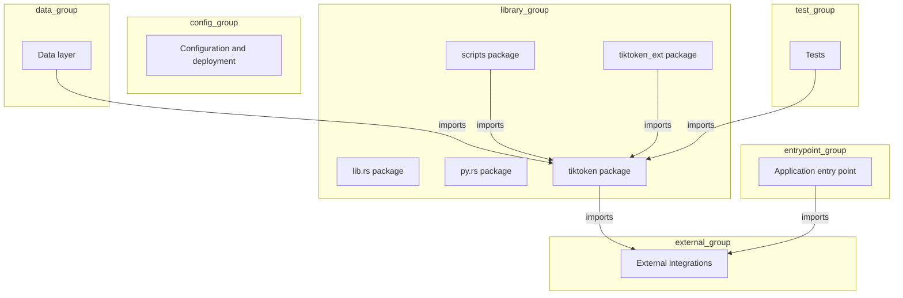

# Architecture report: openai/tiktoken

> Automated static analysis. **Observed** = directly seen in files/imports/AST; **Inferred** = interpretation from that evidence. Repository code was not executed.

## 1. Repository at a glance

| Item | Value |
| --- | --- |
| Repository | openai/tiktoken |
| Description | tiktoken is a fast BPE tokeniser for use with OpenAI's models. |
| Language | Python |
| Stars | 19664 |
| Licence | MIT |
| Analysed commit / branch | 79dc2c0533685b893616c78160b5d9e40876e724 / main |
| Framework(s) | None detected |
| Files analysed | 30 |
| Components | 10 |

## 2. Architecture in one minute

openai/tiktoken - tiktoken is a fast BPE tokeniser for use with OpenAI's models.. This repository was analysed statically from 30 file(s) (18 Python). Detected technologies (observed from imports/manifests): GitHub Actions, NumPy, requests, Poetry, setuptools, pytest. Files are grouped into 10 component(s): Configuration and deployment, Data layer, Application entry point, External integrations, lib.rs package, py.rs package, scripts package, Tests. Observed entry point(s): scripts/redact.py, scripts/wheel_download.py. Findings below distinguish observed facts from inferred interpretation.

## 3. High-level block diagram

## 4. Main components

### Configuration and deployment (`config`)

- **Kind:** config
- **Status:** Observed
- **Confidence:** 0.85
- **Responsibility:** Groups 4 file(s) under configuration and deployment (observed from repository paths and static analysis).
- **Paths:** `Cargo.toml`, `MANIFEST.in`, `pyproject.toml`, `setup.py`
- **Evidence:** [Cargo.toml](https://github.com/openai/tiktoken/blob/79dc2c0533685b893616c78160b5d9e40876e724/Cargo.toml); [MANIFEST.in](https://github.com/openai/tiktoken/blob/79dc2c0533685b893616c78160b5d9e40876e724/MANIFEST.in); [pyproject.toml](https://github.com/openai/tiktoken/blob/79dc2c0533685b893616c78160b5d9e40876e724/pyproject.toml); [setup.py](https://github.com/openai/tiktoken/blob/79dc2c0533685b893616c78160b5d9e40876e724/setup.py)

### Data layer (`data_layer`)

- **Kind:** data
- **Status:** Observed
- **Confidence:** 0.85
- **Responsibility:** Groups 1 file(s) under data layer (observed from repository paths and static analysis). Observed top-level functions: encoding_for_model, encoding_name_for_model.
- **Paths:** `tiktoken/model.py`
- **Evidence:** [tiktoken/model.py:88](https://github.com/openai/tiktoken/blob/79dc2c0533685b893616c78160b5d9e40876e724/tiktoken/model.py#L88)

### Application entry point (`entrypoint`)

- **Kind:** entrypoint
- **Status:** Observed
- **Confidence:** 0.85
- **Responsibility:** Groups 2 file(s) under application entry point (observed from repository paths and static analysis). Observed top-level functions: download_artifacts, main, redact, redact_file.
- **Paths:** `scripts/redact.py`, `scripts/wheel_download.py`
- **Evidence:** [scripts/redact.py:7](https://github.com/openai/tiktoken/blob/79dc2c0533685b893616c78160b5d9e40876e724/scripts/redact.py#L7); [scripts/wheel_download.py:8](https://github.com/openai/tiktoken/blob/79dc2c0533685b893616c78160b5d9e40876e724/scripts/wheel_download.py#L8)

### External integrations (`external_integrations`)

- **Kind:** external
- **Status:** Inferred
- **Confidence:** 0.70
- **Responsibility:** Groups 0 file(s) under external integrations (observed from repository paths and static analysis).
- **Evidence:** [scripts/wheel_download.py:5](https://github.com/openai/tiktoken/blob/79dc2c0533685b893616c78160b5d9e40876e724/scripts/wheel_download.py#L5); [tiktoken/load.py:15](https://github.com/openai/tiktoken/blob/79dc2c0533685b893616c78160b5d9e40876e724/tiktoken/load.py#L15)

### lib.rs package (`lib_rs`)

- **Kind:** library
- **Status:** Observed
- **Confidence:** 0.85
- **Responsibility:** Groups 1 file(s) under lib.rs package (observed from repository paths and static analysis).
- **Paths:** `src/lib.rs`
- **Evidence:** [src/lib.rs](https://github.com/openai/tiktoken/blob/79dc2c0533685b893616c78160b5d9e40876e724/src/lib.rs)

### py.rs package (`py_rs`)

- **Kind:** library
- **Status:** Observed
- **Confidence:** 0.85
- **Responsibility:** Groups 1 file(s) under py.rs package (observed from repository paths and static analysis).
- **Paths:** `src/py.rs`
- **Evidence:** [src/py.rs](https://github.com/openai/tiktoken/blob/79dc2c0533685b893616c78160b5d9e40876e724/src/py.rs)

### scripts package (`scripts`)

- **Kind:** library
- **Status:** Observed
- **Confidence:** 0.85
- **Responsibility:** Groups 1 file(s) under scripts package (observed from repository paths and static analysis). Observed top-level functions: benchmark_batch.
- **Paths:** `scripts/benchmark.py`
- **Evidence:** [scripts/benchmark.py:15](https://github.com/openai/tiktoken/blob/79dc2c0533685b893616c78160b5d9e40876e724/scripts/benchmark.py#L15)

### Tests (`tests`)

- **Kind:** test
- **Status:** Observed
- **Confidence:** 0.85
- **Responsibility:** Groups 7 file(s) under tests (observed from repository paths and static analysis). Observed top-level functions: _common_prefix_len, _token_offsets_reference, test_basic_encode, test_basic_offsets, test_basic_roundtrip, test_batch_encode.
- **Paths:** `tests/__init__.py`, `tests/test_encoding.py`, `tests/test_helpers.py`, `tests/test_misc.py`, `tests/test_offsets.py`, `tests/test_pickle.py`, `tests/test_simple_public.py`
- **Evidence:** [tests/__init__.py](https://github.com/openai/tiktoken/blob/79dc2c0533685b893616c78160b5d9e40876e724/tests/__init__.py); [tests/test_encoding.py:14](https://github.com/openai/tiktoken/blob/79dc2c0533685b893616c78160b5d9e40876e724/tests/test_encoding.py#L14); [tests/test_helpers.py](https://github.com/openai/tiktoken/blob/79dc2c0533685b893616c78160b5d9e40876e724/tests/test_helpers.py); [tests/test_misc.py:7](https://github.com/openai/tiktoken/blob/79dc2c0533685b893616c78160b5d9e40876e724/tests/test_misc.py#L7); [tests/test_offsets.py:12](https://github.com/openai/tiktoken/blob/79dc2c0533685b893616c78160b5d9e40876e724/tests/test_offsets.py#L12); [tests/test_pickle.py:4](https://github.com/openai/tiktoken/blob/79dc2c0533685b893616c78160b5d9e40876e724/tests/test_pickle.py#L4); [tests/test_simple_public.py:7](https://github.com/openai/tiktoken/blob/79dc2c0533685b893616c78160b5d9e40876e724/tests/test_simple_public.py#L7)

### tiktoken package (`tiktoken`)

- **Kind:** library
- **Status:** Observed
- **Confidence:** 0.85
- **Responsibility:** Groups 5 file(s) under tiktoken package (observed from repository paths and static analysis). Observed top-level classes: Encoding, SimpleBytePairEncoding. Observed top-level functions: _available_plugin_modules, _find_constructors, _special_token_regex, bpe_encode, bpe_train, check_hash.
- **Paths:** `tiktoken/__init__.py`, `tiktoken/_educational.py`, `tiktoken/core.py`, `tiktoken/load.py`, `tiktoken/registry.py`
- **Evidence:** [tiktoken/__init__.py](https://github.com/openai/tiktoken/blob/79dc2c0533685b893616c78160b5d9e40876e724/tiktoken/__init__.py); [tiktoken/_educational.py:12](https://github.com/openai/tiktoken/blob/79dc2c0533685b893616c78160b5d9e40876e724/tiktoken/_educational.py#L12); [tiktoken/core.py:16](https://github.com/openai/tiktoken/blob/79dc2c0533685b893616c78160b5d9e40876e724/tiktoken/core.py#L16); [tiktoken/load.py:8](https://github.com/openai/tiktoken/blob/79dc2c0533685b893616c78160b5d9e40876e724/tiktoken/load.py#L8); [tiktoken/registry.py:20](https://github.com/openai/tiktoken/blob/79dc2c0533685b893616c78160b5d9e40876e724/tiktoken/registry.py#L20)

### tiktoken_ext package (`tiktoken_ext`)

- **Kind:** library
- **Status:** Observed
- **Confidence:** 0.85
- **Responsibility:** Groups 1 file(s) under tiktoken_ext package (observed from repository paths and static analysis). Observed top-level functions: cl100k_base, gpt2, o200k_base, o200k_harmony, p50k_base, p50k_edit.
- **Paths:** `tiktoken_ext/openai_public.py`
- **Evidence:** [tiktoken_ext/openai_public.py:17](https://github.com/openai/tiktoken/blob/79dc2c0533685b893616c78160b5d9e40876e724/tiktoken_ext/openai_public.py#L17)

## 5. Execution flow

**Observed** entry point(s):

- [scripts/redact.py:66](https://github.com/openai/tiktoken/blob/79dc2c0533685b893616c78160b5d9e40876e724/scripts/redact.py#L66)
- [scripts/wheel_download.py:44](https://github.com/openai/tiktoken/blob/79dc2c0533685b893616c78160b5d9e40876e724/scripts/wheel_download.py#L44)

Representative flow (derived from observed entry points and the import graph; steps beyond the entry point are **Inferred**):

1. Execution starts at an observed entry point listed above, if present.
2. `data_layer` imports `tiktoken` (Data layer -> tiktoken package).
3. `entrypoint` imports `external_integrations` (Application entry point -> External integrations).
4. `scripts` imports `tiktoken` (scripts package -> tiktoken package).
5. `tests` imports `tiktoken` (Tests -> tiktoken package).
6. `tiktoken` imports `external_integrations` (tiktoken package -> External integrations).
7. `tiktoken_ext` imports `tiktoken` (tiktoken_ext package -> tiktoken package).

## 6. Project structure

### `(root)`

- `.gitignore` - other (403 bytes)
- `CHANGELOG.md` - docs (3987 bytes)
- `Cargo.toml` - manifest (412 bytes)
- `LICENSE` - docs (1078 bytes)
- `MANIFEST.in` - manifest (170 bytes)
- `README.md` - docs (4807 bytes)
- `perf.svg` - other (15845 bytes)
- `pyproject.toml` - manifest (1257 bytes)
- `setup.py` - manifest, Python (572 bytes)

### `.github`

- `.github/workflows/build_wheels.yml` - ci, YAML (3190 bytes)

### `scripts`

- `scripts/benchmark.py` - source, Python (1000 bytes)
- `scripts/redact.py` - source, Python (1746 bytes)
- `scripts/wheel_download.py` - source, Python (2040 bytes)

### `src`

- `src/lib.rs` - source, Rust (26068 bytes)
- `src/py.rs` - source, Rust (9203 bytes)

### `tests`

- `tests/__init__.py` - test, Python (0 bytes)
- `tests/test_encoding.py` - test, Python (8754 bytes)
- `tests/test_helpers.py` - test, Python (477 bytes)
- `tests/test_misc.py` - test, Python (886 bytes)
- `tests/test_offsets.py` - test, Python (2645 bytes)
- `tests/test_pickle.py` - test, Python (715 bytes)
- `tests/test_simple_public.py` - test, Python (1439 bytes)

### `tiktoken`

- `tiktoken/__init__.py` - source, Python (346 bytes)
- `tiktoken/_educational.py` - source, Python (8229 bytes)
- `tiktoken/core.py` - source, Python (17601 bytes)
- `tiktoken/load.py` - source, Python (5887 bytes)
- `tiktoken/model.py` - source, Python (3909 bytes)
- `tiktoken/py.typed` - other (0 bytes)
- `tiktoken/registry.py` - source, Python (3256 bytes)

### `tiktoken_ext`

- `tiktoken_ext/openai_public.py` - source, Python (5613 bytes)

## 7. Key dependencies and integrations

| Name | Category | Status | Confidence | Evidence |
| --- | --- | --- | --- | --- |
| GitHub Actions | ci | Observed | 0.85 | [.github/workflows/build_wheels.yml](https://github.com/openai/tiktoken/blob/79dc2c0533685b893616c78160b5d9e40876e724/.github/workflows/build_wheels.yml) |
| NumPy | library | Observed | 0.95 | [tiktoken/core.py:12](https://github.com/openai/tiktoken/blob/79dc2c0533685b893616c78160b5d9e40876e724/tiktoken/core.py#L12); [tiktoken/core.py:13](https://github.com/openai/tiktoken/blob/79dc2c0533685b893616c78160b5d9e40876e724/tiktoken/core.py#L13); [tiktoken/core.py:159](https://github.com/openai/tiktoken/blob/79dc2c0533685b893616c78160b5d9e40876e724/tiktoken/core.py#L159) |
| requests | library | Observed | 0.95 | [pyproject.toml:9](https://github.com/openai/tiktoken/blob/79dc2c0533685b893616c78160b5d9e40876e724/pyproject.toml#L9); [scripts/wheel_download.py:5](https://github.com/openai/tiktoken/blob/79dc2c0533685b893616c78160b5d9e40876e724/scripts/wheel_download.py#L5); [tiktoken/load.py:15](https://github.com/openai/tiktoken/blob/79dc2c0533685b893616c78160b5d9e40876e724/tiktoken/load.py#L15) |
| Poetry | packaging | Observed | 0.85 | [pyproject.toml](https://github.com/openai/tiktoken/blob/79dc2c0533685b893616c78160b5d9e40876e724/pyproject.toml) |
| setuptools | packaging | Observed | 0.90 | [pyproject.toml:19](https://github.com/openai/tiktoken/blob/79dc2c0533685b893616c78160b5d9e40876e724/pyproject.toml#L19); [setup.py:1](https://github.com/openai/tiktoken/blob/79dc2c0533685b893616c78160b5d9e40876e724/setup.py#L1) |
| pytest | tooling | Observed | 0.95 | [tests/test_encoding.py:7](https://github.com/openai/tiktoken/blob/79dc2c0533685b893616c78160b5d9e40876e724/tests/test_encoding.py#L7); [tests/test_helpers.py:5](https://github.com/openai/tiktoken/blob/79dc2c0533685b893616c78160b5d9e40876e724/tests/test_helpers.py#L5); [tests/test_offsets.py:4](https://github.com/openai/tiktoken/blob/79dc2c0533685b893616c78160b5d9e40876e724/tests/test_offsets.py#L4) |

## 8. Data and state

- Data component `data_layer` (Observed): Groups 1 file(s) under data layer (observed from repository paths and static analysis). Observed top-level functions: encoding_for_model, encoding_name_for_model.

## 9. Configuration and deployment clues

- `.github/workflows/build_wheels.yml` (ci)
- `Cargo.toml` (manifest)
- `MANIFEST.in` (manifest)
- `pyproject.toml` (manifest)
- `setup.py` (manifest)

## 10. Design observations

- An entry/API layer is separated from other code (Inferred from paths and decorators).
- Data-related code is grouped separately, suggesting a data-layer boundary (Inferred).
- Tests are present alongside source code (Observed from test file paths).
- External integrations appear isolated behind a boundary component (Inferred from imports/paths).

These observations are interpretations (**Inferred**) of the observed structure, not guarantees about runtime design.

## 11. Limitations and unknowns

- Static analysis only: repository code was not executed, installed, or imported at runtime.
- Components and relationships are inferred from file paths, imports, and AST structure; runtime behaviour, dynamic imports, and reflection may not be visible.
- Repository text was treated as untrusted data; no instructions found in repository files were followed, and likely secret values were redacted/excluded.

## 12. Source references

- [.github/workflows/build_wheels.yml](https://github.com/openai/tiktoken/blob/79dc2c0533685b893616c78160b5d9e40876e724/.github/workflows/build_wheels.yml)
- [Cargo.toml](https://github.com/openai/tiktoken/blob/79dc2c0533685b893616c78160b5d9e40876e724/Cargo.toml)
- [MANIFEST.in](https://github.com/openai/tiktoken/blob/79dc2c0533685b893616c78160b5d9e40876e724/MANIFEST.in)
- [pyproject.toml](https://github.com/openai/tiktoken/blob/79dc2c0533685b893616c78160b5d9e40876e724/pyproject.toml)
- [pyproject.toml:9](https://github.com/openai/tiktoken/blob/79dc2c0533685b893616c78160b5d9e40876e724/pyproject.toml#L9)
- [pyproject.toml:19](https://github.com/openai/tiktoken/blob/79dc2c0533685b893616c78160b5d9e40876e724/pyproject.toml#L19)
- [scripts/benchmark.py:15](https://github.com/openai/tiktoken/blob/79dc2c0533685b893616c78160b5d9e40876e724/scripts/benchmark.py#L15)
- [scripts/redact.py:7](https://github.com/openai/tiktoken/blob/79dc2c0533685b893616c78160b5d9e40876e724/scripts/redact.py#L7)
- [scripts/redact.py:66](https://github.com/openai/tiktoken/blob/79dc2c0533685b893616c78160b5d9e40876e724/scripts/redact.py#L66)
- [scripts/wheel_download.py:5](https://github.com/openai/tiktoken/blob/79dc2c0533685b893616c78160b5d9e40876e724/scripts/wheel_download.py#L5)
- [scripts/wheel_download.py:8](https://github.com/openai/tiktoken/blob/79dc2c0533685b893616c78160b5d9e40876e724/scripts/wheel_download.py#L8)
- [scripts/wheel_download.py:44](https://github.com/openai/tiktoken/blob/79dc2c0533685b893616c78160b5d9e40876e724/scripts/wheel_download.py#L44)
- [setup.py](https://github.com/openai/tiktoken/blob/79dc2c0533685b893616c78160b5d9e40876e724/setup.py)
- [setup.py:1](https://github.com/openai/tiktoken/blob/79dc2c0533685b893616c78160b5d9e40876e724/setup.py#L1)
- [src/lib.rs](https://github.com/openai/tiktoken/blob/79dc2c0533685b893616c78160b5d9e40876e724/src/lib.rs)
- [src/py.rs](https://github.com/openai/tiktoken/blob/79dc2c0533685b893616c78160b5d9e40876e724/src/py.rs)
- [tests/__init__.py](https://github.com/openai/tiktoken/blob/79dc2c0533685b893616c78160b5d9e40876e724/tests/__init__.py)
- [tests/test_encoding.py:7](https://github.com/openai/tiktoken/blob/79dc2c0533685b893616c78160b5d9e40876e724/tests/test_encoding.py#L7)
- [tests/test_encoding.py:14](https://github.com/openai/tiktoken/blob/79dc2c0533685b893616c78160b5d9e40876e724/tests/test_encoding.py#L14)
- [tests/test_helpers.py](https://github.com/openai/tiktoken/blob/79dc2c0533685b893616c78160b5d9e40876e724/tests/test_helpers.py)
- [tests/test_helpers.py:5](https://github.com/openai/tiktoken/blob/79dc2c0533685b893616c78160b5d9e40876e724/tests/test_helpers.py#L5)
- [tests/test_misc.py:7](https://github.com/openai/tiktoken/blob/79dc2c0533685b893616c78160b5d9e40876e724/tests/test_misc.py#L7)
- [tests/test_offsets.py:4](https://github.com/openai/tiktoken/blob/79dc2c0533685b893616c78160b5d9e40876e724/tests/test_offsets.py#L4)
- [tests/test_offsets.py:12](https://github.com/openai/tiktoken/blob/79dc2c0533685b893616c78160b5d9e40876e724/tests/test_offsets.py#L12)
- [tests/test_pickle.py:4](https://github.com/openai/tiktoken/blob/79dc2c0533685b893616c78160b5d9e40876e724/tests/test_pickle.py#L4)
- [tests/test_simple_public.py:7](https://github.com/openai/tiktoken/blob/79dc2c0533685b893616c78160b5d9e40876e724/tests/test_simple_public.py#L7)
- [tiktoken/__init__.py](https://github.com/openai/tiktoken/blob/79dc2c0533685b893616c78160b5d9e40876e724/tiktoken/__init__.py)
- [tiktoken/_educational.py:12](https://github.com/openai/tiktoken/blob/79dc2c0533685b893616c78160b5d9e40876e724/tiktoken/_educational.py#L12)
- [tiktoken/core.py:12](https://github.com/openai/tiktoken/blob/79dc2c0533685b893616c78160b5d9e40876e724/tiktoken/core.py#L12)
- [tiktoken/core.py:13](https://github.com/openai/tiktoken/blob/79dc2c0533685b893616c78160b5d9e40876e724/tiktoken/core.py#L13)
- [tiktoken/core.py:16](https://github.com/openai/tiktoken/blob/79dc2c0533685b893616c78160b5d9e40876e724/tiktoken/core.py#L16)
- [tiktoken/core.py:159](https://github.com/openai/tiktoken/blob/79dc2c0533685b893616c78160b5d9e40876e724/tiktoken/core.py#L159)
- [tiktoken/load.py:8](https://github.com/openai/tiktoken/blob/79dc2c0533685b893616c78160b5d9e40876e724/tiktoken/load.py#L8)
- [tiktoken/load.py:15](https://github.com/openai/tiktoken/blob/79dc2c0533685b893616c78160b5d9e40876e724/tiktoken/load.py#L15)
- [tiktoken/model.py:88](https://github.com/openai/tiktoken/blob/79dc2c0533685b893616c78160b5d9e40876e724/tiktoken/model.py#L88)
- [tiktoken/registry.py:20](https://github.com/openai/tiktoken/blob/79dc2c0533685b893616c78160b5d9e40876e724/tiktoken/registry.py#L20)
- [tiktoken_ext/openai_public.py:17](https://github.com/openai/tiktoken/blob/79dc2c0533685b893616c78160b5d9e40876e724/tiktoken_ext/openai_public.py#L17)
